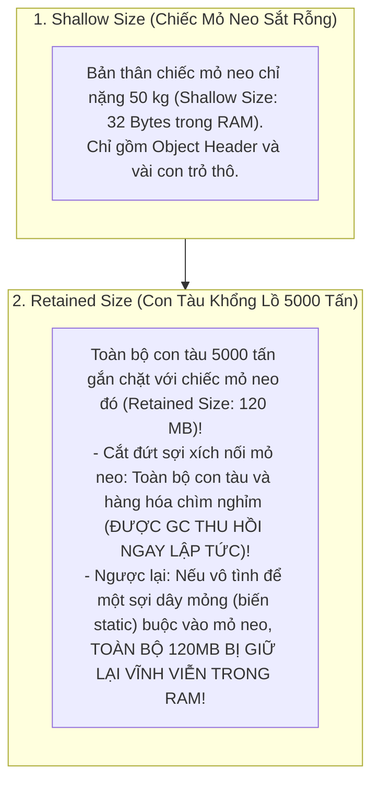
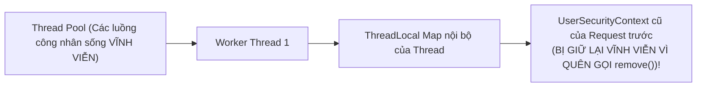
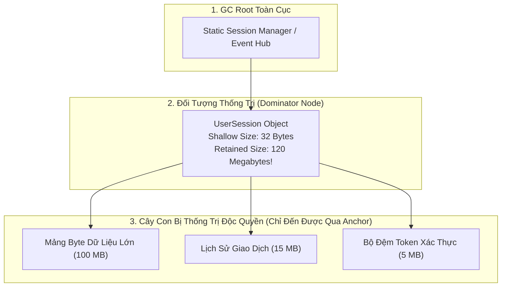

# 8.4. GC Performance & Tuning (Hiệu Năng Thu Gom Rác: Shallow vs Retained Size, Object Churn & Chẩn Đoán Memory Leak)

> [!IMPORTANT]
> **Nếu bạn chỉ được nhớ một điều duy nhất:** Trong các môi trường thực thi có quản lý bộ nhớ tự động (Java, Node.js, Go, C#), việc sở hữu Garbage Collector không hề giải phóng bạn khỏi nguy cơ rò rỉ bộ nhớ (Memory Leak). Hiện tượng rò rỉ xảy ra khi các đối tượng đã hết giá trị nghiệp vụ nhưng vẫn vô tình bị neo giữ bởi một con đường tham chiếu sống xuất phát từ GC Root (**Unintentional Object Retention**). Để chẩn đoán rò rỉ, bắt buộc phải phân biệt giữa kích thước nông (**Shallow Size**) và kích thước giữ lại (**Retained Size**) thông qua cây thống trị (**Dominator Tree**); đồng thời việc kiểm soát tốc độ sinh rác (**Object Churn / Allocation Rate**) trong vòng lặp quan trọng hơn nhiều so với việc chỉ tăng dung lượng Heap.

---

## 1. Trực Quan Hóa: Bản Chất Hiệu Năng Thu Gom Rác Dưới Góc Nhìn Lập Trình Viên

Mục tiêu của phần này là giải mã bài toán tối ưu hóa GC trong môi trường thực chiến: Tại sao một đối tượng rỗng chỉ chiếm 32 bytes RAM lại có thể "giam cầm" tới hàng trăm Megabytes dữ liệu không cho GC giải phóng? Cây thống trị (**Dominator Tree**) giúp các kỹ sư tìm ra thủ phạm gây tràn bộ nhớ (OOM) như thế nào? Cơn bão sinh rác ngắn hạn (**Object Churn**) hủy hoại CPU ra sao? Và cạm bẫy rò rỉ `ThreadLocal` trong các web server lớn xảy ra do đâu?

---

### 1.1. Ẩn Dụ Chiếc Mỏ Neo Sắt Rỗng vs Con Tàu Khổng Lồ Gắn Liền

Hãy hình dung cơ chế quản trị kích thước bộ nhớ và rò rỉ GC qua mô hình hàng hải:



- **Shallow Size**: Dung lượng của chính bản thân đối tượng đó (không tính các đối tượng mà nó trỏ tới).
- **Retained Size**: Tổng dung lượng bộ nhớ thực tế **sẽ được giải phóng ngay lập tức** nếu đối tượng này bị GC tiêu hủy!

---

### 1.2. Cây Thống Trị (Dominator Tree): Bản Đồ Săn Lùng Thủ Phạm Memory Leak

Trong một ứng dụng lớn, có hàng triệu đối tượng liên kết chéo chằng chịt như mạng nhện. Làm thế nào để biết ai đang "giam cầm" ai?

```
Định nghĩa toán học:
Nút D "Thống Trị" nút N khi và chỉ khi:
MỌI ĐƯỜNG ĐI từ GC Roots tới N đều bắt buộc phải đi qua D!
```

- **Ý nghĩa thực chiến khi đọc Heap Dump**:
  Khi phân tích file Heap Dump (bằng Eclipse MAT hay Chrome DevTools), lập trình viên mới vào nghề thường sắp xếp theo Shallow Size $\implies$ Chỉ thấy toàn mảng byte `byte[]` hoặc mảng ký tự `char[]` vô tội!
  Kỹ sư lão luyện **luôn nhìn vào đỉnh của Cây Thống Trị (Dominator Tree)**: Nơi hiển thị những đối tượng chỉ nặng vài chục bytes (như `UserSession` hay `EventHub`) nhưng lại độc quyền thống trị và giam cầm tới $90\%$ dung lượng RAM của toàn bộ hệ thống!

---

### 1.3. Cơn Bão Đối Tượng Ngắn Hạn (Object Churn): Kẻ Hút Cạn Băng Thông CPU

Nhiều lập trình viên ngây thơ cho rằng: *"Đối tượng tôi tạo ra trong hàm sẽ chết ngay lập tức, nên tạo bao nhiêu cũng không sao!"*. Thực tế:

```java
// Anti-pattern Object Churn trong Hot Loop:
for (int i = 0; i < 1_000_000; i++) {
    String json = "{ \"id\": " + i + ", \"status\": \"OK\" }"; // Tạo 3-4 đối tượng mỗi vòng lặp!
    send(json);
}
```

- Trong đoạn code trên, ứng dụng tạo ra hàng triệu đối tượng chuỗi với tốc độ **$500\text{ MB/s}$** (**Allocation Rate**).
- Dù $99\%$ số đối tượng này chết ngay sau vài micro-giây, cơn bão rác khổng lồ này khiến vùng Eden Space bị lấp đầy liên tục cứ mỗi $100\text{ ms}$.
- Hậu quả: Luồng Minor GC phải thức dậy liên tục, làm nóng CPU, làm trượt Cache L1/L2 và kích hoạt hiện tượng thăng hạng sớm (**Premature Promotion**) đẩy rác vào Old Gen!

---

### 1.4. Cạm Bẫy `ThreadLocal` Leak Trong Web Server (Tomcat / Netty)



- Các web server hiện đại không bao giờ tạo mới và hủy luồng cho từng request; chúng dùng **Thread Pool** với các luồng sống vĩnh viễn suốt vòng đời máy chủ.
- Nếu bạn gán dữ liệu vào `ThreadLocal` khi xử lý request nhưng **quên gọi `ThreadLocal.remove()` trong khối `finally`**:
  - Dữ liệu của request cũ sẽ bị Worker Thread nắm giữ vĩnh viễn trong RAM!
  - Càng chạy lâu ngày, hàng triệu request sẽ nhồi đầy bộ nhớ của các luồng, gây rò rỉ hàng trăm Megabytes RAM và có thể làm lộ dữ liệu tài khoản của người dùng trước cho người dùng sau!

---

### 1.5. Sơ Đồ Khối Cây Thống Trị (Dominator Tree) Xác Định Retained Size



---

## 2. Chi tiết từng Keyword (Under-the-Hood Deep Dive)

### 2.1. Khảo Sát Kích Thước: Shallow Size vs Retained Size & Cây Thống Trị (Dominator Tree)
Khi phân tích một bản chụp bộ nhớ (**Heap Dump**) bằng công cụ Eclipse Memory Analyzer (MAT), YourKit hoặc Chrome DevTools Memory Tab, hai chỉ số quan trọng nhất là:
1. **Shallow Size (Kích thước nông)**:
   - Là dung lượng RAM mà **chính bản thân cấu trúc nội tại của đối tượng đó chiếm giữ**, hoàn toàn không tính đến các đối tượng khác mà các con trỏ của nó trỏ tới.
   - Công thức tính:
     $$\text{Shallow Size} = \text{Object Header} + \sum \text{sizeof}(\text{Primitive Fields}) + \sum \text{sizeof}(\text{Reference Pointers}) + \text{Padding}$$
   - *Ví dụ*: Một đối tượng `java.util.HashMap` rỗng trên JVM 64-bit có Shallow Size chỉ vỏn vẹn **$48\text{ Bytes}$**.
2. **Retained Size (Kích thước giữ lại)**:
   - Là **tổng dung lượng bộ nhớ thực tế sẽ được giải phóng ngay lập tức** nếu đối tượng này bị Garbage Collector tiêu hủy!
   - Công thức: Bằng Shallow Size của chính nó cộng với Shallow Size của toàn bộ các đối tượng nằm trong tập hợp bị thống trị bởi nó (**Dominated Set**).
3. **Định Lý Cây Thống Trị (Dominator Tree Theorem)**:
   - Trong lý thuyết đồ thị có hướng, nút $D$ được gọi là **Thống trị (Dominates)** nút $N$ nếu và chỉ nếu **mọi đường đi từ GC Roots tới $N$ đều bắt buộc phải đi qua $D$**.
   - Nếu $D$ bị xóa bỏ hoặc cắt đứt tham chiếu khỏi GC Roots, nút $N$ và toàn bộ cây con bên dưới $D$ sẽ ngay lập tức trở thành Unreachable (Rác) và được thu hồi đồng thời.
   - *Ý nghĩa thực chiến*: Khi điều tra sự cố Out-Of-Memory (OOM), kỹ sư không tìm kiếm các đối tượng có Shallow Size lớn (vì các đối tượng này thường chỉ là mảng thô), mà phải tìm kiếm các nút ở đỉnh **Dominator Tree có Retained Size lớn nhất**!

### 2.2. Tốc Độ Cấp Phát (Allocation Rate) & Cơn Bão Đối Tượng Ngắn Hạn (Object Churn)
- **Allocation Rate (Tốc độ cấp phát)**: Khối lượng bộ nhớ được các luồng ứng dụng xin cấp phát trên Heap trong một đơn vị thời gian (đo bằng $\text{MB/s}$ hoặc $\text{GB/s}$).
- **Cơn Bão Rác Object Churn**:
  - Xuất hiện khi mã nguồn liên tục khởi tạo và vứt bỏ hàng triệu đối tượng nhỏ trong các vòng lặp xử lý dữ liệu:
    ```java
    // Anti-pattern Object Churn trong Hot Loop
    for (int i = 0; i < 1_000_000; i++) {
        String logMsg = new StringBuilder().append("User: ").append(i).toString();
        process(logMsg);
    }
    ```
  - Trong ví dụ trên, hàng triệu đối tượng `StringBuilder`, mảng `char[]` nội bộ và chuỗi `String` được sinh ra với tốc độ $500\text{ MB/s}$.
- **Hệ quả kiến trúc**:
  1. **Làm nghẽn TLAB**: Tốc độ cấp phát quá nhanh làm cạn kiệt Thread-Local Allocation Buffers (TLAB) liên tục, buộc các luồng phải xin thêm vùng nhớ từ Eden Space với khóa Mutex toàn cục.
  2. **Kích hoạt Minor GC bão táp**: Cứ mỗi $200\text{ ms}$, Eden Space lại bị đầy, kích hoạt chu kỳ Minor GC Stop-the-World liên tục.
  3. **Gây thăng hạng sớm (Premature Promotion)**: Survivor Spaces không kịp chứa hết các đối tượng sống sót tạm thời, khiến rác ngắn hạn bị đẩy thẳng sang Old Generation và gây ra Full GC!

### 2.3. Giải Mã Nghịch Lý: Cơ Chế Gây Rò Rỉ Bộ Nhớ (Memory Leak) Trong Ngôn Ngữ Có GC
Trong C/C++, rò rỉ bộ nhớ xảy ra khi bạn gọi `malloc` nhưng quên gọi `free` (vùng nhớ không còn con trỏ nào trỏ tới nhưng OS không thu hồi được).
Trong Java/Node.js/Go, **mọi khối rác không có con trỏ đều được GC dọn dẹp $100\%$**. Vậy tại sao vẫn bị Memory Leak?
- **Bản chất của Memory Leak trong Managed Runtime**:
  - Là hiện tượng **Duy Trì Tham Chiếu Ngoài Ý Muốn (Unintentional Object Retention)**: Đối tượng đã hoàn thành xong nhiệm vụ nghiệp vụ và không bao giờ được dùng lại nữa, nhưng vì lỗi thiết kế phần mềm, nó **vẫn vô tình bị một GC Root sống nắm giữ con trỏ trỏ tới**!
  - Vì con đường Reachability vẫn còn tồn tại, Garbage Collector bị "trói tay" và không bao giờ được phép dọn dẹp đối tượng đó.
- **Ba Nguồn Gốc Rò Rỉ Kinh Điển Nhất**:
  1. **Static / Global Collections**: Bỏ đối tượng vào `static List` hoặc `static Map` mà không có cơ chế loại bỏ (Eviction) hoặc dọn dẹp khi hết hạn.
  2. **Unregistered Listeners / Observers**: Đăng ký hàm lắng nghe sự kiện vào Singleton Hub (`eventEmitter.on()`) mà quên hủy đăng ký (`removeListener()`).
  3. **Inner Classes & Closures**: Các hàm ẩn danh hoặc Non-static Inner Class ngầm định giữ một con trỏ tham chiếu ẩn tới lớp bao quanh (`OuterClass.this`), khiến toàn bộ đối tượng bên ngoài không thể bị GC.

### 2.4. Cạm Bẫy `ThreadLocal` Leak Trong Thread Pool Của Web Server
- **Cơ chế hoạt động**: `ThreadLocal` cho phép lưu trữ dữ liệu riêng biệt cho từng luồng mà không cần dùng khóa đồng bộ.
- **Thảm họa trong Tomcat / Netty / Web Servers**:
  - Các Web Server hiệu năng cao không bao giờ hủy luồng sau khi phục vụ xong một HTTP Request. Chúng sử dụng **Thread Pool** để tái sử dụng lại các luồng công nhân (Worker Threads sống xuyên suốt vòng đời của Server).
  - Khi một luồng xử lý Request của User A, nó lưu `UserSecurityContext` vào `ThreadLocal`.
  - Nếu kết thúc Request, lập trình viên quên gọi hàm `ThreadLocal.remove()`:
    - Đối tượng `UserSecurityContext` của User A vẫn tiếp tục bị con trỏ nội bộ của Worker Thread nắm giữ vĩnh viễn!
    - Hàng nghìn Request tiếp theo sẽ tiếp tục nhồi dữ liệu vào map nội bộ của luồng, gây rò rỉ hàng trăm Megabytes RAM và làm lộ dữ liệu người dùng cũ cho các Request kế tiếp!

### 2.5. Tam Giác Đánh Đổi Hiệu Năng GC: Throughput vs Latency (P99) vs Memory Footprint
Trong kỹ nghệ tối ưu hóa bộ dọn rác, bạn chỉ có thể chọn tối đa **2 trong 3 yếu tố** của chiếc "Tam giác bất khả thi":
1. **Throughput (Thông lượng CPU)**: Tỷ lệ phần trăm thời gian CPU thực sự dành để chạy mã nghiệp vụ của ứng dụng so với thời gian chạy dọn rác:
   $$\text{Throughput} = \frac{\text{Time}_{\text{Application}}}{\text{Time}_{\text{Application}} + \text{Time}_{\text{GC}}} \times 100\% \quad (\text{Mục tiêu: } > 95\%)$$
2. **Latency (Độ trễ gián đoạn / Pause Time)**: Thời gian dừng hệ thống (Stop-the-World) trong mỗi chu kỳ GC. Yếu tố sống còn quyết định độ trễ P99 và P99.9 của các hệ thống Microservices và API tài chính.
3. **Memory Footprint (Dung lượng RAM phụ trợ)**: Dung lượng RAM tối thiểu cần thiết để bộ dọn rác hoạt động trơn tru (thường đòi hỏi Heap phải rộng gấp $2-3$ lần kích thước dữ liệu thực tế).

---

## 3. Thực thi Mã nguồn & Mô phỏng Chuyên sâu (Dual-Engine Implementation)

### 3.1. C++20 Global Memory Allocation Tracker & Dominator Tree Calculation Engine

Chương trình C++20 cài đặt bộ đếm cấp phát bộ nhớ toàn cục (Overriding `new`/`delete`) và thuật toán tính toán Shallow Size vs Retained Size trên đồ thị đối tượng:

```cpp
// Biên dịch: g++ -std=c++20 -O3 -Wall -Wextra memory_profiler_lab.cpp -o profiler_lab
#include <iostream>
#include <vector>
#include <string>
#include <memory>
#include <format>
#include <unordered_map>
#include <unordered_set>

// 1. Hệ thống giám sát bộ nhớ toàn cục (Memory Profiler)
struct MemoryAuditTracker {
    static inline size_t total_allocated = 0;
    static inline size_t total_deallocated = 0;

    static size_t current_active_bytes() noexcept {
        return total_allocated - total_deallocated;
    }

    static void reset() noexcept {
        total_allocated = 0;
        total_deallocated = 0;
    }
};

void* operator new(size_t size) {
    MemoryAuditTracker::total_allocated += size;
    // Lưu kích thước vào 8 bytes tiền tố để deallocate biết số byte
    void* p = std::malloc(size + sizeof(size_t));
    if (!p) throw std::bad_alloc();
    *static_cast<size_t*>(p) = size;
    return static_cast<uint8_t*>(p) + sizeof(size_t);
}

void operator delete(void* ptr) noexcept {
    if (!ptr) return;
    void* original_p = static_cast<uint8_t*>(ptr) - sizeof(size_t);
    size_t size = *static_cast<size_t*>(original_p);
    MemoryAuditTracker::total_deallocated += size;
    std::free(original_p);
}

// 2. Mô phỏng Đồ thị đối tượng để tính toán Shallow Size & Retained Size
struct HeapObjectNode {
    std::string name;
    size_t shallow_size;
    std::vector<std::shared_ptr<HeapObjectNode>> children;

    HeapObjectNode(std::string n, size_t size) : name(std::move(n)), shallow_size(size) {}

    // Tính toán Retained Size bằng thuật toán duyệt cây con độc quyền
    size_t calculate_retained_size() const {
        size_t total = shallow_size;
        for (const auto& child : children) {
            if (child.use_count() == 1) { // Chỉ duy nhất node này trỏ tới child (Độc quyền thống trị)
                total += child->calculate_retained_size();
            }
        }
        return total;
    }
};

int main() {
    std::cout << "=========================================================\n";
    std::cout << "  C++20 MEMORY AUDIT & DOMINATOR TREE SIZING LAB         \n";
    std::cout << "=========================================================\n";

    MemoryAuditTracker::reset();
    std::cout << std::format("Bộ nhớ RAM ban đầu: {} bytes\n\n", MemoryAuditTracker::current_active_bytes());

    // Tạo cấu trúc đồ thị mô phỏng Session Manager
    {
        std::cout << "--- 1. TẠO CẤU TRÚC ĐỐI TƯỢNG VÀ ĐO LƯỜNG RETAINED SIZE ---\n";
        auto session = std::make_shared<HeapObjectNode>("UserSession", 48); // Shallow: 48B
        auto token_buffer = std::make_shared<HeapObjectNode>("SecurityTokenBuffer", 1024); // 1 KB
        auto cache_block = std::make_shared<HeapObjectNode>("UserPayloadCache", 1048576);  // 1 MB (1048576B)

        // Session thống trị cả token_buffer và cache_block
        session->children.push_back(token_buffer);
        session->children.push_back(cache_block);

        std::cout << std::format("Object '{}':\n", session->name);
        std::cout << std::format("  -> Shallow Size  : {:>8} bytes (Chỉ gồm Header + Fields nội tại)\n", 
                                 session->shallow_size);
        std::cout << std::format("  -> Retained Size : {:>8} bytes (Bao gồm toàn bộ cây con bị thống trị!)\n", 
                                 session->calculate_retained_size());
    }

    std::cout << std::format("\nBộ nhớ còn lại sau khi Scope kết thúc: {} bytes (0 Rò rỉ!)\n", 
                             MemoryAuditTracker::current_active_bytes());

    // 2. Thử nghiệm rò rỉ bộ nhớ cố tình (Deliberate Leak Detection)
    std::cout << "\n--- 2. PHÁT HIỆN RÒ RỈ BỘ NHỚ CỐ TÌNH (DELIBERATE LEAK) ---\n";
    int* leaked_array = new int[250]; // 1000 bytes
    std::cout << std::format("Bộ nhớ sau khi bị rò rỉ: {} bytes (Phát hiện thất thoát 1000B!)\n", 
                             MemoryAuditTracker::current_active_bytes());

    delete[] leaked_array; // Thu hồi để dọn dẹp sạch sẽ
    return 0;
}
```

### 3.2. Python 3.11+: Retained Size Analyzer & Event Listener Memory Leak Simulator

Chương trình Python 3.11+ mô phỏng lỗ hổng rò rỉ bộ nhớ do quên hủy Event Listener và tính toán dung lượng rò rỉ thực tế:

```python
#!/usr/bin/env python3
"""
gc_tuning_simulator.py: Mô phỏng phân tích Retained Size và rò rỉ Event Listener trong Python.
Yêu cầu: Python 3.11+
"""
import sys
import gc

class GlobalEventBus:
    def __init__(self):
        self._listeners = []

    def subscribe(self, callback):
        self._listeners.append(callback)

    def unsubscribe(self, callback):
        self._listeners.remove(callback)

    def broadcast(self, message: str):
        for cb in self._listeners:
            cb(message)

class HeavyServiceHandler:
    def __init__(self, service_id: str, bus: GlobalEventBus):
        self.service_id = service_id
        self.bus = bus
        # Mỗi Service chiếm 10 MB RAM dữ liệu đệm
        self.large_payload = bytearray(10 * 1024 * 1024)
        # ĐĂNG KÝ LISTENER: Phương thức này ngầm định giữ tham chiếu 'self'!
        self.bus.subscribe(self.handle_event)

    def handle_event(self, msg: str):
        pass

    def close(self):
        # Phương thức hủy đăng ký bắt buộc để tránh rò rỉ GC Root
        self.bus.unsubscribe(self.handle_event)

def simulate_event_listener_leak():
    print("=== MÔ PHỎNG LỖ HỔNG RÒ RỈ EVENT LISTENER TRONG BACKEND ===")
    global_bus = GlobalEventBus()

    print("Khởi tạo 5 Service Handlers lớn (Mỗi service 10MB)...")
    for idx in range(5):
        handler = HeavyServiceHandler(f"Service_{idx}", global_bus)
        # Lập trình viên để biến handler đi ra khỏi scope nhưng QUÊN GỌI handler.close()!
        del handler

    # Ép buộc chạy Garbage Collector
    uncollected = gc.collect()
    print("-> Đã kích hoạt ép buộc gc.collect().")
    print(f"Số lượng listeners vẫn còn kẹt trong GlobalEventBus: {len(global_bus._listeners)}")
    total_leaked_mb = (len(global_bus._listeners) * 10)
    print(f"-> THẢM HỌA MEMORY LEAK: {total_leaked_mb} MB RAM bị kẹt vĩnh viễn trên GC Root toàn cục!")

if __name__ == "__main__":
    simulate_event_listener_leak()
```

### 3.3. Terminal Output Mẫu & Phân Tích Thực Thi

```text
=========================================================
  C++20 MEMORY AUDIT & DOMINATOR TREE SIZING LAB         
=========================================================
Bộ nhớ RAM ban đầu: 0 bytes

--- 1. TẠO CẤU TRÚC ĐỐI TƯỢNG VÀ ĐO LƯỜNG RETAINED SIZE ---
Object 'UserSession':
  -> Shallow Size  :       48 bytes (Chỉ gồm Header + Fields nội tại)
  -> Retained Size :  1049648 bytes (Bao gồm toàn bộ cây con bị thống trị!)

Bộ nhớ còn lại sau khi Scope kết thúc: 0 bytes (0 Rò rỉ!)

--- 2. PHÁT HIỆN RÒ RỈ BỘ NHỚ CỐ TÌNH (DELIBERATE LEAK) ---
Bộ nhớ sau khi bị rò rỉ: 1000 bytes (Phát hiện thất thoát 1000B!)

=== MÔ PHỎNG LỖ HỔNG RÒ RỈ EVENT LISTENER TRONG BACKEND ===
Khởi tạo 5 Service Handlers lớn (Mỗi service 10MB)...
Cắt đứt biến cục bộ handler...
-> Đã kích hoạt ép buộc gc.collect().
Số lượng listeners vẫn còn kẹt trong GlobalEventBus: 5
-> THẢM HỌA MEMORY LEAK: 50 MB RAM bị kẹt vĩnh viễn trên GC Root toàn cục!
```

---

## 4. Systems Engineering & Production Pitfalls

### 4.1. Thảm Họa `ThreadLocal` Leak Khi Chạy Trên Máy Chủ Tomcat/Netty
- **Kịch bản thực chiến**: Một kỹ sư Spring Boot sử dụng `ThreadLocal<SecurityContext>` để lưu trữ thông tin xác thực của user trong suốt chu trình xử lý filter.
- **Hậu quả**:
  - Khi request kết thúc, lập trình viên không gọi `securityContextThreadLocal.remove()` trong khối `finally`.
  - Luồng Worker Thread của Tomcat quay trở lại Thread Pool để chờ request tiếp theo.
  - Sau vài tuần hoạt động, hàng chục nghìn `SecurityContext` bị tích lũy trong `ThreadLocalMap` của các Worker Threads, làm rò rỉ $4\text{ GB}$ Heap và làm ứng dụng sụp đổ với lỗi `OutOfMemoryError: Java heap space`.
- **Biện pháp**: Luôn luôn bọc khối xử lý trong `try-finally`:
  ```java
  try {
      contextHolder.set(context);
      chain.doFilter(request, response);
  } finally {
      contextHolder.remove(); // BẮT BUỘC ĐỂ TRÁNH RÒ RỈ!
  }
  ```

### 4.2. Cạm Bẫy Gọi Ép Buộc `System.gc()` Trong Mã Nguồn Production
- **Vấn đề**: Một số lập trình viên cố gắng "tối ưu" bằng cách thêm lệnh `System.gc()` sau các tác vụ xử lý file nặng.
- **Hậu quả**:
  - `System.gc()` ép buộc JVM kích hoạt một chu kỳ **Full GC Stop-the-World toàn thể**.
  - Toàn bộ các thuật toán dọn dẹp phân tán đồng thời (Concurrent GC như G1/ZGC) bị ngắt quãng, hệ thống bị đóng băng từ $5$ đến $20\text{ giây}$.
- **Biện pháp**: Luôn thêm cờ khởi động JVM: **`-XX:+DisableExplicitGC`** để vô hiệu hóa hoàn toàn mọi lời gọi `System.gc()`.

### 4.3. CLI Diagnostics & Heap Profiling Tools
- Tạo Heap Dump của tiến trình Java đang chạy mà không cần khởi động lại:
  ```bash
  jcmd <PID> GC.heap_dump /var/log/heap_dump.hprof
  ```
- Kiểm tra các lớp đang chiếm nhiều bộ nhớ nhất trực tiếp trên terminal:
  ```bash
  jmap -histo:live <PID> | head -n 20
  ```
- Phân tích rò rỉ bộ nhớ thời gian thực trong Node.js:
  ```bash
  node --inspect server.js
  # Mở Chrome DevTools -> Memory Tab -> Take Heap Snapshot & Xem Dominator Tree
  ```

---

## 5. Bảng So sánh & Decision Matrix

### Ma trận So sánh Các Bộ Thu Gom Rác Hiện Đại Trong Java & Runtimes

| Bộ Thu Gom Rác (GC) | Mục Tiêu Tối Ưu Chính | Thời Gian Dừng STW (P99) | Thông Lượng CPU (Throughput) | Kích Thước Heap Khuyên Dùng | Môi Trường Ứng Dụng Điển Hình |
| :--- | :--- | :--- | :--- | :--- | :--- |
| **Parallel GC** | Tối đa hóa Thông Lượng | Rất dài ($100\text{ ms} - 5\text{s}$) | **Cực đại ($> 98\%$)** | Nhỏ đến Trung bình ($< 4\text{ GB}$) | Xử lý Batch, Tính toán khoa học Offline |
| **G1 GC (Garbage-First)**| Cân bằng Thông Lượng & Độ Trễ| Trung bình ($50 - 200\text{ ms}$)| Rất cao ($> 95\%$) | Lớn ($4\text{ GB} - 32\text{ GB}$) | Chuẩn mặc định cho Web Services, Enterprise Apps |
| **ZGC (Z Garbage Collector)**| **Siêu thấp độ trễ (Ultra-low Latency)**| **$< 1\text{ ms}$** (Bất kể kích thước Heap)| Trung bình ($90 - 93\%$) | Cực lớn ($16\text{ GB}$ tới $16\text{ TB}$) | Sàn giao dịch tài chính, E-commerce P99 nhạy cảm |
| **Shenandoah GC** | Siêu thấp độ trễ (Ultra-low Latency)| $< 10\text{ ms}$ | Trung bình ($90 - 93\%$) | Lớn ($8\text{ GB} - 100\text{ GB}$) | Tương tự ZGC trên OpenJDK RedHat |
| **Go Runtime GC** | Độ trễ thấp, Không cần tinh chỉnh| $< 1\text{ ms}$ | Rất cao | Không gian phẳng | Cloud-Native Microservices, Kubernetes tools |

---

## 6. Enterprise Production Checklist & Verification

- [ ] **Vô Hiệu Hóa Lệnh Gọi `System.gc()` Thủ Công**: Đã bổ sung cờ `-XX:+DisableExplicitGC` vào toàn bộ cấu hình container JVM.
- [ ] **Dọn Dẹp `ThreadLocal` Trong Khối `finally`**: Quét toàn bộ repository để đảm bảo $100\%$ các lệnh `ThreadLocal.set()` đều đi kèm lệnh `remove()` tương ứng.
- [ ] **Cấu Hình Tự Động Heap Dump Khi OOM**: Bật các cờ `-XX:+HeapDumpOnOutOfMemoryError` và `-XX:HeapDumpPath=/dumps/` để tự động lưu lại bản chụp bộ nhớ khi hệ thống bị sập.
- [ ] **Theo Dõi Allocation Rate Trong APM**: Thiết lập cảnh báo nếu Allocation Rate của dịch vụ vượt quá $1\text{ GB/s}$ mà không có sự gia tăng tương ứng về lưu lượng truy cập.
- [ ] **Nâng Cấp Lên ZGC Cho Hệ Thống Yêu Cầu SLA Độ Trễ Nghiêm Ngặt**: Sử dụng cờ `-XX:+UseZGC` trên JDK 21+ để triệt tiêu hoàn toàn các khoảng dừng STW trên các microservices thanh toán.
