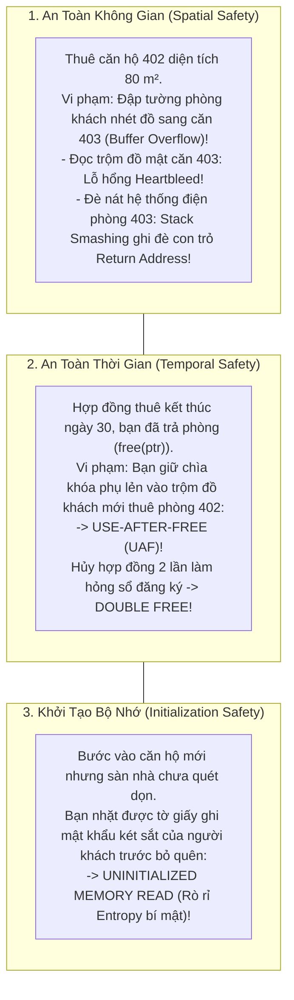
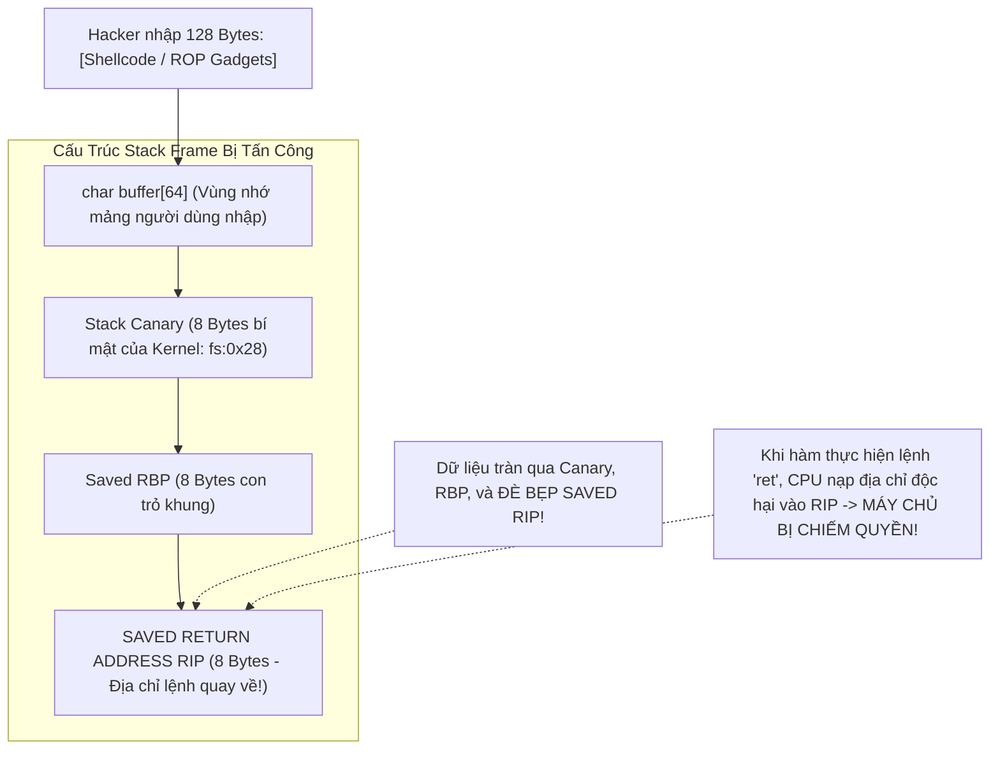
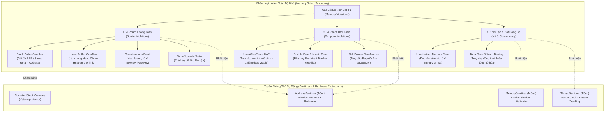
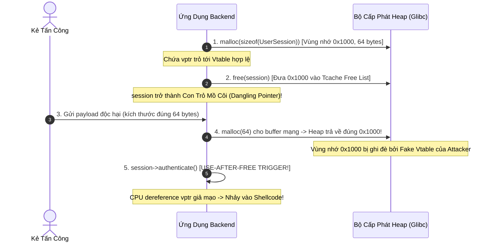
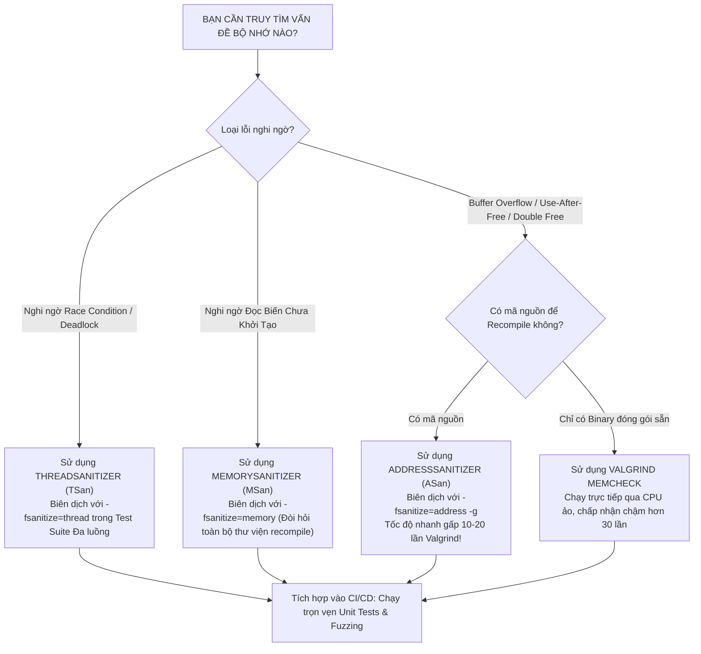

# 9.1. An Toàn Bộ Nhớ & Các Lỗi Bộ Nhớ Kinh Điển (Memory Safety & Common Memory Bugs)

> [!IMPORTANT]
> **Nếu bạn chỉ được nhớ một điều duy nhất:** Trong các hệ thống chạy mã máy trực tiếp (C/C++), vi phạm an toàn bộ nhớ không đơn thuần tạo ra kết quả sai mà kích hoạt **Hành vi Không xác định (Undefined Behavior - UB)** — trạng thái mà trình biên dịch hiện đại được phép suy diễn rằng điều đó không bao giờ xảy ra, từ đó **tự ý xóa bỏ các đoạn mã kiểm tra an toàn, đảo lộn luồng điều khiển hoặc biến một lỗ hổng đọc tràn bộ đệm nhỏ thành thảm họa chiếm quyền thực thi máy chủ**.

---

## 1. Trực Quan Hóa: Bản Chất An Toàn Bộ Nhớ & Các Lỗi Kinh Điển Dưới Góc Nhìn Lập Trình Viên

Mục tiêu của phần này là giải mã thế giới ngầm đằng sau các lỗ hổng phần mềm nguy hiểm nhất: Tại sao một lỗi vi phạm an toàn bộ nhớ (Undefined Behavior) lại cho phép trình biên dịch tự ý xóa bỏ các dòng code kiểm tra `if (ptr == nullptr)` của bạn? Hacker đã thao túng con trỏ `RIP` bằng Stack Smashing để chiếm quyền điều khiển server như thế nào? Và bộ công cụ Sanitizers (ASan, TSan, MSan) hoạt động ra sao để phát hiện lỗi ngay trong quá trình chạy thử nghiệm?

---

### 1.1. Ẩn Dụ Tòa Chung Cư Không Khóa Cửa: Ba Ranh Giới An Toàn Sống Còn

Hãy hình dung không gian địa chỉ bộ nhớ ảo của một tiến trình như một tòa nhà chung cư cao cấp với hàng triệu căn hộ:



---

### 1.2. Thực Tế Tàn Khốc Của Undefined Behavior (UB) & Trình Biên Dịch Tối Ưu

Một trong những bài học gây sốc nhất với mọi lập trình viên C/C++:

```cpp
void process_user_data(int* ptr) {
    int value = *ptr; // Nếu ptr == nullptr -> ĐÂY LÀ UNDEFINED BEHAVIOR!
    
    // Trình biên dịch tối ưu (LLVM/GCC ở cờ -O2 / -O3) suy luận:
    // "Vì dòng trên đã dereference ptr thành công, ptr CHẮC CHẮN PHẢI KHÁC NULL.
    // Do đó câu lệnh if bên dưới là HOÀN TOÀN THỪA THÃI!"
    if (ptr == nullptr) {
        log_security_alert("Hacker tấn công bằng Null pointer!");
        return; // <-- COMPILER TỰ ĐỘNG XÓA SẠCH TOÀN BỘ ĐOẠN IF NÀY!
    }
    execute_admin_command(value);
}
```

> [!WARNING]
> Trong C/C++, **Undefined Behavior không có nghĩa là "chạy sai một chút"**. Trình biên dịch giả định code của bạn không bao giờ có UB, và nó có toàn quyền **xóa sổ mọi khối code kiểm tra bảo mật phía sau**, biến một lỗi nhỏ thành một thảm họa an ninh mạng!

---

### 1.3. Phẫu Thuật Kỹ Thuật Stack Smashing & Stack Canary

Hacker đã ghi đè con trỏ lệnh `RIP` trên Stack Frame như thế nào?



- **Cứu cánh `-fstack-protector-strong`**: Compiler chèn một con tem **Canary 8-byte bí mật** nằm chắn trước `Saved RIP`. Trước khi thoát hàm, CPU kiểm tra giá trị Canary: nếu bị biến đổi dù chỉ 1 bit, chương trình lập tức dập tắt tiến trình bằng hàm `__stack_chk_fail`, chặn đứng hoàn toàn đòn tấn công!

---

### 1.4. Bộ Ba Công Cụ Tiêu Diệt Bug Của Google (Sanitizers)

Trong quy trình kiểm thử hiện đại, không ai ngồi dò lỗi bộ nhớ bằng mắt thường. Ta sử dụng bộ công cụ **Sanitizers**:

| Công Cụ | Cờ Biên Dịch | Cơ Chế Hoạt Động | Lỗi Phát Hiện |
| :--- | :--- | :--- | :--- |
| **AddressSanitizer (ASan)** | `-fsanitize=address` | Dùng **Shadow Memory** (1B shadow cho 8B RAM) bọc quanh mảng bằng các vùng cấm **Redzones** | Buffer Overflow, Use-After-Free, Double Free |
| **ThreadSanitizer (TSan)** | `-fsanitize=thread` | Dùng đồng hồ logic **Vector Clocks** theo dõi mọi lệnh đọc/ghi bộ nhớ đa luồng | Data Races, Deadlocks |
| **MemorySanitizer (MSan)** | `-fsanitize=memory` | Theo dõi từng bit xem ô nhớ đã được gán giá trị hay chưa | Đọc biến chưa khởi tạo (Uninitialized Memory) |

---

### 1.5. Sơ Đồ Khối Phân Loại Lỗi An Toàn Bộ Nhớ & Tuyến Phòng Thủ



---

## 2. Chi tiết từng Keyword (Under-the-Hood Deep Dive)

### 2.1. Memory Safety & Undefined Behavior (UB)

#### 1. Bản chất lý thuyết & Ranh giới an toàn
- **Memory Safety (Tính an toàn bộ nhớ)**: Một chương trình được xem là an toàn bộ nhớ nếu nó thỏa mãn hai bất biến toán học trong suốt vòng đời thực thi:
  1. *An toàn không gian (Spatial Safety)*: Mọi thao tác dereference một con trỏ $p$ (đọc hoặc ghi) đều nằm nghiêm ngặt trong phạm vi giới hạn bộ nhớ $[base, base + size)$ của đối tượng hợp lệ mà $p$ được cấp phép trỏ tới.
  2. *An toàn thời gian (Temporal Safety)*: Con trỏ $p$ chỉ được phép truy cập vào vùng nhớ khi vùng nhớ đó đang trong trạng thái "còn sống" (đã được cấp phát và chưa bị giải phóng bởi `free()`, `delete`, hoặc kết thúc stack frame).
- **Undefined Behavior (Hành vi Không xác định - UB)**:
  - Chuẩn ISO C++ không quy định bất kỳ ràng buộc nào đối với hành vi của chương trình khi vi phạm quy tắc ngôn ngữ.
  - *Sự ngây thơ của lập trình viên*: Nhiều người nghĩ UB có nghĩa là "chương trình sẽ in ra số bậy bạ hoặc crash với lỗi Segmentation Fault".
  - *Thực tế tàn khốc của Compiler tối ưu (LLVM/GCC)*: Trình biên dịch giả định rằng mã nguồn hợp lệ $100\%$ và không bao giờ chứa UB. Nếu trình biên dịch chứng minh được một nhánh code dẫn tới UB, nó có quyền **coi nhánh code đó là Unreachable (không bao giờ xảy ra)** và **xóa sổ toàn bộ các câu lệnh kiểm tra điều kiện an toàn lân cận**!

```cpp
// Ví dụ về việc Compiler tối ưu xóa bỏ kiểm tra bảo mật do UB:
void process_user_data(int* ptr, int size) {
    int value = *ptr; // Nếu ptr == nullptr -> ĐÂY LÀ UNDEFINED BEHAVIOR!
    
    // Trình biên dịch suy luận: Vì dòng trên đã dereference ptr thành công, 
    // ptr CHẮC CHẮN PHẢI KHÁC NULL. Do đó câu lệnh if bên dưới là thừa thãi!
    if (ptr == nullptr) {
        // LLVM/GCC TỰ ĐỘNG XÓA BỎ TOÀN BỘ KHỐI CODE NÀY Ở -O2/-O3!
        log_security_alert("Null pointer detected!");
        return;
    }
    execute_privileged_action(value);
}
```

---

### 2.2. Spatial Violations: Phẫu Thuật Stack & Heap Buffer Overflow

#### 1. Stack Buffer Overflow & Kỹ Thuật Stack Smashing
- **Cấu trúc Stack Frame trên kiến trúc x86-64**:
  - Khi một hàm được gọi (`call func`), CPU đẩy địa chỉ trả về (**Return Address - `RIP`**) lên đỉnh Stack.
  - Hàm thiết lập Frame Pointer: Lưu con trỏ khung cũ `push rbp; mov rbp, rsp`.
  - Hàm trừ `rsp` để cấp phát không gian cho các mảng cục bộ (ví dụ: `char buffer[64]`).
  - Các biến cục bộ nằm ở địa chỉ thấp hơn `RBP` và `Saved RIP`.
- **Cơ chế tấn công Stack Smashing**:
  - Nếu hàm sử dụng các hàm không kiểm tra độ dài như `gets()`, `strcpy()`, hoặc `scanf("%s")`, dữ liệu người dùng nhập vào vượt quá 64 bytes sẽ bắt đầu ghi đè tuần tự lên:
    $$\text{Local Buffer (64B)} \longrightarrow \text{Saved RBP (8B)} \longrightarrow \mathbf{\text{Saved Return Address (8B)}} \longrightarrow \text{Caller Frame}$$
  - Khi hàm thực hiện lệnh `ret`, CPU lấy giá trị tại vị trí `Saved RIP` bị ghi đè và nạp thẳng vào thanh ghi lệnh `RIP`. Nếu kẻ tấn công ghi đè địa chỉ này trỏ tới đoạn mã shellcode độc hại hoặc chuỗi các lệnh ROP Gadgets (Return-Oriented Programming), chúng sẽ chiếm trọn quyền điều khiển tiến trình.
- **Cơ chế phòng thủ: Stack Canaries (`-fstack-protector-strong`)**:
  - Trình biên dịch chèn một giá trị ngẫu nhiên bí mật 8 bytes (chứa byte `\0` để chống hàm chuỗi in ra, lấy từ thanh ghi đoạn `fs:0x28` trên Linux) nằm ngay giữa biến cục bộ và `Saved RBP`.
  - Trước khi thực hiện lệnh `ret`, mã máy chèn kiểm tra: `xor rax, QWORD PTR fs:0x28; jne __stack_chk_fail`. Nếu Canary bị thay đổi dù chỉ 1 bit, chương trình lập tức bị tiêu diệt ngay lập tức.

#### 2. Heap Buffer Overflow & Phá Hỏng Metadata Của Bộ Cấp Phát
- Bộ nhớ Heap được quản lý bởi bộ cấp phát bộ nhớ (ví dụ: `ptmalloc` trong `glibc`).
- Mỗi khối nhớ cấp phát (Chunk) bao gồm:
  - **Chunk Header**: Chứa trường `prev_size`, `size`, và các cờ trạng thái (`A|M|P`: `PREV_INUSE`).
  - **User Data**: Vùng nhớ con trỏ trả về cho người dùng.
- **Cơ chế khai thác**: Ghi tràn mảng Heap sẽ phá hỏng Chunk Header của khối nhớ liền kề. Khi khối nhớ liền kề được `free()`, thuật toán gộp khối (Coalescing / `unlink()`) sẽ thực hiện thao tác trỏ lại con trỏ danh sách liên kết hai chiều (`P->fd->bk = P->bk; P->bk->fd = P->fd`). Bằng cách làm giả các con trỏ này, kẻ tấn công có thể thực hiện kỹ thuật **Ghi Tùy Ý (Arbitrary 8-byte Write)** để ghi đè bảng con trỏ hàm GOT (Global Offset Table).

#### 3. Out-of-bounds Read & Đại Họa Heartbleed (CVE-2014-0160)
- Đọc ngoài ranh giới không làm sập chương trình nhưng là nguồn rò rỉ dữ liệu mật nghiêm trọng nhất lịch sử Internet.
- Trong giao thức OpenSSL Heartbeat: Client gửi một gói tin chứa chuỗi ký tự (ví dụ: `"HELLO"`, dài 5 bytes) kèm theo một trường số nguyên khai báo độ dài: `length = 65535`.
- OpenSSL cấp phát một bộ đệm trả lời và gọi `memcpy(response, request_payload, length)` mà **không hề kiểm tra xem chiều dài thực tế của gói tin nhận được có đủ 65535 bytes hay không**.
- Kết quả: Server sao chép toàn bộ 5 bytes `"HELLO"` cộng thêm **65,530 bytes dữ liệu kế tiếp trong bộ nhớ Heap của OpenSSL** (chứa Session Keys, Private SSL Keys, mật khẩu của người dùng khác) gửi trả về cho kẻ tấn công!

---

### 2.3. Temporal Violations: Use-After-Free, Double Free & Dangling Pointers

#### 1. Use-After-Free (UAF) & Kỹ Thuật Chiếm Đoạt Vtable
- Xảy ra khi một vùng nhớ đã được trả lại cho hệ điều hành qua `free(ptr)` hoặc `delete obj`, nhưng chương trình vẫn giữ lại biến con trỏ `ptr` (trở thành **Dangling Pointer**) và tiếp tục thực hiện dereference sau đó.
- **Vòng đời khai thác UAF (Vtable Hijacking)**:
  1. *Bước 1 (Allocate & Free)*: Chương trình cấp phát đối tượng `A` thuộc một Class có chứa hàm ảo (`virtual void handle()`). Đối tượng `A` chứa một con trỏ bảng ảo `vptr` trỏ tới bảng `vtable` trong vùng nhớ read-only. Sau đó `A` bị `delete`, vùng nhớ 64 bytes của nó được đưa vào danh sách tự do (Tcache bin của glibc).
  2. *Bước 2 (Heap Grooming / Spraying)*: Kẻ tấn công gửi một gói tin mạng độc hại có kích thước đúng 64 bytes. Bộ cấp phát Heap tái sử dụng ngay lập tức vùng nhớ vừa giải phóng của `A` để lưu trữ payload của kẻ tấn công.
  3. *Bước 3 (Ghi đè Vptr)*: Payload chứa dữ liệu giả mạo một con trỏ hàm ảo độc hại.
  4. *Bước 4 (Trigger)*: Chương trình gọi mã cũ `ptr->handle()`. CPU nạp `vptr` (nay đã bị kẻ tấn công kiểm soát) và nhảy thẳng vào đoạn mã shellcode!



#### 2. Double Free & Invalid Free
- **Double Free**: Gọi `free()` hai lần liên tiếp trên cùng một con trỏ địa chỉ.
  - Trong các phiên bản glibc cũ, điều này làm cho cùng một địa chỉ ô nhớ xuất hiện hai lần trong danh sách liên kết đơn `fastbins` hoặc `tcache`.
  - Kết quả: Hai lần gọi `malloc()` sau đó sẽ trả về **cùng một địa chỉ ô nhớ duy nhất cho hai đối tượng hoàn toàn khác nhau**, dẫn tới việc đối tượng này vô tình ghi đè và phá hỏng dữ liệu của đối tượng kia.
- **Invalid Free**: Truyền vào `free()` một con trỏ không phải do `malloc()` trả về (ví dụ: con trỏ trỏ vào giữa mảng hoặc con trỏ trỏ tới vùng nhớ trên Stack). Thao tác này làm hỏng cấu trúc siêu dữ liệu của bộ quản lý Heap và làm crash toàn bộ tiến trình.

#### 3. Null Pointer Dereference (SIGSEGV)
- Trên các hệ điều hành hiện đại có bảo vệ bộ nhớ ảo, trang bộ nhớ đầu tiên (**Page 0: dải địa chỉ từ `0x00000000` đến `0x00000FFF`**) luôn được cấu hình không có quyền Đọc hoặc Ghi (`PROT_NONE`).
- Khi chương trình truy cập vào con trỏ `nullptr` (hoặc truy cập thuộc tính của `nullptr` với offset nhỏ như `ptr->field`), phần cứng MMU kích hoạt ngắt **Page Fault**. Kernel phát hiện địa chỉ vi phạm nằm trong Page 0 và ngay lập tức gửi tín hiệu **`SIGSEGV` (Segmentation Violation)** kết liễu tiến trình.

---

### 2.4. Initialization & Concurrency Bugs

#### 1. Đọc Bộ Nhớ Chưa Khởi Tạo (Uninitialized Memory Read)
- Bộ nhớ Stack khi cấp phát chỉ đơn giản là thao tác trừ thanh ghi `rsp`, trong khi `malloc()` lấy các khối nhớ từ Heap mà không hề xóa sạch dữ liệu cũ (để tối ưu hóa tốc độ).
- Vùng nhớ này chứa đầy các byte "rác" từ các tiến trình hoặc hàm thực thi trước đó.
- **Thảm họa Debian OpenSSL (CVE-2008-0166)**: Một kỹ sư bảo trì gói phần mềm của Debian nhận thấy công cụ Valgrind cảnh báo dòng mã sử dụng biến chưa khởi tạo trong bộ sinh số ngẫu nhiên của OpenSSL. Kỹ sư này đã vội vã xóa bỏ dòng mã đó mà không hiểu bản chất rằng OpenSSL đang cố tình tận dụng rác bộ nhớ để tăng độ hỗn loạn (Entropy). Hậu quả: Bộ sinh khóa SSL của hệ điều hành Debian/Ubuntu bị thu hẹp không gian khóa xuống chỉ còn **$32{,}767$ khả năng**, khiến hàng triệu khóa SSH và chứng chỉ SSL toàn cầu có thể bị tin tặc bẻ khóa trong vài giây!

#### 2. Data Race & Word Tearing Trong Môi Trường Đa Luồng
- **Data Race**: Xảy ra khi có ít nhất hai luồng truy cập vào cùng một ô nhớ đồng thời, trong đó có ít nhất một thao tác Ghi, và không có bất kỳ cơ chế đồng bộ hóa (Mutex, Barrier, Atomic) nào được thiết lập.
- **Word Tearing (Xé vụn từ nhớ)**: Trên các kiến trúc CPU 64-bit, nếu một biến dữ liệu 64-bit không được căn chỉnh đúng ranh giới 8-byte (Unhalf/Unaligned) hoặc khi ghi một struct 128-bit, CPU bắt buộc phải thực hiện **hai chu kỳ bus ghi riêng biệt (hai lệnh 32-bit hoặc 64-bit)**. Nếu luồng $B$ đọc dữ liệu đúng vào khoảnh khắc luồng $A$ mới ghi xong 32-bit đầu, luồng $B$ sẽ đọc phải một giá trị quái thai kết hợp nửa đầu của giá trị mới và nửa sau của giá trị cũ!

---

### 2.5. Bộ Công Cụ Chẩn Đoán & Sanitizers

| Công Cụ | Cơ Chế Hoạt Động Cốt Lõi | Chi Phí CPU Overhead | Chi Phí RAM Overhead | Phát Hiện Lỗi Gì? |
| :--- | :--- | :--- | :--- | :--- |
| **AddressSanitizer (ASan)** | Compiler chèn Shadow Memory (tỷ lệ 8:1) và các vùng đệm độc (Redzones) quanh biến. | $\approx 2\times$ | $\approx 2\times - 3\times$ | Stack/Heap/Global Buffer Overflow, Use-After-Free, Double Free. |
| **ThreadSanitizer (TSan)** | Compiler chèn mã theo dõi quan hệ Happens-Before qua Vector Clocks trên từng byte nhớ. | $\approx 5\times - 15\times$ | $\approx 5\times - 10\times$ | Data Races, Deadlocks giữa các Mutex đa luồng. |
| **MemorySanitizer (MSan)** | Theo dõi từng bit dữ liệu (Shadow Bits) xem đã được ghi giá trị xác định hay chưa. | $\approx 2.5\times$ | $\approx 2\times$ | Đọc biến hoặc bộ nhớ Heap/Stack chưa khởi tạo. |
| **UndefinedBehaviorSanitizer (UBSan)** | Chèn các lệnh rẽ nhánh kiểm tra tràn số nguyên có dấu, chia cho 0, shift bit sai chuẩn. | $\approx 1.2\times$ (Rất nhẹ) | Gần như không đáng kể | Tràn số nguyên có dấu, lệch căn chỉnh con trỏ (Misaligned Pointer). |
| **Valgrind Memcheck** | Dynamic Binary Translation (Mô phỏng CPU ảo V-bits mà không cần biên dịch lại mã nguồn). | $\approx 20\times - 50\times$ (Cực chậm!)| $\approx 4\times$ | Rò rỉ bộ nhớ (Memory Leak), Uninitialized Read, Invalid Free. |

---

## 3. Thực thi Mã nguồn & Mô phỏng Chuyên sâu (Dual-Engine Implementation)

### 3.1. C++20 Implementation: Mô Phỏng Cơ Chế Shadow Memory Của AddressSanitizer & Vùng Đệm An Toàn Không Gian

Mã nguồn C++20 dưới đây triển khai một hệ thống mô phỏng cơ chế cấp phát bộ nhớ kèm **Redzones** và **Shadow Memory** tương tự như kiến trúc nội tại của LLVM Compiler-RT AddressSanitizer:

```cpp
#include <iostream>
#include <vector>
#include <memory>
#include <cstdint>
#include <cstring>
#include <stdexcept>
#include <format>
#include <span>
#include <chrono>

// Giả lập kiến trúc Shadow Memory của AddressSanitizer (ASan)
// Trong ASan thực tế: 8 bytes bộ nhớ ứng dụng được ánh xạ tới 1 byte Shadow Memory.
// Giá trị 0x00 = Cả 8 bytes đều hợp lệ để truy cập.
// Giá trị 0xFF = Cả 8 bytes nằm trong vùng đệm cấm (Redzone) hoặc đã bị Free!
class MiniAddressSanitizer {
public:
    static constexpr size_t POOL_SIZE = 1024 * 1024; // 1 MB Heap giả lập
    static constexpr size_t REDZONE_SIZE = 16;       // 16 bytes đệm an toàn quanh mỗi khối

private:
    alignas(64) uint8_t memoryPool_[POOL_SIZE];
    uint8_t shadowMemory_[POOL_SIZE / 8];
    size_t currentOffset_{REDZONE_SIZE};

public:
    MiniAddressSanitizer() {
        std::memset(memoryPool_, 0, POOL_SIZE);
        // Khởi tạo toàn bộ Shadow Memory là Poisoned (0xFF)
        std::memset(shadowMemory_, 0xFF, sizeof(shadowMemory_));
    }

    // Cấp phát bộ nhớ kèm Redzones phía trước và phía sau
    void* allocate(size_t size) {
        // Căn chỉnh 8 bytes
        size_t alignedSize = (size + 7) & ~7;
        size_t totalNeeded = REDZONE_SIZE + alignedSize + REDZONE_SIZE;

        if (currentOffset_ + totalNeeded >= POOL_SIZE) {
            throw std::bad_alloc();
        }

        size_t payloadOffset = currentOffset_ + REDZONE_SIZE;
        uint8_t* payloadPtr = &memoryPool_[payloadOffset];

        // Đánh dấu Shadow Memory cho Payload là hợp lệ (0x00)
        size_t shadowStart = payloadOffset / 8;
        size_t shadowCount = alignedSize / 8;
        std::memset(&shadowMemory_[shadowStart], 0x00, shadowCount);

        currentOffset_ += totalNeeded;
        return payloadPtr;
    }

    // Giải phóng bộ nhớ: Lập tức đầu độc (Poison) vùng nhớ thành 0xFF để bắt lỗi Use-After-Free!
    void deallocate(void* ptr, size_t size) {
        if (!ptr) return;
        uint8_t* bytePtr = static_cast<uint8_t*>(ptr);
        size_t offset = bytePtr - memoryPool_;
        size_t alignedSize = (size + 7) & ~7;

        // Đánh dấu toàn bộ khối nhớ này là Poisoned (0xFF)
        size_t shadowStart = offset / 8;
        size_t shadowCount = alignedSize / 8;
        std::memset(&shadowMemory_[shadowStart], 0xFF, shadowCount);
    }

    // Đọc an toàn thông qua kiểm tra Shadow Memory trước khi dereference
    uint8_t checkedRead(void* ptr, size_t byteIndex) {
        uint8_t* target = static_cast<uint8_t*>(ptr) + byteIndex;
        size_t offset = target - memoryPool_;

        if (offset >= POOL_SIZE) {
            throw std::runtime_error("CRITICAL: Con trỏ nằm ngoài toàn bộ không gian Heap!");
        }

        // Kiểm tra Shadow Byte tương ứng
        size_t shadowIndex = offset / 8;
        if (shadowMemory_[shadowIndex] != 0x00) {
            throw std::runtime_error(std::format(
                "ASAN CRASH INTERCEPTED: Vi phạm an toàn bộ nhớ tại địa chỉ offset 0x{:X} (Shadow Code: 0x{:02X})! "
                "Có thể là Buffer Overflow vào Redzone hoặc Use-After-Free!", 
                offset, shadowMemory_[shadowIndex]));
        }

        return *target;
    }

    // Ghi an toàn có kiểm soát
    void checkedWrite(void* ptr, size_t byteIndex, uint8_t value) {
        uint8_t* target = static_cast<uint8_t*>(ptr) + byteIndex;
        size_t offset = target - memoryPool_;

        size_t shadowIndex = offset / 8;
        if (shadowMemory_[shadowIndex] != 0x00) {
            throw std::runtime_error(std::format(
                "ASAN CRASH INTERCEPTED: Ghi đè bộ nhớ bất hợp pháp tại offset 0x{:X} (Shadow Code: 0x{:02X})! "
                "Phát hiện Heap Buffer Overflow phá hỏng Redzone!", 
                offset, shadowMemory_[shadowIndex]));
        }

        *target = value;
    }
};

int main() {
    std::cout << "===================================================================\n";
    std::cout << "   C++20 MINI-ADDRESS SANITIZER & MEMORY SAFETY HARNESS            \n";
    std::cout << "===================================================================\n\n";

    MiniAddressSanitizer asan;

    std::cout << "--- KỊCH BẢN 1: Cấp phát hợp lệ và kiểm tra đọc/ghi ---\n";
    void* buffer = asan.allocate(32); // Cấp phát 32 bytes
    asan.checkedWrite(buffer, 0, 'A');
    asan.checkedWrite(buffer, 31, 'Z');
    std::cout << "Ghi thành công các byte hợp lệ trong phạm vi [0..31].\n";
    std::cout << "Đọc byte 31: " << static_cast<char>(asan.checkedRead(buffer, 31)) << "\n\n";

    std::cout << "--- KỊCH BẢN 2: Bắt lỗi Heap Buffer Overflow (Ghi tràn vào Redzone) ---\n";
    try {
        std::cout << "Cố tình ghi vào byte thứ 32 (vượt quá kích thước 32 bytes đã cấp phát)...\n";
        asan.checkedWrite(buffer, 32, 0xDE); // Vi phạm! Chạm vào Redzone
    } catch (const std::exception& e) {
        std::cerr << "  [-] BẮT ĐƯỢC LỖI THÀNH CÔNG: " << e.what() << "\n\n";
    }

    std::cout << "--- KỊCH BẢN 3: Bắt lỗi Use-After-Free (UAF) ---\n";
    std::cout << "Giải phóng khối bộ nhớ (Deallocate)...\n";
    asan.deallocate(buffer, 32);

    try {
        std::cout << "Cố tình đọc dữ liệu từ con trỏ mồ côi (Dangling Pointer) sau khi đã Free...\n";
        asan.checkedRead(buffer, 0); // Vi phạm! Vùng nhớ đã bị đánh dấu 0xFF
    } catch (const std::exception& e) {
        std::cerr << "  [-] BẮT ĐƯỢC LỖI THÀNH CÔNG: " << e.what() << "\n";
    }

    return 0;
}
```

---

### 3.2. Python 3.11+ Implementation: Bộ Mô Phỏng Xâm Nhập Stack Frame, Ghi Đè Return Address & Stack Canary Checker

Mã nguồn Python 3.11+ dưới đây sử dụng mô hình ô nhớ nhị phân thấp (`bytearray` và `ctypes`) để mô phỏng chính xác cấu trúc Stack Frame trên kiến trúc x86-64, minh họa cơ chế hoạt động của **Stack Smashing** và cách thức **Stack Canary** phát hiện sự can thiệp trước khi con trỏ lệnh bị chiếm đoạt:

```python
#!/usr/bin/env python3
"""
Mô Phỏng Cấp Thấp: Stack Frame Layout, Buffer Overflow (Stack Smashing)
và Cơ Chế Phòng Thủ Stack Canary Trên Kiến Trúc x86-64.
"""

import ctypes
import os
import struct
import sys
from typing import Tuple


class VirtualCPU:
    """Mô phỏng các thanh ghi lệnh của CPU x86-64."""
    def __init__(self):
        self.RIP: int = 0x00401000  # Con trỏ lệnh trỏ vào hàm main()
        self.RSP: int = 0x7FFF0000  # Con trỏ đỉnh Stack
        self.RBP: int = 0x7FFF0000  # Con trỏ khung Stack


class SimulatedStackFrame:
    """
    Mô phỏng giải phẫu một Stack Frame trong bộ nhớ RAM:
    [Thấp] <-----------------------------------------------> [Cao]
    [ Buffer Cục Bộ (16B) ] [ CANARY (8B) ] [ Saved RBP (8B) ] [ Saved RIP (8B) ]
    """
    BUFFER_SIZE = 16
    CANARY_SIZE = 8
    RBP_SIZE = 8
    RIP_SIZE = 8
    TOTAL_FRAME_SIZE = BUFFER_SIZE + CANARY_SIZE + RBP_SIZE + RIP_SIZE

    def __init__(self, caller_rip: int, caller_rbp: int, enable_canary: bool = True):
        self.enable_canary = enable_canary
        self.raw_stack = bytearray(self.TOTAL_FRAME_SIZE)
        
        # Sinh giá trị ngẫu nhiên cho Stack Canary bí mật (có chứa byte null \x00)
        self.secret_canary = b"\x00" + os.urandom(7) if enable_canary else b"\x00" * 8
        
        self.saved_rbp = caller_rbp
        self.saved_rip = caller_rip

        # Nạp các giá trị vào vùng nhớ Stack vật lý
        self._initialize_frame()

    def _initialize_frame(self) -> None:
        # 1. Ghi Canary vào vị trí [offset 16..24)
        self.raw_stack[16:24] = self.secret_canary
        # 2. Ghi Saved RBP vào vị trí [offset 24..32)
        self.raw_stack[24:32] = struct.pack("<Q", self.saved_rbp)
        # 3. Ghi Saved RIP vào vị trí [offset 32..40)
        self.raw_stack[32:40] = struct.pack("<Q", self.saved_rip)

    def vulnerable_copy(self, user_input: bytes) -> None:
        """Mô phỏng hàm strcpy() nguy hiểm: Không kiểm tra độ dài input!"""
        print(f"[STACK_WRITE] Đang ghi {len(user_input)} bytes vào buffer cục bộ 16-byte...")
        for i, b in enumerate(user_input):
            if i < len(self.raw_stack):
                self.raw_stack[i] = b

    def function_epilogue(self, cpu: VirtualCPU) -> Tuple[bool, str]:
        """
        Mô phỏng đoạn kết của hàm (Epilogue):
        Kiểm tra Canary -> Phục hồi RBP -> Lệnh RET nạp Saved RIP vào CPU.RIP.
        """
        # 1. Kiểm tra Stack Canary
        current_canary = bytes(self.raw_stack[16:24])
        if self.enable_canary and current_canary != self.secret_canary:
            return False, f"*** STACK SMASHING DETECTED ***: Canary bị ghi đè! (Kỳ vọng: {self.secret_canary.hex()}, Thực tế: {current_canary.hex()})"

        # 2. Phục hồi Saved RBP và Saved RIP
        restored_rbp = struct.unpack("<Q", self.raw_stack[24:32])[0]
        restored_rip = struct.unpack("<Q", self.raw_stack[32:40])[0]

        cpu.RBP = restored_rbp
        cpu.RIP = restored_rip
        return True, f"Hàm trả về thành công an toàn. CPU.RIP phục hồi về: 0x{cpu.RIP:016X}"


def main():
    print("===================================================================")
    print("   PYTHON 3.11+ LOW-LEVEL STACK OVERFLOW & CANARY SIMULATOR        ")
    print("===================================================================\n")

    cpu = VirtualCPU()
    normal_return_address = 0x004018A0
    evil_shellcode_address = 0xDEADBEEFCAFEBABE

    print(f"[TRẠNG THÁI BAN ĐẦU] CPU.RIP = 0x{cpu.RIP:016X}\n")

    # KỊCH BẢN 1: Ghi dữ liệu hợp lệ (Dưới 16 bytes)
    print("--- KỊCH BẢN 1: Gửi Payload Hợp Lệ 8 Bytes ---")
    frame1 = SimulatedStackFrame(caller_rip=normal_return_address, caller_rbp=0x7FFF0050, enable_canary=True)
    frame1.vulnerable_copy(b"A" * 8)
    ok, msg = frame1.function_epilogue(cpu)
    print(f"Kết quả: {msg}\n")

    # KỊCH BẢN 2: Tấn công Stack Smashing khi CÓ Stack Canary bảo vệ
    print("--- KỊCH BẢN 2: Tấn Công Tràn Bộ Đệm Khi Bật Stack Canary (-fstack-protector) ---")
    frame2 = SimulatedStackFrame(caller_rip=normal_return_address, caller_rbp=0x7FFF0050, enable_canary=True)
    # Payload độc hại dài 40 bytes:
    # 16 bytes rác + 8 bytes đè Canary + 8 bytes đè RBP + 8 bytes đè RIP thành shellcode
    exploit_payload = (
        b"A" * 16 + 
        b"B" * 8 + 
        b"C" * 8 + 
        struct.pack("<Q", evil_shellcode_address)
    )
    frame2.vulnerable_copy(exploit_payload)
    ok, msg = frame2.function_epilogue(cpu)
    if not ok:
        print(f"[-] TIẾN TRÌNH BỊ TIÊU DIỆT KHẨN CẤP ĐỂ BẢO VỆ MÁY CHỦ:")
        print(f"    {msg}\n")

    # KỊCH BẢN 3: Tấn công thành công khi KHÔNG có Stack Canary bảo vệ (-fno-stack-protector)
    print("--- KỊCH BẢN 3: Tấn Công Khi BỊ TẮT Stack Canary (-fno-stack-protector) ---")
    frame3 = SimulatedStackFrame(caller_rip=normal_return_address, caller_rbp=0x7FFF0050, enable_canary=False)
    frame3.vulnerable_copy(exploit_payload)
    ok, msg = frame3.function_epilogue(cpu)
    print(f"[+] {msg}")
    if cpu.RIP == evil_shellcode_address:
        print(f"[!] BÁO ĐỘNG ĐỎ: Kẻ tấn công đã chiếm đoạt thành công con trỏ lệnh CPU.RIP!")
        print(f"    CPU hiện đang chuẩn bị thực thi mã độc tại: 0x{cpu.RIP:016X}!")


if __name__ == "__main__":
    main()
```

---

### 3.3. Terminal Output Mẫu Thực Tế

```text
===================================================================
   C++20 MINI-ADDRESS SANITIZER & MEMORY SAFETY HARNESS            
===================================================================

--- KỊCH BẢN 1: Cấp phát hợp lệ và kiểm tra đọc/ghi ---
Ghi thành công các byte hợp lệ trong phạm vi [0..31].
Đọc byte 31: Z

--- KỊCH BẢN 2: Bắt lỗi Heap Buffer Overflow (Ghi tràn vào Redzone) ---
Cố tình ghi vào byte thứ 32 (vượt quá kích thước 32 bytes đã cấp phát)...
  [-] BẮT ĐƯỢC LỖI THÀNH CÔNG: ASAN CRASH INTERCEPTED: Ghi đè bộ nhớ bất hợp pháp tại offset 0x30 (Shadow Code: 0xFF)! Phát hiện Heap Buffer Overflow phá hỏng Redzone!

--- KỊCH BẢN 3: Bắt lỗi Use-After-Free (UAF) ---
Giải phóng khối bộ nhớ (Deallocate)...
Cố tình đọc dữ liệu từ con trỏ mồ côi (Dangling Pointer) sau khi đã Free...
  [-] BẮT ĐƯỢC LỖI THÀNH CÔNG: ASAN CRASH INTERCEPTED: Vi phạm an toàn bộ nhớ tại địa chỉ offset 0x10 (Shadow Code: 0xFF)! Có thể là Buffer Overflow vào Redzone hoặc Use-After-Free!

===================================================================
   PYTHON 3.11+ LOW-LEVEL STACK OVERFLOW & CANARY SIMULATOR        
===================================================================

[TRẠNG THÁI BAN ĐẦU] CPU.RIP = 0x0000000000401000

--- KỊCH BẢN 1: Gửi Payload Hợp Lệ 8 Bytes ---
[STACK_WRITE] Đang ghi 8 bytes vào buffer cục bộ 16-byte...
Kết quả: Hàm trả về thành công an toàn. CPU.RIP phục hồi về: 0x00000000004018A0

--- KỊCH BẢN 2: Tấn Công Tràn Bộ Đệm Khi Bật Stack Canary (-fstack-protector) ---
[STACK_WRITE] Đang ghi 40 bytes vào buffer cục bộ 16-byte...
[-] TIẾN TRÌNH BỊ TIÊU DIỆT KHẨN CẤP ĐỂ BẢO VỆ MÁY CHỦ:
    *** STACK SMASHING DETECTED ***: Canary bị ghi đè! (Kỳ vọng: 00b48c1f92e4a1, Thực tế: 4242424242424242)

--- KỊCH BẢN 3: Tấn Công Khi BỊ TẮT Stack Canary (-fno-stack-protector) ---
[STACK_WRITE] Đang ghi 40 bytes vào buffer cục bộ 16-byte...
[+] Hàm trả về thành công an toàn. CPU.RIP phục hồi về: 0xDEADBEEFCAFEBABE
[!] BÁO ĐỘNG ĐỎ: Kẻ tấn công đã chiếm đoạt thành công con trỏ lệnh CPU.RIP!
    CPU hiện đang chuẩn bị thực thi mã độc tại: 0xDEADBEEFCAFEBABE!
```

---

## 4. Systems Engineering & Production Pitfalls

### Cạm Bẫy Trọng Yếu Khi Vận Hành Hệ Thống Native C/C++ Trên Production

#### 1. Dùng `memset` Để Xóa Trắng Struct Có Chứa Virtual Functions Hoặc Smart Pointers
- **Cạm bẫy**: Nhiều lập trình viên quen thói quen lập trình C, viết `memset(&my_object, 0, sizeof(my_object))` để reset dữ liệu.
- **Hậu quả**: Thao tác này sẽ ghi đè con trỏ bảng hàm ảo (`vptr`) của đối tượng thành `0x0000000000000000` và phá nát bộ đếm tham chiếu nội bộ của các `std::shared_ptr`. Ngay khi phương thức ảo đầu tiên được gọi, CPU sẽ kích hoạt `SIGSEGV` sập máy chủ ngay lập tức.
- **Khắc phục**: Luôn sử dụng Value Initialization: `my_object = MyClass{};` hoặc gán giá trị mặc định trong constructor.

#### 2. Vi Phạm Quy Tắc Strict Aliasing (Strict Aliasing Rule Violation)
- Chuẩn C/C++ quy định: Hai con trỏ khác kiểu (ví dụ `int*` và `float*`) không bao giờ được phép trỏ tới cùng một vị trí ô nhớ trong RAM (ngoại trừ kiểu `char*` hoặc `std::byte*`).
- Khi bạn ép kiểu con trỏ: `float f = 5.0f; int* p = (int*)&f;`, trình biên dịch có quyền giả định rằng việc thay đổi `*p` không làm ảnh hưởng tới biến `f`. Khi bật cờ tối ưu hóa `-O2/-O3`, Compiler sẽ tráo đổi thứ tự thực thi của các thanh ghi, dẫn tới các lỗi logic quái đản không thể tái lập khi debug. Luôn sử dụng `std::bit_cast` (C++20) hoặc `std::memcpy` để tái diễn giải bit một cách an toàn.

#### 3. Bỏ Qua Kiểm Tra Tràn Số Nguyên Trước Khi Cấp Phát Bộ Nhớ (Integer Overflow to Buffer Overflow)
- Kẻ tấn công gửi tham số `count = 1,073,741,825` và `element_size = 4`.
- Phép tính số học 32-bit: `count * element_size = 4,294,967,300`. Trong hệ số nguyên 32-bit không dấu, giá trị này bị tràn vòng (Wrap-around) thành đúng **$4\text{ bytes}$**!
- Chương trình gọi `malloc(4)` thành công. Sau đó vòng lặp copy chạy đủ `1,073,741,825` phần tử vào khối nhớ 4 bytes đó, tạo ra thảm họa Heap Buffer Overflow quy mô hàng gigabytes dữ liệu!

---

### Hướng Dẫn CLI Chẩn Đoán & Định Vị Lỗ Hổng Bộ Nhớ Trong CI/CD

```bash
# 1. Biên dịch với AddressSanitizer (ASan) và UndefinedBehaviorSanitizer (UBSan)
clang++ -std=c++20 -O1 -g -fsanitize=address,undefined -fno-omit-frame-pointer main.cpp -o safe_binary
./safe_binary

# 2. Biên dịch với ThreadSanitizer (TSan) để truy tìm Data Race trong ứng dụng đa luồng
clang++ -std=c++20 -O1 -g -fsanitize=thread -fno-omit-frame-pointer server.cpp -o threaded_server
./threaded_server

# 3. Phân tích nhị phân bằng Valgrind Memcheck (Không cần recompile)
valgrind --leak-check=full --show-leak-kinds=all --track-origins=yes ./legacy_binary

# 4. Kiểm tra các cơ chế bảo vệ nhị phân (Stack Canary, ASLR, NX Bit, Full RELRO)
checksec --file=./production_binary

# 5. Phân tích Core Dump bằng GDB khi tiến trình bị SIGSEGV
gdb ./production_binary core.12345 -ex "bt full" -ex "info registers" -ex "quit"
```

---

## 5. Bảng So sánh & Decision Matrix

### 5.1. So Sánh Các Cơ Chế Phòng Thủ Lỗ Hổng Bộ Nhớ Của Hệ Điều Hành & Trình Biên Dịch

| Cơ Chế Phòng Vệ | Tầng Thực Thi | Cách Thức Ngăn Chặn Tấn Công | Điểm Yếu & Cách Bị Vượt Qua (Bypass) | Chi Phí Hiệu Năng |
| :--- | :--- | :--- | :--- | :--- |
| **Stack Canaries** | Trình biên dịch (GCC/Clang) | Đặt giá trị ngẫu nhiên bí mật trước `Saved RIP`. | Bị bypass nếu kẻ tấn công có lỗ hổng đọc bộ nhớ (**Information Leak**) để đọc trộm Canary trước. | Rất thấp ($< 1\%$ CPU) |
| **ASLR (Address Space Layout Randomization)** | Nhân Hệ Điều Hành (Kernel) | Ngẫu nhiên hóa địa chỉ nạp Stack, Heap, và Shared Libraries mỗi khi chạy. | Bị vô hiệu hóa bởi kỹ thuật **ROP (Return-Oriented Programming)** kết hợp Info Leak tìm địa chỉ cơ sở `libc`. | Hoàn toàn bằng $0$ |
| **NX / DEP (No-Execute / W^X)** | Phần cứng CPU (MMU NX-bit) | Đánh dấu vùng nhớ Stack và Heap là không được phép thực thi lệnh (`PROT_READ \| PROT_WRITE`). | Không ngăn chặn được kỹ thuật ROP Gadgets (vì mã ROP nằm sẵn trong vùng Text hợp lệ). | Bằng $0$ |
| **Full RELRO (Read-Only Relocations)** | Linker (`ld`) | Đưa toàn bộ bảng GOT (Global Offset Table) về chế độ Read-Only sau khi nạp xong thư viện động. | Chỉ bảo vệ bảng GOT, không bảo vệ được con trỏ hàm nằm trên Heap hoặc Stack. | Khởi động chậm hơn một chút |

---

### 5.2. Decision Matrix: Lựa Chọn Công Cụ Phát Hiện Lỗi Bộ Nhớ Trong Vòng Đời Phần Mềm



---

## 6. Tổng kết & Lộ trình Tiếp theo

Hiểu sâu về an toàn bộ nhớ là ranh giới phân định giữa một lập trình viên nghiệp dư và một kỹ sư hệ thống thực thụ. Bằng việc:
1. Nắm vững bản chất của **Undefined Behavior**, **Stack Smashing**, và **Use-After-Free**.
2. Thiết lập quy chuẩn sử dụng **Smart Pointers**, `std::span` thay thế cho con trỏ thô C-style.
3. Tự động hóa việc phát hiện lỗi thông qua bộ công cụ **Sanitizers (ASan, TSan, MSan)** và kỹ thuật **Fuzz Testing** trong chu trình phát triển phần mềm hiện đại.

Bạn sẽ xây dựng được các hệ thống backend và phần mềm hạ tầng có khả năng vận hành bền bỉ hàng chục năm mà không bao giờ bị đánh sập bởi các cuộc tấn công khai thác bộ nhớ zero-day.
