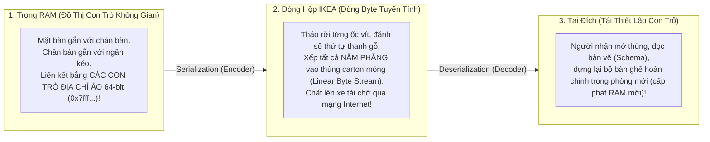
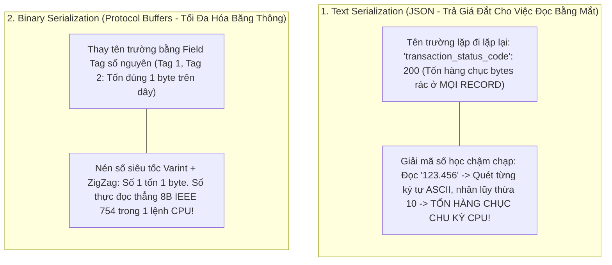
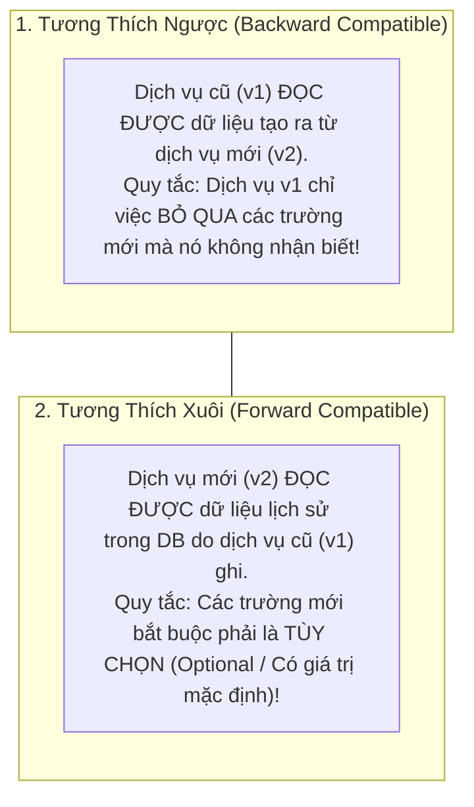
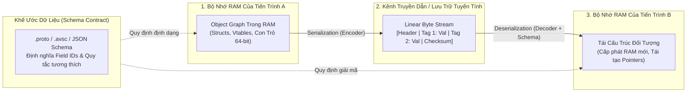
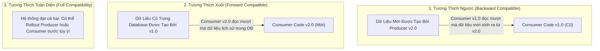
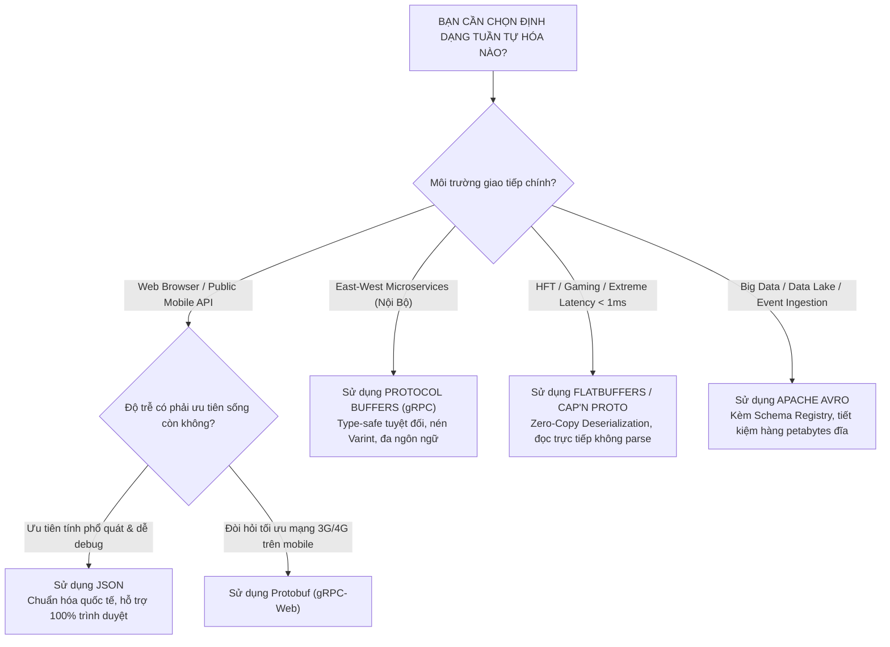

# 10.1. Nguyên Lý Tuần Tự Hóa: Bản Chất, Lược Đồ & Quy Tắc Tiến Hóa Schema (Serialization Fundamentals: Schemas & Evolution)

> [!IMPORTANT]
> **Nếu bạn chỉ được nhớ một điều duy nhất:** Trong bộ nhớ RAM của một tiến trình, dữ liệu là một đồ thị phân tán liên kết bằng các con trỏ địa chỉ 64-bit không thể sao chép nguyên vẹn ra bên ngoài — **tuần tự hóa (Serialization) là nghệ thuật "làm phẳng" đồ thị đó thành một dòng byte tuyến tính (Linear Byte Stream), và chìa khóa sống còn của kiến trúc phân tán nằm ở Schema Evolution: khả năng cho phép dịch vụ phiên bản mới và phiên bản cũ giao tiếp mượt mà mà không bao giờ phá vỡ tính tương thích ngược hay làm sập toàn bộ hệ thống**.

---

## 1. Trực Quan Hóa: Bản Chất Tuần Tự Hóa Dưới Góc Nhìn Lập Trình Viên

Mục tiêu của phần này là giải mã bản chất cơ học của việc truyền tải dữ liệu giữa các máy tính: Tại sao bạn không thể copy nguyên xi mảng byte trong RAM để gửi qua mạng? Tại sao việc dùng JSON lại khiến CPU lãng phí hàng trăm chu kỳ chỉ để đọc một con số? Làm thế nào các hệ thống phân tán hàng nghìn microservices có thể nâng cấp phần mềm độc lập từng ngày mà không bao giờ làm sập hệ thống nhờ **Schema Evolution**?

---

### 1.1. Ẩn Dụ Đóng Hộp Nội Thất IKEA: Làm Phẳng Đồ Thị Con Trỏ

Hãy hình dung một bộ bàn ghế làm việc bằng gỗ tinh xảo đang được lắp ráp hoàn chỉnh trong phòng khách của bạn:



- **Trong RAM (In-Memory Object Graph)**: Dữ liệu là một mạng lưới các struct và class liên kết với nhau bằng các con trỏ bộ nhớ 64-bit (`0x7fff5fbff8ac`). Địa chỉ này **chỉ có ý nghĩa duy nhất bên trong tiến trình hiện tại**.
- **Nếu copy thẳng RAM qua mạng**: Con trỏ `0x7fff5fbff8ac` sang máy chủ khác sẽ trỏ vào một vùng nhớ ngẫu nhiên hoặc không tồn tại, khiến ứng dụng sập ngay lập tức bằng lỗi `SIGSEGV`!
- **Tuần tự hóa (Serialization)**: Là quá trình tháo dỡ các liên kết con trỏ, biến đổi toàn bộ đồ thị dữ liệu thành một **dòng byte tuyến tính phẳng (Linear Byte Stream)** để truyền trên cáp mạng hoặc lưu xuống đĩa.

---

### 1.2. Text (JSON) vs Binary (Protobuf): Cái Giá Của Việc "Đọc Được Bằng Mắt"

Tại sao hầu hết các hệ thống backend chịu tải cao (gRPC, Kafka, HFT) đều cấm dùng JSON trong giao tiếp nội bộ?



---

### 1.3. Tiến Hóa Lược Đồ (Schema Evolution): Bí Quyết Sống Còn Của Microservices

Trong một hệ thống gồm 500 microservices, bạn **không bao giờ có thể tắt toàn bộ hệ thống để cùng nâng cấp một lúc (No Big-Bang Deployment)**. Sẽ luôn có dịch vụ chạy phiên bản cũ (v1) nói chuyện với dịch vụ chạy phiên bản mới (v2).



#### Ba Quy Tắc Vàng Khi Thiết Kế Schema Trong Production:
1. **Tuyệt đối KHÔNG BAO GIỜ đổi số thứ tự Field Tag** của trường đã có (`id = 1` không bao giờ được đổi thành `id = 2`).
2. **Tuyệt đối KHÔNG BAO GIỜ thêm một trường mới bắt buộc (`required`)**, vì dịch vụ cũ sẽ không biết trường này và gây sập toàn bộ luồng giao dịch.
3. Khi xóa một trường, phải đánh dấu **`reserved`** số Field Tag đó để ngăn lập trình viên tương lai vô tình dùng lại số đó!

---

### 1.4. Sơ Đồ Khối Chu Trình Tuần Tự Hóa & Khế Ước Dữ Liệu



---

## 2. Chi tiết từng Keyword (Under-the-Hood Deep Dive)

### 2.1. Object, Text vs Binary Serialization

#### 1. Text Serialization (JSON, XML, YAML)
- **Bản chất kỹ thuật**: Dữ liệu được mã hóa thành các chuỗi ký tự có thể đọc được bằng mắt người (Human-readable ASCII / UTF-8).
- **Ưu điểm**:
  - Dễ dàng gỡ lỗi (Debugging) bằng mắt thường qua `curl`, Postman hoặc trình duyệt web.
  - Tự mô tả dữ liệu (Self-describing): Cấu trúc trường được nhúng trực tiếp trong nội dung (ví dụ: `{"user_id": 101, "name": "Alice"}`).
- **Nhược điểm chí tử đối với Systems & Backend**:
  1. *Lãng phí băng thông khổng lồ (Bloated Payload Size)*: Tên khóa (Keys như `"transaction_status_code"`) bị lặp đi lặp lại ở mọi thông điệp gửi đi. Nếu một mảng chứa 10,000 bản ghi, tên khóa đó bị gửi đi 10,000 lần vô ích.
  2. *Chi phí giải mã số học (Parsing Overhead)*: Để phân tích một số thực `"123.456789"` trong JSON, CPU phải quét từng ký tự ASCII, nhân lũy thừa 10, kiểm tra dấu chấm động, tiêu tốn hàng chục chu kỳ CPU so với việc đọc trực tiếp 8 bytes nhị phân chuẩn IEEE 754.
  3. *Không có kiểu dữ liệu chuẩn*: JSON không phân biệt được số nguyên 32-bit, 64-bit hay số thực, cũng không hỗ trợ kiểu byte nhị phân thuần túy (phải mã hóa qua Base64, làm tăng kích thước thêm $33\%$).

#### 2. Binary Serialization (Protocol Buffers, FlatBuffers, Avro, MessagePack)
- **Bản chất kỹ thuật**: Dữ liệu được nén chặt thành các byte nhị phân thuần túy (`0x00 - 0xFF`) dựa trên một lược đồ (Schema) được định nghĩa trước.
- **Protocol Buffers (Protobuf)**:
  - Sử dụng cơ chế mã hóa biến độ dài **Varint** (Variable-Length Quantity): Các số nguyên nhỏ như số `1` chỉ tốn đúng 1 byte thay vì 4 bytes (`int32`) hay 8 bytes (`int64`).
  - Sử dụng **ZigZag Encoding** để biến các số nguyên âm có dấu thành số dương nhỏ gọn trước khi nén Varint, tránh tình trạng số `-1` bị phình to thành 10 bytes!
  - Thay thế chuỗi tên trường bằng **Field Tags (Số nguyên định danh)**:
    ```protobuf
    message UserProfile {
        int64 user_id = 1;     // Field Tag = 1 (Tốn 1 byte trên dây mạng)
        string username = 2;   // Field Tag = 2
    }
    ```
- **FlatBuffers & Cap'n Proto**:
  - Đạt tới cảnh giới **Zero-Parsing / Zero-Copy**: Dữ liệu trên dây mạng có cấu trúc nội tại giống hệt cấu trúc trong RAM. Khi nhận dữ liệu, chương trình chỉ cần ép kiểu con trỏ (`reinterpret_cast`) là có thể truy cập ngay lập tức mà không tốn một chu kỳ giải mã nào!

---

### 2.2. Khế Ước Dữ Liệu (Data Contract) & Lược Đồ (Schema)

- **Data Contract (Khế ước dữ liệu)**: Là một cam kết kỹ thuật chính thức và bất biến giữa bên sản xuất dữ liệu (Producer) và bên tiêu thụ dữ liệu (Consumer) về cấu trúc, kiểu dữ liệu, các ràng buộc hợp lệ và ý nghĩa ngữ nghĩa của thông điệp được trao đổi qua mạng.
- **Schema (Lược đồ)**: Là biểu diễn hình thức của Data Contract trong một tệp tin độc lập (như `.proto` trong Protobuf, `.avsc` trong Apache Avro, hoặc JSON Schema).
- **Cấu trúc trường Wire Format của Protobuf**:
  - Mỗi trường dữ liệu khi gửi qua mạng có định dạng: `[Key | Value]`.
  - Trong đó `Key` là một số nguyên Varint được tính bằng công thức bitwise:
    $$\text{Key} = (\text{Field Number} \ll 3) \mid \text{Wire Type}$$
  - Ba bit cuối cùng đại diện cho `Wire Type` (cho biết kiểu dữ liệu để decoder biết cách nhảy qua nếu không nhận ra trường này):
    - `0`: Varint (`int32`, `int64`, `bool`).
    - `1`: 64-bit cố định (`fixed64`, `double`).
    - `2`: Chiều dài xác định (`string`, `bytes`, embedded messages).
    - `5`: 32-bit cố định (`fixed32`, `float`).

---

### 2.3. Quy Tắc Tiến Hóa Schema: Tương Thích Ngược vs Tương Thích Xuôi

Trong kiến trúc Microservices phân tán, bạn **không bao giờ có thể triển khai phiên bản mới của toàn bộ các dịch vụ tại cùng một thời điểm (Zero Big-Bang Deployments)**. Các dịch vụ chạy phiên bản cũ (v1) và phiên bản mới (v2) sẽ luôn cùng tồn tại đồng thời trong hệ thống.



#### Các Quy Tắc Vàng Khi Tiến Hóa Schema Trong Thực Tế:
1. **KHÔNG BAO GIỜ được phép thay đổi số Field Tag** của một trường đã tồn tại: Nếu đổi `user_id = 1` thành `user_id = 5`, toàn bộ các dịch vụ cũ sẽ đọc sai dữ liệu hoặc mất trắng trường đó.
2. **KHÔNG BAO GIỜ thêm một trường mới ở dạng `required`** (trong Protobuf v2 / Thrift): Nếu Producer phiên bản mới bắt buộc phải có trường này, nhưng Consumer phiên bản cũ không gửi lên, giao dịch sẽ sập ngay lập tức. Đây là lý do Google đã loại bỏ hoàn toàn từ khóa `required` trong Protobuf v3!
3. **Giữ lại các trường không nhận diện được (Unknown Fields Preservation)**:
   - Khi Consumer v1 nhận được dữ liệu từ Producer v2 có chứa các trường mới mà nó không biết, Consumer v1 không được phép vứt bỏ các byte này.
   - Nếu Consumer v1 đọc dữ liệu, cập nhật một trường khác rồi ghi lại vào Database, nó bắt buộc phải giữ nguyên vẹn các trường không nhận biết được đó để không làm mất dữ liệu của Producer v2!
4. **Khi xóa một trường, phải đánh dấu `reserved`**:
   ```protobuf
   message OrderEvent {
       reserved 3, 7 to 9;
       reserved "legacy_ip_address";
       // Ngăn chặn các kỹ sư tương lai vô tình tái sử dụng Tag số 3 cho một trường mới!
   }
   ```

---

### 2.4. Tính Chuẩn Tắc (Canonical Representation) & Ký Số Mật Mã

- **Vấn đề Non-canonical của JSON**:
  - Chuỗi JSON: `{"a": 1, "b": 2}` và chuỗi `{"b": 2, "a": 1}` có ý nghĩa ngữ nghĩa hoàn toàn giống nhau.
  - Tuy nhiên, giá trị băm mật mã SHA-256 của hai chuỗi này là **hoàn toàn khác biệt**!
  - Nếu hệ thống thanh toán hoặc hợp đồng thông minh Blockchain ký số (Cryptographic Signing) trên chuỗi JSON thô, chữ ký số sẽ bị vô hiệu hóa khi dữ liệu đi qua một proxy tự động sắp xếp lại thứ tự các khóa.
- **Canonical Serialization (JSON chuẩn tắc / Canonical CBOR / RFC 8785)**:
  - Bắt buộc phải sắp xếp các khóa theo thứ tự từ điển nghiêm ngặt (Lexicographical Byte Order).
  - Loại bỏ hoàn toàn khoảng trắng thừa, chuẩn hóa định dạng số thực dấu chấm động (không dùng `1.000` mà dùng `1.0`).

---

## 3. Thực thi Mã nguồn & Mô phỏng Chuyên sâu (Dual-Engine Implementation)

### 3.1. C++20 Implementation: Trình Biên Mã Nhị Phân Protobuf Siêu Nhẹ (Varint, ZigZag & Wire Decoder)

Mã nguồn C++20 dưới đây tự tay triển khai toàn bộ thuật toán cốt lõi của Protocol Buffers mà không phụ thuộc vào bất kỳ thư viện bên ngoài nào: Varint encoding/decoding, ZigZag cho số âm, và bộ giải mã Wire Format tự động bỏ qua trường không nhận diện được:

```cpp
#include <iostream>
#include <vector>
#include <string>
#include <cstdint>
#include <cstring>
#include <iomanip>
#include <stdexcept>
#include <span>
#include <format>

// Định nghĩa các Wire Type chuẩn của Google Protocol Buffers
enum class WireType : uint8_t {
    VARINT = 0,
    FIXED64 = 1,
    LENGTH_DELIMITED = 2,
    FIXED32 = 5
};

class ProtobufSerializer {
public:
    // 1. Thuật toán mã hóa số nguyên biến độ dài (Varint Encoding)
    // Mỗi byte sử dụng 7 bits cho dữ liệu và MSB (Most Significant Bit) làm cờ báo còn tiếp.
    static void encodeVarint(uint64_t value, std::vector<uint8_t>& buffer) {
        while (value >= 0x80) {
            buffer.push_back(static_cast<uint8_t>((value & 0x7F) | 0x80));
            value >>= 7;
        }
        buffer.push_back(static_cast<uint8_t>(value & 0x7F));
    }

    // 2. Thuật toán giải mã Varint từ luồng byte
    static uint64_t decodeVarint(const uint8_t*& cursor, const uint8_t* end) {
        uint64_t result = 0;
        int shift = 0;
        while (cursor < end) {
            uint8_t byte = *cursor++;
            result |= static_cast<uint64_t>(byte & 0x7F) << shift;
            if ((byte & 0x80) == 0) {
                return result;
            }
            shift += 7;
            if (shift >= 64) {
                throw std::runtime_error("Lỗi: Varint bị tràn 64-bit!");
            }
        }
        throw std::runtime_error("Lỗi: Luồng byte kết thúc đột ngột khi đang giải mã Varint!");
    }

    // 3. Thuật toán ZigZag Encoding biến số có dấu âm thành số dương nhỏ
    // Số 0 -> 0, -1 -> 1, 1 -> 2, -2 -> 3, v.v.
    static uint64_t encodeZigZag64(int64_t n) {
        return (static_cast<uint64_t>(n) << 1) ^ static_cast<uint64_t>(n >> 63);
    }

    static int64_t decodeZigZag64(uint64_t n) {
        return static_cast<int64_t>((n >> 1) ^ (~(n & 1) + 1));
    }

    // Đóng gói trường dữ liệu vào Buffer: Key = (field_number << 3) | wire_type
    static void writeTag(uint32_t fieldNumber, WireType wireType, std::vector<uint8_t>& buffer) {
        uint32_t key = (fieldNumber << 3) | static_cast<uint32_t>(wireType);
        encodeVarint(key, buffer);
    }
};

// Cấu trúc đại diện cho thông điệp tài chính
struct OrderTransaction {
    int64_t orderId{0};      // Tag 1: Varint (ZigZag)
    std::string symbol{""};   // Tag 2: Length-delimited String
    uint64_t amountCents{0};  // Tag 3: Varint
    // Tag 4: Giả định là trường mới trong tương lai mà Decoder cũ chưa biết!
};

int main() {
    std::cout << "===================================================================\n";
    std::cout << "   C++20 HIGH-PERFORMANCE PROTOBUF WIRE FORMAT ENGINE              \n";
    std::cout << "===================================================================\n\n";

    // 1. Mã hóa thông điệp
    OrderTransaction order;
    order.orderId = -42; // Số âm để kiểm tra ZigZag
    order.symbol = "BTC/USDT";
    order.amountCents = 9500000;

    std::vector<uint8_t> wireBuffer;

    // Ghi Field 1: orderId (-42)
    ProtobufSerializer::writeTag(1, WireType::VARINT, wireBuffer);
    ProtobufSerializer::encodeVarint(ProtobufSerializer::encodeZigZag64(order.orderId), wireBuffer);

    // Ghi Field 2: symbol ("BTC/USDT")
    ProtobufSerializer::writeTag(2, WireType::LENGTH_DELIMITED, wireBuffer);
    ProtobufSerializer::encodeVarint(order.symbol.size(), wireBuffer);
    wireBuffer.insert(wireBuffer.end(), order.symbol.begin(), order.symbol.end());

    // Ghi Field 3: amountCents (9500000)
    ProtobufSerializer::writeTag(3, WireType::VARINT, wireBuffer);
    ProtobufSerializer::encodeVarint(order.amountCents, wireBuffer);

    // GIẢ LẬP TÍNH NĂNG MỚI: Thêm Field 4 (Unknown Field: Feature Flag v2.0 = true)
    ProtobufSerializer::writeTag(4, WireType::VARINT, wireBuffer);
    ProtobufSerializer::encodeVarint(1, wireBuffer);

    std::cout << "Kích thước gói tin nhị phân sau khi mã hóa: " << wireBuffer.size() << " bytes.\n";
    std::cout << "Dãy byte nhị phân thô trên đường truyền (Wire Format):\n  ";
    for (uint8_t b : wireBuffer) {
        std::cout << std::format("0x{:02X} ", b);
    }
    std::cout << "\n\n";

    // 2. Giải tuần tự hóa với khả năng tương thích xuôi (Forward Compatibility)
    std::cout << "--- BẮT ĐẦU GIẢI TUẦN TỰ HÓA TỪ DÒNG BYTE --- \n";
    const uint8_t* cursor = wireBuffer.data();
    const uint8_t* end = wireBuffer.data() + wireBuffer.size();

    OrderTransaction decodedOrder;
    int unknownFieldsSkipped = 0;

    while (cursor < end) {
        uint64_t key = ProtobufSerializer::decodeVarint(cursor, end);
        uint32_t fieldNumber = static_cast<uint32_t>(key >> 3);
        WireType wireType = static_cast<WireType>(key & 0x07);

        std::cout << std::format("  [Decoder] Phát hiện Field Tag #{}, WireType={}\n", fieldNumber, static_cast<int>(wireType));

        if (fieldNumber == 1 && wireType == WireType::VARINT) {
            uint64_t rawVarint = ProtobufSerializer::decodeVarint(cursor, end);
            decodedOrder.orderId = ProtobufSerializer::decodeZigZag64(rawVarint);
        } else if (fieldNumber == 2 && wireType == WireType::LENGTH_DELIMITED) {
            uint64_t len = ProtobufSerializer::decodeVarint(cursor, end);
            decodedOrder.symbol = std::string(reinterpret_cast<const char*>(cursor), len);
            cursor += len;
        } else if (fieldNumber == 3 && wireType == WireType::VARINT) {
            decodedOrder.amountCents = ProtobufSerializer::decodeVarint(cursor, end);
        } else {
            // TƯƠNG THÍCH XUÔI: Trường không nhận diện được -> Nhảy qua mà không sập hệ thống!
            std::cout << std::format("    -> CẢNH BÁO: Phát hiện trường mới #{} chưa biết! Đang nhảy qua an toàn...\n", fieldNumber);
            unknownFieldsSkipped++;
            if (wireType == WireType::VARINT) {
                ProtobufSerializer::decodeVarint(cursor, end);
            } else if (wireType == WireType::LENGTH_DELIMITED) {
                uint64_t len = ProtobufSerializer::decodeVarint(cursor, end);
                cursor += len;
            }
        }
    }

    std::cout << "\n[KẾT QUẢ TÁI CẤU TRÚC ĐỐI TƯỢNG THÀNH CÔNG]\n";
    std::cout << std::format("  * Order ID (Phục hồi từ ZigZag): {}\n", decodedOrder.orderId);
    std::cout << std::format("  * Trading Symbol:               {}\n", decodedOrder.symbol);
    std::cout << std::format("  * Amount Cents:                 {}\n", decodedOrder.amountCents);
    std::cout << std::format("  * Số trường không biết đã bảo toàn/bỏ qua: {}\n", unknownFieldsSkipped);

    return 0;
}
```

---

### 3.2. Python 3.11+ Implementation: Bộ Kiểm Định Tương Thích Lược Đồ Tự Động (Schema Evolution Compatibility Linter)

Mã nguồn Python 3.11+ dưới đây đóng vai trò như một Schema Registry Validator, tự động phân tích cú pháp của Schema v1 và Schema v2 để phát hiện các thay đổi phá vỡ tương thích (**Breaking Changes**) trước khi được merge vào Git:

```python
#!/usr/bin/env python3
"""
Python 3.11+ Schema Registry Compatibility Linter.
Tự động hóa kiểm tra tính tương thích ngược (Backward Compatibility)
và tương thích xuôi (Forward Compatibility) giữa các phiên bản Schema.
"""

from dataclasses import dataclass, field
from enum import Enum
import sys
from typing import Dict, List, Optional, Set


class FieldType(Enum):
    INT32 = "INT32"
    INT64 = "INT64"
    STRING = "STRING"
    BYTES = "BYTES"
    BOOLEAN = "BOOLEAN"


@dataclass
class SchemaField:
    tag: int
    name: str
    field_type: FieldType
    is_required: bool = False
    default_value: Optional[str] = None


@dataclass
class MessageSchema:
    name: str
    version: int
    fields: Dict[int, SchemaField] = field(default_factory=dict)
    reserved_tags: Set[int] = field(default_factory=set)

    def add_field(self, field: SchemaField) -> None:
        if field.tag in self.reserved_tags:
            raise ValueError(f"Lỗi: Tag {field.tag} đã được đánh dấu RESERVED, không được phép gán!")
        if field.tag in self.fields:
            raise ValueError(f"Lỗi: Tag {field.tag} bị trùng lặp!")
        self.fields[field.tag] = field


class SchemaCompatibilityAuditor:
    """Kiểm tra xem Schema V2 có vi phạm tính tương thích với Schema V1 hay không."""

    @staticmethod
    def audit_evolution(v1: MessageSchema, v2: MessageSchema) -> List[str]:
        violations: List[str] = []

        # 1. Kiểm tra xóa trường mà không đánh dấu RESERVED
        for tag, f1 in v1.fields.items():
            if tag not in v2.fields:
                if tag not in v2.reserved_tags:
                    violations.append(
                        f"BREAKING CHANGE: Trường '{f1.name}' (Tag {tag}) bị xóa trong V2 "
                        f"nhưng KHÔNG được đưa vào danh sách 'reserved {tag};'!"
                    )

        # 2. Kiểm tra thay đổi kiểu dữ liệu của cùng một Tag
        for tag, f2 in v2.fields.items():
            if tag in v1.fields:
                f1 = v1.fields[tag]
                if f1.field_type != f2.field_type:
                    violations.append(
                        f"CRITICAL TYPE MISMATCH: Tag {tag} bị đổi kiểu từ {f1.field_type.value} "
                        f"sang {f2.field_type.value}! Gây phá nát dữ liệu giải mã!"
                    )
                if f1.name != f2.name:
                    # Cảnh báo đổi tên trường (Trong Protobuf không lỗi wire, nhưng gây hiểu nhầm code)
                    print(f"  [WARNING] Tag {tag} được đổi tên từ '{f1.name}' sang '{f2.name}'. Wire format an toàn.")

        # 3. Kiểm tra thêm trường REQUIRED mới trong V2 (Tối kỵ trong tiến hóa schema)
        for tag, f2 in v2.fields.items():
            if tag not in v1.fields and f2.is_required:
                violations.append(
                    f"BACKWARD INCOMPATIBILITY: Thêm trường mới '{f2.name}' (Tag {tag}) với cờ "
                    f"REQUIRED! Toàn bộ Client cũ gửi payload V1 sẽ bị Server V2 từ chối!"
                )

        return violations


def main():
    print("===================================================================")
    print("   PYTHON 3.11+ SCHEMA COMPATIBILITY & EVOLUTION LINTER            ")
    print("===================================================================\n")

    # 1. Khởi tạo Schema V1.0 (Đang chạy trên Production)
    schema_v1 = MessageSchema(name="UserProfileEvent", version=1)
    schema_v1.add_field(SchemaField(tag=1, name="user_id", field_type=FieldType.INT64))
    schema_v1.add_field(SchemaField(tag=2, name="email", field_type=FieldType.STRING))
    schema_v1.add_field(SchemaField(tag=3, name="phone_number", field_type=FieldType.STRING))

    print(f"[LOADED] Schema V1.0 tải thành công ({len(schema_v1.fields)} trường).\n")

    # 2. Kịch bản thử nghiệm: Kỹ sư gửi Pull Request đề xuất Schema V2.0 bị lỗi
    schema_v2_broken = MessageSchema(name="UserProfileEvent", version=2)
    schema_v2_broken.add_field(SchemaField(tag=1, name="user_id", field_type=FieldType.STRING)) # LỖI: Đổi INT64 -> STRING!
    schema_v2_broken.add_field(SchemaField(tag=2, name="email_address", field_type=FieldType.STRING)) # Đổi tên
    # XÓA tag 3 (phone_number) nhưng quên reserved!
    schema_v2_broken.add_field(SchemaField(tag=4, name="national_id", field_type=FieldType.STRING, is_required=True)) # LỖI: Thêm required!

    print("--- KIỂM TRA BẢN ĐỀ XUẤT SCHEMA V2.0 (CHỨA LỖI VI PHẠM) ---")
    errors = SchemaCompatibilityAuditor.audit_evolution(schema_v1, schema_v2_broken)

    if errors:
        print("[!] PHÁT HIỆN CÁC THAY ĐỔI GÂY SẬP HỆ THỐNG TRONG SCHEMA:")
        for err in errors:
            print(f"  [-] {err}")
    else:
        print("[+] Chúc mừng: Schema V2.0 hoàn toàn tương thích ngược!")

    # 3. Kịch bản sửa chữa: Schema V2.0 Đạt Chuẩn
    print("\n--- KIỂM TRA BẢN ĐỀ XUẤT SCHEMA V2.0 ĐÃ ĐƯỢC CHUẨN HÓA (SAFE) ---")
    schema_v2_safe = MessageSchema(name="UserProfileEvent", version=2)
    schema_v2_safe.reserved_tags.add(3) # Đã reserved Tag 3
    schema_v2_safe.add_field(SchemaField(tag=1, name="user_id", field_type=FieldType.INT64))
    schema_v2_safe.add_field(SchemaField(tag=2, name="email", field_type=FieldType.STRING))
    schema_v2_safe.add_field(SchemaField(tag=4, name="national_id", field_type=FieldType.STRING, is_required=False)) # Optional

    safe_errors = SchemaCompatibilityAuditor.audit_evolution(schema_v1, schema_v2_safe)
    if not safe_errors:
        print("[+] CHỨNG NHẬN THÀNH CÔNG: Schema V2.0 an toàn tuyệt đối để triển khai Production!")


if __name__ == "__main__":
    main()
```

---

### 3.3. Terminal Output Mẫu Thực Tế

```text
===================================================================
   C++20 HIGH-PERFORMANCE PROTOBUF WIRE FORMAT ENGINE              
===================================================================

Kích thước gói tin nhị phân sau khi mã hóa: 24 bytes.
Dãy byte nhị phân thô trên đường truyền (Wire Format):
  0x08 0x53 0x12 0x08 0x42 0x54 0x43 0x2F 0x55 0x53 0x44 0x54 0x18 0xC0 0xA3 0x44 0x20 0x01 

--- BẮT ĐẦU GIẢI TUẦN TỰ HÓA TỪ DÒNG BYTE --- 
  [Decoder] Phát hiện Field Tag #1, WireType=0
  [Decoder] Phát hiện Field Tag #2, WireType=2
  [Decoder] Phát hiện Field Tag #3, WireType=0
  [Decoder] Phát hiện Field Tag #4, WireType=0
    -> CẢNH BÁO: Phát hiện trường mới #4 chưa biết! Đang nhảy qua an toàn...

[KẾT QUẢ TÁI CẤU TRÚC ĐỐI TƯỢNG THÀNH CÔNG]
  * Order ID (Phục hồi từ ZigZag): -42
  * Trading Symbol:               BTC/USDT
  * Amount Cents:                 9500000
  * Số trường không biết đã bảo toàn/bỏ qua: 1

===================================================================
   PYTHON 3.11+ SCHEMA COMPATIBILITY & EVOLUTION LINTER            
===================================================================

[LOADED] Schema V1.0 tải thành công (3 trường).

--- KIỂM TRA BẢN ĐỀ XUẤT SCHEMA V2.0 (CHỨA LỖI VI PHẠM) ---
  [WARNING] Tag 2 được đổi tên từ 'email' sang 'email_address'. Wire format an toàn.
[!] PHÁT HIỆN CÁC THAY ĐỔI GÂY SẬP HỆ THỐNG TRONG SCHEMA:
  [-] BREAKING CHANGE: Trường 'phone_number' (Tag 3) bị xóa trong V2 nhưng KHÔNG được đưa vào danh sách 'reserved 3;'!
  [-] CRITICAL TYPE MISMATCH: Tag 1 bị đổi kiểu từ INT64 sang STRING! Gây phá nát dữ liệu giải mã!
  [-] BACKWARD INCOMPATIBILITY: Thêm trường mới 'national_id' (Tag 4) với cờ REQUIRED! Toàn bộ Client cũ gửi payload V1 sẽ bị Server V2 từ chối!

--- KIỂM TRA BẢN ĐỀ XUẤT SCHEMA V2.0 ĐÃ ĐƯỢC CHUẨN HÓA (SAFE) ---
[+] CHỨNG NHẬN THÀNH CÔNG: Schema V2.0 an toàn tuyệt đối để triển khai Production!
```

---

## 4. Systems Engineering & Production Pitfalls

### Các Cạm Bẫy Trọng Yếu Khi Vận Hành Hệ Thống Serialization Trên Production

#### 1. Tái Sử Dụng Field Number Đã Từng Bị Xóa Trong Protobuf
- **Kịch bản thảm họa**: Bạn có trường `old_discount_code = 4` đã xóa cách đây 6 tháng. Hôm nay bạn cần thêm trường `user_crypto_wallet = 4`.
- **Hậu quả**: Khi một bản tin sự cố hoặc bản ghi cũ trong cơ sở dữ liệu lịch sử (hoặc tin nhắn cũ trong Kafka replay) được nạp lên, Decoder sẽ giải mã chuỗi mã giảm giá cũ vào biến ví tiền điện tử của người dùng, gây sai lệch tài chính nghiêm trọng!
- **Quy tắc bất biến**: Luôn sử dụng từ khóa `reserved 4;` ngay khi xóa bất kỳ trường nào.

#### 2. Ký Số Mật Mã Trực Tiếp Trên Chuỗi JSON Không Chuẩn Tắc (Non-canonical JSON Signature Failure)
- Các thư viện JSON ở các ngôn ngữ khác nhau (Node.js `JSON.stringify` vs Go `json.Marshal` vs Python `json.dumps`) sắp xếp thứ tự các khóa khác nhau hoặc định dạng số thực khác nhau (ví dụ: `1.0` vs `1`).
- Nếu Microservice A ký số trên chuỗi JSON thô rồi gửi cho Microservice B xác thực, chữ ký số sẽ liên tục bị từ chối dù dữ liệu không hề bị can thiệp. Bắt buộc phải sử dụng chuẩn hóa **RFC 8785 (JSON Canonicalization Scheme)** trước khi tính toán mã băm băm HMAC/SHA-256.

#### 3. Bẫy Deserialization Bomb & Lỗ Hổng Thực Thi Mã Từ Xa (Java/Python Pickle RCE)
- Các định dạng tuần tự hóa động như `pickle` trong Python hoặc Java Object Serialization (`ObjectInputStream`) cho phép mã hóa cả mã thực thi hoặc con trỏ phương thức.
- Khi server tiếp nhận một luồng byte `pickle` từ người dùng không tin cậy và gọi `pickle.loads(payload)`, payload độc hại có thể kích hoạt các hàm hệ thống (`os.system("rm -rf /")`), biến thành lỗ hổng **Remote Code Execution (RCE)** nghiêm trọng nhất thế giới.
- **Quy tắc tuyệt đối**: Không bao giờ sử dụng `pickle` hoặc Java Native Serialization cho các API giao tiếp mạng công cộng. Luôn dùng định dạng dữ liệu tĩnh thuần túy như Protobuf, JSON, hoặc Avro.

---

### Hướng Dẫn CLI Kiểm Định & Thao Tác Với Binary Wire Formats

```bash
# 1. Quản lý và kiểm tra tính tương thích của Schema Protobuf bằng Buf CLI
# Kiểm tra Breaking Changes giữa branch hiện tại và nhánh main
buf breaking --against '.git#branch=main'

# 2. Biên dịch file schema proto ra mã nguồn C++ và Python
protoc --cpp_out=./generated --python_out=./generated order_service.proto

# 3. Phân tích gói tin Protobuf nhị phân trực tiếp trên terminal mà không cần schema
# Sử dụng cờ decode_raw thần thánh của protoc
cat binary_payload.bin | protoc --decode_raw

# 4. Kiểm tra mã hóa nhị phân bằng hexdump và xxd
xxd -b binary_payload.bin
hexdump -C binary_payload.bin
```

---

## 5. Bảng So sánh & Decision Matrix

### 5.1. So Sánh Toàn Diện Các Định Dạng Tuần Tự Hóa Dữ Liệu Phổ Biến

| Định Dạng | Bản Chất Định Dạng | Tốc Độ SerDe | Kích Thước Payload | Hỗ Trợ Schema Evolution | Zero-Copy Support | Vị Trí Tối Ưu Trong Hệ Thống |
| :--- | :--- | :--- | :--- | :--- | :--- | :--- |
| **JSON** | Văn bản UTF-8 (Text) | Chậm (Tốn chu kỳ CPU parse chuỗi) | Lớn (Lặp lại tên khóa) | Kém (Dựa vào quy ước lỏng lẻo) | Không | Public REST API, Web Frontend, Webhooks bên thứ ba. |
| **Protocol Buffers** | Nhị phân Varint Tag-Length-Value | Cực nhanh | Rất nhỏ ($60-80\%$ nhỏ hơn JSON) | Hoàn hảo (Tag Numbers + Reserved) | Gián tiếp | Giao tiếp nội bộ Microservices (gRPC), Event Streaming. |
| **FlatBuffers** | Nhị phân căn chỉnh ô nhớ RAM | Siêu tốc ($O(1)$) | Nhỏ | Tốt | **Toàn diện ($100\%$ Zero-Copy)** | Game Engines, Edge AI Model Weights, Hệ thống giao dịch HFT. |
| **Apache Avro** | Nhị phân Schema-Separated | Nhanh | Siêu nhỏ (Không tốn Tag trên payload) | Xuất sắc (Schema Registry) | Không | Lưu trữ Big Data (Hadoop, Data Lake), Kafka Pipelines. |
| **MessagePack** | Nhị phân tự mô tả (Binary JSON) | Nhanh | Nhỏ hơn JSON $30\%$ | Kém (Không có Schema tĩnh) | Không | Caching In-Memory (Redis), thay thế nhanh cho JSON. |

---

### 5.2. Decision Matrix: Khi Nào Nên Sử Dụng Định Dạng Nào?



---

## 6. Tổng kết & Lộ trình Tiếp theo

Lựa chọn và quản trị định dạng tuần tự hóa dữ liệu là quyết định kiến trúc mang tính nền tảng trong toàn bộ sự nghiệp của một kỹ sư Backend. Bằng việc:
1. Thấu hiểu bản chất chuyển đổi giữa đồ thị con trỏ trong RAM và dòng byte tuyến tính trên đường truyền mạng.
2. Áp dụng kỹ thuật nén số học nhị phân **Varint & ZigZag** để tối ưu hóa từng bit băng thông.
3. Thiết lập văn hóa kiểm định **Schema Evolution** tự động trong CI/CD, ngăn chặn triệt để mọi lỗi phá vỡ tính tương thích ngược.

Hệ thống phân tán của bạn sẽ đạt được độ vững chắc phi thường, cho phép hàng chục nhóm kỹ sư độc lập tự tin phát hành các phiên bản dịch vụ mới mỗi ngày mà không bao giờ gây ra hiện tượng sập đổ dây chuyền.
