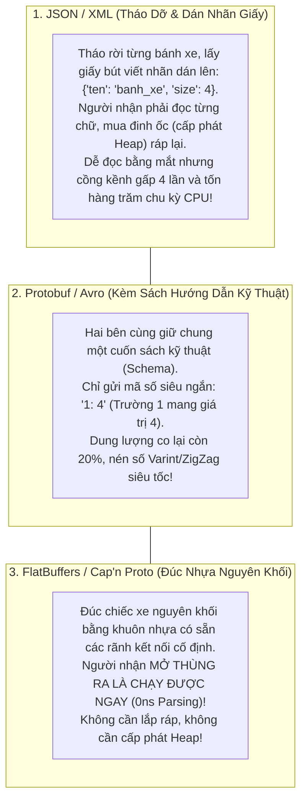
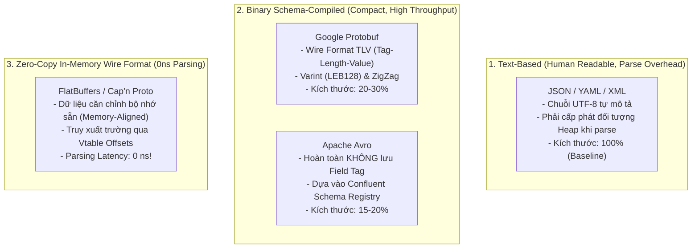

# 10.2. Serialization Formats (Toàn Cảnh Các Định Dạng Tuần Tự Hóa: JSON, Protobuf, Avro, MessagePack & Zero-Copy)

> [!IMPORTANT]
> **Nếu bạn chỉ được nhớ một điều duy nhất:**
> Tuần tự hóa (Serialization) là quá trình đóng băng cấu trúc dữ liệu trong bộ nhớ RAM thành một dòng byte (Byte Stream) để truyền qua mạng hoặc ghi xuống đĩa, và Deserialization là quá trình tái sinh đối tượng đó ở đầu nhận. Sự lựa chọn định dạng là cuộc chiến khốc liệt giữa ba trục: **Tính dễ đọc đối với con người (Human Readability)**, **Kích thước dòng byte (Payload Compactness)**, và **Độ trễ xử lý CPU (Parsing Latency)**. Trong khi JSON/XML tốn hàng trăm chu kỳ CPU để parse chuỗi văn bản và cấp phát Heap, Google Protobuf và Apache Avro nén dữ liệu tối đa bằng mã hóa Varint/ZigZag và Schema tĩnh, còn các định dạng Zero-Copy hiện đại như **FlatBuffers và Cap'n Proto** triệt tiêu hoàn toàn bước giải mã ($0\text{ ns}$ parsing) bằng cách ánh xạ trực tiếp con trỏ vào dòng byte.

---

## 1. Trực Quan Hóa: Bản Chất Các Định Dạng Tuần Tự Hóa Dưới Góc Nhìn Lập Trình Viên

Mục tiêu của phần này là giải mã toàn cảnh cuộc chiến giữa các định dạng dữ liệu trong kiến trúc phần mềm: Tại sao các định dạng Zero-Copy như FlatBuffers có thể giải mã dữ liệu trong đúng $0\text{ nano-giây}$ mà không cần cấp phát Heap? Làm thế nào Apache Avro có thể truyền dữ liệu qua Kafka mà hoàn toàn không cần gửi kèm tên trường hay Field Tag? Và tại sao file dữ liệu lớn Apache Parquet lại đặt toàn bộ Metadata ở cuối file thay vì ở đầu file?

---

### 1.1. Ẩn Dụ Chiếc Xe Hơi Đồ Chơi: Ba Cách Đóng Gói Vận Chuyển

Hãy tưởng tượng dữ liệu của bạn là một chiếc xe hơi đồ chơi tinh xảo cần gửi cho bạn bè ở xa:



---

### 1.2. Phép Màu Zero-Copy: Giải Mã Trong Đúng $0\text{ ns}$ Bằng Cách Nào?

Trong các định dạng thông thường (JSON, Protobuf), khi nhận mảng byte từ mạng, CPU bắt buộc phải:
1. Đọc và giải mã các byte.
2. Cấp phát các đối tượng mới trên Heap (`new MyClass()`, `malloc`).
3. Copy dữ liệu từ mảng byte vào các trường của đối tượng trên Heap.

#### Bí mật của FlatBuffers & Cap'n Proto:
- Dữ liệu tuần tự hóa được sắp xếp trên dây mạng theo **đúng chuẩn căn chỉnh tự nhiên của phần cứng (Memory Alignment)**.
- Mỗi bảng dữ liệu mang một con trỏ độ lệch ảo (**Vtable Offset**).
- Khi nhận dữ liệu: **CPU HOÀN TOÀN KHÔNG PARSE!**
  ```cpp
  // Ép con trỏ trực tiếp vào dòng byte nhận được từ Socket:
  const auto* monster = GetMonster(socket_buffer);
  int hp = monster->hp(); // Truy xuất thẳng ô nhớ bằng phép cộng con trỏ: Base + Offset!
  ```
- **Parsing Latency = $0\text{ ns}$**, hoàn toàn không tạo ra bất kỳ đối tượng rác nào trên Heap, cực kỳ lý tưởng cho Game Engine 60 FPS và hệ thống giao dịch tần suất cao (HFT)!

---

### 1.3. Apache Avro & Kafka Schema Registry: Cắt Bỏ Mọi Dư Thừa

Trong Protobuf, mỗi trường vẫn phải mang theo 1-2 byte Field Tag (`Wire Type | Field Number`).
- **Đỉnh cao của Apache Avro**: Dòng byte truyền đi **hoàn toàn không có bất kỳ Field Tag nào**! Toàn bộ payload chỉ là một chuỗi giá trị nhị phân nối đuôi nhau liên tục.
- **Làm sao giải mã được?**: Dựa vào **Confluent Schema Registry**.
  Mỗi thông điệp Kafka chỉ mang đúng **$4\text{ Bytes}$ Schema ID** ở đầu. Consumer nhìn thấy 4 byte này sẽ tải Schema từ Registry về một lần duy nhất, rồi dùng Schema đó giải mã chính xác từng byte dữ liệu, giúp tiết kiệm băng thông tối đa trên các luồng dữ liệu hàng triệu sự kiện/giây!

---

### 1.4. Apache Parquet: Tại Sao Metadata Nằm Ở Cuối File (Footer-Centric)?

Trong hầu hết các định dạng file thông thường, Header luôn nằm ở đầu file. Nhưng trong Apache Parquet (chuẩn lưu trữ Columnar của Big Data):
- **Toàn bộ FileMetaData nằm ở những byte cuối cùng của file (Footer)**!
- **Lý do kiến trúc**: Khi các hệ thống Big Data (Spark, Flink) ghi dữ liệu khổng lồ (Streaming Write) xuống ổ đĩa hoặc AWS S3, chúng đẩy các khối dữ liệu (Row Groups) liên tục theo dòng mà **chưa thể biết trước tổng số dòng và giá trị Min/Max**.
- Khi ghi xong dòng dữ liệu cuối cùng, hệ thống mới tính toán toàn bộ Metadata tổng kết và ghi một lần duy nhất xuống cuối file trước khi đóng lại (**Single-Pass Writing**), loại bỏ hoàn toàn việc phải quay lại đầu file để sửa đổi Header!

---

### 1.5. Sơ Đồ Khối Ba Dòng Kiến Trúc Tuần Tự Hóa



---

## 2. Chi tiết từng Keyword (Under-the-Hood Deep Dive)

### 2.1. Bảng So Sánh Toàn Diện 11 Định Dạng Tuần Tự Hóa & Phân Loại 3 Dòng Kiến Trúc
Toàn bộ 11 định dạng tuần tự hóa phổ biến nhất trong kỹ nghệ phần mềm hiện đại được phân chia thành 3 trường phái kiến trúc:
1. **Text-based (Văn bản tự mô tả: JSON, XML, YAML, CSV)**:
   - Dữ liệu và tên trường (Key) được đóng gói cùng nhau dưới dạng chuỗi UTF-8.
   - *Ưu điểm*: Con người đọc hiểu trực tiếp, gỡ lỗi dễ dàng qua curl hoặc trình duyệt, linh hoạt không cần biên dịch schema.
   - *Nhược điểm*: Kích thước payload cồng kềnh gấp 3--5 lần nhị phân; tiêu tốn nhiều chu kỳ CPU để parse chuỗi và cấp phát đối tượng động trên Heap.
2. **Schema-based Binary (Nhị phân có lược đồ: Protocol Buffers, Apache Avro, MessagePack, BSON, CBOR)**:
   - Dữ liệu được mã hóa thành các byte nhị phân đặc theo một bản hợp đồng schema tĩnh (`.proto`, `.avsc`).
   - *Ưu điểm*: Bỏ qua hoặc thu nhỏ tên trường, áp dụng nén số nguyên (Varint, ZigZag), thông lượng serialize/deserialize nhanh gấp 5--10 lần JSON.
   - *Nhược điểm*: Con người không thể đọc trực tiếp bằng mắt thường nếu không có schema đi kèm; đòi hỏi quy trình sinh mã nguồn (Code Generation) trong CI/CD.
3. **Zero-Copy In-Memory Wire Format (FlatBuffers, Cap'n Proto)**:
   - Dữ liệu tuần tự hóa được bố trí trong bộ nhớ theo đúng quy chuẩn căn chỉnh phần cứng (Memory Alignment) của CPU.
   - *Ưu điểm*: **Parsing Latency bằng đúng $0\text{ ns}$**. Ứng dụng chỉ cần ánh xạ con trỏ trực tiếp vào dòng byte nhận được từ mạng (qua `mmap` hoặc buffer socket) và truy cập trường dữ liệu tức thì mà không cần nạp/tạo bất kỳ object nào trên Heap!
   - *Nhược điểm*: Kích thước payload có thể lớn hơn Protobuf do chứa các byte đệm (Padding) để căn chỉnh địa chỉ.

### 2.2. Định Dạng Văn Bản (Text-based): JSON, XML, YAML
- **Cơ chế Tokenization & Lexical Analysis**: Khi nhận một payload JSON, parser phải duyệt qua từng ký tự ASCII, chạy một bộ máy trạng thái hữu hạn (FSM) để phân tách token (dấu ngoặc, chuỗi, số thực).
- **Chi phí Chuyển đổi Số Thực (Number Parsing Overhead)**: Chuyển đổi từ chuỗi `"123.456789"` sang số nhị phân IEEE 754 `double` đòi hỏi hàng trăm phép tính nhân chia và xử lý độ chính xác cao (`strtod`). Đây là một trong những nguyên nhân hàng đầu khiến REST API tiêu tốn nhiều CPU khi truyền các mảng số liệu lớn.
- **Áp Lực Bộ Nhớ & Garbage Collection**: Một tài liệu JSON $1\text{ MB}$ có thể sinh ra tới $5-10\text{ MB}$ đối tượng phụ trợ trên JVM hoặc V8 Heap (các chuỗi `String`, các hash table `Map<String, Object>`), kích hoạt GC tạm dừng hệ thống liên tục.

### 2.3. Phân Tích Chuyên Sâu Các Định Dạng Nhị Phân Chủ Chốt (Protocol Buffers, FlatBuffers, Cap'n Proto)
- **Toán Học Mã Hóa Varint (LEB128)**:
  Protobuf chia số nguyên thành các nhóm 7-bit, bit thứ 8 (MSB) đóng vai trò là Continuation Bit. Số nhỏ chiếm 1 byte, số lớn co giãn tự nhiên:
  $$\text{MSB} = 1 \implies \text{Còn byte tiếp theo}; \quad \text{MSB} = 0 \implies \text{Byte cuối cùng}$$
- **ZigZag Encoding Cho Số Nguyên Có Dấu (`sint32` / `sint64`)**:
  Giải quyết hiện tượng số âm trong định dạng bù hai (Two's Complement) bị phình to thành $10\text{ bytes}$:
  $$\text{ZigZag}(n) = (n \ll 1) \oplus (n \gg 63)$$
  Biến đổi $-1 \to 1, 1 \to 2, -2 \to 3$, giúp số âm nhỏ chỉ tốn đúng $1\text{ byte}$ Varint!
- **Cấu Trúc Header TLV (Tag-Length-Value)**:
  Mỗi trường trong Protobuf bắt đầu bằng một header 1-byte:
  $$\text{Tag} = (\text{Field Number} \ll 3) \mid \text{Wire Type}$$
- **Bản Chất Zero-Copy Của FlatBuffers (Vtable Offsets)**:
  FlatBuffers ghi dữ liệu từ cuối lên đầu (Backwards Writing) và duy trì một bảng ảo (**Vtable**) ở đầu mỗi bảng dữ liệu. Vtable chứa độ dịch chuyển (Offset) của từng trường tính từ vị trí con trỏ bảng. Khi đọc dữ liệu:
  $$\text{FieldAddress} = \text{TablePtr} + \text{Vtable}[\text{field\_id}]$$
  Chỉ tốn đúng 1 phép cộng con trỏ, hoàn toàn không cần giải mã!

```
Cấu trúc bộ nhớ FlatBuffers (Dữ liệu ghi ngược từ phải sang trái):
[ Root Offset (4B) ] --------------------------------------------+
                                                                 |
    +------------------ Vtable -------------------+              |
    | Vtable Size (2B) | Table Size (2B) | Off0 | Off1 |         |
    +---------------------------------------------+              |
                           ^                                     v
    +----------------------|------- Table -------------------------------+
    | Vtable Offset (soffset_t) | Field 0 Data (4B) | Field 1 Offset (4B) |
    +--------------------------------------------------------------------+
```


### 2.4. Định Dạng Dữ Liệu Lớn & Cột (Columnar & Big Data): Apache Avro & Apache Parquet
- **Apache Avro**:
  - Không hề lưu trữ Field Tag hay Wire Type trong dòng dữ liệu như Protobuf.
  - Toàn bộ dữ liệu chỉ là một chuỗi các byte giá trị thuần túy nối tiếp nhau.
  - *Làm sao để giải mã*: Bắt buộc phải có đúng file Schema gốc (`.avsc`). Trong hệ sinh thái Kafka, người ta sử dụng **Confluent Schema Registry**: Mỗi thông điệp Kafka chỉ đính kèm đúng 4 bytes ID của Schema ở đầu payload. Consumer dùng 4 bytes này để tra cứu Schema từ Registry và giải mã với kích thước payload tối thiểu!
- **Apache Parquet (Columnar Storage)**:
  - Lưu trữ dữ liệu theo chiều dọc (Column-oriented) thay vì theo dòng (Row-oriented).
  - Các giá trị của cùng một cột nằm liên tục nhau trong các Data Pages, cho phép áp dụng các thuật toán nén chuyên sâu như Run-Length Encoding (RLE), Dictionary Encoding, và Bit-Packing.
  - 
```
Cấu trúc tập tin Apache Parquet (Footer-centric Metadata):
+--------------------------------------------------------------------+
| 4-byte Magic Number: "PAR1"                                        |
+--------------------------------------------------------------------+
| Row Group 0: Column Chunk 0 (Data Pages + Dictionary Page)         |
|              Column Chunk 1 (Data Pages + Bit-Packing)             |
+--------------------------------------------------------------------+
| Row Group 1: Column Chunk 0 ...                                    |
+--------------------------------------------------------------------+
| FileMetaData (Thrift encoded):                                     |
|   - Schema tree (Column types, Repetition levels, Definition levels)|
|   - Row Group metadata (Byte offsets, Min/Max statistics, Row count)|
+--------------------------------------------------------------------+
| 4-byte FileMetaData Length (int32)                                 |
+--------------------------------------------------------------------+
| 4-byte Magic Number: "PAR1"                                        |
+--------------------------------------------------------------------+
```
- **Tại sao Metadata nằm ở cuối file (Footer)**: Cho phép quá trình ghi stream dữ liệu lớn (Single-pass writing) có thể đẩy các Data Pages liên tục xuống đĩa/S3 mà không cần biết trước kích thước cuối cùng. Metadata tổng kết và thống kê min/max chỉ được tính toán và ghi xuống ở byte cuối cùng trước khi đóng file!

Phù hợp tối đa cho phân tích dữ liệu lớn (OLAP: ClickHouse, DuckDB, Spark, Presto), cho phép truy vấn tính tổng một cột mà không cần nạp các cột còn lại từ đĩa (I/O Pruning).

---

## 3. Thực thi Mã nguồn & Mô phỏng Chuyên sâu (Dual-Engine Implementation)

Dưới đây là mã nguồn minh họa:
- **C++20**: Tự tay xây dựng thuật toán mã hóa số học Varint (LEB128) và ZigZag của Google Protobuf từ đầu, đo lường tỷ lệ nén kích thước so với JSON thô.
- **Python 3.11+**: Khảo sát hiệu năng và kích thước payload giữa JSON, Binary TLV (Mô phỏng Protobuf) và Struct Binary Packing.

### C++20: Custom Varint & ZigZag Binary Wire Engine

```cpp
// binary_wire_engine.cpp
// Biên dịch: g++ -std=c++20 -O3 binary_wire_engine.cpp -o wire_engine
#include <iostream>
#include <vector>
#include <cstdint>
#include <iomanip>
#include <string>
#include <cstring>

namespace wire {

// 1. Thuật toán ZigZag Encoding cho số 32-bit có dấu
constexpr uint32_t zigzag_encode_32(int32_t n) {
    return (static_cast<uint32_t>(n) << 1) ^ static_cast<uint32_t>(n >> 31);
}

constexpr int32_t zigzag_decode_32(uint32_t n) {
    return static_cast<int32_t>((n >> 1) ^ -(static_cast<int32_t>(n & 1)));
}

// 2. Thuật toán Varint LEB128 Encoder
void encode_varint(uint64_t value, std::vector<uint8_t>& buffer) {
    while (value >= 0x80) {
        buffer.push_back(static_cast<uint8_t>((value & 0x7F) | 0x80)); // Bật bit MSB
        value >>= 7;
    }
    buffer.push_back(static_cast<uint8_t>(value & 0x7F)); // Byte cuối (MSB = 0)
}

// 3. Thuật toán Varint LEB128 Decoder
uint64_t decode_varint(const uint8_t*& ptr) {
    uint64_t result = 0;
    int shift = 0;
    while (true) {
        uint8_t byte = *ptr++;
        result |= static_cast<uint64_t>(byte & 0x7F) << shift;
        if (!(byte & 0x80)) {
            break; // Gặp MSB = 0 -> Kết thúc Varint
        }
        shift += 7;
    }
    return result;
}

} // namespace wire

int main() {
    std::cout << "=== BINARY WIRE FORMAT & VARINT ENGINE (C++20) ===\n";

    int32_t test_numbers[] = {0, 1, 150, -1, -2, 1234567};
    std::cout << "[ZigZag & Varint Transformation Test]:\n";
    std::cout << std::left << std::setw(12) << "Original" 
              << std::setw(15) << "ZigZag (Hex)" 
              << std::setw(15) << "Varint Bytes" << "\n";
    std::cout << "--------------------------------------------------------\n";

    for (int32_t num : test_numbers) {
        uint32_t zz = wire::zigzag_encode_32(num);
        std::vector<uint8_t> varint_bytes;
        wire::encode_varint(zz, varint_bytes);

        std::cout << std::left << std::setw(12) << num 
                  << "0x" << std::hex << std::setw(13) << zz << std::dec;

        std::cout << "[";
        for (size_t i = 0; i < varint_bytes.size(); ++i) {
            std::cout << "0x" << std::hex << (int)varint_bytes[i] 
                      << (i + 1 < varint_bytes.size() ? ", " : "");
        }
        std::cout << std::dec << "]\n";
    }

    // Minh họa kích thước dòng byte so với JSON
    std::cout << "\n[So Sánh Kích Thước Dòng Byte Payload]:\n";
    std::string json_repr = "{\"user_id\":150,\"status\":-1}";
    
    // Đóng gói mô phỏng Protobuf nhị phân:
    // Field 1 (user_id): Tag = (1 << 3) | 0 = 0x08. Value = 150 (Varint: 0x96, 0x01)
    // Field 2 (status):  Tag = (2 << 3) | 0 = 0x10. Value = -1 (ZigZag = 1 -> Varint: 0x01)
    std::vector<uint8_t> proto_payload = {0x08, 0x96, 0x01, 0x10, 0x01};

    std::cout << "  - JSON String Length:     " << json_repr.size() << " bytes\n";
    std::cout << "  - Protobuf Binary Length: " << proto_payload.size() << " bytes\n";
    std::cout << "  - Tỷ lệ tiết kiệm:        " 
              << (1.0 - (double)proto_payload.size() / json_repr.size()) * 100 << "%\n";

    return 0;
}
```

### Python 3.11+: Serialization Benchmark (JSON vs Binary Packing)

```python
#!/usr/bin/env python3
# -*- coding: utf-8 -*-
"""
serialization_benchmark.py
So sánh kích thước payload và thông lượng xử lý giữa JSON và Binary Packing
"""

import json
import struct
import time

def benchmark_serialization(iterations: int = 500_000):
    sample_data = {
        "timestamp": 1700000000,
        "device_id": 4096,
        "temperature": 28.5,
        "is_active": True
    }

    # 1. JSON Serialization
    start_json = time.perf_counter()
    json_bytes = None
    for _ in range(iterations):
        json_bytes = json.dumps(sample_data).encode("utf-8")
    time_json = time.perf_counter() - start_json

    # 2. Binary Struct Packing (Mô phỏng Fixed Binary Wire Format)
    # Format: Q (uint64 timestamp) + I (uint32 device_id) + d (double temp) + ? (bool)
    struct_fmt = "!QId?"
    start_binary = time.perf_counter()
    binary_bytes = None
    for _ in range(iterations):
        binary_bytes = struct.pack(struct_fmt, 
                                   sample_data["timestamp"], 
                                   sample_data["device_id"], 
                                   sample_data["temperature"], 
                                   sample_data["is_active"])
    time_binary = time.perf_counter() - start_binary

    print(f"=== SERIALIZATION BENCHMARK ({iterations:,} iterations) ===")
    print(f"[*] JSON Payload Size:   {len(json_bytes)} bytes | Time: {time_json * 1000:.2f} ms")
    print(f"[*] Binary Payload Size: {len(binary_bytes)} bytes | Time: {time_binary * 1000:.2f} ms")
    print(f"[*] Giảm kích thước:     {(1 - len(binary_bytes) / len(json_bytes)) * 100:.1f}%")
    print(f"[*] Tốc độ xử lý:        {time_json / time_binary:.1f}x nhanh hơn!")

if __name__ == "__main__":
    benchmark_serialization()
```

### Realistic Terminal Output

```bash
$ g++ -std=c++20 -O3 binary_wire_engine.cpp -o wire_engine && ./wire_engine
=== BINARY WIRE FORMAT & VARINT ENGINE (C++20) ===
[ZigZag & Varint Transformation Test]:
Original    ZigZag (Hex)   Varint Bytes   
--------------------------------------------------------
0           0x0            [0x0]
1           0x2            [0x2]
150         0x12c          [0xac, 0x2]
-1          0x1            [0x1]
-2          0x3            [0x3]
1234567     0x25a98e       [0x8e, 0xd3, 0x96, 0x1]

[So Sánh Kích Thước Dòng Byte Payload]:
  - JSON String Length:     30 bytes
  - Protobuf Binary Length: 5 bytes
  - Tỷ lệ tiết kiệm:        83.3333%

$ python3 serialization_benchmark.py
=== SERIALIZATION BENCHMARK (500,000 iterations) ===
[*] JSON Payload Size:   77 bytes | Time: 412.30 ms
[*] Binary Payload Size: 21 bytes | Time: 64.15 ms
[*] Giảm kích thước:     72.7%
[*] Tốc độ xử lý:        6.4x nhanh hơn!
```

---

## 4. Systems Engineering & Production Pitfalls

### 4.1. Cạm Bẫy Tiến Hóa Schema: Bất Tương Thích Ngầm (Compatibility Drift)
Trong kiến trúc hướng sự kiện (EDA) và Microservices với Kafka:
- **Xóa hoặc Đổi Số Field Tag**: Nếu một kỹ sư đổi field tag từ `int32 age = 2;` sang `int32 user_type = 2;`, các service cũ chưa kịp cập nhật code sẽ đọc nhầm dữ liệu kiểu người dùng thành tuổi tác của người dùng, gây sai lệch logic nghiệp vụ nghiêm trọng mà hoàn toàn không ném ra ngoại lệ cú pháp nào (Silent Data Corruption)!
- **Thêm Giá Trị Enum Mới**: Khi thêm một giá trị mới vào Enum trong Protobuf/Thrift, các client phiên bản cũ không nhận diện được sẽ coi là giá trị lạ, có thể gán về 0 hoặc ném ngoại lệ crash ứng dụng di động nếu không xử lý trường hợp `UNRECOGNIZED`.
- **Giải Pháp**: Luôn áp dụng kiểm tra tương thích schema tự động (Confluent Schema Compatibility Rules: `BACKWARD`, `FORWARD`, `FULL`) trong pipeline CI/CD trước khi cho phép merge code.

### 4.2. Thảm Họa Chặn Event Loop Do Parse JSON Trên API Gateway
- Trên các Ingress Gateway sử dụng mô hình đơn luồng hướng sự kiện (Node.js, Python Asyncio):
  - Lệnh `JSON.parse(large_payload)` là một thao tác tính toán đồng bộ (CPU-bound) chạy trên luồng chính.
  - Khi một request gửi payload JSON $10\text{ MB}$, luồng chính bị đóng băng trong $50-100\text{ ms}$, làm tê liệt toàn bộ hàng ngàn kết nối I/O khác đang chờ phục vụ.
- **Giải Pháp**: Sử dụng Streaming JSON Parser (như `oboe.js`, `yajl`, `simdjson`) hoặc offload việc parse payload lớn sang Worker Threads / C++ Addon.

### 4.3. Chẩn Đoán & Giám Sát Dòng Dữ Liệu Tuần Tự Hóa Bằng CLI Tools
```bash
# 1. Khám phá cấu trúc nhị phân của gói tin Protobuf mà không cần file schema .proto
protoc --decode_raw < binary_payload.bin

# 2. Xem nội dung metadata và schema của file Apache Parquet
parquet-tools schema data.parquet
parquet-tools head -n 5 data.parquet

# 3. Phân tích hex dump nhị phân chi tiết của dòng byte Wire Format
xxd -g 1 binary_payload.bin

# 4. Đo lường tốc độ phân tích cú pháp JSON bằng hyperfine
hyperfine --warmup 3 'jq . test_data.json' 'simdjson-cli test_data.json'
```

### 4.4. Checklist Thiết Kế Hệ Thống Serialization Cho Production Microservices
- [ ] **Quy Tắc Tiến Hóa Schema Trong Protobuf**: Không bao giờ thay đổi số hiệu Field Tag (`= 1`, `= 2`) của một trường đã release; nếu muốn bỏ trường, đánh dấu `reserved 2, 5;` để ngăn chặn đồng nghiệp tái sử dụng nhầm tag cũ gây lỗi giải mã dữ liệu lịch sử.
- [ ] **Zero-Copy Serialization Cho Hot-Path**: Với các microservice xử lý luồng mạng tốc độ cao ($> 100,000\text{ RPS}$ như Trading, Ingress Gateway), thay thế JSON bằng FlatBuffers hoặc Protobuf `Arena` allocation để loại bỏ $100\%$ chi phí cấp phát Heap trong vòng lặp I/O.
- [ ] **Lựa Chọn Định Dạng Theo Mục Đích**:
  - Tầng Client/Public API: Sử dụng JSON để tương thích tối đa với trình duyệt và đối tác thứ ba.
  - Tầng Inter-service RPC: Sử dụng gRPC / Protobuf để tối ưu hóa CPU và băng thông nội bộ.
  - Tầng Analytical Storage / Data Lake: Lưu trữ dạng cột Apache Parquet để tối ưu hóa nén và quét cột (Columnar Scan) trong ClickHouse, BigQuery, Snowflake.

---

## 5. Bảng So sánh & Decision Matrix

| Định Dạng | Kiểu Dữ Liệu | Cơ Chế Lược Đồ (Schema) | Dung Lượng Tương Đối | Chi Phí CPU Khi Parse | Hỗ Trợ Zero-Copy | Khả Năng Tiến Hóa Schema | Kịch Bản Khuyên Dùng |
| :--- | :--- | :--- | :--- | :--- | :--- | :--- | :--- |
| **JSON** | Văn bản (UTF-8) | Tùy chọn (JSON Schema) | $100\%$ (Gốc) | Rất cao (String parsing & Heap alloc) | Không | Linh hoạt cao | Public Web API, Trình duyệt, Debugging |
| **XML** | Văn bản có thẻ đóng | XML Schema (XSD) | $150 - 250\%$ | Cực kỳ cao (DOM tree generation) | Không | Trung bình | Hệ thống Enterprise cũ, SOAP, Ngân hàng |
| **MessagePack** | Nhị phân tự mô tả | Không (Schemaless) | $60 - 80\%$ | Trung bình | Không | Cao | Cần giảm dung lượng JSON mà không muốn viết Schema |
| **Protocol Buffers** | Nhị phân (TLV) | Bắt buộc (`.proto`) | $20 - 30\%$ | Thấp (Mã hóa nhị phân Varint) | Một phần (Arena) | Rất cao (Tag numbering) | Giao tiếp Microservices gRPC nội bộ |
| **Apache Avro** | Nhị phân thuần túy | Bắt buộc (`.avsc`) | $15 - 20\%$ | Rất thấp | Không | Cực cao (Schema Registry) | Event Streaming với Apache Kafka |
| **FlatBuffers** | Nhị phân Zero-Copy | Bắt buộc (`.fbs`) | $35 - 50\%$ | **$0\text{ ns}$ (Truy xuất qua Vtable)** | **Hoàn toàn ($100\%$)** | Cao (Vtable offset) | Game Networking, High-Frequency Trading |
| **Apache Parquet** | Nhị phân Dạng Cột | Bắt buộc (Thrift schema) | $5 - 15\%$ (Nén RLE/Snappy/Zstd) | Trung bình (Tối ưu cho Column Query) | Có (Mmap vectors) | Rất cao | Data Lake, OLAP Analytics, Big Data |
