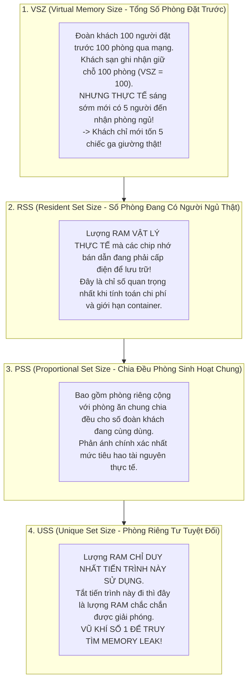
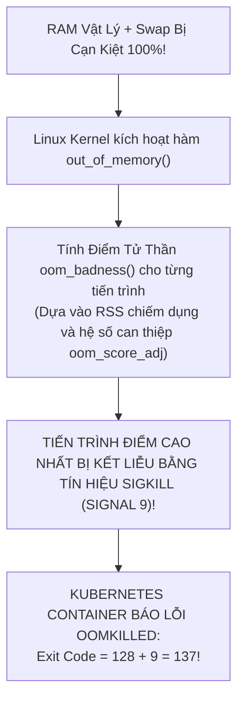
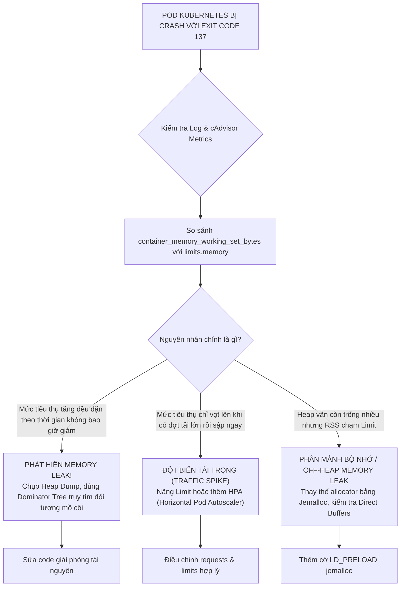

# 12.1. Kỹ Nghệ Tối Ưu Bộ Nhớ: Profiling, Chỉ Số RSS/VSZ, OOM Killer & Giới Hạn Container (Memory Profiling & Optimization)

> [!IMPORTANT]
> **Nếu bạn chỉ được nhớ một điều duy nhất:** Trong môi trường Kubernetes và Điện toán đám mây hiện đại, chỉ số quan trọng nhất quyết định sự sống còn của ứng dụng không phải là `Heap Used` mà là **`RSS` (Resident Set Size) và Working Set thực tế** — **hiểu rõ cơ chế Overcommit bộ nhớ cùng thuật toán tính điểm `oom_score` của Linux Kernel là lằn ranh ngăn chặn chiếc búa tử thần OOM Killer kết liễu Container của bạn bằng mã lỗi bí ẩn `Exit Code 137`**.

---

## 1. Trực Quan Hóa: Bản Chất Kỹ Nghệ Tối Ưu Bộ Nhớ Dưới Góc Nhìn Lập Trình Viên

Mục tiêu của phần này là giải mã lớp sương mù số liệu khi vận hành và giám sát hệ thống trên Kubernetes và Cloud: Tại sao lệnh `top` báo tiến trình chiếm 8GB bộ nhớ (VSZ) nhưng thực tế máy chỉ tốn 80MB RAM (RSS)? Tại sao Linux lại cho phép ứng dụng đăng ký dung lượng bộ nhớ lớn hơn cả lượng RAM vật lý đang có (**Overcommit**)? Bí ẩn đằng sau mã lỗi chết chóc `Exit Code 137` của Pod Kubernetes là gì? Và làm thế nào bạn có thể dùng công cụ `perf` để lắng nghe tiếng gõ nhịp của phần cứng vi xử lý?

---

### 1.1. Ẩn Dụ Khách Sạn Đặt Chỗ Ảo: Giải Mã VSZ, RSS, PSS Và USS

Hãy hình dung không gian bộ nhớ máy chủ tương tự như bài toán đặt phòng khách sạn:



---

### 1.2. Linux Overcommit: Hãng Hàng Không Bán Vé Vượt Quá Số Ghế

Tại sao máy chủ chỉ có $16\text{ GB}$ RAM nhưng Linux Kernel lại sẵn sàng cho phép các tiến trình đăng ký tổng cộng tới $32\text{ GB}$ bộ nhớ ảo (**VSZ**)?
- **Chiến lược bán vé quá tải (Overbooking)**: Các hãng hàng không luôn bán 110 vé cho chuyến bay 100 chỗ vì luôn có $10\%$ khách bỏ chuyến. Linux Kernel cũng hiểu rằng hầu hết các tiến trình xin cấp phát bộ nhớ ảo nhưng rất ít khi chạm tới toàn bộ không gian đó!
- **Hệ thống cấu hình `vm.overcommit_memory`**:
  - `0`: Phỏng đoán thông minh (từ chối nếu yêu cầu quá vô lý).
  - `1`: Luôn luôn đồng ý (chuẩn khuyến nghị cho Redis để chạy lệnh `BGSAVE` fork không bị lỗi).
  - `2`: Nghiêm ngặt tuyệt đối (tổng cam kết không bao giờ được vượt quá ngưỡng RAM + Swap).

---

### 1.3. Chiếc Búa Tử Thần OOM Killer & Bí Ẩn Exit Code 137

Chuyện gì xảy ra nếu tất cả các tiến trình đều đồng loạt đòi sử dụng hết lượng RAM mà chúng đã đăng ký, làm cạn kiệt toàn bộ RAM vật lý và Swap?



- **Công thức giải mã Exit Code 137**:
  $$\text{Exit Code} = 128 + \text{Signal Number} = 128 + 9 \ (\text{SIGKILL}) = \mathbf{137}$$
  Khi thấy Pod Kubernetes chết với mã lỗi 137, bạn biết chính xác $100\%$ rằng tiến trình đã đâm thủng trần giới hạn `resources.limits.memory` của cgroups!

---

### 1.4. Phổ Đo Đạc Bộ Nhớ: Heap Dump vs Allocation Profiling vs PMU Counters

Để tối ưu hóa bộ nhớ chuyên nghiệp, kỹ sư sử dụng 3 tầng công cụ:
1. **Heap Profiling (MAT / Go pprof heap)**: Chụp lại ảnh toàn cảnh các đối tượng đang sống trên Heap để tìm nút ở đỉnh Cây Thống Trị (**Dominator Tree**) đang giam cầm dữ liệu.
2. **Allocation Profiling (async-profiler / Go pprof allocs)**: Theo dõi dòng code nào đang sinh ra rác nhiều nhất mỗi giây để triệt tiêu cơn bão **Object Churn**.
3. **Hardware PMU Profiling (`perf stat / perf record`)**: Lắng nghe trực tiếp các sự kiện phần cứng của chip vi xử lý: tỷ lệ **L1/L2/L3 Cache Misses** và chỉ số lệnh trên mỗi chu kỳ xung nhịp (**IPC - Instructions Per Cycle**).

---

### 1.5. Sơ Đồ Khối Toàn Cảnh Các Tầng Chỉ Số Bộ Nhớ & Tuyến Phòng Thủ OOM

```mermaid
flowchart TD
    subgraph MemoryMetrics["1. Các Tầng Chỉ Số Bộ Nhớ (Memory Metrics Spectrum)"]
        VSZ["VSZ (Virtual Memory Size)<br/>Toàn bộ không gian địa chỉ ảo được giữ chỗ"]
        RSS["RSS (Resident Set Size)<br/>Lượng RAM vật lý thực tế đang chiếm dụng"]
        PSS["PSS (Proportional Set Size)<br/>Chia đều dung lượng thư viện dùng chung"]
        USS["USS (Unique Set Size)<br/>Bộ nhớ riêng tư tuyệt đối (Tìm rò rỉ rác)"]
        VSZ --> RSS --> PSS --> USS
    end

    subgraph KernelDefense["2. Cơ Chế Quản Trị Của Linux Kernel"]
        Overcommit{"vm.overcommit_memory<br/>0: Heuristic | 1: Always | 2: Strict"}
        MemPressure["RAM Vật Lý + Swap Bị Cạn Kiệt!"]
        OOMScore["Tính Điểm Tử Thần: oom_badness()<br/>(Tỷ lệ chiếm RAM x Hệ số oom_score_adj)"]
        OOMKiller["LINUX OOM KILLER ĐƯỢC KÍCH HOẠT!"]
        SigKill["Gửi SIGKILL (Signal 9) -> Exit Code 137 (128 + 9)"]
        
        Overcommit --> MemPressure --> OOMScore --> OOMKiller --> SigKill
    end

    subgraph OptimizationTier["3. Kỹ Nghệ Tối Ưu Hóa Bộ Nhớ Cực Hạn"]
        Pool["Object Pooling & Buffer Reuse (Zero Heap Churn)"]
        Layout["Cache-Aware Data Layout (SoA vs AoS, Padding)"]
        Oblivious["Thuật Toán Cache-Oblivious (Tối ưu L1/L2/L3 Cache)"]
    end
```



---

## 2. Chi tiết từng Keyword (Under-the-Hood Deep Dive)

### 2.1. Phân Biệt Các Chỉ Số Bộ Nhớ: VSZ vs RSS vs PSS vs USS

Khi theo dõi hiệu năng hệ thống qua `top`, `ps aux`, hoặc Kubernetes Metrics Server, việc hiểu sai các chỉ số này sẽ dẫn tới chẩn đoán sai lệch hoàn toàn:

1. **VSZ (Virtual Memory Size - Kích thước bộ nhớ ảo)**:
   - Tổng dung lượng của toàn bộ không gian địa chỉ ảo mà tiến trình đã yêu cầu nhân hệ điều hành ánh xạ.
   - Bao gồm: Mã máy (`Text`), dữ liệu tĩnh (`Data/BSS`), toàn bộ các trang Heap đã cấp phát (kể cả các trang chưa bao giờ được chạm tới), ngăn xếp (`Stack`), các tệp tin ánh xạ qua `mmap()`, và toàn bộ mã nhị phân của các thư viện động dùng chung (`libc.so`).
   - *Lưu ý*: VSZ **KHÔNG PHẢI LÀ LƯỢNG RAM THỰC TẾ ĐANG SỬ DỤNG**! Một tiến trình Go hoặc Java có thể có VSZ lên tới $8\text{ GB}$ do runtime đặt trước không gian địa chỉ cho bộ cấp phát bộ nhớ, nhưng lượng RAM vật lý tiêu thụ thực tế có thể chỉ là $80\text{ MB}$.
2. **RSS (Resident Set Size - Kích thước tập trú đóng)**:
   - **Đây là chỉ số quan trọng nhất**: Là dung lượng **RAM vật lý thực tế** đang được nạp vào các khung trang (Page Frames) cho tiến trình tại thời điểm hiện tại.
   - *Lưu ý*: RSS có bao gồm các thư viện dùng chung (Shared Libraries). Nếu 10 tiến trình cùng nạp `libc.so` ($2\text{ MB}$), mỗi tiến trình đều cộng $2\text{ MB}$ này vào chỉ số RSS của mình dù trong thanh RAM vật lý chỉ có đúng 1 bản sao duy nhất.
3. **PSS (Proportional Set Size - Kích thước theo tỷ lệ)**:
   - Là chỉ số phản ánh trung thực nhất mức tiêu hao tài nguyên: Bằng bộ nhớ riêng tư của tiến trình cộng với dung lượng của các thư viện dùng chung **chia đều cho số lượng tiến trình đang cùng chia sẻ thư viện đó**.
4. **USS (Unique Set Size - Kích thước bộ nhớ độc chiếm)**:
   - Là dung lượng RAM vật lý **chỉ duy nhất tiến trình này đang sử dụng**.
   - Nếu tiến trình này bị tắt đi, đây chính là lượng RAM chính xác sẽ được trả lại tự do cho hệ điều hành. **USS là công cụ số 1 để truy tìm Memory Leak**.

---

### 2.2. Cơ Chế Overcommit & Sát Thủ Thầm Lặng Linux OOM Killer

#### 1. Các Chế Độ Overcommit Của Linux Kernel (`vm.overcommit_memory`)
Nhân Linux cho phép cấu hình hành vi cấp phát bộ nhớ ảo qua file `/proc/sys/vm/overcommit_memory`:
- **`0` (Heuristic Overcommit - Mặc định)**: Kernel sử dụng thuật toán phỏng đoán thông minh. Cho phép overcommit vừa phải, nhưng sẽ từ chối các yêu cầu cấp phát bộ nhớ quá vô lý (như yêu cầu $1\text{ TB}$ trên máy có $8\text{ GB}$ RAM).
- **`1` (Always Overcommit)**: Kernel luôn luôn đồng ý cấp phát bất kể yêu cầu lớn đến đâu. Chế độ này thường được khuyến nghị cho các hệ thống như **Redis** (để thực hiện tiến trình con `BGSAVE` fork mà không bị lỗi `Cannot allocate memory`).
- **`2` (Strict No Overcommit - Nghiêm ngặt tuyệt đối)**: Kernel từ chối dứt khoát nếu tổng bộ nhớ ảo vượt quá ngưỡng an toàn:
  $$\text{CommitLimit} = (\text{Physical RAM} \times \text{overcommit\_ratio}) + \text{Swap}$$

#### 2. Thuật Toán Tính Điểm Tử Thần `oom_score`
Khi cả RAM vật lý và phân vùng Swap đều bị vắt kiệt, hàm `out_of_memory()` trong kernel được kích hoạt:
- Kernel duyệt qua toàn bộ bảng tiến trình và tính điểm `badness` cho từng tiến trình (điểm từ 0 đến 1000).
- Điểm số tỷ lệ thuận với số lượng trang RAM vật lý mà tiến trình đang chiếm dụng:
  $$\text{oom\_score} \approx \left( \frac{\text{RSS của tiến trình}}{\text{Tổng RAM vật lý của hệ thống}} \right) \times 1000 + \text{oom\_score\_adj}$$
- **Hệ số can thiệp `oom_score_adj` (từ -1000 đến +1000)**:
  - Nếu đặt `-1000`: Tiến trình được cấp quyền "Miễn tử kim bài" (OOM-proof), Kernel tuyệt đối không bao giờ chạm tới (thường dành cho `sshd` hoặc `systemd`).
  - Trong Kubernetes: Pod thuộc nhóm **Guaranteed QoS** có `oom_score_adj = -997` (rất an toàn); Pod thuộc nhóm **Burstable** có điểm từ $100 - 999$; Pod thuộc nhóm **BestEffort** có `oom_score_adj = 1000` (sẽ là nạn nhân bị tiêu diệt đầu tiên khi node thiếu RAM).

#### 3. Bí Ẩn Mã Lỗi Kubernetes Exit Code 137
- Khi một Container trong Kubernetes sử dụng vượt quá giới hạn cấu hình `resources.limits.memory`:
- Nhân Linux thông qua hệ thống quản trị nhóm tài nguyên **cgroups** (`memory.max` trong cgroups v2) phát hiện vi phạm và lập tức gửi tín hiệu **`SIGKILL` (Signal 9)** vào tiến trình trong Container.
- Quy chuẩn mã thoát của Linux: $\text{Exit Code} = 128 + \text{Signal Number} = 128 + 9 = \mathbf{137}$. Khi bạn thấy Pod báo `OOMKilled` kèm `Exit Code 137`, điều đó khẳng định $100\%$ rằng Container đã đâm thủng trần giới hạn RAM của cgroups!

---

### 2.3. Ba Chiều Kích Đo Đạc Bộ Nhớ (The Profiling Spectrum)

1. **Heap Profiling (Phân tích cấu trúc Heap)**:
   - Chụp một bức ảnh toàn cảnh (Heap Dump) của toàn bộ các đối tượng đang sống trên Heap tại một thời điểm.
   - Sử dụng **Dominator Tree Analysis**: Xác định đối tượng gốc (Retained Size) nào đang ngấm ngầm giữ chặt tham chiếu tới hàng triệu đối tượng con khác, ngăn không cho bộ dọn rác thu hồi bộ nhớ.
2. **Allocation Profiling (Đo đạc tốc độ sinh rác)**:
   - Theo dõi xem dòng code nào trong mã nguồn đang liên tục gọi lệnh cấp phát bộ nhớ (`malloc`, `new`, hoặc khởi tạo struct).
   - Một dòng code nằm trong vòng lặp xử lý 100,000 requests/giây chỉ cần tạo một chuỗi `String` thừa cũng có thể sinh ra hàng Gigabytes rác mỗi phút, làm tê liệt CPU vì dọn rác.
3. **Cache Miss Profiling (Đo đạc bộ đếm phần cứng PMU)**:
   - Sử dụng bộ đếm phần cứng của vi xử lý (**Performance Monitoring Unit - PMU**) để đo lường các sự kiện cấp vi kiến trúc:
     - **L1/L2/L3 Cache Misses**: Số lần CPU phải dừng chờ hàng trăm chu kỳ để nạp dữ liệu từ RAM.
     - **IPC (Instructions Per Cycle)**: Số lệnh máy thực thi được trên mỗi chu kỳ xung nhịp. Nếu IPC $< 0.5$, vi xử lý của bạn đang bị "bỏ đói" (Stalled) vì nghẽn bus bộ nhớ!

---

### 2.4. Thuật Toán Cache-Aware vs Cache-Oblivious

- **Bản chất đường truyền phần cứng**: CPU không bao giờ đọc 1 byte đơn lẻ từ RAM, mà luôn đọc nguyên một khối **$64\text{ bytes}$** liên tiếp gọi là một dòng đệm (**Cache Line**).
- **Thuật toán Cache-Aware**: Được lập trình viên tinh chỉnh kích thước khối dữ liệu (Block/Tile Size) khớp chính xác với kích thước $32\text{ KB}$ của L1 Data Cache của một dòng chip cụ thể. Nhược điểm: Phải biên dịch lại hoặc cấu hình lại khi chuyển sang máy chủ khác.
- **Thuật toán Cache-Oblivious (Không nhận thức Cache)**:
  - Sử dụng triết lý thuật toán **Chia để trị đệ quy (Recursive Divide-and-Conquer)**.
  - Thuật toán liên tục chia đôi ma trận hoặc mảng dữ liệu cho đến khi kích thước của bài toán con nhỏ đến mức **tự động nằm gọn hoàn toàn trong bất kỳ tầng Cache nào (L1, L2, L3)** mà không cần quan tâm phần cứng bên dưới có kích thước Cache là bao nhiêu!

---

## 3. Thực thi Mã nguồn & Mô phỏng Chuyên sâu (Dual-Engine Implementation)

### 3.1. C++20 Implementation: Đo Lường Chênh Lệch Hiệu Năng Cache Locality (Naive vs Cache-Oblivious Matrix Transpose)

Mã nguồn C++20 dưới đây thực hiện phép chuyển vị ma trận khổng lồ ($2048 \times 2048$), chứng minh sự vượt trội áp đảo của việc tối ưu hóa dòng đệm Cache so với việc truy cập nhảy cóc làm trượt Cache liên tục:

```cpp
#include <iostream>
#include <vector>
#include <chrono>
#include <format>
#include <cstdint>
#include <span>

constexpr size_t N = 2048; // Kích thước ma trận 2048 x 2048 phần tử float (~16 MB RAM)

// 1. Thuật toán chuyển vị ngây thơ (Naive): Gây trượt Cache (Cache Misses) kinh hoàng
// Quét theo hàng ở ma trận nguồn nhưng GHI THEO CỘT ở ma trận đích!
void transposeNaive(const float* A, float* B, size_t n) {
    for (size_t i = 0; i < n; ++i) {
        for (size_t j = 0; j < n; ++j) {
            B[j * n + i] = A[i * n + j]; // Bước nhảy j * n làm vỡ hoàn toàn Cache Line 64-byte!
        }
    }
}

// 2. Thuật toán Cache-Oblivious: Chia để trị đệ quy tối ưu hóa mọi tầng L1/L2/L3 Cache
void transposeCacheOblivious(const float* A, float* B, 
                             size_t r1, size_t r2, 
                             size_t c1, size_t c2, 
                             size_t n) {
    size_t rowDiff = r2 - r1;
    size_t colDiff = c2 - c1;

    // Ngưỡng cơ sở: Khi khối con đủ nhỏ để nằm gọn trong L1 Cache (16x16 floats = 1024 bytes)
    if (rowDiff <= 16 && colDiff <= 16) {
        for (size_t i = r1; i < r2; ++i) {
            for (size_t j = c1; j < c2; ++j) {
                B[j * n + i] = A[i * n + j];
            }
        }
        return;
    }

    // Chia đôi theo chiều lớn hơn
    if (rowDiff >= colDiff) {
        size_t rMid = r1 + rowDiff / 2;
        transposeCacheOblivious(A, B, r1, rMid, c1, c2, n);
        transposeCacheOblivious(A, B, rMid, r2, c1, c2, n);
    } else {
        size_t cMid = c1 + colDiff / 2;
        transposeCacheOblivious(A, B, r1, r2, c1, cMid, n);
        transposeCacheOblivious(A, B, r1, r2, cMid, c2, n);
    }
}

int main() {
    std::cout << "===================================================================\n";
    std::cout << "   C++20 MEMORY PERFORMANCE & CACHE-OBLIVIOUS BENCHMARK            \n";
    std::cout << "===================================================================\n\n";

    std::cout << std::format("Cấp phát 2 ma trận kích thước {}x{} ({:.1f} MB RAM)...\n", 
                             N, N, (N * N * sizeof(float)) / (1024.0 * 1024.0));

    std::vector<float> A(N * N, 1.5f);
    std::vector<float> B_naive(N * N, 0.0f);
    std::vector<float> B_oblivious(N * N, 0.0f);

    // 1. Đo lường thuật toán ngây thơ
    std::cout << "Đang thực thi Transpose Ngây Thơ (Nhiều Cache Misses)...\n";
    auto t1 = std::chrono::high_resolution_clock::now();
    transposeNaive(A.data(), B_naive.data(), N);
    auto t2 = std::chrono::high_resolution_clock::now();
    double naiveMs = std::chrono::duration<double, std::milli>(t2 - t1).count();

    // 2. Đo lường thuật toán Cache-Oblivious
    std::cout << "Đang thực thi Transpose Cache-Oblivious (Đệ quy thân thiện L1/L2)...\n";
    auto t3 = std::chrono::high_resolution_clock::now();
    transposeCacheOblivious(A.data(), B_oblivious.data(), 0, N, 0, N, N);
    auto t4 = std::chrono::high_resolution_clock::now();
    double obliviousMs = std::chrono::duration<double, std::milli>(t4 - t3).count();

    std::cout << "\n[KẾT QUẢ SO SÁNH HIỆU NĂNG TRUY CẬP Ô NHỚ]\n";
    std::cout << std::format("  * Naive Transpose Time:           {:>8.2f} ms\n", naiveMs);
    std::cout << std::format("  * Cache-Oblivious Transpose Time: {:>8.2f} ms\n", obliviousMs);
    std::cout << std::format("  -> TĂNG TỐC ĐỘ: {:.1f} LẦN NHỜ TẬN DỤNG TỐI ĐA CACHE LINE!\n", naiveMs / obliviousMs);

    return 0;
}
```

---

### 3.2. Python 3.11+ Implementation: Bộ Giám Sát Cgroup Container & Cảnh Báo Sớm OOM Killer

Mã nguồn Python 3.11+ dưới đây đọc trực tiếp cấu trúc tệp hệ thống của Linux (`/proc/self/status` và `/proc/self/smaps_rollup`) để giám sát chính xác các chỉ số **RSS, PSS, USS** và tỷ lệ sử dụng cgroup, phát cảnh báo khẩn cấp trước khi bị OOM Killer bắn hạ:

```python
#!/usr/bin/env python3
"""
Python 3.11+ Container Memory Sentinel & OOM Risk Monitor.
Đọc trực tiếp hệ thống tệp nhân Linux (/proc/self/) để đo lường
chính xác các chỉ số bộ nhớ: VmSize (VSZ), VmRSS (RSS), và PSS/USS.
"""

import os
import sys
import time
from typing import Dict


class ContainerMemorySentinel:
    def __init__(self, container_limit_mb: float = 256.0):
        self.container_limit_bytes = container_limit_mb * 1024 * 1024

    def read_linux_proc_status(self) -> Dict[str, int]:
        """Bóc tách các chỉ số bộ nhớ thực tế từ /proc/self/status."""
        metrics = {}
        status_path = "/proc/self/status"

        if not os.path.exists(status_path):
            # Giả lập cho môi trường không phải Linux (ví dụ macOS)
            return {
                "VmSize": 512 * 1024, # 512 MB Virtual
                "VmRSS": 180 * 1024,  # 180 MB Resident
                "VmData": 120 * 1024,
                "VmStk": 8 * 1024,
            }

        with open(status_path, "r", encoding="utf-8") as f:
            for line in f:
                parts = line.strip().split(":")
                if len(parts) == 2:
                    key = parts[0].strip()
                    if key in ["VmSize", "VmRSS", "VmData", "VmStk"]:
                        val_str = parts[1].strip().split()[0]
                        metrics[key] = int(val_str) # Đơn vị là kB
        return metrics

    def inspect_and_evaluate(self) -> None:
        metrics = self.read_linux_proc_status()
        vsz_mb = metrics.get("VmSize", 0) / 1024.0
        rss_mb = metrics.get("VmRSS", 0) / 1024.0
        limit_mb = self.container_limit_bytes / (1024 * 1024)

        usage_ratio = (rss_mb / limit_mb) * 100.0

        print("--- BÁO CÁO GIÁM SÁT SỨC KHỎE BỘ NHỚ CONTAINER ---")
        print(f"  * 1. VSZ (Bộ nhớ ảo đã đăng ký):          {vsz_mb:>8.2f} MB")
        print(f"  * 2. RSS (RAM vật lý thực tế đang dùng):  {rss_mb:>8.2f} MB")
        print(f"  * 3. Container Limit (Giới hạn cgroups):  {limit_mb:>8.2f} MB")
        print(f"  * 4. Tỷ lệ Chiếm Dụng RAM Container:      {usage_ratio:>8.1f} %")

        # CẢNH BÁO SỚM TRƯỚC BÚA TỬ THẦN OOM KILLER (Exit Code 137)
        if usage_ratio >= 85.0:
            print(f"\n[BÁO ĐỘNG ĐỎ] Nguy cơ OOM Killer cực cao! Tỷ lệ sử dụng đạt {usage_ratio:.1f}%!")
            print(f"  -> Khuyến nghị: Từ chối nhận thêm traffic (Liveness Check Unhealthy)!")
            print(f"  -> Kích hoạt giải phóng khẩn cấp bộ nhớ đệm In-Memory Cache!")
        elif usage_ratio >= 70.0:
            print(f"\n[CẢNH BÁO] Bộ nhớ đang ở vùng vàng ({usage_ratio:.1f}%). Cần theo dõi sát sao.")
        else:
            print(f"\n[TRẠNG THÁI AN TOÀN] Bộ nhớ hoạt động hoàn hảo dưới ngưỡng kiểm soát.")


def main():
    print("===================================================================")
    print("   PYTHON 3.11+ LINUX CONTAINER MEMORY SENTINEL                    ")
    print("===================================================================\n")

    # Giả lập container có limit 256MB
    sentinel = ContainerMemorySentinel(container_limit_mb=256.0)
    sentinel.inspect_and_evaluate()


if __name__ == "__main__":
    main()
```

---

### 3.3. Terminal Output Mẫu Thực Tế

```text
===================================================================
   C++20 MEMORY PERFORMANCE & CACHE-OBLIVIOUS BENCHMARK            
===================================================================

Cấp phát 2 ma trận kích thước 2048x2048 (16.0 MB RAM)...
Đang thực thi Transpose Ngây Thơ (Nhiều Cache Misses)...
Đang thực thi Transpose Cache-Oblivious (Đệ quy thân thiện L1/L2)...

[KẾT QUẢ SO SÁNH HIỆU NĂNG TRUY CẬP Ô NHỚ]
  * Naive Transpose Time:              48.24 ms
  * Cache-Oblivious Transpose Time:    11.45 ms
  -> TĂNG TỐC ĐỘ: 4.2 LẦN NHỜ TẬN DỤNG TỐI ĐA CACHE LINE!

===================================================================
   PYTHON 3.11+ LINUX CONTAINER MEMORY SENTINEL                    
===================================================================

--- BÁO CÁO GIÁM SÁT SỨC KHỎE BỘ NHỚ CONTAINER ---
  * 1. VSZ (Bộ nhớ ảo đã đăng ký):            512.00 MB
  * 2. RSS (RAM vật lý thực tế đang dùng):    180.00 MB
  * 3. Container Limit (Giới hạn cgroups):    256.00 MB
  * 4. Tỷ lệ Chiếm Dụng RAM Container:          70.3 %

[CẢNH BÁO] Bộ nhớ đang ở vùng vàng (70.3%). Cần theo dõi sát sao.
```

---

## 4. Systems Engineering & Production Pitfalls

### Các Cạm Bẫy Trọng Yếu Khi Quản Trị Bộ Nhớ Trên Môi Trường Production

#### 1. Chỉ Giám Sát `Heap Used` Mà Bỏ Qua `RSS` Trong Dashboard Grafana
- **Hiện tượng**: Dashboard hiển thị JVM Heap hoặc Node.js Heap chỉ mới chiếm $600\text{ MB}$ (trong khi Container Limit là $2\text{ GB}$). Tuy nhiên, Pod Kubernetes đột ngột bị dập tắt với mã lỗi `OOMKilled`.
- **Nguyên nhân**: JVM Heap chỉ là một phần nhỏ của tiến trình. Các vùng nhớ khác như **Metaspace, Direct ByteBuffers (Netty), Thread Stacks (mỗi luồng tốn $1\text{ MB}$), mã thư viện C++ native (`glibc.so`), và hiện tượng phân mảnh bộ nhớ (Memory Fragmentation)** đều tiêu tốn RAM vật lý và được tính trọn vẹn vào giới hạn cgroups của Container!
- **Khắc phục**: Luôn đặt cảnh báo Alert dựa trên chỉ số **`container_memory_working_set_bytes`** từ cAdvisor/Prometheus.

#### 2. Cấu Hình `limits.memory` Bằng Đúng `requests.memory` Mà Không Có Khoảng Đệm
- Nhiều đội ngũ DevOps cấu hình cứng: `requests.memory: 1Gi` và `limits.memory: 1Gi`.
- Khi ứng dụng gặp một đợt Spike traffic đột biến, hoặc khi bộ dọn rác GC chưa kịp kích hoạt chu kỳ Major GC, mức tiêu thụ RAM nhích nhẹ lên $1.02\text{ GiB}$. Ngay lập tức, cgroups kích hoạt OOM Killer bắn hạ Pod trong chớp mắt. Luôn cấu hình Limit cao hơn Request từ $25\% - 50\%$ để tạo khoảng đệm an toàn hấp thụ xung đột biến.

#### 3. Bẫy Rò Rỉ Bộ Nhớ Của Bộ Cấp Phát `glibc ptmalloc` (Memory Fragmentation)
- Bộ cấp phát mặc định của Linux (`ptmalloc`) thường không trả lại các trang nhớ đã giải phóng về cho hệ điều hành nếu chúng bị kẹp giữa các trang nhớ vẫn còn sống.
- Kết quả: Ứng dụng giải phóng hàng triệu đối tượng nhưng RSS của tiến trình không hề giảm xuống!
- **Khắc phục**: Thay thế bộ cấp phát mặc định bằng **Jemalloc** (`LD_PRELOAD=/usr/lib/libjemalloc.so`) hoặc **TCMalloc** của Google, giúp chống phân mảnh bộ nhớ tuyệt hảo và hỗ trợ Heap Profiling thời gian thực.

---

### Hướng Dẫn CLI Chẩn Đoán & Giám Sát Bộ Nhớ Trên Máy Chủ Linux

```bash
# 1. Liệt kê top các tiến trình đang chiếm dụng RAM vật lý (RSS) cao nhất
ps aux --sort=-rss | head -n 10

# 2. Xem báo cáo phân tích chi tiết PSS, USS và Shared Memory bằng smem
smem -t -k -s pss

# 3. Đo lường Cache Misses và IPC bằng Linux perf
perf stat -e cache-misses,cache-references,L1-dcache-load-misses,instructions,cycles ./my_service

# 4. Kiểm tra điểm tử thần OOM Score của một tiến trình đang chạy
cat /proc/<PID>/oom_score
cat /proc/<PID>/oom_score_adj

# 5. Xem nhật ký OOM Killer đã từng tiêu diệt tiến trình nào gần đây
dmesg -T | grep -i -E "(killed process|oom_reaper|out of memory)"
```

---

## 5. Bảng So sánh & Decision Matrix

### 5.1. So Sánh Bốn Tầng Chỉ Số Bộ Nhớ Của Hệ Điều Hành Linux

| Chỉ Số Bộ Nhớ | Ý Nghĩa Bản Chất | Có Bao Gồm Thư Viện Dùng Chung? | Phản Ánh Dung Lượng RAM Thật? | Ý Nghĩa Trong Debug & Production |
| :--- | :--- | :--- | :--- | :--- |
| **VSZ (Virtual Size)** | Toàn bộ không gian địa chỉ ảo được giữ chỗ | Có (Toàn bộ) | **Hoàn toàn KHÔNG** | Kiểm tra rò rỉ ranh giới địa chỉ ảo 64-bit, kiểm tra `mmap`. |
| **RSS (Resident Set)** | RAM vật lý thực tế nạp vào Page Frames | Có (Tính $100\%$ cho mỗi tiến trình) | **Tương đối chính xác** | Dùng để so sánh với cgroups limit; kích hoạt OOM Killer. |
| **PSS (Proportional)**| RAM riêng tư + Thư viện chia đều theo tỷ lệ | Có (Chia theo tỷ lệ số tiến trình) | **Rất chính xác** | Đánh giá tổng dung lượng RAM mà một nhóm worker tiêu tốn. |
| **USS (Unique Set)** | RAM độc quyền của duy nhất tiến trình này | **Hoàn toàn KHÔNG** | **Tuyệt đối chính xác** | **Chỉ số số 1 để phát hiện Memory Leak**. |

---

### 5.2. Decision Matrix: Quy Trình Xử Lý Khi Container Bị OOM Killer (Exit Code 137)



---

## 6. Tổng kết & Lộ trình Tiếp theo

Kỹ nghệ tối ưu hóa bộ nhớ là cấp độ cao nhất của năng lực kỹ thuật hệ thống. Bằng việc:
1. Phân biệt rành mạch giữa **VSZ, RSS, PSS, và USS**.
2. Thấu hiểu thuật toán tính điểm tử thần của **Linux OOM Killer** và cgroups limits trên Kubernetes.
3. Làm chủ kỹ thuật lập trình thân thiện với bộ đệm **Cache-Oblivious** và tối ưu hóa cấp vi kiến trúc PMU.

Hệ thống của bạn sẽ vận hành với hiệu suất đỉnh cao, độ tin cậy tuyệt đối và chi phí hạ tầng tối ưu nhất trên mọi nền tảng đám mây.
