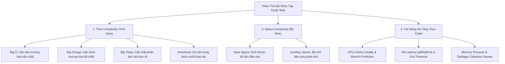
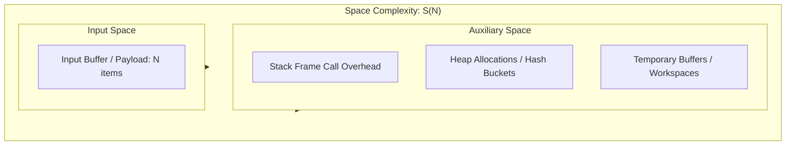
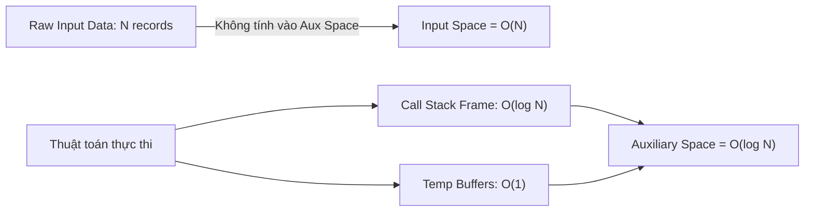
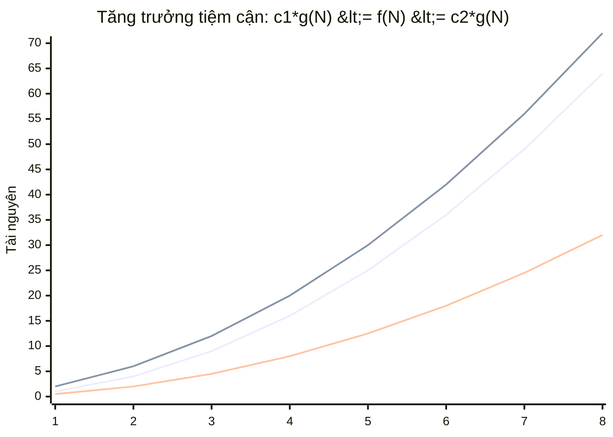
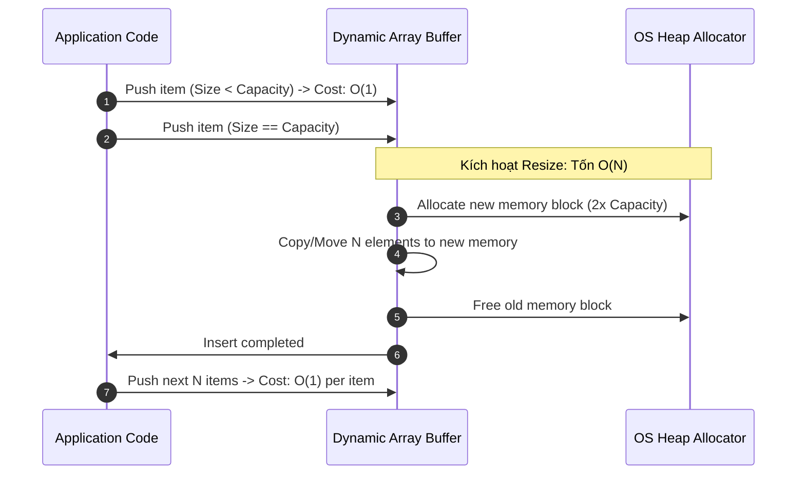

# 1.1. Phân Tích Độ Phức Tạp Thuật Toán (Complexity Analysis)

> [!IMPORTANT]
> **Nếu bạn chỉ được nhớ một điều duy nhất:** Phân tích độ phức tạp (Complexity Analysis) không nhằm đo đếm thời gian chạy chính xác bằng giây (vì số giây phụ thuộc vào xung nhịp CPU, nhiệt độ phần cứng và hệ điều hành), mà là công cụ toán học hình thức nhằm xác định **tốc độ tăng trưởng tài nguyên (CPU cycles & RAM bytes)** khi quy mô dữ liệu $N$ tăng dần về vô cùng. Một thuật toán $O(N^2)$ có thể chạy nhanh hơn $O(N)$ khi $N = 5$, nhưng chắc chắn sẽ đánh sập toàn bộ cụm máy chủ Backend khi $N = 1{,}000{,}000$.

---

## 1. Trực Quan Hóa: Bản Chất Phân Tích Độ Phức Tạp Dưới Góc Nhìn Lập Trình Viên

### 1.1. Đoạn Code Dẫn Nhập & Vấn Đề Thực Tế
Xét bài toán kinh điển trong một API Gateway: Kiểm tra xem danh sách $N$ ID người dùng gửi lên có chứa phần tử trùng lặp hay không:

```typescript
// Cách 1: Hai vòng lặp lồng nhau (Nested Loops) - O(N^2)
function hasDuplicate_Naive(ids: string[]): boolean {
  for (let i = 0; i < ids.length; i++) {
    for (let j = i + 1; j < ids.length; j++) {
      if (ids[i] === ids[j]) return true; // Với N = 100,000 -> 5 tỷ phép so sánh!
    }
  }
  return false;
}

// Cách 2: Tận dụng Hash Set để đánh đổi không gian lấy thời gian - O(N) Time, O(N) Space
function hasDuplicate_Optimized(ids: string[]): boolean {
  const seen = new Set<string>();
  for (const id of ids) {
    if (seen.has(id)) return true; // Tra cứu O(1)
    seen.add(id);
  }
  return false; // Với N = 100,000 -> Chỉ tốn đúng 100,000 bước tra cứu!
}
```

- Với $N = 100$: Cả hai hàm đều phản hồi trong chưa đầy $0.1\text{ ms}$.
- Với $N = 100{,}000$: Cách 1 thực hiện khoảng $5 \times 10^9$ phép tính, CPU chạy $100\%$ trong gần $10\text{ giây}$ khiến API Gateway bị timeout ($504$ Gateway Timeout). Trong khi đó, Cách 2 chỉ tốn đúng $10^5$ phép tính, hoàn thành trong $3\text{ ms}$!

### 1.2. Ẩn Dụ Đời Sống: Nhà Bếp, Đơn Đặt Hàng & Diện Tích Bàn Chế Biến
Để hiểu thấu đáo về Time Complexity và Space Complexity, hãy tưởng tượng một căn bếp nhà hàng:
- **Kích thước đầu vào ($N$)**: Số lượng thực khách bước vào nhà hàng cùng một lúc.
- **Time Complexity (Độ phức tạp thời gian)**: Số phút mà đầu bếp cần làm việc để nấu xong bữa ăn cho $N$ người.
  - $O(1)$ (Món cố định): Nồi súp đã nấu sẵn một nồi khổng lồ. Dù có 1 khách hay 100 khách gọi súp, đầu bếp chỉ việc múc ra bát trong 5 giây.
  - $O(N)$ (Món cuốn thủ công): Mỗi thực khách yêu cầu cuốn 1 chiếc nem. 10 khách tốn 10 phút, 100 khách tốn 100 phút.
  - $O(N^2)$ (Giao lưu chào bàn): Mỗi thực khách muốn cụng ly chúc rượu với tất cả những thực khách còn lại trong phòng ăn. Khi có 10 người, có 45 lượt cụng ly; khi có 100 người, có tới 4,950 lượt cụng ly!
- **Space Complexity (Độ phức tạp không gian)**: Diện tích mặt bàn bếp mà đầu bếp cần bày biện nguyên liệu trong lúc nấu.
  - **Input Space**: Thúng rau và khay thịt mà khách mang đến (dữ liệu đầu vào).
  - **Auxiliary Space**: Số lượng đĩa sạch, thớt phụ, tô trộn mà đầu bếp phải lấy thêm từ tủ ra để phục vụ việc sơ chế.

### 1.3. Mô Phỏng Dữ Liệu Số Nhỏ Từng Bước (Toy Walkthrough)
Giả sử CPU máy chủ hiện đại thực hiện được khoảng $10^9$ phép tính cơ bản mỗi giây ($1\text{ GHz}$ tương đương $1\text{ cycle/ns}$). Dưới đây là bảng số liệu so sánh số phép tính khi kích thước đầu vào $N$ tăng dần:

| Ký pháp Big O | $N = 10$ | $N = 100$ | $N = 1{,}000$ | $N = 1{,}000{,}000$ | Thời gian ước tính ($N = 10^6$) |
| :--- | :--- | :--- | :--- | :--- | :--- |
| **$O(1)$** | $1$ | $1$ | $1$ | $1$ | $\approx 1\text{ ns}$ (Tức thì) |
| **$O(\log N)$** | $3.3$ | $6.6$ | $10$ | $20$ | $\approx 20\text{ ns}$ (Tức thì) |
| **$O(N)$** | $10$ | $100$ | $1{,}000$ | $1{,}000{,}000$ | $\approx 1\text{ ms}$ (Cực nhanh) |
| **$O(N \log N)$** | $33$ | $664$ | $9{,}965$ | $2 \times 10^7$ | $\approx 20\text{ ms}$ (Chấp nhận được) |
| **$O(N^2)$** | $100$ | $10{,}000$ | $10^6$ | $10^{12}$ | $\approx 16.6\text{ phút}$ (Treo hệ thống!) |
| **$O(2^N)$** | $1{,}024$ | $1.26 \times 10^{30}$ | Cực đại | Không thể tính | Vũ trụ sụp đổ trước khi chạy xong! |

### 1.4. Tác Động Thực Tế Tầng Backend & Systems
1. **SLA & Microservices Cascading Failure**: Một thuật toán $O(N^2)$ trong Service phân tích đơn hàng có thể khiến Service đó chậm phản hồi $10\text{ giây}$, làm cạn kiệt Connection Pool của API Gateway, kích hoạt hiệu ứng domino làm sập toàn bộ hệ thống microservices.
2. **CPU Throttling trên Kubernetes / Container**: Khi thuật toán tiêu tốn quá nhiều CPU cycles, CPU cgroup quota của container bị vượt quá ngưỡng giới hạn, Kubernetes sẽ throttle (bóp) CPU, khiến các request tiếp theo bị nghẽn nghiêm trọng.
3. **Out-of-Memory (OOM) Killer**: Một hàm đệ quy không tối ưu có độ phức tạp bộ nhớ phụ trợ $Auxiliary Space = O(N)$ tạo ra $10^6$ Stack Frames sẽ ngay lập tức gây `StackOverflowError` hoặc bị Linux OOM Killer gửi tín hiệu `SIGKILL` tiêu diệt tiến trình.

### 1.5. Sơ Đồ Tư Duy & Kiến Trúc Phân Tích Độ Phức Tạp



---

## 2. Chi tiết từng Keyword (Under-the-Hood Deep Dive)

---

### 2.1. Time Complexity & Space Complexity

#### 1. Khái niệm bản chất (What & Why)
* **Time Complexity (Độ phức tạp thời gian)**: Hàm số $T(N)$ biểu diễn số lượng phép tính cơ bản (primitive operations: gán, so sánh, phép toán số học, dereference con trỏ) mà CPU phải thực hiện theo kích thước đầu vào $N$.
* **Space Complexity (Độ phức tạp không gian)**: Hàm số $S(N)$ đo lường tổng lượng bộ nhớ (Stack frame, Heap allocation, Global segment) cần thiết để chương trình hoàn thành tính toán theo $N$.

#### 2. Cơ chế hoạt động sâu (Under the hood / Hardcore Internals)
* **Tầng CPU Cycles**: Mỗi phép tính cơ bản chuyển thành một hoặc nhiều mã máy Assembly (ví dụ: `mov`, `add`, `cmp`, `jne`). Thời gian thực thi thực tế phụ thuộc vào Instruction Latency (số clock cycles để hoàn thành lệnh) và CPU Throughput.
* **Tầng Memory Layout**: Bộ nhớ không gian bao gồm cả Virtual Memory pages được ánh xạ vào physical frames. Khi Space Complexity tăng cao, hệ thống có thể gặp tình trạng Cache thrashing, Page Faults và kích hoạt cơ chế Out-Of-Memory (OOM) Killer của Linux kernel.

#### 3. Sơ đồ minh họa bộ nhớ


#### 4. Code ví dụ thực chiến (C++)
```cpp
#include <vector>
#include <iostream>

// Hàm tính tổng mảng
// Input Space: O(N) do vector<int> truyền vào
// Auxiliary Space: O(1) vì chỉ dùng 1 biến biến tích lũy sum
// Time Complexity: O(N) với N là số phần tử
long long calculateSum(const std::vector<int>& data) {
    long long sum = 0; // 8 bytes trên Stack Frame
    for (size_t i = 0; i < data.size(); ++i) { // i tăng tuyến tính
        sum += data[i]; // 1 memory read + 1 addition
    }
    return sum;
}
```

#### 5. Pitfalls & Anti-patterns
* Nhầm lẫn giữa số phép toán lý thuyết và thời gian chạy thực tế (bỏ qua chi phí phân bổ bộ nhớ động, cache miss).
* Pass-by-value cấu trúc dữ liệu lớn thay vì Pass-by-reference (`const &`), khiến Auxiliary Space tăng đột biến từ $O(1)$ thành $O(N)$ do copy buffer.

#### 6. Ứng dụng Backend / Systems
* Xác định khả năng chịu tải của API endpoint khi kích thước JSON payload gửi lên tăng từ 1KB lên 100MB.

---

### 2.2. Auxiliary Space & Input Size

#### 1. Khái niệm bản chất (What & Why)
* **Auxiliary Space (Bộ nhớ phụ trợ)**: Lượng không gian bộ nhớ tạm thời được giải thuật sử dụng thêm trong quá trình tính toán, **loại trừ** bộ nhớ lưu trữ chính dữ liệu đầu vào.
  $$\text{Space Complexity} = \text{Input Space} + \text{Auxiliary Space}$$
* **Input Size ($N$)**: Đại lượng đo lường quy mô của dữ liệu đầu vào (ví dụ: số lượng phần tử mảng, số lượng đỉnh $V$ và cạnh $E$ trong đồ thị, số byte chuỗi ký tự, hoặc số lượng bit của một số nguyên lớn).

#### 2. Cơ chế hoạt động sâu (Under the hood / Hardcore Internals)
* Khi đánh giá thuật toán In-place (như QuickSort hoặc HeapSort), người ta tập trung vào **Auxiliary Space**. QuickSort có Space Complexity là $O(N)$ nếu tính mảng đầu vào, nhưng Auxiliary Space chỉ là $O(\log N)$ (cho call stack đệ quy).
* Trong hệ thống phân tán, Input Size $N$ thường được định nghĩa theo luồng streaming hoặc kích thước phân mảnh (partition size) trong Kafka/Spark.

#### 3. Sơ đồ phân biệt


#### 4. Code ví dụ thực chiến (C++)
```cpp
#include <vector>
#include <algorithm>

// MergeSort thông thường: Auxiliary Space O(N) do cần mảng đệm temp
void merge(std::vector<int>& arr, int left, int mid, int right) {
    std::vector<int> temp(right - left + 1); // Cấp phát Heap: Auxiliary Space O(K)
    int i = left, j = mid + 1, k = 0;
    while (i <= mid && j <= right) {
        if (arr[i] <= arr[j]) temp[k++] = arr[i++];
        else temp[k++] = arr[j++];
    }
    while (i <= mid) temp[k++] = arr[i++];
    while (j <= right) temp[k++] = arr[j++];
    for (int p = 0; p < k; ++p) arr[left + p] = temp[p];
}
```

#### 5. Pitfalls
* Nhận định sai rằng thuật toán đệ quy không tốn thêm bộ nhớ. Mỗi tầng đệ quy đẩy một Stack Frame (chứa return address, base pointer, local variables) vào Call Stack (thường giới hạn ở 8MB trên Linux thread stack). Đệ quy quá sâu $N = 10^6$ sẽ lập tức gây **Segmentation Fault (Stack Overflow)**.

#### 6. Ứng dụng Backend / Systems
* Lựa chọn thuật toán In-place cho các microservices chạy trong Container (Docker/K8s) bị giới hạn nghiêm ngặt về RAM (cgroup memory limit: 256MB).

---

### 2.3. Asymptotic Notation: Big O, Big Omega ($\Omega$), Big Theta ($\Theta$)

#### 1. Khái niệm bản chất (What & Why)
Ký pháp tiệm cận dùng để mô tả giới hạn hành vi của hàm số khi $N \to \infty$:
* **Big O ($O$) — Upper Bound (Cận trên)**: $f(N) = O(g(N))$ nếu tồn tại hằng số $c > 0$ và $N_0 \ge 0$ sao cho $f(N) \le c \cdot g(N)$ với mọi $N \ge N_0$. Thuật toán sẽ không bao giờ chạy tệ hơn mức này (trần hiệu năng).
* **Big Omega ($\Omega$) — Lower Bound (Cận dưới)**: $f(N) = \Omega(g(N))$ nếu tồn tại hằng số $c > 0$ và $N_0 \ge 0$ sao cho $f(N) \ge c \cdot g(N)$ với mọi $N \ge N_0$. Thuật toán không thể chạy nhanh hơn mức này (sàn hiệu năng).
* **Big Theta ($\Theta$) — Tight Bound (Cận chặt)**: $f(N) = \Theta(g(N))$ khi và chỉ khi $f(N) = O(g(N))$ và $f(N) = \Omega(g(N))$. Nghĩa là tồn tại các hằng số $c_1, c_2 > 0$ sao cho $c_1 \cdot g(N) \le f(N) \le c_2 \cdot g(N)$ với mọi $N \ge N_0$.

#### 2. Cơ chế hoạt động sâu
* Trong toán học hình thức, $O(g(N))$ là một tập hợp các hàm số. Biểu thức $T(N) = O(N^2)$ thực chất là $T(N) \in O(N^2)$.
* Big O cho phép lược bỏ toàn bộ các bậc thấp (lower order terms) và hệ số nhân (constant factors), vì khi $N \to \infty$, tốc độ tăng trưởng (growth rate) của số hạng bậc cao nhất sẽ hoàn toàn chi phối giá trị của hàm.

#### 3. Sơ đồ hình học của các Cận Tiệm Cận


#### 4. Code ví dụ phân tích (TypeScript)
```typescript
// Hàm tìm kiếm tuyến tính (Linear Search)
// - Best-case: Tìm thấy ở vị trí đầu tiên => T(N) = Ω(1)
// - Worst-case: Nằm ở cuối mảng hoặc không có => T(N) = O(N)
// - Tight bound tổng quát: Không thể kết luận Θ(N) cho toàn bộ các trường hợp, 
//   nhưng Worst-case thì có tight bound là Θ(N).
function findElement(arr: number[], target: number): number {
    for (let i = 0; i < arr.length; i++) {
        if (arr[i] === target) {
            return i; // Ω(1)
        }
    }
    return -1; // O(N)
}
```

#### 5. Pitfalls
* Lạm dụng Big O để kết luận thuật toán này luôn nhanh hơn thuật toán kia trong thực tế. Ví dụ: Thuật toán $O(N)$ với hằng số $c = 10^6$ sẽ chạy chậm hơn rất nhiều so với thuật toán $O(N^2)$ với $c = 1$ trên các tập dữ liệu thực tế $N < 1000$.

#### 6. Ứng dụng Backend / Systems
* Đưa ra SLA (Service Level Agreement) cho API: Sử dụng Big O để cam kết latency tối đa (P99, P99.9) khi lượng request tăng đột biến.

---

### 2.4. Workload Scenarios: Best-case, Average-case, Worst-case Complexity

#### 1. Khái niệm bản chất (What & Why)
* **Best-case Complexity**: Thời gian thực thi tối thiểu trên cấu hình đầu vào lý tưởng nhất đối với kích thước $N$.
* **Worst-case Complexity**: Thời gian thực thi tối đa trên cấu hình đầu vào bất lợi nhất đối với kích thước $N$. Đây là thước đo tiêu chuẩn để thiết kế hệ thống tin cậy (mission-critical).
* **Average-case Complexity**: Kỳ vọng toán học $E[T(N)]$ của thời gian thực thi trên toàn bộ phân phối xác suất khả dĩ của dữ liệu đầu vào.

#### 2. Cơ chế hoạt động sâu
* Trong QuickSort:
  * Best-case / Average-case: Pivot chia đôi mảng đều đặn $\to T(N) = 2T(N/2) + O(N) \to \Theta(N \log N)$.
  * Worst-case: Mảng đã được sắp xếp và chọn pivot là phần tử cuối $\to T(N) = T(N-1) + O(N) \to \Theta(N^2)$.
* Tầng OS & Hardware: Worst-case của Hash Table $O(N)$ do hash collision biến bucket thành linked list dài, gây sụt giảm nghiêm trọng IPC (Instructions Per Cycle) và phá vỡ CPU instruction pipelining.

#### 3. Bảng so sánh kịch bản (Workload Scenarios)
| Giải thuật | Best-case | Average-case | Worst-case | Điều kiện Worst-case |
| :--- | :--- | :--- | :--- | :--- |
| **QuickSort** | $O(N \log N)$ | $O(N \log N)$ | $O(N^2)$ | Pivot là Min/Max liên tục |
| **MergeSort** | $O(N \log N)$ | $O(N \log N)$ | $O(N \log N)$ | Bất biến với thứ tự đầu vào |
| **Hash Table Lookup** | $O(1)$ | $O(1)$ | $O(N)$ | Toàn bộ keys bị băm vào cùng 1 bucket |
| **Insertion Sort** | $O(N)$ | $O(N^2)$ | $O(N^2)$ | Mảng bị đảo ngược hoàn toàn |

#### 4. Code ví dụ thực chiến (C++)
```cpp
#include <iostream>
#include <vector>

// Insertion sort minh họa trực tiếp 3 kịch bản:
// Best-case: Mảng đã sắp xếp sẵn -> vòng lặp while không bao giờ chạy -> O(N)
// Worst-case: Mảng ngược thứ tự -> vòng lặp while chạy tối đa -> O(N^2)
void insertionSort(std::vector<int>& a) {
    int n = a.size();
    for (int i = 1; i < n; ++i) {
        int key = a[i];
        int j = i - 1;
        // Best-case chỉ tốn 1 lần so sánh a[j] > key
        while (j >= 0 && a[j] > key) {
            a[j + 1] = a[j];
            --j;
        }
        a[j + 1] = key;
    }
}
```

#### 5. Pitfalls
* Tin tưởng tuyệt đối vào Average-case khi thiết kế hệ thống công cộng. Kẻ tấn công có thể cố tình tạo dữ liệu kích hoạt Worst-case (ví dụ: Hash DoS Attack).

#### 6. Ứng dụng Backend / Systems
* Database Query Optimizers (PostgreSQL, MySQL): Sử dụng thống kê histogram (pg_statistic) để ước lượng phân phối trung bình (Average-case plan), nhưng thiết lập Timeout để phòng chống truy vấn rơi vào Worst-case execution plan.

---

### 2.5. Amortized Complexity (Độ phức tạp Khấu hao)

#### 1. Khái niệm bản chất (What & Why)
Amortized Complexity là chi phí trung bình của một thao tác trong **chuỗi liên tiếp $K$ thao tác xấu nhất**, đảm bảo rằng tổng chi phí của $K$ thao tác chia cho $K$ là nhỏ, dù có một số thao tác đơn lẻ cực kỳ tốn kém.
Khác với Average-case (dựa trên xác suất dữ liệu ngẫu nhiên), Amortized Complexity là **đảm bảo tất định (deterministic guarantee)** trên chuỗi thao tác bất kỳ.

#### 2. Cơ chế hoạt động sâu
* Minh họa điển hình: Cấp phát động của `std::vector` (C++) hoặc `ArrayList` (Java).
* Khi kích thước mảng vượt quá `capacity`, vector sẽ:
  1. Cấp phát vùng nhớ mới gấp đôi (`capacity * 2` hoặc hệ số vàng $1.5$).
  2. Copy/Move toàn bộ $N$ phần tử từ vùng nhớ cũ sang vùng nhớ mới (Syscall `brk` / `mmap` hoặc allocators như `jemalloc`, `ptmalloc`).
  3. Giải phóng vùng nhớ cũ.
* Thao tác insert này tốn $O(N)$. Tuy nhiên, $N$ thao tác insert kế tiếp chỉ tốn $O(1)$. Khấu hao tổng chi phí:
  $$\frac{N \times O(1) + O(N)}{N} = O(1)$$

#### 3. Sơ đồ minh họa quá trình Resizing và Khấu hao


#### 4. Code ví dụ thực chiến (C++ Custom Dynamic Array)
```cpp
#include <iostream>
#include <memory>
#include <utility>

template <typename T>
class SimpleVector {
private:
    T* data_{nullptr};
    size_t size_{0};
    size_t capacity_{0};

    void reallocate(size_t new_cap) {
        T* new_block = static_cast<T*>(::operator new(new_cap * sizeof(T)));
        for (size_t i = 0; i < size_; ++i) {
            new (&new_block[i]) T(std::move(data_[i]));
            data_[i].~T();
        }
        ::operator delete(data_);
        data_ = new_block;
        capacity_ = new_cap;
    }

public:
    SimpleVector() = default;
    ~SimpleVector() {
        for (size_t i = 0; i < size_; ++i) data_[i].~T();
        ::operator delete(data_);
    }

    // Amortized O(1), Worst-case O(N)
    void push_back(const T& value) {
        if (size_ == capacity_) {
            size_t new_cap = (capacity_ == 0) ? 1 : capacity_ * 2;
            reallocate(new_cap); // Thao tác đắt đỏ O(N) diễn ra rất hiếm
        }
        new (&data_[size_++]) T(value); // Thao tác O(1)
    }

    size_t size() const { return size_; }
    size_t capacity() const { return capacity_; }
};
```

#### 5. Pitfalls
* **Resizing Stalls**: Trong các ứng dụng High-frequency trading (HFT) hoặc Game Engine thời gian thực, thao tác Worst-case $O(N)$ trong chuỗi Amortized $O(1)$ có thể gây lag đột ngột (Tail Latency Spike). Giải pháp là dùng `reserve()` trước hoặc cấu trúc Chunked List (như `std::deque`).

#### 6. Ứng dụng Backend / Systems
* **Redis Append-Only File (AOF) Rewrite**: Thao tác ghi dữ liệu thường xuyên tốn $O(1)$, nhưng định kỳ hệ thống thực hiện Background AOF Rewrite để gộp log ($O(N)$), đảm bảo hiệu năng trung bình khấu hao của cụm Redis luôn ổn định.


---

## 3. Thực Thi Mã Nguồn & Mô Phỏng Chuyên Sâu (Dual-Engine Implementation)

### 3.1. C++20: Micro-benchmark Đo Lường Chính Xác CPU Cycles Giữa Các Lớp Độ Phức Tạp

Chương trình dưới đây sử dụng chuẩn C++20 để đo lường thực nghiệm sự chênh lệch thời gian giữa ba thuật toán $O(1), O(N), O(N^2)$ trên cùng một tập dữ liệu:

```cpp
#include <iostream>
#include <vector>
#include <chrono>
#include <iomanip>
#include <numeric>

// 1. Thuật toán O(1): Truy xuất ngẫu nhiên mảng
uint64_t bench_O1(const std::vector<int>& arr) {
    auto start = std::chrono::high_resolution_clock::now();
    uint64_t val = arr[arr.size() / 2]; // O(1)
    auto end = std::chrono::high_resolution_clock::now();
    std::cout << "[O(1) Access]       Time: " 
              << std::chrono::duration_cast<std::chrono::nanoseconds>(end - start).count() 
              << " ns\n";
    return val;
}

// 2. Thuật toán O(N): Quét tuyến tính tính tổng mảng
uint64_t bench_ON(const std::vector<int>& arr) {
    auto start = std::chrono::high_resolution_clock::now();
    uint64_t sum = 0;
    for (size_t i = 0; i < arr.size(); ++i) {
        sum += arr[i]; // O(N)
    }
    auto end = std::chrono::high_resolution_clock::now();
    std::cout << "[O(N) Linear Scan]  Time: " 
              << std::chrono::duration<double, std::milli>(end - start).count() 
              << " ms\n";
    return sum;
}

// 3. Thuật toán O(N^2): Đếm cặp phần tử thỏa mãn điều kiện
uint64_t bench_ON2(const std::vector<int>& arr, size_t limit) {
    auto start = std::chrono::high_resolution_clock::now();
    uint64_t match_count = 0;
    for (size_t i = 0; i < limit; ++i) {
        for (size_t j = 0; j < limit; ++j) {
            if (arr[i] == arr[j]) match_count++; // O(N^2)
        }
    }
    auto end = std::chrono::high_resolution_clock::now();
    std::cout << "[O(N^2) Pair Scan]  Time: " 
              << std::chrono::duration<double, std::milli>(end - start).count() 
              << " ms (Limit N = " << limit << ")\n";
    return match_count;
}

int main() {
    constexpr size_t N = 100000;
    std::cout << "=== MICRO-BENCHMARK ĐỘ PHỨC TẠP THUẬT TOÁN (C++20) ===\n";
    std::cout << "Kích thước mảng N = " << N << "\n";
    std::cout << "---------------------------------------------------------\n";

    std::vector<int> data(N, 1);

    bench_O1(data);
    bench_ON(data);
    bench_ON2(data, 10000); // Thử nghiệm N = 10,000 để tránh treo CPU quá lâu

    std::cout << "---------------------------------------------------------\n";
    return 0;
}
```

---

### 3.2. Python 3.11+: Mô Phỏng Chi Phí Khấu Hao Của Dynamic Vector Resizing

Chương trình mô phỏng lại toàn bộ chi phí thực tế (Actual Cost) và chi phí khấu hao tích lũy (Amortized Cost) khi chèn $N$ phần tử liên tiếp vào mảng động tự co giãn:

```python
#!/usr/bin/env python3
# -*- coding: utf-8 -*-
# amortized_analysis_sim.py
# Mô phỏng chi tiết chi phí khấu hao (Amortized Complexity) của mảng động

class DynamicArraySimulator:
    def __init__(self, growth_factor: float = 2.0):
        self.capacity = 1
        self.size = 0
        self.growth_factor = growth_factor
        self.total_cost = 0

    def append(self, val: int) -> int:
        cost = 1 # Chi phí chèn phần tử mới vào ô trống
        if self.size == self.capacity:
            new_capacity = int(self.capacity * self.growth_factor)
            cost += self.size # Chi phí copy toàn bộ phần tử cũ sang vùng nhớ mới
            self.capacity = new_capacity
        self.size += 1
        self.total_cost += cost
        return cost

def run_simulation(n: int = 32):
    sim = DynamicArraySimulator(growth_factor=2.0)
    print(f"=== MÔ PHỎNG CHI PHÍ KHẤU HAO DYNAMIC ARRAY (N = {n}) ===")
    print(f"{chr(39)}Thao tác{chr(39):<10} | {chr(39)}Kích thước{chr(39):<10} | {chr(39)}Sức chứa{chr(39):<10} | {chr(39)}Chi phí thực{chr(39):<14} | {chr(39)}Chi phí TB{chr(39):<12}")
    print("-" * 65)

    for i in range(1, n + 1):
        cost = sim.append(i)
        amortized_avg = sim.total_cost / i
        print(f"Push #{i:<4} | Size: {sim.size:<4} | Cap: {sim.capacity:<5} | Cost: {cost:<7} | Amortized: {amortized_avg:.2f}")

if __name__ == "__main__":
    run_simulation(32)
```

---

## 4. Systems Engineering & Production Pitfalls

### 4.1. Những Cạm Bẫy Phổ Biến Khiến Big O Bùng Nổ Trên Production
1. **Lồng hàm tìm kiếm tuyến tính bên trong vòng lặp**:
   ```typescript
   // NGUY HIỂM: Array.includes() hoặc List.contains() bên trong for-loop biến O(N) thành O(N^2)
   const result = orders.filter(order => blacklistedUserIds.includes(order.userId));
   
   // KHẮC PHỤC: Chuyển blacklistedUserIds sang Set để tìm kiếm đạt O(1)
   const blacklistSet = new Set(blacklistedUserIds);
   const result = orders.filter(order => blacklistSet.has(order.userId));
   ```
2. **Nối chuỗi trong vòng lặp (String Immutability)**:
   - Trong Java, Python, C#, JavaScript, chuỗi là bất biến (immutable). Khi bạn viết `s += char` trong vòng lặp $N$ lần, mỗi bước hệ thống phải cấp phát chuỗi mới và copy toàn bộ nội dung cũ, biến thao tác $O(N)$ thành **$O(N^2)$**, gây áp lực rác khổng lồ lên Garbage Collector.
   - *Khắc phục*: Sử dụng `StringBuilder` (Java/C#) hoặc gom mảng rồi `join()` (Python/JS).
3. **Tràn Call Stack do đệ quy thiếu điều kiện dừng (Recursion Depth)**:
   - Khi độ sâu đệ quy vượt quá giới hạn Call Stack mặc định của hệ điều hành ($8\text{ MB}$ trên Linux $\approx 10{,}000$ đến $50{,}000$ stack frames), tiến trình bị `SIGSEGV` ngay lập tức. Luôn chuyển đổi đệ quy sang vòng lặp hoặc cấu trúc dữ liệu Stack trên Heap nếu $N > 10^4$.

### 4.2. Giám Sát & Đo Lường Big O Thực Tế Bằng Linux CLI
Khi ứng dụng chạy chậm trên máy chủ Linux, sử dụng các công cụ sau để phát hiện thuật toán có độ phức tạp cao:

```bash
# 1. Đo lường chính xác thời gian thực thi và bộ nhớ RAM đỉnh (Max RSS)
/usr/bin/time -v ./my_service_binary

# 2. Đếm số chu kỳ CPU cycles và chỉ thị lệnh để phân tích Instructions Per Cycle (IPC)
perf stat -e cycles,instructions,cache-misses,branch-misses ./my_service_binary

# 3. Profiling trực tiếp hàm nào đang chiếm dụng nhiều thời gian CPU nhất (FlameGraph)
perf record -g -F 99 ./my_service_binary
perf report --stdio
```

---

## 5. Bảng So Sánh & Decision Matrix

| Ký pháp Big O | Tên Gọi Kỹ Thuật | Thuật Toán Điển Hình | Thời Gian Thực Tế ($N = 10^6$) | Khuyến Nghị Kiến Trúc Hệ Thống |
| :--- | :--- | :--- | :--- | :--- |
| **$O(1)$** | Hằng số (Constant) | Hash lookup, Array indexing, Push stack | $< 10\text{ ns}$ | **Lý tưởng tuyệt đối**: Dùng cho tầng Hot-path, Cache, Rate limiting |
| **$O(\log N)$** | Lô-ga-rít (Logarithmic) | Binary search, BST search, B-Tree index | $< 1\text{ µs}$ | **Chuẩn mực xuất sắc**: Phù hợp cho tra cứu cơ sở dữ liệu lớn |
| **$O(N)$** | Tuyến tính (Linear) | Quét mảng, DFS/BFS duyệt cây, Bucket sort | $\approx 1\text{ ms}$ | **Tiêu chuẩn tốt**: Cho phép xử lý theo luồng dữ liệu (Stream/Batch) |
| **$O(N \log N)$** | Tuyến tính lô-ga-rít (Linearithmic) | Merge sort, Quick sort, Heap sort | $\approx 20\text{ ms}$ | **Giới hạn tối đa**: Cận dưới lý thuyết cho thuật toán sắp xếp so sánh |
| **$O(N^2)$** | Bậc hai (Quadratic) | Bubble sort, Nested loops comparison | $\approx 15 - 20\text{ phút}$ | **Nguy hiểm**: Chỉ cho phép khi chắc chắn $N < 1{,}000$; cấm trên hot-path |
| **$O(2^N)$** | Cấp số mũ (Exponential) | Quay lui vét cạn (Tập hợp con), Knapsack 0/1 | Hàng triệu năm | **Cấm kỵ trên Production**: Phải tối ưu hóa bằng Quy hoạch động (DP) |

---

## 6. Enterprise Production Checklist & Verification

- [ ] **Khảo sát kích thước dữ liệu đỉnh ($N_{\max}$)**: Xác định rõ $N$ tối đa trong 3-5 năm tới của bảng cơ sở dữ liệu hoặc payload API.
- [ ] **Rà soát triệt để vòng lặp lồng nhau**: Tuyệt đối không gọi truy vấn SQL (`SELECT ... WHERE id = ?`) hoặc gọi API RPC bên trong vòng lặp `for` (Anti-pattern $N+1$).
- [ ] **Kiểm soát Auxiliary Space**: Tránh pass-by-value các mảng hoặc Object lớn. Sử dụng Pass-by-reference (`const &`) trong C++ hoặc con trỏ trong Go.
- [ ] **Thiết lập Timeout chặt chẽ**: Toàn bộ các API endpoint và truy vấn Database đều phải cài đặt Timeout (ví dụ: $3000\text{ ms}$) để cắt đứt ngay các tác vụ rơi vào Worst-case bùng nổ tài nguyên.
