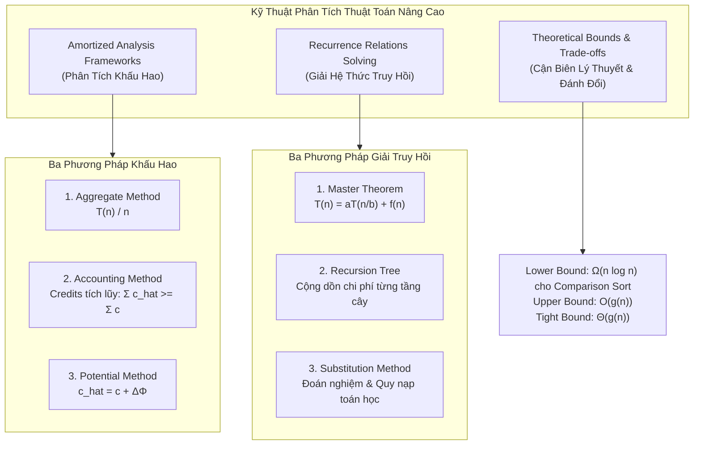

# 1.2. Kỹ Thuật Phân Tích Nâng Cao (Advanced Analysis)

> [!IMPORTANT]
> **Nếu bạn chỉ được nhớ một điều duy nhất:** Phân tích độ phức tạp trong trường hợp xấu nhất (Worst-case) đôi khi vẽ nên một bức tranh quá bi quan và sai lệch về hiệu năng thực tế của các cấu trúc dữ liệu động. Phân tích khấu hao (Amortized Analysis) với ba phương pháp toán học chặt chẽ—Tổng gộp (Aggregate), Kế toán (Accounting) và Hàm thế năng (Potential Method)—chứng minh rằng một chuỗi thao tác gồm cả những bước phình to đột biến vẫn có thể đạt chi phí trung bình tiệm cận $O(1)$. Cùng với Định lý Thơ (Master Theorem) và Phân tích Cận biên (Bounds), đây là bộ công cụ toán học không thể thiếu để thiết kế và dự đoán hành vi của các hệ thống phần mềm hiệu năng cao.

---

## 1. Trực Quan Hóa: Bản Chất Kỹ Thuật Phân Tích Nâng Cao Dưới Góc Nhìn Lập Trình Viên

### 1.1. Đoạn Code Dẫn Nhập & Vấn Đề Thực Tế
Xét thao tác thêm phần tử vào danh sách động `std::vector::push_back` trong C++ hoặc `ArrayList.add` trong Java:

```cpp
std::vector<int> numbers;
for (int i = 0; i < 1'000'000; ++i) {
    numbers.push_back(i); // 99.99% các lần chèn tốn 1 nanosecond!
    // Nhưng tại các mốc i = 1, 2, 4, 8, 16, 32... mảng bị đầy, phải cấp phát bộ nhớ mới và sao chép toàn bộ!
}
```

- Nếu áp dụng phân tích Worst-case bi quan: Một thao tác `push_back` có thể tốn $O(N)$ do phải copy toàn bộ mảng. Do đó một chuỗi $N$ lần chèn có vẻ sẽ tốn $O(N \times N) = O(N^2)$?
- **Thực tế đo đạc**: $1{,}000{,}000$ lần chèn chỉ tốn đúng $\approx 2\text{ ms}$, nghĩa là trung bình mỗi lần chèn chỉ tốn $O(1)$!
- Đây chính là lý do chúng ta cần **Phân tích khấu hao (Amortized Analysis)**: Chứng minh bằng toán học rằng các bước đắt đỏ $O(N)$ diễn ra quá thưa thớt, đủ để các bước cực rẻ $O(1)$ bù đắp toàn bộ chi phí thâm hụt.

### 1.2. Ẩn Dụ Đời Sống: Bình Ắc Quy Năng Lượng & Heo Tiết Kiệm
Hãy hình dung chi phí tính toán của các thao tác trên cấu trúc dữ liệu giống như việc quản lý tài chính và tích trữ năng lượng:
- **Phương pháp Tổng gộp (Aggregate Analysis)** giống như việc bạn thanh toán hóa đơn tiền điện cuối tháng: Công ty điện lực không quan tâm ngày nào bạn bật điều hòa công suất cao hay ngày nào bạn tắt đèn; họ chỉ cộng dồn toàn bộ số kilowatt tiêu thụ trong 30 ngày ($T(n)$) và chia đều cho 30 để ra mức tiêu thụ trung bình mỗi ngày ($T(n)/n$).
- **Phương pháp Kế toán (Accounting Method)** giống như việc bạn bỏ tiền vào heo đất mỗi ngày. Mỗi khi thực hiện một hành động nhẹ nhàng (như insert phần tử vào mảng còn chỗ), bạn phải trả $3\$$ thay vì $1\$$: $1\$$ để thực hiện thao tác ngay lúc đó, còn $2\$$ bỏ vào heo đất ("tín dụng" - credit). Khi mảng bị đầy và cần cấp phát gấp đôi dung lượng (thao tác đắt đỏ tốn $N\$$), bạn đập heo đất ra để trả chi phí copy mà không phải bỏ thêm một đồng nào!
- **Phương pháp Hàm thế năng (Potential Method)** giống như một bình ắc quy dự trữ năng lượng. Mỗi thao tác nhẹ nạp thêm điện tích vào bình khiến thế năng $\Phi$ tăng lên ($\Delta \Phi > 0$). Khi xảy ra biến cố lớn (mảng đầy, phải resize và copy toàn bộ dữ liệu), ắc quy lập tức phóng toàn bộ điện năng tích lũy ra ngoài ($\Delta \Phi < 0$), bù trừ triệt để cho chi phí thực tế khổng lồ, giữ cho chi phí khấu hao gán $\hat{c}_i = c_i + \Delta \Phi$ luôn luôn là một hằng số $O(1)$ ổn định!

### 1.3. Mô Phỏng Dữ Liệu Số Nhỏ Từng Bước (Toy Walkthrough)
Mô phỏng chuỗi 8 thao tác `push_back` liên tiếp vào mảng khởi tạo ban đầu với $\text{capacity} = 1$:

| Thao tác thứ ($i$) | Giá trị chèn | Sức chứa cũ | Sức chứa mới (Resize) | Chi phí copy | Chi phí chèn | Chi phí thực $c_i$ | Tín dụng tích lũy (Accounting) |
| :--- | :--- | :--- | :--- | :--- | :--- | :--- | :--- |
| **$1$** | $x_1$ | $1$ | $1$ (đầy) | $0$ | $1$ | **$1$** | $2$ credits |
| **$2$** | $x_2$ | $1 \to 2$ | $2$ (nhân đôi) | $1$ | $1$ | **$2$** | Dùng $1$, còn $1 + 2 = 3$ |
| **$3$** | $x_3$ | $2 \to 4$ | $4$ (nhân đôi) | $2$ | $1$ | **$3$** | Dùng $2$, còn $1 + 2 = 3$ |
| **$4$** | $x_4$ | $4$ | $4$ (còn chỗ) | $0$ | $1$ | **$1$** | Còn $3 + 2 = 5$ |
| **$5$** | $x_5$ | $4 \to 8$ | $8$ (nhân đôi) | $4$ | $1$ | **$5$** | Dùng $4$, còn $1 + 2 = 3$ |
| **$6$** | $x_6$ | $8$ | $8$ (còn chỗ) | $0$ | $1$ | **$1$** | Còn $3 + 2 = 5$ |
| **$7$** | $x_7$ | $8$ | $8$ (còn chỗ) | $0$ | $1$ | **$1$** | Còn $5 + 2 = 7$ |
| **$8$** | $x_8$ | $8$ | $8$ (còn chỗ) | $0$ | $1$ | **$1$** | Còn $7 + 2 = 9$ |

- Tổng chi phí thực tế cho 8 thao tác: $T(8) = 1 + 2 + 3 + 1 + 5 + 1 + 1 + 1 = 15 < 2 \times 8$.
- Chi phí trung bình khấu hao: $\frac{15}{8} \approx 1.875 = O(1)$!

### 1.4. Tác Động Thực Tế Tầng Backend & Systems
1. **Tránh Lag Spikes trong Message Broker (Kafka / RabbitMQ)**: Các bộ đệm ghi (Batching Buffers) trong Kafka Producer dựa trên phân tích khấu hao. Nếu không cấu hình dung lượng bộ đệm khởi tạo hợp lý (`batch.size`), việc cấp phát mở rộng liên tục sẽ gây ra giật cục (Tail Latency Spike) làm đứt gãy luồng xử lý thời gian thực.
2. **Kỹ thuật Pre-allocation (`reserve`) trong High-Performance Services**: Khi biết trước số lượng bản ghi cần nạp (ví dụ đọc $1{,}000{,}000$ dòng từ DB), kỹ sư luôn gọi `vector.reserve(1000000)` để loại bỏ hoàn toàn chi phí resize, đưa toàn bộ chuỗi chèn về $O(1)$ thuần túy mà không phải chịu khấu hao.
3. **Phân tích Master Theorem trong thuật toán phân tán**: Khi thiết kế các hệ thống chia để trị phân tán (như MapReduce hoặc Distributed Merge Sort), Master Theorem cung cấp công thức tức thì để xác định điểm nghẽn nằm ở khâu chia nhỏ dữ liệu (Network/I/O) hay khâu tính toán cục bộ tại từng Node worker.

### 1.5. Sơ Đồ Khung Phân Tích Thuật Toán Nâng Cao



---

## 2. Chi tiết từng Keyword (Under-the-Hood Deep Dive)

### 2.1. Ba Phương Pháp Phân Tích Khấu Hao: Aggregate, Accounting, Potential Method
Khi một cấu trúc dữ liệu thực thi một chuỗi $n$ thao tác liên tiếp, một số thao tác tốn kém ($O(n)$) xuất hiện rất thưa thớt xen kẽ giữa vô số thao tác rẻ tiền ($O(1)$). Phân tích worst-case cho từng thao tác riêng lẻ ($O(n)$) sẽ đánh giá sai nghiêm trọng hiệu năng toàn cục.
Ba phương pháp phân tích khấu hao cung cấp các góc nhìn toán học chặt chẽ để chứng minh chi phí trung bình:

#### 1. Aggregate Analysis (Phương pháp Tổng gộp)
- **Ý tưởng**: Xác định cận trên của tổng chi phí thực tế $T(n)$ cho toàn bộ chuỗi $n$ thao tác trong trường hợp xấu nhất, sau đó chia đều cho $n$:
  $$C_{\text{amortized}} = \frac{T(n)}{n}$$
- **Ví dụ Dynamic Array Doubling (std::vector / ArrayList)**:
  - Giả sử mảng bắt đầu với capacity $= 1$. Khi mảng đầy, nó cấp phát gấp đôi bộ nhớ và copy toàn bộ các phần tử cũ sang mảng mới.
  - Chi phí chèn một phần tử bình thường: $1$.
  - Chi phí copy khi nhân đôi dung lượng tại các bước $i = 1, 2, 4, 8, \dots, 2^{\lfloor \log_2 n \rfloor}$:
    $$\text{Copy Cost} = \sum_{j=0}^{\lfloor \log_2 n \rfloor} 2^j = 2^{\lfloor \log_2 n \rfloor + 1} - 1 < 2n$$
  - Tổng chi phí thực tế cho $n$ thao tác chèn:
    $$T(n) = \sum_{i=1}^n c_i = n \text{ (chi phí chèn)} + \text{Copy Cost} < n + 2n = 3n$$
  - Do đó:
    $$C_{\text{amortized}} = \frac{T(n)}{n} < \frac{3n}{n} = 3 = O(1)$$

#### 2. Accounting Method (Phương pháp Kế toán / Tín dụng)
- **Ý tưởng**: Gán một chi phí khấu hao giả định $\hat{c}_i$ cho mỗi thao tác.
  - Nếu thao tác thực tế rẻ tiền ($c_i < \hat{c}_i$), phần chênh lệch $\hat{c}_i - c_i > 0$ được lưu trữ lại dưới dạng "khoản tín dụng" (Credit) gắn kèm vào từng phần tử trong cấu trúc dữ liệu.
  - Khi một thao tác đắt đỏ xuất hiện ($c_i > \hat{c}_i$), chi phí thực tế thâm hụt được thanh toán bằng lượng tín dụng đã tích lũy trước đó.
- **Ràng buộc toán học**: Tổng chi phí khấu hao gán phải luôn luôn lớn hơn hoặc bằng tổng chi phí thực tế tại mọi thời điểm $k$ ($1 \le k \le n$):
  $$\sum_{i=1}^k \hat{c}_i \ge \sum_{i=1}^k c_i \quad \implies \quad \text{Credit}_k = \sum_{i=1}^k (\hat{c}_i - c_i) \ge 0$$
- **Ứng dụng trên Dynamic Array**:
  - Gán chi phí khấu hao cho mỗi lần `push_back`: $\hat{c} = 3\$$:
    - $1\$$: Trả cho chi phí chèn phần tử mới vào ô nhớ hiện tại.
    - $1\$$: Lưu trữ trên chính phần tử đó để trả cho việc copy chính nó khi mảng đầy trong tương lai.
    - $1\$$: Lưu trữ cho một phần tử cũ nằm ở nửa dưới của mảng (phần tử này đã từng bị copy một lần và không còn credit).
  - Khi mảng đầy với kích thước $N$, đúng $N/2$ phần tử vừa được chèn gần nhất đã tích lũy đủ $N/2 \times 2\$ = N\$$ tín dụng, vừa vặn chi trả cho việc copy toàn bộ $N$ phần tử sang mảng mới!

#### 3. Potential Method (Phương pháp Hàm thế năng)
- **Ý tưởng**: Thay vì gán tín dụng vào từng phần tử cụ thể (khó kiểm soát khi cấu trúc dữ liệu phức tạp như Splay Tree hay Fibonacci Heap), ta định nghĩa một hàm thế năng $\Phi(D) \ge 0$ ánh xạ toàn bộ trạng thái của cấu trúc dữ liệu $D$ thành một số thực.
- **Công thức chi phí khấu hao**: Chi phí khấu hao $\hat{c}_i$ của thao tác thứ $i$ chuyển cấu trúc dữ liệu từ trạng thái $D_{i-1}$ sang $D_i$ là:
  $$\hat{c}_i = c_i + \Delta \Phi_i = c_i + \Phi(D_i) - \Phi(D_{i-1})$$
- **Tổng chi phí khấu hao cho chuỗi $n$ thao tác**:
  $$\sum_{i=1}^n \hat{c}_i = \sum_{i=1}^n (c_i + \Phi(D_i) - \Phi(D_{i-1})) = \sum_{i=1}^n c_i + \Phi(D_n) - \Phi(D_0)$$
  Nếu ta thiết kế hàm thế năng sao cho $\Phi(D_0) = 0$ và $\Phi(D_n) \ge 0$ với mọi $n$, thì:
  $$\sum_{i=1}^n \hat{c}_i \ge \sum_{i=1}^n c_i$$
  Tổng chi phí khấu hao luôn là một cận trên bảo thủ và an toàn cho tổng chi phí thực tế!
- **Hàm thế năng cho Dynamic Array**:
  Chọn $\Phi(D) = 2 \cdot \text{size} - \text{capacity}$.
  - Ban đầu mảng rỗng: $\text{size}=0, \text{capacity}=0 \implies \Phi(D_0) = 0$.
  - Mảng luôn có $\text{capacity} \ge \text{size} \ge \text{capacity}/2 \implies \Phi(D) \ge 0$.
  - *Trường hợp 1 (Không resize)*: $\text{size}_i = \text{size}_{i-1} + 1$, $\text{capacity}_i = \text{capacity}_{i-1}$, $c_i = 1$:
    $$\Delta \Phi_i = (2(\text{size}_{i-1} + 1) - \text{cap}) - (2\text{size}_{i-1} - \text{cap}) = 2$$
    $$\hat{c}_i = c_i + \Delta \Phi_i = 1 + 2 = 3$$
  - *Trường hợp 2 (Resize)*: $\text{size}_{i-1} = \text{cap}_{i-1} = N$. Thao tác $i$ kích hoạt resize: $\text{cap}_i = 2N$, $\text{size}_i = N + 1$. Chi phí thực tế $c_i = N + 1$ (copy $N$ phần tử cũ và ghi 1 phần tử mới):
    $$\Phi(D_{i-1}) = 2N - N = N$$
    $$\Phi(D_i) = 2(N + 1) - 2N = 2$$
    $$\Delta \Phi_i = \Phi(D_i) - \Phi(D_{i-1}) = 2 - N$$
    $$\hat{c}_i = c_i + \Delta \Phi_i = (N + 1) + (2 - N) = 3$$
  - **Kết luận tuyệt đối**: Dù mảng có phải resize hay không, chi phí khấu hao $\hat{c}_i$ luôn luôn bằng đúng $3 = O(1)$!

---

### 2.2. Giải Hệ Thức Truy Hồi: Master Theorem, Recursion Tree, Substitution Method
Các thuật toán chia để trị (Divide and Conquer như Merge Sort, Quick Select, Fast Fourier Transform) luôn có thời gian thực thi được mô hình hóa dưới dạng hệ thức truy hồi (Recurrence Relation):
$$T(n) = a T(n/b) + f(n)$$
Trong đó $a \ge 1$ là số lượng bài toán con, $b > 1$ là hệ số thu nhỏ kích thước đầu vào, và $f(n)$ là chi phí chia bài toán và gộp kết quả ở tầng hiện tại.

#### 1. Định Lý Thơ (Master Theorem - Dạng Chuẩn Cormen CLRS)
Xét giá trị mũ tới hạn (Critical Exponent) $c_{\text{crit}} = \log_b a$. So sánh hàm chi phí $f(n)$ với hàm đa thức tới hạn $n^{\log_b a}$:
- **Trường hợp 1 (Nút lá áp đảo - Leaf-heavy)**:
  Nếu $f(n) = O(n^{\log_b a - \epsilon})$ với hằng số $\epsilon > 0$ (nghĩa là $f(n)$ tăng chậm hơn $n^{\log_b a}$ một bậc đa thức):
  $$T(n) = \Theta(n^{\log_b a})$$
  *Ví dụ*: Thuật toán nhân ma trận Strassen: $T(n) = 7T(n/2) + \Theta(n^2)$.
  Ta có $\log_2 7 \approx 2.807$. Vì $f(n) = n^2 = O(n^{2.807 - 0.807}) \implies T(n) = \Theta(n^{\log_2 7}) \approx \Theta(n^{2.81})$.
- **Trường hợp 2 (Chi phí phân bổ đều các tầng - Balanced)**:
  Nếu $f(n) = \Theta(n^{\log_b a} \log^k n)$ với $k \ge 0$:
  $$T(n) = \Theta(n^{\log_b a} \log^{k+1} n)$$
  *Ví dụ*: Thuật toán Merge Sort: $T(n) = 2T(n/2) + \Theta(n)$.
  Ta có $\log_2 2 = 1$, $f(n) = n^1 \log^0 n$ ($k=0$) $\implies T(n) = \Theta(n \log n)$.
- **Trường hợp 3 (Gốc đệ quy áp đảo - Root-heavy)**:
  Nếu $f(n) = \Omega(n^{\log_b a + \epsilon})$ với $\epsilon > 0$, đồng thời thỏa mãn **Điều kiện Đều đặn (Regularity Condition)**: $a f(n/b) \le c f(n)$ với hằng số $c < 1$ cho mọi $n$ đủ lớn:
  $$T(n) = \Theta(f(n))$$
  *Ví dụ*: $T(n) = 3T(n/4) + n^2$. Ta có $\log_4 3 \approx 0.793$. Vì $f(n) = n^2 = \Omega(n^{0.793 + 1.207})$, kiểm tra regularity: $3(n/4)^2 = \frac{3}{16}n^2 \le c n^2$ với $c = 3/16 < 1 \implies T(n) = \Theta(n^2)$.

#### 2. Phương Pháp Cây Đệ Quy (Recursion Tree Method)
- Vẽ cây thực thi đệ quy:
  - Tầng $0$ (Gốc): Chi phí $f(n)$.
  - Tầng $1$: $a$ nút, mỗi nút chi phí $f(n/b) \implies$ Tổng chi phí tầng $1$ là $a f(n/b)$.
  - Tầng $j$: $a^j$ nút, mỗi nút chi phí $f(n/b^j) \implies$ Chi phí tầng $j$ là $a^j f(n/b^j)$.
  - Chiều cao của cây: $h = \log_b n$.
  - Tầng lá: Số lượng lá là $a^{\log_b n} = n^{\log_b a}$, mỗi lá tốn $T(1) = \Theta(1)$.
- Cộng dồn chi phí của tất cả các tầng: $T(n) = \sum_{j=0}^{\log_b n - 1} a^j f(n/b^j) + \Theta(n^{\log_b a})$.
- Cực kỳ trực quan khi hệ số chia bài toán con không đều nhau (ví dụ: $T(n) = T(n/3) + T(2n/3) + O(n)$).

#### 3. Phương Pháp Đoán Nghiệm & Quy Nạp (Substitution Method)
- Bước 1: Phỏng đoán dạng của hàm tiệm cận (sử dụng kinh nghiệm hoặc quan sát từ cây đệ quy).
- Bước 2: Dùng phương pháp Quy nạp toán học (Mathematical Induction) để tìm ra các hằng số $c$ và $n_0$ thỏa mãn điều kiện cận biên.
- Bước 3: Chứng minh rằng nghiệm đúng ở bước cơ sở (Base case) và bước quy nạp ($k \implies k+1$).

---

### 2.3. Lower Bound, Upper Bound, Tight Bound & Time-Space Trade-off

#### 1. Hệ Thống Ký Hiệu Tiệm Cận Chuẩn Mực
- **Cận Trên Tiệm Cận (Upper Bound - Big-O: $O(g(n))$)**:
  $$O(g(n)) = \{f(n) : \exists c > 0, n_0 > 0 \text{ sao cho } 0 \le f(n) \le c \cdot g(n), \forall n \ge n_0\}$$
  Đại diện cho trường hợp xấu nhất: Thuật toán không bao giờ chạy chậm hơn giới hạn này khi $n$ tiến ra vô cùng.
- **Cận Dưới Tiệm Cận (Lower Bound - Big-Omega: $\Omega(g(n))$)**:
  $$\Omega(g(n)) = \{f(n) : \exists c > 0, n_0 > 0 \text{ sao cho } 0 \le c \cdot g(n) \le f(n), \forall n \ge n_0\}$$
  Đại diện cho giới hạn vật lý/toán học mà thuật toán bắt buộc phải tiêu tốn ít nhất ngần ấy tài nguyên.
- **Cận Chặt Tiệm Cận (Tight Bound - Big-Theta: $\Theta(g(n))$)**:
  $$\Theta(g(n)) = \{f(n) : \exists c_1, c_2 > 0, n_0 > 0 \text{ sao cho } 0 \le c_1 g(n) \le f(n) \le c_2 g(n), \forall n \ge n_0\}$$
  $f(n) = \Theta(g(n))$ khi và chỉ khi $f(n) = O(g(n))$ đồng thời $f(n) = \Omega(g(n))$.

#### 2. Cận Dưới Của Bài Toán Sắp Xếp So Sánh (Comparison-Based Sorting Lower Bound)
- Mọi thuật toán sắp xếp dựa trên phép so sánh hai phần tử ($A[i] \le A[j]$) đều có thể được mô hình hóa bằng một **Cây Quyết Định (Decision Tree)**:
  - Mỗi nút lá của cây quyết định đại diện cho một hoán vị duy nhất của $n$ phần tử. Với $n$ phần tử, có đúng $n!$ hoán vị có thể xảy ra.
  - Mỗi bước so sánh là một nút rẽ nhánh nhị phân (Đúng/Sai $\implies$ tối đa 2 con).
  - Một cây nhị phân có chiều cao $h$ có tối đa $2^h$ nút lá. Do cây phải chứa ít nhất $n!$ lá để phân biệt mọi hoán vị:
    $$2^h \ge n! \implies h \ge \log_2(n!)$$
  - Áp dụng công thức xấp xỉ Stirling ($\ln(n!) \approx n \ln n - n$):
    $$h \ge \log_2(n!) = \sum_{i=1}^n \log_2 i \ge \sum_{i=n/2}^n \log_2(n/2) = \frac{n}{2} \log_2(n/2) = \Omega(n \log n)$$
- **Hệ quả định lý**: Không có bất kỳ thuật toán sắp xếp so sánh nào (Quick Sort, Merge Sort, Heap Sort) có thể vượt qua rào cản $\Omega(n \log n)$ trong trường hợp xấu nhất!

#### 3. Đánh Đổi Không Gian - Thời Gian (Time-Space Trade-off)
Trong thiết kế giải thuật hệ thống:
- Dùng thêm bộ nhớ (RAM/Cache) để giảm thiểu thời gian tính toán CPU:
  - *Lookup Tables / Memoization*: Lưu sẵn bảng tính sin/cos hoặc kết quả quy hoạch động.
  - *Cấu trúc dữ liệu xác suất*: Bloom Filter tốn vài bits bộ nhớ để loại bỏ $99\%$ truy vấn đọc đĩa tốn kém.
  - *Chỉ mục cơ sở dữ liệu (B-Tree, Inverted Index)*: Chiếm gấp đôi dung lượng đĩa của bảng gốc nhưng giảm thời gian tìm kiếm từ $O(n)$ xuống $O(\log n)$.

---

## 3. Thực thi Mã nguồn & Mô phỏng Chuyên sâu (Dual-Engine Implementation)

### 3.1. C++20: Dynamic Array Potential Method Simulation Engine

Chương trình C++20 mô phỏng chi tiết cơ chế hoạt động của hàm thế năng $\Phi(D) = 2 \cdot \text{size} - \text{capacity}$ trong Dynamic Array doubling, đo lường chi phí thực tế và chi phí khấu hao tại từng bước chèn:

```cpp
// compile: g++ -std=c++20 -O3 dynamic_array_potential.cpp -o dynamic_array_potential
#include <iostream>
#include <vector>
#include <iomanip>
#include <cstdint>

class PotentialVectorSimulator {
private:
    size_t size_{0};
    size_t capacity_{1};
    uint64_t total_actual_cost_{0};
    uint64_t total_amortized_cost_{0};

    // Hàm thế năng toán học: Phi(D) = 2 * size - capacity
    int64_t potential() const {
        return static_cast<int64_t>(2 * size_) - static_cast<int64_t>(capacity_);
    }

public:
    void push_back(int value) {
        int64_t phi_before = potential();
        size_t actual_cost = 1; // Chi phí chèn 1 phần tử

        if (size_ == capacity_) {
            // Resize gấp đôi: copy toàn bộ size_ phần tử cũ sang vùng nhớ mới
            actual_cost += size_;
            capacity_ *= 2;
        }

        size_++;
        int64_t phi_after = potential();
        int64_t delta_phi = phi_after - phi_before;
        int64_t amortized_cost = actual_cost + delta_phi;

        total_actual_cost_ += actual_cost;
        total_amortized_cost_ += amortized_cost;

        // Chỉ in ra các bước quan trọng để bảo đảm output súc tích
        if (size_ <= 8 || (size_ & (size_ - 1)) == 0 || size_ == 64) {
            std::cout << "[Step " << std::setw(2) << size_ << "] "
                      << "Cap: " << std::setw(2) << capacity_
                      << " | Actual: " << std::setw(2) << actual_cost
                      << " | DeltaPhi: " << std::setw(2) << delta_phi
                      << " | Amortized: " << std::setw(2) << amortized_cost
                      << " | CumulActual: " << std::setw(3) << total_actual_cost_
                      << " | Phi: " << std::setw(2) << phi_after << "\n";
        }
    }

    void summary() const {
        std::cout << "\n=== TỔNG KẾT PHÂN TÍCH KHẤU HAO (POTENTIAL METHOD) ===\n"
                  << "Tổng số phần tử chèn (N)    : " << size_ << "\n"
                  << "Tổng chi phí thực tế (Sum c) : " << total_actual_cost_ << "\n"
                  << "Chi phí trung bình thực tế   : " << std::fixed << std::setprecision(2)
                  << static_cast<double>(total_actual_cost_) / size_ << " (<= 3, chứng minh O(1)!)\n"
                  << "Tổng chi phí khấu hao gán    : " << total_amortized_cost_ << "\n"
                  << "Thế năng cuối cùng Phi(D_N)  : " << potential() << " (>= 0, bảo đảm tính đúng đắn)\n";
    }
};

int main() {
    std::cout << "=== MÔ PHỎNG PHƯƠNG PHÁP HÀM THẾ NĂNG (C++20) ===\n\n";
    PotentialVectorSimulator sim;
    for (int i = 1; i <= 64; ++i) {
        sim.push_back(i);
    }
    sim.summary();
    return 0;
}
```

### 3.2. Python 3.11+: Master Theorem Recurrence Solver & Algorithmic Classifier

Mã nguồn Python 3.11+ tự động giải các phương trình truy hồi dạng $T(n) = a T(n/b) + \Theta(n^k \log^p n)$, phân loại chính xác các trường hợp theo Master Theorem:

```python
#!/usr/bin/env python3
"""
master_theorem_solver.py: Bộ giải hệ thức truy hồi đệ quy tự động theo Định lý Thơ.
Yêu cầu: Python 3.11+
"""
import math
from typing import TypedDict

class RecurrenceResult(TypedDict):
    case: int
    critical_exponent: float
    complexity: str
    reason: str

def solve_master_theorem(a: float, b: float, k: float, p: float = 0.0) -> RecurrenceResult:
    """
    Giải phương trình truy hồi: T(n) = a * T(n / b) + Theta(n^k * log^p(n))
    """
    assert a >= 1.0, "Số lượng bài toán con a phải >= 1"
    assert b > 1.0, "Hệ số thu nhỏ kích thước bài toán b phải > 1"

    crit_exp = math.log(a, b)
    eps = 1e-9

    if crit_exp > k + eps:
        # Trường hợp 1: Nút lá áp đảo
        case = 1
        complexity = f"Theta(n^{crit_exp:.2f})"
        reason = f"log_b(a) = {crit_exp:.2f} > k = {k} (Nút lá áp đảo)"
    elif abs(crit_exp - k) <= eps:
        # Trường hợp 2: Cân bằng
        case = 2
        if p > -1:
            complexity = f"Theta(n^{k} * log^{p + 1}(n))"
        elif p == -1:
            complexity = f"Theta(n^{k} * log(log(n)))"
        else:
            complexity = f"Theta(n^{k})"
        reason = f"log_b(a) = {crit_exp:.2f} == k = {k} (Chi phí phân bổ đều các tầng)"
    else:
        # Trường hợp 3: Gốc áp đảo
        case = 3
        if p >= 0:
            complexity = f"Theta(n^{k} * log^{p}(n))"
        else:
            complexity = f"Theta(n^{k})"
        reason = f"log_b(a) = {crit_exp:.2f} < k = {k} (Gốc đệ quy áp đảo)"

    return RecurrenceResult(
        case=case,
        critical_exponent=crit_exp,
        complexity=complexity,
        reason=reason
    )

if __name__ == "__main__":
    print("=== MASTER THEOREM SOLVER & ALGORITHMIC CLASSIFIER ===")
    test_cases = [
        ("Merge Sort: T(n) = 2T(n/2) + Theta(n)", 2, 2, 1, 0),
        ("Binary Search: T(n) = T(n/2) + Theta(1)", 1, 2, 0, 0),
        ("Strassen Matrix Mult: T(n) = 7T(n/2) + Theta(n^2)", 7, 2, 2, 0),
        ("Karatsuba Mult: T(n) = 3T(n/2) + Theta(n)", 3, 2, 1, 0),
        ("Large Divide: T(n) = 3T(n/4) + Theta(n^2)", 3, 4, 2, 0)
    ]

    for name, a, b, k, p in test_cases:
        res = solve_master_theorem(a, b, k, p)
        print(f"\n[*] Thuật toán: {name}")
        print(f"    -> Phân loại   : Trường hợp {res['case']}")
        print(f"    -> Đánh giá    : {res['reason']}")
        print(f"    -> Độ phức tạp : {res['complexity']}")
```

### 3.3. Kết quả Thực thi Terminal Mẫu

```text
=== KẾT QUẢ THỰC THI C++20 DYNAMIC ARRAY POTENTIAL ===
=== MÔ PHỎNG PHƯƠNG PHÁP HÀM THẾ NĂNG (C++20) ===

[Step  1] Cap:  1 | Actual:  1 | DeltaPhi:  2 | Amortized:  3 | CumulActual:   1 | Phi:  1
[Step  2] Cap:  2 | Actual:  2 | DeltaPhi:  1 | Amortized:  3 | CumulActual:   3 | Phi:  2
[Step  3] Cap:  4 | Actual:  3 | DeltaPhi:  0 | Amortized:  3 | CumulActual:   6 | Phi:  2
[Step  4] Cap:  4 | Actual:  1 | DeltaPhi:  2 | Amortized:  3 | CumulActual:   7 | Phi:  4
[Step  5] Cap:  8 | Actual:  5 | DeltaPhi: -2 | Amortized:  3 | CumulActual:  12 | Phi:  2
[Step  6] Cap:  8 | Actual:  1 | DeltaPhi:  2 | Amortized:  3 | CumulActual:  13 | Phi:  4
[Step  7] Cap:  8 | Actual:  1 | DeltaPhi:  2 | Amortized:  3 | CumulActual:  14 | Phi:  6
[Step  8] Cap:  8 | Actual:  1 | DeltaPhi:  2 | Amortized:  3 | CumulActual:  15 | Phi:  8
[Step 16] Cap: 16 | Actual:  1 | DeltaPhi:  2 | Amortized:  3 | CumulActual:  31 | Phi: 16
[Step 32] Cap: 32 | Actual:  1 | DeltaPhi:  2 | Amortized:  3 | CumulActual:  63 | Phi: 32
[Step 64] Cap: 64 | Actual:  1 | DeltaPhi:  2 | Amortized:  3 | CumulActual: 127 | Phi: 64

=== TỔNG KẾT PHÂN TÍCH KHẤU HAO (POTENTIAL METHOD) ===
Tổng số phần tử chèn (N)    : 64
Tổng chi phí thực tế (Sum c) : 127
Chi phí trung bình thực tế   : 1.98 (<= 3, chứng minh O(1)!)
Tổng chi phí khấu hao gán    : 192
Thế năng cuối cùng Phi(D_N)  : 64 (>= 0, bảo đảm tính đúng đắn)

=== KẾT QUẢ THỰC THI PYTHON RECURRENCE SOLVER ===
=== MASTER THEOREM SOLVER & ALGORITHMIC CLASSIFIER ===

[*] Thuật toán: Merge Sort: T(n) = 2T(n/2) + Theta(n)
    -> Phân loại   : Trường hợp 2
    -> Đánh giá    : log_b(a) = 1.00 == k = 1 (Chi phí phân bổ đều các tầng)
    -> Độ phức tạp : Theta(n^1 * log^1(n))

[*] Thuật toán: Binary Search: T(n) = T(n/2) + Theta(1)
    -> Phân loại   : Trường hợp 2
    -> Đánh giá    : log_b(a) = 0.00 == k = 0 (Chi phí phân bổ đều các tầng)
    -> Độ phức tạp : Theta(n^0 * log^1(n))

[*] Thuật toán: Strassen Matrix Mult: T(n) = 7T(n/2) + Theta(n^2)
    -> Phân loại   : Trường hợp 1
    -> Đánh giá    : log_b(a) = 2.81 > k = 2 (Nút lá áp đảo)
    -> Độ phức tạp : Theta(n^2.81)

[*] Thuật toán: Karatsuba Mult: T(n) = 3T(n/2) + Theta(n)
    -> Phân loại   : Trường hợp 1
    -> Đánh giá    : log_b(a) = 1.58 > k = 1 (Nút lá áp đảo)
    -> Độ phức tạp : Theta(n^1.58)

[*] Thuật toán: Large Divide: T(n) = 3T(n/4) + Theta(n^2)
    -> Phân loại   : Trường hợp 3
    -> Đánh giá    : log_b(a) = 0.79 < k = 2 (Gốc đệ quy áp đảo)
    -> Độ phức tạp : Theta(n^2 * log^0(n))
```

---

## 4. Systems Engineering & Production Pitfalls

### 4.1. Cạm Bẫy Đột Biến Độ Trễ Đuôi (Tail Latency Spikes Do Vector Resizing)
- **Bản chất**: Phân tích khấu hao chứng minh rằng trung bình mỗi thao tác chèn chỉ tốn $O(1)$. Tuy nhiên, trong hệ thống tài chính giao dịch tần suất cao (High-Frequency Trading) hoặc Game Engine thời gian thực, **độ trễ tại đúng bước resize thứ $N$ là $O(N)$**!
- **Hậu quả**: Khi vector đạt kích thước $10\text{ triệu}$ phần tử, thao tác `push_back` tiếp theo sẽ kích hoạt lệnh `malloc(160MB)`, copy toàn bộ $80\text{MB}$ dữ liệu cũ sang vùng nhớ mới, làm đóng băng CPU trong hàng chục mili-giây, dẫn đến việc rớt frame hoặc lỡ khớp lệnh giao dịch.
- **Giải pháp Production**:
  - Luôn sử dụng phương thức `reserve(expected_capacity)` để cấp phát bộ nhớ cố định một lần duy nhất từ đầu.
  - Sử dụng cấu trúc dữ liệu không đòi hỏi vùng nhớ phẳng liên tục (như `std::deque` trong C++ gồm nhiều block cố định $512\text{ bytes}$ nối tiếp nhau) để triệt tiêu hoàn toàn chi phí copy khi mở rộng.

### 4.2. Cạm Bẫy Khoảng Cách Đa Thức Trong Master Theorem (Polynomial Gap Pitfall)
- **Sai lầm phổ biến**: Lập trình viên áp dụng nhầm Master Theorem cho phương trình $T(n) = 2T(n/2) + n \log n$.
- **Phân tích toán học**:
  Ta có $\log_2 2 = 1 \implies n^{\log_b a} = n^1$. Hàm $f(n) = n \log n$ lớn hơn $n$, nhưng nó **không lớn hơn một bậc đa thức ($n^\epsilon$)**:
  $$\frac{f(n)}{n^{\log_b a}} = \frac{n \log n}{n} = \log n \neq n^\epsilon \quad (\forall \epsilon > 0)$$
  Do thiếu khoảng cách đa thức (Polynomial Gap), ta không thể áp dụng Trường hợp 3 của Master Theorem thông thường. Trường hợp này phải sử dụng dạng mở rộng của Master Theorem (Akra-Bazzi method) để ra kết quả chính xác: $T(n) = \Theta(n \log^2 n)$.

### 4.3. Đệ Quy Sâu Gây Tràn Ngăn Xếp (Stack Overflow Vulnerability)
- Khi giải bài toán chia để trị, nếu điều kiện chia bài toán con bị suy biến (ví dụ: Quick Sort với pivot xấu nhất dẫn đến $T(n) = T(n-1) + O(n)$), độ sâu cây đệ quy đạt tới $O(n)$.
- Kích thước Stack mặc định của Linux thread chỉ là $8\text{ MB}$ (và chỉ $1\text{ MB}$ trên Windows/macOS). Khi $n > 100,000$, tiến trình sẽ bị sập tức thì bởi lỗi `SIGSEGV` do Stack Overflow.
- **Biện pháp khắc phục**: Chuyển đổi đệ quy sang vòng lặp với ngăn xếp tự quản lý trên Heap (Explicit Heap-allocated Stack) hoặc áp dụng kỹ thuật tối ưu đệ quy đuôi (Tail Call Optimization).

---

## 5. Bảng So sánh & Decision Matrix

### Ma trận So sánh Ba Phương pháp Phân tích Khấu hao

| Tiêu chí So sánh | Phương pháp Tổng gộp (Aggregate) | Phương pháp Kế toán (Accounting) | Phương pháp Hàm thế năng (Potential) |
| :--- | :--- | :--- | :--- |
| **Bản chất Toán học** | Trung bình số học thô $\frac{T(n)}{n}$ | Phân bổ tín dụng ảo (Credit) cho từng phần tử | Đạo hàm thế năng trạng thái $\hat{c} = c + \Delta\Phi$ |
| **Độ phức tạp khi chứng minh** | Đơn giản nhất, dễ trực quan hóa | Trung bình, đòi hỏi gán tín dụng khéo léo | Chặt chẽ nhất, đòi hỏi tìm hàm $\Phi$ phù hợp |
| **Phân biệt từng thao tác** | Không (Mọi thao tác đều có cùng chi phí) | Có (Có thể gán chi phí khác nhau cho insert/delete) | Có (Chi phí khấu hao phụ thuộc biến thiên $\Delta\Phi$) |
| **Khả năng mở rộng** | Kém (Chỉ áp dụng được cho cấu trúc đơn giản) | Trung bình (Dễ rối khi cấu trúc phân nhánh) | Tuyệt hảo (Chuẩn mực cho Fibonacci Heap, Splay Tree) |
| **Cận biên an toàn** | Cận trên chính xác của cả chuỗi | Cận trên an toàn nếu $\sum \hat{c}_i \ge \sum c_i$ | Tuyệt đối an toàn nếu $\Phi(D_n) \ge \Phi(D_0)$ |

---

## 6. Enterprise Production Checklist & Verification

- [ ] **Khử Trừ Cấp Phát Động Trong Hot-Path**: Đã gọi `reserve()` trên toàn bộ các vector/mảng động trước khi thực thi vòng lặp nạp dữ liệu lớn?
- [ ] **Kiểm Tra Điều Kiện Đều Đặn (Regularity Condition)**: Khi áp dụng Trường hợp 3 của Master Theorem, đã chứng minh $a f(n/b) \le c f(n)$ chưa?
- [ ] **Chặn Giới Hạn Đệ Quy**: Các giải thuật chia để trị có ngưỡng dừng (Cut-off threshold, ví dụ $n \le 32$ chuyển sang Insertion Sort) để tránh tạo cây đệ quy quá sâu?
- [ ] **Đo Lường Jitter Thay Vì Trung Bình**: Test suite hiệu năng đã đo đạc $P99$ và $P99.9$ latency để phát hiện các bước sụt giảm do amortized reallocation chưa?
