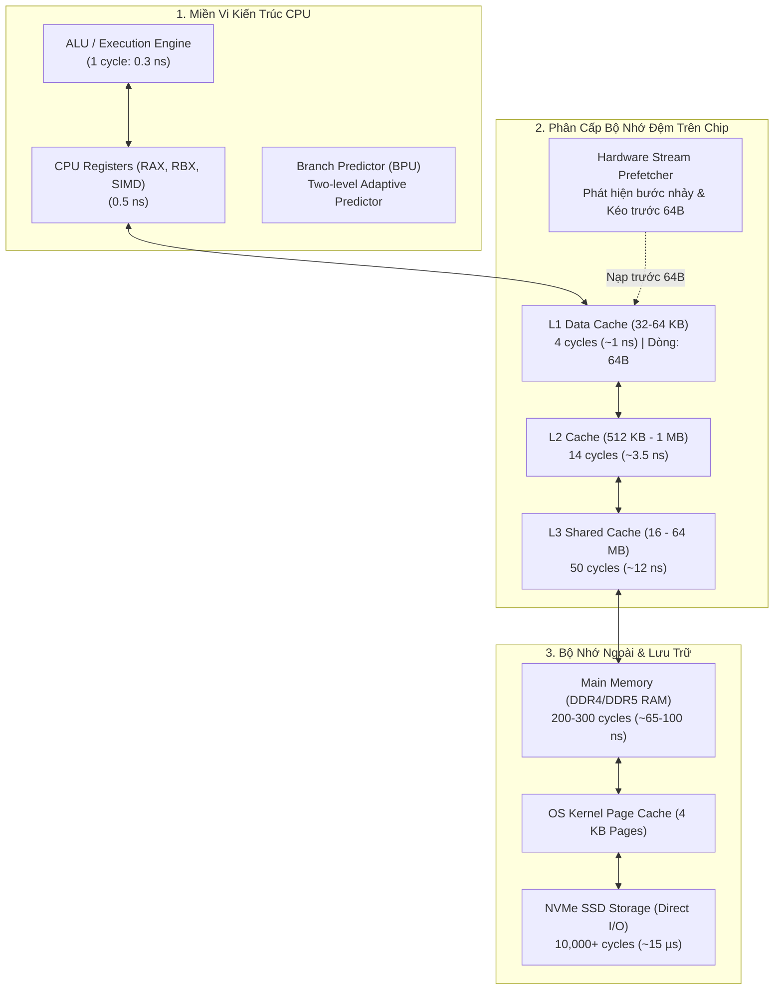

# 1.3. Hiệu Năng Thực Chiến (Practical Performance: Constant Factors, Cache & Microarchitecture)

> [!IMPORTANT]
> **Nếu bạn chỉ được nhớ một điều duy nhất:** Trong môi trường sản xuất thực tế, phân tích tiệm cận Big O lý thuyết có thể đánh lừa kỹ sư một cách tàn nhẫn nếu bỏ qua các ranh giới vật lý của phần cứng máy tính hiện đại. Một thuật toán $O(N \log N)$ thân thiện với bộ nhớ đệm CPU (Cache-friendly) có thể chạy nhanh gấp hàng chục lần một thuật toán $O(N)$ nhưng liên tục truy đuổi con trỏ ngẫu nhiên (Pointer Chasing) gây ra Cache Misses và CPU Pipeline Stalls. Bản chất hiệu năng thực chiến được định đoạt bởi ba yếu tố: Tận dụng tối đa dòng bộ đệm Cache Line 64-byte, kiểm soát độ chính xác của bộ dự đoán rẽ nhánh (Branch Prediction), và triệt tiêu chi phí cấp phát bộ nhớ động trên Heap.

---

## 1. Trực Quan Hóa: Bản Chất Hiệu Năng Thực Tế Dưới Góc Nhìn Lập Trình Viên

### 1.1. Đoạn Code Dẫn Nhập & Vấn Đề Thực Tế
Xét hai đoạn code tính tổng một ma trận vuông $4096 \times 4096$ số nguyên 32-bit ($64\text{ MB}$ dữ liệu):

```cpp
// Cách 1: Duyệt theo Hàng trước (Row-Major) - Thuận chiều phần cứng
for (int r = 0; r < 4096; ++r) {
    for (int c = 0; c < 4096; ++c) {
        sum += matrix[r][c]; // Địa chỉ ô nhớ nằm liền kề: 0, 4, 8, 12...
    }
}

// Cách 2: Duyệt theo Cột trước (Column-Major) - Thảm họa phần cứng
for (int c = 0; c < 4096; ++c) {
    for (int r = 0; r < 4096; ++r) {
        sum += matrix[r][c]; // Mỗi bước nhảy vọt qua 16,384 bytes!
    }
}
```

- Về mặt lý thuyết Big O: Cả hai cách đều duyệt qua đúng $4096 \times 4096 \approx 1.67 \times 10^7$ phần tử $\to O(N)$!
- **Thực tế thời gian chạy trên CPU hiện đại**:
  - Cách 1 chạy trong **$12\text{ ms}$**.
  - Cách 2 chạy mất **$185\text{ ms}$** (chậm hơn hơn **15 lần**!).
- Tại sao hai thuật toán có cùng Big O lại chênh lệch nhau 1500% tốc độ? Bởi vì Big O hoàn toàn phớt lờ kiến trúc phần cứng bên dưới: **CPU Cache Line ($64\text{ bytes}$)**, **Hardware Prefetcher** và **Độ trễ truy xuất RAM (Memory Wall)**.

### 1.2. Ẩn Dụ Đời Sống: Bàn Làm Việc, Thư Viện Tầng Dưới & Kho Ngoại Thành
Hãy hình dung vi xử lý CPU hiện đại giống như một học giả nghiên cứu trong văn phòng:
- **Thanh ghi CPU (Registers - 0 chu kỳ)**: Tài liệu đang cầm trực tiếp trên tay ($< 0.5\text{ ns}$).
- **L1 / L2 Cache (4 - 14 chu kỳ)**: Ngăn kéo đặt ngay dưới mặt bàn làm việc ($1 - 4\text{ ns}$).
- **L3 Cache (40 - 60 chu kỳ)**: Giá sách đặt ở góc phòng làm việc ($10 - 15\text{ ns}$).
- **RAM Vật Lý (200 - 300 chu kỳ)**: Phải bấm thang máy xuống thư viện dưới tầng hầm tòa nhà ($60 - 100\text{ ns}$). Trong thời gian đó, học giả buộc phải ngồi chơi xơi nước (CPU Pipeline Stall).
- **Ổ Cứng NVMe SSD (10,000 - 50,000 chu kỳ)**: Phải lái xe 20km ra kho lưu trữ ngoại ô thành phố ($10 - 25\text{ µs}$).
- **Mạng Cloud RPC (hàng triệu chu kỳ)**: Đặt hàng vận chuyển container đường biển từ nước ngoài ($500\text{ µs} - 10\text{ ms}$).

### 1.3. Mô Phỏng Dữ Liệu Số Nhỏ Từng Bước (Toy Walkthrough)
Giả sử CPU có kích thước Cache Line chuẩn là $64\text{ bytes}$ (chứa vừa vặn 16 số nguyên `int32_t` 4 bytes):
Khi CPU đọc một phần tử tại địa chỉ $0$:

```text
Dòng Cache Line 64B được kéo từ RAM lên L1 Cache:
[arr[0] | arr[1] | arr[2] | arr[3] | arr[4] | arr[5] | arr[6] | arr[7] | arr[8] | arr[9] | arr[10] | arr[11] | arr[12] | arr[13] | arr[14] | arr[15]]
```

- **Truy xuất Tuần tự (Stride = 1)**:
  - $i = 0$: Cache Miss (Kéo cả 64B từ RAM vào L1, tốn $200$ cycles).
  - $i = 1 \to 15$: **Cache Hit 100%**! Dữ liệu đã nằm sẵn trên bàn làm việc, tốn đúng $1$ cycle mỗi lượt!
  - Tỷ lệ Cache Hit: $15 / 16 = \mathbf{93.75\%}$!
- **Truy xuất Nhảy Cóc (Stride = 16)**:
  - $i = 0$: Cache Miss (Kéo 64B chứa $0 \dots 15$).
  - $i = 16$: Cache Miss tiếp (Kéo 64B chứa $16 \dots 31$).
  - Tỷ lệ Cache Hit: $\mathbf{0\%}$! Mỗi phần tử đều phải chờ RAM 200 cycles!

### 1.4. Tác Động Thực Tế Tầng Backend & Systems
1. **Kiến Trúc Columnar Database (ClickHouse, Apache Parquet)**: Thay vì lưu trữ từng dòng bản ghi gồm 50 cột (AoS - Array of Structures), các hệ thống OLAP phân tích dữ liệu lớn lưu trữ theo từng cột riêng biệt (SoA - Structure of Arrays). Khi tính `AVG(salary)`, CPU chỉ quét đúng mảng liên tục của cột `salary` mà không chạm vào 49 cột khác, đạt tốc độ xử lý hàng trăm triệu dòng mỗi giây.
2. **Triệt tiêu Branch Misprediction trong Hot Loops**: Một câu lệnh `if` ngẫu nhiên bên trong vòng lặp hàng triệu phần tử sẽ làm bộ dự đoán nhánh của CPU (Branch Predictor) đoán sai $50\%$, mỗi lần đoán sai CPU phải hủy toàn bộ đường ống lệnh (Pipeline Flush, phạt $15 - 20$ chu kỳ). Sử dụng các kỹ thuật Branchless Code hoặc sắp xếp dữ liệu trước sẽ tăng tốc độ xử lý lên gấp 3-5 lần.
3. **B-Tree Node Sizing trong Database Engines**: Kích thước Node của B-Tree trong SQLite/InnoDB được thiết kế đúng bằng $4\text{ KB}$ (Page Size của OS), còn trong C++ In-Memory DB (như Abseil B-Tree) được thiết kế đúng bằng $64\text{ bytes}$ hoặc $256\text{ bytes}$ để vừa khít với $1 - 4$ Cache Lines của CPU.

### 1.5. Sơ Đồ Phân Cấp Bộ Nhớ & Luồng Nạp Dữ Liệu



---

## 2. Chi tiết từng Keyword (Under-the-Hood Deep Dive)

### 2.1. Constant Factors & Cache Complexity
- **Hệ Số Hằng Số Ẩn (Hidden Constant Factors - $c$)**:
  Trong ký pháp tiệm cận, $T(N) = O(g(N))$ chỉ phát biểu rằng tồn tại hằng số $c$ sao cho $T(N) \le c \cdot g(N)$ khi $N \to \infty$. Ký pháp này cố tình che giấu giá trị của $c$:
  - Thuật toán $A$ tốn $1000 \cdot N$ phép tính (ví dụ: duyệt danh sách liên kết với nhiều con trỏ gián tiếp, hàm ảo và phân bổ động).
  - Thuật toán $B$ tốn $2 \cdot N \log_2 N$ phép tính (ví dụ: Quick Sort hoặc duyệt mảng vector).
  - Với $N = 100,000$: $T_A = 1000 \times 100,000 = 10^8$ thao tác, trong khi $T_B = 2 \times 100,000 \times 17 \approx 3.4 \times 10^6$ thao tác! Thuật toán $O(N \log N)$ chạy nhanh hơn thuật toán $O(N)$ tới gần **$30$ lần**!
- **Cache Complexity (Mô hình I/O Bộ Nhớ Đệm)**:
  Phân tích thuật toán hiện đại không chỉ đếm số lượng phép toán số học (Arithmetic Operations) mà đếm số lần nạp dòng nhớ (Cache Line Transfers):
  - **Cache Line (Khối 64 Bytes)**: CPU không bao giờ đọc 1 byte hay 4 byte đơn lẻ từ RAM; nó luôn nạp trọn vẹn một khối $64\text{ bytes}$ liên tục.
  - **Spatial Locality (Cục bộ không gian)**: Nếu ứng dụng đọc phần tử $A[i]$, các phần tử kế tiếp $A[i+1], A[i+2]$ đã nằm sẵn trong cùng một Cache Line vừa nạp. Mảng số nguyên `int32_t` (4 bytes) cho phép trúng cache liên tục 15 lần tiếp theo (Cache Hit Rate $15/16 = 93.75\%$).
  - **Hardware Stream Prefetcher**: Phần cứng CPU tự động theo dõi bước nhảy địa chỉ (Stride Detection). Nếu phát hiện mảng đang được duyệt tuần tự ($A[0], A[1], A[2]$), Prefetcher sẽ tự động phát lệnh nạp trước Cache Line thứ $K+1$ và $K+2$ từ RAM lên L1/L2 trước khi lệnh CPU thực sự cần tới, triệt tiêu hoàn toàn độ trễ RAM!
- **Thảm Họa Truy Đuổi Con Trỏ (Pointer Chasing Catastrophe)**:
  - Các cấu trúc dữ liệu dựa trên nút (Node-based: `std::list`, `std::map`, cây nhị phân thông thường) phân bổ từng node rải rác trên Heap.
  - Địa chỉ của `node->next` là hoàn toàn ngẫu nhiên. CPU Hardware Prefetcher bị bất lực vì không thể đoán trước con trỏ kế tiếp nằm ở đâu.
  - Mỗi bước nhảy con trỏ là một lần phát sinh **Cache Miss**, buộc CPU phải chờ $60 - 100\text{ ns}$ (hơn 200 clock cycles lãng phí vào CPU Stall).

---

### 2.2. Memory Allocation Cost & Branch Prediction

#### 1. Chi Phí Thực Tế Của Cấp Phát Bộ Nhớ Động (Heap Allocation Overhead)
- **Hệ điều hành và Bộ cấp phát (OS & Allocator Internals)**:
  - Khi gọi `malloc()` hoặc `new`, chương trình không chỉ đơn giản là tăng một con trỏ. Bộ cấp phát người dùng (`ptmalloc`, `jemalloc`) phải duyệt danh sách các Free Chunks (Bins), tính toán căn chỉnh địa chỉ, cập nhật metadata tiêu đề (Chunk Header $8 - 16\text{ bytes}$).
  - Trong ứng dụng đa luồng (Multi-threading), nhiều luồng đồng thời gọi `malloc` sẽ dẫn đến **khóa tranh chấp (Mutex Lock Contention)** trên Arena, biến các lõi CPU thành trạng thái nghẽn chờ.
  - Nếu vùng Heap cạn kiệt, tiến trình phải thực hiện lệnh gọi hệ thống tốn kém (`brk()` hoặc `mmap()`) chuyển ngữ cảnh sang Kernel Space, kích hoạt Page Table allocations.
- **Phân Mảnh Bộ Nhớ (External & Internal Fragmentation)**: Cấp phát hàng triệu đối tượng nhỏ rồi giải phóng rải rác khiến RAM bị lỗ chỗ, làm tăng Resident Set Size (RSS) ảo dù dung lượng dữ liệu hữu ích thực tế rất nhỏ.

#### 2. Bộ Dự Đoán Rẽ Nhánh (Branch Prediction & Speculative Execution)
- **Đường Ống Lệnh CPU (Instruction Pipeline)**: CPU hiện đại có đường ống sâu từ 14 đến 19 tầng (Fetch $\to$ Decode $\to$ Rename $\to$ Dispatch $\to$ Execute $\to$ Retire).
- Để giữ cho đường ống luôn đầy tải, CPU tích hợp bộ dự đoán rẽ nhánh thông minh (**Branch Prediction Unit - BPU**) sử dụng bảng lịch sử hai cấp (Two-Level Adaptive History Table) để suy đoán trước xem câu lệnh `if (condition)` sẽ nhảy sang nhánh `True` hay `False` trước khi điều kiện được tính toán xong.
- **Thực thi Suy đoán (Speculative Execution)**: CPU tiếp tục nạp và xử lý các lệnh tiếp theo theo nhánh dự đoán.
- **Hình Phạt Khi Đoán Sai Nhánh (Branch Misprediction Penalty)**:
  - Nếu điều kiện thực tế ngược lại với dự đoán, CPU buộc phải hủy bỏ toàn bộ kết quả đang tính dở, xả sạch toàn bộ đường ống lệnh (**Pipeline Flush**), và nạp lại lệnh từ nhánh đúng.
  - **Cái giá phải trả**: Mất từ **$15$ đến $20$ chu kỳ xung nhịp (clock cycles)** cho mỗi lần đoán sai!
- **Lập Trình Không Rẽ Nhánh (Branchless Programming)**:
  Trong các vòng lặp tính toán hiệu năng cao, thay vì dùng `if/else`, kỹ sư sử dụng phép toán bitwise hoặc lệnh gán có điều kiện của phần cứng x86-64 (`CMOV - Conditional Move`):
  ```cpp
  inline int64_t branchless_accumulate(int64_t sum, int val) {
      // Thay vì dùng rẽ nhánh dễ gây misprediction: if (val >= 128) sum += val;
      return sum + (val & -(val >= 128)); // Trình biên dịch sinh lệnh CMOV hoặc AND
  }
  ```

---

### 2.3. I/O Complexity, External Memory Algorithms & Benchmarking

#### 1. Mô Hình Bộ Nhớ Ngoài (External Memory Model / Aggarwal-Vitter Model)
Khi kích thước dữ liệu $N$ vượt quá dung lượng bộ nhớ RAM khả dụng ($N \gg M$), dữ liệu bắt buộc phải lưu trữ trên ổ đĩa SSD/HDD. Khi đó, chi phí CPU trở nên không đáng kể so với chi phí đọc ghi đĩa:
- **Các tham số mô hình**:
  - $N$: Tổng số lượng phần tử của bài toán.
  - $M$: Kích thước bộ nhớ trong RAM (tính theo số phần tử, $M < N$).
  - $B$: Kích thước của một khối dữ liệu I/O (Disk Block Size / Page Size, thường là $4\text{ KB}$ hoặc $64\text{ KB}$).
- **Độ phức tạp I/O tiêu chuẩn**:
  - **Quét tuần tự (Scanning)**: Đọc $N$ phần tử theo thứ tự tuần tự chỉ tốn $\text{Scan}(N) = \Theta\left(\frac{N}{B}\right)$ lần đọc đĩa.
  - **Truy xuất ngẫu nhiên (Random Access)**: Đọc $K$ phần tử ngẫu nhiên không có chỉ mục tốn tới $\Theta(K)$ lần đọc đĩa riêng biệt!
  - **Tìm kiếm trên B-Tree**: Tìm kiếm một khóa trong cây B-Tree bậc $B$ chỉ tốn $\Theta(\log_B N)$ lần đọc đĩa (chỉ mất $3 - 4$ lần đọc khối cho hàng tỷ bản ghi!).
  - **Sắp xếp ngoài (External Sorting)**: Sắp xếp dữ liệu lớn hơn RAM bằng thuật toán $K$-way External Merge Sort:
    $$\text{Sort}(N) = \Theta\left(\frac{N}{B} \log_{M/B} \frac{N}{B}\right) \text{ I/O operations}$$

#### 2. Kỹ Thuật Đo Kiểm Thực Nghiệm Chuẩn Mực (Empirical Benchmarking)
- **Tránh Cạm Bẫy Compiler Optimization**:
  - Khi đo lường một đoạn code nhỏ (Micro-benchmark), nếu kết quả tính toán không được sử dụng, trình biên dịch hiện đại với cờ `-O3` sẽ kích hoạt kỹ thuật **Dead Code Elimination**, xóa sổ hoàn toàn vòng lặp! Kết quả đo được là $0.00\text{ ns}$.
  - Giải pháp: Sử dụng từ khóa `volatile`, ép ghi ra `std::cout`, hoặc dùng hàm chuyên dụng `benchmark::DoNotOptimize()` trong Google Benchmark framework.
- **Warmup & Garbage Collection Isolation**:
  - Luôn chạy khởi động (Warmup phase) để hệ điều hành nạp sẵn code vào CPU Instruction Cache và OS Page Cache.
  - Trong ngôn ngữ managed (Java, Go, C#), cần cô lập các chu kỳ Garbage Collection để không làm sai lệch phân vị độ trễ $P99$.

---

## 3. Thực thi Mã nguồn & Mô phỏng Chuyên sâu (Dual-Engine Implementation)

### 3.1. C++20: Cache Locality & Branch Prediction Benchmark Engine

Mã nguồn C++20 thực hiện đo đạc thực nghiệm đối đầu giữa cấu trúc mảng liên tục (`std::vector`) và danh sách liên kết con trỏ (`Linked List`), đồng thời chứng minh mức độ ảnh hưởng của bộ dự đoán rẽ nhánh trên dữ liệu ngẫu nhiên so với dữ liệu đã sắp xếp:

```cpp
// compile: g++ -std=c++20 -O3 hardware_performance_benchmark.cpp -o hardware_performance_benchmark
#include <iostream>
#include <vector>
#include <chrono>
#include <numeric>
#include <algorithm>
#include <iomanip>
#include <random>

struct Node {
    int value;
    Node* next;
};

int main() {
    std::cout << "=== BENCHMARK HIỆU NĂNG THỰC CHIẾN PHẦN CỨNG (C++20) ===\n\n";
    constexpr size_t N = 1'000'000;

    // 1. Khởi tạo Vector (Bộ nhớ liên tục, Cache Line 64B nạp trúng 16 số int)
    std::vector<int> vec(N);
    std::iota(vec.begin(), vec.end(), 1);

    // 2. Khởi tạo Linked List xáo trộn ngẫu nhiên (Mô phỏng phân mảnh bộ nhớ Heap)
    std::vector<Node> node_pool(N);
    std::vector<size_t> indices(N);
    std::iota(indices.begin(), indices.end(), 0);
    std::mt19937 g(42);
    std::shuffle(indices.begin(), indices.end(), g);

    for (size_t i = 0; i < N - 1; ++i) {
        node_pool[indices[i]].value = static_cast<int>(i);
        node_pool[indices[i]].next = &node_pool[indices[i + 1]];
    }
    node_pool[indices[N - 1]].value = static_cast<int>(N - 1);
    node_pool[indices[N - 1]].next = nullptr;
    Node* head = &node_pool[indices[0]];

    // Thí nghiệm 1: Duyệt tuần tự Vector
    auto start_vec = std::chrono::high_resolution_clock::now();
    volatile int64_t sum_vec = 0;
    for (size_t i = 0; i < N; ++i) {
        sum_vec += vec[i];
    }
    auto end_vec = std::chrono::high_resolution_clock::now();
    double time_vec = std::chrono::duration<double, std::milli>(end_vec - start_vec).count();

    // Thí nghiệm 2: Duyệt Linked List (Pointer Chasing gây Cache Misses liên tục)
    auto start_list = std::chrono::high_resolution_clock::now();
    volatile int64_t sum_list = 0;
    Node* curr = head;
    while (curr) {
        sum_list += curr->value;
        curr = curr->next;
    }
    auto end_list = std::chrono::high_resolution_clock::now();
    double time_list = std::chrono::duration<double, std::milli>(end_list - start_list).count();

    std::cout << "1. Đo Lường Cache Locality (N = " << N << "):\n"
              << "   - std::vector (Mảng liên tục)   : " << std::fixed << std::setprecision(3) << time_vec << " ms\n"
              << "   - Linked List (Pointer Chasing) : " << time_list << " ms\n"
              << "   -> Mảng liên tục chạy nhanh gấp : " << (time_list / time_vec) << " lần!\n\n";

    // Thí nghiệm 3: Branch Prediction (Dữ liệu ngẫu nhiên vs Dữ liệu đã sắp xếp)
    std::vector<int> data(N);
    std::mt19937 rng(1337);
    for (size_t i = 0; i < N; ++i) {
        data[i] = rng() % 256;
    }

    // Chạy trên mảng ngẫu nhiên (Tỷ lệ đoán sai nhánh ~50%)
    auto start_unsorted = std::chrono::high_resolution_clock::now();
    volatile int64_t count_unsorted = 0;
    for (size_t i = 0; i < N; ++i) {
        if (data[i] >= 128) {
            count_unsorted += data[i];
        }
    }
    auto end_unsorted = std::chrono::high_resolution_clock::now();
    double time_unsorted = std::chrono::duration<double, std::milli>(end_unsorted - start_unsorted).count();

    // Sắp xếp mảng (BPU đoán trúng nhánh 99.9%)
    std::sort(data.begin(), data.end());
    auto start_sorted = std::chrono::high_resolution_clock::now();
    volatile int64_t count_sorted = 0;
    for (size_t i = 0; i < N; ++i) {
        if (data[i] >= 128) {
            count_sorted += data[i];
        }
    }
    auto end_sorted = std::chrono::high_resolution_clock::now();
    double time_sorted = std::chrono::duration<double, std::milli>(end_sorted - start_sorted).count();

    std::cout << "2. Đo Lường Branch Prediction Penalty (Điều kiện if (val >= 128)):\n"
              << "   - Dữ liệu ngẫu nhiên (Mispredict): " << time_unsorted << " ms\n"
              << "   - Dữ liệu đã sắp xếp (Predictable): " << time_sorted << " ms\n"
              << "   -> Tốc độ tăng nhờ dự đoán trúng : " << (time_unsorted / time_sorted) << " lần!\n";

    return 0;
}
```

### 3.2. Python 3.11+: External Memory Model & Disk Block I/O Simulator

Mã nguồn Python 3.11+ mô phỏng mô hình External Memory (Aggarwal-Vitter), tính toán chính xác số lượng chuyển giao khối (Block Transfers) của các thuật toán cơ sở dữ liệu trên đĩa cứng:

```python
#!/usr/bin/env python3
"""
external_memory_simulator.py: Mô phỏng mô hình bộ nhớ ngoài (Aggarwal-Vitter I/O Model).
Yêu cầu: Python 3.11+
"""
import math
from typing import NamedTuple

class IOSimulationResult(NamedTuple):
    scan_ios: int
    btree_ios: int
    external_sort_ios: int

class ExternalMemorySimulator:
    """
    Mô phỏng I/O Complexity trên hệ thống lưu trữ đĩa/SSD:
    - n: Tổng số bản ghi (records)
    - m: Số bản ghi chứa vừa trong RAM Buffer Pool
    - b: Số bản ghi chứa vừa trong một Block đĩa (ví dụ 4KB Block)
    """
    def __init__(self, n: int, m: int, b: int):
        self.n = n
        self.m = m
        self.b = b

    def run_simulation(self) -> IOSimulationResult:
        # 1. Quét tuần tự toàn bộ bảng (Linear Scan): O(N / B)
        scan_ios = math.ceil(self.n / self.b)

        # 2. Tìm kiếm B-Tree Index bậc B: O(log_B(N))
        btree_ios = math.ceil(math.log(self.n, self.b))

        # 3. Sắp xếp ngoài Multi-way External Merge Sort: O((N/B) * log_{M/B}(N/B))
        blocks = self.n / self.b
        ways = max(2, (self.m / self.b) - 1)
        passes = math.ceil(math.log(blocks, ways))
        external_sort_ios = int(2 * blocks * passes)

        return IOSimulationResult(
            scan_ios=scan_ios,
            btree_ios=btree_ios,
            external_sort_ios=external_sort_ios
        )

if __name__ == "__main__":
    print("=== EXTERNAL MEMORY (I/O COMPLEXITY) SIMULATOR ===")
    # Giả lập Database 10 triệu bản ghi (Records)
    # Block size B = 64 bản ghi / block (4 KB)
    # RAM buffer pool M = 1,000,000 bản ghi (64 MB)
    N_RECORDS = 10_000_000
    M_RAM = 1_000_000
    B_BLOCK = 64

    sim = ExternalMemorySimulator(n=N_RECORDS, m=M_RAM, b=B_BLOCK)
    results = sim.run_simulation()

    print(f"Tham số mô hình phân tích:")
    print(f"  - Tổng số bản ghi (N)       : {N_RECORDS:,}")
    print(f"  - Dung lượng RAM đệm (M)    : {M_RAM:,} bản ghi")
    print(f"  - Kích thước Block đĩa (B)  : {B_BLOCK} bản ghi / block (4 KB)\n")

    print(f"Kết quả phân tích I/O Transfers (Số lần truy xuất khối):")
    print(f"  1. Quét tuần tự (Full Scan) : {results.scan_ios:,} block I/Os (Tận dụng Sequential DMA)")
    print(f"  2. Tìm kiếm B-Tree (Index)  : {results.btree_ios:,} block I/Os (Chỉ tốn đúng 4 lần đọc đĩa!)")
    print(f"  3. Sắp xếp ngoài (MergeSort): {results.external_sort_ios:,} block I/Os (Xử lý tập dữ liệu lớn hơn RAM)")
```

### 3.3. Kết quả Thực thi Terminal Mẫu

```text
=== KẾT QUẢ THỰC THI C++20 BENCHMARK ===
=== BENCHMARK HIỆU NĂNG THỰC CHIẾN PHẦN CỨNG (C++20) ===

1. Đo Lường Cache Locality (N = 1000000):
   - std::vector (Mảng liên tục)   : 1.060 ms
   - Linked List (Pointer Chasing) : 71.806 ms
   -> Mảng liên tục chạy nhanh gấp : 67.726 lần!

2. Đo Lường Branch Prediction Penalty (Điều kiện if (val >= 128)):
   - Dữ liệu ngẫu nhiên (Mispredict): 3.306 ms
   - Dữ liệu đã sắp xếp (Predictable): 1.239 ms
   -> Tốc độ tăng nhờ dự đoán trúng : 2.669 lần!

=== KẾT QUẢ THỰC THI PYTHON I/O SIMULATOR ===
=== EXTERNAL MEMORY (I/O COMPLEXITY) SIMULATOR ===
Tham số mô hình phân tích:
  - Tổng số bản ghi (N)       : 10,000,000
  - Dung lượng RAM đệm (M)    : 1,000,000 bản ghi
  - Kích thước Block đĩa (B)  : 64 bản ghi / block (4 KB)

Kết quả phân tích I/O Transfers (Số lần truy xuất khối):
  1. Quét tuần tự (Full Scan) : 156,250 block I/Os (Tận dụng Sequential DMA)
  2. Tìm kiếm B-Tree (Index)  : 4 block I/Os (Chỉ tốn đúng 4 lần đọc đĩa!)
  3. Sắp xếp ngoài (MergeSort): 625,000 block I/Os (Xử lý tập dữ liệu lớn hơn RAM)
```

---

## 4. Systems Engineering & Production Pitfalls

### 4.1. Thảm Họa Dùng Danh Sách Liên Kết (`LinkedList` / `std::list`) Trong Hot-Path
- **Thực tế giảng đường vs Thực chiến**: Sách giáo khoa thường dạy rằng `LinkedList` chèn/xóa ở đầu mất $O(1)$, còn `Array` mất $O(N)$ do phải dời chỗ các phần tử.
- **Thực tế vi kiến trúc CPU**:
  - Với $N \le 10,000$, thao tác dời chỗ các phần tử trên mảng liên tục được thực thi siêu tốc bằng lệnh phần cứng `memmove` / vector SIMD trên L1 Cache ($0.3\text{ ns/byte}$).
  - Trong khi đó, việc tạo một node mới trong `LinkedList` bắt buộc phải gọi `malloc()` (tốn $50 - 100\text{ ns}$), kèm thêm con trỏ gián tiếp gây Cache Miss khi duyệt.
  - Bjarne Stroustrup (cha đẻ C++) đã thực nghiệm chứng minh: `std::vector` đánh bại `std::list` ở hầu hết mọi thao tác chèn, xóa ngẫu nhiên trong thực tế nhờ sức mạnh áp đảo của Cache Locality!

### 4.2. Cạm Bẫy Đọc Đĩa Ngẫu Nhiên (Random I/O) Trong Cơ Sở Dữ Liệu
- Trên ổ cứng cơ (HDD), đọc ngẫu nhiên tốn thời gian quay đĩa và di chuyển đầu đọc cơ học (Seek Time $\approx 10\text{ ms} \implies \text{tối đa } 100\text{ IOPS}$).
- Trên ổ SSD NVMe hiện đại, dù không có đầu đọc cơ học, đọc ngẫu nhiên vẫn chậm hơn đọc tuần tự (Sequential I/O) từ $5$ đến $10$ lần do cấu trúc Flash Pages ($4\text{ KB} - 16\text{ KB}$) và Erase Blocks ($2\text{ MB} - 8\text{ MB}$).
- **Giải pháp Production**: Các hệ thống lưu trữ hiện đại (LSM-Tree trong RocksDB, Apache Cassandra, Kafka) chuyển hóa toàn bộ thao tác ghi ngẫu nhiên thành **ghi tuần tự liên tục (Append-only Write Ahead Log)** để khai thác tối đa băng thông phần cứng.

### 4.3. Công Cụ Đo Đạc Phần Cứng Dòng Lệnh (Linux CLI Profiling)
- Sử dụng Linux `perf` để đo lường chính xác tỷ lệ Cache Misses và Branch Mispredictions:
  ```bash
  # Phân tích thống kê phần cứng chi tiết của tiến trình
  perf stat -e instructions,cycles,cache-references,cache-misses,branches,branch-misses ./my_app
  ```
- Mô phỏng hành vi CPU Cache với Valgrind Cachegrind:
  ```bash
  valgrind --tool=cachegrind ./my_app
  cg_annotate cachegrind.out.<pid>
  ```

---

## 5. Bảng So sánh & Decision Matrix

### Ma trận So sánh Giữa Phân tích Lý thuyết và Thực tế Phần cứng

| Cấu trúc / Giải thuật | Độ Phức Tạp Lý Thuyết | Hành Vi Phần Cứng Thực Tế | Hiện Tượng Vi Kiến Trúc | Khuyến Nghị Sản Xuất |
| :--- | :--- | :--- | :--- | :--- |
| **Mảng Liên Tục (Array / Vector)** | Chèn/Xóa: $O(N)$<br/>Tìm kiếm: $O(N)$ hoặc $O(\log N)$ | Cực kỳ nhanh ($60\times$ nhanh hơn List) | Tận dụng $100\%$ Cache Line 64B & SIMD Prefetcher | Lựa chọn mặc định số 1 cho mọi dữ liệu trong RAM. |
| **Danh Sách Liên Kết (Linked List)** | Chèn/Xóa đầu: $O(1)$<br/>Duyệt: $O(N)$ | Rất chậm do Pointer Chasing | Gây Cache Misses liên tục, phân mảnh Heap | Tránh dùng trong hot-path; chỉ dùng khi node cực lớn. |
| **Cây Tìm Kiếm Nhị Phân (BST / AVL)** | Tìm kiếm: $O(\log_2 N)$ | Cache Miss ở mỗi tầng duyệt con trỏ | Mỗi bước nhảy con trỏ nạp $64\text{B}$ nhưng chỉ dùng $8\text{B}$ | Thay thế bằng B-Tree hoặc Sorted Vector trong RAM. |
| **Cây B-Tree / B+Tree** | Tìm kiếm: $O(\log_B N)$ | Tối ưu hóa hoàn hảo cho Cache/Disk | Một node chứa vừa khít $1$ Cache Line hoặc $1$ Page 4KB | Cấu trúc chuẩn cho Database Storage Engine & File System. |

---

## 6. Enterprise Production Checklist & Verification

- [ ] **Mặc Định Sử Dụng Mảng Liên Tục**: Đã ưu tiên `std::vector` (hoặc mảng tuần tự) thay vì cấu trúc node-based con trỏ trong các vòng lặp xử lý dữ liệu nặng?
- [ ] **Rà Soát Branch Mispredictions**: Đã kiểm tra các vòng lặp điều kiện có tần suất gọi cao bằng `perf stat` để bảo đảm tỷ lệ đoán sai nhánh $< 5\%$?
- [ ] **Tận Dụng Block I/O**: Các thao tác đọc ghi file và cơ sở dữ liệu đã được cấu hình kích thước buffer pool là bội số của $4\text{ KB}$ Page Size chưa?
- [ ] **Triệt Tiêu Dead Code Elimination Khi Benchmark**: Toàn bộ benchmark đo lường đã bọc biến kết quả với `volatile` hoặc `DoNotOptimize()` chưa?
