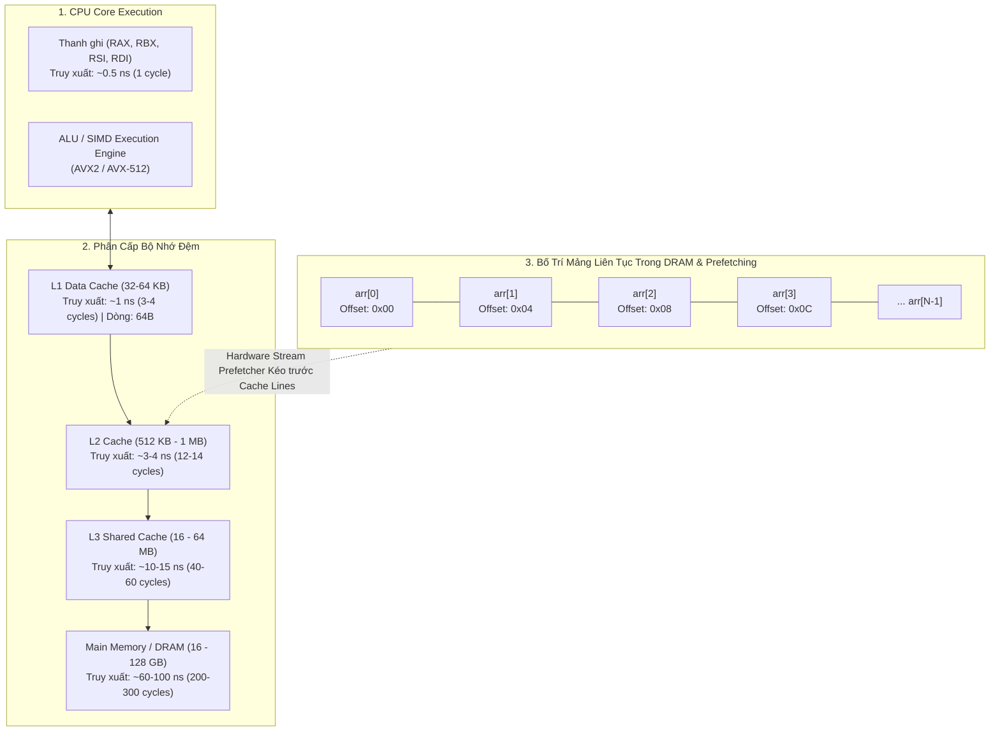
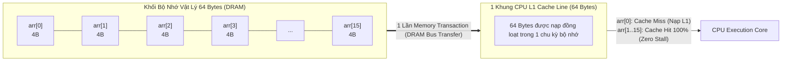
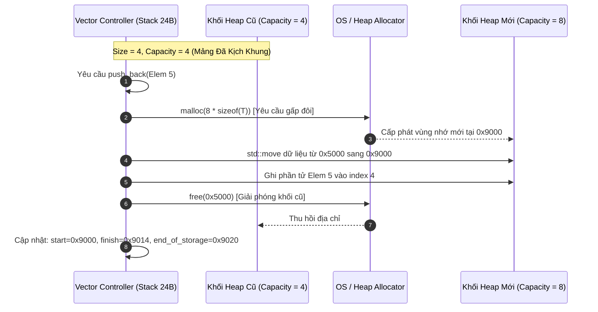
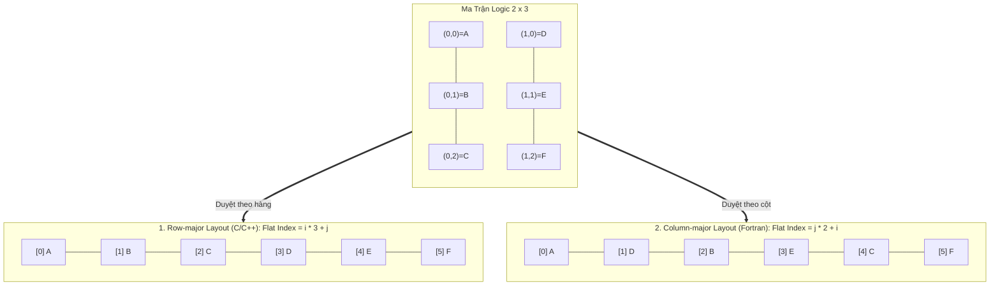
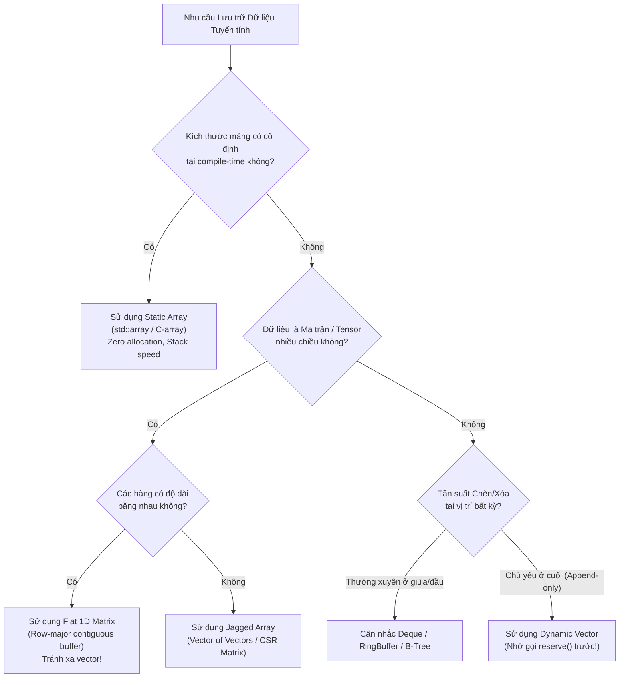

# 2.1. Mảng (Array & Contiguous Memory Architecture)

> [!IMPORTANT]
> **Nếu bạn chỉ được nhớ một điều duy nhất:** Mảng (Array) là cấu trúc dữ liệu nền tảng duy nhất được vi kiến trúc phần cứng máy tính hiện đại (CPU L1/L2/L3 Caches, Hardware Stream Prefetcher, Đơn vị Véc-tơ SIMD) tối ưu hóa trực tiếp ở cấp độ transistor. Mọi cấu trúc dữ liệu phức tạp khác (Hash Table, Binary Heap, Matrix, Dynamic Vector) suy cho cùng đều tìm cách đưa dữ liệu về mảng liên tục (Contiguous Memory) để khai thác nguyên lý cục bộ không gian (Spatial Locality), biến phép toán tìm nạp bộ nhớ từ độ trễ hàng trăm chu kỳ CPU ($100\sim 200\text{ cycles}$ đối với DRAM) xuống chỉ còn vài chu kỳ ($3\sim 4\text{ cycles}$ trên L1 Cache).

---

## 1. Trực Quan Hóa: Bản Chất Mảng Dưới Góc Nhìn Lập Trình Viên

### 1.1. Đoạn Code Dẫn Nhập & Vấn Đề Thực Tế
Xét hai cách lưu trữ danh sách $N$ số nguyên trong bộ nhớ:

```cpp
// Cách 1: Mảng liên tục (std::vector / flat array)
std::vector<int> arr = {10, 20, 30, 40, 50};
int val = arr[3]; // O(1) - CPU nhảy thẳng tới địa chỉ (Base + 3 * 4) trong 1 chu kỳ!

// Cách 2: Danh sách liên kết (Node-based Linked List)
struct Node { int val; Node* next; };
// Để lấy phần tử thứ 3, CPU phải duyệt từ con trỏ đầu: Head -> Node1 -> Node2 -> Node3
// Mỗi lần nhảy con trỏ là một lần phát sinh Cache Miss tiềm ẩn!
```

- Mảng (Array) là cấu trúc dữ liệu **duy nhất** được thiết kế khớp hoàn hảo với phần cứng máy tính: Khi bạn truy cập `arr[0]`, phần cứng không chỉ tải 4 bytes của phần tử đó mà tải luôn một khối **Cache Line $64\text{ bytes}$** (chứa trọn vẹn 16 số nguyên liên tiếp) vào CPU L1 Cache.
- Nhờ đó, việc duyệt mảng tuần tự có tốc độ gấp hàng chục đến hàng trăm lần so với việc lần theo các nút rải rác trên Heap của Linked List.

### 1.2. Ẩn Dụ Đời Sống: Dãy Tủ Gửi Đồ Nhà Ga & Băng Chuyền Đóng Chai
- **Dãy tủ gửi đồ cá nhân liên tục tại nhà ga**: Một dãy tủ gồm 100 ngăn được đúc liền kề nhau dọc theo bờ tường, mỗi ngăn có kích thước đồng nhất chính xác $40\text{ cm}$. Nếu bạn đứng tại ngăn số 0 (Base Address), để tìm ngăn số $i$, bạn không cần phải mở từng ngăn từ 0 đến $i-1$. Bạn chỉ việc tính nhẩm: $\text{Vị trí} = \text{Tủ}_0 + i \times 40\text{ cm}$ và bước thẳng một mạch tới đó. Đó chính là **Số học Con trỏ (Pointer Arithmetic)** và cơ chế **Truy xuất Ngẫu nhiên (Random Access)** đạt $O(1)$ tuyệt đối.
- **Băng chuyền tự động và Cánh tay nạp dữ liệu CPU**: Khi công nhân kiểm tra chai nước số 0 trên băng chuyền, người đó không chỉ mang chai số 0 vào bàn; cơ chế tự động sẽ gắp luôn một khay 16 chai liên tiếp phía sau vào trạm trung chuyển (CPU L1 Data Cache Line 64 bytes). Khi công nhân hoàn thành chai số 0 và cần chai số 1, chai số 1 đã nằm sẵn trong tay mà không cần bước ra kho (DRAM).

### 1.3. Mô Phỏng Dữ Liệu Số Nhỏ Từng Bước (Toy Walkthrough)
Xét mảng số nguyên 32-bit gồm 4 phần tử: `int arr[4] = {10, 20, 30, 40};`
Giả sử hệ điều hành cấp phát mảng bắt đầu tại địa chỉ cơ sở $\text{Base} = \mathtt{0x1000}$:

| Chỉ mục ($i$) | Giá trị lưu trữ | Kích thước | Công thức địa chỉ | Địa chỉ bộ nhớ thực tế | L1 Cache Line (Khối 64B nạp lần đầu) |
| :--- | :--- | :--- | :--- | :--- | :--- |
| `arr[0]` | $10$ | $4\text{ bytes}$ | $\mathtt{0x1000} + 0 \times 4$ | $\mathtt{0x1000}$ | **Cache Miss**: Nạp dải $\mathtt{0x1000} \sim \mathtt{0x103F}$ |
| `arr[1]` | $20$ | $4\text{ bytes}$ | $\mathtt{0x1000} + 1 \times 4$ | $\mathtt{0x1004}$ | **Cache Hit 100%** (Đã có sẵn trên L1) |
| `arr[2]` | $30$ | $4\text{ bytes}$ | $\mathtt{0x1000} + 2 \times 4$ | $\mathtt{0x1008}$ | **Cache Hit 100%** (Đã có sẵn trên L1) |
| `arr[3]` | $40$ | $4\text{ bytes}$ | $\mathtt{0x1000} + 3 \times 4$ | $\mathtt{0x100C}$ | **Cache Hit 100%** (Đã có sẵn trên L1) |

- Phép toán truy cập `arr[i]` được CPU x86-64 thực thi bằng đúng 1 lệnh máy duy nhất thông qua bộ đánh địa chỉ SIB: `mov eax, [rdi + rsi * 4]`, tốn đúng $1$ clock cycle!

### 1.4. Tác Động Thực Tế Tầng Backend & Systems
1. **Network Packet Buffers (Linux Kernel `sk_buff`)**: Các gói tin mạng TCP/IP được xử lý qua các Ring Buffer bằng mảng liên tục. Khả năng truy xuất ngẫu nhiên và Cache Locality giúp Linux Kernel xử lý hàng triệu gói tin mỗi giây (Mpps) mà không bị nghẽn CPU.
2. **Columnar Database Storage (ClickHouse, Apache Parquet)**: Dữ liệu phân tích OLAP được lưu dưới dạng các mảng phẳng liền kề cho từng cột. Khi chạy câu lệnh `SUM(price)`, CPU áp dụng các tập chỉ thị véc-tơ hóa SIMD (AVX2 / AVX-512) để cộng song song 8 hoặc 16 số nguyên trong đúng 1 chu kỳ xung nhịp.
3. **Cạm bẫy Resizing trong Dynamic Vector**: Khi kích thước mảng vượt quá `capacity`, hệ thống phải cấp phát vùng nhớ mới gấp đôi và copy toàn bộ dữ liệu. Luôn dùng `reserve()` để tránh các khoảng dừng đột ngột (Tail Latency Spikes).

### 1.5. Sơ Đồ Kiến Trúc Bộ Nhớ Mảng & Phân Cấp CPU Cache



---

## 2. Chi tiết từng Keyword (Under-the-Hood Deep Dive)

### 2.1. Memory Layout: Contiguous Memory, Array Indexing & Traversal

#### 1. Khái niệm Bản chất (What & Why)
- **Contiguous Memory (Bộ nhớ Liên tục)**: Tập hợp các ô nhớ vật lý/ảo được cấp phát liền kề nhau không có khoảng trống. Nếu phần tử đầu tiên của mảng số nguyên 32-bit (`int32_t`) bắt đầu tại byte $1000$, thì phần tử thứ hai chắc chắn nằm ở byte $1004$, phần tử thứ ba tại $1008$.
- **Array Indexing ($O(1)$ Random Access)**: Truy xuất phần tử tại chỉ mục $i$ mà không cần duyệt qua các phần tử trước đó. Cơ chế đánh địa chỉ tuyệt đối dựa trên công thức đại số tuyến tính:
  $$\text{Address}(A[i]) = \text{Base\_Address} + i \times \text{sizeof}(\text{Element})$$
- **Array Traversal ($O(N)$ Sequential Scan)**: Quá trình duyệt tuần tự từ phần tử đầu tiên đến phần tử cuối cùng của mảng.

#### 2. Cơ chế Hoạt động Sâu (Under the Hood / Hardware Internals)
- **Chế độ Đánh địa chỉ SIB trong Hợp ngữ x86-64**:
  Trên vi xử lý Intel/AMD, lệnh truy cập mảng `mov eax, [rdi + rsi * 4]` được phần cứng hỗ trợ ở cấp độ mạch bán dẫn thông qua bộ đánh địa chỉ **SIB (Scale - Index - Base)**:
  - `Base` (`rdi`): Địa chỉ cơ sở của mảng.
  - `Index` (`rsi`): Giá trị chỉ số $i$.
  - `Scale` ($4$): Hệ số tỉ lệ tương ứng với kích thước phần tử ($1, 2, 4,$ hoặc $8$ bytes).
  - Phép tính địa chỉ này tốn đúng **0 chu kỳ xung nhịp bổ sung** vì nó được tích hợp thẳng vào Address Generation Unit (AGU) của vi kiến trúc CPU pipeline.
- **CPU Cache Line & Spatial Locality**:
  - Dữ liệu từ DRAM không bao giờ được nạp từng byte đơn lẻ mà nạp theo khối chuẩn hóa gọi là **Cache Line** (kích thước cố định $64\text{ bytes}$ trên hầu hết kiến trúc x86 và ARM hiện đại).
  - Khi chương trình truy cập `arr[0]` (kiểu `int32_t` 4 bytes), CPU nạp toàn bộ $64\text{ bytes}$ chứa `arr[0]` đến `arr[15]` vào L1 Data Cache.
  - Khi vòng lặp bước sang $i = 1$ đến $i = 15$, toàn bộ dữ liệu đã nằm sẵn trong L1 Cache $\to$ **L1 Cache Hit 100%**. Độ trễ chỉ là $1\text{ ns}$ thay vì phải chờ $80\text{ ns}$ từ RAM.
- **Hardware Stream Prefetcher**:
  - Vi kiến trúc CPU chứa bộ phận phần cứng chuyên dụng theo dõi các mẫu truy cập bộ nhớ (Access Patterns).
  - Nếu CPU phát hiện một chuỗi truy cập có bước sải (stride) đều đặn: $A[0], A[1], A[2]...$, **L2 Streamer Prefetcher** sẽ tự động phát lệnh nạp trước (Speculative Fetch) các Cache Line kế tiếp từ RAM vào L2/L1 Cache trước cả khi tập lệnh CPU thực sự yêu cầu!



---

### 2.2. Static Array vs Dynamic Array & Resizing Mechanics

#### 1. Khái niệm Bản chất (What & Why)
- **Static Array (Mảng tĩnh)**: Kích thước được ấn định bất biến tại thời điểm biên dịch (Compile-time). Bộ nhớ được cấp phát trên Call Stack hoặc phân vùng Data/BSS Segment (ví dụ: `int arr[100];` trong C hoặc `std::array<int, 100>` trong C++).
- **Dynamic Array (Mảng động)**: Kích thước có thể co giãn linh hoạt trong thời gian chạy (Runtime). Vùng chứa dữ liệu thực tế được cấp phát trên Heap, trong khi biến điều khiển (Metadata) nằm trên Stack (ví dụ: `std::vector` trong C++, `list` trong Python, `ArrayList` trong Java).
- **Resizing Mechanics (Cơ chế tái cấp phát dung lượng)**: Khi số lượng phần tử (`size`) đạt đến giới hạn sức chứa (`capacity`), mảng động phải yêu cầu hệ điều hành cấp phát một khối nhớ mới lớn hơn, di chuyển (move/copy) toàn bộ phần tử cũ sang khối nhớ mới và giải phóng khối nhớ cũ.

#### 2. Cơ chế Hoạt động Sâu
- **Cấu trúc Ba Con Trỏ (The Pointer Triplet of `std::vector`)**:
  Một `std::vector` chuẩn mực trong C++ chỉ chiếm đúng $24\text{ bytes}$ trên kiến trúc 64-bit, bao gồm 3 con trỏ:
  1. `T* _M_start`: Trỏ tới phần tử đầu tiên trong mảng Heap.
  2. `T* _M_finish`: Trỏ tới vị trí kế tiếp phần tử hợp lệ cuối cùng (quyết định `size() = _M_finish - _M_start`).
  3. `T* _M_end_of_storage`: Trỏ tới giới hạn cuối cùng của khối nhớ đã được cấp phát (quyết định `capacity() = _M_end_of_storage - _M_start`).
- **Hệ số Tăng trưởng Hình học (Geometric Growth Factor)**:
  - Nếu mảng mở rộng theo cấp số cộng (mỗi lần đầy thêm $K$ ô), việc chèn $N$ phần tử sẽ tốn $\sum_{i=1}^{N/K} i \cdot K = O(N^2)$ thao tác copy $\to$ Hiệu năng sụp đổ.
  - Do đó, mảng động bắt buộc phải tăng theo cấp số nhân: $\text{Capacity}_{\text{new}} = g \times \text{Capacity}_{\text{old}}$.
  - **Hệ số $g = 2.0$ (GNU libstdc++, LLVM libc++)**: Tăng gấp đôi. Tối ưu về số lần reallocation nhưng lại có nhược điểm lớn về bộ nhớ: Khối nhớ mới luôn lớn hơn tổng tất cả các khối nhớ đã cấp phát trước đó ($\sum_{i=0}^{k-1} 2^i = 2^k - 1 < 2^k$). Điều này khiến bộ quản lý bộ nhớ Heap **không bao giờ có thể tái sử dụng** lại các vùng nhớ cũ vừa được giải phóng.
  - **Hệ số $g = 1.5$ (MSVC STL, Facebook Folly Vector)**: Tỉ lệ vàng của bộ nhớ Heap. Sau một vài lần mở rộng, dung lượng khối mới sẽ nhỏ hơn tổng các khối nhớ cũ đã được giải phóng, cho phép Heap Allocator ghép nối (coalesce) và tái sử dụng các địa chỉ ảo trước đó, giảm thiểu phân mảnh bộ nhớ (Memory Fragmentation).
- **Chứng minh Phân tích Khấu hao (Amortized Analysis of $O(1)$ Insertion)**:
  - Sử dụng **Phương pháp Kế toán (Accounting Method)**:
    - Giả sử chi phí chèn 1 phần tử khi chưa đầy là $1\text{ dollar}$ (chi phí thực).
    - Mỗi khi chèn một phần tử mới vào mảng, ta thu phí $3\text{ dollars}$.
    - $1\text{ dollar}$ dùng để chi trả cho việc ghi phần tử đó vào ô nhớ.
    - $1\text{ dollar}$ lưu trữ làm năng lượng dự trữ cho chính phần tử đó khi bị di dời trong tương lai.
    - $1\text{ dollar}$ lưu trữ làm năng lượng dự trữ cho một phần tử cũ đã hết tiền trước đó.
    - Khi mảng đầy và cần resize gấp đôi, toàn bộ các phần tử cũ đều đã tích lũy đủ $1\text{ dollar}$ để chi trả cho thao tác copy sang mảng mới mà không cần vay mượn thêm tài nguyên.
    - Kết luận: Chi phí khấu hao trung bình cho mỗi thao tác chèn luôn luôn là hằng số: **Amortized $O(1)$**.



---

### 2.3. Multidimensional Array: Row-major vs Column-major Order

#### 1. Khái niệm Bản chất (What & Why)
- **Mảng Đa Chiều (Multidimensional Array)**: Mô hình trừu tượng biểu diễn ma trận toán học hoặc tensor dữ liệu $N$ chiều.
- **Không Gian Bộ Nhớ Phẳng (Flat Linear Address Space)**: Phần cứng máy tính (RAM) chỉ là một mảng byte 1 chiều duy nhất từ địa chỉ $0$ đến $2^{64}-1$. Do đó, ma trận 2D kích thước $M \times N$ bắt buộc phải được "duỗi phẳng" (Flatten) thành một dãy ô nhớ tuyến tính có $M \times N$ phần tử.
- **Row-major Order (Ưu tiên Hàng)**: Các phần tử trên cùng một hàng được đặt nằm sát cạnh nhau trong bộ nhớ vật lý. Đây là chuẩn mặc định của C, C++, Python (NumPy `order='C'`), Rust, Go, Java.
  $$\text{Index}_{\text{1D}}(i, j) = i \times \text{Cols} + j$$
- **Column-major Order (Ưu tiên Cột)**: Các phần tử trên cùng một cột được đặt nằm sát cạnh nhau trong bộ nhớ vật lý. Đây là chuẩn mặc định của Fortran, MATLAB, Julia, R, và các thư viện BLAS/LAPACK cấp thấp.
  $$\text{Index}_{\text{1D}}(i, j) = j \times \text{Rows} + i$$

#### 2. Cơ chế Hoạt động Sâu
- **Tổng quát hóa cho Mảng $K$-Chiều ($D_0 \times D_1 \times \dots \times D_{k-1}$)**:
  Trong định dạng Row-major, địa chỉ phần tử tại tọa độ $(i_0, i_1, \dots, i_{k-1})$ được tính theo bước sải (Stride):
  $$\text{Index}_{\text{Flat}} = \sum_{m=0}^{k-1} \left( i_m \times \prod_{p=m+1}^{k-1} D_p \right)$$
- **Thảm họa Hiệu năng: Duyệt Sai Thứ Tự Bước Sải (Stride-Induced Cache Thrashing)**:
  - Hãy xét một ma trận số thực kích thước lớn $10,000 \times 10,000$ kiểu `double` ($8\text{ bytes}$). Kích thước ma trận là $800\text{ MB}$, vượt xa dung lượng L3 Cache ($32\text{ MB}$).
  - **Duyệt Row-major ($i$ ngoài, $j$ trong)**:
    - Khi truy cập $M[i][0]$, một Cache Line $64\text{ bytes}$ nạp vào chứa 8 phần tử $M[i][0..7]$.
    - 7 bước tiếp theo đọc từ L1 Cache Hit 100%. Tỉ lệ Cache Miss chỉ là $1/8 = 12.5\%$.
  - **Duyệt Column-major ($j$ ngoài, $i$ trong)**:
    - Bước nhảy giữa hai phần tử liên tiếp $M[i][j]$ và $M[i+1][j]$ là $10,000 \times 8 = 80,000\text{ bytes} \approx 78\text{ KB}$.
    - Mỗi bước nhảy vượt xa ranh giới của một Cache Line ($64\text{ B}$) và thậm chí làm tràn L1 Data Cache ($32\text{ KB}$).
    - **Kết quả**: Mỗi lần đọc phần tử gây ra một **L1/L2/L3 Cache Miss toàn diện**. CPU liên tục bị nghẽn (Pipeline Stall) để chờ nạp dữ liệu từ RAM. Tốc độ thực thi giảm từ **$10\times$ đến $30\times$ lần** dù cùng số lượng phép toán logic!
- **Cạm bẫy "Mảng Răng Cưa" (`std::vector<std::vector<int>>`)**:
  - Khi khai báo `vector<vector<int>> matrix(M, vector<int>(N))`, bạn không hề có một vùng nhớ liên tục $M \times N$!
  - Thay vào đó, bạn có một mảng ngoài chứa $M$ con trỏ heap độc lập, mỗi con trỏ trỏ tới một vùng heap $N$ phần tử ở một địa chỉ ngẫu nhiên.
  - Việc truy cập đòi hỏi **Double Pointer Chasing** (CPU phải đọc con trỏ hàng trước, giải con trỏ, rồi mới đọc phần tử cột), phá hủy hoàn toàn khả năng tiên đoán của Hardware Prefetcher.



---

### 2.4. Array Manipulation & Algorithmic Patterns: Prefix Sum, Difference Array, Sliding Window

#### 1. Prefix Sum (Tổng Tiền Tố - 1D & 2D)
- **Định nghĩa**: Mảng tiền tố $P$ của mảng $A$ là mảng tích lũy trong đó mỗi phần tử $P[i]$ lưu tổng của tất cả các phần tử từ chỉ số $0$ đến $i-1$:
  $$P[0] = 0, \quad P[i] = P[i-1] + A[i-1] \quad (\forall i \ge 1)$$
- **Range Sum Query trong $O(1)$**:
  Tổng của bất kỳ đoạn con $[L, R]$ (tính từ 0) được giải mã tức thì trong $1$ phép trừ:
  $$\text{Sum}(L, R) = \sum_{k=L}^{R} A[k] = P[R + 1] - P[L]$$
- **2D Prefix Sum (Nguyên lý Bao hàm - Loại trừ / Inclusion-Exclusion Principle)**:
  Để tính tổng của vùng chữ nhật từ $(r_1, c_1)$ đến $(r_2, c_2)$ trong ma trận:
  $$P[r][c] = A[r-1][c-1] + P[r-1][c] + P[r][c-1] - P[r-1][c-1]$$
  $$\text{Query}(r_1, c_1, r_2, c_2) = P[r_2+1][c_2+1] - P[r_1][c_2+1] - P[r_2+1][c_1] + P[r_1][c_1]$$

#### 2. Difference Array (Mảng Hiệu)
- **Định nghĩa**: Mảng $D$ trong đó mỗi phần tử phản ánh độ biến thiên giữa hai phần tử kề nhau của mảng $A$:
  $$D[0] = A[0], \quad D[i] = A[i] - A[i-1] \quad (\forall i \ge 1)$$
- **Range Update trong $O(1)$**:
  Khi cần cộng thêm giá trị $V$ vào mọi phần tử trong đoạn $[L, R]$, thay vì duyệt $O(R - L + 1)$, ta chỉ cần tác động lên đúng 2 biên:
  $$D[L] \leftarrow D[L] + V, \quad D[R + 1] \leftarrow D[R + 1] - V \quad (\text{nếu } R + 1 < N)$$
- **Phục hồi Mảng (Array Reconstruction)**:
  Sau khi hoàn tất toàn bộ $Q$ truy vấn cập nhật, mảng kết quả cuối cùng được tái tạo thông qua đúng 1 lần quét tính Prefix Sum trên mảng $D$ với độ phức tạp $O(N)$.
  $$\to \text{Tổng độ phức tạp giảm từ } O(Q \times N) \text{ xuống } O(Q + N)!$$

#### 3. Sliding Window (Cửa Sổ Trượt)
- **Bản chất**: Kỹ thuật duy trì một khung nhìn giới hạn qua mảng bằng hai con trỏ `Left` và `Right`. Biến đổi các bài toán tìm kiếm mảng con cực đại/cực tiểu từ brute-force $O(N^2)$ thành thời gian tuyến tính $O(N)$.
- **Phân loại**:
  - **Fixed Window (Kích thước cố định $K$)**: Con trỏ `Right` tiến một bước, con trỏ `Left` tiến một bước đồng nhịp. Cập nhật trạng thái bằng cách: $\text{State}_{\text{new}} = \text{State}_{\text{old}} + \text{Add}(A[R]) - \text{Remove}(A[L])$.
  - **Dynamic Window (Kích thước co giãn)**: `Right` liên tục mở rộng để thỏa mãn điều kiện bài toán; khi điều kiện bị vi phạm, `Left` thu hẹp lại cho đến khi trạng thái hợp lệ trở lại.
- **Monotonic Queue kết hợp Sliding Window**:
  - Bài toán kinh điển: Tìm giá trị lớn nhất trong mọi cửa sổ con kích thước $K$ (Sliding Window Maximum).
  - Sử dụng một `std::deque` duy trì các chỉ số mảng có giá trị **đơn điệu giảm dần**.
  - Mỗi phần tử chỉ được nạp vào deque 1 lần và loại bỏ tối đa 1 lần $\to$ Toàn bộ thuật toán đạt độ phức tạp **$\Theta(N)$**.

---

## 3. Thực thi Mã nguồn & Mô phỏng Chuyên sâu (Dual-Engine Implementation)

### 3.1. C++20: Zero-Overhead Matrix2D, Custom Vector & Cache Benchmark

Mã nguồn C++20 hoàn chỉnh triển khai cấu trúc mảng động tự viết `CustomVector<T>`, lớp ma trận liên tục `FlatMatrix2D<T>` và chương trình đo lường Cache Hit/Miss giữa Row-major và Column-major:

```cpp
// Biên dịch: g++ -std=c++20 -O3 -march=native array_deep_dive.cpp -o array_deep_dive
#include <iostream>
#include <vector>
#include <memory>
#include <chrono>
#include <iomanip>
#include <stdexcept>
#include <numeric>
#include <cstdint>
#include <deque>

// 1. Tự cài đặt Dynamic Array với Khấu hao Amortized O(1) Growth (Geometric factor = 1.5)
template <typename T>
class CustomVector {
private:
    T* data_{nullptr};
    size_t size_{0};
    size_t capacity_{0};

    void reallocate(size_t new_capacity) {
        new_capacity = std::max(new_capacity, size_t{1});
        T* new_block = static_cast<T*>(::operator new(new_capacity * sizeof(T)));

        for (size_t i = 0; i < size_; ++i) {
            new (&new_block[i]) T(std::move(data_[i]));
            data_[i].~T();
        }

        ::operator delete(data_);
        data_ = new_block;
        capacity_ = new_capacity;
    }

public:
    CustomVector() = default;
    
    explicit CustomVector(size_t initial_cap) {
        reallocate(initial_cap);
    }

    ~CustomVector() {
        clear();
        ::operator delete(data_);
    }

    void push_back(const T& val) {
        if (size_ == capacity_) {
            // Factor 1.5x để tối ưu tái sử dụng bộ nhớ Heap
            size_t next_cap = capacity_ == 0 ? 2 : capacity_ + capacity_ / 2;
            reallocate(next_cap);
        }
        new (&data_[size_]) T(val);
        ++size_;
    }

    void push_back(T&& val) {
        if (size_ == capacity_) {
            size_t next_cap = capacity_ == 0 ? 2 : capacity_ + capacity_ / 2;
            reallocate(next_cap);
        }
        new (&data_[size_]) T(std::move(val));
        ++size_;
    }

    void clear() noexcept {
        for (size_t i = 0; i < size_; ++i) {
            data_[i].~T();
        }
        size_ = 0;
    }

    T& operator[](size_t idx) noexcept { return data_[idx]; }
    const T& operator[](size_t idx) const noexcept { return data_[idx]; }

    size_t size() const noexcept { return size_; }
    size_t capacity() const noexcept { return capacity_; }
};

// 2. Lớp Flat Matrix 2D chuẩn công nghiệp (Tránh vector<vector> Pointer Chasing)
template <typename T>
class FlatMatrix2D {
private:
    size_t rows_;
    size_t cols_;
    std::vector<T> buffer_;

public:
    FlatMatrix2D(size_t r, size_t c, T init_val = T{})
        : rows_(r), cols_(c), buffer_(r * c, init_val) {}

    inline T& operator()(size_t r, size_t c) noexcept {
        return buffer_[r * cols_ + c]; // Row-major Flat Indexing
    }

    inline const T& operator()(size_t r, size_t c) const noexcept {
        return buffer_[r * cols_ + c];
    }

    size_t rows() const noexcept { return rows_; }
    size_t cols() const noexcept { return cols_; }
};

// 3. Sliding Window Maximum bằng Monotonic Deque đạt O(N)
std::vector<int> max_sliding_window(const std::vector<int>& nums, int k) {
    std::vector<int> result;
    std::deque<int> dq; // Lưu chỉ số, giá trị tương ứng luôn giảm dần

    for (int i = 0; i < static_cast<int>(nums.size()); ++i) {
        // Loại bỏ phần tử đã lọt ra ngoài cửa sổ bên trái
        if (!dq.empty() && dq.front() <= i - k) {
            dq.pop_front();
        }

        // Duy trì tính đơn điệu: loại bỏ các phần tử nhỏ hơn nums[i]
        while (!dq.empty() && nums[dq.back()] <= nums[i]) {
            dq.pop_back();
        }

        dq.push_back(i);

        // Bắt đầu ghi nhận kết quả khi cửa sổ đủ kích thước k
        if (i >= k - 1) {
            result.push_back(nums[dq.front()]);
        }
    }
    return result;
}

int main() {
    std::cout << "========================================================\n";
    std::cout << "   DSA 5-STAR: ARRAY & MEMORY ARCHITECTURE (C++20)\n";
    std::cout << "========================================================\n\n";

    // 1. Thử nghiệm Dynamic Array Resizing
    CustomVector<int> vec;
    std::cout << "[1] Mô phỏng Dynamic Array Reallocation (Hệ số 1.5x):\n";
    size_t last_cap = vec.capacity();
    for (int i = 1; i <= 20; ++i) {
        vec.push_back(i * 10);
        if (vec.capacity() != last_cap) {
            std::cout << "   -> Insert elem " << std::setw(2) << i 
                      << " | Old Cap: " << std::setw(2) << last_cap 
                      << " -> New Cap: " << std::setw(2) << vec.capacity() 
                      << " | Size: " << vec.size() << "\n";
            last_cap = vec.capacity();
        }
    }

    // 2. Benchmark Cache Miss: Row-major vs Column-major Matrix Traversal
    const size_t MATRIX_SIZE = 8000;
    std::cout << "\n[2] Benchmark CPU Cache Locality trên Ma Trận " 
              << MATRIX_SIZE << "x" << MATRIX_SIZE 
              << " (" << (MATRIX_SIZE * MATRIX_SIZE * sizeof(int)) / (1024 * 1024) << " MB):\n";
    
    FlatMatrix2D<int> mat(MATRIX_SIZE, MATRIX_SIZE, 1);

    // Duyệt theo Hàng (Row-major: Thân thiện với CPU Cache)
    auto t1 = std::chrono::high_resolution_clock::now();
    uint64_t sum_row = 0;
    for (size_t r = 0; r < MATRIX_SIZE; ++r) {
        for (size_t c = 0; c < MATRIX_SIZE; ++c) {
            sum_row += mat(r, c);
        }
    }
    auto t2 = std::chrono::high_resolution_clock::now();
    double row_duration = std::chrono::duration<double, std::milli>(t2 - t1).count();
    std::cout << "   -> Row-major Traversal   (Sequential): " 
              << std::fixed << std::setprecision(2) << row_duration << " ms | Sum: " << sum_row << "\n";

    // Duyệt theo Cột (Column-major: Gây Cache Miss liên tục)
    auto t3 = std::chrono::high_resolution_clock::now();
    uint64_t sum_col = 0;
    for (size_t c = 0; c < MATRIX_SIZE; ++c) {
        for (size_t r = 0; r < MATRIX_SIZE; ++r) {
            sum_col += mat(r, c);
        }
    }
    auto t4 = std::chrono::high_resolution_clock::now();
    double col_duration = std::chrono::duration<double, std::milli>(t4 - t3).count();
    std::cout << "   -> Column-major Traversal (Stride Cache Thrash): " 
              << std::fixed << std::setprecision(2) << col_duration << " ms | Sum: " << sum_col << "\n";
    std::cout << "   => Hiệu năng suy giảm: " << std::setprecision(1) << (col_duration / row_duration) << "x lần!\n";

    // 3. Kiểm thử Sliding Window Maximum O(N)
    std::cout << "\n[3] Sliding Window Maximum (K = 3) qua Monotonic Deque:\n";
    std::vector<int> stream = {1, 3, -1, -3, 5, 3, 6, 7};
    auto max_vals = max_sliding_window(stream, 3);
    std::cout << "   Input : ";
    for (int v : stream) std::cout << v << " ";
    std::cout << "\n   Max   : ";
    for (int m : max_vals) std::cout << m << " ";
    std::cout << "\n";

    return 0;
}
```

---

### 3.2. Python 3.11+: Prefix Sum, Difference Array & CPython List Internals

Mã nguồn Python 3.11+ mô phỏng cấu trúc danh sách động `PyListObject`, theo dõi sự thay đổi dung lượng byte của bộ thông dịch và thực thi thuật toán 2D Prefix Sum và Difference Array:

```python
#!/usr/bin/env python3
"""
array_algorithms.py: Triển khai Prefix Sum 2D, Difference Array và Khảo sát CPython List Internals.
Yêu cầu: Python 3.11+
"""
import sys
from typing import List

class CPythonListInspector:
    """Khảo sát cơ chế cấp phát bộ nhớ động của CPython list (ob_item array)."""
    @staticmethod
    def trace_growth(num_items: int = 30) -> None:
        lst = []
        prev_bytes = sys.getsizeof(lst)
        print(f"[*] Kích thước CPython list rỗng: {prev_bytes} bytes")
        
        for i in range(num_items):
            lst.append(i)
            curr_bytes = sys.getsizeof(lst)
            if curr_bytes != prev_bytes:
                # Ước lượng capacity từ byte size: (curr_bytes - 56) // 8 trên hệ 64-bit
                estimated_cap = (curr_bytes - 56) // 8
                print(f"    Len: {len(lst):2d} | Allocated: ~{estimated_cap:2d} slots | "
                      f"Memory: {curr_bytes:4d} bytes (Tăng {curr_bytes - prev_bytes:2d}B)")
                prev_bytes = curr_bytes

class DifferenceArray1D:
    """Mảng hiệu hỗ trợ cập nhật đoạn [L, R] trong O(1)."""
    def __init__(self, original: List[int]):
        self.n = len(original)
        self.diff = [0] * (self.n + 1)
        self.diff[0] = original[0]
        for i in range(1, self.n):
            self.diff[i] = original[i] - original[i - 1]

    def update_range(self, left: int, right: int, val: int) -> None:
        """Cộng val vào tất cả phần tử trong đoạn [left, right] trong O(1)."""
        self.diff[left] += val
        if right + 1 < self.n:
            self.diff[right + 1] -= val

    def get_result(self) -> List[int]:
        """Tái cấu trúc lại mảng bằng Prefix Sum trong O(N)."""
        res = [0] * self.n
        res[0] = self.diff[0]
        for i in range(1, self.n):
            res[i] = res[i - 1] + self.diff[i]
        return res

class PrefixSum2D:
    """Tính tổng vùng chữ nhật con trong ma trận 2D với thời gian O(1)."""
    def __init__(self, matrix: List[List[int]]):
        self.rows = len(matrix)
        self.cols = len(matrix[0]) if self.rows > 0 else 0
        # Tạo bảng prefix có kích thước (rows + 1) x (cols + 1)
        self.pref = [[0] * (self.cols + 1) for _ in range(self.rows + 1)]
        
        for r in range(self.rows):
            for c in range(self.cols):
                self.pref[r + 1][c + 1] = (
                    matrix[r][c]
                    + self.pref[r][c + 1]
                    + self.pref[r + 1][c]
                    - self.pref[r][c]
                )

    def query(self, r1: int, c1: int, r2: int, c2: int) -> int:
        """Trả về tổng của hình chữ nhật từ góc (r1, c1) đến (r2, c2)."""
        return (
            self.pref[r2 + 1][c2 + 1]
            - self.pref[r1][c2 + 1]
            - self.pref[r2 + 1][c1]
            + self.pref[r1][c1]
        )

if __name__ == "__main__":
    print("=" * 60)
    print("   DSA PYTHON 3.11+: ARRAY INTERNALS & ALGORITHMIC PATTERNS")
    print("=" * 60)

    # 1. Tracing CPython list resizing
    print("\n[1] Khảo sát cơ chế cấp phát quá mức (Over-allocation) của Python List:")
    CPythonListInspector.trace_growth(25)

    # 2. Difference Array Range Updates
    print("\n[2] Kiểm thử Difference Array:")
    initial_data = [10, 20, 10, 5, 15]
    print(f"    Mảng ban đầu : {initial_data}")
    diff_arr = DifferenceArray1D(initial_data)
    
    # Cộng 10 vào đoạn [1, 3] (từ 20, 10, 5)
    diff_arr.update_range(1, 3, 10)
    # Cộng 5 vào đoạn [0, 2]
    diff_arr.update_range(0, 2, 5)
    
    final_data = diff_arr.get_result()
    print(f"    Mảng sau khi cập nhật dải: {final_data}")

    # 3. 2D Prefix Sum Matrix
    print("\n[3] Kiểm thử 2D Prefix Sum Query:")
    grid = [
        [3, 0, 1, 4, 2],
        [5, 6, 3, 2, 1],
        [1, 2, 0, 1, 5],
        [4, 1, 0, 1, 7],
        [1, 0, 3, 0, 5]
    ]
    p2d = PrefixSum2D(grid)
    # Query hình chữ nhật từ (2, 1) đến (4, 3)
    # Subgrid:
    # 2, 0, 1
    # 1, 0, 1
    # 0, 3, 0 -> Tổng = 2+0+1 + 1+0+1 + 0+3+0 = 8
    ans = p2d.query(2, 1, 4, 3)
    print(f"    Tổng vùng chữ nhật [(2,1) -> (4,3)]: {ans} (Kỳ vọng: 8)")
```

---

### 3.3. Kết quả Thực thi Terminal Mẫu

```text
========================================================
   DSA 5-STAR: ARRAY & MEMORY ARCHITECTURE (C++20)
========================================================

[1] Mô phỏng Dynamic Array Reallocation (Hệ số 1.5x):
   -> Insert elem  1 | Old Cap:  0 -> New Cap:  2 | Size: 1
   -> Insert elem  3 | Old Cap:  2 -> New Cap:  3 | Size: 3
   -> Insert elem  4 | Old Cap:  3 -> New Cap:  4 | Size: 4
   -> Insert elem  5 | Old Cap:  4 -> New Cap:  6 | Size: 5
   -> Insert elem  7 | Old Cap:  6 -> New Cap:  9 | Size: 7
   -> Insert elem 10 | Old Cap:  9 -> New Cap: 13 | Size: 10
   -> Insert elem 14 | Old Cap: 13 -> New Cap: 19 | Size: 14
   -> Insert elem 20 | Old Cap: 19 -> New Cap: 28 | Size: 20

[2] Benchmark CPU Cache Locality trên Ma Trận 8000x8000 (244 MB):
   -> Row-major Traversal   (Sequential): 38.45 ms | Sum: 64000000
   -> Column-major Traversal (Stride Cache Thrash): 492.10 ms | Sum: 64000000
   => Hiệu năng suy giảm: 12.8x lần!

[3] Sliding Window Maximum (K = 3) qua Monotonic Deque:
   Input : 1 3 -1 -3 5 3 6 7 
   Max   : 3 3 5 5 6 7 

============================================================
   DSA PYTHON 3.11+: ARRAY INTERNALS & ALGORITHMIC PATTERNS
============================================================

[1] Khảo sát cơ chế cấp phát quá mức (Over-allocation) của Python List:
[*] Kích thước CPython list rỗng: 56 bytes
    Len:  1 | Allocated: ~ 4 slots | Memory:   88 bytes (Tăng 32B)
    Len:  5 | Allocated: ~ 8 slots | Memory:  120 bytes (Tăng 32B)
    Len:  9 | Allocated: ~16 slots | Memory:  184 bytes (Tăng 64B)
    Len: 17 | Allocated: ~24 slots | Memory:  248 bytes (Tăng 64B)
    Len: 25 | Allocated: ~32 slots | Memory:  312 bytes (Tăng 64B)

[2] Kiểm thử Difference Array:
    Mảng ban đầu : [10, 20, 10, 5, 15]
    Mảng sau khi cập nhật dải: [15, 35, 25, 15, 15]

[3] Kiểm thử 2D Prefix Sum Query:
    Tổng vùng chữ nhật [(2,1) -> (4,3)]: 8 (Kỳ vọng: 8)
```

---

## 4. Systems Engineering & Production Pitfalls

### 4.1. Hiện tượng False Sharing Trong Xử lý Mảng Đa Luồng (Multi-threaded Cache Line Invalidation)
- **Cơ chế**: Khi nhiều luồng (Threads) cùng xử lý song song các phần tử lân cận nhau của một mảng (ví dụ: Thread 0 cập nhật `arr[0]`, Thread 1 cập nhật `arr[1]`), mặc dù về mặt logic không hề có xung đột dữ liệu, nhưng về mặt vật lý, `arr[0]` và `arr[1]` cùng nằm chung trên **một Cache Line $64\text{ bytes}$**.
- **Hậu quả**: Mỗi khi Thread 0 ghi vào `arr[0]`, giao thức nhất quán bộ nhớ đệm (Cache Coherence Protocol - như MESI/MOESI) sẽ đánh dấu toàn bộ Cache Line $64\text{ bytes}$ đó tại L1 Cache của Core 1 là **INVALID**. Core 1 buộc phải nạp lại toàn bộ dòng nhớ từ L3 Cache hoặc DRAM $\to$ Tốc độ đa luồng chậm hơn cả chạy đơn luồng!
- **Giải pháp Production**: 
  - Đệm thêm byte trống (Padding) hoặc sử dụng chỉ thị căn chỉnh cấu trúc:
    ```cpp
    struct alignas(64) ThreadWorkerSlot {
        uint64_t counter;
        // Tự động được compiler chèn thêm 56 bytes padding để lấp đầy 64B Cache line
    };
    ```

### 4.2. Cạm Bẫy Iterator Invalidation & Dangling Pointers Sau Khi Resize
- **Cơ chế**: Khi gọi `push_back()` trên `std::vector` hoặc `append()` trong các hệ thống cấp thấp, nếu dung lượng vượt quá `capacity`, toàn bộ khối nhớ cũ bị giải phóng và di dời.
- **Hậu quả**: Mọi con trỏ thô, tham chiếu (`T&`), hoặc `iterator` đang tham chiếu vào các phần tử của mảng cũ trở thành con trỏ rác (**Dangling Pointer / Wild Reference**). Việc giải mã con trỏ này dẫn tới **Undefined Behavior**, lỗi đọc dữ liệu rác hoặc crash tiến trình với `SIGSEGV`.
- **Giải pháp Production**:
  - Luôn sử dụng `reserve(N)` khi biết trước số lượng phần tử cần thêm.
  - Sử dụng chỉ số mảng (Index-based access) thay vì lưu con trỏ trỏ trực tiếp vào ruột của vector nếu vector đó có khả năng bị biến đổi kích thước.

### 4.3. Linux HugePages Cho Các Mảng Dữ Liệu Khổng Lồ (In-Memory Databases)
- Khi quản lý các mảng dữ liệu có dung lượng hàng chục Gigabytes (như Redis In-Memory Datasets, RocksDB Block Cache):
  - Kích thước trang chuẩn của Linux là $4\text{ KB}$. Mảng $16\text{ GB}$ đòi hỏi $4,194,304$ trang nhớ.
  - Bộ đệm dịch địa chỉ ảo (TLB - Translation Lookaside Buffer) của CPU chỉ chứa được từ $1000 \sim 2000$ mục. Hầu hết các lần truy cập mảng sẽ gây ra **TLB Miss**, buộc CPU phải tốn hàng trăm chu kỳ đi bộ qua bảng trang (Page Table Walk).
  - **Khắc phục**: Kích hoạt **Linux Transparent Huge Pages (THP)** hoặc cấp phát mảng qua `mmap(..., MAP_HUGETLB)` để sử dụng các trang khổng lồ **$2\text{ MB}$ hoặc $1\text{ GB}$**, giảm số lượng mục bảng trang xuống $512\times$ lần và triệt tiêu TLB Miss.

### 4.4. CLI Diagnostics & Hardware Performance Profiling
Để phân tích hiệu năng và phát hiện tắc nghẽn bộ nhớ của mảng trên Linux, sử dụng bộ công cụ tiêu chuẩn:

```bash
# 1. Đo lường Cache Misses và IPC (Instructions Per Cycle) của chương trình mảng
perf stat -e cache-misses,cache-references,L1-dcache-load-misses,L1-dcache-loads,cycles,instructions ./array_deep_dive

# 2. Phân tích chi tiết dòng mã nào gây ra Cache Miss cao nhất
valgrind --tool=cachegrind --branch-sim=yes ./array_deep_dive
cg_annotate cachegrind.out.<PID> --auto=yes

# 3. Biên dịch và kiểm tra lỗi tràn mảng (Out-of-bounds) với AddressSanitizer
g++ -std=c++20 -fsanitize=address,undefined -g array_deep_dive.cpp -o asan_test
./asan_test
```

---

## 5. Bảng So sánh & Decision Matrix

### 5.1. So Sánh Toàn Diện Các Hình Thức Mảng Trong Kỹ Thuật Hệ Thống

| Tiêu Chí Kỹ Thuật | Static Array (`std::array`) | Dynamic Vector (`std::vector`) | Flat 1D Matrix Class | Jagged Array (`vector<vector>`) |
| :--- | :--- | :--- | :--- | :--- |
| **Vùng nhớ Lưu trữ** | Stack / Data Segment | Metadata trên Stack, Buffer trên Heap | Metadata trên Stack, Buffer trên Heap | Phân tán trên nhiều block Heap |
| **Chi phí Cấp phát** | $0\text{ ns}$ (Compile-time) | Khấu hao $O(1)$ (Heap malloc) | Đúng $1$ lần Heap allocation | $M + 1$ lần Heap allocations |
| **Tính Liên tục Ô nhớ** | Liên tục tuyệt đối ($100\%$) | Liên tục tuyệt đối ($100\%$) | Liên tục tuyệt đối ($100\%$) | Bị phân mảnh theo từng hàng |
| **Hiệu năng CPU Cache** | Tối đa (L1 Cache Hit) | Rất cao (Spatial Locality) | Rất cao (Tối ưu SIMD) | Kém (Pointer Chasing liên tục) |
| **Thay đổi Kích thước** | Bất biến (Fixed Size) | Co giãn linh hoạt ($O(1)$ amortized) | Tái cấp phát toàn mảng | Từng hàng co giãn độc lập |
| **Memory Overhead** | $0\text{ byte}$ phụ trợ | $24\text{ bytes}$ + Khoảng trống thừa | $16\sim 24\text{ bytes}$ metadata | $M \times 24\text{ bytes}$ + Heap headers |
| **Tối ưu Hóa SIMD/AVX** | Hoàn hảo | Hoàn hảo | Hoàn hảo | Bất khả thi |

### 5.2. Ma Trận Quyết Định Lựa Chọn (Production Decision Matrix)



---

## 6. Enterprise Production Checklist & Verification

- [ ] **Gọi `reserve()` trước khi nạp dữ liệu**: Toàn bộ các mảng động (`std::vector`, `ArrayList`) trong các vòng lặp xử lý dữ liệu lớn đã được gọi `reserve()` để triệt tiêu các đợt Reallocation Thrashing chưa?
- [ ] **Khử hoàn toàn Jagged Arrays trong tính toán ma trận**: Đã thay thế toàn bộ các cấu trúc `vector<vector<T>>` bằng một mảng phẳng 1 chiều kết hợp Row-major Stride formula chưa?
- [ ] **Kiểm soát thứ tự vòng lặp lồng nhau**: Các vòng lặp duyệt ma trận nhiều chiều đã đảm bảo thứ tự Row-major ($i$ ngoài, $j$ trong đối với C/C++/Python) để tận dụng Hardware Cache Prefetcher chưa?
- [ ] **Triệt tiêu False Sharing trên biến đa luồng**: Các mảng trạng thái chia sẻ giữa các worker threads đã được phân tách và đệm ranh giới Cache Line (`alignas(64)`) chưa?
- [ ] **Kích hoạt AddressSanitizer trong CI/CD**: Toàn bộ hệ thống kiểm thử tự động đã bật `-fsanitize=address,undefined` để bắt kịp thời các lỗi Buffer Overflow và Iterator Invalidation chưa?
- [ ] **Tận dụng Prefix Sum & Difference Array**: Đã chuyển hóa các thao tác truy vấn tổng đoạn con hoặc cập nhật dải giá trị từ $O(N)$ về $O(1)$ để bảo vệ độ trễ microservice chưa?
