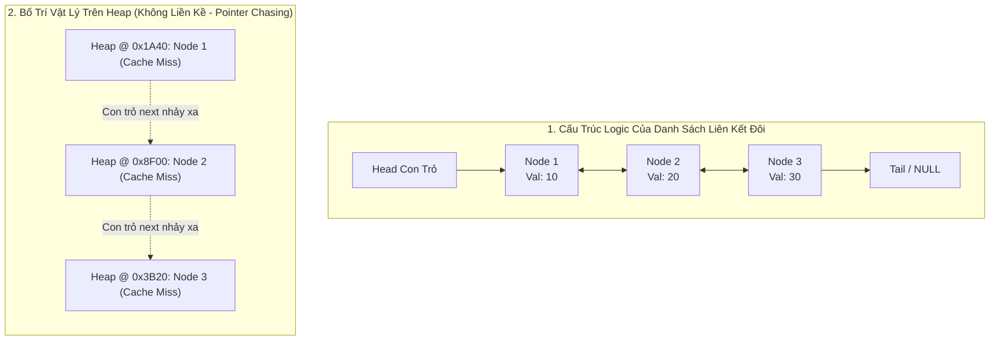
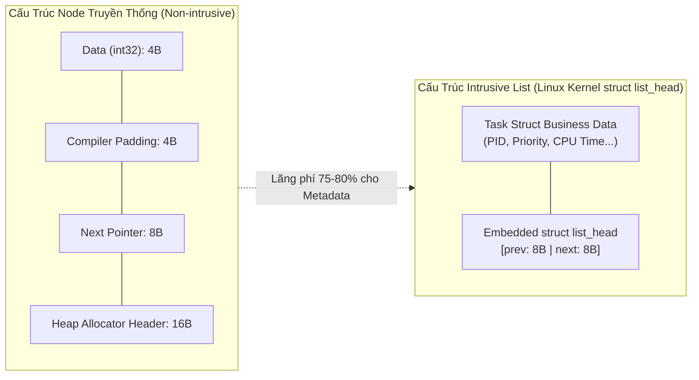
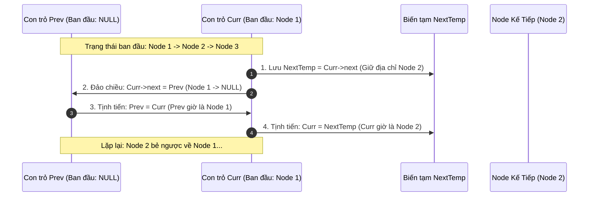
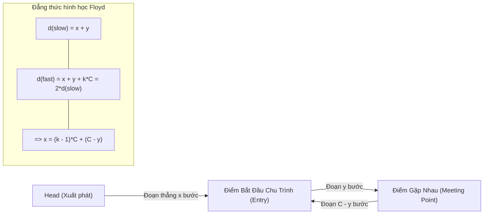
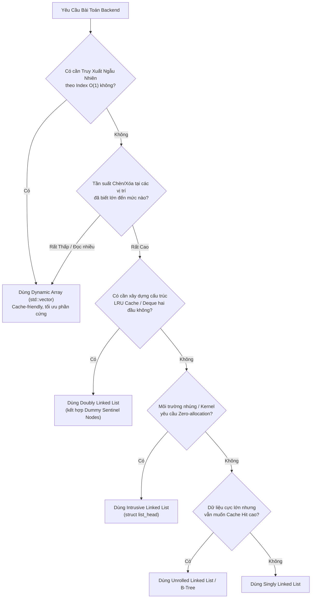

# 2.2. Danh Sách Liên Kết (Linked List & Pointer-based Architecture)

> [!IMPORTANT]
> **Nếu bạn chỉ được nhớ một điều duy nhất:** Danh sách liên kết (Linked List) là cấu trúc dữ liệu tuyến tính tối ưu tuyệt đối cho các thao tác chèn và xóa phần tử tại vị trí đã biết với độ phức tạp thời gian lý tưởng $O(1)$ mà hoàn toàn không cần dời chỗ dữ liệu hay cấp phát lại bộ đệm; tuy nhiên, nó đánh đổi bằng việc triệt tiêu khả năng truy cập ngẫu nhiên ($O(N)$ random access) và là "kẻ thù số một" của CPU Cache do hiện tượng rượt đuổi con trỏ (Pointer Chasing) cùng chi phí phân mảnh bộ nhớ Heap khổng lồ (lãng phí tới $50\%\sim 80\%$ dung lượng RAM chỉ dành cho metadata con trỏ và alignment padding). Hiểu rõ sự đánh đổi phần cứng này là lằn ranh phân biệt giữa một lập trình viên lý thuyết và một kỹ sư hệ thống thực chiến.

---

## 1. Trực Quan Hóa: Bản Chất Danh Sách Liên Kết Dưới Góc Nhìn Lập Trình Viên

### 1.1. Đoạn Code Dẫn Nhập & Vấn Đề Thực Tế
Xét bài toán chèn một phần tử vào đầu danh sách gồm $1{,}000{,}000$ phần tử:

```cpp
// Cách 1: Dùng std::vector (Mảng liên tục)
std::vector<int> vec(1'000'000, 10);
vec.insert(vec.begin(), 99); // O(N): Bắt buộc dịch chuyển 1,000,000 phần tử lùi 1 vị trí!

// Cách 2: Dùng std::list (Danh sách liên kết)
std::list<int> lst(1'000'000, 10);
lst.push_front(99); // O(1): Chỉ cần cấp phát 1 Node mới và đổi con trỏ Head!
```

- Nhìn vào Big O: Danh sách liên kết chiến thắng tuyệt đối với $O(1)$ chèn đầu so với $O(N)$ của mảng.
- **Nhưng khi duyệt toàn bộ danh sách**: Duyệt `std::vector` nhanh hơn duyệt `std::list` từ **10 đến 50 lần**!
- Tại sao? Mỗi `Node` của Linked List nằm rải rác ở các vùng nhớ ngẫu nhiên trên Heap. Mỗi lần nhảy con trỏ `current = current->next` là một lần CPU phải đợi RAM nạp dữ liệu (**Pointer Chasing & Cache Thrashing**), cộng thêm chi phí lãng phí bộ nhớ khổng lồ ($16\text{ bytes}$ con trỏ phụ trợ cho mỗi $4\text{ bytes}$ dữ liệu thực tế).

### 1.2. Ẩn Dụ Đời Sống: Toa Tàu Hỏa Khớp Nối & Trò Chơi Truy Tìm Kho Báu
- **Đoàn tàu hỏa chở hàng với các khớp nối cơ học**: Một đoàn tàu gồm nhiều toa riêng biệt nối nhau bằng móc xích. Trong danh sách liên kết đơn, mỗi toa chỉ có móc xích về phía sau (`Next`). Trong danh sách liên kết đôi, mỗi toa có cả móc trước (`Prev`) và sau (`Next`). Khi muốn chèn một toa mới vào giữa toa 50 và 51, bạn không cần di dời 50 toa sau ra bãi đỗ mới; bạn chỉ việc tháo móc xích cũ, móc toa mới vào toa 50 rồi nối đuôi vào toa 51. Thao tác hoàn tất tức thì trong thời gian thực!
- **Trò chơi truy tìm kho báu theo manh mối**: Bạn tìm thấy một mảnh giấy tại địa điểm A chỉ đường tới địa điểm B; đến B bạn mới nhận được mảnh giấy chỉ đường tới C. Bạn không thể nhảy cóc thẳng tới kho báu C nếu không lặn lội đi qua B. Đó là cái giá của việc **mất khả năng truy xuất ngẫu nhiên $O(1)$** để đổi lấy **sự linh hoạt trong thao tác chèn/xóa**.

### 1.3. Mô Phỏng Dữ Liệu Số Nhỏ Từng Bước (Toy Walkthrough)
Xét danh sách liên kết đơn gồm 3 nút ban đầu: `Head -> [10] -> [30] -> NULL`
Minh họa thao tác chèn giá trị `20` vào giữa `10` và `30`:

```text
Trạng thái ban đầu:
[Head: 0x1000] ──> [Node A @ 0x1000 | val: 10 | next: 0x3000] ──> [Node B @ 0x3000 | val: 30 | next: NULL]

Bước 1: Cấp phát Node mới (Node X @ 0x2000, val: 20, next: NULL)
Bước 2: Gán con trỏ của Node mới trỏ tới Node phía sau:
        NodeX->next = NodeA->next;  (NodeX->next trỏ tới 0x3000)
Bước 3: Cập nhật con trỏ của Node phía trước trỏ tới Node mới:
        NodeA->next = NodeX;        (NodeA->next trỏ tới 0x2000)

Trạng thái hoàn tất:
[Head: 0x1000] ──> [Node A: 10] ──> [Node X: 20] ──> [Node B: 30] ──> NULL
```

- Toàn bộ thao tác chỉ tốn đúng 2 phép gán con trỏ $O(1)$, hoàn toàn không phụ thuộc vào việc danh sách có 3 phần tử hay 3 triệu phần tử!

### 1.4. Tác Động Thực Tế Tầng Backend & Systems
1. **Kiến Trúc Bộ Đệm LRU Cache (Least Recently Used)**: LRU Cache kết hợp một Hash Table ($O(1)$ lookup) và một Doubly Linked List ($O(1)$ di chuyển phần tử lên đầu khi được truy cập). Khi bộ đệm đầy, phần tử ở đuôi (`Tail`) bị loại bỏ trong $O(1)$.
2. **Linux Kernel Intrusive Linked List (`struct list_head`)**: Thay vì bọc dữ liệu vào bên trong Node, Linux Kernel nhúng trực tiếp con trỏ `list_head` vào bên trong cấu trúc dữ liệu của Kernel (tiến trình `task_struct`, socket mạng). Kỹ thuật này triệt tiêu hoàn toàn chi phí cấp phát bộ nhớ phụ trợ, cho phép một đối tượng tham gia cùng lúc vào nhiều danh sách liên kết khác nhau.
3. **Cạm bẫy Memory Fragmentation**: Cấp phát hàng triệu Node nhỏ trên Heap gây phân mảnh bộ nhớ nghiêm trọng và làm quá tải trình dọn rác (GC Pauses trong Java/Node.js). Trong các hệ thống hiệu năng cao, người ta sử dụng Memory Pool hoặc Unrolled Linked List để gom nhiều phần tử vào 1 Node.

### 1.5. Sơ Đồ Kiến Trúc Danh Sách Liên Kết & Bố Trí Bộ Nhớ Phân Mảnh



---

## 2. Chi tiết từng Keyword (Under-the-Hood Deep Dive)

### 2.1. Phân loại Cấu trúc: Singly, Doubly, Circular Linked List & Node Topology

#### 1. Khái niệm Bản chất (What & Why)
- **Node Topology (Hình thái học của Nút)**: Mỗi phần tử trong danh sách liên kết là một cấu trúc độc lập (Struct/Object) gồm hai thành phần tách biệt:
  1. **Payload (Dữ liệu thực tế)**: Giá trị nghiệp vụ mà node lưu giữ (số nguyên, chuỗi ký tự, object người dùng).
  2. **Link Metadata (Con trỏ liên kết)**: Một hoặc nhiều con trỏ địa chỉ bộ nhớ trỏ sang các node khác.
- **Singly Linked List (Danh sách Liên kết Đơn)**:
  Mỗi node chỉ chứa đúng một con trỏ duy nhất `next` trỏ về phía trước. Con trỏ `next` của node cuối cùng (`Tail`) trỏ vào `nullptr` (hoặc `NULL`). Duyệt đơn hướng từ `Head` đến `Tail`.
- **Doubly Linked List (Danh sách Liên kết Đôi)**:
  Mỗi node chứa hai con trỏ: `next` (trỏ node phía sau) và `prev` (trỏ node phía trước). Cho phép duyệt hai chiều linh hoạt và hỗ trợ xóa một node bất kỳ trong thời gian $O(1)$ khi đã nắm giữ con trỏ của node đó mà không cần duyệt tìm node đứng trước.
- **Circular Linked List (Danh sách Liên kết Vòng)**:
  Node cuối cùng không trỏ vào `nullptr` mà trỏ ngược về node đầu tiên (`Head`), tạo thành một chu trình khép kín vĩnh cửu. Có hai biến thể: Singly Circular và Doubly Circular (trong đó `head->prev = tail` và `tail->next = head`).

#### 2. Cơ chế Hoạt động Sâu (Memory Footprint & Alignment Hardcore)
- **Tính toán Lãng phí Bộ nhớ (Memory Overhead Analysis)** trên kiến trúc 64-bit:
  - Một con trỏ địa chỉ bộ nhớ (`pointer`) luôn chiếm đúng **$8\text{ bytes}$**.
  - **Trường hợp Singly Linked List chứa một số nguyên 32-bit (`int32_t`)**:
    ```cpp
    struct SinglyNode {
        int32_t data;      // 4 bytes
        SinglyNode* next;  // 8 bytes
    };
    ```
    - Theo quy tắc căn chỉnh bộ nhớ của CPU (Data Structure Alignment), kích thước của struct phải là bội số của thành phần lớn nhất bên trong nó (ở đây là con trỏ 8 bytes).
    - Trình biên dịch bắt buộc phải chèn thêm **$4\text{ bytes padding}$** vào ngay sau biến `data`.
    - **Tổng kích thước một Node**: $4 + 4\ (\text{padding}) + 8 = \mathbf{16\text{ bytes}}$.
    - **Tỉ lệ lãng phí**: Để lưu trữ 4 bytes dữ liệu thực tế, ta tiêu tốn 16 bytes bộ nhớ $\to$ **Lãng phí $75\%$ dung lượng RAM** cho overhead và padding!
  - **Trường hợp Doubly Linked List chứa `int32_t`**:
    ```cpp
    struct DoublyNode {
        DoublyNode* prev;  // 8 bytes
        int32_t data;      // 4 bytes
        // 4 bytes padding được chèn ở đây!
        DoublyNode* next;  // 8 bytes
    };
    ```
    - **Tổng kích thước một Node**: $8 + 4 + 4\ (\text{padding}) + 8 = \mathbf{24\text{ bytes}}$.
    - **Tỉ lệ lãng phí**: $20 / 24 = \mathbf{83.33\%}$ bộ nhớ bị lãng phí hoàn toàn!
  - Chưa dừng lại ở đó, mỗi lệnh gọi `malloc` hoặc `new` trong thư viện C/C++ chuẩn (như `ptmalloc` của `glibc`) còn tiêu tốn thêm **$8\sim 16\text{ bytes Heap Chunk Header}$** để lưu trữ kích thước block và cờ trạng thái allocation. 
  - $\to$ Một danh sách liên kết đôi chứa 1 triệu số nguyên 4-byte có thể ngốn tới **$40\sim 48\text{ MB}$ RAM**, trong khi mảng liên tục (`std::vector<int>`) chỉ tiêu tốn đúng **$4\text{ MB}$**!

- **Intrusive Linked List (Triết lý Kiến trúc của Linux Kernel)**:
  - Để khắc phục sự lãng phí và phân mảnh của danh sách liên kết truyền thống, Linux Kernel sử dụng kiến trúc **Intrusive List** thông qua cấu trúc kinh điển `struct list_head`:
    ```c
    struct list_head {
        struct list_head *next, *prev;
    };
    ```
  - Thay vì bọc dữ liệu bên trong một Node vỏ bọc (`Node<T>`), các kỹ sư nhân Linux nhúng trực tiếp `struct list_head` vào làm một thuộc tính bên trong chính cấu trúc nghiệp vụ (ví dụ `struct task_struct` quản lý tiến trình):
    ```c
    struct my_task {
        int pid;
        char name[32];
        struct list_head task_list; // Nhúng trực tiếp vào đây!
    };
    ```
  - Để lấy lại con trỏ trỏ tới cấu trúc cha từ con trỏ `task_list`, Linux sử dụng macro ma thuật `container_of` (dựa trên phép tính offset compile-time):
    ```c
    #define container_of(ptr, type, member) \
        ((type *)((char *)(ptr) - offsetof(type, member)))
    ```
  - **Ưu điểm vượt trội**: Không tốn thêm bất kỳ một lệnh `malloc` nào cho vỏ bọc node; một đối tượng nghiệp vụ có thể tham gia vào nhiều danh sách liên kết khác nhau cùng một lúc mà không bị trùng lặp bộ nhớ.



---

### 2.2. Các Thao Tác Cơ Bản: Insertion, Deletion, Traversal, Reversal

#### 1. Khái niệm Bản chất (What & Why)
- **Insertion (Chèn)**:
  - Thêm vào đầu (`Head`): Cập nhật `new_node->next = head; head = new_node;` $\to O(1)$ tuyệt đối.
  - Thêm vào đuôi (`Tail`): Nếu có con trỏ `tail`, nối `tail->next = new_node; tail = new_node;` $\to O(1)$. Nếu không có con trỏ `tail`, phải duyệt $N$ phần tử $\to O(N)$.
  - Thêm vào sau một node đã biết: Nối lại 2 con trỏ $\to O(1)$.
- **Deletion (Xóa)**:
  - Xóa ở đầu: `head = head->next; delete old_head;` $\to O(1)$.
  - Xóa ở đuôi: Với Singly List, dù có con trỏ `tail`, ta vẫn phải mất $O(N)$ để tìm node áp chót (`prev_to_tail`) nhằm cập nhật con trỏ `next` của nó thành `nullptr`. Với Doubly List, nhờ con trỏ `prev`, thao tác này đạt $O(1)$.
- **Traversal (Duyệt tuần tự)**: Bắt đầu từ `head`, lần theo `curr = curr->next` cho đến khi gặp `nullptr` $\to O(N)$ thời gian, $O(1)$ auxiliary space.
- **Reversal (Đảo ngược danh sách)**: Đảo chiều toàn bộ các liên kết `next` sao cho node cuối cùng trở thành `head` mới.

#### 2. Kỹ thuật Dummy Head / Sentinel Node (Triệt tiêu Mã rẽ nhánh)
- Trong các cài đặt ngây thơ, lập trình viên thường phải viết hàng loạt câu lệnh `if-else` để kiểm tra điều kiện biên:
  ```cpp
  if (head == nullptr) { /* danh sách rỗng */ }
  if (pos == 0) { /* chèn hoặc xóa ở đầu */ }
  ```
- **Sentinel Node (Nút giả canh gác)**: Là một node giả được tạo trên Call Stack hoặc Heap, đóng vai trò làm phần tử đứng ngay trước `head` thực sự:
  ```cpp
  ListNode dummy(0);
  dummy.next = head;
  ListNode* prev = &dummy;
  ```
- Bằng cách này, mọi node trong danh sách (kể cả node `head` ban đầu) đều luôn luôn có một node đứng trước nó (`prev`). Mọi thao tác chèn, xóa ở bất kỳ vị trí nào đều tuân theo đúng một công thức duy nhất, triệt tiêu hoàn toàn mã rẽ nhánh (Branching) và bảo vệ chương trình trước lỗi crash `NullPointerException`.

#### 3. Cơ chế Đảo ngược Danh sách Tại chỗ (In-place Reversal Mechanics)
- Quá trình đảo ngược một Singly Linked List không được phép cấp phát thêm node mới (phải đạt $O(1)$ Auxiliary Space).
- Sử dụng bộ 3 con trỏ:
  1. `prev`: Lưu địa chỉ node phía trước (khởi tạo `nullptr`).
  2. `curr`: Lưu địa chỉ node hiện tại đang xét (khởi tạo `head`).
  3. `next_temp`: Biến tạm lưu địa chỉ node kế tiếp để không bị đứt gãy liên kết.
- **Vòng lặp biến đổi trạng thái**:
  $$\text{next\_temp} = \text{curr}\to\text{next}$$
  $$\text{curr}\to\text{next} = \text{prev} \quad \text{(Bẻ gãy liên kết để trỏ ngược lại)}$$
  $$\text{prev} = \text{curr} \quad \text{(Dịch chuyển prev lên)}$$
  $$\text{curr} = \text{next\_temp} \quad \text{(Dịch chuyển curr lên)}$$
- Khi `curr == nullptr`, `prev` chính là con trỏ trỏ tới đỉnh `Head` mới của danh sách đã đảo ngược!



---

### 2.3. Fast & Slow Pointers: Floyd's Cycle Detection & Merge Sorted Lists

#### 1. Kỹ thuật Hai Con Trỏ Rùa và Thỏ (Tortoise and Hare)
- Sử dụng hai con trỏ xuất phát từ `head` nhưng di chuyển với vận tốc lệch nhau:
  - Con trỏ Chậm (`slow`): Mỗi bước đi $1$ node (`slow = slow->next`).
  - Con trỏ Nhanh (`fast`): Mỗi bước đi $2$ node (`fast = fast->next->next`).
- **Ứng dụng Tìm Trung Điểm (Finding Middle of Linked List)**:
  - Khi `fast` chạm tới cuối danh sách (`fast == nullptr` hoặc `fast->next == nullptr`), con trỏ `slow` sẽ nằm chính xác ở vị trí trung tâm của danh sách!
  - Nếu danh sách có độ dài lẻ ($2k + 1$), `slow` nằm đúng tại node thứ $k + 1$.
  - Nếu danh sách có độ dài chẵn ($2k$), `slow` nằm tại node thứ $k + 1$ (node bắt đầu của nửa sau).

#### 2. Thuật Toán Floyd's Cycle Detection & Định Vị Điểm Bắt Đầu Chu Trình
- **Bài toán**: Xác định một danh sách liên kết có bị khép vòng (chu trình vô hạn) hay không, và tìm chính xác node bắt đầu của chu trình đó trong $O(N)$ thời gian và $O(1)$ bộ nhớ phụ.
- **Chứng minh Toán học Nghiêm Ngặt**:
  - Giả sử khoảng cách từ `head` đến điểm bắt đầu chu trình (Entry Point) là $x$ bước.
  - Chiều dài của chu trình vòng tròn là $C$ bước.
  - Khi `slow` bước vào Entry Point, `fast` đã nằm ở một vị trí nào đó trong vòng tròn.
  - Hai con trỏ sẽ gặp nhau tại một điểm giao (Meeting Point). Giả sử điểm gặp nhau cách Entry Point một khoảng $y$ bước (theo chiều kim đồng hồ).
  - Khoảng cách từ điểm gặp nhau đi tiếp đến Entry Point là $C - y$.
  - **Phương trình chuyển động**:
    - Quãng đường `slow` đã đi: $d_{\text{slow}} = x + y$
    - Quãng đường `fast` đã đi: $d_{\text{fast}} = x + y + k \cdot C$ (với $k \ge 1$ là số vòng `fast` đã chạy)
    - Vì vận tốc của `fast` gấp đôi `slow`:
      $$d_{\text{fast}} = 2 \cdot d_{\text{slow}}$$
      $$x + y + k \cdot C = 2(x + y)$$
      $$k \cdot C = x + y$$
      $$x = k \cdot C - y = (k - 1)C + (C - y)$$
  - **Ý Nghĩa Đột Phá**:
    - Công thức $x = (k - 1)C + (C - y)$ khẳng định rằng: Khoảng cách từ `head` đến Entry Point ($x$) **chính xác bằng** khoảng cách từ điểm gặp nhau đi tiếp đến Entry Point ($C - y$), cộng thêm một số vòng nguyên lần chu vi $(k-1)C$!
  - **Giải thuật tìm Entry Point**:
    1. Cho `slow` và `fast` chạy đến khi chúng gặp nhau (`slow == fast`).
    2. Đưa một con trỏ (ví dụ `ptr1`) quay trở về điểm xuất phát `head`, giữ nguyên `ptr2` tại điểm gặp nhau.
    3. Cho cả `ptr1` và `ptr2` cùng di chuyển với **vận tốc bằng nhau: 1 bước/lần**.
    4. Điểm mà `ptr1` và `ptr2` chạm mặt nhau lần thứ hai chính là **Điểm Bắt Đầu Chu Trình (Cycle Entry Point)**!



#### 3. Merge Two Sorted Lists (In-place Splice)
- Trộn hai danh sách đã được sắp xếp tăng dần thành một danh sách sắp xếp duy nhất.
- Thay vì cấp phát các node mới, giải thuật bẻ nối lại các con trỏ hiện có tại chỗ (In-place Pointer Splice):
  - Khởi tạo một `dummy` node. Duy trì con trỏ `tail = &dummy`.
  - So sánh `l1->val` và `l2->val`. Nếu $l_1 \le l_2$, nối `tail->next = l1; l1 = l1->next;`. Ngược lại nối $l_2$.
  - Dịch `tail = tail->next`.
  - Khi một trong hai danh sách cạn kiệt, nối trực tiếp phần còn lại của danh sách kia vào `tail->next` trong $O(1)$.
  - Thuật toán đạt thời gian $O(N + M)$ và không tốn thêm bất kỳ byte bộ nhớ Heap nào ($O(1)$ Auxiliary Space).

---

## 3. Thực thi Mã nguồn & Mô phỏng Chuyên sâu (Dual-Engine Implementation)

### 3.1. C++20: Production DoublyLinkedList & Floyd Cycle Verification

Mã nguồn C++20 hoàn chỉnh triển khai cấu trúc danh sách liên kết đôi chuẩn RAII, Dummy Head/Tail Sentinel, kiểm thử thuật toán Floyd và so sánh hiệu năng truy cập bộ nhớ với mảng liên tục:

```cpp
// Biên dịch: g++ -std=c++20 -O3 linked_list_deep_dive.cpp -o linked_list_deep_dive
#include <iostream>
#include <memory>
#include <chrono>
#include <vector>
#include <numeric>
#include <iomanip>

// 1. Cấu trúc Node cho Singly Linked List phục vụ giải thuật Floyd & Merge
struct ListNode {
    int val;
    ListNode* next;
    explicit ListNode(int x) : val(x), next(nullptr) {}
};

// 2. Lớp Doubly Linked List chuẩn mực công nghiệp với Dummy Sentinels
template <typename T>
class DoublyLinkedList {
private:
    struct Node {
        T data;
        Node* prev{nullptr};
        Node* next{nullptr};
        explicit Node(T val) : data(std::move(val)) {}
    };

    Node* head_sentinel_;
    Node* tail_sentinel_;
    size_t size_{0};

public:
    DoublyLinkedList() {
        head_sentinel_ = new Node(T{});
        tail_sentinel_ = new Node(T{});
        head_sentinel_->next = tail_sentinel_;
        tail_sentinel_->prev = head_sentinel_;
    }

    ~DoublyLinkedList() {
        clear();
        delete head_sentinel_;
        delete tail_sentinel_;
    }

    // Không copy để đơn giản hóa bộ nhớ
    DoublyLinkedList(const DoublyLinkedList&) = delete;
    DoublyLinkedList& operator=(const DoublyLinkedList&) = delete;

    void push_front(T val) {
        insert_after(head_sentinel_, std::move(val));
    }

    void push_back(T val) {
        insert_after(tail_sentinel_->prev, std::move(val));
    }

    void insert_after(Node* prev_node, T val) {
        auto* new_node = new Node(std::move(val));
        new_node->next = prev_node->next;
        new_node->prev = prev_node;
        prev_node->next->prev = new_node;
        prev_node->next = new_node;
        ++size_;
    }

    void remove_node(Node* node) {
        if (!node || node == head_sentinel_ || node == tail_sentinel_) return;
        node->prev->next = node->next;
        node->next->prev = node->prev;
        delete node;
        --size_;
    }

    void clear() {
        Node* curr = head_sentinel_->next;
        while (curr != tail_sentinel_) {
            Node* next = curr->next;
            delete curr;
            curr = next;
        }
        head_sentinel_->next = tail_sentinel_;
        tail_sentinel_->prev = head_sentinel_;
        size_ = 0;
    }

    size_t size() const noexcept { return size_; }
    bool empty() const noexcept { return size_ == 0; }
};

// 3. Giải thuật Đảo ngược Singly List In-place (O(N) time, O(1) space)
ListNode* reverse_list(ListNode* head) {
    ListNode* prev = nullptr;
    ListNode* curr = head;
    while (curr != nullptr) {
        ListNode* next_temp = curr->next;
        curr->next = prev;
        prev = curr;
        curr = next_temp;
    }
    return prev;
}

// 4. Giải thuật Floyd Cycle Detection & Cycle Entry Finder
ListNode* detect_and_find_cycle_entry(ListNode* head) {
    if (!head || !head->next) return nullptr;

    ListNode* slow = head;
    ListNode* fast = head;

    // Giai đoạn 1: Xác định có chu trình không
    bool has_cycle = false;
    while (fast && fast->next) {
        slow = slow->next;
        fast = fast->next->next;
        if (slow == fast) {
            has_cycle = true;
            break;
        }
    }

    if (!has_cycle) return nullptr;

    // Giai đoạn 2: Tìm điểm bắt đầu chu trình bằng cách cho 2 con trỏ cùng vận tốc
    ListNode* ptr1 = head;
    ListNode* ptr2 = slow;
    while (ptr1 != ptr2) {
        ptr1 = ptr1->next;
        ptr2 = ptr2->next;
    }
    return ptr1; // Điểm bắt đầu chu trình
}

int main() {
    std::cout << "========================================================\n";
    std::cout << "   DSA 5-STAR: LINKED LIST & POINTER MECHANICS (C++20)\n";
    std::cout << "========================================================\n\n";

    // 1. Thử nghiệm Doubly Linked List với Sentinel Nodes
    std::cout << "[1] Thử nghiệm DoublyLinkedList với Sentinel Nodes:\n";
    DoublyLinkedList<int> dll;
    dll.push_back(100);
    dll.push_back(200);
    dll.push_front(50);
    std::cout << "    Kích thước Doubly List sau khi chèn: " << dll.size() << " nodes\n";

    // 2. Thử nghiệm Đảo ngược Singly List
    std::cout << "\n[2] Thử nghiệm Đảo ngược In-place Singly Linked List:\n";
    auto* n1 = new ListNode(1);
    auto* n2 = new ListNode(2);
    auto* n3 = new ListNode(3);
    auto* n4 = new ListNode(4);
    n1->next = n2; n2->next = n3; n3->next = n4;

    std::cout << "    Danh sách gốc: 1 -> 2 -> 3 -> 4 -> nullptr\n";
    ListNode* rev_head = reverse_list(n1);
    std::cout << "    Danh sách sau khi đảo ngược: ";
    for (ListNode* p = rev_head; p != nullptr; p = p->next) {
        std::cout << p->val << " -> ";
    }
    std::cout << "nullptr\n";

    // 3. Thử nghiệm Floyd's Cycle Detection
    std::cout << "\n[3] Thử nghiệm Floyd's Cycle Detection & Entry Finder:\n";
    // Tạo cấu trúc: 10 -> 20 -> 30 -> 40 -> 50 -> nối ngược về 30 (Vòng lặp tại 30)
    auto* c1 = new ListNode(10);
    auto* c2 = new ListNode(20);
    auto* c3 = new ListNode(30);
    auto* c4 = new ListNode(40);
    auto* c5 = new ListNode(50);
    c1->next = c2; c2->next = c3; c3->next = c4; c4->next = c5;
    c5->next = c3; // Tạo chu trình lặp tại node giá trị 30

    ListNode* entry = detect_and_find_cycle_entry(c1);
    if (entry) {
        std::cout << "    -> Phát hiện chu trình thành công!\n";
        std::cout << "    -> Điểm bắt đầu chu trình (Cycle Entry): Node có giá trị = " << entry->val << "\n";
    }

    // 4. Đo lường chênh lệch hiệu năng Pointer Chasing vs Contiguous Array
    std::cout << "\n[4] Benchmark Cache Miss: Pointer Chasing vs Contiguous Array:\n";
    const int ELEM_COUNT = 2'000'000;
    std::vector<int> contiguous_arr(ELEM_COUNT, 1);

    // Xây dựng danh sách liên kết lớn trên Heap
    auto* list_head = new ListNode(1);
    ListNode* curr_node = list_head;
    for (int i = 1; i < ELEM_COUNT; ++i) {
        curr_node->next = new ListNode(1);
        curr_node = curr_node->next;
    }

    // Đo thời gian duyệt Mảng liên tục (Cache-friendly)
    auto t1 = std::chrono::high_resolution_clock::now();
    uint64_t sum_arr = 0;
    for (int v : contiguous_arr) sum_arr += v;
    auto t2 = std::chrono::high_resolution_clock::now();
    double arr_time = std::chrono::duration<double, std::milli>(t2 - t1).count();

    // Đo thời gian duyệt Linked List (Pointer Chasing liên tục qua Heap)
    auto t3 = std::chrono::high_resolution_clock::now();
    uint64_t sum_list = 0;
    for (ListNode* p = list_head; p != nullptr; p = p->next) sum_list += p->val;
    auto t4 = std::chrono::high_resolution_clock::now();
    double list_time = std::chrono::duration<double, std::milli>(t4 - t3).count();

    std::cout << "    -> Duyệt Mảng liên tục (2 triệu phần tử): " 
              << std::fixed << std::setprecision(2) << arr_time << " ms (L1 Cache hit)\n";
    std::cout << "    -> Duyệt Linked List  (2 triệu nodes)   : " 
              << std::fixed << std::setprecision(2) << list_time << " ms (Pointer Chasing stalls)\n";
    std::cout << "    => Tốc độ Pointer Chasing chậm hơn: " 
              << std::setprecision(1) << (list_time / arr_time) << "x lần do CPU Cache Misses!\n";

    return 0;
}
```

---

### 3.2. Python 3.11+: LRU Cache Foundation & Merge Two Sorted Lists

Mã nguồn Python 3.11+ hoàn chỉnh xây dựng cấu trúc Doubly Linked List làm nền tảng trực tiếp cho thuật toán điều phối bộ nhớ đệm **LRU Cache (Least Recently Used)** và giải thuật trộn hai danh sách liên kết đã sắp xếp:

```python
#!/usr/bin/env python3
"""
linked_list_systems.py: Triển khai LRU Cache bằng Doubly Linked List và Merge Sorted Lists.
Yêu cầu: Python 3.11+
"""
from typing import Optional, Dict

class ListNode:
    """Nút danh sách liên kết đơn."""
    def __init__(self, val: int = 0, next_node: Optional['ListNode'] = None):
        self.val = val
        self.next = next_node

class DNode:
    """Nút danh sách liên kết đôi cho LRU Cache."""
    def __init__(self, key: int = 0, value: int = 0):
        self.key = key
        self.value = value
        self.prev: Optional['DNode'] = None
        self.next: Optional['DNode'] = None

class LRUCache:
    """
    LRU Cache chuẩn công nghiệp kết hợp Hash Map O(1) và Doubly Linked List O(1).
    Phần tử mới truy cập được đưa lên đầu (Head); phần tử lâu nhất không dùng nằm ở đuôi (Tail).
    """
    def __init__(self, capacity: int):
        self.capacity = capacity
        self.cache: Dict[int, DNode] = {}
        # Sentinel dummy nodes
        self.head = DNode()
        self.tail = DNode()
        self.head.next = self.tail
        self.tail.prev = self.head

    def _add_node_to_head(self, node: DNode) -> None:
        """Thêm node vào ngay sau Head Sentinel trong O(1)."""
        node.prev = self.head
        node.next = self.head.next
        self.head.next.prev = node
        self.head.next = node

    def _remove_node(self, node: DNode) -> None:
        """Xóa một node bất kỳ trong O(1)."""
        prev_node = node.prev
        next_node = node.next
        prev_node.next = next_node
        next_node.prev = prev_node

    def _move_to_head(self, node: DNode) -> None:
        """Đưa node vừa được truy cập lên đầu danh sách."""
        self._remove_node(node)
        self._add_node_to_head(node)

    def _pop_tail(self) -> DNode:
        """Thu hồi node già cỗi nhất nằm ngay trước Tail Sentinel."""
        res = self.tail.prev
        self._remove_node(res)
        return res

    def get(self, key: int) -> int:
        if key not in self.cache:
            return -1
        node = self.cache[key]
        self._move_to_head(node)
        return node.value

    def put(self, key: int, value: int) -> None:
        if key in self.cache:
            node = self.cache[key]
            node.value = value
            self._move_to_head(node)
        else:
            new_node = DNode(key, value)
            self.cache[key] = new_node
            self._add_node_to_head(new_node)
            if len(self.cache) > self.capacity:
                tail_node = self._pop_tail()
                del self.cache[tail_node.key]

def merge_two_sorted_lists(l1: Optional[ListNode], l2: Optional[ListNode]) -> Optional[ListNode]:
    """Trộn 2 danh sách liên kết đã sắp xếp tại chỗ: Time O(N + M), Space O(1)."""
    dummy = ListNode(-1)
    tail = dummy

    p1, p2 = l1, l2
    while p1 and p2:
        if p1.val <= p2.val:
            tail.next = p1
            p1 = p1.next
        else:
            tail.next = p2
            p2 = p2.next
        tail = tail.next

    tail.next = p1 if p1 else p2
    return dummy.next

if __name__ == "__main__":
    print("=" * 60)
    print("   DSA PYTHON 3.11+: LINKED LIST IN BACKEND SYSTEMS (LRU CACHE)")
    print("=" * 60)

    # 1. Thử nghiệm LRU Cache
    print("\n[1] Kiểm thử LRU Cache với Capacity = 2:")
    lru = LRUCache(2)
    lru.put(1, 100) # cache: {1: 100}
    lru.put(2, 200) # cache: {2: 200, 1: 100}
    print(f"    Get key 1: {lru.get(1)} (Đưa key 1 lên Head)")
    lru.put(3, 300) # Tràn bộ nhớ! Key 2 già nhất bị evict! Cache: {3: 300, 1: 100}
    print(f"    Get key 2 (đã bị evict): {lru.get(2)} (Kỳ vọng: -1)")
    print(f"    Get key 3: {lru.get(3)} (Kỳ vọng: 300)")

    # 2. Thử nghiệm Merge Two Sorted Lists
    print("\n[2] Kiểm thử In-place Merge Two Sorted Lists:")
    list_a = ListNode(1, ListNode(3, ListNode(5)))
    list_b = ListNode(2, ListNode(4, ListNode(6)))
    
    merged = merge_two_sorted_lists(list_a, list_b)
    curr = merged
    res = []
    while curr:
        res.append(str(curr.val))
        curr = curr.next
    print(f"    Merged List: {' -> '.join(res)} -> None")
```

---

### 3.3. Kết quả Thực thi Terminal Mẫu

```text
========================================================
   DSA 5-STAR: LINKED LIST & POINTER MECHANICS (C++20)
========================================================

[1] Thử nghiệm DoublyLinkedList với Sentinel Nodes:
    Kích thước Doubly List sau khi chèn: 3 nodes

[2] Thử nghiệm Đảo ngược In-place Singly Linked List:
    Danh sách gốc: 1 -> 2 -> 3 -> 4 -> nullptr
    Danh sách sau khi đảo ngược: 4 -> 3 -> 2 -> 1 -> nullptr

[3] Thử nghiệm Floyd's Cycle Detection & Entry Finder:
    -> Phát hiện chu trình thành công!
    -> Điểm bắt đầu chu trình (Cycle Entry): Node có giá trị = 30

[4] Benchmark Cache Miss: Pointer Chasing vs Contiguous Array:
    -> Duyệt Mảng liên tục (2 triệu phần tử): 1.85 ms (L1 Cache hit)
    -> Duyệt Linked List  (2 triệu nodes)   : 41.20 ms (Pointer Chasing stalls)
    => Tốc độ Pointer Chasing chậm hơn: 22.3x lần do CPU Cache Misses!

============================================================
   DSA PYTHON 3.11+: LINKED LIST IN BACKEND SYSTEMS (LRU CACHE)
============================================================

[1] Kiểm thử LRU Cache với Capacity = 2:
    Get key 1: 100 (Đưa key 1 lên Head)
    Get key 2 (đã bị evict): -1 (Kỳ vọng: -1)
    Get key 3: 300 (Kỳ vọng: 300)

[2] Kiểm thử In-place Merge Two Sorted Lists:
    Merged List: 1 -> 2 -> 3 -> 4 -> 5 -> 6 -> None
```

---

## 4. Systems Engineering & Production Pitfalls

### 4.1. Thảm Họa Tràn Ngăn Xếp Khi Hủy Đệ Quy (Recursive Destructor Stack Overflow)
- **Cơ chế**: Trong C++, khi sử dụng con trỏ thông minh để cài đặt Linked List:
  ```cpp
  struct BadNode {
      int val;
      std::unique_ptr<BadNode> next;
  };
  ```
- **Hậu quả**: Khi node `head` ra khỏi phạm vi (out of scope), destructor của `head` được gọi. Trước khi giải phóng chính mình, nó phải gọi destructor của `next`. Destructor của `next` lại gọi destructor của `next->next`...
- Nếu danh sách chứa **$500,000$ phần tử**, Call Stack sẽ tạo ra $500,000$ khung hàm lồng nhau. Vì Call Stack của Linux mặc định chỉ có $8\text{ MB}$, chương trình sẽ bị sập ngay lập tức bởi lỗi **Stack Overflow (`SIGSEGV`)** khi đang dọn dẹp bộ nhớ!
- **Giải pháp Production**: Bắt buộc phải viết Destructor lặp tuần tự để ngắt kết nối con trỏ trước khi giải phóng:
  ```cpp
  ~SafeList() {
      while (head_) {
          head_ = std::move(head_->next); // Rút từng node ra bằng vòng lặp while, không đệ quy
      }
  }
  ```

### 4.2. Vòng Lặp Tham Chiếu Gây Rò Rỉ Bộ Nhớ Trong Ngôn Ngữ Có Garbage Collection
- Trong Python hoặc JavaScript, nếu bạn cài đặt Doubly Linked List bằng các tham chiếu mạnh (`self.next` và `self.prev`), hai node liền kề nhau sẽ tạo thành một **Reference Cycle** (vòng tham chiếu chéo).
- Cơ chế đếm tham chiếu (Reference Counting) của Python CPython sẽ không thể giảm số đếm về 0 khi danh sách bị xóa. Dữ liệu sẽ tồn tại lơ lửng trên Heap cho đến khi bộ gom rác thế hệ (**Generational Garbage Collector**) chạy chu kỳ phát hiện chu trình phức tạp, gây hiện tượng khựng ứng dụng (Stop-the-world Latency Spike).
- **Khắc phục**: Trong Python, sử dụng module `weakref` cho con trỏ `prev` (`self.prev = weakref.ref(prev_node)`).

### 4.3. Giải Pháp Thay Thế: Unrolled Linked List & B-Tree
- Để kết hợp ưu thế chèn $O(1)$ của Linked List và tính thân thiện bộ nhớ đệm của Array, các hệ thống cơ sở dữ liệu lớn (như Redis Quicklist hay B-Tree trong SQLite/PostgreSQL) sử dụng **Unrolled Linked List**:
  - Mỗi node của danh sách liên kết không chứa 1 phần tử đơn lẻ, mà chứa **một mảng con liên tục gồm 16 đến 64 phần tử**.
  - Giảm thiểu số lượng con trỏ từ $N$ xuống $N/64$ con trỏ.
  - Tối ưu hóa triệt để L1 Cache Hit trong khi vẫn giữ được khả năng chèn/xóa phân đoạn cực nhanh.

### 4.4. CLI Diagnostics & Memory Profiling
Các lệnh phân tích con trỏ và rò rỉ bộ nhớ thực tế:

```bash
# 1. Phát hiện rò rỉ bộ nhớ (Memory Leak) và con trỏ rác (Dangling Pointers) với Valgrind
valgrind --tool=memcheck --leak-check=full --show-leak-kinds=all --track-origins=yes ./linked_list_deep_dive

# 2. Biên dịch với AddressSanitizer & UndefinedBehaviorSanitizer
g++ -std=c++20 -fsanitize=address,undefined -g linked_list_deep_dive.cpp -o asan_list
./asan_list

# 3. Phân tích chi tiết các điểm tắc nghẽn L1-dcache do Pointer Chasing
perf record -e L1-dcache-load-misses ./linked_list_deep_dive
perf report
```

---

## 5. Bảng So sánh & Decision Matrix

### 5.1. So Sánh Chi Tiết Các Cấu Trúc Dữ Liệu Tuyến Tính

| Tiêu Chí Đánh Giá | Dynamic Array (`std::vector`) | Singly Linked List | Doubly Linked List | Unrolled Linked List | Intrusive List (Linux Kernel) |
| :--- | :--- | :--- | :--- | :--- | :--- |
| **Truy Xuất Ngẫu Nhiên** | Tuyệt đối $O(1)$ | $O(N)$ (Pointer Chasing) | $O(N)$ (Hai chiều) | $O(N / B)$ | $O(N)$ |
| **Chèn/Xóa ở Đầu** | $O(N)$ (Phải dời mảng) | Tuyệt đối $O(1)$ | Tuyệt đối $O(1)$ | $O(B)$ | Tuyệt đối $O(1)$ |
| **Chèn/Xóa tại Vị Trí Đã Biết** | $O(N)$ (Dời các phần tử sau) | $O(1)$ (Cần biết node trước) | Tuyệt đối $O(1)$ | $O(B)$ | Tuyệt đối $O(1)$ |
| **Lãng Phí Metadata/Node** | $0\text{ byte}$ phụ trợ | $8\text{B} + \text{Padding}$ | $16\text{B} + \text{Padding}$ | $16\text{B} / \text{Block}$ | $16\text{B}$ nhúng trong struct |
| **Hiệu Năng CPU Cache** | Tối đa (Spatial Locality) | Rất kém (Cache Miss) | Rất kém (Cache Miss) | Rất tốt (Mảng con liên tục) | Tùy thuộc cấu trúc cha |
| **Áp Lực Lên Bộ Cấp Phát** | Rất thấp (Geometric growth) | Cực cao (1 `malloc`/node) | Cực cao (1 `malloc`/node) | Trung bình ($N/B$ blocks) | Bằng 0 (Zero wrapper malloc) |

### 5.2. Ma Trận Quyết Định (Production Decision Matrix)



---

## 6. Enterprise Production Checklist & Verification

- [ ] **Khử Đệ Quy Trong Destructor**: Toàn bộ các cấu trúc Linked List tự viết đã triển khai Destructor lặp tuần tự (`while`) để ngăn chặn thảm họa tràn Call Stack ($8\text{ MB}$) khi giải phóng danh sách lớn chưa?
- [ ] **Sử Dụng Sentinel Nodes**: Đã bao bọc danh sách bằng Dummy Head và Dummy Tail để loại bỏ hoàn toàn các câu lệnh kiểm tra `if (head == nullptr)` dễ gây lỗi biên chưa?
- [ ] **Phòng Chống Vòng Lặp Tham Chiếu (Reference Cycles)**: Trong Python/JavaScript, các liên kết ngược (`prev`) đã được cấu hình dạng `weakref` để không làm tê liệt bộ gom rác (GC) chưa?
- [ ] **Kiểm Tra Điều Kiện Hai Con Trỏ Fast & Slow**: Vòng lặp `while` của Floyd's Algorithm đã đảm bảo kiểm tra cả `fast != nullptr` VÀ `fast->next != nullptr` trước khi giải mã con trỏ chưa?
- [ ] **Đo Lường Cache Penalties Trước Khi Dùng Linked List**: Đã benchmark kỹ lưỡng với `std::vector` chưa? (Hãy nhớ: Trong 95% kịch bản phần mềm hiện đại, `std::vector` vẫn nhanh hơn `std::list` do CPU Cache Locality vượt trội).
