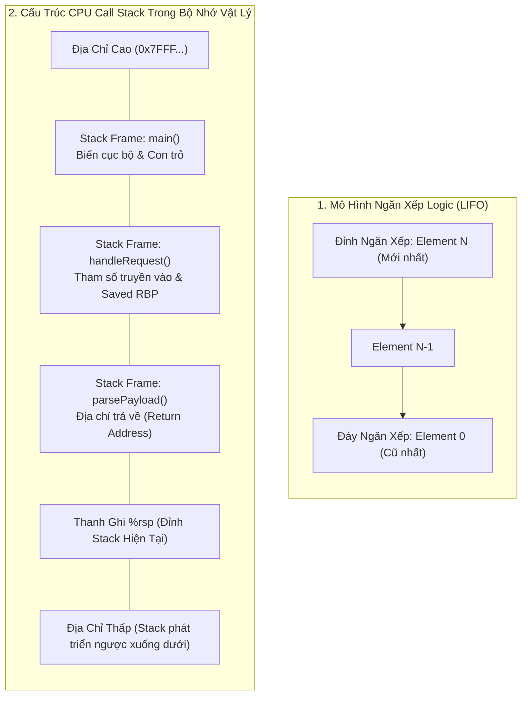

# 2.3. Ngăn Xếp (Stack & Monotonic Stack)

> [!IMPORTANT]
> **Nếu bạn chỉ được nhớ một điều duy nhất:** Ngăn xếp (Stack) không chỉ là một cấu trúc dữ liệu tuyến tính đơn giản tuân theo nguyên lý LIFO (Last-In, First-Out), mà là xương sống vận hành của toàn bộ kiến trúc máy tính hiện đại (CPU Call Stack, thanh ghi `RSP`), giải mã ngôn ngữ hình thức (Shunting-yard Expression Parsing), và công cụ đột phá giúp tối ưu hóa độ phức tạp từ $O(N^2)$ xuống $O(N)$ bằng kỹ thuật Ngăn Xếp Đơn Điệu (Monotonic Stack). Kiểm soát nghiêm ngặt kích thước Stack và hiểu rõ cơ chế tràn bộ đệm (Stack Overflow & Guard Pages) là điều kiện tiên quyết để bảo vệ hệ thống trước các cuộc tấn công khai thác lỗ hổng nhị phân (ROP Exploits).

---

## 1. Trực Quan Hóa: Bản Chất Ngăn Xếp Dưới Góc Nhìn Lập Trình Viên

### 1.1. Đoạn Code Dẫn Nhập & Vấn Đề Thực Tế
Xét bài toán kiểm tra tính hợp lệ của dấu ngoặc trong câu lệnh SQL hoặc file cấu hình JSON:

```typescript
function isValidSyntax(code: string): boolean {
  const stack: string[] = [];
  const matching: Record<string, string> = { ')': '(', '}': '{', ']': '[' };

  for (const char of code) {
    if (char === '(' || char === '{' || char === '[') {
      stack.push(char); // LIFO: Ký tự mở ngoặc gần nhất phải được đóng trước tiên!
    } else if (char in matching) {
      if (stack.pop() !== matching[char]) return false; // Ngoặc không khớp
    }
  }
  return stack.length === 0;
}
```

- Bản chất của bài toán này đòi hỏi cơ chế **"Vào sau, ra trước" (LIFO - Last In, First Out)**: Dấu ngoặc mở sau cùng bắt buộc phải là dấu ngoặc được đóng đầu tiên. Ngăn xếp (Stack) là cấu trúc hoàn hảo duy nhất giải quyết bài toán này với $O(N)$ thời gian và $O(N)$ bộ nhớ.

### 1.2. Ẩn Dụ Đời Sống: Chồng Đĩa Buffet & Hộp Tiếp Đạn Súng Ngắn
- **Chồng đĩa trong nhà hàng Buffet**: Khi nhân viên rửa bát đặt thêm một chiếc đĩa sạch vào chồng, chiếc đĩa đó được đặt lên đỉnh (`Push`). Khách hàng bước vào sẽ lấy chiếc đĩa nằm ở trên cùng ra trước (`Pop`). Chiếc đĩa được đặt vào đầu tiên dưới đáy chồng sẽ là chiếc đĩa cuối cùng được lấy ra.
- **Hộp tiếp đạn súng ngắn**: Viên đạn nạp vào sau cùng sẽ nằm ngay sát miệng hộp tiếp đạn và là viên đầu tiên được đẩy vào buồng nổ. Nếu cố gắng nhồi thêm viên thứ 16 vào hộp 15 viên, lò xo vỡ kịch khung (**Stack Overflow**). Nếu bóp cò khi hộp hết đạn, kim hỏa đập vào khoảng không rỗng (**Stack Underflow**).
- **Thanh ghi CPU Stack Pointer (`RSP`)**: Vi kiến trúc phần cứng x86-64 ánh xạ hoàn hảo tư duy này vào Call Stack vật lý: Thanh ghi `%rsp` lưu giữ đỉnh ngăn xếp. Lệnh `call` tự động push địa chỉ trả về vào stack; lệnh `ret` pop địa chỉ đó ra để CPU nhảy ngược về luồng thực thi.

### 1.3. Mô Phỏng Dữ Liệu Số Nhỏ Từng Bước (Toy Walkthrough)
Mô phỏng chuỗi thao tác: `Push(10) -> Push(20) -> Push(30) -> Pop() -> Push(40)` trên Stack mảng kích thước cố định:

| Bước | Thao tác | Phần tử tại Đỉnh (`Top`) | Mảng dữ liệu nội bộ (`arr[0..3]`) | Con trỏ `top_idx` | Trạng thái |
| :--- | :--- | :--- | :--- | :--- | :--- |
| **0** | Khởi tạo | Rỗng | `[ - , - , - , - ]` | `-1` | Stack Rỗng |
| **1** | `Push(10)` | `10` | `[ 10, - , - , - ]` | `0` | Thành công |
| **2** | `Push(20)` | `20` | `[ 10, 20, - , - ]` | `1` | Thành công |
| **3** | `Push(30)` | `30` | `[ 10, 20, 30, - ]` | `2` | Thành công |
| **4** | `Pop() -> 30` | `20` | `[ 10, 20, - , - ]` | `1` | Lấy ra 30, đỉnh quay về 20 |
| **5** | `Push(40)` | `40` | `[ 10, 20, 40, - ]` | `2` | Ghi đè 40 vào vị trí index 2 |

- Mọi thao tác `Push` và `Pop` đều chỉ tốn đúng 1 phép gán và 1 phép tăng/giảm chỉ số: $\mathbf{O(1)}$ thời gian thực thi tức thì!

### 1.4. Tác Động Thực Tế Tầng Backend & Systems
1. **Duyệt Cây & Phân Tích Cú Pháp (AST Parsing)**: Toàn bộ các trình thông dịch SQL, JSON, Babel, TypeScript Compiler đều sử dụng Stack để phân tích cú pháp biểu thức và xây dựng cây cú pháp trừu tượng (Abstract Syntax Tree).
2. **Khắc phục Đệ Quy Tràn Stack (Deep Recursion Elimination)**: Khi thực thi duyệt đồ thị DFS hoặc duyệt thư mục hàng triệu file, hàm đệ quy dễ gây tràn Call Stack hệ điều hành ($8\text{ MB}$). Thay thế bằng vòng lặp `while` kết hợp một `std::stack` tự quản lý trên Heap cho phép xử lý hàng chục triệu node mà không bao giờ bị Crash.
3. **Cơ Chế Undo/Redo & Transaction Rollback**: Các hệ thống cơ sở dữ liệu và trình soạn thảo lưu trữ chuỗi thao tác nghịch đảo vào một Rollback Stack để khôi phục trạng thái nguyên tử khi xảy ra lỗi.

### 1.5. Sơ Đồ Kiến Trúc Ngăn Xếp & CPU Call Stack Layout



---

## 2. Chi tiết từng Keyword (Under-the-Hood Deep Dive)

### 2.1. Nguyên lý LIFO, Thao tác Cơ bản, Stack Overflow & Underflow
- **Bản Chất Nguyên Lý LIFO (Last-In, First-Out)**:
  - Chỉ cho phép truy xuất, thêm mới và loại bỏ phần tử tại một đầu duy nhất (gọi là `Top`).
  - Đảm bảo tính đóng gói và bảo tồn thứ tự đảo ngược tự nhiên của các luồng xử lý: Hàm nào được gọi sau thì phải hoàn tất và dọn dẹp biến cục bộ trước khi hàm cha có thể tiếp tục.
- **Bộ Ba Thao Tác Căn Bản ($O(1)$ Tuyệt Đối)**:
  - `Push(element)`: Nạp phần tử vào đỉnh ngăn xếp.
  - `Pop()`: Thu hồi và loại bỏ phần tử ở đỉnh ngăn xếp.
  - `Peek()` hoặc `Top()`: Quan sát giá trị đỉnh mà không làm thay đổi trạng thái ngăn xếp.
- **Cơ Chế Phần Cứng CPU x86-64**:
  - Không gian Call Stack của luồng hệ điều hành phát triển ngược từ vùng địa chỉ cao xuống vùng địa chỉ thấp (`High Memory $\to$ Low Memory`).
  - Khi thực hiện lệnh hợp ngữ `push %rax`:
    $$\text{RSP} \leftarrow \text{RSP} - 8; \quad [\text{RSP}] \leftarrow \text{RAX}$$
  - Khi thực hiện lệnh hợp ngữ `pop %rax`:
    $$\text{RAX} \leftarrow [\text{RSP}]; \quad \text{RSP} \leftarrow \text{RSP} + 8$$
- **Stack Overflow (Tràn Ngăn Xếp)**:
  - Xảy ra khi một chương trình đệ quy vô hạn (hoặc cấp phát mảng cục bộ quá lớn trên Stack, ví dụ `int buffer[10000000]`).
  - Thanh ghi `RSP` giảm liên tục cho đến khi vượt qua ranh giới Stack Segment và chạm vào **Trang Bảo Vệ (Guard Page)** do Linux Kernel thiết lập với cờ bảo vệ `PROT_NONE`.
  - Bộ quản lý bộ nhớ MMU phát hiện vi phạm quyền truy cập, kích hoạt ngắt phần cứng Page Fault, Kernel gửi tín hiệu `SIGSEGV` (Segmentation Fault) và lập tức dừng tiến trình (Crash) để bảo vệ các vùng nhớ Heap và Data xung quanh.
- **Stack Underflow (Hụt Ngăn Xếp)**: Xảy ra khi mã nguồn gọi `Pop()` hoặc `Peek()` trên một ngăn xếp đang rỗng (`size == 0`), dẫn đến việc đọc/ghi con trỏ rác hoặc ném ngoại lệ logic `std::underflow_error`.

---

### 2.2. Monotonic Stack (Ngăn Xếp Đơn Điệu)
- **Định Nghĩa Bản Chất**:
  - Là một cấu trúc dữ liệu ngăn xếp mà trong đó các phần tử được duy trì nghiêm ngặt theo một thứ tự đơn điệu: hoặc **luôn luôn tăng dần (Monotonically Increasing)** hoặc **luôn luôn giảm dần (Monotonically Decreasing)** từ đáy lên đỉnh.
  - Mỗi khi chèn một phần tử mới vào, toàn bộ các phần tử ở đỉnh vi phạm tính chất đơn điệu sẽ liên tục bị loại bỏ (`Pop`) cho đến khi tính chất đơn điệu được tái lập, sau đó phần tử mới mới được `Push` vào.
- **Sức Mạnh Đột Phá: Chuyển Hóa Độ Phức Tạp Từ $O(N^2)$ Về $O(N)$**:
  - Trong các bài toán tìm phần tử lớn hơn tiếp theo (**Next Greater Element - NGE**), phần tử nhỏ hơn gần nhất (**Previous Smaller Element**), hay bài toán tìm diện tích hình chữ nhật lớn nhất trong biểu đồ cột (**Largest Rectangle in Histogram**):
  - Lối tư duy thô (Brute Force) yêu cầu hai vòng lặp lồng nhau duyệt qua toàn bộ cặp $(i, j)$ với chi phí $O(N^2)$.
  - **Chứng minh bằng Phân tích Khấu hao (Amortized Analysis)**: Với Monotonic Stack, dù bên trong vòng lặp chính có chứa vòng lặp `while (!stack.empty() && ...)`:
    - Mỗi phần tử trong mảng chỉ được `Push` vào stack **đúng 1 lần duy nhất**.
    - Mỗi phần tử chỉ có thể bị `Pop` ra khỏi stack **tối đa 1 lần duy nhất**.
    - Do đó, tổng số thao tác `Push` và `Pop` trong suốt toàn bộ vòng đời thuật toán không bao giờ vượt quá $2N$.
    - Chi phí thời gian tiệm cận được bảo đảm ở mức tuyệt đối: **$\Theta(N)$**!

---

### 2.3. Expression Evaluation & Parentheses Matching

#### 1. Khớp Dấu Ngoặc (Parentheses Matching)
- Được ứng dụng trong mọi Lexer và Parser của trình biên dịch (GCC, Clang, V8) và kiểm tra tính toàn vẹn cú pháp JSON/XML.
- Cơ chế: Gặp ký tự mở ngoặc (`(`, `{`, `[`) $\implies$ `Push` vào stack. Gặp ký tự đóng ngoặc (`)`, `}`, `]`) $\implies$ `Pop` đỉnh stack và kiểm tra xem có khớp cặp không. Kết thúc chuỗi, nếu stack rỗng thì biểu thức hợp lệ $100\%$.

#### 2. Định Giá Biểu Thức & Thuật Toán Shunting-yard (Edsger Dijkstra)
- **Các dạng biểu diễn biểu thức toán học**:
  - **Infix (Trung tố)**: Dạng con người đọc hiểu, toán tử nằm giữa hai toán hạng: $(A + B) \times C$. Đòi hỏi quy tắc thứ tự ưu tiên (Precedence) và dấu ngoặc.
  - **Postfix / Reverse Polish Notation (Hậu tố / RPN)**: Toán tử nằm ngay sau các toán hạng: $A\ B\ +\ C\ \times$. Hoàn toàn triệt tiêu nhu cầu dùng dấu ngoặc và thứ tự ưu tiên, cực kỳ dễ thực thi trên máy tính phần cứng.
- **Thuật Toán Đường Ray Phân Luồng (Shunting-yard Algorithm)**:
  - Dijkstra sử dụng một ngăn xếp toán tử (`Operator Stack`) và một hàng đợi đầu ra (`Output Queue`):
    1. Khi đọc được một toán hạng (số): Đẩy thẳng sang Output.
    2. Khi đọc được dấu ngoặc mở `(`: Đẩy vào Operator Stack.
    3. Khi đọc được dấu ngoặc đóng `)`: Liên tục `Pop` từ Operator Stack sang Output cho đến khi gặp dấu ngoặc mở `(`.
    4. Khi đọc được một toán tử $op_1$: Trong khi đỉnh Operator Stack là toán tử $op_2$ có độ ưu tiên cao hơn hoặc bằng $op_1$ (hoặc cùng độ ưu tiên nhưng kết hợp trái): `Pop` $op_2$ sang Output. Sau đó đẩy $op_1$ vào Operator Stack.
    5. Kết thúc chuỗi: Xả toàn bộ các toán tử còn lại trong Operator Stack sang Output.
- **Thực Thi RPN Bằng Máy Ngăn Xếp (Stack-based Virtual Machine)**:
  - Máy ảo Java JVM (Bytecode) và WebAssembly (Wasm) đều là các máy ảo ngăn xếp (Stack Machine). Khi thực hiện biểu thức hậu tố `2 3 + 4 *`:
    - `Push 2` $\implies$ `Push 3` $\implies$ Gặp `+`: `Pop 3`, `Pop 2`, tính $2 + 3 = 5$, `Push 5` $\implies$ `Push 4` $\implies$ Gặp `*`: `Pop 4`, `Pop 5`, tính $5 \times 4 = 20$, `Push 20`.

---

## 3. Thực thi Mã nguồn & Mô phỏng Chuyên sâu (Dual-Engine Implementation)

### 3.1. C++20: Zero-Heap FastStack & Monotonic Stack Implementation

Mã nguồn C++20 triển khai cấu trúc ngăn xếp cố định siêu tốc không cấp phát Heap (Zero-Heap Overhead) và giải thuật Ngăn Xếp Đơn Điệu giải quyết bài toán Next Greater Element trong độ phức tạp thời gian tuyến tính $O(N)$:

```cpp
// compile: g++ -std=c++20 -O3 fast_stack_monotonic.cpp -o fast_stack_monotonic
#include <iostream>
#include <vector>
#include <stack>
#include <stdexcept>
#include <array>
#include <cstdint>
#include <iomanip>

// 1. Ngăn xếp bộ nhớ tĩnh siêu tốc (Zero Heap Allocation Stack)
template <typename T, size_t Capacity>
class FastStack {
private:
    std::array<T, Capacity> buffer_;
    size_t top_idx_{0};

public:
    void push(const T& val) {
        if (top_idx_ >= Capacity) {
            throw std::overflow_error("Stack Overflow: Vượt quá dung lượng buffer tĩnh!");
        }
        buffer_[top_idx_++] = val;
    }

    T pop() {
        if (empty()) {
            throw std::underflow_error("Stack Underflow: Ngăn xếp rỗng!");
        }
        return buffer_[--top_idx_];
    }

    const T& top() const {
        if (empty()) {
            throw std::underflow_error("Stack Underflow: Ngăn xếp rỗng!");
        }
        return buffer_[top_idx_ - 1];
    }

    bool empty() const noexcept { return top_idx_ == 0; }
    size_t size() const noexcept { return top_idx_; }
};

// 2. Monotonic Stack giải quyết bài toán Next Greater Element trong O(N)
std::vector<int> next_greater_elements(const std::vector<int>& nums) {
    size_t n = nums.size();
    std::vector<int> result(n, -1);
    std::stack<size_t> mono_stack; // Lưu trữ chỉ mục (Index Stack)

    for (size_t i = 0; i < n; ++i) {
        // Duy trì tính chất đơn điệu giảm dần của stack:
        // Khi gặp phần tử lớn hơn đỉnh stack, ta đã tìm thấy Next Greater Element cho đỉnh đó
        while (!mono_stack.empty() && nums[i] > nums[mono_stack.top()]) {
            result[mono_stack.top()] = nums[i];
            mono_stack.pop();
        }
        mono_stack.push(i);
    }
    return result;
}

int main() {
    std::cout << "=== THỰC THI STACK VÀ MONOTONIC STACK (C++20) ===\n\n";

    // 1. Thử nghiệm FastStack tĩnh
    FastStack<int, 4> fast_stack;
    fast_stack.push(10);
    fast_stack.push(20);
    fast_stack.push(30);
    std::cout << "1. Thử nghiệm FastStack (Fixed Capacity Buffer):\n";
    std::cout << "   - Giá trị đỉnh (Top) : " << fast_stack.top() << " | Kích thước: " << fast_stack.size() << "\n";
    std::cout << "   - Thu hồi (Pop)      : " << fast_stack.pop() << "\n";
    std::cout << "   - Đỉnh sau khi Pop   : " << fast_stack.top() << "\n\n";

    // 2. Thử nghiệm Monotonic Stack trên mảng nhiệt độ hàng ngày (Daily Temperatures)
    std::vector<int> temperatures = {73, 74, 75, 71, 69, 72, 76, 73};
    std::cout << "2. Thử nghiệm Monotonic Stack (Next Greater Temperature):\n";
    std::cout << "   - Mảng nhiệt độ đầu vào : ";
    for (int t : temperatures) std::cout << std::setw(3) << t << " ";
    std::cout << "\n";

    auto nge = next_greater_elements(temperatures);
    std::cout << "   - Nhiệt độ cao hơn kế tiếp: ";
    for (int v : nge) std::cout << std::setw(3) << v << " ";
    std::cout << "\n   -> Toàn bộ mảng được xử lý trong đúng O(N) thời gian!\n";

    return 0;
}
```

### 3.2. Python 3.11+: Shunting-Yard Algorithm & Infix-to-Postfix Evaluator

Mã nguồn Python 3.11+ hoàn chỉnh thực thi thuật toán Shunting-yard của Dijkstra để kiểm tra dấu ngoặc, chuyển đổi biểu thức từ trung tố (Infix) sang hậu tố (Postfix) và định giá biểu thức toán học:

```python
#!/usr/bin/env python3
"""
shunting_yard_evaluator.py: Giải thuật Shunting-yard và Bộ tính toán biểu thức RPN.
Yêu cầu: Python 3.11+
"""
from typing import List

def is_valid_parentheses(expression: str) -> bool:
    """Kiểm tra tính hợp lệ của các cặp dấu ngoặc lồng nhau."""
    bracket_pairs = {')': '(', '}': '{', ']': '['}
    stack: List[str] = []

    for char in expression:
        if char in bracket_pairs.values():
            stack.append(char)
        elif char in bracket_pairs:
            if not stack or stack.pop() != bracket_pairs[char]:
                return False
    return len(stack) == 0

def infix_to_postfix(tokens: List[str]) -> List[str]:
    """Chuyển đổi biểu thức Infix sang Postfix bằng giải thuật Shunting-yard."""
    precedence = {'+': 1, '-': 1, '*': 2, '/': 2}
    output_queue: List[str] = []
    operator_stack: List[str] = []

    for token in tokens:
        if token.isdigit():
            output_queue.append(token)
        elif token == '(':
            operator_stack.append(token)
        elif token == ')':
            while operator_stack and operator_stack[-1] != '(':
                output_queue.append(operator_stack.pop())
            if operator_stack and operator_stack[-1] == '(':
                operator_stack.pop() # Loại bỏ dấu '('
        elif token in precedence:
            while (operator_stack and operator_stack[-1] != '(' and 
                   precedence.get(operator_stack[-1], 0) >= precedence[token]):
                output_queue.append(operator_stack.pop())
            operator_stack.append(token)

    while operator_stack:
        output_queue.append(operator_stack.pop())
    return output_queue

def evaluate_postfix(postfix_tokens: List[str]) -> int:
    """Tính toán giá trị biểu thức hậu tố Postfix (Reverse Polish Notation)."""
    eval_stack: List[int] = []

    for token in postfix_tokens:
        if token.isdigit():
            eval_stack.append(int(token))
        else:
            right_operand = eval_stack.pop()
            left_operand = eval_stack.pop()
            if token == '+':
                eval_stack.append(left_operand + right_operand)
            elif token == '-':
                eval_stack.append(left_operand - right_operand)
            elif token == '*':
                eval_stack.append(left_operand * right_operand)
            elif token == '/':
                eval_stack.append(int(left_operand / right_operand))

    return eval_stack[0]

if __name__ == "__main__":
    print("=== SHUNTING-YARD ALGORITHM & EXPRESSION EVALUATOR ===")
    expr_str = "((2 + 3) * 4) - (10 / 2)"
    token_list = ["(", "(", "2", "+", "3", ")", "*", "4", ")", "-", "(", "10", "/", "2", ")"]

    # 1. Thẩm định tính cân bằng dấu ngoặc
    valid = is_valid_parentheses(expr_str)
    print(f"Biểu thức trung tố (Infix) : {expr_str}")
    print(f"Kiểm tra khớp ngoặc hợp lệ : {valid}")

    # 2. Chuyển đổi Infix -> Postfix
    postfix = infix_to_postfix(token_list)
    print(f"Biểu thức hậu tố (Postfix) : {' '.join(postfix)}")

    # 3. Tính toán giá trị RPN
    result = evaluate_postfix(postfix)
    print(f"Kết quả tính toán biểu thức: {result} (Kỳ vọng chuẩn: (5 * 4) - 5 = 15)")
```

### 3.3. Kết quả Thực thi Terminal Mẫu

```text
=== KẾT QUẢ THỰC THI C++20 BENCHMARK ===
=== THỰC THI STACK VÀ MONOTONIC STACK (C++20) ===

1. Thử nghiệm FastStack (Fixed Capacity Buffer):
   - Giá trị đỉnh (Top) : 30 | Kích thước: 3
   - Thu hồi (Pop)      : 30
   - Đỉnh sau khi Pop   : 20

2. Thử nghiệm Monotonic Stack (Next Greater Temperature):
   - Mảng nhiệt độ đầu vào :  73  74  75  71  69  72  76  73 
   - Nhiệt độ cao hơn kế tiếp:  74  75  76  72  72  76  -1  -1 
   -> Toàn bộ mảng được xử lý trong đúng O(N) thời gian!

=== KẾT QUẢ THỰC THI PYTHON SHUNTING-YARD ===
=== SHUNTING-YARD ALGORITHM & EXPRESSION EVALUATOR ===
Biểu thức trung tố (Infix) : ((2 + 3) * 4) - (10 / 2)
Kiểm tra khớp ngoặc hợp lệ : True
Biểu thức hậu tố (Postfix) : 2 3 + 4 * 10 2 / -
Kết quả tính toán biểu thức: 15 (Kỳ vọng chuẩn: (5 * 4) - 5 = 15)
```

---

## 4. Systems Engineering & Production Pitfalls

### 4.1. Thảm Họa Tràn Bộ Đệm Ngăn Xếp & Tấn Công ROP (Return-Oriented Programming)
- **Cơ chế tấn công**: Trong C/C++, việc sử dụng các hàm thao tác chuỗi không an toàn (`gets()`, `strcpy()`, `sprintf()`) cho phép người dùng nạp một chuỗi dài vượt quá kích thước mảng cục bộ trên Stack.
- **Hậu quả**: Chuỗi dữ liệu độc hại ghi đè lên giá trị thanh ghi `Saved RBP` và **Return Address** nằm ngay trên Stack Frame. Khi hàm kết thúc và lệnh `ret` được gọi, CPU sẽ nhảy thẳng vào địa chỉ do tin tặc cài cắm để thực thi shellcode hoặc các chuỗi lệnh độc hại (ROP gadgets).
- **Phòng vệ hiện đại (Compiler Mitigations)**:
  - **Stack Canaries (`-fstack-protector-strong`)**: Trình biên dịch chèn một giá trị ngẫu nhiên (Canary) nằm giữa mảng cục bộ và Return Address. Trước khi `ret`, CPU kiểm tra xem Canary có bị thay đổi không; nếu bị ghi đè, tiến trình tự ngắt ngay lập tức với lỗi `*** stack smashing detected ***`.
  - **Non-Executable Stack (NX / DEP Bit)**: Đánh dấu phân vùng nhớ Stack là Read/Write nhưng cấm quyền Thực thi (No-Execute), ngăn chặn việc chạy mã nhị phân trên Stack.

### 4.2. Cạm Bẫy Đệ Quy Trong Xử Lý JSON / XML Lồng Nhau (Billion Laughs & Deep Nesting)
- Các parser JSON/XML sử dụng giải thuật đệ quy từ trên xuống (Recursive Descent Parsing) rất dễ bị khai thác bởi các payload độc hại chứa hàng chục ngàn cặp ngoặc lồng nhau `[[[[...]]]]`.
- Khi bộ phân tích cố gắng đệ quy qua 50,000 tầng, Call Stack của tiến trình vượt quá giới hạn $8\text{ MB}$, khiến toàn bộ web server bị sập bởi lỗi `SIGSEGV` (Denial of Service - DoS).
- **Quy chuẩn sản xuất**: Luôn giới hạn độ sâu tối đa (Max Nesting Depth Limit, ví dụ `max_depth = 64` hoặc `128`) trong cấu hình parser, hoặc chuyển sang parser hướng sự kiện lặp (Iterative Streaming Parser như SAX hoặc Jackson Streaming).

---

## 5. Bảng So sánh & Decision Matrix

### Ma trận So sánh Các Kỹ thuật Triển khai Ngăn Xếp (Stack Implementations Matrix)

| Tiêu chí Đánh giá | Array-based Stack (`std::vector`) | Fixed Buffer Stack (`std::array`) | Linked List Stack (`std::forward_list`) |
| :--- | :--- | :--- | :--- |
| **Chi phí Cấp phát (Allocation)** | Khấu hao $O(1)$, thỉnh thoảng resize | $0\text{ ns}$ (Không cấp phát Heap) | Mỗi lần Push là một lần gọi `malloc()` |
| **Hiệu năng CPU Cache** | Tuyệt hảo (Dữ liệu liên tục trên Cache Line) | Cực đại (Nằm gọn trong L1 Cache / Stack) | Kém (Pointer Chasing gây Cache Misses) |
| **Bộ nhớ Overhead** | Thừa một phần capacity chưa dùng | Cố định theo compile-time | $8\text{ bytes}$ con trỏ `next` cho mỗi phần tử |
| **Nguy cơ Tràn bộ nhớ** | Có thể gây OOM nếu mảng quá lớn | Gây `Stack Overflow` nếu vượt quá giới hạn | Không giới hạn miễn là RAM còn trống |
| **Ngữ cảnh Tối ưu** | Ngăn xếp đa năng mặc định trong phần mềm | Hot-path trong vi điều khiển, Game, HFT | Không khuyến nghị trong hệ thống hiệu năng cao |

---

## 6. Enterprise Production Checklist & Verification

- [ ] **Bật Stack Protection Flag**: Đã kích hoạt các cờ `-fstack-protector-strong` và `-D_FORTIFY_SOURCE=2` trong toàn bộ quy trình build C/C++?
- [ ] **Giới Hạn Độ Sâu Phân Tích (Parsing Depth Limit)**: Bộ phân tích cú pháp JSON, XML, Markdown có ngưỡng chặn độ sâu lồng nhau để ngăn ngừa DoS không?
- [ ] **Áp Dụng Monotonic Stack Cho Dãy Số**: Các bài toán tìm phần tử biên (Next Greater, Histogram, Sliding Window Max) đã được chuyển hóa sang Monotonic Stack để đạt thời gian $O(N)$ chưa?
- [ ] **Tận Dụng Bộ Đệm Cố Định**: Các cấu trúc ngăn xếp phục vụ xử lý luồng mạng tần suất cao có được cấp phát cố định (Fixed Stack Buffer) để triệt tiêu chi phí `malloc` không?
