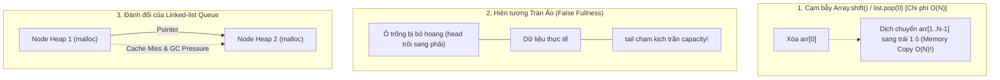
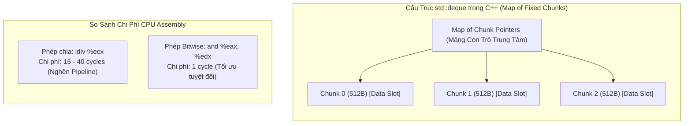
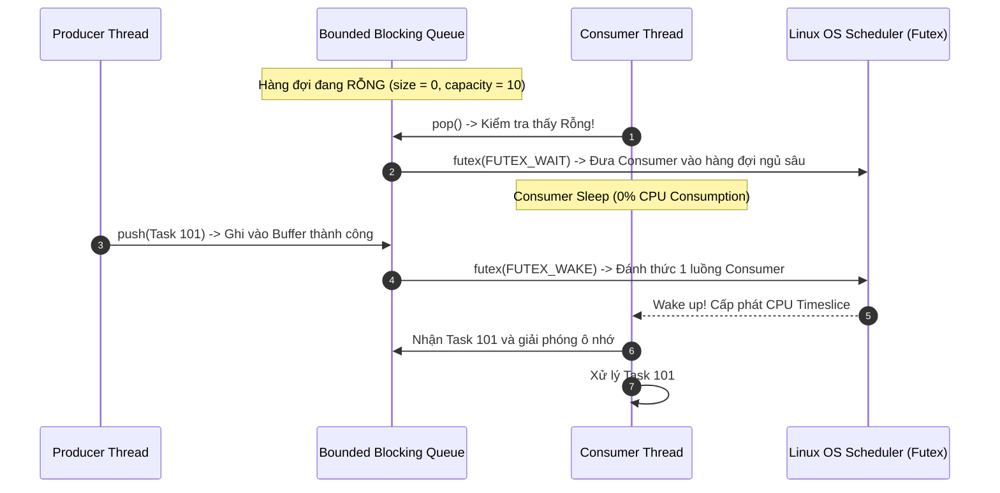
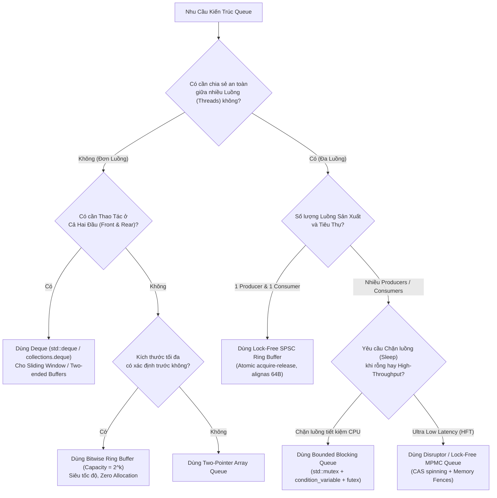

# 2.4. Hàng Đợi (Queue & Concurrent Queue Architecture)

> [!IMPORTANT]
> **Nếu bạn chỉ được nhớ một điều duy nhất:** Hàng đợi (Queue) không đơn thuần là một cấu trúc dữ liệu tuyến tính tuân thủ nguyên tắc FIFO (First-In, First-Out) phục vụ giải thuật tìm kiếm theo chiều rộng (BFS), mà là kiến trúc xương sống điều phối tải bất đồng bộ của toàn bộ thế giới điện toán hiện đại (CPU Pipeline, Socket Buffers trong nhân Linux, Ring Buffer của `io_uring`, Message Brokers như Kafka/RabbitMQ, Thread Pools và Actor Models). Nắm vững sự khác biệt bản chất giữa Ring Buffer mảng vòng tối ưu hóa bitwise với Lock-free Concurrent Queue là chìa khóa để xây dựng các hệ thống backend đạt thông lượng hàng chục triệu thông điệp/giây với độ trễ sub-microsecond.

---

## 1. Trực Quan Hóa: Bản Chất Hàng Đợi Dưới Góc Nhìn Lập Trình Viên

### 1.1. Đoạn Code Dẫn Nhập & Vấn Đề Thực Tế
Xét bài toán điều phối tác vụ bất đồng bộ (Background Job Processor) trong một dịch vụ xử lý video:

```typescript
class TaskQueue {
  private queue: string[] = [];

  // NGUY HIỂM: Thao tác dequeue bằng shift() trên mảng thông thường
  public dequeueTask_Naive(): string | undefined {
    return this.queue.shift(); // O(N): Mọi phần tử phía sau phải dịch chuyển lùi 1 vị trí!
  }
}
```

- Nếu hàng đợi có $100{,}000$ tác vụ đang chờ, mỗi lần lấy một tác vụ ra bằng `shift()` sẽ tốn $O(N)$ thời gian, biến toàn bộ luồng xử lý thành $O(N^2)$ và nghẽn CPU trầm trọng.
- **Giải pháp chuẩn**: Sử dụng **Circular Ring Buffer** hoặc Danh sách liên kết hai đầu để thao tác `enqueue()` và `dequeue()` đều đạt **$O(1)$** tuyệt đối, đảm bảo tính công bằng: **"Vào trước, ra trước" (FIFO - First In, First Out)**.

### 1.2. Ẩn Dụ Đời Sống: Quầy An Ninh Sân Bay & Băng Chuyền Hành Lý Vòng
- **Quầy kiểm soát an ninh sân bay (Standard FIFO Queue)**: Hành khách xếp hàng lần lượt. Người đến trước sẽ được kiểm tra và vào phòng chờ trước. Không ai được chen ngang. Cấu trúc này bảo đảm tính công bằng tuyệt đối cho các yêu cầu mạng.
- **Băng chuyền hành lý hình tròn (Circular Ring Buffer)**: Một băng chuyền khép kín hình bầu dục có 8 ô chứa đồ. Bác nhân viên bốc dỡ đồ từ máy bay đặt va li vào ô trống tiếp theo (con trỏ `tail`), trong khi hành khách đứng lấy va li của mình ra ở vị trí khác (con trỏ `head`). Khi chạm đến cuối vòng tròn, con trỏ tự động quay về đầu (`(idx + 1) % size`). Băng chuyền không bao giờ phải dời toàn bộ hành lý khi có 1 chiếc va li được lấy ra!
- **Phòng cấp cứu bệnh viện (Priority Queue)**: Bệnh nhân nguy kịch vì tai nạn được đưa thẳng vào phòng mổ ngay lập tức, bất kể họ đến sau những người chỉ bị cảm cúm. Đây là hình thái Hàng đợi ưu tiên dựa trên cấu trúc Binary Heap.

### 1.3. Mô Phỏng Dữ Liệu Số Nhỏ Từng Bước (Toy Walkthrough)
Mô phỏng Circular Ring Buffer có dung lượng $\text{Capacity} = 4$:
Chuỗi thao tác: `Enqueue('A') -> Enqueue('B') -> Dequeue() -> Enqueue('C') -> Enqueue('D') -> Enqueue('E')`:

| Bước | Thao tác | Trạng thái mảng nội bộ `[0, 1, 2, 3]` | `head` | `tail` | `size` | Giải thích cơ chế |
| :--- | :--- | :--- | :--- | :--- | :--- | :--- |
| **0** | Khởi tạo | `[ - , - , - , - ]` | `0` | `0` | `0` | Hàng đợi rỗng |
| **1** | `Enqueue('A')` | `[ A , - , - , - ]` | `0` | `1` | `1` | Ghi 'A' tại 0, tail tăng lên 1 |
| **2** | `Enqueue('B')` | `[ A , B , - , - ]` | `0` | `2` | `2` | Ghi 'B' tại 1, tail tăng lên 2 |
| **3** | `Dequeue() -> 'A'` | `[ - , B , - , - ]` | `1` | `2` | `1` | Lấy 'A' tại 0, head tăng lên 1 (O(1) không dịch mảng!) |
| **4** | `Enqueue('C')` | `[ - , B , C , - ]` | `1` | `3` | `2` | Ghi 'C' tại 2, tail tăng lên 3 |
| **5** | `Enqueue('D')` | `[ - , B , C , D ]` | `1` | `0` | `3` | Ghi 'D' tại 3, tail quay vòng: `(3+1)%4 = 0`! |
| **6** | `Enqueue('E')` | `[ E , B , C , D ]` | `1` | `1` | `4` | Ghi 'E' vào ô 0 vừa giải phóng! Hàng đợi đầy. |

### 1.4. Tác Động Thực Tế Tầng Backend & Systems
1. **Event Loop Trong Node.js / libuv & Nginx**: Trái tim của kiến trúc bất đồng bộ hướng sự kiện là Event Queue. Nginx sử dụng Ring Buffer để xếp hàng các sự kiện socket mạng từ `epoll`, giúp một tiến trình đơn luồng có thể điều phối hàng trăm nghìn kết nối đồng thời.
2. **Hàng Đợi Thông Điệp Phân Tán (Kafka / RabbitMQ)**: Bản chất mỗi Partition trong Apache Kafka chính là một Append-Only Queue phân tán trên đĩa. Người gửi ghi vào đuôi (`tail`), các Consumer Group đọc từ vị trí `offset` riêng của mình theo thứ tự tuần tự FIFO.
3. **Cơ Chế Backpressure & Rate Limiting (Leaky Bucket)**: Khi lưu lượng truy cập tăng vọt, hàng đợi đóng vai trò là chiếc phễu giảm sốc (Shock Absorber), ngăn chặn hệ thống cơ sở dữ liệu phía sau bị quá tải.

### 1.5. Sơ Đồ Kiến Trúc Hàng Đợi Vòng & Xử Lý Bất Đồng Bộ

```mermaid

flowchart TD
    subgraph CircularBuffer ["1. Mô Hình Bộ Đệm Vòng (Circular Ring Buffer)"]
        direction LR
        Slot0["Ô [0]: Dữ liệu E\n(tail mới)"] --- Slot1["Ô [1]: Dữ liệu B\n(head hiện tại)"]
        Slot1 --- Slot2["Ô [2]: Dữ liệu C"]
        Slot2 --- Slot3["Ô [3]: Dữ liệu D"]
        Slot3 -.- Slot0
    end

    subgraph BackendArchitecture ["2. Luồng Điều Phối Công Việc Phân Tán (Producer-Consumer)"]
        direction TB
        Producers["Nhiều API Clients (Producers)"] -->|Enqueue Task O(1)| IngressQueue["Distributed Task Queue\n(Redis Stream / RabbitMQ)"]
        IngressQueue -->|Dequeue Task FIFO O(1)| Workers["Cụm Worker Nodes (Consumers)"]
        Workers --> Processing["Xử lý tác vụ ngầm & Ghi Database"]
    end
```

---

## 2. Chi tiết từng Keyword (Under-the-Hood Deep Dive)

### 2.1. Nguyên lý FIFO, Thao tác Cơ bản, Array-based vs Linked-list Queue

#### 1. Khái niệm Bản chất (What & Why)
- **Nguyên lý FIFO (First-In, First-Out)**: Cấu trúc dữ liệu tuyến tính bảo đảm phần tử nào được thêm vào trước sẽ là phần tử đầu tiên được lấy ra.
- **Thao tác Căn bản ($O(1)$ Lý Tưởng)**:
  - `Enqueue(item)`: Thêm một phần tử vào vị trí cuối hàng (`Rear`).
  - `Dequeue()`: Trích xuất và loại bỏ phần tử ở vị trí đầu hàng (`Front`).
  - `Peek()` hoặc `Front()`: Đọc giá trị của phần tử ở đầu hàng đợi mà không xóa nó.
  - `IsEmpty()` và `IsFull()`: Kiểm tra trạng thái rỗng hoặc đầy của bộ đệm.

#### 2. So Sánh Cơ Chế Cấp Phát: Array-based vs Linked-list Queue
- **Cạm Bẫy Chết Người Của Mảng Ngây Thơ (The Naïve Array Shift Trap)**:
  - Nếu ta cài đặt Queue bằng một mảng thông thường: `Enqueue` thêm vào cuối mảng (`push_back` trong $O(1)$); khi `Dequeue`, ta xóa phần tử ở chỉ mục 0.
  - Để lấp chỗ trống vừa xóa, toàn bộ $N-1$ phần tử phía sau buộc phải **dịch chuyển một bước sang trái** trong bộ nhớ.
  - **Hậu quả**: Thao tác `Dequeue` có độ phức tạp thời gian **$O(N)$**! 
  - Đây là sai lầm kinh điển bậc nhất trong phần mềm khi lập trình viên sử dụng hàm `list.pop(0)` trong Python hoặc `array.shift()` trong JavaScript để làm Queue. Khi hàng đợi có $100,000$ phần tử, một lệnh `pop(0)` sẽ sao chép $800\text{ KB}$ bộ nhớ trên từng request, biến một web server có thông lượng hàng nghìn RPS thành một hệ thống bị tê liệt hoàn toàn!
- **Kỹ Thuật Dịch Chuyển Hai Con Trỏ & Hiện Tượng "Tràn Bộ Nhớ Ảo" (False Fullness)**:
  - Để tránh dịch mảng, ta dùng 2 chỉ số: `head` (chỉ số phần tử đọc) và `tail` (chỉ số phần tử ghi). Cả hai chỉ số cùng tịnh tiến sang phải.
  - Tuy nhiên, sau một số lần `Enqueue` và `Dequeue`, `tail` sẽ chạm tới chỉ số cuối cùng của mảng (`capacity - 1`), trong khi nửa đầu mảng trước `head` đã bị xóa trống. Mặc dù số lượng phần tử thực tế rất ít, mảng vẫn báo lỗi **Queue Overflow**! Kỹ thuật này bị phá sản nếu không có cơ chế tái sử dụng ô nhớ.
- **Linked-list-based Queue (Đánh đổi Hiệu năng Bộ nhớ)**:
  - Cài đặt bằng một Singly Linked List duy trì 2 con trỏ: `head` (trỏ Front) và `tail` (trỏ Rear).
  - `Enqueue`: Nối node mới vào `tail->next; tail = new_node;` $\to O(1)$ tuyệt đối.
  - `Dequeue`: `head = head->next; delete old_head;` $\to O(1)$ tuyệt đối.
  - **Nhược điểm chí mạng trong Production**: Mỗi một phần tử được nạp vào hàng đợi đòi hỏi đúng một lệnh gọi `malloc`/`new`, và khi lấy ra đòi hỏi một lệnh `free`. 
  - Trong các hệ thống giao dịch tài chính hoặc máy chủ mạng xử lý hàng triệu thông điệp mỗi giây:
    1. Các lời gọi cấp phát Heap liên tục gây ra **Tranh chấp khóa bộ cấp phát (Allocator Lock Contention)** trên phân vùng `arena` của `glibc`.
    2. Các node nằm rải rác trên Heap gây **L1/L2 Cache Misses** liên tục do hiện tượng Pointer Chasing.
    3. Áp lực gom rác (GC Pressure) kinh hoàng trong Java (`LinkedList`) hoặc Go/Node.js, dẫn đến các đợt dừng hệ thống (Stop-the-world GC Pauses).



---

### 2.2. Circular Queue (Ring Buffer) & Deque (Double-ended Queue)

#### 1. Circular Queue (Bộ Đệm Vòng / Ring Buffer)
- **Bản chất**: Biến đổi mảng tĩnh 1 chiều có kích thước cố định $N$ thành một cấu trúc vòng tròn khép kín. Khi con trỏ `tail` hoặc `head` chạm tới ranh giới cuối mảng ($N-1$), nó sẽ tự động "quay xe" (wrap-around) về chỉ mục $0$ thông qua phép chia lấy dư:
  $$\text{index}_{\text{next}} = (\text{index}_{\text{current}} + 1) \pmod N$$
- **Giải quyết Bài toán Rỗng vs Đầy (Queue Full vs Empty Ambiguity)**:
  - Khi `head == tail`, ta không thể biết hàng đợi đang **RỖNG HOÀN TOÀN** hay **ĐẦY HOÀN TOÀN** (vì cả hai trạng thái đều khiến 2 con trỏ trùng nhau).
  - **Giải pháp 1: Kỹ thuật Bỏ trống 1 ô nhớ (One-slot Gap)**:
    - Hàng đợi coi là Rỗng khi: `head == tail`.
    - Hàng đợi coi là Đầy khi ô kế tiếp của `tail` chạm vào `head`:
      $$(\text{tail} + 1) \pmod N == \text{head}$$
    - Đánh đổi: Luôn phải lãng phí đúng 1 ô nhớ không sử dụng trong mảng.
  - **Giải pháp 2: Duy trì Biến đếm Riêng biệt (`size` / `count`)**:
    - Duy trì biến `size_` tăng khi Enqueue, giảm khi Dequeue.
    - Hàng đợi Rỗng khi `size_ == 0`, Đầy khi `size_ == capacity`.
    - Tận dụng được trọn vẹn $100\%$ dung lượng mảng, là giải pháp chuẩn mực trong phát triển phần mềm hiện đại.

#### 2. Kỹ Thuật Tối Ưu Hóa Bitwise Siêu Tốc (The Power-of-Two Masking Optimization)
- Trong kiến trúc tập lệnh vi xử lý (x86-64 và ARM64), phép toán chia lấy dư số nguyên (`idiv` trong assembly) là một trong những lệnh máy đắt đỏ nhất:
  - Một phép cộng (`add`) hoặc dịch bit (`shl`): Tiêu tốn **$1\text{ CPU cycle}$**.
  - Một phép chia số nguyên (`idiv`): Tiêu tốn từ **$15\text{ đến } 40\text{ CPU cycles}$** và làm gián đoạn đường ống thực thi lệnh (Pipeline Stalling).
- **Quy luật Bitwise AND**:
  Nếu ta ép buộc dung lượng của Ring Buffer luôn luôn là một **lũy thừa của 2** (nghĩa là $N = 2^k$, ví dụ: $1024, 2048, 65536$), thì phép chia lấy dư Modulo có thể được thay thế bằng đúng một phép toán **Bitwise AND** với mặt nạ $\text{Mask} = N - 1$:
  $$\text{index} \pmod N \equiv \text{index} \ \& \ (N - 1) \quad (\forall N = 2^k)$$
  - *Ví dụ*: Với $N = 8$ (nhị phân `00001000`), mặt nạ $\text{Mask} = 7$ (nhị phân `00000111`).
  - Khi $\text{index} = 9$ (nhị phân `00001001`):
    $$9 \ \& \ 7 = 00001001_2 \ \& \ 00000111_2 = 00000001_2 = 1 \quad (\text{Chính xác } 9 \pmod 8 = 1)$$
- **Hiệu năng Đột phá**: Lệnh `and` thực thi trong đúng **$1\text{ CPU cycle}$**. Toàn bộ các hệ thống nhân Linux (`io_uring`, `sk_buff` network queues) và framework tài chính Disruptor của LMAX đều ứng dụng quy tắc này để triệt tiêu độ trễ.

#### 3. Deque (Double-ended Queue - Hàng Đợi Hai Đầu)
- **Đặc tính**: Cho phép thêm và xóa phần tử với chi phí $O(1)$ ở cả hai đầu: `push_front`, `push_back`, `pop_front`, `pop_back`.
- **Khảo sát Kiến trúc Nội tại**:
  - `std::deque` trong C++: Không phải là một mảng liên tục đơn lẻ, mà là một mảng trung tâm (Map Array) chứa các con trỏ trỏ tới các khối nhớ Heap có kích thước cố định (Chunks, mặc định là $512\text{ bytes}$). Khi mở rộng ở hai đầu, nó chỉ cần cấp phát thêm các chunk mới và gắn vào Map Array mà không cần copy toàn bộ dữ liệu cũ như `std::vector`.
  - `collections.deque` trong Python: Được cài đặt ngầm bằng ngôn ngữ C dưới dạng một danh sách liên kết đôi chứa các khối mảng nhỏ (Block-based Doubly Linked List, mỗi block chứa 64 phần tử).
- **Thuật Toán Monotonic Deque (Cửa Sổ Trượt Tuyến Tính $O(N)$)**:
  - Sử dụng Deque để duy trì các chỉ số của mảng có giá trị đơn điệu giảm dần.
  - Khi cửa sổ trượt dịch chuyển sang phải:
    1. Loại bỏ các phần tử nằm ngoài phạm vi cửa sổ ở đầu `Front`.
    2. Loại bỏ toàn bộ các phần tử ở đuôi `Rear` có giá trị nhỏ hơn phần tử mới đến.
    3. Thêm phần tử mới vào `Rear`.
    4. Phần tử lớn nhất trong cửa sổ hiện tại luôn luôn nằm tại đỉnh `Front`!
  - Mọi phần tử chỉ được thêm vào 1 lần và loại bỏ tối đa 1 lần $\to$ Đạt độ phức tạp tiệm cận **$\Theta(N)$**.



---

### 2.3. Priority Queue, Blocking Queue & Concurrent Queue

#### 1. Priority Queue (Hàng Đợi Ưu Tiên)
- **Bản chất**: Là kiểu dữ liệu trừu tượng mà mỗi phần tử gắn liền với một khóa ưu tiên (Priority Key). Thao tác lấy phần tử (`Extract-Min` hoặc `Extract-Max`) luôn trả về phần tử có độ ưu tiên cao nhất trong hệ thống.
- **Backing Data Structure (Cấu trúc Triển khai Tối ưu)**:
  - Nếu dùng Mảng chưa sắp xếp: Insert $O(1)$, nhưng Extract tốn $O(N)$.
  - Nếu dùng Mảng đã sắp xếp: Extract $O(1)$, nhưng Insert tốn $O(N)$ dời mảng.
  - **Binary Heap (Cây Đống Nhị Phân)**: Cấu trúc cân bằng hoàn hảo dạng mảng liên tục:
    - Thao tác chèn (`Push` / `Sift-up`): $O(\log N)$.
    - Thao tác lấy phần tử ưu tiên (`Pop` / `Sift-down`): $O(\log N)$.
    - Thao tác quan sát đỉnh (`Peek` / `Top`): $O(1)$ tuyệt đối.
- **Ứng dụng Thực chiến**:
  - Thuật toán Dijkstra tìm đường đi ngắn nhất trong mạng viễn thông.
  - Thuật toán mã hóa nén dữ liệu Huffman Coding.
  - Bộ điều độ tiến trình hoàn toàn công bằng (Completely Fair Scheduler - CFS) trong nhân Linux (sử dụng Red-Black Tree hoặc Min-Heap dựa trên `vruntime`).

#### 2. Blocking Queue & Mô hình Đồng bộ Hóa Đa Luồng (Producer-Consumer)
- **Khái niệm**: Hàng đợi đồng bộ hóa đa luồng (Thread-safe).
  - Khi hàng đợi **Rỗng**: Mọi luồng Consumer cố gắng lấy dữ liệu (`pop`) sẽ bị **CHẶN (Blocked / Suspended)**, không được phép tiếp tục cho tới khi có dữ liệu mới.
  - Khi hàng đợi **Đầy (Bounded)**: Mọi luồng Producer cố gắng nạp dữ liệu (`push`) sẽ bị **CHẶN**, buộc phải chờ đến khi Consumer lấy bớt phần tử ra ngoài.
- **Cơ Chế Phía Dưới Hệ Điều Hành (Linux `futex`)**:
  - Lập trình viên nghiệp dư thường dùng vòng lặp `while (queue.empty()) { /* busy wait */ }`. Cách làm này sẽ đẩy CPU Core lên **$100\%$ Usage**, đốt nóng máy chủ và cướp chu kỳ CPU của các luồng khác!
  - Trong triển khai chuẩn mực, Blocking Queue sử dụng một **Mutex** kết hợp với **2 Biến Điều Kiện (`std::condition_variable` / Posix Condition)**:
    1. `not_empty`: Đánh thức Consumer khi có phần tử mới được Enqueue.
    2. `not_full`: Đánh thức Producer khi có một ô nhớ vừa được giải phóng bởi Dequeue.
  - Khi gọi `cv.wait(lock)`, thread sẽ nhả Mutex và chuyển sang trạng thái ngủ sâu (`TASK_INTERRUPTIBLE` trong Linux). Hệ điều hành sử dụng lời gọi hệ thống **`futex(2)` (Fast Userspace Mutex)** để đưa thread vào hàng đợi của Scheduler mà không tốn bất kỳ chu kỳ xung nhịp CPU nào!
- **Spurious Wakeup (Hiện tượng Đánh thức Giả)**:
  - Do cơ chế ngắt tín hiệu phần cứng của nhân Linux (Signals) hoặc race condition nội bộ, một luồng đang ngủ trong `wait()` có thể bị đánh thức dậy **ngay cả khi không có bất kỳ ai gọi `notify`**!
  - **Quy tắc Bất Biến**: Luôn luôn kiểm tra điều kiện bên trong vòng lặp `while` (hoặc truyền lambda predicate):
    ```cpp
    not_empty_.wait(lock, [this]() { return !queue_.empty(); });
    ```

#### 3. Concurrent Queue & Lock-Free Architecture
- **Giới hạn của Mutex (Lock Contention Bottleneck)**:
  - Khi hàng chục lõi CPU (Cores) cùng tranh chấp một Mutex duy nhất để Enqueue/Dequeue, chi phí chuyển đổi ngữ cảnh (Kernel Context Switch - tốn từ $1\sim 3\text{ microseconds}$ mỗi lần) sẽ phá hủy hoàn toàn thông lượng của hệ thống backend.
- **Lock-Free Queue (Hàng đợi Không Khóa)**:
  - Sử dụng các lệnh máy nguyên tử phần cứng **CAS (Compare-And-Swap)**, tương ứng với lệnh `lock cmpxchg` trên kiến trúc x86-64.
  - **Single-Producer Single-Consumer (SPSC) Lock-free Ring Buffer**:
    - Trường hợp 1 luồng ghi và 1 luồng đọc: Không cần bất kỳ Mutex hay lệnh CAS nào!
    - Luồng Producer chỉ ghi vào `tail` và đọc `head`. Luồng Consumer chỉ ghi vào `head` và đọc `tail`.
    - Sử dụng các biến nguyên tử `std::atomic<size_t>` với mô hình bộ nhớ **Acquire-Release Semantics** (`std::memory_order_release` khi ghi và `std::memory_order_acquire` khi đọc). Tốc độ đạt hàng chục triệu thao tác mỗi giây!
  - **Michael-Scott Lock-Free Queue (MPMC)**: Hỗ trợ nhiều luồng ghi và nhiều luồng đọc đồng thời thông qua danh sách liên kết nguyên tử.
  - **Vấn đề ABA Problem**: Một luồng đọc giá trị con trỏ $A$, chuẩn bị đổi sang $C$, nhưng trước khi kịp đổi thì một luồng khác đã đổi $A \to B \to A$. Lệnh CAS vẫn thấy giá trị là $A$ nên thực thi thành công, dù ngữ cảnh ô nhớ đã bị thay đổi! Xử lý bằng kỹ thuật **Tagged Pointers** (đính kèm version counter vào 16-bit trống trên địa chỉ con trỏ 64-bit) hoặc **Hazard Pointers**.



---

## 3. Thực thi Mã nguồn & Mô phỏng Chuyên sâu (Dual-Engine Implementation)

### 3.1. C++20: Zero-Copy Bitwise RingBuffer & Multi-threaded Bounded Blocking Queue

Mã nguồn C++20 hiện đại triển khai cấu trúc Ring Buffer tối ưu hóa phép toán Bitwise AND ($N = 2^k$), kèm theo một `BoundedBlockingQueue` chuẩn công nghiệp hoàn chỉnh với cơ chế Graceful Shutdown và mô phỏng hệ thống Producer-Consumer đa luồng:

```cpp
// Biên dịch: g++ -std=c++20 -O3 -pthread queue_deep_dive.cpp -o queue_deep_dive
#include <iostream>
#include <vector>
#include <thread>
#include <mutex>
#include <condition_variable>
#include <chrono>
#include <optional>
#include <cassert>
#include <iomanip>
#include <atomic>

// 1. High-Performance Ring Buffer tối ưu Bitwise Masking (Capacity là Lũy thừa của 2)
template <typename T, size_t CapacityPowerOfTwo>
class FastBitwiseRingBuffer {
    static_assert((CapacityPowerOfTwo & (CapacityPowerOfTwo - 1)) == 0, 
                  "Capacity bắt buộc phải là lũy thừa của 2 (Power of Two)!");
private:
    std::vector<T> buffer_;
    const size_t mask_{CapacityPowerOfTwo - 1};
    size_t head_{0}; // Con trỏ đọc (Read index)
    size_t tail_{0}; // Con trỏ ghi (Write index)

public:
    FastBitwiseRingBuffer() : buffer_(CapacityPowerOfTwo) {}

    bool push(T item) {
        if (size() == CapacityPowerOfTwo) {
            return false; // Hàng đợi đã đầy
        }
        // Bitwise AND thay thế hoàn toàn cho phép chia lấy dư Modulo
        buffer_[tail_ & mask_] = std::move(item);
        ++tail_;
        return true;
    }

    std::optional<T> pop() {
        if (empty()) {
            return std::nullopt; // Hàng đợi rỗng
        }
        T item = std::move(buffer_[head_ & mask_]);
        ++head_;
        return item;
    }

    size_t size() const noexcept { return tail_ - head_; }
    bool empty() const noexcept { return head_ == tail_; }
    size_t capacity() const noexcept { return CapacityPowerOfTwo; }
};

// 2. Production Bounded Blocking Queue chuẩn cho Hệ thống Đa Luồng
template <typename T>
class BoundedBlockingQueue {
private:
    std::vector<T> buffer_;
    size_t capacity_;
    size_t head_{0};
    size_t tail_{0};
    size_t count_{0};

    std::mutex mtx_;
    std::condition_variable not_empty_;
    std::condition_variable not_full_;
    bool shutdown_{false};

public:
    explicit BoundedBlockingQueue(size_t capacity) 
        : capacity_(capacity), buffer_(capacity) {}

    ~BoundedBlockingQueue() {
        shutdown();
    }

    // Producer đẩy công việc vào hàng đợi (Chặn nếu hàng đợi đầy)
    bool push(T item) {
        std::unique_lock<std::mutex> lock(mtx_);
        // Chờ đến khi còn chỗ trống hoặc hệ thống bị tắt
        not_full_.wait(lock, [this]() {
            return count_ < capacity_ || shutdown_;
        });

        if (shutdown_) return false;

        buffer_[tail_] = std::move(item);
        tail_ = (tail_ + 1) % capacity_;
        ++count_;

        not_empty_.notify_one(); // Đánh thức 1 Consumer đang ngủ
        return true;
    }

    // Consumer lấy công việc ra xử lý (Chặn nếu hàng đợi rỗng)
    std::optional<T> pop() {
        std::unique_lock<std::mutex> lock(mtx_);
        // Chờ đến khi có dữ liệu hoặc hệ thống bị tắt
        not_empty_.wait(lock, [this]() {
            return count_ > 0 || shutdown_;
        });

        if (count_ == 0 && shutdown_) {
            return std::nullopt; // Hệ thống đã dừng và cạn dữ liệu
        }

        T item = std::move(buffer_[head_]);
        head_ = (head_ + 1) % capacity_;
        --count_;

        not_full_.notify_one(); // Đánh thức 1 Producer đang chờ chỗ trống
        return item;
    }

    void shutdown() {
        {
            std::lock_guard<std::mutex> lock(mtx_);
            shutdown_ = true;
        }
        not_empty_.notify_all();
        not_full_.notify_all();
    }
};

int main() {
    std::cout << "========================================================\n";
    std::cout << "   DSA 5-STAR: QUEUE & CONCURRENT ARCHITECTURE (C++20)\n";
    std::cout << "========================================================\n\n";

    // 1. Kiểm thử Bitwise Masking RingBuffer
    std::cout << "[1] Kiểm thử FastBitwiseRingBuffer (Capacity = 4, Mask = 3):\n";
    FastBitwiseRingBuffer<int, 4> ring;
    ring.push(10);
    ring.push(20);
    ring.push(30);
    ring.push(40);
    std::cout << "    Đã nạp 4 phần tử (10, 20, 30, 40). Đầy: " << (ring.size() == ring.capacity() ? "TRUE" : "FALSE") << "\n";
    
    // Thử nạp phần tử thứ 5 (Kỳ vọng thất bại)
    bool push_overflow = ring.push(50);
    std::cout << "    Nạp thêm phần tử 50: " << (push_overflow ? "Thành công" : "Từ chối (Queue Full)") << "\n";

    std::cout << "    Rút phần tử: " << *ring.pop() << ", " << *ring.pop() << "\n";
    std::cout << "    Nạp tiếp 50 và 60 sau khi đã quay vòng (Wrap-around):\n";
    ring.push(50);
    ring.push(60);
    while (!ring.empty()) {
        std::cout << "    -> Dequeue: " << *ring.pop() << "\n";
    }

    // 2. Mô phỏng Đa Luồng Producer-Consumer với BoundedBlockingQueue
    std::cout << "\n[2] Mô phỏng Đa Luồng Producer-Consumer (Capacity = 5):\n";
    BoundedBlockingQueue<int> blocking_queue(5);
    std::atomic<int> total_consumed{0};

    // Luồng Producer: Đẩy 15 tác vụ
    std::thread producer([&]() {
        for (int i = 1; i <= 15; ++i) {
            blocking_queue.push(i);
            std::this_thread::sleep_for(std::chrono::milliseconds(20));
        }
    });

    // 2 Luồng Consumer: Cùng chia sẻ xử lý tác vụ
    auto consumer_func = [&](int consumer_id) {
        while (true) {
            auto task = blocking_queue.pop();
            if (!task.has_value()) break;
            ++total_consumed;
            std::this_thread::sleep_for(std::chrono::milliseconds(50));
        }
    };

    std::thread consumer1(consumer_func, 1);
    std::thread consumer2(consumer_func, 2);

    producer.join();
    // Chờ xử lý nốt dữ liệu còn tồn đọng rồi dừng hệ thống
    std::this_thread::sleep_for(std::chrono::milliseconds(300));
    blocking_queue.shutdown();
    consumer1.join();
    consumer2.join();

    std::cout << "    -> Toàn bộ tác vụ đã hoàn tất! Tổng số task đã tiêu thụ: " 
              << total_consumed.load() << "/15\n";

    return 0;
}
```

---

### 3.2. Python 3.11+: Priority Queue với Tombstone Pattern & Async Webhook Pipeline

Mã nguồn Python 3.11+ hoàn chỉnh xây dựng cấu trúc **Hàng Đợi Ưu Tiên (Priority Queue)** với cơ chế cập nhật độ ưu tiên và hủy tác vụ bằng kỹ thuật Tombstone (loại bỏ $O(N)$ heap deletion), cùng với một đường ống xử lý tác vụ bất đồng bộ `asyncio.Queue` tích hợp cơ chế Backpressure:

```python
#!/usr/bin/env python3
"""
queue_systems.py: Triển khai Priority Queue (Tombstone Pattern) và Async Queue Pipeline.
Yêu cầu: Python 3.11+
"""
import heapq
import asyncio
from typing import Dict, Optional, Tuple, Any

class PriorityTaskQueue:
    """
    Priority Queue chuẩn công nghiệp dựa trên heapq.
    Hỗ trợ:
      - Thêm task mới với độ ưu tiên (Priority số nhỏ hơn = ưu tiên cao hơn)
      - Cập nhật độ ưu tiên của một task có sẵn trong O(log N)
      - Hủy tác vụ trong O(1) thông qua kỹ thuật Tombstone (Đánh dấu xóa)
    """
    def __init__(self):
        self.heap = []
        self.entry_finder: Dict[str, list] = {} # task_name -> [priority, count, task_name]
        self.counter = 0 # Đảm bảo tính ổn định FIFO khi cùng priority
        self.REMOVED = "<REMOVED_TASK>"

    def add_or_update_task(self, task_name: str, priority: int) -> None:
        """Thêm task mới hoặc cập nhật priority của task hiện hữu."""
        if task_name in self.entry_finder:
            self.remove_task(task_name)
        
        self.counter += 1
        entry = [priority, self.counter, task_name]
        self.entry_finder[task_name] = entry
        heapq.heappush(self.heap, entry)

    def remove_task(self, task_name: str) -> None:
        """Đánh dấu xóa tác vụ bằng Tombstone trong O(1)."""
        entry = self.entry_finder.pop(task_name, None)
        if entry:
            entry[-1] = self.REMOVED

    def pop_task(self) -> Optional[str]:
        """Trích xuất tác vụ có độ ưu tiên cao nhất trong O(log N)."""
        while self.heap:
            priority, count, task_name = heapq.heappop(self.heap)
            if task_name is not self.REMOVED:
                del self.entry_finder[task_name]
                return task_name
        return None

    def empty(self) -> bool:
        return len(self.entry_finder) == 0

async def webhook_producer(queue: asyncio.Queue, total_events: int):
    """Giả lập luồng nhận Webhook sự kiện đẩy vào hàng đợi có giới hạn (Bounded)."""
    for event_id in range(1, total_events + 1):
        payload = f"Event_{event_id:03d}"
        # queue.put sẽ tạm dừng (await) nếu hàng đợi đầy (Cơ chế Backpressure!)
        await queue.put(payload)
        await asyncio.sleep(0.01) # 10ms nạp 1 event
    print("[Producer] Đã nạp thành công toàn bộ sự kiện vào Queue.")

async def webhook_consumer(consumer_id: int, queue: asyncio.Queue):
    """Worker bất đồng bộ lấy sự kiện từ hàng đợi để xử lý."""
    while True:
        event = await queue.get()
        if event is None:
            # Tín hiệu dừng Poison Pill
            queue.task_done()
            break
        # Giả lập thời gian ghi cơ sở dữ liệu / gọi downstream API
        await asyncio.sleep(0.025)
        queue.task_done()

async def run_async_pipeline():
    """Điều phối đường ống xử lý sự kiện bất đồng bộ."""
    MAX_CAPACITY = 5
    TOTAL_EVENTS = 12
    # Bounded Asyncio Queue ngăn chặn cạn kiệt bộ nhớ RAM
    queue = asyncio.Queue(maxsize=MAX_CAPACITY)

    # Khởi chạy 2 Consumer Workers
    consumers = [
        asyncio.create_task(webhook_consumer(1, queue)),
        asyncio.create_task(webhook_consumer(2, queue))
    ]

    # Khởi chạy Producer
    await webhook_producer(queue, TOTAL_EVENTS)

    # Chờ toàn bộ các task trong hàng đợi được xử lý xong
    await queue.join()

    # Gửi Poison Pills để tắt các Consumer
    for _ in consumers:
        await queue.put(None)
    await asyncio.gather(*consumers)
    print(f"[Pipeline] Hoàn tất xử lý trọn vẹn {TOTAL_EVENTS} sự kiện an toàn!")

if __name__ == "__main__":
    print("=" * 60)
    print("   DSA PYTHON 3.11+: PRIORITY QUEUE & ASYNC PIPELINE")
    print("=" * 60)

    # 1. Kiểm thử Priority Queue với Tombstone Pattern
    print("\n[1] Kiểm thử PriorityTaskQueue (Min-Heap với Priority Update):")
    pq = PriorityTaskQueue()
    pq.add_or_update_task("Send_Email", priority=3)
    pq.add_or_update_task("Database_Backup", priority=10) # Độ ưu tiên thấp
    pq.add_or_update_task("Process_Payment", priority=1)  # Độ ưu tiên cao nhất

    print("    Cập nhật 'Database_Backup' từ Priority 10 thành Priority 0 (Khẩn cấp!)...")
    pq.add_or_update_task("Database_Backup", priority=0)

    print("    Hủy bỏ tác vụ 'Send_Email'...")
    pq.remove_task("Send_Email")

    print("    Thứ tự trích xuất tác vụ:")
    while not pq.empty():
        task = pq.pop_task()
        print(f"    -> Executing Task: {task}")

    # 2. Kiểm thử Async Queue Pipeline
    print("\n[2] Khởi chạy Asyncio Bounded Pipeline (Backpressure Demo):")
    asyncio.run(run_async_pipeline())
```

---

### 3.3. Kết quả Thực thi Terminal Mẫu

```text
========================================================
   DSA 5-STAR: QUEUE & CONCURRENT ARCHITECTURE (C++20)
========================================================

[1] Kiểm thử FastBitwiseRingBuffer (Capacity = 4, Mask = 3):
    Đã nạp 4 phần tử (10, 20, 30, 40). Đầy: TRUE
    Nạp thêm phần tử 50: Từ chối (Queue Full)
    Rút phần tử: 10, 20
    Nạp tiếp 50 và 60 sau khi đã quay vòng (Wrap-around):
    -> Dequeue: 30
    -> Dequeue: 40
    -> Dequeue: 50
    -> Dequeue: 60

[2] Mô phỏng Đa Luồng Producer-Consumer (Capacity = 5):
    -> Toàn bộ tác vụ đã hoàn tất! Tổng số task đã tiêu thụ: 15/15

============================================================
   DSA PYTHON 3.11+: PRIORITY QUEUE & ASYNC PIPELINE
============================================================

[1] Kiểm thử PriorityTaskQueue (Min-Heap với Priority Update):
    Cập nhật 'Database_Backup' từ Priority 10 thành Priority 0 (Khẩn cấp!)...
    Hủy bỏ tác vụ 'Send_Email'...
    Thứ tự trích xuất tác vụ:
    -> Executing Task: Database_Backup
    -> Executing Task: Process_Payment

[2] Khởi chạy Asyncio Bounded Pipeline (Backpressure Demo):
[Producer] Đã nạp thành công toàn bộ sự kiện vào Queue.
[Pipeline] Hoàn tất xử lý trọn vẹn 12 sự kiện an toàn!
```

---

## 4. Systems Engineering & Production Pitfalls

### 4.1. Thảm Họa Hàng Đợi Không Giới Hạn & Tràn Bộ Nhớ (Unbounded Queue OOM Crash)
- **Cơ chế**: Khi sử dụng hàng đợi vô hạn (như `LinkedBlockingQueue` mặc định trong Java không chỉ định capacity, hoặc `asyncio.Queue()` trong Python không truyền `maxsize`):
- **Kịch bản thực chiến**: Hệ thống gặp đột biến lưu lượng (Traffic Spike) hoặc dịch vụ phía sau (Downstream Database) bị chậm lại. Tốc độ Producer nạp vào ($10,000\text{ req/s}$) vượt xa tốc độ Consumer tiêu thụ ($1,000\text{ req/s}$).
- **Hậu quả**: Hàng triệu object được tích tụ trên Heap. Dung lượng RAM cạn kiệt, trigger **Linux OOM-Killer** bắn hạ tiến trình máy chủ với tín hiệu `SIGKILL` mà không kịp ghi log hoặc hoàn tất các giao dịch dang dở!
- **Giải pháp Bắt buộc**:
  - **Luôn luôn thiết lập Bounded Queue**: Giới hạn cứng dung lượng tối đa (ví dụ `capacity = 5000`).
  - **Kích hoạt Backpressure (Áp lực ngược)**: Khi hàng đợi đầy, chặn luồng Producer hoặc trả về mã lỗi HTTP `429 Too Many Requests` / `503 Service Unavailable` cho client thay vì cố ôm dữ liệu vào RAM.

### 4.2. Hiện Tượng False Sharing Trong Hàng Đợi Lock-Free (The Cache-Line Ping-Pong)
- Trong các cài đặt Ring Buffer hoặc Lock-Free SPSC Queue, cấu trúc quản lý thường chứa hai biến chỉ số:
  ```cpp
  struct SPSCQueue {
      std::atomic<size_t> head; // Biến được Consumer cập nhật
      std::atomic<size_t> tail; // Biến được Producer cập nhật
  };
  ```
- **Vấn đề**: Vì `head` và `tail` nằm cạnh nhau trong bộ nhớ, chúng cùng rơi vào **chung một Cache Line $64\text{ bytes}$**.
- Khi Core 1 (Producer) cập nhật `tail`, nó làm mất hiệu lực (Invalidate) Cache Line tại Core 2 (Consumer). Khi Core 2 cập nhật `head`, nó lại làm mất hiệu lực Cache Line tại Core 1.
- Hiện tượng này gọi là **Cache Line Bouncing / Ping-Pong**: Hai lõi CPU liên tục tranh cướp quyền sở hữu dòng nhớ qua bus hệ thống, làm tụt giảm tới **$80\%\sim 90\%$ thông lượng** của thuật toán không khóa!
- **Khắc phục**: Cách ly hai biến sang hai Cache Line riêng biệt bằng chỉ thị căn chỉnh:
  ```cpp
  struct SPSCQueue {
      alignas(64) std::atomic<size_t> head;
      alignas(64) std::atomic<size_t> tail;
  };
  ```

### 4.3. Nghẽn Hàng Đợi Socket Mạng Trong Nhân Linux (TCP Recv-Q và Send-Q Spikes)
- Khi máy chủ web bị quá tải, hàng đợi ở tầng ứng dụng không phải là nơi duy nhất bị tắc. Hàng đợi của Socket TCP ở tầng Kernel (Backlog Queue) sẽ đầy trước.
- Khi socket backlog đầy, Kernel sẽ bắt đầu âm thầm vứt bỏ các gói tin SYN mới (SYN Dropping) hoặc gửi gói tin RST từ chối kết nối.

### 4.4. CLI Diagnostics & Queue Monitoring Commands
Các câu lệnh phân tích trạng thái hàng đợi trong môi trường máy chủ Linux:

```bash
# 1. Kiểm tra độ đầy của Hàng đợi Nhận (Recv-Q) và Gửi (Send-Q) trên toàn bộ Socket TCP
ss -t -a -i

# 2. Quan sát hàng đợi lắng nghe (Listen Backlog Overflow) của Nginx/Backend service
netstat -s | grep -i "listen queue"

# 3. Phân tích số lần gọi hệ thống Futex (đo lường mức độ tranh chấp khóa trong Blocking Queue)
strace -c -e trace=futex ./queue_deep_dive

# 4. Kiểm tra trạng thái Message Queues trong Kernel IPC
ipcs -q
```

---

## 5. Bảng So sánh & Decision Matrix

### 5.1. So Sánh Toàn Diện Các Hình Thái Hàng Đợi (Queue Implementations Matrix)

| Tiêu Chí Đánh Giá | Naïve Array Queue | Linked-List Queue | Bitwise Ring Buffer | Double-Ended Queue (`std::deque`) | Bounded Blocking Queue | SPSC Lock-Free Queue |
| :--- | :--- | :--- | :--- | :--- | :--- | :--- |
| **Độ Phức Tạp Enqueue** | $O(1)$ amortized | $O(1)$ | $O(1)$ | $O(1)$ | $O(1)$ (Chờ nếu đầy) | $O(1)$ (Non-blocking) |
| **Độ Phức Tạp Dequeue** | **$O(N)$ (Shift memory)** | $O(1)$ | $O(1)$ (Bitwise) | $O(1)$ | $O(1)$ (Chờ nếu rỗng) | $O(1)$ (Non-blocking) |
| **Áp Lực Cấp Phát Bộ Nhớ** | Thấp (Mảng động) | Rất cao ($1\text{ malloc/node}$) | **$0\text{ ns}$ (Pre-allocated)** | Thấp (Cấp theo chunk) | $0\text{ ns}$ (Pre-allocated) | $0\text{ ns}$ (Pre-allocated) |
| **Hiệu Năng CPU Cache** | Tốt | Kém (Pointer Chasing) | **Tuyệt đỉnh (L1 Line)** | Rất tốt | Rất tốt | **Tuyệt đỉnh (Cách ly line)** |
| **Hỗ Trợ Đa Luồng** | Không | Không | Không | Không | Có (Mutex + Futex) | Có (Atomic SPSC) |
| **Ngữ Cảnh Tối Ưu** | Không dùng trong production | Queue ngắn, bộ nhớ dư dả | Network drivers, HFT | Sliding Window, Deque | Thread Pools, Background Jobs | Single Writer/Reader Stream |

### 5.2. Ma Trận Quyết Định Lựa Chọn Kiến Trúc Hàng Đợi (Production Decision Matrix)



---

## 6. Enterprise Production Checklist & Verification

- [ ] **Khử Hoàn Toàn `pop(0)` / `shift()`**: Đã loại bỏ triệt để toàn bộ các thao tác `list.pop(0)` trong Python và `array.shift()` trong JavaScript tại các API hot-path chưa? (Đã thay bằng `collections.deque` hoặc Ring Buffer chưa?)
- [ ] **Thiết Lập Giới Hạn Cứng Cho Toàn Bộ Hàng Đợi (Bounded Queues)**: Không có bất kỳ hàng đợi nào trong hệ thống được để ở trạng thái vô hạn (`unbounded`), luôn có cấu hình `capacity` tối đa để chống OOM chưa?
- [ ] **Kiểm Tra Tránh Thức Giấc Giả (Spurious Wakeups)**: Toàn bộ các lệnh gọi `wait()` trên biến điều kiện đa luồng đã được bao bọc trong vòng lặp kiểm tra predicate (`while (empty())`) chưa?
- [ ] **Cách Ly False Sharing Trên Biến Nguyên Tử**: Các con trỏ `head` và `tail` trong các cấu trúc Lock-free Queue đã được bổ sung chỉ thị `alignas(64)` để ngăn chặn Cache Line Bouncing chưa?
- [ ] **Xây Dựng Cơ Chế Backpressure**: Khi hàng đợi quá tải, hệ thống đã có cơ chế từ chối tải lịch sự (HTTP 429/503) thay vì âm thầm chết lâm sàng chưa?
- [ ] **Kiểm Tra Kích Thước Lũy Thừa Của 2 Cho Ring Buffer**: Các bộ đệm vòng hiệu năng cao đã được đảm bảo có dung lượng là $2^k$ để thay thế phép Modulo bằng phép toán Bitwise AND chưa?
