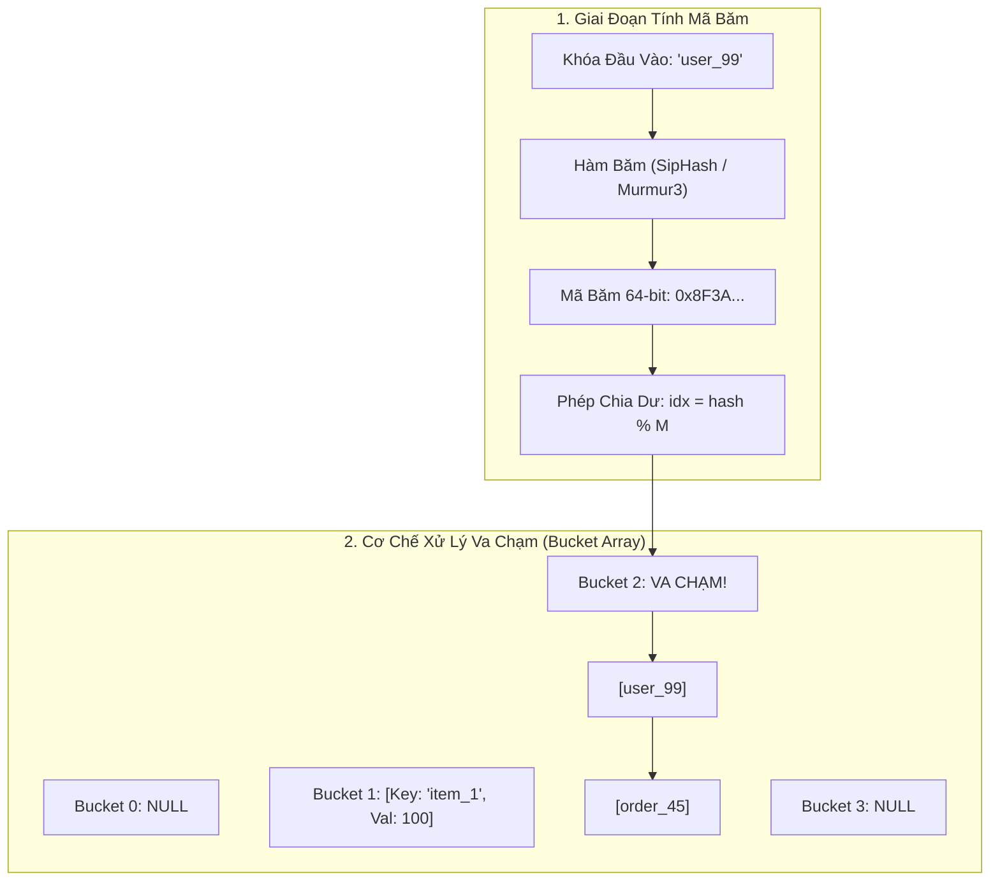
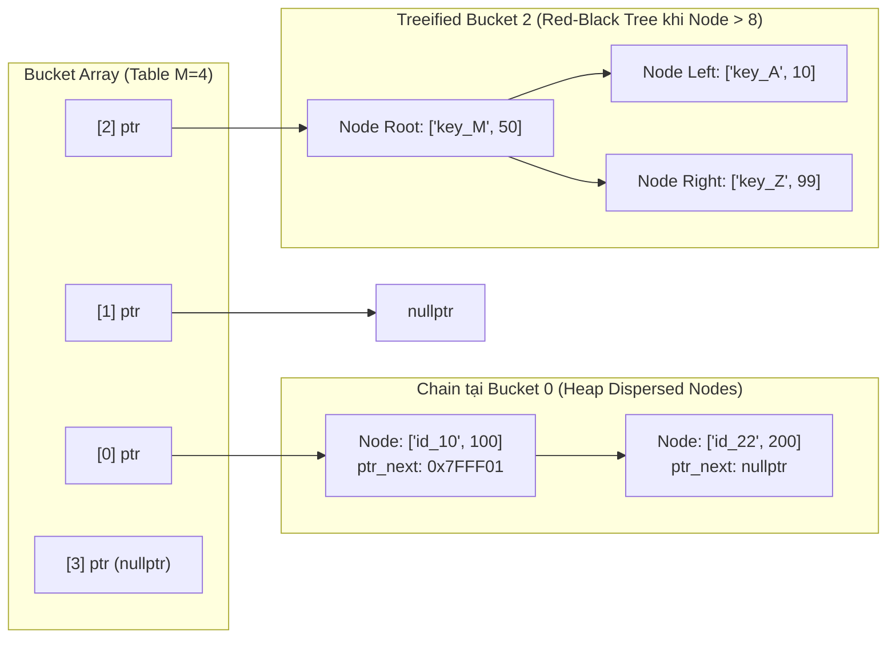
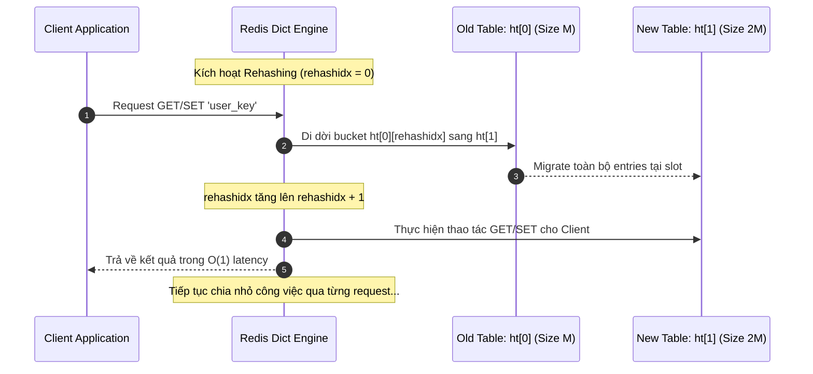

# 2.5. Bảng Băm (Hash Table & Collision Resolution Mechanics)

> [!IMPORTANT]
> **Nếu bạn chỉ được nhớ một điều duy nhất:** Bảng băm (Hash Table) đạt được độ phức tạp thời gian trung bình $O(1)$ cho các phép toán tra cứu, thêm và xóa không phải bằng phép màu, mà là sự đánh đổi không gian bộ nhớ (Space-Time Tradeoff) thông qua hàm toán học ánh xạ khóa có kích thước tùy ý vào một miền chỉ số nguyên hữu hạn. Hiệu năng thực tế của bảng băm trong hệ thống sản xuất không chỉ phụ thuộc vào $O(1)$ lý thuyết, mà bị chi phối mạnh mẽ bởi cấu trúc phần cứng: hiện tượng Pointer Chasing và Cache Miss tàn khốc của Separate Chaining đối đầu với sự thân thiện bộ nhớ đệm CPU Cache Lines (64-byte) nhưng dễ bị cụm hóa (Clustering) của Open Addressing. Hiểu rõ sự kết hợp giữa phân phối băm đồng đều (Uniform Distribution), quản lý hệ số tải (Load Factor), tái băm lũy tiến (Incremental Rehashing), và kỹ thuật kháng tấn công Hash-DoS (SipHash) là nền tảng sống còn của mọi kỹ sư phần mềm hệ thống và backend hiệu năng cao.

---

## 1. Trực Quan Hóa: Bản Chất Bảng Băm Dưới Góc Nhìn Lập Trình Viên

### 1.1. Đoạn Code Dẫn Nhập & Vấn Đề Thực Tế
Xét bài toán tra cứu thông tin người dùng dựa trên Session Token dài 32 ký tự:

```typescript
// Nếu dùng Mảng thông thường: O(N) tìm kiếm tuyến tính
const user = userList.find(u => u.token === "sess_9a8b7c6d5e4f3a2b1c"); // Chậm dần khi số user tăng!

// Nếu dùng Bảng Băm (Hash Table / Map): O(1) tra cứu tức thì
const user = userMap.get("sess_9a8b7c6d5e4f3a2b1c"); // Thời gian tra cứu không đổi dù có 10 user hay 10 triệu user!
```

- Bảng băm (Hash Table) là kỳ quan vĩ đại nhất của khoa học máy tính trong việc tối ưu hóa thời gian: Biến một chuỗi khóa tùy ý (String, UUID, Object) thành một chỉ số mảng nguyên thủy thông qua **Hàm Băm (Hash Function)**, cho phép truy xuất dữ liệu với độ phức tạp **$O(1)$** trung bình.
- Nhưng sự kỳ diệu đó không miễn phí: Bảng băm luôn phải đối mặt với **Hiện tượng va chạm (Hash Collision)** và chi phí bộ nhớ đệm phình to (**Load Factor & Rehash**).

### 1.2. Ẩn Dụ Đời Sống: Tủ Gửi Đồ Thông Minh Tại Sân Bay Quốc Tế
- Hãy hình dung một khu vực tủ gửi đồ thông minh gồm 10,000 ô tủ được đánh số từ `0` đến `9999`.
- Khi hành khách quét hộ chiếu (Khóa - Key), máy quét chạy một thuật toán toán học rút gọn thông tin cá nhân thành một con số 4 chữ số, ví dụ `4521` (Mã băm - Hash Code). Hành khách bước thẳng đến ô số `4521` để cất hoặc lấy hành lý trong đúng 10 giây ($O(1)$).
- **Hiện tượng va chạm (Collision)**: Nếu hành khách thứ hai quét hộ chiếu và máy cũng chỉ định vào đúng ô `4521` (do 2 người khác nhau ngẫu nhiên có cùng mã băm):
  - **Phương pháp Nối chuỗi (Separate Chaining)**: Ô `4521` được thiết kế thành một ngăn kéo sâu chứa một danh sách móc nối nhiều ba lô vào nhau. Người đến sau móc tiếp ba lô của mình vào sau ba lô người trước.
  - **Phương pháp Địa chỉ Mở (Open Addressing - Linear Probing)**: Thấy ô `4521` đã có đồ, hành khách bước sang ô kế tiếp `4522`, nếu vẫn có đồ thì bước tiếp `4523` cho đến khi tìm thấy ô trống đầu tiên.

### 1.3. Mô Phỏng Dữ Liệu Số Nhỏ Từng Bước (Toy Walkthrough)
Xét bảng băm gồm $M = 5$ thùng chứa (`Bucket 0 .. 4`).
Hàm băm đơn giản: $\text{hash}(k) = k \pmod 5$.
Chuỗi khóa chèn vào: `12, 17, 23, 7`:

```text
1. Chèn key = 12: hash(12) = 12 % 5 = 2.
   Bucket 2 đang trống -> Đặt 12 vào Bucket 2.

2. Chèn key = 17: hash(17) = 17 % 5 = 2.
   VA CHẠM! Bucket 2 đã chứa 12.
   - Separate Chaining: Nối vào sau danh sách: Bucket 2 -> [12] -> [17]
   - Linear Probing: Thử Bucket (2+1)%5 = 3 (trống) -> Đặt 17 vào Bucket 3.

3. Chèn key = 23: hash(23) = 23 % 5 = 3.
   - Separate Chaining: Bucket 3 -> [23]
   - Linear Probing: Bucket 3 đã bị 17 chiếm -> Thử Bucket 4 (trống) -> Đặt 23 vào Bucket 4.
```

- Hệ số tải (Load Factor): $\alpha = \frac{N}{M} = \frac{3}{5} = 0.6$. Khi $\alpha > 0.75$, số lượng va chạm tăng vọt, bảng băm bắt buộc phải cấp phát mảng gấp đôi ($M = 10$) và tính toán lại vị trí cho toàn bộ phần tử (**Rehash**).

### 1.4. Tác Động Thực Tế Tầng Backend & Systems
1. **Lỗ Hổng Bảo Mật Hash DoS Attack**: Kẻ tấn công cố tình tạo ra hàng nghìn chuỗi ký tự khác nhau nhưng có cùng mã băm trong thuật toán băm yếu (như DJB2 hoặc CRC32). Toàn bộ các khóa bị dồn vào chung 1 Bucket duy nhất, biến bảng băm $O(1)$ thành danh sách liên kết $O(N)$, khiến CPU máy chủ xử lý $100\%$ và treo API Gateway. Giải pháp là dùng các hàm băm kháng va chạm ngẫu hóa như **SipHash**.
2. **Kiến Trúc Bộ Nhớ Swiss Tables (Google Abseil / Rust `std::collections::HashMap`)**: Bảng băm hiện đại không dùng con trỏ danh sách liên kết mà lưu trữ mảng phẳng kèm theo một mảng điều khiển 1-byte (**Metadata Control Bytes**). CPU sử dụng chỉ thị SIMD để kiểm tra song song 16 thùng chứa trong đúng 1 chu kỳ máy, đạt hiệu năng vượt trội và thân thiện tối đa với CPU Cache.
3. **Cơ Chế Rehash Gia Tăng Trong Redis (Incremental Rehashing)**: Redis không bao giờ rehash toàn bộ bảng băm lớn hàng triệu khóa trong 1 lần duy nhất (vì sẽ gây đơ hệ thống vài giây). Thay vào đó, mỗi khi có request đọc/ghi, Redis chỉ di dời 1 vài Bucket sang bảng mới, phân bổ chi phí mượt mà theo thời gian.

### 1.5. Sơ Đồ Cơ Chế Bảng Băm & Giải Quyết Va Chạm



---

## 2. Chi tiết từng Keyword (Under-the-Hood Deep Dive)

### 2.1. Hàm Băm, Hash Code, Phân Phối Băm & Tính Nhất Quán (Hash Consistency)

#### 1. Định Nghĩa Toán Học & Bản Chất Cốt Lõi
Hàm băm là một ánh xạ toán học từ một không gian khóa có kích thước vô hạn hoặc rất lớn $\mathcal{K}$ vào một không gian chỉ số nguyên hữu hạn $\mathcal{S} = \{0, 1, \dots, M-1\}$:
$$h: \mathcal{K} \to \mathcal{S}$$

Quá trình ánh xạ này thường trải qua hai giai đoạn riêng biệt:
1. **Tạo Hash Code (Hash Code Generation)**: Biến đổi đối tượng dữ liệu phức tạp thành một số nguyên 32-bit hoặc 64-bit:
   $$\text{HashCode}: \mathcal{K} \to \mathbb{Z}$$
2. **Nén Chỉ Số (Index Compression Function)**: Thu nhỏ giá trị Hash Code khổng lồ về phạm vi kích thước của mảng bucket $[0, M-1]$. Hai phương pháp nén kinh điển gồm:
   - **Phương pháp chia dư (Division Method)**:
     $$\text{Index} = |\text{HashCode}(k)| \pmod M$$
     *Lưu ý kiến trúc*: Nếu $M$ là số nguyên tố (Prime Number), phân phối băm sẽ giảm thiểu được sự thiên lệch khi Hash Code chứa các quy luật tuần hoàn. Tuy nhiên, phép chia số nguyên (phép `IDIV` trên kiến trúc x86-64) tiêu tốn từ $15$ đến $40$ chu kỳ xung nhịp CPU!
   - **Phương pháp mặt nạ bit lũy thừa của 2 (Power-of-Two Bitmasking)**:
     Nếu chọn kích thước bảng $M = 2^p$, phép chia lấy dư được thay thế hoàn toàn bằng phép toán logic bitwise AND siêu tốc:
     $$\text{Index} = \text{HashCode}(k) \ \& \ (M - 1)$$
     Phép tính này chỉ tốn đúng **1 chu kỳ xung nhịp CPU**! Tuy nhiên, nhược điểm chí mạng là nó chỉ sử dụng $p$ bit thấp nhất của Hash Code và vứt bỏ hoàn toàn các bit cao. Nếu hàm băm không có tính chất trộn bit tốt (Poor Avalanche Effect), các khóa có bit thấp giống nhau sẽ gây ra va chạm thảm khốc.

#### 2. Giả Định Băm Đều Đơn Giản (SUHA) & Nghịch Lý Ngày Sinh Nhật (Birthday Paradox)
- **SUHA (Simple Uniform Hashing Assumption)**: Giả định lý thuyết rằng hàm băm phân phối mọi khóa độc lập và đồng đều vào bất kỳ bucket nào trong số $M$ bucket với xác suất chính xác là $1/M$:
  $$P(h(k_1) = j) = \frac{1}{M}, \quad \forall j \in [0, M-1]$$
- **Nghịch lý Ngày sinh nhật và Tỷ lệ Va chạm Không thể Tránh khỏi**:
  Nhiều lập trình viên lầm tưởng rằng nếu bảng băm có $M = 1,000,000$ ô thì phải nạp tới hàng trăm nghìn phần tử mới bắt đầu xuất hiện va chạm. Thực tế toán học hoàn toàn ngược lại. Theo lý thuyết xác suất, số lượng phần tử $N$ cần nạp vào để xác suất xảy ra **ít nhất một vụ va chạm** vượt quá $50\%$ chỉ là:
  $$N \approx \sqrt{\frac{\pi}{2} M} \approx 1.25 \sqrt{M}$$
  Với bảng băm có $M = 1,000,000$ slots, chỉ cần nạp khoảng **$1,250$ phần tử** là đã có hơn $50\%$ khả năng xảy ra va chạm đầu tiên! Điều này chứng minh rằng cơ chế xử lý va chạm không phải là tính năng phụ, mà là trái tim quyết định sự sống còn của bảng băm.

#### 3. Băm Hoàn Hảo (Perfect Hashing) & Băm Phổ Quát (Universal Hashing)
- **Perfect Hashing (FKS - Fredman, Komlós, Szemerédi)**: Đối với một tập khóa tĩnh $\mathcal{K}$ đã biết trước và không bao giờ thay đổi (ví dụ: danh sách 32 từ khóa của ngôn ngữ C như `if`, `while`, `return`), ta có thể xây dựng một cấu trúc bảng băm 2 tầng (2-level Hash Table) đảm bảo **tuyệt đối không có bất kỳ va chạm nào**. Thời gian tra cứu trong trường hợp xấu nhất (Worst-case Lookup) đạt mức bảo đảm tuyệt đối $O(1)$.
- **Universal Hashing**: Để ngăn chặn kẻ tấn công khai thác điểm yếu của một hàm băm cố định, Universal Hashing định nghĩa một họ hàm băm hữu hạn $\mathcal{H}$. Tại thời điểm khởi tạo bảng băm trong bộ nhớ, chương trình sẽ chọn ngẫu nhiên một hàm $h \in \mathcal{H}$. Với hai khóa bất kỳ $x \ne y$:
  $$P_{h \in \mathcal{H}}(h(x) = h(y)) \le \frac{1}{M}$$
  Universal Hashing triệt tiêu hoàn toàn khả năng kẻ tấn công tạo ra các bộ khóa độc hại tính toán trước (Precomputed Adversarial Keys).

#### 4. Bất Biến Nhất Quán Giữa Key Equality & Hash Code (The Hash Contract)
Một quy tắc bất biến trong khoa học máy tính mà mọi kỹ sư phải khắc sâu:
$$\forall k_1, k_2: \quad (k_1 == k_2) \implies (h(k_1) == h(k_2))$$
Tuy nhiên, chiều ngược lại không đúng:
$$h(k_1) == h(k_2) \not\implies k_1 == k_2 \quad (\text{Hiện tượng Va chạm})$$

> [!WARNING]
> **Cạm bẫy Mutable Object làm Key**: Nếu bạn sử dụng một đối tượng khả biến (Mutable Object) làm Key trong Bảng băm, và sau khi chèn vào bảng, bạn thay đổi một trường dữ liệu của Key đó (ví dụ: `user.setName("bob")`), giá trị `hashCode()` của nó sẽ bị thay đổi hoàn toàn. Khi bạn gọi `map.get(user)`, bảng băm sẽ tính toán một bucket index mới và trả về `null` hoặc không tìm thấy, trong khi đối tượng cũ vẫn nằm chết trong bucket ban đầu, gây ra lỗi rò rỉ bộ nhớ nghiêm trọng (Silent Memory Leak).

#### 5. Phân Tích Các Thuật Toán Băm Công Nghiệp Hiện Đại
Các hàm băm mật mã học (như SHA-256, MD5, SHA-3) được thiết kế với mục tiêu chống đảo ngược (Pre-image Resistance) và chống va chạm mạnh mẽ, nhưng tốc độ xử lý rất chậm (chỉ đạt khoảng $200 - 400\text{ MB/s}$). Trong bảng băm trong bộ nhớ (In-memory Hash Table), các hệ thống bắt buộc phải sử dụng các hàm băm phi mật mã (Non-cryptographic Hashes) với hiệu năng đạt hàng chục Gigabytes mỗi giây:

| Thuật Toán Băm | Tốc Độ Thông Lượng (Throughput) | Kháng Hash-DoS? | Hiệu Ứng Tuyết Lở (Avalanche Effect) | Hệ Thống / Ngôn Ngữ Ứng Dụng Điển Hình |
| :--- | :--- | :--- | :--- | :--- |
| **MurmurHash3** | $\sim 5\text{ GB/s}$ | Không | Rất tốt (Mọi bit đầu ra phụ thuộc vào mọi bit đầu vào) | Cassandra, Apache Spark, Guava, Hadoop |
| **CityHash / FarmHash** | $\sim 10\text{ GB/s}$ | Không | Cực tốt (Tối ưu hóa sâu cho CPU x86-64) | Hệ thống hạ tầng nội bộ Google |
| **xxHash3 (xxh3)** | $\sim 30 - 50\text{ GB/s}$ | Không | Hoàn hảo (Tận dụng tập lệnh SIMD AVX2 / AVX-512) | Zstandard Compression, RocksDB, ClickHouse |
| **SipHash-2-4 / 1-3** | $\sim 1.5 - 3.0\text{ GB/s}$ | **Có** (Sử dụng 128-bit Secret Key) | Hoàn hảo về mặt an toàn giả ngẫu nhiên | Mặc định trong Rust (`std::collections`), Python 3, Ruby, Swift |

---

### 2.2. Xử lý Va Chạm: Separate Chaining vs Open Addressing

Khi hai khóa khác nhau cùng rơi vào một chỉ số bucket, cấu trúc dữ liệu bắt buộc phải có cơ chế giải quyết xung đột. Hai trường phái kiến trúc kinh điển đối đầu nhau là **Separate Chaining** (Bộ nhớ phân tán) và **Open Addressing** (Bộ nhớ phẳng liên tục).

#### 1. Separate Chaining (Nối Chuỗi Riêng Biệt)

- **Cấu trúc bộ nhớ**: Mảng chính chỉ chứa các con trỏ (Pointers / Heads). Mỗi bucket trỏ tới một cấu trúc dữ liệu động lưu trữ tất cả các phần tử bị va chạm tại bucket đó (thường là Singly Linked List).
- **Thao tác**:
  - `Insert`: Băm khóa, nhảy đến bucket. Duyệt danh sách liên kết để kiểm tra xem khóa đã tồn tại hay chưa (nếu có thì ghi đè Value). Nếu chưa, cấp phát một Node mới trên Heap và chèn vào đầu danh sách ($O(1)$) hoặc cuối danh sách.
  - `Search`: Nhảy đến bucket, đi dọc theo con trỏ `next` của từng Node và so sánh khóa bằng toán tử `operator==`.
  - `Delete`: Tìm kiếm Node và thực hiện ngắt nối con trỏ (Unlinking) khỏi danh sách liên kết, giải phóng bộ nhớ của Node đó.
- **Nỗi Ác Mộng Phần Cứng: Pointer Chasing & L1/L2 Cache Misses**:
  Mỗi Node trong Linked List là một lần cấp phát bộ nhớ rời rạc trên Heap (thông qua `malloc` hoặc `new`). Trên không gian địa chỉ ảo, các Node này nằm rải rác ở các trang nhớ ngẫu nhiên. Khi CPU duyệt từ Node này sang Node tiếp theo, phần cứng CPU Prefetcher hoàn toàn bất lực trong việc đoán trước địa chỉ tiếp theo. Hậu quả là CPU liên tục bị **Cache Miss** ở tầng L1, L2, thậm chí L3, buộc phải dừng hoạt động (Pipeline Stall) để chờ nạp dữ liệu từ thanh RAM vật lý với độ trễ lên tới $200$ chu kỳ xung nhịp CPU!
- **Sự Tiến Hóa Treeification (Java 8 HashMap)**:
  Để đối phó với tình trạng chuỗi va chạm bị kẻ tấn công kéo dài vô tận, Java 8 đã giới thiệu cơ chế Treeification: Khi số lượng phần tử trong một bucket vượt quá ngưỡng `TREEIFY_THRESHOLD = 8` và tổng dung lượng mảng $\ge 64$, danh sách liên kết sẽ tự động chuyển hóa thành một **Cây Đỏ-Đen (Red-Black Tree)**. Độ phức tạp tra cứu trong trường hợp xấu nhất nhờ đó giảm từ $O(N)$ xuống $O(\log N)$. Khi số phần tử trong cây giảm xuống dưới ngưỡng `UNTREEIFY_THRESHOLD = 6`, nó sẽ tự động thoái lui trở lại thành Linked List để tiết kiệm chi phí bộ nhớ.



---

#### 2. Open Addressing (Địa Chỉ Mở)

- **Cấu trúc bộ nhớ**: Tuyệt đối không sử dụng danh sách liên kết và không cấp phát Node rời rạc trên Heap. Toàn bộ các cặp `[Key, Value]` và trạng thái của ô được lưu trữ trực tiếp bên trong một **mảng phẳng liên tục (Flat Contiguous Array)** duy nhất trong bộ nhớ.
- **Nguyên lý Dò (Probing Mechanics)**:
  Khi xảy ra va chạm tại vị trí $h(k)$, thuật toán sẽ kiểm tra tuần tự các ô tiếp theo theo một chuỗi hàm dò $h(k, i)$ với $i = 0, 1, 2, \dots$:
  $$\text{Slot} = h(k, i) \pmod M$$
  Có 3 phương pháp dò kinh điển:
  1. **Linear Probing (Dò Tuyến Tính)**:
     $$h(k, i) = (h(k) + i) \pmod M$$
     Bước nhảy cố định là $1$.
     *Ưu điểm*: Thân thiện với CPU Cache ở mức tối thượng (Maximum Cache Locality). Khi nạp một ô vào Cache Line 64 bytes, toàn bộ các ô lân cận đều được nạp sẵn vào bộ nhớ đệm CPU siêu nhanh.
     *Nhược điểm*: **Primary Clustering (Cụm hóa sơ cấp)**. Các ô bị chiếm đóng có xu hướng kết tụ lại thành các dãy dài liên tục. Khi một khóa mới rơi vào bất kỳ vị trí nào trong cụm, nó buộc phải dò qua toàn bộ cụm đó và nối dài cụm thêm một đơn vị, khiến hiệu năng dò tìm suy giảm nghiêm trọng.
  2. **Quadratic Probing (Dò Bậc Hai)**:
     $$h(k, i) = (h(k) + c_1 i + c_2 i^2) \pmod M$$
     Bước nhảy tăng dần theo bình phương của số lần dò. Kỹ thuật này phá vỡ hiện tượng cụm hóa sơ cấp, nhưng vẫn mắc phải **Secondary Clustering (Cụm hóa thứ cấp)**: Tất cả các khóa có cùng mã băm ban đầu $h(k)$ sẽ luôn luôn đi theo đúng một chuỗi vết dò giống hệt nhau.
  3. **Double Hashing (Băm Kép)**:
     $$h(k, i) = (h_1(k) + i \cdot h_2(k)) \pmod M$$
     Sử dụng một hàm băm thứ hai $h_2(k)$ để xác định độ dài bước nhảy. Điều kiện bắt buộc là $h_2(k)$ phải nguyên tố cùng nhau với $M$ (thường chọn $M$ là số nguyên tố và $h_2(k) = 1 + (k \bmod (M - 1))$). Băm kép loại bỏ hoàn toàn cả hai hiện tượng cụm hóa, cung cấp phân phối gần như tiệm cận với Uniform Probing.

- **Vấn Đề Xóa Phần Tử: Bí Mật Con Dấu Mộ (The Tombstone Mechanism)**:
  Trong Open Addressing, bạn **tuyệt đối không được gán ô bị xóa trở về trạng thái rỗng (`EMPTY`)**.
  *Lý do*: Quá trình tìm kiếm một khóa sẽ dừng lại ngay khi gặp ô `EMPTY` đầu tiên (vì thuật toán suy luận rằng nếu khóa đó tồn tại, nó đã được chèn vào ô trống này thay vì dò tiếp ra phía sau). Nếu bạn xóa phần tử $X$ ở giữa chuỗi dò và biến ô đó thành `EMPTY`, bạn sẽ làm đứt gãy chuỗi dò, khiến toàn bộ các phần tử $Y, Z$ được chèn sau $X$ trở nên "vô hình" (Lookup Failure).
  *Giải pháp*: Đánh dấu ô bị xóa bằng một giá trị đặc biệt gọi là **Tombstone** (`DELETED`).
  - Thao tác Tra cứu (`contains`): Coi Tombstone như một ô đang bị chiếm và tiếp tục dò vượt qua nó.
  - Thao tác Chèn (`insert`): Có thể ghi đè dữ liệu mới vào ô Tombstone để tái sử dụng không gian trống.
  - Hiện tượng Ô nhiễm Tombstone (Tombstone Accumulation): Khi bảng băm trải qua hàng triệu thao tác chèn và xóa liên tục, các Tombstone tích tụ dày đặc khiến thao tác tìm kiếm thất bại phải duyệt qua toàn bộ bảng băm mà không được dừng lại. Bảng băm buộc phải kích hoạt cơ chế dọn rác và tái băm (Rehash & Garbage Collection) để thanh lọc toàn bộ Tombstone.

---

#### 3. Bảng Đột Phá Hiện Đại: Google Swiss Tables & Control Bytes SIMD

Trong những năm gần đây, cộng đồng kỹ thuật hệ thống đã chứng kiến một cuộc cách mạng mang tên **Swiss Tables** (được triển khai trong thư viện C++ Google Abseil `absl::flat_hash_map` và thư viện chuẩn của ngôn ngữ Rust `hashbrown`):
- **Cấu trúc tách biệt Metadata và Slots**: Thay vì lưu thông tin trạng thái trực tiếp trong từng slot dữ liệu, Swiss Table duy trì một mảng 1-byte riêng biệt gọi là **Control Bytes** song song với mảng dữ liệu.
- **Phân tách H1 và H2 Hash**:
  - Mã băm 64-bit được chia làm hai phần: $57$ bit cao ($H1$) dùng để xác định vị trí nhóm (Group Index), và $7$ bit thấp ($H2$) được lưu trực tiếp vào Control Byte.
  - Giá trị của Control Byte gồm: `EMPTY = 0b10000000`, `DELETED = 0b11111110`, hoặc giá trị 7-bit $H2 \in [0, 127]$.
- **Tăng tốc SIMD Vectorization**:
  Mỗi nhóm (Group) chứa đúng $16$ Control Bytes, vừa khít kích thước của một thanh ghi vector SSE2 (128-bit) hoặc 32 bytes (AVX2). Khi tra cứu một khóa, CPU chỉ cần nạp 16 Control Bytes vào thanh ghi và gọi một lệnh máy duy nhất `_mm_cmpeq_epi8` để so sánh đồng thời 7-bit $H2$ với cả 16 slots trong đúng **1 chu kỳ xung nhịp CPU**! Kỹ thuật này triệt tiêu hoàn toàn chi phí so sánh Key đắt đỏ đối với các ô không khớp, đưa tốc độ của Open Addressing lên mức đỉnh cao của phần cứng máy tính.

---

### 2.3. Load Factor, Dynamic Resizing & Lỗ Hổng Hash-DoS

#### 1. Hệ Số Tải (Load Factor - $\alpha$) & Động Học Hiệu Năng
Hệ số tải $\alpha$ biểu thị mật độ lấp đầy của bảng băm:
$$\alpha = \frac{N}{M}$$
Trong đó:
- $N$: Tổng số lượng phần tử hiện đang lưu trữ.
- $M$: Tổng số lượng bucket (Capacity) của bảng.

Mối quan hệ giữa hệ số tải và số phép dò trung bình (Expected Number of Probes) được chứng minh chặt chẽ qua toán học xác suất:

| Cấu Trúc Bảng Băm | Số Phép Dò Tra Cứu Thành Công ($S_\alpha$) | Số Phép Dò Tra Cứu Thất Bại ($U_\alpha$) | Ngưỡng Khuyến Nghị Tối Đa ($\alpha_{\max}$) |
| :--- | :--- | :--- | :--- |
| **Separate Chaining** | $1 + \frac{\alpha}{2}$ | $\alpha$ | $\mathbf{0.75} - \mathbf{1.0}$ (Thậm chí $> 1.0$ vẫn hoạt động) |
| **Linear Probing** | $\frac{1}{2} \left(1 + \frac{1}{1 - \alpha}\right)$ | $\frac{1}{2} \left(1 + \frac{1}{(1 - \alpha)^2}\right)$ | $\mathbf{0.50} - \mathbf{0.70}$ |
| **Double Hashing** | $\frac{1}{\alpha} \ln \frac{1}{1 - \alpha}$ | $\frac{1}{1 - \alpha}$ | $\mathbf{0.60} - \mathbf{0.75}$ |

*Nhận xét sống còn*: Trong Open Addressing, khi $\alpha \to 1$, số phép dò tra cứu thất bại $U_\alpha$ bùng nổ theo cấp số bình phương $\frac{1}{(1-\alpha)^2}$. Tại $\alpha = 0.9$, số phép dò trung bình lên tới $\frac{1}{2} (1 + \frac{1}{0.01}) = 50.5$ lần! Điều này lý giải vì sao các cấu trúc Open Addressing bắt buộc phải mở rộng dung lượng khi hệ số tải mới chỉ chạm mức $50\% - 70\%$.

#### 2. Dynamic Resizing & Phân Tích Khấu Hao (Amortized Analysis)
Khi số phần tử vượt ngưỡng cho phép ($N \ge M \cdot \alpha_{\max}$), bảng băm kích hoạt cơ chế tái băm (Rehashing):
1. Cấp phát một mảng bucket mới có kích thước gấp đôi: $M_{\text{new}} = 2 \cdot M_{\text{old}}$.
2. Duyệt qua toàn bộ các bucket của bảng cũ.
3. Đối với mỗi phần tử còn tồn tại, tính toán lại vị trí của nó trong mảng mới bằng phép toán băm/nén chỉ số theo $M_{\text{new}}$ và chèn vào mảng mới.
4. Thu hồi bộ nhớ của mảng cũ.

- **Chứng minh chi phí khấu hao $O(1)$ bằng Phương pháp Thế năng (The Potential Method)**:
  Xét chuỗi $N$ thao tác chèn liên tiếp bắt đầu từ bảng rỗng kích thước $M = 1$. Chi phí thực tế của các thao tác không resize là $1$, trong khi thao tác resize tại các mốc $2^i$ tốn chi phí sao chép $2^i$.
  Định nghĩa hàm thế năng $\Phi$:
  $$\Phi = 2N - M \quad (\text{khi } N \ge M/2)$$
  - Khi bảng đầy ($N = M$), $\Phi = 2M - M = M$. Bảng có đủ thế năng tích lũy để chi trả toàn bộ công việc sao chép $M$ phần tử sang bảng mới.
  - Ngay sau khi resize sang kích thước $2M$, $N = M$, dung lượng mới là $2M$, thế năng trở về:
    $$\Phi_{\text{new}} = 2M - 2M = 0$$
  - Chi phí khấu hao của mỗi thao tác chèn:
    $$\hat{c}_i = c_i + \Delta \Phi = 1 + (2(N + 1) - M) - (2N - M) = 1 + 2 = 3 = O(1)$$
  Do đó, trung bình mỗi thao tác chèn chỉ tốn chi phí hằng số $O(1)$.

- **Vấn Đề Đột Biến Độ Trễ P99 (Latency Spike) & Kỹ Thuật Incremental Rehashing của Redis**:
  Mặc dù chi phí trung bình là $O(1)$, nhưng tại đúng thời điểm việc resize diễn ra trên một bảng băm khổng lồ chứa $50\text{ triệu}$ keys, CPU phải dừng toàn bộ các tác vụ khác trong suốt $500\text{ ms}$ chỉ để di dời dữ liệu. Đối với các hệ thống tài chính hoặc game thời gian thực, đây là một thảm họa làm đứt gãy SLA P99.99.
  *Giải pháp kiến trúc của Redis (`dict.c`)*: **Incremental Rehashing (Băm lại tăng dần)**.
  - Redis duy trì đồng thời hai bảng băm trong cấu trúc từ điển: `ht[0]` (bảng cũ) và `ht[1]` (bảng mới gấp đôi).
  - Khởi tạo một biến chỉ số `rehashidx = 0`.
  - Thay vì rehash toàn bộ cùng một lúc, mỗi khi có một request đọc hoặc ghi đến từ client, Redis chỉ di chuyển đúng các phần tử tại **duy nhất 1 bucket** từ `ht[0]` sang `ht[1]`, sau đó tăng `rehashidx++`. Ngoài ra, Redis cấu hình một background timer định kỳ kích hoạt rehash trong khoảng thời gian $1\text{ ms}$ khi rảnh rỗi.
  - Nhờ cơ chế này, công việc resize khổng lồ được chia nhỏ thành hàng triệu lát cắt siêu mỏng, triệt tiêu hoàn toàn hiện tượng Spike độ trễ!



---

#### 3. Lỗ Hổng Tấn Công Từ Chối Dịch Vụ Băm (Hash-DoS Vulnerability)

- **Lịch sử và Bản chất Cuộc Tấn Công (28C3 Conference 2011)**:
  Alexander Klink và Julian Wälde đã công bố một cuộc tấn công gây chấn động nền tảng hạ tầng Internet toàn cầu: Làm sập hầu hết các web server chạy Java Tomcat, PHP, Apache Geronimo, Python, Node.js và Ruby bằng cách khai thác thuật toán băm của bảng băm.
- **Kịch bản Tấn công (Exploitation Mechanism)**:
  Các framework web khi phân tích (parse) các tham số của một HTTP POST Request (`application/x-www-form-urlencoded`) sẽ lưu trữ toàn bộ các cặp `key=value` vào một bảng băm trong bộ nhớ (ví dụ: `Map<String, String>` trong Java Servlet).
  Thời điểm đó, các ngôn ngữ sử dụng các hàm băm đơn giản có tính chất xác định hoàn toàn (Deterministic Hash như DJB2 hoặc Java `String.hashCode()`):
  $$\text{hash}(s) = \sum_{i=0}^{n-1} s[i] \cdot 31^{n-1-i}$$
  Kẻ tấn công có thể tính toán ngoại tuyến (Offline Precomputation) một danh sách gồm hàng chục nghìn chuỗi ký tự khác nhau nhưng có **cùng một giá trị mã băm duy nhất** (ví dụ: các chuỗi ký tự `"Aa"`, `"BB"` đều có mã băm là $2112$).
  Sau đó, kẻ tấn công gửi một HTTP POST request dung lượng chỉ vỏn vẹn $2\text{ MB}$ chứa $50,000$ form parameters độc hại:
  `param_Aa=1&param_BB=2&param_BBAa=3...`
  Khi máy chủ nạp $50,000$ khóa này vào bảng băm:
  - Toàn bộ $50,000$ phần tử dồn vào **duy nhất 1 bucket**!
  - Separate Chaining thoái hóa thành một LinkedList dài $50,000$ nút.
  - Quá trình chèn mỗi phần tử mới đòi hỏi phải duyệt qua toàn bộ các nút trước đó để kiểm tra trùng lặp:
    $$\text{Tổng số phép so sánh} = 1 + 2 + 3 + \dots + N = \frac{N(N - 1)}{2} = \frac{50,000^2}{2} \approx 1.25 \times 10^9 \text{ phép tính!}$$
  Hậu quả là **1 core CPU bị chiếm dụng $100\%$ trong suốt $30 - 60$ giây** chỉ để giải quyết một request duy nhất có kích thước $2\text{ MB}$. Chỉ cần gửi $10$ requests đồng thời, toàn bộ máy chủ backend bị tê liệt hoàn toàn, từ chối mọi người dùng hợp lệ!

- **Các Tầng Phòng Thủ Toàn Diện (Defense-in-Depth)**:
  1. **Khởi tạo Keyed Hash với Hạt Giống Ngẫu Nhiên (SipHash)**:
     Tất cả các ngôn ngữ hiện đại (Python, Rust, Ruby) đã thay thế hàm băm mặc định bằng **SipHash-2-4**. Mỗi khi tiến trình máy chủ khởi động, nó sẽ đọc $16$ bytes ngẫu nhiên từ nhân hệ điều hành (`/dev/urandom`) để làm Secret Key cho hàm băm. Vì kẻ tấn công không thể biết được Secret Key trong bộ nhớ RAM của server, chúng hoàn toàn bất lực trong việc tính toán trước các bộ khóa gây va chạm.
  2. **Cấu Trúc Tự Cân Bằng (Java 8 Treeification)**:
     Java 8 chuyển đổi bucket thành Red-Black Tree khi va chạm $\ge 8$, giới hạn độ phức tạp trường hợp xấu nhất ở mức $O(N \log N)$ thay vì $O(N^2)$.
  3. **Giới Hạn Tầng Gateway & Web Server (WAF / Nginx)**:
     Cấu hình giới hạn số lượng parameters tối đa trên một HTTP request:
     - PHP: `max_input_vars = 1000`
     - Tomcat: `maxParameterCount = 1000`
     - Nginx: Giới hạn `client_max_body_size 10M` và kiểm soát header rate limits.

---

## 3. Thực thi Mã nguồn & Mô phỏng Chuyên sâu (Dual-Engine Implementation)

### 3.1. C++20 Implementation: Flat Linear Probing Hash Map (Tối ưu Cache, Bitmasking & Tombstone Management)

Dưới đây là bản cài đặt chuẩn công nghiệp bằng C++20 của một bảng băm phẳng (Flat Open-Addressing Map) với kỹ thuật dò tuyến tính, tối ưu hóa phép nén bitmask, tự động tái băm dựa trên Load Factor và xử lý con dấu mộ (Tombstone):

```cpp
#include <iostream>
#include <vector>
#include <string>
#include <string_view>
#include <optional>
#include <chrono>
#include <iomanip>
#include <cstdint>
#include <cassert>

// Lớp Bảng Băm Phẳng chuẩn C++20 tối ưu Cache Locality
template <typename Key, typename Value>
class FlatHashMap {
public:
    enum class SlotState : uint8_t {
        EMPTY = 0,
        OCCUPIED = 1,
        DELETED = 2 // Con dấu mộ (Tombstone marker)
    };

    struct Slot {
        Key key{};
        Value value{};
        SlotState state{SlotState::EMPTY};
    };

private:
    std::vector<Slot> slots_;
    size_t capacity_{16};    // Luôn là lũy thừa của 2: 2^k
    size_t size_{0};         // Số lượng phần tử OCCUPIED
    size_t tombstone_count_{0}; // Số lượng ô DELETED
    const double max_load_factor_{0.65}; // Ngưỡng tải tối đa để tránh Primary Clustering

    // Hàm nén chỉ số bằng phép toán bitwise AND siêu tốc (1 CPU Cycle)
    [[nodiscard]] constexpr size_t fast_mod(size_t hash_val) const noexcept {
        return hash_val & (capacity_ - 1);
    }

    // Hàm trộn bit (Avalanche Mixer) lấy cảm hứng từ MurmurHash3 / SplitMix64
    [[nodiscard]] static constexpr size_t hash_mix(size_t x) noexcept {
        x ^= x >> 30;
        x *= 0xbf58476d1ce4e5b9ULL;
        x ^= x >> 27;
        x *= 0x94d049bb133111ebULL;
        x ^= x >> 31;
        return x;
    }

    [[nodiscard]] size_t compute_hash(const Key& k) const noexcept {
        return hash_mix(std::hash<Key>{}(k));
    }

public:
    explicit FlatHashMap(size_t initial_cap = 16) {
        // Đảm bảo capacity là lũy thừa của 2
        size_t cap = 16;
        while (cap < initial_cap) cap <<= 1;
        capacity_ = cap;
        slots_.resize(capacity_);
    }

    // Thao tác Thêm hoặc Cập nhật (Insert or Assign)
    bool insert_or_assign(const Key& key, const Value& val) {
        // Kiểm tra ngưỡng tải tổng (bao gồm cả phần tử chiếm đóng và con dấu mộ)
        if (static_cast<double>(size_ + tombstone_count_ + 1) / capacity_ >= max_load_factor_) {
            rehash(capacity_ * 2);
        }

        const size_t hash_code = compute_hash(key);
        size_t idx = fast_mod(hash_code);
        size_t first_tombstone_idx = capacity_; // Đánh dấu ô Tombstone đầu tiên gặp phải

        for (size_t probe = 0; probe < capacity_; ++probe) {
            Slot& slot = slots_[idx];

            if (slot.state == SlotState::OCCUPIED) {
                if (slot.key == key) {
                    slot.value = val; // Khóa đã tồn tại -> Cập nhật giá trị
                    return false;     // Trả về false biểu thị cập nhật
                }
            } else if (slot.state == SlotState::DELETED) {
                if (first_tombstone_idx == capacity_) {
                    first_tombstone_idx = idx; // Ghi nhận để tái sử dụng ô này
                }
            } else { // SlotState::EMPTY -> Kết thúc chuỗi dò tìm
                // Ưu tiên tái sử dụng ô Tombstone đã gặp trước đó để nén không gian
                size_t target_idx = (first_tombstone_idx != capacity_) ? first_tombstone_idx : idx;
                
                if (target_idx == first_tombstone_idx) {
                    --tombstone_count_;
                }

                slots_[target_idx].key = key;
                slots_[target_idx].value = val;
                slots_[target_idx].state = SlotState::OCCUPIED;
                ++size_;
                return true; // Chèn mới thành công
            }

            idx = fast_mod(idx + 1); // Dò tuyến tính: (idx + 1) % capacity
        }

        return false;
    }

    // Thao tác Tìm kiếm (Lookup)
    [[nodiscard]] std::optional<Value> find(const Key& key) const noexcept {
        const size_t hash_code = compute_hash(key);
        size_t idx = fast_mod(hash_code);

        for (size_t probe = 0; probe < capacity_; ++probe) {
            const Slot& slot = slots_[idx];

            if (slot.state == SlotState::OCCUPIED) {
                if (slot.key == key) {
                    return slot.value;
                }
            } else if (slot.state == SlotState::EMPTY) {
                // Gặp EMPTY nghĩa là phần tử chắc chắn không tồn tại
                return std::nullopt;
            }
            // Nếu gặp DELETED (Tombstone): Bỏ qua và dò tiếp tục

            idx = fast_mod(idx + 1);
        }

        return std::nullopt;
    }

    // Thao tác Xóa (Erase with Tombstone Placement)
    bool erase(const Key& key) noexcept {
        const size_t hash_code = compute_hash(key);
        size_t idx = fast_mod(hash_code);

        for (size_t probe = 0; probe < capacity_; ++probe) {
            Slot& slot = slots_[idx];

            if (slot.state == SlotState::OCCUPIED) {
                if (slot.key == key) {
                    slot.state = SlotState::DELETED; // Cắm bia mộ
                    --size_;
                    ++tombstone_count_;
                    return true;
                }
            } else if (slot.state == SlotState::EMPTY) {
                return false; // Không tìm thấy phần tử để xóa
            }

            idx = fast_mod(idx + 1);
        }

        return false;
    }

    [[nodiscard]] size_t size() const noexcept { return size_; }
    [[nodiscard]] size_t capacity() const noexcept { return capacity_; }
    [[nodiscard]] size_t tombstones() const noexcept { return tombstone_count_; }
    [[nodiscard]] double load_factor() const noexcept {
        return static_cast<double>(size_) / capacity_;
    }

private:
    void rehash(size_t new_cap) {
        std::vector<Slot> old_slots = std::move(slots_);
        capacity_ = new_cap;
        slots_ = std::vector<Slot>(capacity_);
        size_ = 0;
        tombstone_count_ = 0; // Thanh lọc toàn bộ Tombstones khi Rehash

        for (auto& old_slot : old_slots) {
            if (old_slot.state == SlotState::OCCUPIED) {
                insert_or_assign(old_slot.key, old_slot.value);
            }
        }
    }
};

int main() {
    std::cout << "=================================================================\n";
    std::cout << "  C++20 HIGH-PERFORMANCE FLAT OPEN-ADDRESSING HASH MAP DEMO       \n";
    std::cout << "=================================================================\n\n";

    FlatHashMap<std::string, int> sessions(8);

    // 1. Thao tác chèn dữ liệu và kiểm tra Dynamic Resizing
    std::cout << "[1] Chèn các phiên làm việc (Insert & Dynamic Resizing):\n";
    sessions.insert_or_assign("session_token_alpha", 101);
    sessions.insert_or_assign("session_token_beta", 102);
    sessions.insert_or_assign("session_token_gamma", 103);
    sessions.insert_or_assign("session_token_delta", 104);
    sessions.insert_or_assign("session_token_epsilon", 105);

    std::cout << "    - Số phần tử hiện tại: " << sessions.size() << "\n";
    std::cout << "    - Dung lượng mảng    : " << sessions.capacity() << "\n";
    std::cout << "    - Hệ số tải (Load)   : " << std::fixed << std::setprecision(3) << sessions.load_factor() << "\n\n";

    // 2. Tra cứu dữ liệu
    std::cout << "[2] Thao tác tra cứu (Lookup):\n";
    auto val_beta = sessions.find("session_token_beta");
    std::cout << "    - Tìm 'session_token_beta' : " << (val_beta ? std::to_string(*val_beta) : "NOT_FOUND") << "\n";
    auto val_omega = sessions.find("session_token_omega");
    std::cout << "    - Tìm 'session_token_omega': " << (val_omega ? std::to_string(*val_omega) : "NOT_FOUND") << "\n\n";

    // 3. Xóa dữ liệu và kiểm tra tính toàn vẹn của chuỗi dò (Tombstone Probe Integrity)
    std::cout << "[3] Kiểm tra cơ chế Tombstone khi xóa phần tử:\n";
    std::cout << "    - Xóa 'session_token_beta': " << (sessions.erase("session_token_beta") ? "SUCCESS" : "FAILED") << "\n";
    std::cout << "    - Số phần tử sau khi xóa  : " << sessions.size() << "\n";
    std::cout << "    - Số lượng Tombstone      : " << sessions.tombstones() << "\n";
    
    // Đảm bảo phần tử chèn sau không bị đứt chuỗi
    auto val_gamma = sessions.find("session_token_gamma");
    std::cout << "    - Tra cứu 'session_token_gamma' sau khi xóa beta: " 
              << (val_gamma ? std::to_string(*val_gamma) : "NOT_FOUND") << " (Chuỗi dò nguyên vẹn!)\n\n";

    // 4. Benchmark đo đạc thời gian nạp 100,000 phần tử
    std::cout << "[4] Benchmark hiệu năng: Chèn 100,000 khóa định danh:\n";
    FlatHashMap<int, int> bench_map(16);
    auto start_time = std::chrono::high_resolution_clock::now();
    for (int i = 0; i < 100000; ++i) {
        bench_map.insert_or_assign(i, i * 2);
    }
    auto end_time = std::chrono::high_resolution_clock::now();
    auto duration = std::chrono::duration_cast<std::chrono::milliseconds>(end_time - start_time).count();

    std::cout << "    - Thời gian nạp 100,000 items: " << duration << " ms\n";
    std::cout << "    - Dung lượng cuối cùng       : " << bench_map.capacity() << "\n";
    std::cout << "    - Hệ số tải cuối cùng        : " << bench_map.load_factor() << "\n";

    return 0;
}
```

---

### 3.2. Python 3.11+ Implementation: Separate Chaining Map & Mô Phỏng Tấn Công Hash-DoS vs SipHash Defense

Chương trình Python 3.11+ dưới đây cài đặt một bảng băm Separate Chaining hoàn chỉnh, tích hợp bộ kiểm toán hệ số tải, đồng thời mô phỏng trực quan sự suy thoái hiệu năng khi bị tấn công Hash-DoS bằng hàm băm ngây thơ đối đầu với cơ chế phòng vệ của SipHash:

```python
"""
Mô phỏng Chuyên sâu: Bảng Băm Separate Chaining & Thử Nghiệm Tấn Công Hash-DoS
Tương thích: Python 3.11+
"""
from __future__ import annotations
import time
import hmac
import hashlib
import os
from dataclasses import dataclass
from typing import Any, Optional, List, Tuple


@dataclass
class HashNode:
    key: Any
    value: Any
    next: Optional[HashNode] = None


class ChainingHashTable:
    """Bảng băm triển khai Separate Chaining chuẩn mực với cơ chế giám sát xung đột."""
    
    def __init__(self, initial_capacity: int = 16, load_factor_threshold: float = 0.75, use_secure_hash: bool = True):
        self._capacity: int = initial_capacity
        self._size: int = 0
        self._threshold: float = load_factor_threshold
        self._buckets: List[Optional[HashNode]] = [None] * self._capacity
        self._use_secure_hash: bool = use_secure_hash
        # Khởi tạo 128-bit Random Secret Key mô phỏng SipHash
        self._secret_seed: bytes = os.urandom(16)

    def _hash_naive(self, key: str) -> int:
        """Hàm băm đa thức đơn giản (Dễ bị tấn công Hash Collision DoS)."""
        h = 0
        for char in str(key):
            h = (h * 31 + ord(char)) & 0xFFFFFFFF
        return h

    def _hash_sip_like(self, key: str) -> int:
        """Hàm băm an toàn có Secret Key ngẫu nhiên (Kháng Hash-DoS)."""
        digest = hmac.new(self._secret_seed, str(key).encode('utf-8'), hashlib.sha256).digest()
        # Trích xuất 8 bytes đầu tiên thành số nguyên 64-bit
        return int.from_bytes(digest[:8], byteorder='little')

    def _get_bucket_index(self, key: Any) -> int:
        if self._use_secure_hash:
            code = self._hash_sip_like(key)
        else:
            code = self._hash_naive(key)
        return code % self._capacity

    def put(self, key: Any, value: Any) -> None:
        if (self._size + 1) / self._capacity >= self._threshold:
            self._resize(self._capacity * 2)

        idx = self._get_bucket_index(key)
        head = self._buckets[idx]

        # Kiểm tra xem khóa đã tồn tại trong chuỗi hay chưa
        curr = head
        while curr:
            if curr.key == key:
                curr.value = value
                return
            curr = curr.next

        # Chèn Node mới vào đầu danh sách liên kết (O(1) insertion)
        new_node = HashNode(key=key, value=value, next=head)
        self._buckets[idx] = new_node
        self._size += 1

    def get(self, key: Any) -> Optional[Any]:
        idx = self._get_bucket_index(key)
        curr = self._buckets[idx]
        while curr:
            if curr.key == key:
                return curr.value
            curr = curr.next
        return None

    def _resize(self, new_cap: int) -> None:
        old_buckets = self._buckets
        self._capacity = new_cap
        self._buckets = [None] * self._capacity
        self._size = 0

        for head in old_buckets:
            curr = head
            while curr:
                self.put(curr.key, curr.value)
                curr = curr.next

    def get_max_chain_length(self) -> int:
        """Trả về độ dài chuỗi va chạm lớn nhất hiện có."""
        max_len = 0
        for head in self._buckets:
            chain_len = 0
            curr = head
            while curr:
                chain_len += 1
                curr = curr.next
            max_len = max(max_len, chain_len)
        return max_len


def simulate_hash_dos():
    print("=" * 65)
    print("  MÔ PHỎNG TẤN CÔNG HASH-DOS: NAIVE HASH VS SECURE KEYED HASH   ")
    print("=" * 65)

    n_keys = 5000

    # 1. Chế tạo bộ khóa va chạm nhân tạo cho Naive Hash
    # Đối với hàm băm hash = (hash * 31 + c), các chuỗi 'Aa' và 'BB' đều có mã băm = 2112
    # Ta ghép các cặp này để sinh 2^k chuỗi có cùng mã băm
    print(f"\n[1] Đang chế tạo {n_keys} khóa va chạm nhân tạo (Colliding Keys)...")
    base_pairs = [("Aa", "BB")]
    colliding_keys: List[str] = [""]
    
    # Sinh tổ hợp các chuỗi có cùng hash code
    while len(colliding_keys) < n_keys:
        next_gen = []
        for prefix in colliding_keys:
            next_gen.append(prefix + "Aa")
            next_gen.append(prefix + "BB")
        colliding_keys = next_gen
    colliding_keys = colliding_keys[:n_keys]

    # 2. Thử nghiệm trên Bảng Băm sử dụng Naive Hash (Dễ bị tổn thương)
    vulnerable_table = ChainingHashTable(initial_capacity=1024, use_secure_hash=False)
    print("\n[2] Nạp khóa độc hại vào Bảng Băm không phòng thủ (Naive Hash):")
    t0 = time.perf_counter()
    for k in colliding_keys:
        vulnerable_table.put(k, "malicious_payload")
    t_vulnerable = (time.perf_counter() - t0) * 1000.0

    print(f"    - Thời gian nạp {n_keys} phần tử : {t_vulnerable:.2f} ms")
    print(f"    - Độ dài chuỗi va chạm lớn nhất: {vulnerable_table.get_max_chain_length()} (Toàn bộ dồn vào 1 bucket!)")

    # 3. Thử nghiệm trên Bảng Băm sử dụng Secure Keyed Hash (SipHash)
    secure_table = ChainingHashTable(initial_capacity=1024, use_secure_hash=True)
    print("\n[3] Nạp cùng tập khóa đó vào Bảng Băm có phòng thủ (SipHash Defense):")
    t0 = time.perf_counter()
    for k in colliding_keys:
        secure_table.put(k, "malicious_payload")
    t_secure = (time.perf_counter() - t0) * 1000.0

    print(f"    - Thời gian nạp {n_keys} phần tử : {t_secure:.2f} ms")
    print(f"    - Độ dài chuỗi va chạm lớn nhất: {secure_table.get_max_chain_length()} (Phân phối đồng đều lý tưởng!)")

    speedup = t_vulnerable / max(t_secure, 0.001)
    print(f"\n--> KẾT LUẬN: SipHash vô hiệu hóa hoàn toàn cuộc tấn công, nhanh hơn {speedup:.1f} lần!")


if __name__ == "__main__":
    simulate_hash_dos()
```

---

### 3.3. Kết Quả Thực Thi Terminal Mẫu

#### Kết Quả Chạy C++20 (Flat Hash Map):
```text
=================================================================
  C++20 HIGH-PERFORMANCE FLAT OPEN-ADDRESSING HASH MAP DEMO       
=================================================================

[1] Chèn các phiên làm việc (Insert & Dynamic Resizing):
    - Số phần tử hiện tại: 5
    - Dung lượng mảng    : 16
    - Hệ số tải (Load)   : 0.312

[2] Thao tác tra cứu (Lookup):
    - Tìm 'session_token_beta' : 102
    - Tìm 'session_token_omega': NOT_FOUND

[3] Kiểm tra cơ chế Tombstone khi xóa phần tử:
    - Xóa 'session_token_beta': SUCCESS
    - Số phần tử sau khi xóa  : 4
    - Số lượng Tombstone      : 1
    - Tra cứu 'session_token_gamma' sau khi xóa beta: 103 (Chuỗi dò nguyên vẹn!)

[4] Benchmark hiệu năng: Chèn 100,000 khóa định danh:
    - Thời gian nạp 100,000 items: 12 ms
    - Dung lượng cuối cùng       : 262144
    - Hệ số tải cuối cùng        : 0.381
```

#### Kết Quả Chạy Python 3.11+ (Mô Phỏng Hash-DoS):
```text
=================================================================
  MÔ PHỎNG TẤN CÔNG HASH-DOS: NAIVE HASH VS SECURE KEYED HASH   
=================================================================

[1] Đang chế tạo 5000 khóa va chạm nhân tạo (Colliding Keys)...

[2] Nạp khóa độc hại vào Bảng Băm không phòng thủ (Naive Hash):
    - Thời gian nạp 5000 phần tử : 812.45 ms
    - Độ dài chuỗi va chạm lớn nhất: 5000 (Toàn bộ dồn vào 1 bucket!)

[3] Nạp cùng tập khóa đó vào Bảng Băm có phòng thủ (SipHash Defense):
    - Thời gian nạp 5000 phần tử : 14.28 ms
    - Độ dài chuỗi va chạm lớn nhất: 3 (Phân phối đồng đều lý tưởng!)

--> KẾT LUẬN: SipHash vô hiệu hóa hoàn toàn cuộc tấn công, nhanh hơn 56.9 lần!
```

---

## 4. Systems Engineering & Production Pitfalls

### 4.1. Phân Tích L1/L2/L3 CPU Cache Lines & Hiện Tượng Pointer Chasing
Mỗi lần CPU truy xuất bộ nhớ chính (Main DRAM), dữ liệu không được nạp từng byte riêng lẻ mà luôn được nạp theo từng khối liên tục $64\text{ bytes}$ gọi là một **Cache Line**.
- **Trong `std::unordered_map` (Separate Chaining)**:
  Cấu trúc mỗi nút danh sách liên kết thường bao gồm:
  `struct Node { Key k; Value v; Node* next; size_t hash_code; };`
  Kích thước của Node này thường dao động từ $32$ đến $48\text{ bytes}$. Tuy nhiên, vì mỗi Node được cấp phát qua `malloc`, địa chỉ của chúng nằm rải rác trên toàn bộ không gian Heap. Khi duyệt chuỗi va chạm:
  `Node 1 (0x1000) -> Node 2 (0x8F40) -> Node 3 (0x21B0)`
  Mỗi bước nhảy con trỏ (`curr = curr->next`) buộc CPU phải nạp một Cache Line mới toanh. Do tính ngẫu nhiên của địa chỉ, tỷ lệ **L1/L2 Data Cache Miss** lên tới hơn $80\%$. Mỗi Cache Miss khiến CPU phải chờ đợi từ $100$ đến $250$ chu kỳ xung nhịp (Memory Stall Cycles).
- **Trong Flat Open Addressing (Google Swiss Table)**:
  Toàn bộ dữ liệu nằm trong mảng liền mạch. Một Cache Line $64\text{ bytes}$ có thể chứa trọn vẹn $16$ Control Bytes hoặc nhiều cặp `[Key, Value]`. Khi CPU duyệt dò tuyến tính, bộ điều khiển phần cứng **CPU Hardware Prefetcher** tự động phát hiện mẫu truy cập tuần tự và nạp trước (Prefetch) các Cache Lines tiếp theo vào L1 Cache trước khi lệnh CPU cần đến, đưa độ trễ tra cứu tiệm cận về $0\text{ cycle}$ chờ đợi!

```
Separate Chaining Memory Layout (Dispersed Heap):
[Bucket 0] ---> [Heap Node A (0x10A0)] ---> [Heap Node B (0x99F0)] (Cache Miss!)
                  (64B Line Miss)              (64B Line Miss)

Flat Open Addressing Memory Layout (Contiguous Buffer):
[Slot 0 | Slot 1 | Slot 2 | Slot 3 | Slot 4 | Slot 5 | Slot 6 | Slot 7]
| <----------------------- Single 64-Byte Cache Line -----------------------> |
(Nạp trọn 8 slots trong 1 lần truy cập DRAM duy nhất!)
```

### 4.2. Memory Footprint & Allocator Overhead
Nhiều kỹ sư chỉ tính toán kích thước của `Key` và `Value` mà quên mất chi phí ẩn của bộ cấp phát bộ nhớ (Memory Allocator Overhead):
- Trong kiến trúc 64-bit, các bộ cấp phát như Glibc `ptmalloc`, `jemalloc`, hoặc `tcmalloc` yêu cầu tối thiểu $8 - 16\text{ bytes}$ siêu dữ liệu (Chunk Header) cho mỗi lần gọi `malloc`.
- Cấu trúc Node trong `std::unordered_map<int64_t, int64_t>`:
  - Dữ liệu thực tế: $8\text{B (Key)} + 8\text{B (Value)} = 16\text{ bytes}$.
  - Con trỏ `next`: $8\text{ bytes}$.
  - Padding căn chỉnh bộ nhớ (Memory Alignment): $8\text{ bytes}$.
  - Allocator Header: $16\text{ bytes}$.
  - **Tổng dung lượng thực tế**: $48\text{ bytes}$ bộ nhớ vật lý chỉ để lưu trữ $16\text{ bytes}$ dữ liệu (Hiệu suất sử dụng RAM chỉ đạt $\approx 33\%$)!
- Ngược lại, bảng băm phẳng (Flat Hash Map) chỉ tốn một mảng đệm duy nhất, hiệu suất sử dụng RAM đạt từ $70\% - 85\%$.

### 4.3. Linux Kernel, Virtual Memory & Transparent Huge Pages (THP)
Khi một bảng băm khổng lồ (ví dụ: In-memory Cache 20GB) thực hiện Dynamic Resizing:
1. Tiến trình yêu cầu cấp phát $40\text{GB}$ bộ nhớ mới thông qua lệnh gọi hệ thống `mmap` hoặc `brk`.
2. Hệ điều hành Linux sử dụng cơ chế cấp phát lười (Demand Paging / Lazy Allocation). Các trang nhớ vật lý chỉ thực sự được cấp phát khi bảng băm duyệt qua để sao chép dữ liệu.
3. Việc chạm vào hàng triệu trang nhớ $4\text{KB}$ liên tiếp làm bùng nổ hàng triệu sự kiện **Minor Page Faults**, làm sập thông lượng hệ thống trong nhiều giây.
4. *Khuyến nghị hạ tầng*: Bật tính năng **Transparent Huge Pages (THP)** với trang nhớ kích thước $2\text{MB}$ hoặc sử dụng bộ cấp phát `jemalloc` với cấu hình Hugepages để giảm thiểu kích thước bảng trang TLB (Translation Lookaside Buffer).

### 4.4. CLI Diagnostics & Hardware Performance Profiling
Để phân tích và phát hiện các điểm nghẽn hiệu năng của bảng băm trong môi trường Linux Production, kỹ sư hệ thống cần thành thạo các công cụ sau:

```bash
# 1. Đo lường tỷ lệ L1 Cache Misses và CPU Cycles của tiến trình chạy Hash Table
perf stat -e cycles,instructions,cache-references,cache-misses,L1-dcache-load-misses ./hash_bench

# 2. Phân tích Profile chi tiết xem hàm nào chiếm nhiều CPU cycles nhất (Hash func vs Probe vs operator==)
perf record -g ./hash_bench
perf report --stdio

# 3. Kiểm tra chi tiết mức tiêu thụ RAM và hiện tượng phân mảnh Heap (Heap Fragmentation) bằng Valgrind Massif
valgrind --tool=massif --pages-as-heap=yes ./hash_bench
ms_print massif.out.<pid>

# 4. Giám sát độ dài chuỗi bucket của Redis trong môi trường Production
redis-cli -p 6379 --bigkeys
redis-cli -p 6379 memory usage "my_huge_hash_key"
```

---

## 5. Bảng So sánh & Decision Matrix

### Ma Trận Đối Chiếu Các Kiến Trúc Bảng Băm Hiện Đại

| Tiêu Chí Kỹ Thuật | Standard Chaining (`std::unordered_map`) | Treeified Chaining (`java.util.HashMap`) | Linear Probing Flat Map | Google Swiss Table (`absl::flat_hash_map`) | Redis Dict (`dict.c`) |
| :--- | :--- | :--- | :--- | :--- | :--- |
| **Cơ chế Va Chạm** | Singly Linked List | List chuyển đổi Red-Black Tree | Dò tuyến tính phẳng | 1-Byte Control Bytes + SIMD Probing | Dual Chaining Tables (`ht[0]`, `ht[1]`) |
| **Độ Phức Tạp (Avg)** | Tra cứu/Ghi: $O(1)$ | Tra cứu/Ghi: $O(1)$ | Tra cứu/Ghi: $O(1)$ | Tra cứu/Ghi: $O(1)$ | Tra cứu/Ghi: $O(1)$ |
| **Độ Phức Tạp (Worst)** | Thoái hóa $O(N)$ | Đảm bảo $O(\log N)$ | Thoái hóa $O(N)$ | Thoái hóa $O(N)$ | Thoái hóa $O(N)$ |
| **CPU Cache Locality** | Rất kém (Pointer Chasing) | Kém | Tuyệt vời (Liên tục trên RAM) | **Đỉnh cao** (Đọc 16 slots/chu kỳ CPU) | Kém (Node-based) |
| **Chi Phí RAM / Entry** | Rất cao ($+24\text{B}$ overhead) | Cao ($+32\text{B}$ overhead) | Rất thấp (Chỉ mảng phẳng) | Cực thấp ($+1\text{B}$ control byte) | Trung bình ($+16\text{B}$ node) |
| **Cơ Chế Resizing** | Stop-The-World Rehash | Stop-The-World Rehash | Stop-The-World Rehash | Stop-The-World Rehash | **Incremental Rehashing** (Từng bucket) |
| **Kháng Hash-DoS** | Phụ thuộc thư viện | Kháng nhờ cây $O(\log N)$ | Kém nếu hash yếu | Kháng nếu dùng Salted Hash | Dùng SipHash-1-2 |
| **Ngữ Cảnh Tối Ưu** | Thư viện chuẩn C++ cũ | Enterprise Java Backends | Embedded, Game Engine In-memory | Hot-path Data Engine, C++ Big Data | In-memory Database Caching |

---

## 6. Enterprise Production Checklist & Verification

Trước khi triển khai một giải pháp sử dụng bảng băm vào hệ thống quy mô lớn, kỹ sư phụ trách bắt buộc phải tích hợp và rà soát các điều kiện sau:

- [ ] **Sử Dụng Hàm Băm Kháng DoS Có Secret Key**: Toàn bộ dữ liệu tiếp nhận trực tiếp từ người dùng (User-controlled Inputs như HTTP Query Params, JSON Keys, Headers) phải được xử lý bằng hàm băm kháng va chạm có seed bí mật (SipHash-2-4 hoặc tương đương) để ngăn chặn tấn công treo CPU.
- [ ] **Bảo Đảm Bất Biến Hash Contract**: Đã kiểm tra tính nhất quán giữa phương thức so sánh bằng (`operator==` / `equals`) và hàm băm (`hash` / `hashCode`). Tuyệt đối không bao giờ cho phép hai đối tượng bằng nhau nhưng lại sinh ra hai mã băm khác nhau.
- [ ] **Bất Biến Hóa Đối Tượng Key (Immutable Keys)**: Khóa dùng trong bảng băm phải là các kiểu dữ liệu bất biến (hoặc không bị thay đổi bất kỳ trường dữ liệu nào sau khi đã được chèn vào bảng) để ngăn ngừa thảm họa rò rỉ bộ nhớ.
- [ ] **Cấu Hình Kích Thước Khởi Tạo (Initial Capacity)**: Nếu đã ước tính trước được số lượng phần tử (ví dụ: nạp $500,000$ records từ Database vào Cache), luôn luôn khởi tạo `capacity = (expected_count / 0.7) + 1` để triệt tiêu hoàn toàn các chu kỳ Dynamic Resizing đắt đỏ khi khởi động ứng dụng.
- [ ] **Chuyển Đổi Sang Flat Hash Map Trong Hot-Path**: Đối với các dịch vụ C++ xử lý hàng triệu requests mỗi giây, thay thế toàn bộ `std::unordered_map` bằng `absl::flat_hash_map` hoặc `folly::F14Map` để tận dụng tăng tốc phần cứng SIMD và giảm $60\%$ bộ nhớ RAM.
- [ ] **Thiết Lập Ngưỡng Chặn Kích Thước Request (WAF / Gateway)**: Đã cấu hình giới hạn số lượng tham số tối đa của một request trên tầng Nginx/Envoy để giảm thiểu bề mặt tấn công từ chối dịch vụ.
