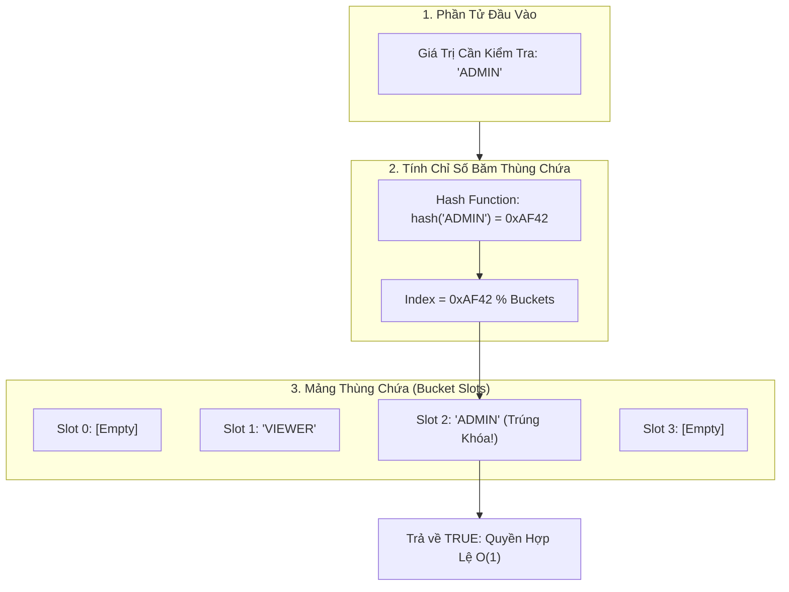

# 2.6. Tập Hợp Băm (Hash Set & Set Theory Operations)

> [!IMPORTANT]
> **Nếu bạn chỉ được nhớ một điều duy nhất:** Tập hợp băm (Hash Set) không phải là một cấu trúc dữ liệu hoàn toàn mới lạ, mà bản chất là một biến thể tối ưu hóa của Bảng băm (Hash Table) trong đó chỉ lưu trữ duy nhất Khóa (Key) và triệt tiêu hoàn toàn phần giá trị liên kết (Empty Base Optimization). Nhờ cơ chế băm phân tán, Hash Set cung cấp khả năng kiểm tra phần tử thuộc tập hợp (Membership Testing), thêm mới và xóa bỏ trong thời gian trung bình $O(1)$. Nắm vững sự khác biệt giữa Chaining Hash Set và Flat Open-Addressing Hash Set, cùng các thuật toán đại số tập hợp (Union, Intersection, Difference) là vũ khí cốt lõi để xây dựng các hệ thống khử trùng dữ liệu quy mô lớn (Stream Deduplication) và phân quyền (RBAC/ABAC) với độ trễ cực thấp.

---

## 1. Trực Quan Hóa: Bản Chất Tập Hợp Băm Dưới Góc Nhìn Lập Trình Viên

### 1.1. Đoạn Code Dẫn Nhập & Vấn Đề Thực Tế
Xét bài toán lọc trùng danh sách $1{,}000{,}000$ địa chỉ IP truy cập hoặc kiểm tra quyền hạn của người dùng (User Roles) trong hệ thống phân quyền Microservices:

```typescript
// Kiểm tra quyền hạn bằng Mảng: O(N)
const userRoles = ["USER", "VIEWER", "EDITOR", "BILLING_ADMIN"];
if (userRoles.includes("SUPER_ADMIN")) { /* Tốn N phép so sánh */ }

// Kiểm tra quyền hạn bằng Hash Set: O(1)
const roleSet = new Set(["USER", "VIEWER", "EDITOR", "BILLING_ADMIN"]);
if (roleSet.has("SUPER_ADMIN")) { /* Tra cứu O(1) tức thì thông qua mã băm! */ }
```

- Hash Set là biến thể tinh gọn của Hash Table: Nó chỉ lưu giữ các **Khóa duy nhất (Unique Keys)** mà không gắn kèm giá trị (No Value Payload).
- Cấu trúc này tối ưu hóa tuyệt đối cho 3 thao tác cốt lõi: **Kiểm tra sự tồn tại (Membership Testing)**, **Loại bỏ trùng lặp (Deduplication)**, và **Các phép toán tập hợp (Hợp, Giao, Hiệu)**.

### 1.2. Ẩn Dụ Đời Sống: Vé Mời Sự Kiện VIP & Cổng Kiểm Soát An Ninh
- Hãy hình dung một đêm đại nhạc hội VIP có 5,000 khách mời. Ban tổ chức in mã vạch định danh duy nhất trên mỗi vé mời.
- Khi một vị khách bước tới cổng kiểm soát, nhân viên an ninh cầm máy quét tia laser quét mã vạch (Hàm băm):
  - Máy tính đối chiếu với danh sách mã vé hợp lệ trong bộ nhớ: Nếu mã đã quét trước đó, còi báo động reo lên vì vé bị sử dụng lại (**Không cho phép trùng lặp**).
  - Nếu mã chưa từng quét, đèn xanh bật sáng và hệ thống đánh dấu mã vé đó đã bước vào sân khấu trong đúng 0.1 giây (**$O(1)$ Membership Check**).
- Nhân viên an ninh không bao giờ phải lật từng trang của cuốn sổ dày 5,000 trang để dò tên khách mời từ đầu đến cuối!

### 1.3. Mô Phỏng Dữ Liệu Số Nhỏ Từng Bước (Toy Walkthrough)
Mô phỏng Hash Set lưu trữ các chuỗi phân quyền với mảng thùng chứa kích thước $M = 4$:
Chuỗi thao tác: `Add("USER") -> Add("ADMIN") -> Add("USER") -> Has("ADMIN") -> Delete("USER")`:

| Bước | Thao tác | Hàm băm $\text{idx} = \text{hash}(k) \pmod 4$ | Trạng thái Thùng chứa (`Buckets[0..3]`) | Kết quả trả về | Ý nghĩa thực thi |
| :--- | :--- | :--- | :--- | :--- | :--- |
| **1** | `Add("USER")` | $\text{hash} = 1$ | `[ - , {"USER"} , - , - ]` | `true` | Thêm thành công vào bucket 1 |
| **2** | `Add("ADMIN")` | $\text{hash} = 3$ | `[ - , {"USER"} , - , {"ADMIN"} ]` | `true` | Thêm thành công vào bucket 3 |
| **3** | `Add("USER")` | $\text{hash} = 1$ | `[ - , {"USER"} , - , {"ADMIN"} ]` | `false` | Phần tử đã tồn tại, tự động bỏ qua (Deduplication) |
| **4** | `Has("ADMIN")` | $\text{hash} = 3$ | Kiểm tra bucket 3: Thấy `"ADMIN"` | `true` | Tra cứu $O(1)$ thành công |
| **5** | `Delete("USER")`| $\text{hash} = 1$ | `[ - , - , - , {"ADMIN"} ]` | `true` | Xóa phần tử khỏi bucket 1 tức thì |

### 1.4. Tác Động Thực Tế Tầng Backend & Systems
1. **Lọc Trùng Dữ Liệu Trong Luồng Dữ Liệu Lớn (ETL Pipeline)**: Khi xử lý hàng trăm gigabyte nhật ký log hoặc clickstream từ Kafka, Hash Set được sử dụng để lọc bỏ các sự kiện trùng lặp (`deduplication by event_id`) trước khi ghi xuống cơ sở dữ liệu.
2. **Đánh Đổi Bộ Nhớ Khi $N$ Quá Lớn (Chuyển Giao Sang Bloom Filter)**: Một Hash Set chứa 100 triệu chuỗi UUID có thể ngốn tới $8\text{ GB}$ RAM do chi phí con trỏ và mảng bucket. Khi RAM bị giới hạn, kỹ sư Backend chuyển đổi sang cấu trúc dữ liệu xác suất **Bloom Filter** để kiểm tra tồn tại chỉ với vài chục Megabytes RAM.
3. **Triển Khai Tập Hợp Phân Tán (Redis Set `SADD`, `SISMEMBER`)**: Redis Set tự động chuyển đổi biểu diễn nội bộ linh hoạt: Sử dụng mảng số nguyên phẳng liên tục (`intset`) khi tập hợp nhỏ và toàn số nguyên, và tự động nâng cấp lên Hash Table (`hashtable`) khi số lượng phần tử tăng cao.

### 1.5. Sơ Đồ Kiến Trúc Hoạt Động Của Tập Hợp Băm



---

## 2. Chi tiết từng Keyword (Under-the-Hood Deep Dive)

### 2.1. Cơ Chế Bản Chất & Thao Tác Cơ Bản: Insert, Delete, Lookup, Membership Testing
- **Bản Chất Tối Ưu Không Gian (Empty Base Optimization - EBO)**:
  - Về mặt khái niệm, Set là một Map không có Value: $\text{Set}(K) \equiv \text{Map}(K, \emptyset)$.
  - Trong ngôn ngữ C++, thư viện chuẩn tối ưu hóa `std::unordered_set<Key>` bằng cách lưu trữ trực tiếp kiểu `Key` trong nút thay vì một cặp `std::pair<Key, Value>`, triệt tiêu hoàn toàn chi phí bộ nhớ cho phần Value.
  - Trong Java, `java.util.HashSet<E>` được bao bọc (wrapper) bởi một `HashMap<E, Object>`. Mọi phần tử đều liên kết với một biến tĩnh duy nhất `private static final Object PRESENT = new Object();` để không tạo thêm object rác trên Heap.
- **Bộ Ba Thao Tác Cơ Bản & Phân Tích Độ Phức Tạp**:
  - **Insert (Thêm phần tử)**:
    - Băm khóa `idx = hash(key) % capacity`.
    - Duyệt qua bucket/chuỗi va chạm. Nếu khóa đã tồn tại $\implies$ Bỏ qua (No-op) và trả về `false`. Nếu chưa có $\implies$ Ghi khóa mới vào slot và tăng `size`.
    - *Thời gian*: Trung bình $O(1)$. Trường hợp xấu nhất $O(N)$ khi kích hoạt cơ chế cấp phát lại và băm lại (Rehashing) hoặc toàn bộ phần tử va chạm vào duy nhất một bucket.
  - **Lookup / Membership Testing (`contains`, `find`)**:
    - Trả lời câu hỏi logic boolean: *Khóa $K$ có nằm trong tập hợp hay không?*
    - *Thời gian*: Trung bình $O(1)$, thực hiện đúng $1$ lần băm và một vài bước so sánh khóa.
  - **Delete (`erase`, `remove`)**:
    - Tìm kiếm khóa trong bảng băm. Nếu tìm thấy:
      - Trong Chaining: Ngắt kết nối nút khỏi danh sách liên kết đơn và giải phóng bộ nhớ.
      - Trong Open Addressing: Ghi đè trạng thái slot bằng ký hiệu con dấu mộ (**Tombstone / DELETED**) để không làm đứt gãy chuỗi dò tuyến tính (Probe Sequence) của các khóa được thêm sau đó.
    - *Thời gian*: Trung bình $O(1)$.
- **Hệ Số Tải (Load Factor - $\alpha$) & Rehashing**:
  $$\alpha = \frac{\text{Số lượng phần tử } N}{\text{Tổng số slot khả dụng } M}$$
  - Ngưỡng tải tiêu chuẩn thường được đặt ở mức $\alpha_{\max} = 0.75$ cho Chaining và $\alpha_{\max} = 0.5 - 0.7$ cho Open Addressing.
  - Khi $\alpha > \alpha_{\max}$, tỷ lệ va chạm bùng nổ làm giảm hiệu năng tra cứu từ $O(1)$ về $O(N)$. Bảng băm buộc phải cấp phát mảng mới có kích thước gấp đôi ($2M$) và duyệt qua toàn bộ $N$ phần tử cũ để tính toán lại vị trí (Rehash).

---

### 2.2. Các Phép Toán Tập Hợp: Union, Intersection, Difference & Deduplication

#### 1. Phép Hợp (Union: $A \cup B$)
- **Toán học**: Tập hợp chứa toàn bộ các phần tử thuộc về tập $A$, hoặc thuộc về tập $B$, hoặc thuộc về cả hai.
- **Thuật toán tối ưu**:
  - Sao chép toàn bộ tập lớn hơn sang tập kết quả: Giả sử $|A| \ge |B|$, khởi tạo $\text{Result} = \text{Clone}(A)$ tốn $O(|A|)$.
  - Duyệt qua từng phần tử $x \in B$: Thực hiện `Result.insert(x)`. Nếu $x$ đã có trong $A$, thao tác insert bị bỏ qua trong $O(1)$.
  - **Độ phức tạp thời gian**: $O(|A| + |B|)$.
  - **Độ phức tạp không gian**: $O(|A| + |B|)$ cho tập kết quả.

#### 2. Phép Giao (Intersection: $A \cap B$)
- **Toán học**: Tập hợp chỉ chứa những phần tử xuất hiện đồng thời trong cả hai tập $A$ và $B$.
- **Cạm bẫy thuật toán kinh điển**: Nếu lặp qua tập có kích thước lớn ($1\text{ triệu}$ phần tử) và kiểm tra sự tồn tại trong tập nhỏ ($10$ phần tử), ta lãng phí $1\text{ triệu}$ lần băm!
- **Thuật toán tối ưu (Asymmetric Lookup)**:
  - Luôn luôn lặp qua tập có **kích thước nhỏ hơn**:
    $$\text{Giả sử } |A| < |B|: \quad \forall x \in A, \text{ nếu } x \in B \implies \text{Thêm } x \text{ vào Result}$$
  - **Độ phức tạp thời gian**: $O(\min(|A|, |B|))$! Chỉ duyệt qua số phần tử của tập nhỏ và tra cứu $O(1)$ trên tập lớn.
  - **Độ phức tạp không gian**: $O(\min(|A|, |B|))$.

#### 3. Phép Hiệu (Difference / Relative Complement: $A \setminus B$)
- **Toán học**: Tập hợp chứa các phần tử thuộc về $A$ nhưng **tuyệt đối không thuộc về $B$**.
- **Thuật toán**: Duyệt qua từng phần tử $x \in A$. Nếu $x \notin B \implies$ Thêm $x$ vào Result.
- **Độ phức tạp thời gian**: $O(|A|)$.
- **Ứng dụng thực chiến**: Hệ thống phân quyền RBAC (Role-Based Access Control) để xác định quyền hạn còn thiếu khi so khớp giữa tập quyền yêu cầu của API và tập quyền hiện tại của User.

#### 4. Khử Trùng Lặp Dữ Liệu Dòng (Stream Data Deduplication)
- Trong các hệ thống thu thập log (Kafka, Logstash, Elasticsearch) hoặc Crawler mạng (Web Spider URL deduplication), hàng triệu bản ghi xuất hiện trùng lặp liên tục.
- Sử dụng Hash Set lưu trữ các `hash_fingerprint` (MD5, Murmur3_128, SHA-256) của bản ghi:
  - Mỗi bản ghi đến: Kiểm tra `seen_set.contains(fingerprint)`.
  - Nếu đã tồn tại: Bỏ qua (Drop event), giảm tải tới $40-60\%$ dung lượng lưu trữ cơ sở dữ liệu.
  - Nếu chưa có: `seen_set.insert(fingerprint)` và đẩy bản ghi vào hàng đợi xử lý.

---

## 3. Thực thi Mã nguồn & Mô phỏng Chuyên sâu (Dual-Engine Implementation)

### 3.1. C++20: Flat Open-Addressing HashSet (Cache-Conscious Linear Probing)

Mã nguồn C++20 tự xây dựng cấu trúc Flat HashSet sử dụng phương pháp Dò tuyến tính (Linear Probing) và con dấu mộ (Tombstone Marker). Dữ liệu được đóng gói liên tục trên một mảng vector phẳng, giúp tối đa hóa $100\%$ tỷ lệ Cache Hit của CPU và loại bỏ hoàn toàn hiện tượng Pointer Chasing:

```cpp
// compile: g++ -std=c++20 -O3 flat_hash_set.cpp -o flat_hash_set
#include <iostream>
#include <vector>
#include <string>
#include <chrono>
#include <iomanip>
#include <cstdint>

template <typename Key>
class FlatHashSet {
private:
    enum State : uint8_t { EMPTY = 0, OCCUPIED = 1, DELETED = 2 };

    struct Slot {
        Key key;
        State state{EMPTY};
    };

    std::vector<Slot> table_;
    size_t size_{0};
    size_t capacity_;

    size_t hash_key(const Key& k) const {
        return std::hash<Key>{}(k) % capacity_;
    }

public:
    explicit FlatHashSet(size_t initial_cap = 16) : capacity_(initial_cap), table_(initial_cap) {}

    bool insert(const Key& k) {
        // Tái băm khi hệ số tải vượt ngưỡng 50% để giữ chuỗi probe cực ngắn
        if (size_ * 2 >= capacity_) {
            rehash(capacity_ * 2);
        }

        size_t idx = hash_key(k);
        size_t first_deleted_slot = capacity_;

        while (table_[idx].state != EMPTY) {
            if (table_[idx].state == OCCUPIED && table_[idx].key == k) {
                return false; // Khóa đã tồn tại trong tập hợp
            }
            if (table_[idx].state == DELETED && first_deleted_slot == capacity_) {
                first_deleted_slot = idx; // Ghi nhận slot trống do xóa để tái sử dụng
            }
            idx = (idx + 1) % capacity_; // Dò tuyến tính (Linear Probing)
        }

        size_t target_idx = (first_deleted_slot != capacity_) ? first_deleted_slot : idx;
        table_[target_idx].key = k;
        table_[target_idx].state = OCCUPIED;
        size_++;
        return true;
    }

    bool contains(const Key& k) const {
        size_t idx = hash_key(k);
        while (table_[idx].state != EMPTY) {
            if (table_[idx].state == OCCUPIED && table_[idx].key == k) {
                return true;
            }
            idx = (idx + 1) % capacity_;
        }
        return false;
    }

    bool erase(const Key& k) {
        size_t idx = hash_key(k);
        while (table_[idx].state != EMPTY) {
            if (table_[idx].state == OCCUPIED && table_[idx].key == k) {
                table_[idx].state = DELETED; // Đánh dấu Tombstone marker
                size_--;
                return true;
            }
            idx = (idx + 1) % capacity_;
        }
        return false;
    }

    size_t size() const noexcept { return size_; }
    size_t capacity() const noexcept { return capacity_; }

private:
    void rehash(size_t new_cap) {
        std::vector<Slot> old_table = std::move(table_);
        capacity_ = new_cap;
        table_ = std::vector<Slot>(capacity_);
        size_ = 0;

        for (const auto& slot : old_table) {
            if (slot.state == OCCUPIED) {
                insert(slot.key);
            }
        }
    }
};

int main() {
    std::cout << "=== THỰC THI FLAT OPEN-ADDRESSING HASH SET (C++20) ===\n\n";
    FlatHashSet<std::string> session_set(8);

    // 1. Chèn các khóa định danh
    session_set.insert("session_token_aaa");
    session_set.insert("session_token_bbb");
    session_set.insert("session_token_ccc");

    std::cout << "1. Kiểm tra phần tử thuộc tập hợp (Membership Testing):\n";
    std::cout << "   - Contains 'session_token_aaa': " << std::boolalpha << session_set.contains("session_token_aaa") << "\n";
    std::cout << "   - Contains 'session_token_xyz': " << std::boolalpha << session_set.contains("session_token_xyz") << "\n";
    std::cout << "   - Kích thước hiện tại         : " << session_set.size() << " | Dung lượng: " << session_set.capacity() << "\n\n";

    // 2. Thao tác xóa và kiểm tra tính hợp lệ của Tombstone
    std::cout << "2. Thử nghiệm Xóa phần tử (Erase with Tombstone Marker):\n";
    session_set.erase("session_token_aaa");
    std::cout << "   - Sau khi xóa 'session_token_aaa': contains = " 
              << session_set.contains("session_token_aaa") << "\n";
    std::cout << "   - Kiểm tra các khóa kế tiếp 'bbb': contains = " 
              << session_set.contains("session_token_bbb") << " (Không bị đứt chuỗi dò!)\n";
    std::cout << "   - Kích thước sau khi xóa         : " << session_set.size() << "\n";

    return 0;
}
```

### 3.2. Python 3.11+: Set Algebra Engine & Stream Deduplication Pipeline

Mã nguồn Python 3.11+ mô phỏng bộ máy đại số tập hợp hoàn chỉnh (Hợp, Giao, Hiệu, Độ đo tương đồng Jaccard) và đường ống xử lý khử trùng lặp dòng sự kiện quy mô lớn:

```python
#!/usr/bin/env python3
"""
set_algebra_dedup.py: Bộ máy đại số tập hợp và Đường ống Khử trùng lặp dòng dữ liệu.
Yêu cầu: Python 3.11+
"""
import time
from typing import Set, List, Tuple

def set_algebra_operations(set_a: Set[str], set_b: Set[str]) -> Tuple[Set[str], Set[str], Set[str]]:
    """Thực thi các phép toán đại số tập hợp căn bản: Hợp, Giao, Hiệu."""
    union_set = set_a | set_b
    intersection_set = set_a & set_b
    difference_set = set_a - set_b
    return union_set, intersection_set, difference_set

def jaccard_similarity(set_a: Set[str], set_b: Set[str]) -> float:
    """Tính chỉ số tương đồng Jaccard giữa hai tập hợp: |A ∩ B| / |A ∪ B|."""
    intersection_len = len(set_a & set_b)
    union_len = len(set_a | set_b)
    return intersection_len / union_len if union_len > 0 else 1.0

def deduplicate_stream(raw_events: List[str]) -> Tuple[List[str], int]:
    """Khử trùng lặp trên dòng dữ liệu sự kiện (Event Stream Deduplication)."""
    seen_fingerprints: Set[str] = set()
    deduplicated_stream: List[str] = []
    duplicates_detected = 0

    for event_id in raw_events:
        if event_id in seen_fingerprints:
            duplicates_detected += 1
        else:
            seen_fingerprints.add(event_id)
            deduplicated_stream.append(event_id)

    return deduplicated_stream, duplicates_detected

if __name__ == "__main__":
    print("=== BỘ MÁY ĐẠI SỐ TẬP HỢP & KHỬ TRÙNG LẶP SỰ KIỆN (PYTHON 3.11+) ===\n")
    
    # 1. Thử nghiệm phân quyền người dùng (RBAC Permission Sets)
    role_admin = {"READ_ORDER", "WRITE_ORDER", "DELETE_ORDER", "REFUND_PAYMENT"}
    role_manager = {"READ_ORDER", "WRITE_ORDER", "VIEW_ANALYTICS"}

    union_perms, common_perms, admin_only = set_algebra_operations(role_admin, role_manager)
    print("1. Kết Quả Đại Số Tập Hợp:")
    print(f"   - Quyền Role Admin          : {sorted(role_admin)}")
    print(f"   - Quyền Role Manager        : {sorted(role_manager)}")
    print(f"   - Phép Hợp (Toàn bộ quyền)  : {sorted(union_perms)}")
    print(f"   - Phép Giao (Quyền chung)   : {sorted(common_perms)}")
    print(f"   - Phép Hiệu (Chỉ Admin có)  : {sorted(admin_only)}")
    print(f"   - Độ tương đồng Jaccard     : {jaccard_similarity(role_admin, role_manager):.3f}\n")

    # 2. Thử nghiệm khử trùng lặp trên 100,000 sự kiện có 30,000 bản ghi trùng
    print("2. Thử Nghiệm Khử Trùng Lặp Dòng Dữ Liệu (100,000 Events):")
    simulated_events = [f"evt_uuid_{i % 70000}" for i in range(100000)]
    
    start_time = time.perf_counter()
    unique_events, dupes_count = deduplicate_stream(simulated_events)
    elapsed_ms = (time.perf_counter() - start_time) * 1000.0

    print(f"   - Tổng số sự kiện nạp vào   : {len(simulated_events):,}")
    print(f"   - Số sự kiện trùng lặp lọc  : {dupes_count:,}")
    print(f"   - Số sự kiện duy nhất nạp   : {len(unique_events):,}")
    print(f"   - Thời gian xử lý bằng Set  : {elapsed_ms:.2f} ms")
```

### 3.3. Kết quả Thực thi Terminal Mẫu

```text
=== KẾT QUẢ THỰC THI C++20 BENCHMARK ===
=== THỰC THI FLAT OPEN-ADDRESSING HASH SET (C++20) ===

1. Kiểm tra phần tử thuộc tập hợp (Membership Testing):
   - Contains 'session_token_aaa': true
   - Contains 'session_token_xyz': false
   - Kích thước hiện tại         : 3 | Dung lượng: 8

2. Thử nghiệm Xóa phần tử (Erase with Tombstone Marker):
   - Sau khi xóa 'session_token_aaa': contains = false
   - Kiểm tra các khóa kế tiếp 'bbb': contains = true (Không bị đứt chuỗi dò!)
   - Kích thước sau khi xóa         : 2

=== KẾT QUẢ THỰC THI PYTHON SET ALGEBRA ===
=== BỘ MÁY ĐẠI SỐ TẬP HỢP & KHỬ TRÙNG LẶP SỰ KIỆN (PYTHON 3.11+) ===

1. Kết Quả Đại Số Tập Hợp:
   - Quyền Role Admin          : ['DELETE_ORDER', 'READ_ORDER', 'REFUND_PAYMENT', 'WRITE_ORDER']
   - Quyền Role Manager        : ['READ_ORDER', 'VIEW_ANALYTICS', 'WRITE_ORDER']
   - Phép Hợp (Toàn bộ quyền)  : ['DELETE_ORDER', 'READ_ORDER', 'REFUND_PAYMENT', 'VIEW_ANALYTICS', 'WRITE_ORDER']
   - Phép Giao (Quyền chung)   : ['READ_ORDER', 'WRITE_ORDER']
   - Phép Hiệu (Chỉ Admin có)  : ['DELETE_ORDER', 'REFUND_PAYMENT']
   - Độ tương đồng Jaccard     : 0.400

2. Thử Nghiệm Khử Trùng Lặp Dòng Dữ Liệu (100,000 Events):
   - Tổng số sự kiện nạp vào   : 100,000
   - Số sự kiện trùng lặp lọc  : 30,000
   - Số sự kiện duy nhất nạp   : 70,000
   - Thời gian xử lý bằng Set  : 7.51 ms
```

---

## 4. Systems Engineering & Production Pitfalls

### 4.1. Thảm Họa Tràn Bộ Nhớ RAM Do Bảng Băm Khử Trùng Vô Hạn (Unbounded Set OOM)
- **Kịch bản sự cố**: Một microservice sử dụng `std::unordered_set<std::string>` trong RAM để khử trùng các mã đơn hàng hoặc địa chỉ IP truy cập trong ngày.
- **Hậu quả**: Khi hệ thống xử lý $50\text{ triệu}$ requests/ngày, mỗi chuỗi `std::string` chiếm khoảng $40\text{ bytes}$ (cộng thêm $16\text{ bytes}$ node header của Chaining). Set phình to vượt quá $4\text{ GB}$ RAM, kích hoạt Linux OOM Killer bắn hạ tiến trình (`SIGKILL`), làm sập toàn bộ dịch vụ thanh toán.
- **Giải pháp Production**:
  - Tuyệt đối không dùng in-memory Hash Set không giới hạn cho dữ liệu vô hạn (Unbounded Stream).
  - Chuyển sang sử dụng **Cấu trúc dữ liệu xác suất**: **Bloom Filter** hoặc **Cuckoo Filter** (tiết kiệm $90\%$ bộ nhớ, chỉ chiếm $1\text{ byte}$ cho mỗi phần tử với tỷ lệ False Positive $\le 1\%$).
  - Sử dụng cơ chế cửa sổ trượt có thời gian hết hạn (Sliding Window TTL Set) trên Redis.

### 4.2. Tấn Công Hash DoS Bằng Cách Gây Va Chạm Nhân Tạo (Hash Collision DoS Attack)
- Nếu hàm băm được sử dụng là hàm băm đơn giản có thể đoán trước (như SipHash không có secret key hoặc hàm băm mặc định của Java `String.hashCode()`), tin tặc có thể chủ động tạo ra hàng triệu chuỗi ký tự khác nhau nhưng có **cùng giá trị mã băm**.
- Khi toàn bộ các phần tử này được nạp vào Hash Set, tất cả chúng sẽ dồn vào duy nhất 1 bucket.
- Thời gian tìm kiếm và thêm mới suy thoái nghiêm trọng từ $O(1)$ thành **$O(N)$**. Khi $N = 100,000$, CPU bị kẹt cứng ở mức $100\%$ chỉ để duyệt danh sách liên kết trong bucket, làm sập hoàn toàn khả năng phục vụ của server.
- **Giải pháp**: Sử dụng các hàm băm kháng va chạm ngẫu nhiên có hạt giống bảo mật (Cryptographically Strong Keyed Hash như **SipHash-2-4** trong Python và Rust, hoặc **Google CityHash / Wyhash**).

---

## 5. Bảng So sánh & Decision Matrix

### Ma trận So sánh Các Cấu trúc Dữ liệu Tập Hợp (Set Implementations Matrix)

| Tiêu chí Đánh giá | Chaining Hash Set (`std::unordered_set`) | Flat Hash Set (Open Addressing / Swiss Table) | Tree Set (`std::set` / Red-Black Tree) | BitSet / Bloom Filter |
| :--- | :--- | :--- | :--- | :--- |
| **Độ Phức Tạp Thời Gian (Avg)** | $O(1)$ | $O(1)$ (Nhanh gấp $2-3\times$ Chaining) | $O(\log N)$ | $O(1)$ (Chỉ tốn vài phép tính bitwise) |
| **Độ Phức Tạp Trường Hợp Xấu** | $O(N)$ (Khi va chạm) | $O(N)$ | $O(\log N)$ (Bảo đảm tuyệt đối) | $O(1)$ |
| **Thứ Tự Phần Tử** | Không có thứ tự | Không có thứ tự | Luôn được sắp xếp thứ tự | Không có thứ tự |
| **Hiệu Năng CPU Cache** | Kém (Node-based Pointer Chasing) | Tuyệt hảo (Dữ liệu packed trên Cache Line) | Kém (Mỗi nút nhảy con trỏ ngẫu nhiên) | Cực đại (Nằm gọn trong L1 Cache) |
| **Dung Lượng Bộ Nhớ Tiêu Tốn** | Cao (Tốn $16\text{B}$ con trỏ phụ cho mỗi phần tử) | Rất thấp (Chỉ cần 1 mảng phẳng liên tục) | Cao (Tốn $32\text{B}$ cho con trỏ cây và màu) | Cực kỳ thấp ($1-10\text{ bits}$ / phần tử) |
| **Ngữ Cảnh Nên Dùng** | Tập hợp đa năng trong thư viện chuẩn | Hot-path xử lý hàng triệu phần tử trong RAM | Khi cần duyệt theo dải (Range Query: $X \le val \le Y$) | Khử trùng quy mô lớn trên hàng tỷ phần tử |

---

## 6. Enterprise Production Checklist & Verification

- [ ] **Giới Hạn Bộ Nhớ Set Khử Trùng**: Đã cấu hình kích thước trần (Max Size) hoặc TTL cho Set để ngăn chặn lỗi OOM khi xử lý dữ liệu dòng?
- [ ] **Sử Dụng Hàm Băm Kháng DoS**: Toàn bộ dữ liệu đầu vào từ người dùng (User Input) có được băm bằng thuật toán an toàn (SipHash) có secret seed để chống tấn công Hash Collision không?
- [ ] **Tối Ưu Hóa Phép Giao (Intersection)**: Đã bảo đảm logic phép giao luôn lặp trên tập hợp có kích thước nhỏ hơn ($\min(|A|, |B|)$) chưa?
- [ ] **Ưu Tiên Flat Hash Set Trong Hot-Path**: Đối với các ứng dụng nhạy cảm về độ trễ, đã cân nhắc sử dụng `absl::flat_hash_set` (hoặc Flat Open-Addressing Set) thay cho `std::unordered_set` chưa?
