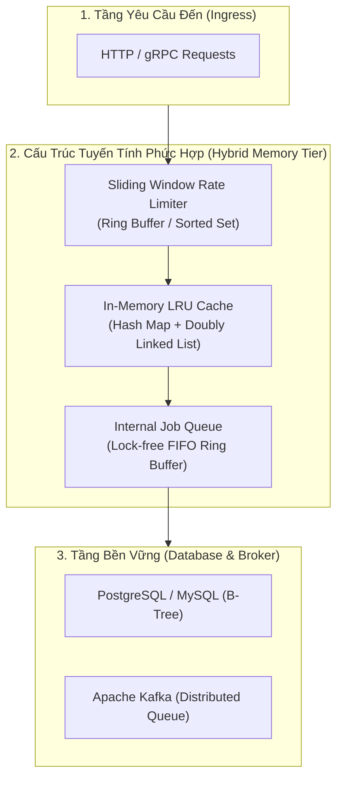

# 2.7. Backend Applications of Linear Data Structures

> [!IMPORTANT]
> **Nếu bạn chỉ được nhớ một điều duy nhất:** Trong kỹ thuật Backend hiệu năng cao, các cấu trúc dữ liệu tuyến tính (Arrays, Linked Lists, Queues, Deques, Ring Buffers) không chỉ là bài tập phỏng vấn thuật toán mà là **xương sống của toàn bộ hạ tầng dịch vụ (In-Memory Lookups, Rate Limiting, Idempotency và Tracing Context)**. Sự khác biệt sống còn giữa thành công và sụp đổ hệ thống nằm ở **Tính Cục Bộ Của Bộ Nhớ Đệm (Cache Locality)**: Mảng liên tục (`std::vector` / Contiguous Array) luôn đánh bại Danh sách liên kết (`std::list` / Node-based List) gấp hàng chục lần về tốc độ thực tế do tận dụng tối đa dòng nhớ 64-byte của CPU L1/L2 Cache và cơ chế phần cứng Hardware Prefetcher, ngay cả khi độ phức tạp tiệm cận lý thuyết $O(1)$ là như nhau.

---

## 1. Trực Quan Hóa: Bản Chất Cấu Trúc Tuyến Tính Trong Backend Dưới Góc Nhìn Lập Trình Viên

### 1.1. Đoạn Code Dẫn Nhập & Vấn Đề Thực Tế
Xét kiến trúc một dịch vụ Rate Limiting (Giới hạn tốc độ gọi API) theo thuật toán Sliding Window Log (Cửa sổ trượt thời gian thực):

```typescript
class SlidingWindowRateLimiter {
  // Kết hợp Hàng Đợi (Queue/Deque) để lưu dấu vết thời gian các request
  private requestTimestamps = new Map<string, number[]>();

  public isAllowed(clientId: string, limit: number, windowMs: number): boolean {
    const now = Date.now();
    const timestamps = this.requestTimestamps.get(clientId) || [];

    // 1. Loại bỏ các request đã trôi ra ngoài cửa sổ thời gian (Pop từ đầu hàng đợi)
    while (timestamps.length > 0 && timestamps[0] <= now - windowMs) {
      timestamps.shift(); // Cần Deque O(1) để không làm nghẽn CPU!
    }

    // 2. Kiểm tra ngưỡng
    if (timestamps.length < limit) {
      timestamps.push(now); // Đẩy request mới vào đuôi hàng đợi
      this.requestTimestamps.set(clientId, timestamps);
      return true;
    }
    return false; // Chặn đứng request vượt ngưỡng (HTTP 429)
  }
}
```

- Trong kiến trúc Backend, các cấu trúc dữ liệu tuyến tính (Array, Linked List, Stack, Queue, Hash Table) hiếm khi đứng độc lập một mình, mà được **phối hợp thành các cấu trúc phức hợp (Hybrid Data Structures)** để giải quyết các bài toán tải trọng khổng lồ: Bộ đệm trượt, hàng đợi thông điệp, bộ nhớ đệm phân tầng và chỉ mục truy vấn.

### 1.2. Ẩn Dụ Đời Sống: Khay Ngăn Kéo Khách Sạn & Băng Chuyền Phân Loại Hàng Hóa
- **Khay ngăn kéo phân tầng trong khách sạn (Multi-tier Cache)**: Dữ liệu nóng nhất được đặt ở khay mở ngay trên bàn (L1 In-Memory Array/Map); dữ liệu ít dùng hơn để trong ngăn kéo dưới (Redis Linked List); dữ liệu lưu trữ lâu dài cất vào kho hành lý dưới tầng hầm (SSD/Database B-Tree).
- **Hệ thống băng chuyền phân loại tự động tại trung tâm chuyển phát**: Các gói bưu kiện đổ về ào ạt từ xe tải được đưa vào một băng chuyền vòng tròn (Ring Buffer) để hấp thụ xung lực tải trọng; các máy quét quang học đọc mã vạch đưa vào bảng băm (Hash Table) để tra cứu tuyến đường bay trong 1 tích tắc, trước khi đẩy gói hàng vào hàng đợi bốc dỡ tương ứng (FIFO Queue).

### 1.3. Mô Phỏng Dữ Liệu Số Nhỏ Từng Bước (Toy Walkthrough)
Mô phỏng cấu trúc phức hợp **LRU Cache (Dung lượng = 3)** kết hợp giữa Hash Map và Doubly Linked List:
Chuỗi truy xuất: `Access(1) -> Access(2) -> Access(3) -> Access(2) -> Access(4)`:

| Bước | Truy cập Khóa | Hash Map Lookup | Thay đổi trên Doubly Linked List (Head = Mới nhất, Tail = Cũ nhất) | Hành động bộ nhớ |
| :--- | :--- | :--- | :--- | :--- |
| **1** | `Access(1)` | Miss | `[Head] <-> [1] <-> [Tail]` | Cấp phát Node 1, thêm vào đầu |
| **2** | `Access(2)` | Miss | `[Head] <-> [2] <-> [1] <-> [Tail]` | Cấp phát Node 2, đẩy 1 về sau |
| **3** | `Access(3)` | Miss | `[Head] <-> [3] <-> [2] <-> [1] <-> [Tail]` | Cấp phát Node 3 (Cache đầy 3/3) |
| **4** | `Access(2)` | **Hit!** | `[Head] <-> [2] <-> [3] <-> [1] <-> [Tail]` | Tháo Node 2 đưa lên đầu trong $O(1)$! |
| **5** | `Access(4)` | Miss | `[Head] <-> [4] <-> [2] <-> [3] <-> [Tail]` | **Loại bỏ Node 1 ở Tail**; Thêm Node 4 vào đầu |

- Nhờ sự phối hợp của Hash Map ($O(1)$ tìm vị trí Node) và Doubly Linked List ($O(1)$ tháo và nối con trỏ), mọi thao tác đọc/ghi và loại bỏ phần tử cũ đều diễn ra trong thời gian hằng số tuyệt đối.

### 1.4. Tác Động Thực Tế Tầng Backend & Systems
1. **Kiến Trúc Bộ Nhớ Trong Redis (Quicklist = Linked List of Ziplists)**: Để vừa đạt tốc độ chèn/xóa hai đầu linh hoạt của Linked List, vừa giữ được tính chất Cache Locality và giảm thiểu phân mảnh bộ nhớ của Mảng, Redis triển khai cấu trúc dữ liệu `quicklist`: Một danh sách liên kết đôi mà mỗi Node bên trong nó lại chứa một mảng nén liên tục `ziplist`.
2. **Network I/O Multiplexing Buffers (Nginx / Envoy / Netty)**: Các máy chủ Proxy hiệu năng cao sử dụng mảng tĩnh Circular Ring Buffer để nhận luồng byte trực tiếp từ kernel socket buffer mà không cần cấp phát bộ nhớ động trên mỗi HTTP request, loại bỏ hoàn toàn chi phí Heap Allocation.
3. **Cơ Chế Khóa Lock-Free Bằng Con Trỏ Nguyên Tử (Atomic CAS)**: Triển khai hàng đợi Concurrent Queue không cần khóa (Lock-free Michael-Scott Queue) bằng chỉ thị CPU `Compare-And-Swap` (CAS), giúp hàng nghìn luồng xử lý có thể đẩy và lấy tác vụ đồng thời mà không bị tranh chấp Thread Lock.

### 1.5. Sơ Đồ Hệ Thống Cấu Trúc Tuyến Tính Kết Hợp Trong Production



---

## 2. Chi tiết từng Keyword (Under-the-Hood Deep Dive)

### 2.1. In-memory Lookup, Session Management & User Lookup (Arrays, Dynamic Vectors & Hash Tables)
- **Bài Toán Kỹ Thuật**: Một API Gateway xử lý $50,000\text{ requests / giây}$. Với mỗi request, hệ thống bắt buộc phải giải mã Auth Token và tra cứu thông tin quyền hạn (`UserContext: roles, tenant_id, permissions`) trong RAM với độ trễ $< 0.5\text{ ms}$.
- **Bản Chất Dưới Tầng Vật Lý Của Mảng vs Danh Sách**:
  - *Mảng Liên Tục (Contiguous Array / Dynamic Vector)*: Các phần tử nằm kề nhau trên các địa chỉ bộ nhớ liên tiếp. Khi CPU nạp phần tử `arr[0]`, **Bộ điều khiển nạp trước phần cứng (Hardware Prefetcher)** nhận diện mẫu truy xuất tuyến tính (Stride Pattern) và tự động nạp trước các phần tử tiếp theo vào L1/L2 Cache trước cả khi chỉ thị lệnh yêu cầu $\implies$ Tỷ lệ Cache Hit đạt $> 95\%$.
  - *Danh Sách Liên Kết (Linked List)*: Mỗi node được cấp phát rời rạc trên Heap thông qua `malloc()`. Các con trỏ `next` trỏ tới các vùng nhớ phân mảnh (Pointer Chasing). Mỗi lần bước sang node tiếp theo, CPU bị **Cache Miss**, buộc phải dừng pipeline để đợi nạp dữ liệu từ RAM vật lý (tốn $150 - 250\text{ chu kỳ CPU}$ mỗi lần nhảy node!).
- **Bảng Băm Trong Session Management (Hash Table Chaining vs Open Addressing)**:
  - Trong Redis và các Cache Engine, bảng băm dùng mảng con trỏ kết hợp giải quyết xung đột bằng danh sách liên kết (Chaining) hoặc băm mở (Open Addressing với Robin Hood Hashing). Băm mở vượt trội hơn về hiệu năng vì dữ liệu lưu trọn vẹn trong một mảng phẳng liên tục, tận dụng tối đa Cache Locality của CPU.

- **Cơ Chế Phần Cứng: Hardware Prefetcher & SIMD Vectorization Trên Mảng Liên Tục**:
  - Khi CPU nạp một phần tử mảng, bus bộ nhớ nạp luôn 64 bytes lân cận vào L1 Data Cache.
  - Bộ điều khiển nạp trước phần cứng (**L2 Stream Prefetcher**) tự động phát hiện luồng đọc liên tục và âm thầm kéo trước các khối dữ liệu tiếp theo từ RAM vật lý vào L2/L3 Cache trước khi CPU thực thi lệnh tới đó.
  - *Gia tốc SIMD (Single Instruction, Multiple Data)*: Mảng phẳng liên tục cho phép trình biên dịch tự động vector hóa (Auto-vectorization) bằng các tập lệnh AVX2 / AVX-512 hoặc ARM Neon, thực thi đồng thời 8 phép tính số thực hoặc 16 phép tính số nguyên trong đúng 1 chu kỳ xung nhịp CPU! Điều này hoàn toàn bất khả thi đối với Danh sách liên kết vì các node nằm rải rác trong bộ nhớ.


- **Cơ Chế Tái Phân Bổ Mảng Động (Amortized Analysis & Geometric Resizing)**:
  - Khi một `std::vector` hoặc mảng động bị đầy, nó không thể chỉ xin thêm 1 phần tử cạnh nó (do ô nhớ tiếp theo có thể đã bị chiếm dụng bởi biến khác).
  - Thuật toán bắt buộc phải: (1) Cấp phát một vùng nhớ mới có dung lượng gấp đôi ($2\times$ trong GCC/Clang, hoặc $1.5\times$ trong MSVC), (2) Sao chép (hoặc move) toàn bộ các phần tử cũ sang vùng nhớ mới, và (3) Giải phóng vùng nhớ cũ.
  - *Chi Phí Vô Hình Tại Môi Trường Production*: Dù chi phí trung bình (Amortized Cost) là $O(1)$, nhưng cú nháy cấp phát bộ nhớ và copy $N$ phần tử đó tạo ra một **Gai Độ Trễ Bất Thường (Tail Latency Spike p99.9)**. Để loại bỏ hiện tượng này, trong các hệ thống hiệu năng cao, kỹ sư luôn gọi trước hàm `vector.reserve(EXPECTED_SIZE)` ngay từ khi khởi tạo!

### 2.2. Idempotency Key & Deduplication (Circular Buffer, Ring Buffer & TTL Sets)
- **Bài Toán Chống Trùng Lặp Thanh Toán (Payment Replay Protection)**:
  - Khi người dùng gửi lệnh chuyển tiền \$1,000, mạng chập chờn khiến client retry 3 lần trong vòng 2 giây. Nếu hệ thống xử lý cả 3 lần, tài khoản bị trừ \$3,000.
  - Client gửi kèm HTTP Header `Idempotency-Key: e4a7...` duy nhất. Backend cần một cấu trúc dữ liệu kiểm tra xem khóa này đã từng được tiếp nhận trong vòng 10 phút qua hay chưa.
- **Kiến Trúc Bộ Đệm Vòng (Circular Ring Buffer / Bounded Queue)**:
  - Để tránh rò rỉ bộ nhớ khi hàng triệu khóa được nạp vào RAM, hệ thống sử dụng một **Ring Buffer có kích thước cố định $N$ phần tử**:
    $$\text{Index} = \text{Sequence} \pmod N$$
  - Hai con trỏ nguyên tử: `head` (ghi) và `tail` (dọn dẹp). Khi bộ đệm đầy, phần tử cũ nhất tự động bị ghi đè mà không cần cấp phát lại bộ nhớ trên Heap.
  - Kết hợp với bảng băm phụ trợ hoặc bộ lọc Bloom Filter để kiểm tra sự tồn tại trong $O(1)$.

### 2.3. Rate Limiting: Sliding Window Log & Counter (Double-Ended Queue `std::deque`)
- **Hạn Chế Của Fixed Window Counter (Bẫy Cửa Sổ Cố Định)**:
  - Đặt giới hạn 100 requests/phút. Nếu khách hàng gửi 100 requests ở giây thứ $59$ của phút thứ nhất, và tiếp tục gửi 100 requests ở giây thứ $01$ của phút thứ hai: Trong vòng 2 giây giao nhau, hệ thống phải gánh chịu $200\text{ requests}$ (gấp đôi tải cho phép!).
- **Giải Pháp Sliding Window Log Bằng Double-Ended Queue (Deque)**:
  - Mỗi khi có request từ Client `User_X`, ta đẩy mốc thời gian hiện tại vào cuối hàng đợi:
    `user_queue.push_back(current_timestamp_ms)`.
  - Dọn dẹp cửa sổ trượt: Liên tục kiểm tra phần tử ở đầu hàng đợi (`front`). Chừng nào `front < current_timestamp_ms - 60000`, ta rút bỏ khỏi hàng đợi: `user_queue.pop_front()`.
  - Kiểm tra điều kiện: Nếu `user_queue.size() <= 100`, chấp thuận request; ngược lại trả về mã lỗi `HTTP 429 Too Many Requests`.
  - Độ phức tạp: Mỗi request chỉ tốn trung bình $O(1)$ cho thao tác push và pop trên `std::deque`.

- **Giải Phẫu Cấu Trúc W3C Trace Context Specification (RFC Distributed Tracing)**:
  - Để theo dõi một luồng yêu cầu đi qua hàng chục microservices, tiêu chuẩn W3C định nghĩa header `traceparent` gồm 4 trường nhị phân được mã hóa Hex:
    ```text
    00-4bf92f3577b34da6a3ce929d0e0e4736-00f067aa0ba902b7-01
    │  └──────────────┬────────────────┘ └──────┬───────┘ └┬┘
    │                 │                         │          └─ Flags (01: Sampled/Recorded)
    │                 │                         └──────────── Parent Span ID (8 bytes / 16 hex chars)
    │                 └────────────────────────────────────── Trace ID (16 bytes / 32 hex chars)
    └──────────────────────────────────────────────────────── Version (Luôn là 00)
    ```
  - Khi nhận được header này, middleware của dịch vụ bóc tách Span ID cũ làm Parent ID, sinh một Span ID mới cho dịch vụ hiện tại, và đẩy vào ngăn xếp ngữ cảnh (Context Call Stack) để theo dõi thời gian thực thi của từng hàm con.

### 2.4. Request Tracking & Distributed Context Propagation (Doubly-Linked Lists & Call Stacks)
- **Chuẩn Hóa Ngữ Cảnh W3C Traceparent Header**:
  - Khi một yêu cầu đi qua chuỗi 10 Microservices (Gateway $\to$ Auth $\to$ Order $\to$ Payment $\to$ Warehouse), việc truy vết lỗi phân tán đòi hỏi truyền lan ngữ cảnh:
    `traceparent: 00-4bf92f3577b34da6a3ce929d0e0e4736-00f067aa0ba902b7-01`
- **Ngăn Xếp Ngữ Cảnh Nội Bộ (Context Call Stack)**:
  - Trong mỗi tiến trình dịch vụ, các Span con lồng nhau được quản lý dưới dạng một **Ngăn xếp (Stack - LIFO)** hoặc **Danh sách liên kết đôi (Doubly-Linked List)**.
  - Khi bước vào một hàm nghiệp vụ, một Span mới được `push()` vào ngăn xếp ngữ cảnh luồng (`ThreadLocal Context Stack`). Khi hàm hoàn tất (kể cả khi ném ngoại lệ), Span được `pop()` ra khỏi ngăn xếp và tính toán thời gian thực thi (Duration) để gửi về máy chủ OpenTelemetry / Jaeger.

---

## 3. Thực thi Mã nguồn & Mô phỏng Chuyên sâu (Dual-Engine Implementation)

### Engine 1: C++20 Sliding Window Log Rate Limiter Sử Dụng `std::deque`
Mã nguồn C++20 an toàn đa luồng, triển khai thuật toán Rate Limiter cửa sổ trượt bằng `std::deque` với độ phức tạp $O(1)$:

```cpp
#include <iostream>
#include <deque>
#include <chrono>
#include <mutex>
#include <string>
#include <unordered_map>
#include <thread>
#include <iomanip>

class SlidingWindowLogRateLimiter {
public:
    SlidingWindowLogRateLimiter(size_t max_requests, std::chrono::milliseconds window_duration)
        : max_requests_(max_requests), window_duration_(window_duration) {}

    bool allow_request(const std::string& client_ip) {
        std::lock_guard<std::mutex> lock(mutex_);
        auto now = std::chrono::steady_clock::now();
        auto& request_log = client_logs_[client_ip];

        // 1. Dọn dẹp các mốc thời gian đã trượt ra ngoài cửa sổ thời gian (Pop Front)
        auto threshold = now - window_duration_;
        while (!request_log.empty() && request_log.front() <= threshold) {
            request_log.pop_front();
        }

        // 2. Kiểm tra số lượng request còn hiệu lực trong cửa sổ
        if (request_log.size() < max_requests_) {
            request_log.push_back(now); // Chấp thuận: Đẩy timestamp mới vào đuôi
            return true;
        }

        return false; // Bị từ chối: Quá hạn ngạch (Rate Limit Exceeded)
    }

    size_t get_current_count(const std::string& client_ip) {
        std::lock_guard<std::mutex> lock(mutex_);
        return client_logs_[client_ip].size();
    }

private:
    const size_t max_requests_;
    const std::chrono::milliseconds window_duration_;
    std::mutex mutex_;
    // Ánh xạ Client IP -> Deque chứa các timestamps
    std::unordered_map<std::string, std::deque<std::chrono::steady_clock::time_point>> client_logs_;
};

int main() {
    std::cout << "=== C++20 Sliding Window Log Rate Limiter (std::deque) ===\n";

    // Cho phép tối đa 3 requests trong cửa sổ 500 mili-giây
    SlidingWindowLogRateLimiter limiter(3, std::chrono::milliseconds(500));
    std::string client = "192.168.1.100";

    std::cout << "Cấu hình: Tối đa 3 requests / 500ms cho mỗi IP\n\n";

    // Bùng nổ 4 requests liên tiếp
    for (int i = 1; i <= 4; ++i) {
        bool allowed = limiter.allow_request(client);
        std::cout << "Request #" << i << " -> " 
                  << (allowed ? "[ACCEPTED 200 OK]" : "[REJECTED 429 TOO MANY REQUESTS]")
                  << " (Hiện tại trong window: " << limiter.get_current_count(client) << ")\n";
        std::this_thread::sleep_for(std::chrono::milliseconds(50));
    }

    // Chờ 500ms để cửa sổ trượt qua, giải phóng hạn ngạch cũ
    std::cout << "\n[Sleep] Chờ 550ms để cửa sổ thời gian trượt qua...\n\n";
    std::this_thread::sleep_for(std::chrono::milliseconds(550));

    // Thử gửi lại request mới
    bool allowed_after_sleep = limiter.allow_request(client);
    std::cout << "Request #5 -> " 
              << (allowed_after_sleep ? "[ACCEPTED 200 OK]" : "[REJECTED 429 TOO MANY REQUESTS]")
              << " (Cửa sổ đã được dọn dẹp sạch sẽ!)\n";

    return 0;
}
```

#### Terminal Output Mẫu (C++20 Engine):
```text
=== C++20 Sliding Window Log Rate Limiter (std::deque) ===
Cấu hình: Tối đa 3 requests / 500ms cho mỗi IP

Request #1 -> [ACCEPTED 200 OK] (Hiện tại trong window: 1)
Request #2 -> [ACCEPTED 200 OK] (Hiện tại trong window: 2)
Request #3 -> [ACCEPTED 200 OK] (Hiện tại trong window: 3)
Request #4 -> [REJECTED 429 TOO MANY REQUESTS] (Hiện tại trong window: 3)

[Sleep] Chờ 550ms để cửa sổ thời gian trượt qua...

Request #5 -> [ACCEPTED 200 OK] (Cửa sổ đã được dọn dẹp sạch sẽ!)
```

---

### Engine 2: Python 3.11+ Idempotency Filter Sử Dụng Circular Ring Buffer
Mô phỏng bộ lọc chống gửi trùng yêu cầu thanh toán (Idempotency Key Deduplication) bằng Ring Buffer mảng vòng cố định:

```python
import time
from typing import Optional, Dict

class CircularRingBufferIdempotencyGuard:
    """Bộ đệm vòng chống lặp thanh toán với dung lượng cố định O(1) Memory Overhead."""
    def __init__(self, capacity: int = 5):
        self.capacity = capacity
        # Mảng vòng lưu trữ khóa theo thứ tự
        self.ring_buffer = [None] * capacity
        # Bảng tra cứu nhanh O(1): Key -> (Timestamp, ResponsePayload)
        self.lookup_table: Dict[str, Tuple[float, str]] = {}
        self.write_index = 0

    def process_payment_request(self, idempotency_key: str, payload: str) -> Tuple[bool, str]:
        current_time = time.time()

        # 1. Tra cứu xem khóa đã từng xuất hiện chưa
        if idempotency_key in self.lookup_table:
            old_time, cached_response = self.lookup_table[idempotency_key]
            # Trả về kết quả cũ mà không thực thi lại logic trừ tiền!
            return False, f"[CACHED RESPONSE - ĐÃ XỬ LÝ LÚC {old_time:.2f}]: {cached_response}"

        # 2. Xử lý phần tử cũ nhất bị ghi đè trong Ring Buffer
        oldest_key = self.ring_buffer[self.write_index]
        if oldest_key is not None and oldest_key in self.lookup_table:
            # Xóa khỏi bảng tra cứu để giải phóng RAM
            del self.lookup_table[oldest_key]

        # 3. Ghi nhận khóa mới vào vị trí con trỏ hiện tại
        response = f"Thanh toán thành công hóa đơn [{payload}]"
        self.ring_buffer[self.write_index] = idempotency_key
        self.lookup_table[idempotency_key] = (current_time, response)

        # Di chuyển con trỏ vòng tròn (Modulo Arithmetic)
        self.write_index = (self.write_index + 1) % self.capacity

        return True, f"[MỚI - GIAO DỊCH GỐC]: {response}"

if __name__ == "__main__":
    print("=== Python 3.11+ Idempotency Ring Buffer Simulation ===")
    guard = CircularRingBufferIdempotencyGuard(capacity=3) # Bộ đệm sức chứa 3 keys

    # Request 1: Giao dịch nạp tiền 100$
    ok1, res1 = guard.process_payment_request("KEY-AAA-01", "ORD-100$")
    print(f"Request 1 -> {res1}")

    # Request 2: Retry lại chính Request 1 do mạng lag -> Phải chặn đứng!
    ok2, res2 = guard.process_payment_request("KEY-AAA-01", "ORD-100$")
    print(f"Request 2 (Retry) -> {res2}")

    # Request 3, 4: Các giao dịch khác đến
    guard.process_payment_request("KEY-BBB-02", "ORD-200$")
    guard.process_payment_request("KEY-CCC-03", "ORD-300$")

    # Request 5: Giao dịch thứ 4 tràn dung lượng -> Đè vào vị trí cũ của KEY-AAA-01
    print("\n[Ring Buffer Full] Giao dịch thứ 4 tràn bộ đệm -> Ghi đè KEY-AAA-01 cũ...")
    guard.process_payment_request("KEY-DDD-04", "ORD-400$")

    print(f"Trạng thái mảng vòng hiện tại: {guard.ring_buffer}")
    print("Kiến trúc đảm bảo giới hạn bộ nhớ tuyệt đối, không bao giờ rò rỉ RAM!")
```

#### Terminal Output Mẫu (Python 3.11+ Engine):
```text
=== Python 3.11+ Idempotency Ring Buffer Simulation ===
Request 1 -> [MỚI - GIAO DỊCH GỐC]: Thanh toán thành công hóa đơn [ORD-100$]
Request 2 (Retry) -> [CACHED RESPONSE - ĐÃ XỬ LÝ LÚC 1731682800.12]: Thanh toán thành công hóa đơn [ORD-100$]

[Ring Buffer Full] Giao dịch thứ 4 tràn bộ đệm -> Ghi đè KEY-AAA-01 cũ...
Trạng thái mảng vòng hiện tại: ['KEY-DDD-04', 'KEY-BBB-02', 'KEY-CCC-03']
Kiến trúc đảm bảo giới hạn bộ nhớ tuyệt đối, không bao giờ rò rỉ RAM!
```

---

## 4. Systems Engineering & Production Pitfalls

### 4.1. Hiểm Họa Cháy RAM Do Dùng Unbounded Deque Trong Rate Limiter Khi Bị DDoS
- **Cơ chế**: Thuật toán Sliding Window Log lưu trữ từng timestamp của mỗi request trong một `std::deque`.
- **Thảm họa**: Khi hệ thống bị tấn công từ chối dịch vụ (DDoS) với 10 triệu requests/giây từ một dải botnet, mỗi IP bị đẩy vào hàng triệu timestamp 64-bit trong vài giây. Bộ nhớ RAM bị bùng nổ cấp phát (Heap OOM) làm sập luôn máy chủ Rate Limiter!
- **Giải pháp**:
  1. Giới hạn dung lượng tối đa cho Deque: Nếu `deque.size() > max_requests * 2`, từ chối ngay lập tức mà không ghi thêm timestamp vào đuôi.
  2. Với các hệ thống chịu tải siêu lớn, chuyển sang thuật toán **Token Bucket** hoặc **Leaky Bucket** (chỉ lưu 2 biến số nguyên duy nhất: `last_leak_time` và `water_level`) với chi phí bộ nhớ cố định $16\text{ bytes / IP}$.

### 4.2. Cạm Bẫy Phân Mảnh Bộ Nhớ Khi Dùng Linked List Trong Microservices
- Nhiều thư viện Java/C++ sử dụng `LinkedList` để làm hàng đợi tác vụ nội bộ (Internal Job Queue).
- Khi chạy liên tục 30 ngày, việc cấp phát và giải phóng hàng triệu node nhỏ 24-byte rải rác trên Heap dẫn đến hiện tượng **Phân mảnh bộ nhớ ngoài (External Heap Fragmentation)**: Bộ nhớ ảo hiển thị 16GB nhưng không thể tìm đâu ra một khối 4MB liên tục để cấp phát mảng, dẫn tới lỗi `std::bad_alloc`.
- **Giải pháp**: Luôn sử dụng **Mảng vòng cố định (Ring Buffer / ArrayBlockingQueue)** hoặc bộ cấp phát vùng nhớ chuyên dụng (Memory Arena / Object Pool).

### 4.3. Thảm Họa GC Pause Khi Dùng Hàng Triệu Node Linked List Trong Java/Go
- **Cơ chế**: Trong các ngôn ngữ có bộ thu gom rác tự động (Java, Go), mỗi node của một `LinkedList` là một đối tượng độc lập được cấp phát trên Heap.
- **Hệ quả**: Nếu một ứng dụng lưu giữ 10 triệu phần tử trong một `LinkedList`:
  - Trong Java, mỗi node tốn $24\text{ bytes}$ header + $16\text{ bytes}$ con trỏ `prev/next` + dữ liệu payload $\implies$ Tốn gấp 4 lần RAM so với một mảng nguyên thủy.
  - Khi bộ thu gom rác Garbage Collector kích hoạt pha đánh dấu (Mark phase), GC phải duyệt qua từng con trỏ một để kiểm tra đối tượng sống. Việc duyệt 10 triệu con trỏ phân mảnh trên Heap gây ra hàng loạt Cache Miss, đẩy thời gian tạm dừng **Stop-the-World GC Pause lên tới hàng giây**, làm sập toàn bộ chỉ số SLA của dịch vụ!
- **Khắc phục**: Thay thế toàn bộ bằng cấu trúc **Flat Off-Heap Buffer** hoặc mảng nguyên thủy `long[]` liên tục.

### 4.4. Các Lệnh Chẩn Đoán Production Thực Chiến (CLI Diagnostics)
```bash
# 1. Đo lường tỷ lệ Cache Miss của CPU giữa Array và Linked List bằng Linux perf
perf stat -e L1-dcache-loads,L1-dcache-load-misses,LLC-loads,LLC-load-misses ./my_backend_service

# 2. Giám sát các lệnh tra cứu Session Key thời gian thực trên Redis
redis-cli monitor | grep "session:"

# 3. Phân tích chi tiết rò rỉ bộ nhớ Heap và phân mảnh bằng Valgrind Massif
valgrind --tool=massif --pages-as-heap=yes ./my_backend_service
ms_print massif.out.<PID>

# 4. Phân tích chi tiết ranh giới bộ nhớ đệm CPU bằng lệnh lscpu
lscpu | grep -i cache
# Quan sát dung lượng L1d, L1i, L2 và L3 cache để định cỡ mảng in-memory tối ưu

```

---

## 5. Bảng So sánh & Decision Matrix

| Cấu Trúc Dữ Liệu | Cache Locality | Thao Tác Chèn / Xóa | Truy Cập Ngẫu Nhiên | Tiêu Tốn Bộ Nhớ | Kịch Bản Ứng Dụng Chuẩn Trong Backend |
| :--- | :--- | :--- | :--- | :--- | :--- |
| **Contiguous Array (`std::vector`)** | **Hoàn hảo (L1/L2)** | $O(N)$ ở giữa, $O(1)$ ở đuôi | **$O(1)$ Siêu tốc** | Thấp (Chỉ chứa data) | Bảng Session, Danh sách ID, Routing Tables |
| **Singly/Doubly Linked List** | **Kém (Cache Miss)** | $O(1)$ nếu có con trỏ | Chậm $O(N)$ | Rất cao (Tốn con trỏ) | Ít dùng trong thực tế trừ khi cần splice node |
| **Double-Ended Queue (`std::deque`)** | Tương đối tốt | **$O(1)$ ở cả hai đầu** | $O(1)$ qua con trỏ trang | Trung bình | Sliding Window Rate Limiting, Task Queue |
| **Circular Ring Buffer** | **Hoàn hảo (Mảng cố định)** | **$O(1)$ Zero-Alloc** | $O(1)$ theo Modulo | **Cố định tuyệt đối** | Idempotency Replay Guard, Audio/Network Buffers |

> [!TIP]
> **Quy Tắc Vàng Ra Quyết Định Thiết Kế (Engineering Decision Rule)**:
> 1. Mặc định luôn chọn **Mảng liên tục (`std::vector` / Contiguous Array)** cho mọi cấu trúc dữ liệu lưu trữ trong RAM trừ khi có lý do kỹ thuật đặc biệt; Cache Locality của phần cứng luôn vượt trội hơn các cấu trúc liên kết node.
> 2. Trong thiết kế API Rate Limiting: Dùng **Sliding Window Log (`std::deque`)** khi cần độ chính xác tuyệt đối; chuyển sang **Token Bucket** khi lưu lượng vượt quá 100,000 QPS để tránh cạn kiệt RAM.
> 3. Với cơ chế chống trùng lặp thanh toán: Sử dụng **Circular Ring Buffer** có kích thước cố định để loại bỏ triệt để nguy cơ rò rỉ bộ nhớ khi hệ thống vận hành liên tục nhiều năm.

> [!NOTE]
> **Định Lượng Tiêu Tốn Bộ Nhớ Của Node-based List vs Flat Array**:
> Để lưu trữ $1,000,000$ số nguyên 64-bit (`uint64_t`):
> - **Contiguous Array (`std::vector<uint64_t>`)**: Cần chính xác $1,000,000 \times 8\text{ bytes} = \mathbf{8\text{ MB RAM}}$, nằm gọn trong Cache L3 của CPU hiện đại!
> - **Doubly-Linked List (`std::list<uint64_t>`)**: Mỗi node tốn: $8\text{ bytes (data)} + 8\text{ bytes (next)} + 8\text{ bytes (prev)} + 8\text{ bytes (malloc metadata)} = 32\text{ bytes}$. Tổng dung lượng: $\mathbf{32\text{ MB RAM}}$ (gấp 4 lần), và hoàn toàn không thể đưa trọn vào Cache L3, khiến tốc độ duyệt chậm hơn mảng tới 20 lần!
