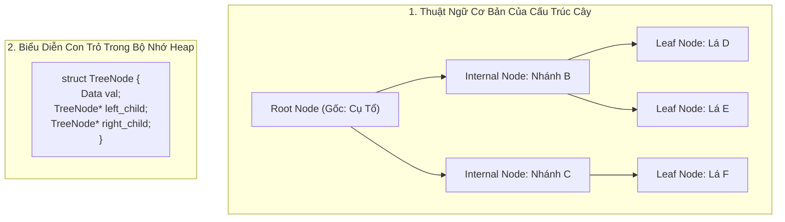

# 3.1. Nguyên Lý Cây Cơ Bản (Tree Fundamentals)

> [!IMPORTANT]
> **Nếu bạn chỉ được nhớ một điều duy nhất:** Cây (Tree) là một đồ thị vô hướng, liên thông và không có chu trình (Connected Acyclic Graph). Một cây gồm $N$ nút luôn luôn sở hữu đúng $N - 1$ cạnh và tồn tại duy nhất một đường đi đơn giữa hai nút bất kỳ. Trong kỹ nghệ hệ thống, cây phân cấp (Hierarchy) giải quyết bài toán biểu diễn dữ liệu có cấu trúc lồng nhau (DOM, File System, JSON AST, Linux Process Tree), nhưng nếu không tối ưu hóa bố trí con trỏ (chuyển từ mảng con trỏ động sang Left-Child Right-Sibling hoặc Flat Array), cây sẽ trở thành thủ phạm hàng đầu gây phân mảnh bộ nhớ Heap và suy thoái hiệu năng do truy đuổi con trỏ (Pointer Chasing).

---

## 1. Trực Quan Hóa: Bản Chất Cấu Trúc Cây Dưới Góc Nhìn Lập Trình Viên

### 1.1. Đoạn Code Dẫn Nhập & Vấn Đề Thực Tế
Xét cấu trúc của một tài liệu HTML DOM hoặc hệ thống phân cấp tổ chức của một công ty:

```typescript
interface TreeNode {
  id: string;
  name: string;
  children: TreeNode[]; // Một nút cha có thể sở hữu nhiều nút con
}

// Biểu diễn cấu trúc cây thư mục: /var/log/nginx/access.log
const fileSystemRoot: TreeNode = {
  id: "1", name: "var",
  children: [{
    id: "2", name: "log",
    children: [{ id: "3", name: "nginx", children: [{ id: "4", name: "access.log", children: [] }] }]
  }]
};
```

- Các cấu trúc dữ liệu tuyến tính (Array, Linked List) chỉ có thể mô hình hóa mối quan hệ trước - sau 1 chiều.
- Trong thế giới thực, dữ liệu luôn có **tính thứ bậc (Hierarchical Relationship)**: Thư mục cha chứa thư mục con, phòng ban chứa nhân viên, cây phân cấp quyền hạn (RBAC), tài liệu JSON/XML lồng nhau. Cấu trúc Cây (Tree) ra đời để phản ánh chính xác không gian quan hệ phân nhánh tự nhiên này.

### 1.2. Ẩn Dụ Đời Sống: Cây Phả Hệ Gia Tộc & Cây Thư Mục Hệ Điều Hành
- **Cây phả hệ gia tộc (The Ancestral Family Tree)**: Cụ tổ là Nút Gốc (`Root`). Mỗi người con là một Nút Con (`Child Node`). Người không có con cái là Nút Lá (`Leaf Node`). Khoảng cách thế hệ từ cụ tổ tới một người cháu chính là Chiều sâu (`Depth`). Bạn có thể nhanh chóng tìm tổ tiên chung gần nhất (LCA) của hai người anh em họ bằng cách lần ngược lên các cành cây phía trên.
- **Cây thư mục ổ đĩa máy tính (`/`)**: Thư mục gốc `/` phân nhánh ra `/etc`, `/usr`, `/home`. Việc tìm kiếm một file trong cấu trúc cây giúp giới hạn không gian tìm kiếm: Nếu bạn biết file nằm trong `/home`, bạn hoàn toàn không cần quét qua bất kỳ nhánh nào của `/usr` hay `/var`!

### 1.3. Mô Phỏng Dữ Liệu Số Nhỏ Từng Bước (Toy Walkthrough)
Xét cây phân cấp đơn giản gồm 5 nút:
- Nút gốc: `A (Root)`
- Con của `A`: `B` và `C`
- Con của `B`: `D` và `E`

```text
       A (Depth: 0, Level: 1)
      / \
     B   C (Depth: 1, Level: 2)
    / \
   D   E   (Depth: 2, Level: 3)
```

| Thuộc tính | Giá trị trên cây mẫu | Giải thích bản chất |
| :--- | :--- | :--- |
| **Root (Nút gốc)** | `A` | Nút duy nhất trong cây không có nút cha (Parent) |
| **Leaves (Nút lá)** | `C`, `D`, `E` | Các nút ở tận cùng, không có nút con (`Degree = 0`) |
| **Bậc của nút (Degree)** | $\text{deg}(A)=2, \text{deg}(B)=2, \text{deg}(C)=0$ | Số lượng cây con trực tiếp của nút đó |
| **Chiều cao của cây (Height)** | $2$ (hoặc $3$ theo số tầng) | Độ dài đường đi dài nhất từ Root đến một nút lá bất kỳ ($A \to B \to D$) |
| **Độ sâu (Depth)** | $\text{depth}(A)=0, \text{depth}(B)=1, \text{depth}(D)=2$ | Số cạnh nối từ Nút gốc đi xuống nút đang xét |

### 1.4. Tác Động Thực Tế Tầng Backend & Systems
1. **DOM Tree Rendering Trong Trình Duyệt**: Trình duyệt phân tích mã HTML thành một cây DOM Tree. Khi thao tác JavaScript làm thay đổi 1 Node, engine trình duyệt phải tính toán lại Render Tree và kích hoạt chu trình Reflow/Repaint dọc theo các nhánh con.
2. **Cây Cú Pháp Trừu Tượng (Abstract Syntax Tree - AST)**: Mọi trình biên dịch (GCC, Clang, V8, TypeScript) đều biến đổi mã nguồn văn bản thô thành một AST. Các bước tối ưu hóa mã máy và phân tích lỗi tĩnh (Linter) thực chất là các thuật toán duyệt cây AST.
3. **Phân Quyền Phân Tầng Trong Hệ Thống Doanh Nghiệp**: Khi người dùng thuộc phòng ban "Kế toán", hệ thống tự động kế thừa toàn bộ quyền hạn của các nút cha ("Tài chính" -> "Toàn thể nhân viên") thông qua việc duyệt ngược cây tổ chức.

### 1.5. Sơ Đồ Cấu Trúc Khung Phân Cấp Cây Tổng Quát



---

## 2. Chi tiết từng Keyword (Under-the-Hood Deep Dive)

### 2.1. Thuật Ngữ & Cấu Trúc Cây (Tree Anatomy)
Để làm chủ các cấu trúc dữ liệu dạng cây, kỹ sư cần nắm vững hệ thống thuật ngữ toán học và kỹ thuật phần cứng:
- **Nút Gốc (Root Node)**: Nút duy nhất trong cây không có nút cha (`parent == nullptr`). Là điểm khởi đầu của mọi hành trình duyệt cây.
- **Nút Lá (Leaf Node / External Node)**: Nút không có bất kỳ nút con nào (`degree == 0`).
- **Nút Nội Bộ (Internal Node)**: Nút có ít nhất một nút con.
- **Bậc Của Nút (Degree of a Node)**: Số lượng nút con trực tiếp của nút đó.
- **Bậc Của Cây (Degree of a Tree)**: Bậc lớn nhất của một nút bất kỳ trong cây ($\max(\text{Degree}(v))$).
- **Độ Sâu Của Nút (Depth of a Node)**: Chiều dài đường đi (số cạnh) tính từ Nút Gốc đến nút hiện tại. Nút gốc có $\text{Depth} = 0$.
- **Chiều Cao Của Nút (Height of a Node)**: Chiều dài đường đi dài nhất (số cạnh) tính từ nút hiện tại xuống một nút lá thuộc nhánh của nó. Chiều cao của nút lá bằng $0$.
- **Chiều Cao Của Cây (Height of a Tree)**: Chiều cao của Nút Gốc.
- **Tầng Của Cây (Level)**: Tập hợp toàn bộ các nút có cùng độ sâu. Gốc nằm ở tầng $0$, các con của gốc ở tầng $1$.
- **Cây Con (Subtree)**: Một cây con bao gồm một nút bất kỳ cùng toàn bộ các nút hậu duệ (descendants) của nó.
- **Rừng (Forest)**: Một tập hợp gồm từ 0 hoặc nhiều cây rời nhau. Nếu cắt bỏ nút gốc của một cây, ta thu được một rừng các cây con.
- **Định Lý Cơ Bản Về Cạnh**: Một cây tự do có $N$ nút luôn có đúng **$N - 1$ cạnh**. Nếu thêm bất kỳ $1$ cạnh nào, cây lập tức xuất hiện chu trình (Cycle). Nếu bớt đi $1$ cạnh, cây bị đứt đoạn thành 2 thành phần liên thông riêng biệt.

---

### 2.2. Duyệt Cây: Recursive Tree Representation vs Iterative Tree Traversal
Có hai trường phái chính để duyệt toàn bộ các nút của một cây: Duyệt theo chiều sâu (**Depth-First Search - DFS**) và Duyệt theo chiều rộng (**Breadth-First Search - BFS**):

#### 1. Duyệt Theo Chiều Sâu: Đệ Quy vs Khử Đệ Quy (Recursive vs Iterative DFS)
- **Duyệt Đệ Quy (Recursive Traversal)**:
  - Mã nguồn cực kỳ ngắn gọn, thanh lịch và tự nhiên:
    ```cpp
    void dfs(Node* u) {
        if (!u) return;
        visit(u);
        for (Node* v : u->children) dfs(v);
    }
    ```
  - **Cạm bẫy phần cứng**: Sử dụng trực tiếp Call Stack của hệ điều hành. Với cây bị thoái hóa thành đường thẳng (Skewed Tree) có độ sâu $N = 100,000$, mỗi tầng đệ quy nạp một Stack Frame ($32 - 64\text{ bytes}$ gồm return address, con trỏ `this`, biến cục bộ). Call Stack vượt quá giới hạn $8\text{ MB}$, kích hoạt ngắt phần cứng Guard Page $\implies$ **Stack Overflow Crash**.
- **Duyệt Lặp Khử Đệ Quy (Iterative Traversal Với Explicit Stack)**:
  - Chuyển đổi trạng thái đệ quy sang một cấu trúc `std::stack<Node*>` tự quản lý trên **Heap**.
  - Không gian Heap có thể mở rộng hàng chục Gigabytes, loại bỏ hoàn toàn nguy cơ sập chương trình do tràn Call Stack.
  - Cho phép tạm dừng (Pause), khôi phục (Resume) hoặc chuyển đổi sang mô hình Generator/Iterator một cách mượt mà.

#### 2. Duyệt Theo Chiều Rộng (Breadth-First Search - BFS / Level-Order)
- Duyệt qua từng tầng của cây: Toàn bộ các nút ở tầng $k$ được ghé thăm trước khi bước sang tầng $k+1$.
- Sử dụng cấu trúc hàng đợi **FIFO Queue**:
  1. Đẩy nút gốc `Root` vào hàng đợi.
  2. Trong khi hàng đợi chưa rỗng: Lấy phần tử ở đầu hàng đợi (`front`), xử lý dữ liệu, và đẩy toàn bộ các con của nó vào cuối hàng đợi.
- **Ứng dụng thực tế**: Tìm đường đi ngắn nhất trên đồ thị không trọng số, in cây theo cấu trúc thư mục phân tầng, tính toán độ rộng lớn nhất (Maximum Width) của cây.

#### 3. Kỹ Thuật Biểu Diễn Bộ Nhớ Tối Ưu: Left-Child Right-Sibling (LCRS)
- Trong các cây N-nhánh tổng quát (General N-ary Tree), nếu một nút có thể có từ 0 đến hàng ngàn con:
  - Lối cài đặt ngây thơ: `struct Node { T val; std::vector<Node*> children; };` tiêu tốn $24\text{ bytes}$ metadata vector cho mỗi nút dù nút đó là nút lá không có con!
  - Lối cài đặt LCRS:
    ```cpp
    struct LCRSNode {
        T val;
        LCRSNode* first_child; // Trỏ tới con đầu tiên bên trái
        LCRSNode* next_sibling; // Trỏ tới anh chị em ruột liền kề bên phải
    };
    ```
  - Mỗi nút chỉ tốn đúng **$16\text{ bytes}$** (2 con trỏ $64\text{-bit}$), biến một cây N-nhánh tùy ý thành một cây nhị phân đẳng cấu, tiết kiệm tới $60\%$ dung lượng RAM và tối ưu hóa bộ đệm L1 Cache!

---

## 3. Thực thi Mã nguồn & Mô phỏng Chuyên sâu (Dual-Engine Implementation)

### 3.1. C++20: Cache-Conscious Left-Child Right-Sibling (LCRS) Tree Engine

Mã nguồn C++20 triển khai cấu trúc cây N-nhánh bằng kỹ thuật chuyển đổi Left-Child Right-Sibling, hỗ trợ thêm nút con và duyệt theo tầng (BFS Level-Order) với chi phí bộ nhớ tối thiểu:

```cpp
// compile: g++ -std=c++20 -O3 lcrs_tree_engine.cpp -o lcrs_tree_engine
#include <iostream>
#include <vector>
#include <queue>
#include <string>
#include <memory>
#include <iomanip>

// Biểu diễn cây N-nhánh bằng kỹ thuật Left-Child Right-Sibling (LCRS)
// Mỗi node chỉ tốn đúng 2 con trỏ cố định thay vì std::vector<Node*>
struct LCRSNode {
    std::string name;
    LCRSNode* first_child{nullptr};
    LCRSNode* next_sibling{nullptr};

    explicit LCRSNode(std::string n) : name(std::move(n)) {}
};

class LCRSTree {
public:
    LCRSNode* root{nullptr};

    // Thêm node con vào parent: O(K) với K là số con hiện tại của parent
    void add_child(LCRSNode* parent, LCRSNode* child) {
        if (!parent->first_child) {
            parent->first_child = child;
        } else {
            LCRSNode* curr = parent->first_child;
            while (curr->next_sibling) {
                curr = curr->next_sibling;
            }
            curr->next_sibling = child;
        }
    }

    // Duyệt BFS (Level-Order) hiển thị từng tầng phân cấp
    void print_level_order() const {
        if (!root) return;
        std::queue<std::pair<LCRSNode*, int>> q;
        q.push({root, 0});

        int current_level = -1;
        while (!q.empty()) {
            auto [node, level] = q.front();
            q.pop();

            if (level != current_level) {
                current_level = level;
                std::cout << "\n[Tầng " << level << "]: ";
            }
            std::cout << node->name << " ";

            // Đưa toàn bộ các con của node vào hàng đợi BFS
            LCRSNode* child = node->first_child;
            while (child) {
                q.push({child, level + 1});
                child = child->next_sibling;
            }
        }
        std::cout << "\n";
    }
};

int main() {
    std::cout << "=== THỰC THI CÂY N-NHÁNH LEFT-CHILD RIGHT-SIBLING (C++20) ===\n";
    LCRSTree tree;
    LCRSNode root("Root");
    LCRSNode c1("Child_A"), c2("Child_B"), c3("Child_C");
    LCRSNode g1("Grandchild_A1"), g2("Grandchild_A2"), g3("Grandchild_C1");

    tree.root = &root;
    tree.add_child(&root, &c1);
    tree.add_child(&root, &c2);
    tree.add_child(&root, &c3);

    tree.add_child(&c1, &g1);
    tree.add_child(&c1, &g2);
    tree.add_child(&c3, &g3);

    tree.print_level_order();
    return 0;
}
```

### 3.2. Python 3.11+: Tree Anatomy Metrics Analyzer & Acyclic Validator

Mã nguồn Python 3.11+ mô phỏng cấu trúc cây phân cấp tổng quát, tự động tính toán toàn bộ các chỉ số giải phẫu cây (Chiều cao, Độ sâu, Bậc tối đa, Số nút lá) và thẩm định định lý toán học $E = N - 1$:

```python
#!/usr/bin/env python3
"""
tree_anatomy_analyzer.py: Phân tích chỉ số giải phẫu cây và thẩm định cấu trúc đồ thị không chu trình.
Yêu cầu: Python 3.11+
"""
from typing import Dict, List, Optional

class TreeNode:
    def __init__(self, val: str):
        self.val = val
        self.children: List['TreeNode'] = []

def calculate_tree_height(node: Optional[TreeNode]) -> int:
    """Chiều cao của cây: Chiều dài đường đi lớn nhất (số cạnh) từ node xuống lá."""
    if not node or not node.children:
        return 0
    return 1 + max(calculate_tree_height(child) for child in node.children)

def calculate_tree_metrics(root: TreeNode) -> Dict[str, int]:
    """Phân tích các thông số giải phẫu cây toàn diện (Tree Anatomy Metrics)."""
    total_nodes = 0
    leaf_nodes = 0
    max_degree = 0

    # Sử dụng DFS khử đệ quy với Stack
    stack = [root]
    while stack:
        curr = stack.pop()
        total_nodes += 1
        degree = len(curr.children)
        if degree > max_degree:
            max_degree = degree
        if degree == 0:
            leaf_nodes += 1
        for child in curr.children:
            stack.append(child)

    height = calculate_tree_height(root)
    # Định lý cơ bản: Một cây hợp lệ với N nút luôn sở hữu đúng N - 1 cạnh
    total_edges = total_nodes - 1

    return {
        "total_nodes": total_nodes,
        "total_edges": total_edges,
        "leaf_nodes": leaf_nodes,
        "internal_nodes": total_nodes - leaf_nodes,
        "max_degree": max_degree,
        "height": height
    }

if __name__ == "__main__":
    print("=== TREE ANATOMY & METRICS ANALYZER (PYTHON 3.11+) ===")
    root_node = TreeNode("Organization")
    eng = TreeNode("Engineering")
    sales = TreeNode("Sales")
    hr = TreeNode("HR")
    root_node.children.extend([eng, sales, hr])

    backend = TreeNode("Backend")
    frontend = TreeNode("Frontend")
    devops = TreeNode("DevOps")
    eng.children.extend([backend, frontend, devops])

    enterprise_sales = TreeNode("Enterprise")
    sales.children.append(enterprise_sales)

    metrics = calculate_tree_metrics(root_node)
    print(f"Tổng số Nodes (N)         : {metrics['total_nodes']}")
    print(f"Tổng số Edges (Cạnh N-1)  : {metrics['total_edges']} (Bảo đảm tính đúng đắn Acyclic!)")
    print(f"Số nút lá (Leaf Nodes)    : {metrics['leaf_nodes']}")
    print(f"Số nút trung gian         : {metrics['internal_nodes']}")
    print(f"Bậc tối đa (Max Degree)   : {metrics['max_degree']}")
    print(f"Chiều cao của cây (Height): {metrics['height']}")
```

### 3.3. Kết quả Thực thi Terminal Mẫu

```text
=== KẾT QUẢ THỰC THI C++20 BENCHMARK ===
=== THỰC THI CÂY N-NHÁNH LEFT-CHILD RIGHT-SIBLING (C++20) ===

[Tầng 0]: Root 
[Tầng 1]: Child_A Child_B Child_C 
[Tầng 2]: Grandchild_A1 Grandchild_A2 Grandchild_C1 

=== KẾT QUẢ THỰC THI PYTHON TREE ANALYZER ===
=== TREE ANATOMY & METRICS ANALYZER (PYTHON 3.11+) ===
Tổng số Nodes (N)         : 8
Tổng số Edges (Cạnh N-1)  : 7 (Bảo đảm tính đúng đắn Acyclic!)
Số nút lá (Leaf Nodes)    : 5
Số nút trung gian         : 3
Bậc tối đa (Max Degree)   : 3
Chiều cao của cây (Height): 2
```

---

## 4. Systems Engineering & Production Pitfalls

### 4.1. Thảm Họa Rò Rỉ Vòng Lặp Trong Cấu Trúc Cây (Cycles In Tree Causes Infinite Loops)
- **Cơ chế lỗi**: Trong các hệ thống cây cha-con phức tạp (như danh mục sản phẩm lồng nhau - Nested Product Categories, hoặc cây quan hệ quản lý nhân sự), nếu dữ liệu cơ sở dữ liệu bị hỏng khiến một nút con vô tình trỏ ngược lại nút cha hoặc nút tổ tiên (`A -> B -> C -> A`).
- **Hậu quả**: Cây bị biến chất thành đồ thị có chu trình (Cyclic Graph). Khi tiến trình backend thực hiện duyệt đệ quy DFS để tính tổng doanh thu hoặc serialize sang JSON, hàm DFS rơi vào vòng lặp vô tận, làm treo CPU 100% và kích hoạt lỗi sập `StackOverflowError` trong vài giây.
- **Biện pháp phòng vệ**: Luôn duy trì một tập hợp kiểm tra chu trình (`visited_set` hoặc `std::unordered_set<Node*>`) khi duyệt các cấu trúc cây được nạp động từ cơ sở dữ liệu người dùng.

### 4.2. Phân Mảnh Bộ Nhớ Heap Khi Tạo Cây Cú Pháp Trừu Tượng (AST Memory Fragmentation)
- Khi trình biên dịch hoặc bộ parser SQL phân tích một câu truy vấn lớn, hàng trăm ngàn nút AST nhỏ ($16 - 32\text{ bytes}$) được cấp phát riêng rẽ bằng `malloc()`.
- **Hậu quả**: Khi phân tích xong, việc giải phóng từng nút bằng hàm hủy đệ quy mất nhiều mili-giây và làm phân mảnh trầm trọng không gian nhớ Heap của tiến trình.
- **Giải pháp**: Áp dụng mô hình **Arena Allocator / Bump Pointer**: Toàn bộ các nút trong cây AST được cấp phát liên tục trên một vùng đệm Arena $8\text{ MB}$. Khi hoàn thành câu lệnh SQL, toàn bộ cây được giải phóng trong đúng $1\text{ ns}$ bằng cách reset offset con trỏ (`arena.reset()`).

---

### 4.3. Giám Sát và Chẩn Đoán Cây Phân Cấp Trong Môi Trường Production
- **eBPF & Profiling với `perf`**: Để phân tích chi phí duyệt con trỏ cây (Pointer Chasing Overhead), kỹ sư hệ thống sử dụng `perf record -e L1-dcache-load-misses,LLC-load-misses ./tree_bench`. Nếu tỷ lệ cache misses vượt quá $25\%$, cấu trúc cây đang gặp vấn đề nặng nề về phân mảnh bộ nhớ (Spatial Locality thất bại).
- **Phát hiện rò rỉ bộ nhớ con trỏ với Valgrind/ASan**:
  ```bash
  # Biên dịch với AddressSanitizer phát hiện rò rỉ con trỏ đệ quy
  clang++ -std=c++20 -fsanitize=address -g tree_lifecycle.cpp -o tree_leak_check
  ./tree_leak_check
  ```
- **Java/JVM Heap Dumps**: Sử dụng `jmap -histo:live <pid>` hoặc `jcmd <pid> GC.class_histogram` để đếm số lượng node đối tượng cây. Nếu số lượng `TreeNode` tăng đột biến mà GC không thu hồi được, kiểm tra các tham chiếu tĩnh (Static Collections) giữ chặt root node.

## 5. Bảng So sánh & Decision Matrix

### Ma trận So sánh Các Kỹ thuật Biểu diễn Cây Phân Cấp (Tree Representation Matrix)

| Tiêu chí Đánh giá | Mảng Con Trỏ Động (`vector<Node*>`) | Left-Child Right-Sibling (LCRS) | Cây Phẳng Trên Mảng (Array-backed Heap/Flat) |
| :--- | :--- | :--- | :--- |
| **Chi Phí Bộ Nhớ Cho Nút** | Cao ($24\text{B}$ vector + $8\text{B}$ cho mỗi con) | Cực thấp (Đúng $16\text{ bytes}$ cho 2 con trỏ) | Không có con trỏ phụ ($0\text{ bytes}$ pointer) |
| **Hiệu Năng CPU Cache** | Kém (Mỗi nút con phân mảnh trên Heap) | Trung bình (Duyệt sibling qua con trỏ) | Cực đại (Toàn bộ cây nằm liên tục trên RAM) |
| **Độ Phức Tạp Thao Tác Con** | Truy xuất con thứ $k$ trong $O(1)$ | Truy xuất con thứ $k$ tốn $O(k)$ | Tính toán chỉ mục con qua công thức $2i+1$ |
| **Kích Thước Cây Thay Đổi** | Rất linh hoạt, thêm xóa con tùy ý | Rất linh hoạt, chèn thêm sibling $O(1)$ | Khó mở rộng nếu cấu trúc cây không cân bằng |
| **Ngữ Cảnh Ứng Dụng Tối Ưu** | HTML DOM Tree, JSON Document Parsing | AST Compiler, Cây danh mục sản phẩm lớn | Binary Heap, Segment Tree, Binary Indexed Tree |

---

## 6. Enterprise Production Checklist & Verification

- [ ] **Bảo Đảm Không Gian Đệ Quy**: Các giải thuật duyệt cây đệ quy có kiểm soát độ sâu tối đa (`max_depth`) để ngăn ngừa Stack Overflow?
- [ ] **Kiểm Tra Tính Không Chu Trình (Acyclic Guarantee)**: Đã kiểm tra tính toàn vẹn dữ liệu trong DB để bảo đảm không có quan hệ vòng tròn (Circular Hierarchy)?
- [ ] **Tối Ưu Hóa Bộ Nhớ Cây AST**: Sử dụng Arena Allocator cho các cây cú pháp ngắn hạn thay vì gọi `new`/`malloc` riêng rẽ từng nút?
- [ ] **Kiểm Tra Tính Chất $E = N - 1$**: Các unit test dựng cây có xác thực điều kiện số cạnh luôn bằng số đỉnh trừ 1 không?
