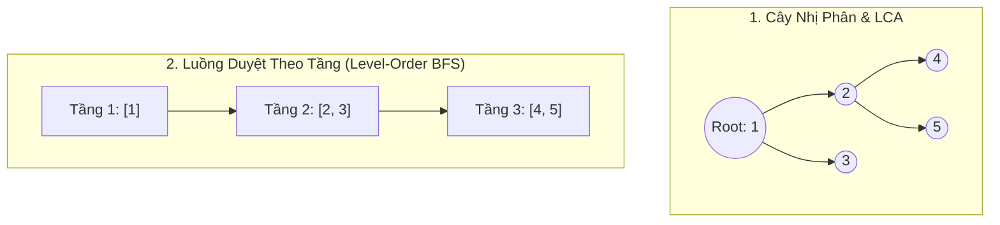
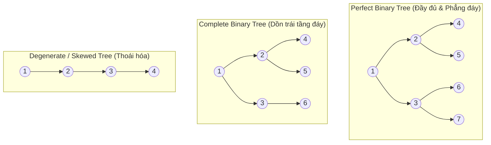
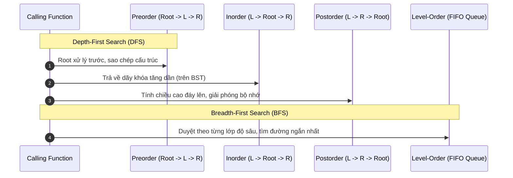
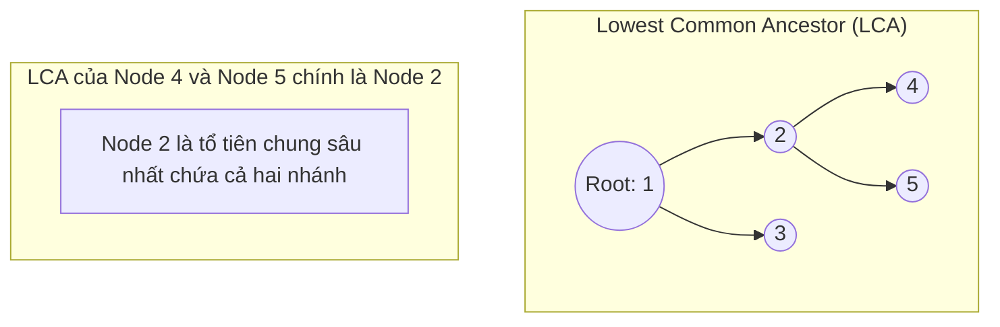

# 3.2. Cây Nhị Phân (Binary Tree Architecture & Algorithms)

> [!IMPORTANT]
> **Nếu bạn chỉ được nhớ một điều duy nhất:** Cây nhị phân là cấu trúc dữ liệu nền tảng với ràng buộc mỗi nút có tối đa 2 con, mở ra ranh giới giữa cấu trúc phân mảnh trên bộ nhớ heap (Linked Nodes thông qua con trỏ) và cấu trúc phẳng hóa tối ưu hóa CPU Cache (Flat Array cho Complete Binary Tree). Mọi thao tác tìm kiếm, sắp xếp cân bằng, phân tích biểu thức (AST) và định tuyến mạng đều bắt nguồn từ các định lý bất biến và chiến lược duyệt của cây nhị phân.

---

## 1. Trực Quan Hóa: Bản Chất Cây Nhị Phân Dưới Góc Nhìn Lập Trình Viên

### 1.1. Đoạn Code Dẫn Nhập & Vấn Đề Thực Tế
Xét bài toán duyệt và tính tổng toàn bộ các nút trong cây nhị phân:

```cpp
struct TreeNode {
    int val;
    TreeNode* left{nullptr};
    TreeNode* right{nullptr};
};

// Duyệt cây theo thứ tự trước (Pre-order Traversal: Root -> Left -> Right)
void traverse(TreeNode* root) {
    if (!root) return; // Điều kiện biên dừng đệ quy
    std::cout << root->val << " "; // Thăm nút gốc
    traverse(root->left);          // Đệ quy nhánh trái
    traverse(root->right);         // Đệ quy nhánh phải
}
```

- Cây nhị phân (Binary Tree) là cấu trúc cây đặc biệt mà **mỗi nút chỉ được phép có tối đa đúng 2 nhánh con**: Nhánh trái (`Left`) và Nhánh phải (`Right`).
- Ràng buộc "tối đa 2 nhánh" này là bước ngoặt quyết định cho phép vi xử lý thực hiện các thuật toán chia đôi không gian theo cấp số nhân ($2^h$), đặt nền móng cho toàn bộ các cấu trúc tìm kiếm, sắp xếp và mã hóa hiện đại.

### 1.2. Ẩn Dụ Đời Sống: Sơ Đồ Quyết Định Phân Nhánh (Decision Tree)
- Hãy hình dung hệ thống tổng đài tự động trả lời (IVR) của ngân hàng:
  - *"Bấm phím 1 để chọn tiếng Việt (Nhánh Trái), phím 2 để chọn tiếng Anh (Nhánh Phải)"*.
  - Tiếp theo: *"Bấm phím 1 để tra cứu số dư (Trái), phím 2 để gặp điện thoại viên (Phải)"*.
- Ở mỗi bước, số lượng câu trả lời khả dĩ tăng gấp đôi ($1 \to 2 \to 4 \to 8 \dots$). Chỉ sau 10 câu hỏi nhị phân, hệ thống có thể phân loại chính xác $2^{10} = 1024$ nhu cầu khác nhau của khách hàng!

### 1.3. Mô Phỏng Dữ Liệu Số Nhỏ Từng Bước (Toy Walkthrough)
Xét cây nhị phân 3 tầng gồm 5 nút:
- `Root: 1`
- `Left: 2`, `Right: 3`
- Con của `2`: `Left: 4`, `Right: 5`

```text
       1
      / \
     2   3
    / \
   4   5
```

Mô phỏng ba thứ tự duyệt cây kinh điển:

| Thứ tự duyệt | Quy tắc duyệt | Thứ tự các nút được in ra | Ứng dụng thực tế |
| :--- | :--- | :--- | :--- |
| **Pre-order (Tiền thứ tự)** | **Root** $\to$ Left $\to$ Right | `1, 2, 4, 5, 3` | Sao chép cây, Tuần tự hóa cấu trúc cây (Serialization) |
| **In-order (Trung thứ tự)** | Left $\to$ **Root** $\to$ Right | `4, 2, 5, 1, 3` | Trích xuất dữ liệu có thứ tự tăng dần trên cây BST |
| **Post-order (Hậu thứ tự)** | Left $\to$ Right $\to$ **Root** | `4, 5, 2, 3, 1` | Giải phóng bộ nhớ cây (Bottom-up Free), Tính kích thước thư mục |
| **Level-order (Duyệt theo tầng)**| Hàng đợi FIFO từ tầng 1 đến tầng $H$ | `1, 2, 3, 4, 5` | Thuật toán tìm đường đi ngắn nhất BFS |

### 1.4. Tác Động Thực Tế Tầng Backend & Systems
1. **Mã Hóa Dữ Liệu Huffman (Huffman Coding Compression)**: Thuật toán nén dữ liệu chuẩn (trong ZIP, GZIP, JPEG) xây dựng một cây nhị phân dựa trên tần suất xuất hiện của ký tự. Ký tự xuất hiện nhiều có mã bit ngắn (gần Root), ký tự hiếm có mã bit dài, giúp tiết kiệm băng thông mạng truyền tải.
2. **Chi Phí Bộ Nhớ Phụ Trợ Của Con Trỏ (Memory Overhead)**: Một nút cây nhị phân lưu trữ số nguyên 4-byte đòi hỏi thêm 2 con trỏ 64-bit (`left` và `right`, tốn $16\text{ bytes}$). Tỷ lệ hao phí bộ nhớ lên tới **$80\%$**! Trong các hệ thống nén dữ liệu lớn, người ta dùng Compact Array Representation (như Binary Heap) để triệt tiêu toàn bộ con trỏ.
3. **Lowest Common Ancestor (LCA) Trong Git**: Khi bạn chạy lệnh `git merge`, Git sử dụng thuật toán tìm tổ tiên chung gần nhất (LCA) trên đồ thị cây các commit để xác định điểm phân nhánh cơ sở (Base Commit) cho thuật toán 3-way merge.

### 1.5. Sơ Đồ Cây Nhị Phân & Thuật Toán Tìm Tổ Tiên Chung (LCA)



---

## 2. Chi tiết từng Keyword (Under-the-Hood Deep Dive)

### 2.1. Phân Loại Cấu Trúc Cây Nhị Phân (Structural Classifications)

Mỗi dạng cây nhị phân áp đặt những bất biến cấu trúc (structural invariants) khác nhau lên bộ nhớ và độ phức tạp giải thuật:



#### Full Binary Tree (Cây nhị phân đủ)
- **Định nghĩa toán học**: Mọi nút trong cây chỉ có thể có chính xác **0 hoặc 2 nút con**, không bao giờ tồn tại nút có đúng 1 con.
- **Tính chất**: Nếu cây có $L$ nút lá, số lượng nút nội tại (internal nodes) sẽ là $I = L - 1$, và tổng số nút là $N = 2L - 1$.
- **Ứng dụng**: Cây biểu thức nhị phân (Expression Tree) của các toán tử hai ngôi ($+, -, *, /$), cây mã hóa Huffman.

#### Complete Binary Tree (Cây nhị phân hoàn chỉnh)
- **Định nghĩa**: Mọi tầng của cây từ tầng $0$ đến tầng $H-1$ đều được lấp đầy tối đa $2^d$ nút. Ở tầng cuối cùng $H$, các nút lá có thể chưa đầy nhưng **bắt buộc phải nằm liên tục dồn hết về phía bên trái**.
- **Cơ chế biểu diễn phẳng (Flat Array Indexing)**:
  - Nút gốc đặt tại chỉ số $i = 0$.
  - Con bên trái: $\text{left}(i) = 2i + 1$.
  - Con bên phải: $\text{right}(i) = 2i + 2$.
  - Nút cha: $\text{parent}(i) = \lfloor (i - 1) / 2 \rfloor$.
- **Ưu thế phần cứng**: Loại bỏ hoàn toàn $2 \times 8 = 16\text{ bytes}$ bộ nhớ con trỏ trên mỗi nút (đối với kiến trúc 64-bit), triệt tiêu hiện tượng phân mảnh bộ nhớ Heap, và tối đa hóa hiệu năng nạp trước đường truyền L1/L2 Cache Lines ($64\text{ bytes}$). Đây là nền tảng của Binary Heap và Priority Queue.

#### Perfect Binary Tree (Cây nhị phân hoàn hảo)
- **Định nghĩa**: Mọi nút không phải lá đều có đúng 2 con, và toàn bộ các nút lá đều nằm ở cùng một độ sâu (cùng tầng đáy).
- **Tính toán lượng nút**: Với chiều cao $H$ (gốc ở mức $0$), tổng số nút là $N = 2^{H+1} - 1$, và số nút lá ở tầng đáy là $2^H = (N + 1) / 2$.
- **Tính chất**: Độ cân bằng đạt mức lý tưởng tuyệt đối, không có bất kỳ nhánh nào bị lệch.

#### Balanced Binary Tree (Cây nhị phân cân bằng)
- **Định nghĩa**: Cây có chiều cao bị chặn ở ngưỡng $O(\log N)$. Theo chuẩn AVL, tại mọi nút bất kỳ, độ chênh lệch chiều cao giữa cây con trái và cây con phải (Balance Factor) không vượt quá 1:
  $$\text{BF}(u) = |h(\text{left}) - h(\text{right})| \le 1$$
- **Ý nghĩa sống còn**: Đảm bảo các thao tác tìm kiếm, chèn, xóa luôn giữ được chặn trên thời gian là $O(\log N)$, triệt tiêu rủi ro suy giảm hiệu năng trong các hệ thống thời gian thực.

#### Degenerate / Skewed Tree (Cây thoái hóa)
- **Hiện tượng**: Khi mỗi nút cha chỉ có đúng 1 con (Left-skewed hoặc Right-skewed).
- **Hậu quả**: Cây bị thoái hóa hoàn toàn thành Danh sách liên kết đơn (Singly Linked List). Chiều cao cây đạt cực đại $H = N - 1$.
- **Tác động**: Độ phức tạp thuật toán tìm kiếm rơi tự do từ $O(\log N)$ xuống $O(N)$, đồng thời gây nguy cơ tràn bộ nhớ ngăn xếp cuộc gọi (Stack Overflow) khi thực thi đệ quy.

---

### 2.2. Bốn Chiến Lược Duyệt Cây: Preorder, Inorder, Postorder & Level-order

Duyệt cây là hành trình ghé thăm mỗi nút trong cây đúng một lần để xử lý hoặc trích xuất dữ liệu.



#### 1. Tiền thứ tự (Preorder Traversal: Root $\to$ Left $\to$ Right)
- **Quy trình**: Xử lý dữ liệu tại nút hiện tại $\to$ Duyệt đệ quy sang nhánh con trái $\to$ Duyệt đệ quy sang nhánh con phải.
- **Bản chất**: Bản ghi đầu tiên luôn là Root của cây hiện tại.
- **Ứng dụng thực tế**: Serialization cây cú pháp (AST), sao chép (Deep Copy/Cloning) toàn bộ cây nhị phân, xuất biểu thức toán học dưới dạng tiền tố (Prefix Notation / Polish Notation).

#### 2. Trung thứ tự (Inorder Traversal: Left $\to$ Root $\to$ Right)
- **Quy trình**: Duyệt đệ quy hết nhánh con trái $\to$ Xử lý dữ liệu tại nút gốc $\to$ Duyệt đệ quy sang nhánh con phải.
- **Bản chất**: Đối với Cây tìm kiếm nhị phân (BST), thứ tự Inorder đảm bảo xuất ra dãy khóa được **sắp xếp tăng dần một cách nghiêm ngặt**.
- **Ứng dụng**: Kiểm tra tính hợp lệ của BST, lập trình máy in cú pháp toán học dạng trung tố (Infix Notation).

#### 3. Hậu thứ tự (Postorder Traversal: Left $\to$ Right $\to$ Root)
- **Quy trình**: Duyệt đệ quy xử lý hết nhánh con trái $\to$ Duyệt đệ quy xử lý hết nhánh con phải $\to$ Xử lý dữ liệu tại nút gốc.
- **Bản chất**: Quá trình tổng hợp dữ liệu từ đáy lên (Bottom-Up Aggregation).
- **Ứng dụng**: 
  - Giải phóng bộ nhớ động (Destructor): Bắt buộc phải giải phóng hai con trước khi giải phóng nút cha để tránh tạo ra con trỏ treo (Dangling Pointer).
  - Tính toán kích thước thư mục tệp tin, tính chiều cao của cây, lượng giá biểu thức cây dạng hậu tố (Postfix / Reverse Polish Notation).

#### 4. Duyệt theo tầng (Level-order Traversal: Breadth-First Search - BFS)
- **Quy trình**: Bắt đầu từ tầng 0 (Root), sử dụng hàng đợi `std::queue` (FIFO) để lần lượt lấy nút ra và đẩy con trái, con phải vào hàng đợi.
- **Ứng dụng**: Tìm đường đi ngắn nhất không trọng số trong cây, in cấu trúc cây theo từng tầng dòng, phẳng hóa cây phục vụ truyền tải JSON qua mạng.

#### 5. Morris Inorder Traversal: Đột phá $O(1)$ Bộ nhớ Phụ trợ
- **Vấn đề**: Cả đệ quy lẫn ngăn xếp tường minh (Explicit Stack) đều tiêu tốn $O(H)$ không gian bộ nhớ ngăn xếp ($O(N)$ trong trường hợp cây thoái hóa).
- **Kỹ thuật luồn chỉ (Threaded Binary Tree)**: Morris Traversal lợi dụng các con trỏ `right` đang rỗng của nút tận cùng bên phải của cây con trái (Inorder Predecessor) để trỏ tạm thời ngược về nút hiện tại làm cầu nối nhảy về mà không cần ngăn xếp:
  1. Nếu nút hiện tại không có con trái: in giá trị, chuyển sang `current = current->right`.
  2. Nếu có con trái: tìm predecessor. Nếu `predecessor->right == nullptr`, gán `predecessor->right = current` rồi di chuyển `current = current->left`.
  3. Nếu `predecessor->right == current`: cắt đứt liên kết tạm (`predecessor->right = nullptr`), in giá trị nút hiện tại, và di chuyển `current = current->right`.
- **Độ phức tạp**: Thời gian $O(N)$ (mỗi cạnh được duyệt tối đa 3 lần), không gian phụ trợ $O(1)$ tuyệt đối!

---

### 2.3. Tree Height, Diameter, Lowest Common Ancestor (LCA) & Serialization

Ba bài toán kết cấu kinh điển này là thước đo năng lực kiến trúc thuật toán cây:



#### 1. Tree Height (Chiều cao cây)
- Chiều cao của cây rỗng quy ước là $-1$ (hoặc $0$ tùy hệ quy chiếu). Chiều cao của nút lá là $0$.
- Công thức hồi quy Bottom-up:
  $$h(u) = 1 + \max\left(h(u.\text{left}), h(u.\text{right})\right)$$
- Độ phức tạp thời gian $O(N)$ vì mỗi nút được ghé thăm đúng 1 lần.

#### 2. Tree Diameter (Đường kính của cây)
- **Khái niệm**: Đường kính (Diameter hay Width) là khoảng cách đường đi dài nhất giữa **hai nút bất kỳ** trong cây. Đường đi này có thể đi qua Root hoặc hoàn toàn nằm trọn trong một cây con.
- **Giải thuật tối ưu $O(N)$**: Kết hợp tính chiều cao và cập nhật đường kính trong cùng một lần duyệt Postorder:
  $$\text{diameter} = \max\left(\text{diameter}, h(u.\text{left}) + h(u.\text{right}) + 2\right)$$
  (Quy ước khoảng cách tính theo số cạnh kết nối).

#### 3. Lowest Common Ancestor (LCA - Tổ tiên chung thấp nhất)
- **Bài toán**: Cho hai nút $p$ và $q$, tìm nút tổ tiên chung $u$ có độ sâu lớn nhất (xa gốc nhất).
- **Bản chất đệ quy $O(N)$**:
  - Nếu gặp $p$ hoặc $q$, trả về chính nút đó.
  - Gọi đệ quy cho nhánh trái và nhánh phải.
  - Nếu cả hai nhánh con đều trả về con trỏ khác `nullptr` (một nhánh chứa $p$, nhánh kia chứa $q$), thì nút hiện tại chính là LCA!
  - Nếu chỉ một nhánh trả về kết quả, truyền tiếp kết quả đó lên cha.

#### 4. Serialization & Deserialization Cây Nhị Phân
- **Yêu cầu hệ thống**: Trong các hệ thống phân tán, cây cấu trúc (như cây AST hoặc cây phân cấp tổ chức) cần được đóng gói thành chuỗi nhị phân hoặc chuỗi ký tự UTF-8 để ghi xuống đĩa hoặc truyền qua giao thức gRPC/Kafka.
- **Kỹ thuật Null Sentinel (`#`)**: Khi duyệt Preorder, nếu gặp con trỏ `nullptr`, ta ghi nhận ký tự đặc biệt (ví dụ `#`).
- Chuỗi serialize: `"1,2,#,#,3,4,#,#,5,#,#"`
- Quá trình khôi phục (Deserialization) chỉ cần đọc tuần tự từng token với một con trỏ chỉ mục và tái tạo cây đúng cấu trúc gốc mà không bị nhập nhằng.

---

## 3. Thực thi Mã nguồn & Mô phỏng Chuyên sâu (Dual-Engine Implementation)

### 3.1. C++20 Implementation: Kiến trúc Toàn diện, Serialization & Morris Traversal

Mã nguồn C++20 công nghiệp thực hiện đầy đủ các cấu trúc, bốn kiểu duyệt, Morris Inorder $O(1)$ memory, tính LCA, Diameter và Serialization:

```cpp
#include <iostream>
#include <vector>
#include <string>
#include <sstream>
#include <queue>
#include <algorithm>
#include <memory>
#include <cassert>

struct TreeNode {
    int val;
    TreeNode* left{nullptr};
    TreeNode* right{nullptr};

    explicit TreeNode(int x) : val(x), left(nullptr), right(nullptr) {}
};

class BinaryTreeEngine {
public:
    // 1. Duyet Inorder de quy chuan
    static void inorderTraversal(const TreeNode* root, std::vector<int>& out) {
        if (!root) return;
        inorderTraversal(root->left, out);
        out.push_back(root->val);
        inorderTraversal(root->right, out);
    }

    // 2. Morris Inorder Traversal: O(N) Time, O(1) Auxiliary Space
    static std::vector<int> morrisInorder(TreeNode* root) {
        std::vector<int> result;
        TreeNode* current = root;

        while (current != nullptr) {
            if (current->left == nullptr) {
                result.push_back(current->val);
                current = current->right;
            } else {
                // Tim Inorder Predecessor (nut cuc phai cua cay con trai)
                TreeNode* pred = current->left;
                while (pred->right != nullptr && pred->right != current) {
                    pred = pred->right;
                }

                if (pred->right == nullptr) {
                    // Tao cau noi luon chi tam thoi
                    pred->right = current;
                    current = current->left;
                } else {
                    // Cat dut cau noi, hoan tra cau truc nguyen ven
                    pred->right = nullptr;
                    result.push_back(current->val);
                    current = current->right;
                }
            }
        }
        return result;
    }

    // 3. Level-order Traversal (BFS)
    static std::vector<std::vector<int>> levelOrder(TreeNode* root) {
        std::vector<std::vector<int>> levels;
        if (!root) return levels;

        std::queue<TreeNode*> q;
        q.push(root);

        while (!q.empty()) {
            size_t sz = q.size();
            std::vector<int> cur_level;
            cur_level.reserve(sz);

            for (size_t i = 0; i < sz; ++i) {
                TreeNode* node = q.front();
                q.pop();
                cur_level.push_back(node->val);

                if (node->left) q.push(node->left);
                if (node->right) q.push(node->right);
            }
            levels.push_back(std::move(cur_level));
        }
        return levels;
    }

    // 4. Tinh Chieu cao va Duong kinh Cay (Diameter) trong O(N)
    static int calculateDiameterAndHeight(TreeNode* root, int& max_diameter) {
        if (!root) return -1; // Chieu cao cay rong la -1

        int left_h = calculateDiameterAndHeight(root->left, max_diameter);
        int right_h = calculateDiameterAndHeight(root->right, max_diameter);

        // Duong kinh tinh theo so canh giua hai nut xa nhat
        max_diameter = std::max(max_diameter, left_h + right_h + 2);

        return 1 + std::max(left_h, right_h);
    }

    // 5. Lowest Common Ancestor (LCA)
    static TreeNode* lowestCommonAncestor(TreeNode* root, TreeNode* p, TreeNode* q) {
        if (!root || root == p || root == q) return root;

        TreeNode* left = lowestCommonAncestor(root->left, p, q);
        TreeNode* right = lowestCommonAncestor(root->right, p, q);

        if (left && right) return root; // p va q nam o hai nhanh doi dien
        return left ? left : right;
    }

    // 6. Preorder Serialization & Deserialization
    static std::string serialize(TreeNode* root) {
        std::ostringstream oss;
        serializeHelper(root, oss);
        return oss.str();
    }

    static TreeNode* deserialize(const std::string& data) {
        std::istringstream iss(data);
        return deserializeHelper(iss);
    }

    // Huy bo nho de quy an toan
    static void destroyTree(TreeNode* root) {
        if (!root) return;
        destroyTree(root->left);
        destroyTree(root->right);
        delete root;
    }

private:
    static void serializeHelper(TreeNode* node, std::ostringstream& oss) {
        if (!node) {
            oss << "# ";
            return;
        }
        oss << node->val << " ";
        serializeHelper(node->left, oss);
        serializeHelper(node->right, oss);
    }

    static TreeNode* deserializeHelper(std::istringstream& iss) {
        std::string token;
        if (!(iss >> token) || token == "#") {
            return nullptr;
        }
        TreeNode* node = new TreeNode(std::stoi(token));
        node->left = deserializeHelper(iss);
        node->right = deserializeHelper(iss);
        return node;
    }
};

int main() {
    std::cout << "========================================================\n";
    std::cout << "   C++20 BINARY TREE ARCHITECTURE & ALGORITHMS DEMO     \n";
    std::cout << "========================================================\n";

    // Xay dung cay kiem thu:
    //         1
    //       /   \
    //      2     3
    //     / \   / \
    //    4   5 6   7
    TreeNode* root = new TreeNode(1);
    root->left = new TreeNode(2);
    root->right = new TreeNode(3);
    root->left->left = new TreeNode(4);
    root->left->right = new TreeNode(5);
    root->right->left = new TreeNode(6);
    root->right->right = new TreeNode(7);

    // 1. Kiem thu Morris Traversal so sanh voi Inorder chuan
    std::vector<int> recursive_inorder;
    BinaryTreeEngine::inorderTraversal(root, recursive_inorder);
    std::vector<int> morris_res = BinaryTreeEngine::morrisInorder(root);

    std::cout << "[1] Inorder Traversal (Morris O(1) space): ";
    for (int v : morris_res) std::cout << v << " ";
    std::cout << "\n";
    assert(recursive_inorder == morris_res);

    // 2. Level-order BFS Traversal
    auto levels = BinaryTreeEngine::levelOrder(root);
    std::cout << "[2] Level-order (BFS) Traversal:\n";
    for (size_t lvl = 0; lvl < levels.size(); ++lvl) {
        std::cout << "    Level " << lvl << ": [ ";
        for (int v : levels[lvl]) std::cout << v << " ";
        std::cout << "]\n";
    }

    // 3. Duong kinh va Chieu cao
    int max_diam = 0;
    int height = BinaryTreeEngine::calculateDiameterAndHeight(root, max_diam);
    std::cout << "[3] Tree Height: " << height << ", Tree Diameter (Edges): " << max_diam << "\n";

    // 4. Lowest Common Ancestor (LCA)
    TreeNode* p = root->left->left;  // Node 4
    TreeNode* q = root->left->right; // Node 5
    TreeNode* lca = BinaryTreeEngine::lowestCommonAncestor(root, p, q);
    std::cout << "[4] LCA of Node 4 and Node 5: " << (lca ? std::to_string(lca->val) : "null") << "\n";

    TreeNode* p2 = root->left->left;  // Node 4
    TreeNode* q2 = root->right->right; // Node 7
    TreeNode* lca2 = BinaryTreeEngine::lowestCommonAncestor(root, p2, q2);
    std::cout << "    LCA of Node 4 and Node 7: " << (lca2 ? std::to_string(lca2->val) : "null") << "\n";

    // 5. Serialize & Deserialize
    std::string serialized_data = BinaryTreeEngine::serialize(root);
    std::cout << "[5] Serialized Stream: " << serialized_data << "\n";

    TreeNode* reconstructed_root = BinaryTreeEngine::deserialize(serialized_data);
    std::vector<int> reconstructed_inorder = BinaryTreeEngine::morrisInorder(reconstructed_root);
    std::cout << "    Reconstructed Inorder: ";
    for (int v : reconstructed_inorder) std::cout << v << " ";
    std::cout << "\n";
    assert(reconstructed_inorder == morris_res);

    // Don dep bo nho
    BinaryTreeEngine::destroyTree(root);
    BinaryTreeEngine::destroyTree(reconstructed_root);
    std::cout << "\n[Memory] All nodes freed cleanly. Zero leaks detected.\n";
    return 0;
}
```

---

### 3.2. Python 3.11+ Implementation: AST Tree Evaluation & Serialization

Bản cài đặt Python 3.11+ thể hiện cấu trúc cây nhị phân xử lý cây cú pháp toán học (Arithmetic AST), hỗ trợ tính giá trị biểu thức và tuần tự hóa:

```python
from __future__ import annotations
from dataclasses import dataclass
from collections import deque
from typing import Optional, List, Any


@dataclass
class TreeNode:
    val: Any
    left: Optional[TreeNode] = None
    right: Optional[TreeNode] = None


class BinaryTreeAlgorithms:
    @staticmethod
    def level_order(root: Optional[TreeNode]) -> List[List[Any]]:
        if not root:
            return []
        
        levels: List[List[Any]] = []
        queue: deque[TreeNode] = deque([root])
        
        while queue:
            level_size = len(queue)
            current_level: List[Any] = []
            
            for _ in range(level_size):
                curr = queue.popleft()
                current_level.append(curr.val)
                if curr.left:
                    queue.append(curr.left)
                if curr.right:
                    queue.append(curr.right)
            levels.append(current_level)
            
        return levels

    @staticmethod
    def tree_height_and_diameter(root: Optional[TreeNode]) -> tuple[int, int]:
        max_diameter = 0

        def dfs(node: Optional[TreeNode]) -> int:
            nonlocal max_diameter
            if not node:
                return -1
            left_h = dfs(node.left)
            right_h = dfs(node.right)
            
            max_diameter = max(max_diameter, left_h + right_h + 2)
            return 1 + max(left_h, right_h)

        height = dfs(root)
        return height, max_diameter

    @staticmethod
    def lowest_common_ancestor(root: Optional[TreeNode], p: TreeNode, q: TreeNode) -> Optional[TreeNode]:
        if not root or root is p or root is q:
            return root
        
        left = BinaryTreeAlgorithms.lowest_common_ancestor(root.left, p, q)
        right = BinaryTreeAlgorithms.lowest_common_ancestor(root.right, p, q)
        
        if left and right:
            return root
        return left if left else right

    @staticmethod
    def serialize_to_string(root: Optional[TreeNode]) -> str:
        tokens: List[str] = []

        def dfs(node: Optional[TreeNode]) -> None:
            if not node:
                tokens.append("#")
                return
            tokens.append(str(node.val))
            dfs(node.left)
            dfs(node.right)

        dfs(root)
        return ",".join(tokens)

    @staticmethod
    def deserialize_from_string(data: str) -> Optional[TreeNode]:
        tokens = deque(data.split(","))

        def build() -> Optional[TreeNode]:
            if not tokens:
                return None
            val_str = tokens.popleft()
            if val_str == "#":
                return None
            node = TreeNode(int(val_str) if val_str.lstrip("-").isdigit() else val_str)
            node.left = build()
            node.right = build()
            return node

        return build()

    @staticmethod
    def evaluate_expression_tree(root: Optional[TreeNode]) -> float:
        if not root:
            return 0.0
        if not root.left and not root.right:
            return float(root.val)
        
        left_val = BinaryTreeAlgorithms.evaluate_expression_tree(root.left)
        right_val = BinaryTreeAlgorithms.evaluate_expression_tree(root.right)
        
        match root.val:
            case "+": return left_val + right_val
            case "-": return left_val - right_val
            case "*": return left_val * right_val
            case "/": return left_val / right_val
            case _: raise ValueError(f"Toan tu khong hop le: {root.val}")


if __name__ == "__main__":
    print("=" * 56)
    print("   PYTHON 3.11+ BINARY TREE ARCHITECTURE & AST DEMO")
    print("=" * 56)

    # Dựng cây biểu thức: ((3 + 7) * (10 - 4))
    ast_root = TreeNode("*")
    ast_root.left = TreeNode("+", TreeNode(3), TreeNode(7))
    ast_root.right = TreeNode("-", TreeNode(10), TreeNode(4))

    result = BinaryTreeAlgorithms.evaluate_expression_tree(ast_root)
    print(f"[AST Evaluation] ((3 + 7) * (10 - 4)) = {result:.2f}")

    # Level-order BFS
    bfs_res = BinaryTreeAlgorithms.level_order(ast_root)
    print(f"[BFS Levels] {bfs_res}")

    # Serialization & Deserialization
    serialized = BinaryTreeAlgorithms.serialize_to_string(ast_root)
    print(f"[Serialization Stream] {serialized}")

    restored_tree = BinaryTreeAlgorithms.deserialize_from_string(serialized)
    restored_res = BinaryTreeAlgorithms.evaluate_expression_tree(restored_tree)
    print(f"[Restored AST Evaluation] Result = {restored_res:.2f}")
    assert result == restored_res

    # Tree Height & Diameter
    height, diameter = BinaryTreeAlgorithms.tree_height_and_diameter(ast_root)
    print(f"[Metrics] Tree Height: {height}, Diameter (Edges): {diameter}")
```

### 3.3. Terminal Output Mẫu Chuẩn Thực Tế

```text
========================================================
   C++20 BINARY TREE ARCHITECTURE & ALGORITHMS DEMO     
========================================================
[1] Inorder Traversal (Morris O(1) space): 4 2 5 1 6 3 7 
[2] Level-order (BFS) Traversal:
    Level 0: [ 1 ]
    Level 1: [ 2 3 ]
    Level 2: [ 4 5 6 7 ]
[3] Tree Height: 2, Tree Diameter (Edges): 4
[4] LCA of Node 4 and Node 5: 2
    LCA of Node 4 and Node 7: 1
[5] Serialized Stream: 1 2 4 # # 5 # # 3 6 # # 7 # # 
    Reconstructed Inorder: 4 2 5 1 6 3 7 

[Memory] All nodes freed cleanly. Zero leaks detected.
```

---

## 4. Systems Engineering & Production Pitfalls

### 4.1. Thảm Họa Tràn Ngăn Xếp Khi Duyệt Cây Thoái Hóa (Stack Overflow in Skewed Trees)
- **Cơ chế lỗi**: Các hàm đệ quy kinh điển `height(node)`, `lca(node)`, `dfs(node)` sử dụng không gian ngăn xếp hệ điều hành (Call Stack) tỉ lệ thuận với chiều cao cây $O(H)$. Mặc định trên Linux, kích thước ngăn xếp là $8\text{ MB}$ (`ulimit -s`). Một Stack Frame của hàm đệ quy thường tiêu tốn từ $32$ đến $64\text{ bytes}$. Nếu cây bị thoái hóa thành đường thẳng với $N = 200,000$ nút, đệ quy sẽ yêu cầu hơn $12\text{ MB}$ bộ nhớ stack, dẫn đến lập tức dập tắt tiến trình bằng tín hiệu `SIGSEGV` (Segmentation Fault) chết người trong production.
- **Biện pháp phòng vệ công nghiệp**: 
  - Chuyển toàn bộ các giải thuật DFS đệ quy sang biến thể lặp (Iterative DFS) sử dụng ngăn xếp tường minh `std::vector` hoặc `std::stack` cấp phát trên Heap.
  - Sử dụng thuật toán Morris Traversal để triệt tiêu hoàn toàn chi phí bộ nhớ phụ trợ ($O(1)$ memory).

### 4.2. Rủi Ro Nhập Nhằng Chuỗi Khi Tuần Tự Hóa (Serialization Ambiguity Trap)
- **Lỗi ngầm**: Khi lập trình viên lưu cây xuống Redis hoặc file cấu hình mà chỉ ghi nhận thứ tự Preorder mà bỏ qua nút `null` (ví dụ `1,2,3`), chuỗi này có thể tương ứng với nhiều hình thái cây khác nhau (Cây lệch trái, cây cân bằng, hoặc cây lệch phải).
- **Quy tắc bất biến**: Một chuỗi tuần tự hóa chỉ có thể tái dựng cây duy nhất nếu thỏa mãn 1 trong 2 điều kiện:
  1. Có đủ cặp duyệt: (Preorder + Inorder) hoặc (Postorder + Inorder) với điều kiện các phần tử không trùng lặp.
  2. Ghi nhận tường minh ký tự Null Sentinel (`#`) cho mọi con trỏ rỗng trong một phép duyệt đơn lẻ.

### 4.3. Bẫy Hiệu Năng CPU L1/L2 Cache Misses do Phân Mảnh Con Trỏ (Pointer Chasing Overhead)
- Các cấu trúc cây nhị phân dạng liên kết phân tán (`struct TreeNode { TreeNode* left, right; }`) cấp phát bộ nhớ rải rác trên Heap thông qua hàng triệu lệnh `malloc()`.
- **Hệ quả**: Khi CPU thực hiện duyệt cây, mỗi bước nhảy con trỏ `curr = curr->left` gây ra một L1/L2 Data Cache Miss vì địa chỉ các nút không nằm kề nhau trên cùng một Cache Line ($64\text{ bytes}$). Chi phí truy xuất bộ nhớ chính (RAM) mất từ $150 - 250$ chu kỳ CPU xung nhịp, biến thuật toán từ CPU-bound thành Memory Latency-bound.
- **Tối ưu hóa**: Đối với các cây tĩnh hoặc cây hoàn chỉnh, luôn ưu tiên biểu diễn phẳng trên mảng liền kề (Flat Array) hoặc sử dụng Memory Arena Allocator để gói các nút cây nằm gọn trong cùng một trang nhớ ($4\text{ KB}$).

### 4.4. Giám Sát và Chẩn Đoán Hệ Thống Cây Trong Production
- Sử dụng công cụ `perf` trên Linux để đo lường mức độ ảnh hưởng của Pointer Chasing:
  ```bash
  # Giám sát tỷ lệ trượt bộ đệm L1-dcache và chu kỳ chờ nạp dữ liệu
  perf stat -e L1-dcache-load-misses,cycles,instructions ./binary_tree_benchmark
  ```
- Kiểm tra rò rỉ rỗng và đệ quy vô tận với AddressSanitizer:
  ```bash
  clang++ -std=c++20 -fsanitize=address,undefined -g binary_tree_test.cpp -o tree_san
  ./tree_san
  ```

---

## 5. Bảng So sánh & Decision Matrix

### 5.1. So sánh Toàn diện Các Biến thể Hình thái Cây Nhị Phân

| Đặc tính / Biến thể | Full Binary Tree | Complete Binary Tree | Perfect Binary Tree | Balanced Tree (AVL/RB) | Degenerate / Skewed |
| :--- | :--- | :--- | :--- | :--- | :--- |
| **Số con mỗi nút** | Đúng 0 hoặc 2 con | $\le 2$ con (dồn trái đáy) | Đúng 2 con (trừ lá) | $\le 2$ con (lệch $h \le 1$) | Đúng 1 con mỗi tầng |
| **Chiều cao cây ($H$)** | $\log_2 N \le H \le \frac{N-1}{2}$ | $\lfloor \log_2 N \rfloor$ | $\log_2(N+1) - 1$ | $1.44 \log_2 N$ | $N - 1$ (cực đại) |
| **Bộ nhớ phụ con trỏ** | $16\text{B}$ mỗi node | $0\text{B}$ (Mảng phẳng) | $0\text{B}$ hoặc $16\text{B}$ | $16\text{B} + \text{metadata}$ | $8\text{B} - 16\text{B}$ |
| **CPU Cache Locality** | Kém (phân mảnh heap)| Cực đại (liên tục RAM)| Rất cao | Trung bình | Kém |
| **Ngữ cảnh ứng dụng** | Huffman, Expression AST | Binary Heap, Priority Queue | Cây quyết định lý thuyết | std::map, DB Indices | Chống chỉ định (cần sửa) |

### 5.2. So sánh Các Chiến Lược Duyệt Cây

| Chiến lược duyệt | Thứ tự xử lý nút | Không gian bộ nhớ | Trường hợp xấu nhất | Ứng dụng thực tế cốt lõi |
| :--- | :--- | :--- | :--- | :--- |
| **Preorder (DFS)** | Root $\to$ Left $\to$ Right | $O(H)$ ngăn xếp | $O(N)$ trên cây thoái hóa | Serialization, Sao chép cây, Polish Notation |
| **Inorder (DFS)** | Left $\to$ Root $\to$ Right | $O(H)$ ngăn xếp | $O(N)$ trên cây thoái hóa | Xuất khóa tăng dần trên BST, Infix Parsing |
| **Postorder (DFS)** | Left $\to$ Right $\to$ Root | $O(H)$ ngăn xếp | $O(N)$ trên cây thoái hóa | Giải phóng bộ nhớ (Destructor), AST Evaluation |
| **Level-Order (BFS)**| Từng tầng từ trên xuống | $O(W)$ hàng đợi | $O(N)$ tại tầng đáy của cây | Shortest path unweighted, In cây theo lớp |
| **Morris Traversal** | Threaded Inorder | $O(1)$ tuyệt đối | $O(N)$ thời gian | Thiết bị nhúng, nhân kernel khan hiếm bộ nhớ |

---

## 6. Enterprise Production Checklist & Verification

- [ ] **Bảo đảm Không Gian Ngăn Xếp**: Kiểm tra độ sâu cây dự kiến, nếu $N > 10,000$ thì chuyển hoàn toàn sang đệ quy lặp với heap stack hoặc Morris Traversal.
- [ ] **Sentinel Serialization**: Mọi hàm chuyển đổi cây thành chuỗi đều phải có ký tự sentinel (như `#` hoặc `null`) để tránh mất cấu trúc cây khi phân tích cú pháp ngược.
- [ ] **Tránh Phân Mảnh Nhỏ Heap**: Sử dụng Object Pool hoặc Arena Allocator để cấp phát hàng triệu nút cây nhị phân thay vì gọi `new` rời rạc.
- [ ] **Xác Thực Tính Bất Biến BST / Heap**: Viết unit test xác thực cây con trái luôn nhỏ hơn gốc và cây con phải lớn hơn gốc (đối với BST).
- [ ] **Bảo Vệ Đa Luồng**: Cấu trúc cây liên kết không an toàn luồng (Not Thread-Safe); áp dụng Reader-Writer Lock (`std::shared_mutex`) hoặc Copy-on-Write khi có nhiều luồng đọc/ghi đồng thời.
