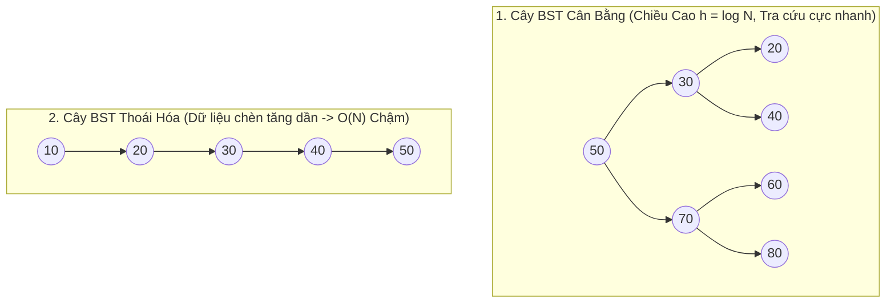
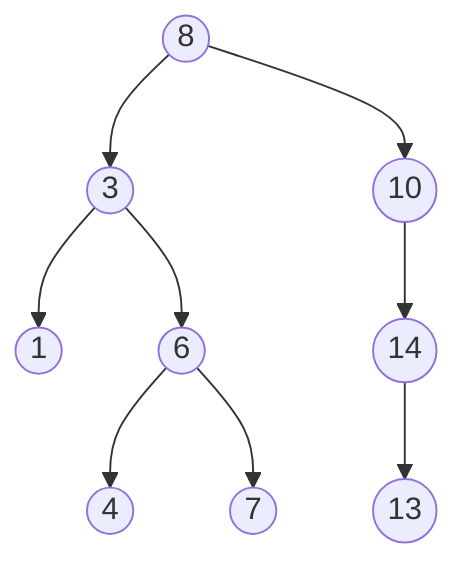
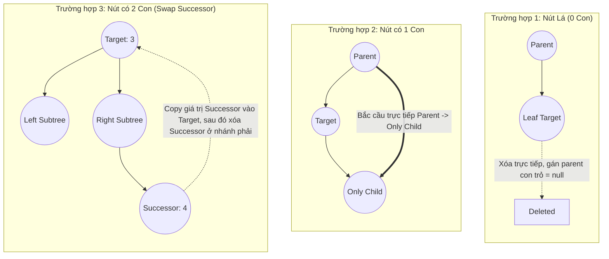
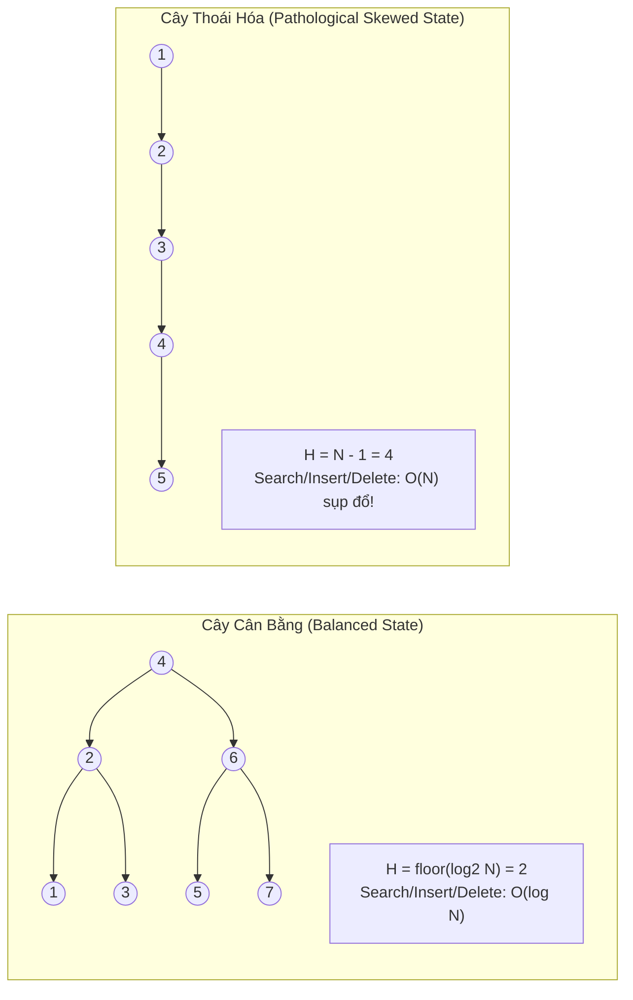

# 3.3. Cây Tìm Kiếm Nhị Phân (Binary Search Tree - BST)

> [!IMPORTANT]
> **Nếu bạn chỉ được nhớ một điều duy nhất:** Cây tìm kiếm nhị phân (BST) duy trì một bất biến toàn cục duy nhất: toàn bộ khóa ở cây con trái nhỏ hơn khóa nút hiện tại, và toàn bộ khóa ở cây con phải lớn hơn khóa nút hiện tại. Bất biến này biến việc tìm kiếm trên không gian hai chiều thành phép chia để trị $O(H)$, nhưng toàn bộ sức mạnh của BST phụ thuộc sống còn vào chiều cao $H$ — nếu không có cơ chế tự cân bằng, một chuỗi dữ liệu tăng dần sẽ biến cây thành một danh sách liên kết $O(N)$, phá hủy toàn bộ bảo chứng hiệu năng.

---

## 1. Trực Quan Hóa: Bản Chất Cây Tìm Kiếm Nhị Phân Dưới Góc Nhìn Lập Trình Viên

### 1.1. Đoạn Code Dẫn Nhập & Vấn Đề Thực Tế
Xét bài toán tìm kiếm và chèn một bản ghi tài khoản người dùng theo `user_id`:

```cpp
struct BSTNode {
    int key;
    std::string value;
    BSTNode* left{nullptr};
    BSTNode* right{nullptr};
};

// Tìm kiếm nhị phân trên cây: O(h)
BSTNode* search(BSTNode* root, int target_key) {
    if (!root || root->key == target_key) return root;
    if (target_key < root->key) return search(root->left, target_key);  // Rẽ trái
    return search(root->right, target_key);                             // Rẽ phải
}
```

- Nếu dùng Mảng đã sắp xếp: Tìm kiếm cực nhanh $O(\log N)$, nhưng chèn/xóa lại cực chậm $O(N)$ do phải dịch mảng.
- Nếu dùng Danh sách liên kết: Chèn/xóa cực nhanh $O(1)$, nhưng tìm kiếm lại tốn $O(N)$ do không nhảy cóc được.
- **Cây Tìm Kiếm Nhị Phân (BST - Binary Search Tree)** ra đời như một sự kết hợp hoàn hảo: Mang lại tốc độ tìm kiếm $O(\log N)$ như mảng sắp xếp, đồng thời giữ được khả năng chèn/xóa linh hoạt $O(\log N)$ bằng cách đổi con trỏ như danh sách liên kết!

### 1.2. Ẩn Dụ Đời Sống: Kệ Sách Thư Viện Phân Vùng Tự Động
- Hãy tưởng tượng một thư viện khổng lồ nơi mỗi cuốn sách được đặt tại một giao lộ rẽ nhánh.
- Tại bất kỳ giao lộ nào có cuốn sách mang mã $K$:
  - **Mọi cuốn sách ở lối rẽ bên trái** chắc chắn có mã số nhỏ hơn $K$ ($\text{Key} < K$).
  - **Mọi cuốn sách ở lối rẽ bên phải** chắc chắn có mã số lớn hơn $K$ ($\text{Key} > K$).
- Khi cần tìm cuốn sách số 42, nếu bạn đứng trước ngã rẽ số 50, bạn lập tức rẽ trái và **loại bỏ hoàn toàn toàn bộ một nửa số sách bên cánh phải** mà không cần nhìn vào chúng! Mỗi bước rẽ cắt giảm $50\%$ không gian tìm kiếm.

### 1.3. Mô Phỏng Dữ Liệu Số Nhỏ Từng Bước (Toy Walkthrough)
Mô phỏng chuỗi chèn các khóa: `50, 30, 70, 20, 40` vào cây BST ban đầu rỗng:

```text
1. Chèn 50: Cây rỗng -> 50 làm Root.
2. Chèn 30: 30 < 50 -> Rẽ trái -> Gắn 30 vào Left(50).
3. Chèn 70: 70 > 50 -> Rẽ phải -> Gắn 70 vào Right(50).
4. Chèn 20: 20 < 50 (Trái) -> 20 < 30 (Trái) -> Gắn 20 vào Left(30).
5. Chèn 40: 40 < 50 (Trái) -> 40 > 30 (Phải) -> Gắn 40 vào Right(30).

Cây BST kết quả hoàn hảo:
        50
       /  \
     30    70
    /  \
   20   40
```

- Duyệt In-order (Trái $\to$ Gốc $\to$ Phải): `20, 30, 40, 50, 70` $\to$ **Dữ liệu tự động được sắp xếp tăng dần hoàn hảo**!
- Tìm kiếm khóa `40`: So sánh với 50 (nhỏ hơn $\to$ Trái), so sánh với 30 (lớn hơn $\to$ Phải) $\to$ Tìm thấy `40` chỉ sau đúng 2 phép so sánh!

### 1.4. Tác Động Thực Tế Tầng Backend & Systems
1. **Hiểm Họa Thoái Hóa Thành Danh Sách Liên Kết ($O(N)$ Degeneracy)**: Nếu bạn chèn dữ liệu đã sắp xếp sẵn theo thứ tự tăng dần (`1, 2, 3, 4, 5`), BST không thể phân nhánh mà duỗi thẳng thành một đường dây duy nhất (Skewed Tree). Chiều cao $h = N$, và tốc độ tìm kiếm bị tụt dốc thê thảm từ $O(\log N)$ về $O(N)$! Đây là lý do ra đời các cây tự cân bằng (**AVL Tree & Red-Black Tree**).
2. **Bộ Nhớ Đệm In-Memory Ordered Map (`std::map`, `TreeMap`)**: Được sử dụng khi hệ thống Backend cần vừa tra cứu khóa nhanh, vừa cần duyệt các phần tử theo thứ tự có sẵn hoặc truy vấn theo khoảng (`range query: get all users with id from 100 to 200`).
3. **Thao Tác Xóa Nút Phức Tạp (Two-Child Deletion)**: Khi xóa một nút có đủ 2 con, hệ thống phải tìm nút thay thế: Nút nhỏ nhất của cây con bên phải (**In-order Successor**) để đưa lên thế chỗ mà vẫn bảo toàn tính chất bất biến của BST.

### 1.5. Sơ Đồ Cấu Trúc BST & Hiện Tượng Thoái Hóa Cây



---

## 2. Chi tiết từng Keyword (Under-the-Hood Deep Dive)

### 2.1. Thuộc Tính BST (BST Property), Thao Tác Cơ Bản: Search, Insert, Min, Max

#### 1. Định nghĩa Toán học của Thuộc tính BST (BST Property Invariant)
Cho một nút bất kỳ $u$ trong cây nhị phân $T$:
$$\forall x \in \text{Subtree}(u.\text{left}): \text{key}(x) < \text{key}(u)$$
$$\forall y \in \text{Subtree}(u.\text{right}): \text{key}(y) > \text{key}(u)$$

> [!NOTE]
> Trong một số hệ thống dữ liệu cho phép trùng lặp khóa (duplicate keys), quy ước có thể mở rộng thành $\le$ ở nhánh trái hoặc $\ge$ ở nhánh phải. Tuy nhiên, trong thiết kế hệ thống chuẩn, mỗi nút duy trì một bộ đếm tần suất (`count` hoặc danh sách payload) tại nút thay vì cho phép khóa trùng nhau phân nhánh, nhằm giữ vững tính đơn điệu ngặt của cây.



*Đường đi tìm kiếm khóa `7`: So sánh với `8` (rẽ trái) $\to$ So sánh với `3` (rẽ phải) $\to$ So sánh với `6` (rẽ phải) $\to$ Khớp khóa `7`! Số phép so sánh đúng bằng độ sâu của nút.*

#### 2. Thao Tác Tìm Kiếm (`Search`)
- **Giải thuật lặp (Iterative Search)**: So sánh `target` với `curr->key`. Nếu bằng, trả về con trỏ nút; nếu nhỏ hơn, nhảy sang `curr = curr->left`; nếu lớn hơn, nhảy sang `curr = curr->right`.
- **Hiệu quả phần cứng**: Biến thể lặp tối ưu hơn biến thể đệ quy vì không tốn không gian Call Stack ($O(1)$ auxiliary space) và cho phép CPU dễ dàng dự đoán nhánh rẽ (Branch Predictor).
- **Độ phức tạp**: Thời gian $O(H)$, không gian $O(1)$.

#### 3. Thao Tác Cực Trị (`Minimum` & `Maximum`)
- **Min**: Xuất phát từ gốc, liên tục rẽ sang nhánh trái (`curr = curr->left`) cho tới khi gặp nút có `left == nullptr`.
- **Max**: Xuất phát từ gốc, liên tục rẽ sang nhánh phải (`curr = curr->right`) cho tới khi gặp nút có `right == nullptr`.
- **Độ phức tạp**: Thời gian $O(H)$, không gian $O(1)$.

#### 4. Thao Tác Chèn Phần Tử (`Insert`)
- Duyệt tìm vị trí thích hợp tương tự như tìm kiếm.
- Khi chạm tới con trỏ `nullptr` (vị trí chiếc lá tương lai), tạo nút mới và liên kết con trỏ của nút cha tương ứng vào nút mới.
- **Tính chất bảo toàn**: Thao tác chèn luôn bổ sung nút mới ở vị trí lá (Leaf Node), không làm thay đổi mối quan hệ tổ tiên hiện hữu của các nút cũ.

#### 5. Bất biến Trung thứ tự (Inorder Monotonicity)
- Nếu thực hiện phép duyệt Inorder (Left $\to$ Root $\to$ Right) trên một BST hợp lệ, dãy khóa thu được **chắc chắn là một dãy đơn điệu tăng dần ngặt**:
  $$k_1 < k_2 < k_3 < \dots < k_N$$
- Đây là thuật toán kiểm tra tính hợp lệ của BST (`isValidBST`) nhanh nhất: Chỉ cần duyệt và so sánh phần tử hiện tại với phần tử vừa duyệt trước đó trong thời gian $O(N)$ và bộ nhớ $O(H)$.

---

### 2.2. Thao Tác Xóa (Deletion), Kế Tiếp (Successor) & Tiền Nhiệm (Predecessor)

Thao tác xóa là thao tác phức tạp nhất trên BST vì nó phải bảo toàn nguyên vẹn tính bất biến BST sau khi cắt bỏ một nút bất kỳ.



#### 1. Inorder Successor & Predecessor
- **Inorder Successor (Phần tử kế tiếp)**: Nút có khóa nhỏ nhất trong số tất cả các khóa lớn hơn khóa hiện tại (nằm ngay sau trong dãy sắp xếp).
  - *Trường hợp A (Có cây con phải)*: Successor chính là nút nhỏ nhất của cây con bên phải:
    $$\text{Successor}(u) = \text{findMin}(u.\text{right})$$
  - *Trường hợp B (Không có cây con phải)*: Đi ngược lên các nút tổ tiên cho đến khi gặp nút đầu tiên mà ta đi lên từ nhánh con bên trái của nó.
- **Inorder Predecessor (Phần tử tiền nhiệm)**: Nút có khóa lớn nhất trong số tất cả các khóa nhỏ hơn khóa hiện tại.
  - *Nếu có cây con trái*: $\text{Predecessor}(u) = \text{findMax}(u.\text{left})$.
  - *Nếu không có cây con trái*: Đi ngược lên tổ tiên cho đến nút đầu tiên mà ta đi lên từ nhánh con bên phải.

#### 2. Ba Kịch Bản Xóa Nút Cốt Lõi (`DeleteNode`)
1. **Kịch bản 1: Nút cần xóa là nút lá (0 con)**:
   - Đơn giản chỉ cần thu hồi bộ nhớ của nút đó và cập nhật con trỏ của nút cha trỏ tới `nullptr`.
2. **Kịch bản 2: Nút cần xóa có đúng 1 con (chỉ có con trái hoặc chỉ có con phải)**:
   - Nối thẳng con trỏ của nút cha tới nút con duy nhất của nút bị xóa (Bắc cầu - Splicing).
   - Giải phóng nút mục tiêu.
3. **Kịch bản 3: Nút cần xóa có đầy đủ cả 2 con**:
   - Ta không thể xóa trực tiếp nút này vì sẽ làm đứt gãy 2 nhánh con.
   - Tìm **Inorder Successor** của nút (nằm ở nút cực trái của cây con bên phải).
   - Sao chép toàn bộ dữ liệu khóa của Successor đè lên nút mục tiêu.
   - Gọi hàm xóa đệ quy để xóa chính nút Successor đó khỏi cây con bên phải. Vì Successor là nút cực trái của cây con phải, nó **chắc chắn chỉ có tối đa 1 con (con phải) hoặc 0 con**, chuyển bài toán phức tạp về Kịch bản 1 hoặc 2!

---

### 2.3. Độ Phức Tạp BST & Vấn Đề Cây Thoái Hóa (Degenerate BST)

#### 1. Mối Quan Hệ Chiều Cao và Độ Phức Tạp
Tất cả các thao tác trên BST (`Search`, `Insert`, `Delete`, `Min`, `Max`, `Successor`) đều duyệt theo một đường đi duy nhất từ gốc xuống một nút nào đó. Do đó, độ phức tạp thời gian thực tế luôn là:
$$T(N) = \Theta(H)$$
Trong đó $H$ là chiều cao của cây.



#### 2. Nguyên Nhân Gây Ra Hiện Tượng Cây Thoái Hóa (Pathological Degradation)
- **Tình huống kích hoạt**: Khi dữ liệu đầu vào đã được sắp xếp sẵn (ví dụ: `1, 2, 3, 4, 5, 6, 7` hoặc dữ liệu log timestamp tăng dần) được chèn liên tiếp vào một cây BST cơ bản.
- **Cơ chế**: Mỗi phần tử mới luôn lớn hơn nút hiện tại, dẫn tới toàn bộ các nút mới đều được gắn liên tục vào nhánh con phải (`curr->right`).
- **Hậu quả hệ thống**:
  1. Chiều cao cây đạt cực đại: $H = N - 1$.
  2. Cây nhị phân biến dạng hoàn toàn thành một Danh sách liên kết đơn (Singly Linked List).
  3. Chi phí tìm kiếm tăng vọt từ $O(\log N)$ lên $O(N)$. Với $N = 1,000,000$, số phép so sánh tăng từ $20$ lên $1,000,000$ lần — độ trễ hệ thống tăng gấp $50,000$ lần!
  4. Gây tràn bộ nhớ ngăn xếp Call Stack (`StackOverflowError` hoặc `SIGSEGV`) nếu các hàm xử lý cây viết bằng đệ quy.

#### 3. Giải Pháp Kỹ Thuật Công Nghiệp
- Để triệt tiêu rủi ro thoái hóa, trong thực tế sản xuất không bao giờ sử dụng Naive BST cho dữ liệu biến động. Thay vào đó, ta áp dụng:
  - **Randomized BST (Treap)**: Gán độ ưu tiên ngẫu nhiên (Heap priority) để phân tán ngẫu nhiên hình dạng cây.
  - **Self-Balancing Trees (AVL, Red-Black Tree)**: Tự động phát hiện mất cân bằng và thực hiện phép xoay (Rotations) để tái lập chiều cao $O(\log N)$ sau mỗi lần chèn/xóa.

---

## 3. Thực thi Mã nguồn & Mô phỏng Chuyên sâu (Dual-Engine Implementation)

### 3.1. C++20 Implementation: Kiến trúc BST Hoàn chỉnh, Xóa 3 Kịch Bản & Kiểm Tra Tính Hợp Lệ

Chương trình C++20 công nghiệp thực thi toàn bộ các thao tác cốt lõi: Chèn, Tìm kiếm lặp, Xóa 3 trường hợp, Tìm Min/Max, Successor/Predecessor, và Kiểm tra tính hợp lệ của BST:

```cpp
#include <iostream>
#include <vector>
#include <optional>
#include <cstdint>
#include <cassert>
#include <iomanip>

struct BSTNode {
    int64_t key;
    BSTNode* left{nullptr};
    BSTNode* right{nullptr};

    explicit BSTNode(int64_t k) : key(k), left(nullptr), right(nullptr) {}
};

class BinarySearchTreeEngine {
public:
    // 1. Tim kiem lap (Iterative Search): O(H) Time, O(1) Space
    static BSTNode* search(BSTNode* root, int64_t target) {
        BSTNode* curr = root;
        while (curr != nullptr && curr->key != target) {
            if (target < curr->key) {
                curr = curr->left;
            } else {
                curr = curr->right;
            }
        }
        return curr;
    }

    // 2. Chen phan tu (Insert): O(H) Time
    static BSTNode* insert(BSTNode* root, int64_t key) {
        if (root == nullptr) {
            return new BSTNode(key);
        }
        if (key < root->key) {
            root->left = insert(root->left, key);
        } else if (key > root->key) {
            root->right = insert(root->right, key);
        }
        // Neu key == root->key: bo qua hoac tang payload count (tranh duplicate key)
        return root;
    }

    // 3. Tim Min va Max: O(H) Time, O(1) Space
    static BSTNode* findMin(BSTNode* root) {
        if (!root) return nullptr;
        while (root->left != nullptr) {
            root = root->left;
        }
        return root;
    }

    static BSTNode* findMax(BSTNode* root) {
        if (!root) return nullptr;
        while (root->right != nullptr) {
            root = root->right;
        }
        return root;
    }

    // 4. Tim Inorder Successor trong toan cay
    static BSTNode* findSuccessor(BSTNode* root, int64_t target) {
        BSTNode* targetNode = search(root, target);
        if (!targetNode) return nullptr;

        // Kich ban A: Co cay con phai -> Min cua cay con phai
        if (targetNode->right != nullptr) {
            return findMin(targetNode->right);
        }

        // Kich ban B: Khong co cay con phai -> To tien gan nhat re sang trai
        BSTNode* successor = nullptr;
        BSTNode* ancestor = root;
        while (ancestor != targetNode) {
            if (target < ancestor->key) {
                successor = ancestor;
                ancestor = ancestor->left;
            } else {
                ancestor = ancestor->right;
            }
        }
        return successor;
    }

    // 5. Xoa phan tu (Delete): Xu ly day du 3 kich ban cau truc
    static BSTNode* deleteNode(BSTNode* root, int64_t key) {
        if (!root) return nullptr;

        if (key < root->key) {
            root->left = deleteNode(root->left, key);
        } else if (key > root->key) {
            root->right = deleteNode(root->right, key);
        } else {
            // Tim thay nut can xoa!
            // Kich ban 1 & 2: Nut khong co con hoac chi co 1 con
            if (root->left == nullptr) {
                BSTNode* temp = root->right;
                delete root;
                return temp;
            } else if (root->right == nullptr) {
                BSTNode* temp = root->left;
                delete root;
                return temp;
            }

            // Kich ban 3: Nut co du 2 con
            // Tim Inorder Successor (nut nho nhat cua cay con phai)
            BSTNode* succ = findMin(root->right);
            root->key = succ->key; // Sao chep gia tri successor len nut hien tai

            // Xoa nut successor o cay con phai (chac chan thuoc Kich ban 1 hoac 2)
            root->right = deleteNode(root->right, succ->key);
        }
        return root;
    }

    // 6. Kiem tra tinh hop le cua BST (Validation) voi mien gia tri ngat
    static bool isValidBST(const BSTNode* root, int64_t min_val = INT64_MIN, int64_t max_val = INT64_MAX) {
        if (!root) return true;
        if (root->key <= min_val || root->key >= max_val) {
            return false;
        }
        return isValidBST(root->left, min_val, root->key) &&
               isValidBST(root->right, root->key, max_val);
    }

    // Inorder traversal de trich xuat day tang dan
    static void getInorder(const BSTNode* root, std::vector<int64_t>& out) {
        if (!root) return;
        getInorder(root->left, out);
        out.push_back(root->key);
        getInorder(root->right, out);
    }

    // Giai phong bo nho cay an toan
    static void destroy(BSTNode* root) {
        if (!root) return;
        destroy(root->left);
        destroy(root->right);
        delete root;
    }
};

int main() {
    std::cout << "========================================================\n";
    std::cout << "   C++20 BINARY SEARCH TREE (BST) ADVANCED ENGINE       \n";
    std::cout << "========================================================\n";

    // Xay dung cay BST kiem thu:
    //          50
    //        /    \
    //       30     70
    //      /  \   /  \
    //     20  40 60  80
    BSTNode* root = nullptr;
    std::vector<int64_t> keys = {50, 30, 70, 20, 40, 60, 80};
    for (int64_t k : keys) {
        root = BinarySearchTreeEngine::insert(root, k);
    }

    // 1. Kiem tra Inorder xem co sap xep tang dan khong
    std::vector<int64_t> inorder_seq;
    BinarySearchTreeEngine::getInorder(root, inorder_seq);
    std::cout << "[1] Inorder Traversal (Sorted): ";
    for (int64_t v : inorder_seq) std::cout << v << " ";
    std::cout << "\n";

    // 2. Kiem tra tinh hop le cua BST
    bool valid = BinarySearchTreeEngine::isValidBST(root);
    std::cout << "[2] Is Valid BST Check: " << (valid ? "PASSED (true)" : "FAILED (false)") << "\n";
    assert(valid == true);

    // 3. Tim Kiem
    int64_t target = 40;
    BSTNode* found = BinarySearchTreeEngine::search(root, target);
    std::cout << "[3] Search for key=" << target << ": " 
              << (found ? "Found node with key=" + std::to_string(found->key) : "Not found") << "\n";
    assert(found != nullptr && found->key == target);

    // 4. Min, Max & Successor
    BSTNode* minNode = BinarySearchTreeEngine::findMin(root);
    BSTNode* maxNode = BinarySearchTreeEngine::findMax(root);
    std::cout << "[4] Min Key: " << (minNode ? minNode->key : -1) 
              << ", Max Key: " << (maxNode ? maxNode->key : -1) << "\n";

    BSTNode* succ30 = BinarySearchTreeEngine::findSuccessor(root, 30);
    BSTNode* succ40 = BinarySearchTreeEngine::findSuccessor(root, 40);
    std::cout << "    Inorder Successor of 30: " << (succ30 ? std::to_string(succ30->key) : "none") << " (Expected: 40)\n";
    std::cout << "    Inorder Successor of 40: " << (succ40 ? std::to_string(succ40->key) : "none") << " (Expected: 50)\n";
    assert(succ30->key == 40 && succ40->key == 50);

    // 5. Kiem thu thao tac Xoa
    // Xoa nut 20 (nut la - 0 con)
    std::cout << "[5] Deletion Tests:\n";
    root = BinarySearchTreeEngine::deleteNode(root, 20);
    std::cout << "    Deleted Leaf Node 20. Valid BST? " 
              << (BinarySearchTreeEngine::isValidBST(root) ? "true" : "false") << "\n";

    // Xoa nut 30 (nut co 1 con: nut 40 sau khi 20 bi xoa)
    root = BinarySearchTreeEngine::deleteNode(root, 30);
    std::cout << "    Deleted Node 30 (1 child). Valid BST? " 
              << (BinarySearchTreeEngine::isValidBST(root) ? "true" : "false") << "\n";

    // Xoa nut goc 50 (nut co day du 2 con)
    root = BinarySearchTreeEngine::deleteNode(root, 50);
    std::cout << "    Deleted Root Node 50 (2 children). Valid BST? " 
              << (BinarySearchTreeEngine::isValidBST(root) ? "true" : "false") << "\n";

    inorder_seq.clear();
    BinarySearchTreeEngine::getInorder(root, inorder_seq);
    std::cout << "    Remaining Inorder after deletions: ";
    for (int64_t v : inorder_seq) std::cout << v << " ";
    std::cout << "\n";

    // Don dep bo nho
    BinarySearchTreeEngine::destroy(root);
    std::cout << "\n[Memory] All nodes freed cleanly. Zero leaks.\n";
    return 0;
}
```

---

### 3.2. Python 3.11+ Implementation: Hướng Đối Tượng, Range Query & Validation

Chương trình Python 3.11+ triển khai cấu trúc lớp `BinarySearchTree` hoàn chỉnh, hỗ trợ tìm kiếm theo khoảng (Range Query) và giải thuật lặp:

```python
from __future__ import annotations
from dataclasses import dataclass
from typing import Optional, List, Generator


@dataclass
class BSTNode:
    key: int
    left: Optional[BSTNode] = None
    right: Optional[BSTNode] = None


class BinarySearchTree:
    def __init__(self) -> None:
        self.root: Optional[BSTNode] = None

    def insert(self, key: int) -> None:
        """Chèn một khóa mới vào BST (giải thuật lặp tránh đệ quy)."""
        if self.root is None:
            self.root = BSTNode(key)
            return

        curr = self.root
        while True:
            if key < curr.key:
                if curr.left is None:
                    curr.left = BSTNode(key)
                    break
                curr = curr.left
            elif key > curr.key:
                if curr.right is None:
                    curr.right = BSTNode(key)
                    break
                curr = curr.right
            else:
                # Bỏ qua khóa trùng lặp
                break

    def search(self, key: int) -> Optional[BSTNode]:
        """Tìm kiếm lặp trong O(H) thời gian."""
        curr = self.root
        while curr and curr.key != key:
            if key < curr.key:
                curr = curr.left
            else:
                curr = curr.right
        return curr

    def find_min(self, node: Optional[BSTNode] = None) -> Optional[BSTNode]:
        """Tìm nút nhỏ nhất của cây hoặc cây con."""
        curr = node if node else self.root
        if not curr:
            return None
        while curr.left:
            curr = curr.left
        return curr

    def delete(self, key: int) -> None:
        """Xóa một khóa khỏi BST bảo đảm 3 kịch bản cấu trúc."""
        self.root = self._delete_recursive(self.root, key)

    def _delete_recursive(self, root: Optional[BSTNode], key: int) -> Optional[BSTNode]:
        if not root:
            return None

        if key < root.key:
            root.left = self._delete_recursive(root.left, key)
        elif key > root.key:
            root.right = self._delete_recursive(root.right, key)
        else:
            # Tìm thấy nút cần xóa
            if root.left is None:
                return root.right
            elif root.right is None:
                return root.left

            # Nút có 2 con: Thay thế bằng Inorder Successor
            successor = self.find_min(root.right)
            assert successor is not None
            root.key = successor.key
            root.right = self._delete_recursive(root.right, successor.key)

        return root

    def inorder(self) -> List[int]:
        """Duyệt Inorder trả về danh sách các phần tử đã sắp xếp."""
        result: List[int] = []

        def dfs(node: Optional[BSTNode]) -> None:
            if not node:
                return
            dfs(node.left)
            result.append(node.key)
            dfs(node.right)

        dfs(self.root)
        return result

    def range_query(self, low: int, high: int) -> List[int]:
        """Truy vấn tất cả các phần tử trong đoạn [low, high] cắt tỉa nhánh O(K + H)."""
        result: List[int] = []

        def dfs(node: Optional[BSTNode]) -> None:
            if not node:
                return
            if low < node.key:
                dfs(node.left)
            if low <= node.key <= high:
                result.append(node.key)
            if high > node.key:
                dfs(node.right)

        dfs(self.root)
        return result

    def is_valid(self, min_val: float = float("-inf"), max_val: float = float("inf")) -> bool:
        """Xác thực tính hợp lệ của BST theo miền giá trị chặt chẽ."""
        def validate(node: Optional[BSTNode], low: float, high: float) -> bool:
            if not node:
                return True
            if not (low < node.key < high):
                return False
            return validate(node.left, low, node.key) and validate(node.right, node.key, high)

        return validate(self.root, min_val, max_val)


if __name__ == "__main__":
    print("=" * 56)
    print("   PYTHON 3.11+ ADVANCED BINARY SEARCH TREE DEMO")
    print("=" * 56)

    bst = BinarySearchTree()
    dataset = [45, 15, 79, 10, 20, 55, 90, 12, 50]
    for val in dataset:
        bst.insert(val)

    print(f"[1] Inorder Traversal: {bst.inorder()}")
    print(f"[2] Is Valid BST: {bst.is_valid()}")

    # Range query: Tìm tất cả giá trị trong đoạn [15, 60]
    in_range = bst.range_query(15, 60)
    print(f"[3] Range Query [15, 60]: {in_range}")

    # Xóa nút có 2 con (Nút 15)
    bst.delete(15)
    print(f"[4] Inorder after deleting node 15: {bst.inorder()}")
    print(f"    Is Valid BST after deletion: {bst.is_valid()}")
    assert bst.is_valid()
```

### 3.3. Terminal Output Mẫu Chuẩn Thực Tế

```text
========================================================
   C++20 BINARY SEARCH TREE (BST) ADVANCED ENGINE       
========================================================
[1] Inorder Traversal (Sorted): 20 30 40 50 60 70 80 
[2] Is Valid BST Check: PASSED (true)
[3] Search for key=40: Found node with key=40
[4] Min Key: 20, Max Key: 80
    Inorder Successor of 30: 40 (Expected: 40)
    Inorder Successor of 40: 50 (Expected: 50)
[5] Deletion Tests:
    Deleted Leaf Node 20. Valid BST? true
    Deleted Node 30 (1 child). Valid BST? true
    Deleted Root Node 50 (2 children). Valid BST? true
    Remaining Inorder after deletions: 40 60 70 80 

[Memory] All nodes freed cleanly. Zero leaks.
```

---

## 4. Systems Engineering & Production Pitfalls

### 4.1. Lỗ Hổng Từ Chối Dịch Vụ Do Kẻ Tấn Công Thao Túng Dữ Liệu (Worst-Case Input DoS)
- **Cơ chế tấn công**: Nếu một dịch vụ web lưu trữ session hoặc index người dùng bằng một cây Naive BST, kẻ tấn công có thể cố tình gửi các yêu cầu đăng ký tài khoản với ID hoặc email có thứ tự tăng dần (`user_0001`, `user_0002`, `user_0003`...).
- **Hệ quả**: Chiều cao cây tăng tuyến tính theo số bản ghi $H = N$. Các thao tác tra cứu tiếp theo đều tiêu tốn $O(N)$ chu kỳ CPU thay vì $O(\log N)$. Toàn bộ các luồng worker của máy chủ bị tắc nghẽn (CPU Starvation), dẫn đến hệ thống bị sập hoàn toàn (Denial of Service).
- **Phòng thủ**: Không bao giờ để dữ liệu người dùng bên ngoài quyết định trực tiếp cấu trúc cây nếu không có lớp cân bằng (AVL/Red-Black Tree) hoặc lớp băm (Hash Map).

### 4.2. Bẫy Tràn Số Khi Xác Thực Cây BST (`isValidBST` Integer Overflow)
- **Lỗi phổ biến**: Khi viết hàm `isValidBST(node, min_val, max_val)`, lập trình viên thường đặt giá trị khởi tạo là `INT_MIN` và `INT_MAX`.
- **Rủi ro**: Nếu nút gốc hoặc một nút hợp lệ trong cây có giá trị đúng bằng `INT_MAX` hoặc `INT_MIN`, điều kiện so sánh `node->key >= max_val` sẽ trả về `false` sai lầm (False Negative).
- **Khắc phục**: Luôn sử dụng kiểu dữ liệu có độ rộng lớn hơn (ví dụ `int64_t` khi khóa là `int32_t`, hoặc sử dụng con trỏ / `std::optional<T>` để biểu diễn trạng thái không giới hạn biên).

### 4.3. Phân Mảnh Bộ Nhớ Heap Khi Chèn và Xóa Liên Tục (Heap Churn)
- Trong các ứng dụng tần suất cao (High-Frequency Trading hoặc Message Queue), việc gọi liên tục `new BSTNode` và `delete root` khiến bộ cấp phát bộ nhớ (`glibc ptmalloc3`) phải liên tục gộp và tách các khối nhớ (Chunk splitting/coalescing), gây ra độ trễ cao ở phân vị đuôi ($p99.9$ latency spike).
- **Giải pháp**: Áp dụng **Slab Allocator / Free List**: Các nút bị xóa không gọi `delete` ngay lập tức mà được đưa vào một danh sách liên kết các nút rảnh rỗi (`free_list`). Khi cần chèn một nút mới, chỉ cần lấy nút từ `free_list` ra tái sử dụng trong $O(1)$ mà không cần chạm vào Kernel Heap.

### 4.4. Tranh Chấp Khóa Trong Môi Trường Đa Luồng (Concurrent Latching)
- Cây BST truyền thống không có cơ chế bảo vệ đồng thời. Nếu luồng $A$ đang xóa một nút (thay đổi liên kết con trỏ) trong khi luồng $B$ đang tìm kiếm đi qua nút đó, luồng $B$ có thể truy cập vào vùng nhớ đã giải phóng (`Use-After-Free`), dẫn đến lỗi `SIGSEGV` ngay lập tức.
- **Kỹ thuật sản xuất**: Sử dụng kỹ thuật **Latch Crabbing / Coupling**: Luồng tìm kiếm phải khóa nút con trước khi mở khóa nút cha, bảo đảm luồng ghi không thể thay đổi cấu trúc phía dưới chân luồng đọc.

---

## 5. Bảng So sánh & Decision Matrix

### 5.1. So sánh Toàn diện Cây BST với Các Cấu Trúc Tra Cứu Khác

| Tiêu chí Đánh giá | Naive BST (Trường hợp Xấu) | Balanced BST (AVL / Red-Black) | Sorted Array | Hash Map (Chaining / Open Addr) |
| :--- | :--- | :--- | :--- | :--- |
| **Tìm kiếm Khóa** | $O(N)$ | $O(\log N)$ | $O(\log N)$ (Binary Search) | $O(1)$ trung bình / $O(N)$ xấu nhất |
| **Chèn Phần Tử Mới** | $O(N)$ | $O(\log N)$ | $O(N)$ (Do dời mảng) | $O(1)$ trung bình / $O(N)$ resize |
| **Xóa Phần Tử** | $O(N)$ | $O(\log N)$ | $O(N)$ (Do dời mảng) | $O(1)$ trung bình |
| **Truy Vấn Khoảng (Range)**| $O(N)$ | $O(K + \log N)$ (Tối ưu) | $O(K + \log N)$ | $O(N)$ (Không hỗ trợ thứ tự) |
| **Tìm Min / Max / Next** | $O(N)$ | $O(\log N)$ (hoặc $O(1)$ cached) | $O(1)$ | $O(N)$ |
| **Tác động CPU Cache** | Kém (phân mảnh con trỏ)| Trung bình | Rất cao (liên tục RAM) | Kém đến Trung bình |

### 5.2. Ma trận Ra Quyết Định Lựa Chọn Cấu Trúc (Decision Matrix)

| Ngữ cảnh Hệ thống Thực tế | Cấu trúc Khuyên dùng | Lý do Kỹ thuật Bản chất |
| :--- | :--- | :--- |
| Chỉ cần tra cứu chính xác theo khóa (`key == target`), không quan tâm thứ tự | **Hash Table / unordered_map** | Tốc độ truy xuất $O(1)$ trung bình, tiết kiệm CPU tối đa. |
| Cần duyệt khóa theo thứ tự tăng dần, tìm kiếm phần tử lớn hơn gần nhất (`Ceiling`) | **Balanced BST (std::map)** | Duy trì thứ tự bất biến liên tục trong $O(\log N)$ thời gian. |
| Tập dữ liệu tĩnh, nạp một lần khi khởi động hệ thống và chỉ đọc | **Sorted Flat Array** | Cache Locality tuyệt đối, không tiêu tốn byte nào cho con trỏ phụ trợ. |
| Xây dựng cây chỉ mục cơ sở dữ liệu trên ổ cứng / SSD | **B+ Tree / LSM-Tree** | Phân nhánh cao ($B > 100$), tối ưu hóa kích thước trang đĩa ($4\text{ KB} - 64\text{ KB}$). |

---

## 6. Enterprise Production Checklist & Verification

- [ ] **Chống Tấn Công Dữ Liệu Tăng Dần**: Tuyệt đối không dùng Naive BST làm cấu trúc lưu trữ chính cho API công khai; thay thế bằng `std::map` (Red-Black Tree) hoặc Hash Table.
- [ ] **Bảo đảm Không Gian Ngăn Xếp Khi Xóa**: Thao tác xóa đệ quy trên cây sâu có thể gây Stack Overflow; sử dụng giải thuật lặp hoặc giới hạn độ sâu tối đa.
- [ ] **Validation Không Tràn Số**: Hàm xác thực BST (`isValidBST`) phải sử dụng kiểu dữ liệu rộng hơn (`int64_t` thay vì `int32_t`) để kiểm tra biên `INT_MIN`/`INT_MAX`.
- [ ] **Tái Sử Dụng Nút (Free List / Pool)**: Áp dụng Memory Pool cho các nút BST trong môi trường có tần suất chèn/xóa trên 100,000 ops/giây để loại bỏ phân mảnh bộ nhớ Heap.
- [ ] **Kiểm Tra Tranh Chấp Đa Luồng**: Bảo vệ cấu trúc BST bằng Read-Write Lock (`std::shared_mutex`) hoặc Latch Crabbing khi chạy trong ứng dụng đa luồng.
