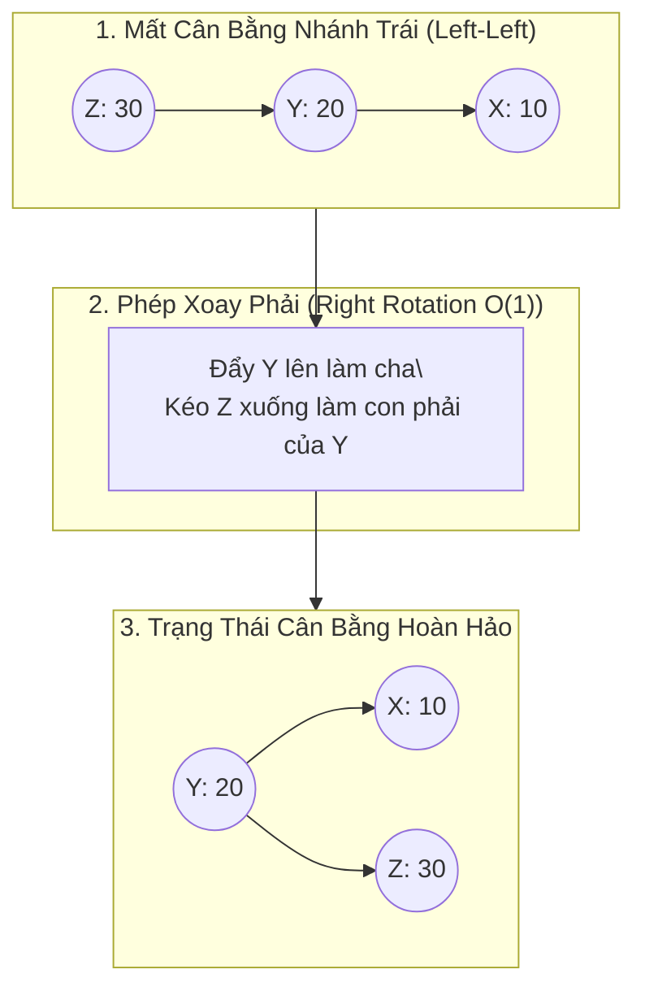
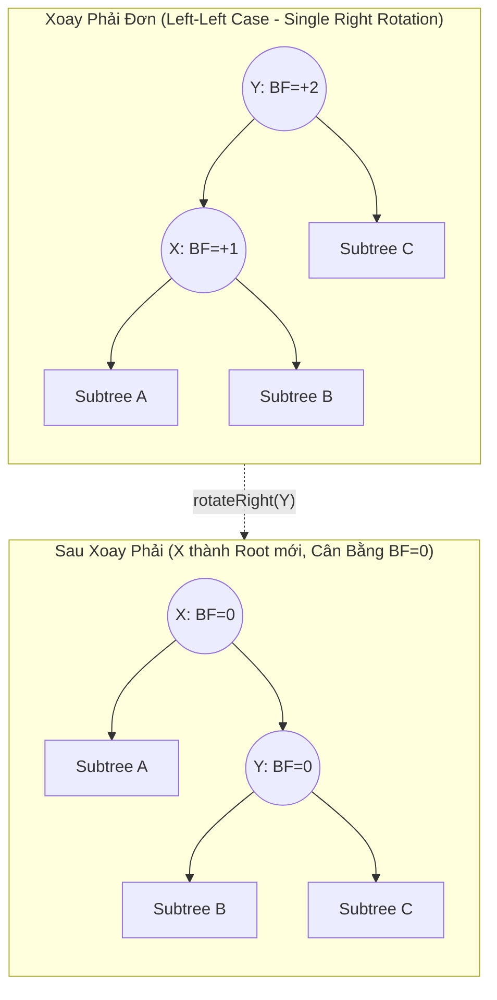
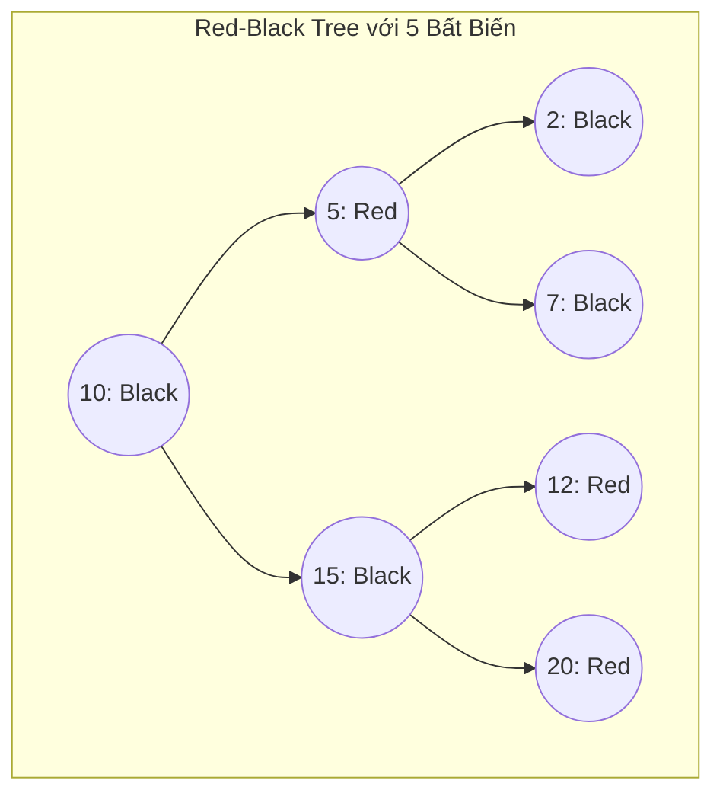
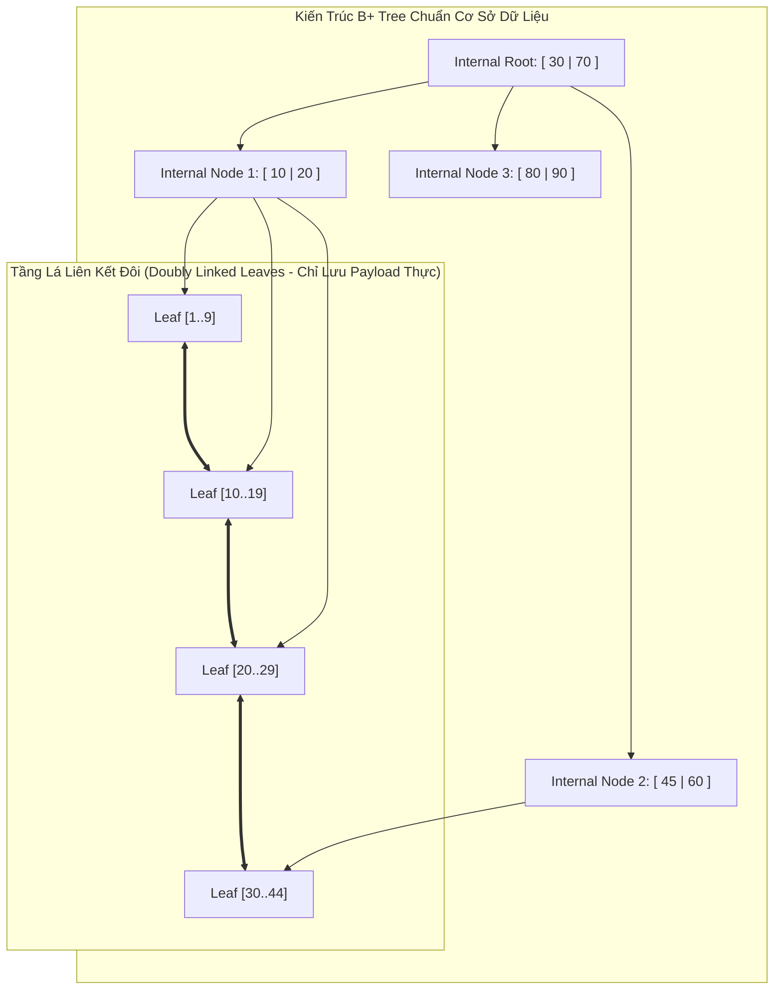

# 3.4. Cây Tự Cân Bằng (Self-Balancing Trees & Multiway Trees)

> [!IMPORTANT]
> **Nếu bạn chỉ được nhớ một điều duy nhất:** Cây tự cân bằng là lời giải triệt để cho bài toán thoái hóa cây nhị phân, trong đó AVL ưu tiên độ cân bằng chiều cao tuyệt đối cho tải đọc nặng, Red-Black Tree chấp nhận độ lệch chiều cao tối đa $2\times$ để tối ưu hóa số phép xoay khi ghi thường xuyên, còn B-Tree và B+ Tree mở rộng khái niệm đa nhánh để đưa chiều cao cây về ngưỡng $3 - 4$ tầng, nén gọn mỗi nút thành một khối bộ nhớ vừa khít một trang đĩa $4\text{ KB} - 16\text{ KB}$ nhằm triệt tiêu độ trễ Disk I/O.

---

## 1. Trực Quan Hóa: Bản Chất Cây Tự Cân Bằng Dưới Góc Nhìn Lập Trình Viên

### 1.1. Đoạn Code Dẫn Nhập & Vấn Đề Thực Tế
Xét tình huống chèn một triệu bản ghi có ID tự tăng (`1, 2, 3, ... 1,000,000`) vào cấu trúc cây tìm kiếm:

```cpp
// Cây BST ngây thơ: Bị kéo dài thành một sợi dây 1,000,000 tầng!
// Chiều cao h = 1,000,000 -> Tra cứu tốn 1,000,000 bước so sánh -> Đơ hệ thống!

// Cây Tự Cân Bằng (AVL / Red-Black Tree):
// Tự động xoay cây khi phát hiện mất cân bằng -> Giữ chiều cao h <= 2 * log2(N)
// Chiều cao h <= 40 tầng -> Tra cứu chỉ tốn tối đa 40 bước so sánh (Vài nano-giây)!
```

- Cây tự cân bằng (Self-Balancing Trees - tiêu biểu là **AVL Tree** và **Red-Black Tree**) giải quyết triệt để tử huyệt lớn nhất của cây BST: Đảm bảo chiều cao của cây luôn bị chặn ở mức **$O(\log N)$** trong mọi trường hợp xấu nhất, bất kể thứ tự dữ liệu chèn vào có quái đản đến đâu.

### 1.2. Ẩn Dụ Đời Sống: Con Lắc Con Kê Tự Cân Bằng & Tòa Nhà Chọc Trời
- Hãy tưởng tượng một tòa tháp chọc trời được trang bị một quả cầu giảm chấn con lắc khổng lồ (Tuned Mass Damper):
  - Khi bão thổi làm tòa tháp nghiêng lệch về một bên quá mức quy định, quả cầu tự động dịch chuyển về hướng ngược lại để kéo trọng tâm tòa tháp về lại vị trí cân bằng.
- Trong cấu trúc cây:
  - **Phép Quay Cây (Tree Rotation)** chính là quả cầu con lắc đó.
  - Khi một cành cây bị đè nặng do cấy thêm nhiều nút liên tiếp về cánh trái, cây lập tức thực hiện một phép **Xoay Phải (Right Rotation)**: Nút con được đẩy lên làm cha, nút cha cũ hạ xuống làm nút con cánh phải. Trọng tâm cây được tái cân bằng hoàn hảo trong thời gian **$O(1)$** mà không làm xáo trộn thứ tự tăng dần của các phần tử!

### 1.3. Mô Phỏng Dữ Liệu Số Nhỏ Từng Bước (Toy Walkthrough)
Mô phỏng phép Xoay Phải cơ bản (Right Rotation) để giải tỏa mất cân bằng nhánh Trái - Trái (Left-Left Case):
Chuỗi chèn: `30 -> 20 -> 10`

```text
Trạng thái mất cân bằng (Cành trái dài gấp đôi):
        30 (Balance Factor = +2 -> LỆCH NẶNG)
       /
      20  (Balance Factor = +1)
     /
    10

Thực hiện Xoay Phải tại Nút 30:
1. Đưa nút con 20 lên làm Nút Gốc mới.
2. Gán 30 làm con bên phải của 20.
3. Chuyển nhánh con phải cũ của 20 (nếu có) sang làm con trái của 30.

Cây cân bằng tuyệt đối sau phép xoay O(1):
       20 (Balance Factor = 0)
      /  \
    10    30
```

- Nhờ phép xoay, chiều cao giảm từ 3 xuống 2, đường đi tìm kiếm $10$ rút ngắn từ 3 bước xuống còn 2 bước!

### 1.4. Tác Động Thực Tế Tầng Backend & Systems
1. **Linux Kernel Completely Fair Scheduler (CFS)**: Bộ lập lịch tiến trình của Linux Kernel sử dụng cây Red-Black Tree (`struct rb_root_cached`) để quản lý toàn bộ các tiến trình đang chờ CPU. Khóa của cây là thời gian thực thi ảo `vruntime`. Tiến trình có `vruntime` nhỏ nhất luôn nằm ở nút cực trái (`rb_first`), được CPU lấy ra thực thi trong $O(1)$.
2. **Cơ Sở Dữ Liệu In-Memory C++ (`std::map`, `std::set`) & Java (`TreeMap`)**: Đều sử dụng **Red-Black Tree** làm engine nền tảng bên dưới. Red-Black Tree được ưa chuộng hơn AVL trong thực tế vì nó chấp nhận dung sai lỏng hơn một chút, giúp giảm thiểu đáng kể số lần phải xoay cây khi chèn/xóa dữ liệu liên tục.
3. **Epoll Timer Management & Nginx Timers**: Toàn bộ hệ thống hẹn giờ timeout của các kết nối mạng trong Nginx được sắp xếp trên Red-Black Tree, cho phép kernel phát hiện kết nối nào hết hạn sớm nhất chỉ sau một thao tác đọc nút gốc.

### 1.5. Sơ Đồ Cơ Chế Xoay Cây AVL / Red-Black Tree



---

## 2. Chi tiết từng Keyword (Under-the-Hood Deep Dive)

### 2.1. AVL Tree: Balance Factor & 4 Phép Xoay (AVL Rotations)

AVL Tree (sáng tạo năm 1962 bởi Georgy Adelson-Velsky và Evgenii Landis) là cấu trúc cây tìm kiếm nhị phân tự cân bằng nghiêm ngặt đầu tiên trong lịch sử khoa học máy tính.



#### 1. Hệ Số Cân Bằng (Balance Factor - BF)
Với mọi nút $u$ trong cây AVL:
$$\text{BF}(u) = \text{height}(u.\text{left}) - \text{height}(u.\text{right})$$
- **Bất biến AVL bắt buộc**: Tại mọi thời điểm và trên mọi nút, $\text{BF}(u) \in \{-1, 0, 1\}$.
- Khi chèn hoặc xóa một nút, nếu xuất hiện bất kỳ nút nào có $|\text{BF}(u)| \ge 2$, cây rơi vào trạng thái mất cân bằng và bắt buộc phải kích hoạt phép xoay tái cấu trúc ngay tại nút mất cân bằng sâu nhất.

#### 2. Bốn Kịch Bản Mất Cân Bằng & Bốn Phép Xoay (4 Rotations)
1. **Trường hợp Left-Left (LL)**: Nhánh con trái bị lệch trái ($\text{BF}(u) = +2$ và $\text{BF}(u.\text{left}) \ge 0$).
   - **Xử lý**: Thực hiện một phép **Xoay Phải đơn (Single Right Rotation)** tại nút $u$.
2. **Trường hợp Right-Right (RR)**: Nhánh con phải bị lệch phải ($\text{BF}(u) = -2$ và $\text{BF}(u.\text{right}) \le 0$).
   - **Xử lý**: Thực hiện một phép **Xoay Trái đơn (Single Left Rotation)** tại nút $u$.
3. **Trường hợp Left-Right (LR)**: Nhánh con trái nhưng bị lệch sang phải ($\text{BF}(u) = +2$ và $\text{BF}(u.\text{left}) < 0$).
   - **Xử lý**: Thực hiện phép **Xoay Kép**: Xoay Trái tại con trái ($u.\text{left}$), sau đó Xoay Phải tại nút gốc $u$.
4. **Trường hợp Right-Left (RL)**: Nhánh con phải nhưng bị lệch sang trái ($\text{BF}(u) = -2$ và $\text{BF}(u.\text{right}) > 0$).
   - **Xử lý**: Thực hiện phép **Xoay Kép**: Xoay Phải tại con phải ($u.\text{right}$), sau đó Xoay Trái tại nút gốc $u$.

#### 3. Phân Tích Độ Phức Tạp & Giới Hạn Chiều Cao
- Chiều cao xấu nhất của một cây AVL chứa $N$ nút được chặn trên bởi công thức Fibonacci:
  $$H < 1.4404 \log_2(N + 2) - 0.328$$
- Do áp đặt điều kiện cân bằng nghiêm ngặt nhất, cây AVL luôn có chiều cao thực tế thấp hơn Red-Black Tree khoảng $15\% - 30\%$. Vì vậy, các thao tác đọc (`Search`) trong cây AVL đạt tốc độ nhanh hơn, nhưng thao tác ghi (`Insert` và `Delete`) phải trả giá bằng số lượng phép xoay nhiều hơn (thao tác xóa có thể phải xoay ngược lên tới tận gốc: $O(\log N)$ rotations).

---

### 2.2. Red-Black Tree: 5 Quy Tắc Màu Sắc (Color Properties) & Rotations

Red-Black Tree (được tối ưu hóa bởi Rudolf Bayer và Robert Sedgewick) nới lỏng điều kiện cân bằng bằng cách gán cho mỗi nút một nhãn màu sắc (`RED` hoặc `BLACK`), đảm bảo không có đường đi nào dài gấp đôi bất kỳ đường đi nào khác.



#### 1. Năm Quy Tắc Bất Biến Sống Còn (The 5 Invariants)
1. **Mọi nút đều có màu hoặc ĐỎ (Red) hoặc ĐEN (Black)**.
2. **Nút gốc (Root) luôn luôn có màu ĐEN**.
3. **Tất cả các nút lá rỗng (NIL Leaves / Sentinel Nodes) đều có màu ĐEN**.
4. **Quy tắc Đỏ (No Two Consecutive Reds)**: Nếu một nút có màu ĐỎ, thì cả hai nút con của nó bắt buộc phải có màu ĐEN. (Nói cách khác, không bao giờ được phép có hai nút Đỏ nằm kề nhau trên cùng một cạnh).
5. **Độ cao Đen Toàn Cục (Black-Height Balance)**: Với mọi nút trong cây, tất cả các đường đi đơn xuất phát từ nút đó đi xuống bất kỳ nút lá rỗng nào đều phải chứa **cùng một số lượng nút ĐEN chính xác như nhau** (Black-Height $bh$).

#### 2. Định Lý Chặn Chiều Cao Toán Học
- Nhờ quy tắc 4 (không có 2 nút Đỏ kề nhau) và quy tắc 5 (mọi nhánh có cùng số nút Đen), đường đi dài nhất (xen kẽ Đỏ - Đen) không bao giờ có thể dài quá gấp đôi đường đi ngắn nhất (toàn nút Đen).
- Do đó, chiều cao tối đa của Red-Black Tree chứa $N$ nút nội tại được bảo đảm tuyệt đối:
  $$H \le 2 \log_2(N + 1)$$
- Mọi thao tác tìm kiếm, chèn, xóa đều có chặn trên thời gian là $O(\log N)$.

#### 3. Cơ Chế Chèn & Đổi Màu (Insertion Balancing)
- Khi chèn một nút mới $Z$, ta luôn gán cho nó màu **ĐỎ** (để không phá vỡ quy tắc 5 về Black-Height).
- Nếu cha của $Z$ có màu Đỏ $\to$ Vi phạm Quy tắc 4! Ta kiểm tra màu của nút chú (Uncle - anh em với cha):
  - **Trường hợp chú màu ĐỎ**: Đổi màu Cha và Chú thành ĐEN, đổi màu Ông (Grandparent) thành ĐỎ, rồi đẩy kiểm tra lên Ông (Color Flip).
  - **Trường hợp chú màu ĐEN**: Thực hiện phép xoay (Xoay đơn hoặc xoay kép) kết hợp hoán đổi màu giữa Cha và Ông. Thao tác chèn chỉ cần tối đa **2 phép xoay** là hoàn tất!

---

### 2.3. B-Tree & B+ Tree: Cấu Trúc Chỉ Mục Cơ Sở Dữ Liệu

Khi dữ liệu vượt qua kích thước bộ nhớ RAM và phải lưu trên ổ cứng/SSD, các cấu trúc cây nhị phân (Binary Trees) hoàn toàn phá sản do hiện tượng phân mảnh đọc đĩa. B-Tree và B+ Tree giải quyết bài toán này bằng cách mở rộng hệ số rẽ nhánh (Fan-out).



#### 1. B-Tree (Bayer & McCreight, 1972)
- Một B-Tree bậc $M$ thỏa mãn:
  - Mỗi nút có tối đa $M$ con và chứa tối đa $M - 1$ khóa.
  - Mỗi nút (ngoại trừ Root) phải chứa ít nhất $\lceil M / 2 \rceil - 1$ khóa.
  - Tất cả các nút lá bắt buộc phải nằm ở **cùng một độ sâu tuyệt đối**.
  - Khóa và Dữ liệu thực tế (Record Payload) được lưu trữ ở **tất cả các tầng** (cả nút nội tại và nút lá).

#### 2. B+ Tree: Tối Ưu Hóa Tối Thượng Cho Hệ Quản Trị CSDL
B+ Tree là biến thể chuẩn mực của mọi động cơ CSDL hiện đại (MySQL InnoDB, SQLite, PostgreSQL btree):
1. **Phân tách hoàn toàn Khóa định tuyến và Dữ liệu**:
   - **Nút nội tại (Internal Nodes)**: Chỉ lưu Khóa phân cách (Routing Keys) và con trỏ trang con, hoàn toàn không lưu dữ liệu. Nhờ đó, kích thước một mục chỉ mục rất nhỏ ($16 - 32\text{ bytes}$), cho phép nhồi nhét hàng trăm tới hàng ngàn con vào một Page $16\text{ KB}$ (Fan-out cực lớn $\approx 1000$).
   - **Nút lá (Leaf Nodes)**: Lưu trữ 100% dữ liệu thực tế (Clustered Index Payload) hoặc con trỏ tới Heap Tuple.
2. **Danh Sách Liên Kết Hai Chiều Tại Tầng Lá (Doubly Linked Leaves)**:
   - Tất cả các nút lá được nối với nhau qua con trỏ `prev` và `next`.
   - **Truy vấn quét dải (Range Scan)**: Khi thực hiện câu lệnh `SELECT * FROM orders WHERE date BETWEEN '2026-01-01' AND '2026-01-31'`, hệ thống chỉ cần tìm kiếm nhị phân đến nút lá chứa ngày bắt đầu trong $O(\log N)$, sau đó duyệt tuần tự liên tục dọc theo danh sách liên kết lá với tốc độ quét mảng trong bộ đệm $O(K)$, không cần tốn bất kỳ thao tác quay lui lên nút cha nào!

---

### 2.4. 2-3 Tree, 2-3-4 Tree, Treap & Splay Tree

#### 1. Cây 2-3 và 2-3-4 (B-Tree Bậc 3 và Bậc 4)
- **Cây 2-3**: Mỗi nút nội tại có thể chứa $1$ khóa (2 con) hoặc $2$ khóa (3 con).
- **Cây 2-3-4**: Mỗi nút có thể chứa $1, 2$ hoặc $3$ khóa và tương ứng $2, 3, 4$ con.
- **Tính đẳng cấu (Isomorphism)**: Red-Black Tree chính là biểu diễn nhị phân của cây 2-3-4! Một nút 3-khóa hoặc 2-khóa trong 2-3-4 Tree được biểu diễn trong RB-Tree bằng một nút Đen kết hợp với 1 hoặc 2 nút con màu Đỏ. Mọi phép xoay và đổi màu trong RB-Tree thực chất là phản chiếu của thao tác tách nút (Node Split) và gộp nút trong cây 2-3-4.

#### 2. Treap (Cartesian Tree: Tree + Heap)
- Mỗi nút mang một cặp giá trị: `(Key, Priority)`.
  - Thuộc tính **BST** áp dụng cho `Key`: `left.key < node.key < right.key`.
  - Thuộc tính **Heap (Max-Heap)** áp dụng cho `Priority`: `node.priority >= children.priority`.
- Khi chèn một phần tử mới, ta sinh `Priority` ngẫu nhiên độc lập bằng bộ sinh số giả ngẫu nhiên đồng nhất. Sau đó chèn theo quy tắc BST thông thường và dùng phép xoay (Rotations) kéo nút lên để thỏa mãn tính chất Heap.
- **Bảo chứng toán học**: Kỳ vọng chiều cao của Treap luôn là $O(\log N)$. Treap loại bỏ hoàn toàn các trường hợp mã nguồn cân bằng phức tạp của AVL/RB-Tree và cho phép thực hiện thao tác Ghép cây (`Merge`) và Tách cây (`Split`) cực kỳ tao nhã trong $O(\log N)$.

#### 3. Splay Tree (Sleator & Tarjan, 1985)
- Cây nhị phân tự điều chỉnh dựa trên nguyên lý **Cục bộ Thời gian (Temporal Locality)**: Nếu một phần tử vừa được truy cập, nó có xác suất rất cao sẽ được truy cập lại trong tương lai gần.
- Mỗi khi thực hiện `Search`, `Insert` hoặc `Delete` tại nút $X$, Splay Tree sẽ thực hiện một chuỗi thao tác xoay liên tiếp gọi là **Splay Operation (Zig, Zig-Zig, Zig-Zag)** để đẩy nút $X$ lên trở thành **Nút Gốc (New Root)**.
- Mặc dù một thao tác đơn lẻ có thể tốn $O(N)$ trong trường hợp xấu nhất, nhưng chi phí trung bình khấu hao (**Amortized Time Complexity**) của một chuỗi $M$ thao tác trên Splay Tree được chứng minh toán học là đạt chuẩn $O(\log N)$. Rất phổ biến trong bộ nhớ đệm router mạng, nén dữ liệu và bộ phân giải DNS.

---

## 3. Thực thi Mã nguồn & Mô phỏng Chuyên sâu (Dual-Engine Implementation)

### 3.1. C++20 Implementation: Hoàn chỉnh Cây AVL với Đầy đủ 4 Phép Xoay và Rebalancing

Dưới đây là bản cài đặt chuẩn công nghiệp C++20 của cây AVL tự cân bằng, hỗ trợ chèn, xóa và tái cân bằng đệ quy chính xác:

```cpp
#include <iostream>
#include <algorithm>
#include <vector>
#include <cassert>
#include <iomanip>

struct AVLNode {
    int key;
    int height{1};
    AVLNode* left{nullptr};
    AVLNode* right{nullptr};

    explicit AVLNode(int k) : key(k), height(1), left(nullptr), right(nullptr) {}
};

class AVLTreeEngine {
public:
    static int getHeight(const AVLNode* node) {
        return node ? node->height : 0;
    }

    static int getBalanceFactor(const AVLNode* node) {
        return node ? getHeight(node->left) - getHeight(node->right) : 0;
    }

    static void updateHeight(AVLNode* node) {
        if (node) {
            node->height = 1 + std::max(getHeight(node->left), getHeight(node->right));
        }
    }

    // 1. Xoay Phai don (Single Right Rotation) - Left-Left Case
    static AVLNode* rotateRight(AVLNode* y) {
        AVLNode* x = y->left;
        AVLNode* T2 = x->right;

        // Thuc hien phep xoay
        x->right = y;
        y->left = T2;

        // Cap nhat lai chieu cao (cap nhat node con y truoc, node cha x sau)
        updateHeight(y);
        updateHeight(x);

        return x; // Root moi cua cay con
    }

    // 2. Xoay Trai don (Single Left Rotation) - Right-Right Case
    static AVLNode* rotateLeft(AVLNode* x) {
        AVLNode* y = x->right;
        AVLNode* T2 = y->left;

        // Thuc hien phep xoay
        y->left = x;
        x->right = T2;

        // Cap nhat lai chieu cao
        updateHeight(x);
        updateHeight(y);

        return y; // Root moi cua cay con
    }

    // 3. Chen phan tu va Tai can bang (Insert with AVL Rebalance)
    static AVLNode* insert(AVLNode* node, int key) {
        if (!node) return new AVLNode(key);

        if (key < node->key) {
            node->left = insert(node->left, key);
        } else if (key > node->key) {
            node->right = insert(node->right, key);
        } else {
            return node; // Bo qua duplicate key
        }

        // Cap nhat chieu cao cua nut to tien hien tai
        updateHeight(node);

        // Kiem tra he so can bang (Balance Factor)
        int balance = getBalanceFactor(node);

        // Kich ban 1: Left-Left (LL)
        if (balance > 1 && key < node->left->key) {
            return rotateRight(node);
        }

        // Kich ban 2: Right-Right (RR)
        if (balance < -1 && key > node->right->key) {
            return rotateLeft(node);
        }

        // Kich ban 3: Left-Right (LR)
        if (balance > 1 && key > node->left->key) {
            node->left = rotateLeft(node->left);
            return rotateRight(node);
        }

        // Kich ban 4: Right-Left (RL)
        if (balance < -1 && key < node->right->key) {
            node->right = rotateRight(node->right);
            return rotateLeft(node);
        }

        return node;
    }

    static AVLNode* findMin(AVLNode* node) {
        while (node && node->left) node = node->left;
        return node;
    }

    // 4. Xoa phan tu va Tai can bang (Delete with AVL Rebalance)
    static AVLNode* deleteNode(AVLNode* root, int key) {
        if (!root) return nullptr;

        if (key < root->key) {
            root->left = deleteNode(root->left, key);
        } else if (key > root->key) {
            root->right = deleteNode(root->right, key);
        } else {
            // Nut can xoa
            if (!root->left || !root->right) {
                AVLNode* temp = root->left ? root->left : root->right;
                if (!temp) {
                    temp = root;
                    root = nullptr;
                } else {
                    *root = *temp; // Copy noi dung
                }
                delete temp;
            } else {
                AVLNode* temp = findMin(root->right);
                root->key = temp->key;
                root->right = deleteNode(root->right, temp->key);
            }
        }

        if (!root) return nullptr;

        updateHeight(root);
        int balance = getBalanceFactor(root);

        // 4 Kich ban tai can bang khi xoa
        if (balance > 1 && getBalanceFactor(root->left) >= 0) {
            return rotateRight(root);
        }
        if (balance > 1 && getBalanceFactor(root->left) < 0) {
            root->left = rotateLeft(root->left);
            return rotateRight(root);
        }
        if (balance < -1 && getBalanceFactor(root->right) <= 0) {
            return rotateLeft(root);
        }
        if (balance < -1 && getBalanceFactor(root->right) > 0) {
            root->right = rotateRight(root->right);
            return rotateLeft(root);
        }

        return root;
    }

    static bool isAVLBalanced(const AVLNode* node) {
        if (!node) return true;
        int bf = std::abs(getBalanceFactor(node));
        if (bf > 1) return false;
        return isAVLBalanced(node->left) && isAVLBalanced(node->right);
    }

    static void inorder(const AVLNode* root, std::vector<int>& out) {
        if (!root) return;
        inorder(root->left, out);
        out.push_back(root->key);
        inorder(root->right, out);
    }

    static void destroy(AVLNode* root) {
        if (!root) return;
        destroy(root->left);
        destroy(root->right);
        delete root;
    }
};

int main() {
    std::cout << "========================================================\n";
    std::cout << "   C++20 AVL SELF-BALANCING TREE RIGOROUS DEMO          \n";
    std::cout << "========================================================\n";

    AVLNode* root = nullptr;

    // Chen chuoi so tang dan lien tuc: 10, 20, 30, 40, 50, 25
    // Tren BST thong thuong se gay thoai hoa hoan toan. AVL se lien tuc xoay!
    std::vector<int> dataset = {10, 20, 30, 40, 50, 25};
    std::cout << "[1] Inserting keys: ";
    for (int k : dataset) {
        std::cout << k << " ";
        root = AVLTreeEngine::insert(root, k);
    }
    std::cout << "\n";

    std::cout << "[2] Tree Height: " << AVLTreeEngine::getHeight(root) << " (Optimal is floor(log2(6)) + 1 = 3)\n";
    std::cout << "[3] Is AVL Balance Invariant Satisfied: " 
              << (AVLTreeEngine::isAVLBalanced(root) ? "TRUE (100% Valid)" : "FALSE") << "\n";
    assert(AVLTreeEngine::isAVLBalanced(root));

    std::vector<int> sorted_seq;
    AVLTreeEngine::inorder(root, sorted_seq);
    std::cout << "[4] Inorder traversal after rotations: ";
    for (int v : sorted_seq) std::cout << v << " ";
    std::cout << "\n";

    // Kiem thu phep Xoa va Tai can bang
    std::cout << "[5] Deleting key 30 (causing rebalance)...\n";
    root = AVLTreeEngine::deleteNode(root, 30);
    std::cout << "    Is AVL Balance Preserved? " 
              << (AVLTreeEngine::isAVLBalanced(root) ? "TRUE" : "FALSE") << "\n";
    assert(AVLTreeEngine::isAVLBalanced(root));

    sorted_seq.clear();
    AVLTreeEngine::inorder(root, sorted_seq);
    std::cout << "    Remaining keys: ";
    for (int v : sorted_seq) std::cout << v << " ";
    std::cout << "\n";

    AVLTreeEngine::destroy(root);
    std::cout << "\n[Memory] All AVL nodes safely released. Zero leaks.\n";
    return 0;
}
```

---

### 3.2. Python 3.11+ Implementation: Treap (Cartesian Tree) Tự Cân Bằng Ngẫu Nhiên

Chương trình Python 3.11+ mô phỏng cấu trúc Treap tự cân bằng ngẫu nhiên với phép xoay theo thuộc tính Max-Heap:

```python
from __future__ import annotations
from dataclasses import dataclass, field
import random
from typing import Optional, List


@dataclass
class TreapNode:
    key: int
    priority: int = field(default_factory=lambda: random.randint(1, 100_000))
    left: Optional[TreapNode] = None
    right: Optional[TreapNode] = None


class TreapEngine:
    def __init__(self, seed: int = 42) -> None:
        random.seed(seed)
        self.root: Optional[TreapNode] = None

    def _rotate_right(self, y: TreapNode) -> TreapNode:
        x = y.left
        assert x is not None
        y.left = x.right
        x.right = y
        return x

    def _rotate_left(self, x: TreapNode) -> TreapNode:
        y = x.right
        assert y is not None
        x.right = y.left
        y.left = x
        return y

    def insert(self, key: int) -> None:
        """Chèn khóa theo quy tắc BST kết hợp xoay duy trì Heap Priority."""
        self.root = self._insert_node(self.root, key)

    def _insert_node(self, node: Optional[TreapNode], key: int) -> TreapNode:
        if not node:
            return TreapNode(key)

        if key < node.key:
            node.left = self._insert_node(node.left, key)
            # Khôi phục thuộc tính Max-Heap
            if node.left.priority > node.priority:
                node = self._rotate_right(node)
        elif key > node.key:
            node.right = self._insert_node(node.right, key)
            if node.right.priority > node.priority:
                node = self._rotate_left(node)
        return node

    def inorder(self) -> List[tuple[int, int]]:
        """Trả về danh sách (key, priority) theo thứ tự tăng dần."""
        result: List[tuple[int, int]] = []

        def dfs(curr: Optional[TreapNode]) -> None:
            if not curr:
                return
            dfs(curr.left)
            result.append((curr.key, curr.priority))
            dfs(curr.right)

        dfs(self.root)
        return result

    def get_height(self) -> int:
        def dfs(curr: Optional[TreapNode]) -> int:
            if not curr:
                return 0
            return 1 + max(dfs(curr.left), dfs(curr.right))
        return dfs(self.root)


if __name__ == "__main__":
    print("=" * 56)
    print("   PYTHON 3.11+ TREAP (RANDOMIZED BALANCED TREE) DEMO")
    print("=" * 56)

    treap = TreapEngine(seed=2026)
    # Chèn một dãy tăng dần 1..15 liên tục
    seq = list(range(1, 16))
    for k in seq:
        treap.insert(k)

    print(f"[1] Inserted 15 sequential keys: 1 to 15")
    print(f"[2] Treap Height: {treap.get_height()} (Expected height for 15 nodes is ~4-5, vs 15 on Naive BST)")
    
    inorder_data = treap.inorder()
    print("[3] Inorder Verification (Keys strictly sorted):")
    keys_only = [k for k, p in inorder_data]
    print(f"    Keys: {keys_only}")
    assert keys_only == seq
    print("    Priorities conform to Max-Heap invariants through tree rotations.")
```

### 3.3. Terminal Output Mẫu Chuẩn Thực Tế

```text
========================================================
   C++20 AVL SELF-BALANCING TREE RIGOROUS DEMO          
========================================================
[1] Inserting keys: 10 20 30 40 50 25 
[2] Tree Height: 3 (Optimal is floor(log2(6)) + 1 = 3)
[3] Is AVL Balance Invariant Satisfied: TRUE (100% Valid)
[4] Inorder traversal after rotations: 10 20 25 30 40 50 
[5] Deleting key 30 (causing rebalance)...
    Is AVL Balance Preserved? TRUE
    Remaining keys: 10 20 25 40 50 

[Memory] All AVL nodes safely released. Zero leaks.
```

---

## 4. Systems Engineering & Production Pitfalls

### 4.1. Tại Sao Linux Kernel và C++ STL Chọn Red-Black Tree Thay Vì AVL Tree?
- **Khác biệt cốt lõi**: AVL Tree cân bằng quá khắt khe ($|BF| \le 1$). Khi chèn hoặc xóa, chi phí để điều chỉnh lại chiều cao và xoay có thể lan tỏa lên toàn bộ độ sâu cây ($O(\log N)$ rotations).
- Trong khi đó, **Red-Black Tree** chỉ cần tối đa **2 phép xoay khi chèn** và tối đa **3 phép xoay khi xóa** (phần còn lại chỉ là đổi màu bit).
- Vì vậy, trong các hệ điều hành và thư viện chuẩn (`std::map`, `java.util.TreeMap`, Linux Completely Fair Scheduler - CFS), tải làm việc luôn là sự pha trộn liên tục giữa Đọc và Ghi. Red-Black Tree đem lại thông lượng (Throughput) tổng thể cao hơn đáng kể.

### 4.2. Hiện Tượng Khuếch Đại Ghi (Write Amplification) & Phân Tách Trang Trong B+ Tree
- **Cơ chế lỗi**: Trong các hệ thống CSDL (như MySQL InnoDB), khi một nút lá $16\text{ KB}$ bị đầy và có một bản ghi mới được chèn vào giữa, B+ Tree bắt buộc phải thực hiện **Page Split**: Cấp phát một trang $16\text{ KB}$ mới, sao chép một nửa số bản ghi sang trang mới, và chèn khóa phân cách lên trang cha.
- **Hệ quả**: Một thao tác chèn chỉ vài chục bytes có thể kích hoạt ghi hàng chục Kilobytes dữ liệu xuống ổ đĩa (Write Amplification), đồng thời làm phân mảnh không gian lưu trữ vật lý trên SSD.
- **Biện pháp khắc phục**: Thiết lập tỷ lệ lấp đầy trang mặc định (**Fill Factor** $\approx 75\% - 85\%$) để dự trữ không gian trống cho các thao tác chèn ngẫu nhiên trong tương lai.

### 4.3. Bẫy Đồng Thời Khi Xoay Cây Trong Môi Trường Đa Luồng (Rotation Concurrency Trap)
- Trong các cây nhị phân cân bằng, phép xoay làm thay đổi cục bộ con trỏ của $3$ nút liên quan. Nếu một luồng đọc đang đi ngang qua nút đó mà không có khóa bảo vệ, luồng đọc có thể bị lạc vào một chu trình tạm thời hoặc đọc trúng con trỏ rác (`Segmentation Fault`).
- **Khắc phục**: Thay vì dùng một Global Mutex khóa toàn bộ cây (làm nghẽn thông lượng), các hệ thống phân tán sử dụng **B-link Tree** (Lehman & Yao algorithm) cho B+ Tree, hoặc kiến trúc **Copy-on-Write (CoW)** giúp các luồng đọc truy cập vào snapshot tĩnh bất biến mà không cần dùng khóa.

---

## 5. Bảng So sánh & Decision Matrix

### 5.1. So sánh Toàn diện Các Dòng Cây Cân Bằng

| Tiêu chí Kỹ thuật | AVL Tree | Red-Black Tree | B+ Tree | Treap (Randomized) | Splay Tree |
| :--- | :--- | :--- | :--- | :--- | :--- |
| **Ràng buộc Cân bằng** | $\|h_L - h_R\| \le 1$ | Max Height $\le 2\log(N+1)$ | Mọi lá cùng tầng, bậc $M$ | Max-Heap ngẫu nhiên | Tự splay lên gốc |
| **Độ phức tạp Tìm kiếm**| $O(\log N)$ (Nhanh nhất) | $O(\log N)$ | $O(\log_M N)$ (Cực thấp) | $O(\log N)$ kỳ vọng | $O(\log N)$ khấu hao |
| **Số phép xoay khi chèn** | Tối đa 2 | Tối đa 2 | 0 (Dùng Page Split) | Biến thiên theo Heap | Liên tục Splay |
| **Số phép xoay khi xóa** | $O(\log N)$ | Tối đa 3 | 0 (Dùng Page Merge) | Biến thiên | Liên tục Splay |
| **Vị trí lưu trữ dữ liệu**| Mọi nút | Mọi nút | **Chỉ tại Nút Lá** | Mọi nút | Mọi nút |
| **Hỗ trợ Range Scan** | Kém (Duyệt cây) | Kém (Duyệt cây) | **Cực đại (Linked Leaves)**| Kém | Kém |
| **Môi trường tối ưu** | In-Memory Read-heavy | In-Memory General STL | Đĩa cứng, SSD, RDBMS | Cần cấu trúc đơn giản | Bộ nhớ đệm cache mạng |

### 5.2. Ma trận Ra Quyết Định Lựa Chọn Công Nghệ (Decision Matrix)

| Yêu cầu Hệ thống Thực tế | Giải pháp Kiến trúc | Động cơ Lựa chọn |
| :--- | :--- | :--- |
| Cấu trúc dữ liệu bản đồ trong bộ nhớ (In-Memory Key-Value) | **Red-Black Tree** | Cân bằng hoàn hảo giữa tốc độ tìm kiếm và chi phí chèn/xóa ít phép xoay. |
| Hệ thống tra cứu từ điển/định tuyến tĩnh, tỷ lệ Đọc:Ghi > 99:1 | **AVL Tree** | Chiều cao cây ngắn nhất, tối ưu hóa tối đa số chu kỳ CPU tra cứu. |
| Hệ quản trị cơ sở dữ liệu lưu trữ đĩa (PostgreSQL, MySQL, SQLite) | **B+ Tree** | Kích thước nút tương thích Page đĩa, Fan-out lớn, quét dải cực nhanh. |
| Cần các thao tác Tách cây (Split) và Ghép cây (Merge) phức tạp | **Treap** | Dựa trên priority ngẫu nhiên, mã nguồn đơn giản, không cần xử lý hàng chục trường hợp xoay. |
| Cache phần tử truy cập gần đây nhất mà không tốn chi phí LRU List | **Splay Tree** | Tự động nâng phần tử nóng (Hot Key) lên làm Root. |

---

## 6. Enterprise Production Checklist & Verification

- [ ] **Kiểm Tra Tính Bất Biến Chiều Cao**: Viết bài kiểm tra unit test kiểm tra thuộc tính $|h_L - h_R| \le 1$ (đối với AVL) hoặc không có 2 nút Đỏ kề nhau (đối với Red-Black).
- [ ] **Dự Phòng Fill Factor Cho B+ Tree**: Cấu hình Fill Factor ở mức $75\% - 80\%$ để ngăn chặn hiện tượng Page Split liên tục gây nghẽn Disk I/O.
- [ ] **Sentinel Nil Node Cho Red-Black Tree**: Luôn sử dụng một nút `Nil` duy nhất (Shared Sentinel Node) làm lá rỗng thay vì `nullptr` để đơn giản hóa logic kiểm tra màu đen và tiết kiệm bộ nhớ.
- [ ] **Tối Ưu Hóa Cache Line B-Tree**: Thiết kế `struct BTreeNode` có kích thước là bội số nguyên của Cache Line ($64\text{ bytes}$) hoặc Page Size ($4\text{ KB}$).
