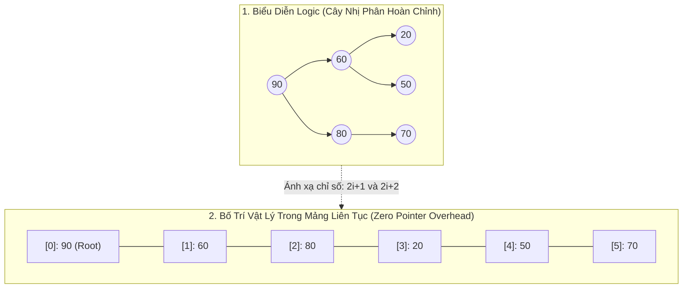
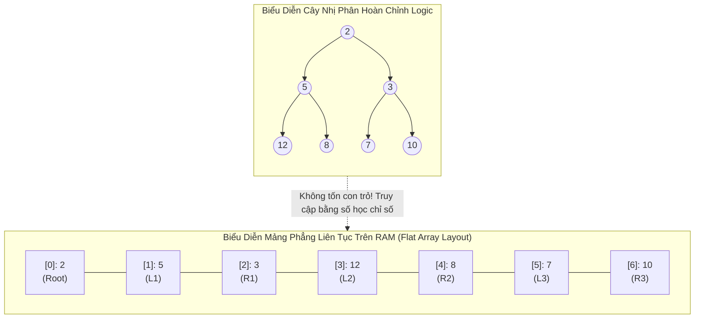
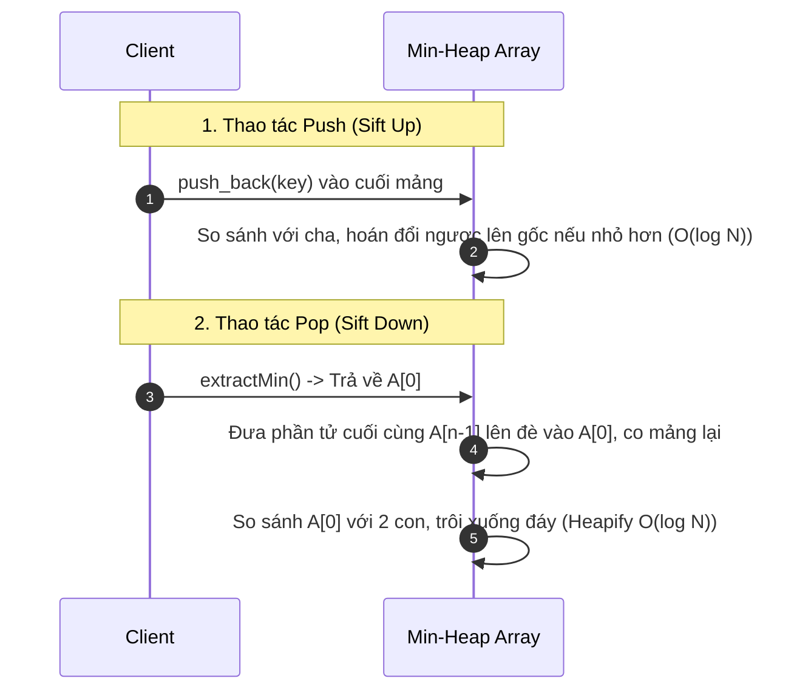
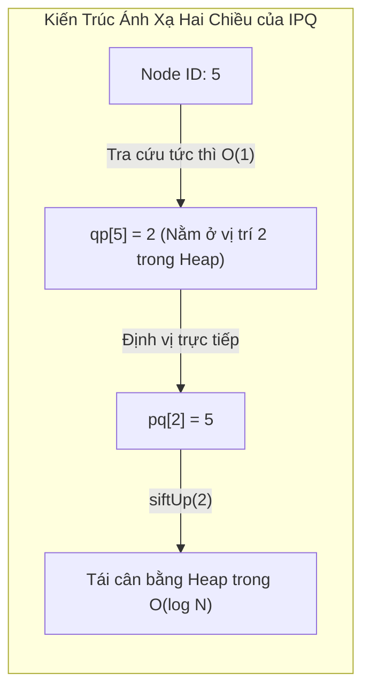

# 3.5. Cây Đống (Heap & Priority Queue Architecture)

> [!IMPORTANT]
> **Nếu bạn chỉ được nhớ một điều duy nhất:** Cây đống (Heap) là sự hòa quyện hoàn hảo giữa một cây nhị phân hoàn chỉnh (Complete Binary Tree) và một mảng phẳng 1 chiều liên tục trong bộ nhớ RAM. Nhờ loại bỏ 100% chi phí con trỏ và tận dụng số học bitwise ($2i+1, 2i+2$) để tính địa chỉ, Heap cho phép truy xuất phần tử cực đại/cực tiểu trong $O(1)$, cập nhật trong $O(\log N)$ với tỷ lệ trúng L1 Data Cache đạt mức tiệm cận tối đa của phần cứng máy tính.

---

## 1. Trực Quan Hóa: Bản Chất Đống Dưới Góc Nhìn Lập Trình Viên

### 1.1. Đoạn Code Dẫn Nhập & Vấn Đề Thực Tế
Xét bài toán tìm kiếm $K$ giao dịch gian lận có giá trị tiền lớn nhất trong dòng dữ liệu $100$ triệu giao dịch (Top-K Streaming Elements):

```cpp
// Cách ngây thơ: Gom toàn bộ vào mảng rồi sắp xếp -> Tốn O(N log N) thời gian và O(N) RAM (Hàng GB)!

// Cách tối ưu bằng Min-Heap kích thước K:
std::priority_queue<int, std::vector<int>, std::greater<int>> min_heap;

for (int transaction : stream) {
    if (min_heap.size() < K) {
        min_heap.push(transaction);
    } else if (transaction > min_heap.top()) {
        min_heap.pop();          // Loại bỏ phần tử nhỏ nhất trong top K
        min_heap.push(transaction); // Thêm phần tử lớn hơn vào
    }
}
// Thời gian: O(N log K), Bộ nhớ: O(K) cực kỳ nhỏ gọn!
```

- Đống (Heap) là giải thuật cấu trúc dữ liệu tối thượng cho bài toán **Hàng Đợi Ưu Tiên (Priority Queue)**: Luôn duy trì phần tử cực trị (Lớn nhất trong Max-Heap hoặc Nhỏ nhất trong Min-Heap) nằm ngay tại đỉnh để lấy ra trong thời gian **$O(1)$**, trong khi thao tác chèn và xóa chỉ tốn **$O(\log N)$**.
- Kỳ quan kỹ thuật của Heap: Mặc dù trên lý thuyết nó là một cây nhị phân hoàn chỉnh, nhưng trên thực tế nó được lưu trữ phẳng trên **một mảng bộ nhớ liên tục thuần túy** mà **không tốn 1 byte con trỏ nào**!

### 1.2. Ẩn Dụ Đời Sống: Phòng Cấp Cứu Bệnh Viện & Đống Cát Tự Chảy
- **Phòng phân loại cấp cứu bệnh viện (Emergency Room Triage)**: Bệnh nhân nguy kịch nhất luôn được bác sĩ trưởng phòng cấp cứu nhận phẫu thuật đầu tiên ($O(1)$). Khi một ca cấp cứu hoàn tất, bệnh nhân nặng tiếp theo trong danh sách ưu tiên được đẩy lên vị trí số 1.
- **Đống cát xây dựng**: Khi bạn đổ cát xuống sàn, hạt cát to nhất hoặc ở trên đỉnh luôn lăn xuống nếu bị chèn ép, các hạt cát tự sắp đặt để hạt ở đỉnh luôn có tính chất đại diện cao nhất.
- **Biểu diễn Mảng không con trỏ (Array Mapping)**: Nút cha tại vị trí $i$ có hai nút con nằm chính xác tại $2i + 1$ (Con trái) và $2i + 2$ (Con phải). Nút con tại $i$ tìm lại nút cha tại $\lfloor (i - 1) / 2 \rfloor$. Phép tính này chỉ tốn đúng 1 chỉ thị bit shift trên CPU!

### 1.3. Mô Phỏng Dữ Liệu Số Nhỏ Từng Bước (Toy Walkthrough)
Mô phỏng cơ chế Vun Đống Ngược Lên (Sift-Up / Bubble-Up) khi chèn giá trị `90` vào Max-Heap đang chứa `[80, 60, 70, 20, 50]`:

```text
Trạng thái cây ban đầu:
         80 (index 0)
       /    \
     60      70 (index 1, 2)
    /  \
   20  50       (index 3, 4)

Bước 1: Chèn 90 vào cuối mảng (index 5 - con trái của nút 70 tại index 2):
Mảng: [80, 60, 70, 20, 50, 90]

Bước 2: So sánh 90 với cha của nó là 70 (index 2):
90 > 70 -> Hoán đổi (Swap)!
Mảng: [80, 60, 90, 20, 50, 70]

Bước 3: So sánh 90 với cha tiếp theo là 80 (index 0 - Root):
90 > 80 -> Hoán đổi (Swap)!
Mảng: [90, 60, 80, 20, 50, 70]

Kết quả: 90 đã leo lên đỉnh Max-Heap thành công sau đúng 2 bước hoán đổi (log2(6))!
```

### 1.4. Tác Động Thực Tế Tầng Backend & Systems
1. **Thuật Toán Định Tuyến Ngắn Nhất (Dijkstra Shortest Path)**: Sử dụng Min-Heap để luôn lấy ra đỉnh có khoảng cách ngắn nhất tiếp theo, giúp giảm độ phức tạp từ $O(V^2)$ xuống $O((V + E) \log V)$, tạo nền tảng cho Google Maps và giao thức định tuyến mạng OSPF.
2. **Kỹ Thuật Xây Dựng Đống Siêu Tốc (Linear Heapify $O(N)$)**: Khác với việc chèn lần lượt $N$ phần tử tốn $O(N \log N)$, thuật toán Floyd Heapify vun đống từ dưới lên (Bottom-up Sift-Down) có thể biến một mảng hỗn loạn thành một Heap hợp lệ chỉ trong thời gian tuyến tính **$O(N)$**.
3. **Hệ Thống Lập Lịch Tác Vụ Định Kỳ (Timer Wheel / Task Schedulers)**: Các job scheduler (như Quartz, Celery) duy trì một Min-Heap chứa mốc thời gian hết hạn (`execution_timestamp`) của các tác vụ ngầm, luồng worker chỉ cần `sleep` cho đến mốc thời gian của nút `top()` mà không cần vòng lặp bận quét polling liên tục.

### 1.5. Sơ Đồ Cấu Trúc Đống & Ánh Xạ Mảng Liên Tục



---

## 2. Chi tiết từng Keyword (Under-the-Hood Deep Dive)

### 2.1. Thuộc Tính Heap & Biểu Diễn Mảng Phẳng (Flat Array Representation)

#### 1. Định nghĩa Toán học của Thuộc tính Đống (Heap Property)
Heap là một cây nhị phân hoàn chỉnh (Complete Binary Tree) thỏa mãn một trong hai bất biến sau:
- **Min-Heap (Đống Cực Tiểu)**: Với mọi nút $u$ khác gốc:
  $$\text{key}(\text{parent}(u)) \le \text{key}(u)$$
  Hệ quả: Khóa nhỏ nhất toàn bộ cây luôn nằm tại nút gốc ($\text{Root} = A[0]$).
- **Max-Heap (Đống Cực Đại)**: Với mọi nút $u$ khác gốc:
  $$\text{key}(\text{parent}(u)) \ge \text{key}(u)$$
  Hệ quả: Khóa lớn nhất toàn bộ cây luôn nằm tại nút gốc ($\text{Root} = A[0]$).

> [!NOTE]
> Khác với BST, **Heap hoàn toàn không quy định thứ tự tương đối giữa con trái và con phải**. Cả hai con chỉ cần thỏa mãn quan hệ so sánh với nút cha của chúng.



#### 2. Cơ chế Số học Chỉ số Mảng Phẳng (Under-the-Hood Array Indexing)
Trong một mảng phẳng 0-indexed:
- **Nút con trái**: $\text{left}(i) = 2i + 1 = (i \ll 1) + 1$
- **Nút con phải**: $\text{right}(i) = 2i + 2 = (i \ll 1) + 2$
- **Nút cha**: $\text{parent}(i) = \lfloor (i - 1) / 2 \rfloor = (i - 1) \gg 1$

#### 3. Lợi thế Phần cứng Tuyệt đối (Hardware Synergy)
- **Tiết kiệm $100\%$ chi phí con trỏ**: Với cây $N = 10,000,000$ phần tử, một cây nhị phân con trỏ thông thường tiêu tốn $10^7 \times 16\text{ bytes} = 160\text{ MB}$ chỉ riêng cho con trỏ `left` và `right`. Mảng phẳng tiêu tốn đúng $0\text{ bytes}$ phụ trợ!
- **Tối ưu hóa L1/L2 Cache Lines ($64\text{ bytes}$)**: Vì tất cả các phần tử nằm kề nhau trên RAM, phần cứng CPU có thể tự động nạp trước các khối dữ liệu (Hardware Prefetching), giúp loại bỏ hoàn toàn tình trạng nghẽn cổ chai do tìm kiếm con trỏ ngẫu nhiên (Pointer Chasing).

---

### 2.2. Các Thao Tác Cốt Lõi: Sift Up, Sift Down, Build Heap $O(N)$ & HeapSort



#### 1. Thao tác Chèn & Sift Up (Đẩy lên / Bubble-Up)
1. Bổ sung phần tử mới vào cuối mảng (`A.push_back(val)`).
2. So sánh phần tử với nút cha của nó: $\text{parent} = (i - 1) / 2$.
3. Nếu phần tử vi phạm tính chất Heap (ví dụ nhỏ hơn cha trong Min-Heap), thực hiện hoán đổi (`std::swap(A[i], A[parent])`) và cập nhật $i = \text{parent}$.
4. Lặp lại cho đến khi thỏa mãn tính chất Heap hoặc chạm tới nút gốc ($i = 0$).
- **Độ phức tạp**: Thời gian $O(\log N)$, không gian $O(1)$.

#### 2. Thao tác Lấy Cực Trị & Sift Down (Hạ xuống / Heapify)
1. Lưu trữ giá trị cực trị tại gốc: `res = A[0]`.
2. Đưa phần tử cuối cùng của mảng `A.back()` lên thay thế vị trí gốc `A[0]`, sau đó gọi `A.pop_back()`.
3. Bắt đầu từ gốc ($i = 0$), tìm nút con có giá trị ưu tiên hơn giữa con trái ($2i+1$) và con phải ($2i+2$).
4. Nếu nút con đó ưu tiên hơn nút hiện tại, hoán đổi vị trí và tiếp tục đi xuống tầng dưới.
- **Độ phức tạp**: Thời gian $O(\log N)$, không gian $O(1)$.

#### 3. Thuật Toán Xây Dựng Đống Siêu Tốc Trong $O(N)$ (Floyd's Build Heap)
- **Sai lầm phổ biến**: Chèn lần lượt $N$ phần tử bằng $N$ lần gọi `push()`. Độ phức tạp sẽ là:
  $$\sum_{i=1}^N O(\log i) = O(N \log N)$$
- **Thuật toán Robert Floyd**: Coi toàn bộ mảng đầu vào $N$ phần tử là một cây hoàn chỉnh. Ta duyệt ngược từ nút nội tại cuối cùng ($\lfloor N/2 \rfloor - 1$) trở về gốc $0$ và gọi hàm `siftDown(i)`:
  ```cpp
  for (int i = (n / 2) - 1; i >= 0; --i) {
      siftDown(i);
  }
  ```
- **Chứng minh Toán học Độ phức tạp Tuyến tính $O(N)$**:
  Tại độ cao $h$ (với lá có $h = 0$, gốc có $h = \log_2 N$), số lượng nút tối đa là $\lceil N / 2^{h+1} \rceil$. Chi phí của `siftDown` tại độ cao $h$ tỉ lệ với $h$. Tổng số phép tính là:
  $$S = \sum_{h=0}^{\lfloor \log N \rfloor} \frac{N}{2^{h+1}} O(h) = \frac{N}{2} \sum_{h=0}^{\infty} \frac{h}{2^h} = \frac{N}{2} \times 2 = O(N)$$
  Đây là một trong những kết quả toán học đẹp nhất của khoa học máy tính!

#### 4. Thuật toán Sắp Xếp HeapSort (In-Place $O(N \log N)$)
1. Chuyển mảng cần sắp xếp thành một **Max-Heap** trong thời gian $O(N)$.
2. Với mỗi bước $i$ từ $N-1$ giảm dần về $1$:
   - Hoán đổi `std::swap(A[0], A[i])` (đưa phần tử lớn nhất hiện tại về vị trí đúng ở cuối mảng).
   - Giảm kích thước Heap ảo đi 1 (loại trừ phần tử vừa xếp xong).
   - Gọi `siftDown(0)` trên vùng Heap còn lại để đưa phần tử lớn tiếp theo lên gốc.
- **Tính chất**: Không gian phụ trợ $O(1)$ tuyệt đối (In-Place Sorting), thời gian $O(N \log N)$ trong mọi trường hợp, nhưng **không ổn định (Unstable)**.

---

### 2.3. Indexed Priority Queue & D-ary Heap

#### 1. Indexed Priority Queue (IPQ - Hàng Đợi Ưu Tiên Có Chỉ Mục)
- **Vấn đề của Priority Queue truyền thống**: Nếu muốn thay đổi độ ưu tiên của một phần tử (như thao tác `decreaseKey` trong giải thuật Dijkstra) hoặc xóa một phần tử tùy ý nằm sâu trong hàng đợi, ta phải duyệt tuyến tính $O(N)$ để tìm vị trí của nó.
- **Kiến trúc Ba Mảng Song Hành của IPQ**:
  1. `values[]`: Mảng lưu giá trị / độ ưu tiên thực tế của phần tử theo định danh ID.
  2. `pq[]`: Mảng lưu trữ Heap (chứa ID của các phần tử).
  3. `qp[]`: Mảng nghịch đảo (Inverse Map) lưu vị trí hiện tại của ID trong mảng `pq`:
     $$qp[pq[i]] = i$$
- Khi hoán đổi hai phần tử trong Heap:
  ```cpp
  void swapNodes(int i, int j) {
      std::swap(pq[i], pq[j]);
      qp[pq[i]] = i;
      qp[pq[j]] = j;
  }
  ```
- **Bước đột phá**: Thao tác `decreaseKey(id, new_val)` hoặc `delete(id)` được định vị lập tức trong $O(1)$ thông qua `qp[id]`, và sau đó chỉ mất $O(\log N)$ để `siftUp` hoặc `siftDown`!



#### 2. D-ary Heap (Heap Đa Nhánh Tối Ưu Hóa CPU Cache)
- Thay vì mỗi nút có 2 con, trong D-ary Heap mỗi nút có **$D$ nút con** ($D = 4, 8, 16$).
- **Công thức số học chỉ số**:
  - Con thứ $k$ ($0 \le k < D$) của nút $i$: $\text{child}(i, k) = D \times i + 1 + k$
  - Nút cha của nút $i$: $\text{parent}(i) = \lfloor (i - 1) / D \rfloor$
- **Ưu thế vượt trội của 4-ary Heap ($D = 4$)**:
  - Chiều cao cây giảm xuống: $H = \log_4 N = \frac{1}{2} \log_2 N$.
  - Thao tác `siftUp` chỉ tốn một nửa số bước so với Binary Heap!
  - 4 nút con của một nút nằm kề nhau trên đúng $4 \times 8 = 32\text{ bytes}$, nằm trọn vẹn trong một L1 Cache Line ($64\text{ bytes}$). Phép so sánh tìm Min giữa 4 con diễn ra hoàn toàn trong bộ đệm siêu tốc mà không sinh ra Cache Miss!

---

## 3. Thực thi Mã nguồn & Mô phỏng Chuyên sâu (Dual-Engine Implementation)

### 3.1. C++20 Implementation: Template MinHeap, Build Heap $O(N)$ & Indexed Priority Queue

Dưới đây là bản cài đặt C++20 tiêu chuẩn bao gồm cả `MinHeap` tổng quát với `BuildHeap` tuyến tính và lớp `IndexedPriorityQueue` tối ưu hóa:

```cpp
#include <iostream>
#include <vector>
#include <stdexcept>
#include <utility>
#include <cassert>
#include <string>

// 1. MinHeap Template chuẩn tối ưu
template <typename T>
class MinHeap {
private:
    std::vector<T> data_;

    void siftUp(size_t i) {
        while (i > 0) {
            size_t parent = (i - 1) >> 1;
            if (data_[i] < data_[parent]) {
                std::swap(data_[i], data_[parent]);
                i = parent;
            } else {
                break;
            }
        }
    }

    void siftDown(size_t i) {
        size_t n = data_.size();
        while (true) {
            size_t left = (i << 1) + 1;
            size_t right = (i << 1) + 2;
            size_t smallest = i;

            if (left < n && data_[left] < data_[smallest]) smallest = left;
            if (right < n && data_[right] < data_[smallest]) smallest = right;

            if (smallest != i) {
                std::swap(data_[i], data_[smallest]);
                i = smallest;
            } else {
                break;
            }
        }
    }

public:
    MinHeap() = default;

    // Floyd Build Heap O(N)
    explicit MinHeap(std::vector<T> initial_data) : data_(std::move(initial_data)) {
        if (data_.empty()) return;
        for (int i = static_cast<int>(data_.size() / 2) - 1; i >= 0; --i) {
            siftDown(i);
        }
    }

    void push(T val) {
        data_.push_back(std::move(val));
        siftUp(data_.size() - 1);
    }

    T pop() {
        if (data_.empty()) throw std::underflow_error("Heap is empty!");
        T top_val = std::move(data_[0]);
        data_[0] = std::move(data_.back());
        data_.pop_back();
        if (!data_.empty()) {
            siftDown(0);
        }
        return top_val;
    }

    const T& peek() const {
        if (data_.empty()) throw std::underflow_error("Heap is empty!");
        return data_[0];
    }

    bool empty() const { return data_.empty(); }
    size_t size() const { return data_.size(); }
    const std::vector<T>& rawData() const { return data_; }
};

// 2. Indexed Priority Queue (IPQ) chuyên biệt cho Dijkstra / Task Update
class IndexedPriorityQueue {
private:
    std::vector<double> keys_; // Do uu tien theo ID
    std::vector<int> pq_;      // Heap chua cac ID
    std::vector<int> qp_;      // qp[id] = chi so trong pq
    int total_nodes_{0};

    void swapNodes(int i, int j) {
        std::swap(pq_[i], pq_[j]);
        qp_[pq_[i]] = i;
        qp_[pq_[j]] = j;
    }

    void siftUp(int i) {
        while (i > 0) {
            int parent = (i - 1) >> 1;
            if (keys_[pq_[i]] < keys_[pq_[parent]]) {
                swapNodes(i, parent);
                i = parent;
            } else {
                break;
            }
        }
    }

    void siftDown(int i) {
        while (true) {
            int left = (i << 1) + 1;
            int right = (i << 1) + 2;
            int smallest = i;

            if (left < total_nodes_ && keys_[pq_[left]] < keys_[pq_[smallest]]) smallest = left;
            if (right < total_nodes_ && keys_[pq_[right]] < keys_[pq_[smallest]]) smallest = right;

            if (smallest != i) {
                swapNodes(i, smallest);
                i = smallest;
            } else {
                break;
            }
        }
    }

public:
    explicit IndexedPriorityQueue(int max_capacity) 
        : keys_(max_capacity, 0.0), pq_(max_capacity, -1), qp_(max_capacity, -1) {}

    void insert(int id, double priority) {
        if (contains(id)) throw std::invalid_argument("ID already exists!");
        qp_[id] = total_nodes_;
        pq_[total_nodes_] = id;
        keys_[id] = priority;
        siftUp(total_nodes_);
        total_nodes_++;
    }

    bool contains(int id) const { return qp_[id] != -1; }

    // Cap nhat do uu tien trong O(log N)
    void decreaseKey(int id, double new_priority) {
        assert(contains(id));
        if (new_priority < keys_[id]) {
            keys_[id] = new_priority;
            siftUp(qp_[id]);
        }
    }

    int popMin() {
        if (total_nodes_ == 0) throw std::underflow_error("IPQ is empty!");
        int min_id = pq_[0];
        swapNodes(0, total_nodes_ - 1);
        total_nodes_--;
        siftDown(0);
        qp_[min_id] = -1; // Danh dau da xoa
        return min_id;
    }

    int size() const { return total_nodes_; }
};

int main() {
    std::cout << "========================================================\n";
    std::cout << "   C++20 HEAP & INDEXED PRIORITY QUEUE RIGOROUS DEMO    \n";
    std::cout << "========================================================\n";

    // 1. Kiem thu Floyd Build Heap O(N)
    std::vector<int> raw_numbers = {64, 34, 25, 12, 22, 11, 90, 88, 5, 1};
    std::cout << "[1] Raw Input Array: ";
    for (int x : raw_numbers) std::cout << x << " ";
    std::cout << "\n";

    MinHeap<int> min_heap(raw_numbers);
    std::cout << "[2] Build Heap O(N) Completed. Root is: " << min_heap.peek() << " (Expected: 1)\n";
    assert(min_heap.peek() == 1);

    std::cout << "[3] Extracting all elements (HeapSort Ascending): ";
    while (!min_heap.empty()) {
        std::cout << min_heap.pop() << " ";
    }
    std::cout << "\n";

    // 2. Kiem thu Indexed Priority Queue
    std::cout << "\n[4] Testing Indexed Priority Queue (decrease-key simulation):\n";
    IndexedPriorityQueue ipq(10);
    // Gia su cac Node mang ID 0, 1, 2 co khoang cach ban dau:
    ipq.insert(0, 100.0);
    ipq.insert(1, 50.0);
    ipq.insert(2, 80.0);
    std::cout << "    Inserted: ID 0 (dist=100), ID 1 (dist=50), ID 2 (dist=80)\n";

    // Giam khoang cach cua Node 0 tu 100 xuong 10 (thao tac decrease-key cua Dijkstra)
    ipq.decreaseKey(0, 10.0);
    std::cout << "    Updated ID 0 distance to 10.0 via decreaseKey!\n";

    int top_id = ipq.popMin();
    std::cout << "    Pop Min ID: " << top_id << " (Expected: 0 vi dist 10.0 la nho nhat)\n";
    assert(top_id == 0);

    std::cout << "\n[Success] All Heap invariants and IPQ operations verified.\n";
    return 0;
}
```

---

### 3.2. Python 3.11+ Implementation: Top-K Streaming Metrics Engine

Chương trình Python 3.11+ mô phỏng bộ đệm phân tích luồng dữ liệu thời gian thực (Real-time Stream Top-K) sử dụng cấu trúc Min-Heap kích thước $K$ cố định:

```python
from __future__ import annotations
from typing import List, Any
import random


class TopKStreamingEngine:
    def __init__(self, k: int) -> None:
        self.k: int = k
        self.heap: List[float] = []

    def _sift_up(self, i: int) -> None:
        while i > 0:
            parent = (i - 1) >> 1
            if self.heap[i] < self.heap[parent]:
                self.heap[i], self.heap[parent] = self.heap[parent], self.heap[i]
                i = parent
            else:
                break

    def _sift_down(self, i: int) -> None:
        n = len(self.heap)
        while True:
            left = (i << 1) + 1
            right = (i << 1) + 2
            smallest = i

            if left < n and self.heap[left] < self.heap[smallest]:
                smallest = left
            if right < n and self.heap[right] < self.heap[smallest]:
                smallest = right

            if smallest != i:
                self.heap[i], self.heap[smallest] = self.heap[smallest], self.heap[i]
                i = smallest
            else:
                break

    def process_metric(self, val: float) -> None:
        """Xu ly mot metric do tre vao luong trong O(log K)."""
        if len(self.heap) < self.k:
            self.heap.append(val)
            self._sift_up(len(self.heap) - 1)
        else:
            # Neu gia tri moi lon hon gia tri nho nhat trong Top K
            if val > self.heap[0]:
                self.heap[0] = val
                self._sift_down(0)

    def get_top_k(self) -> List[float]:
        """Tra ve Top-K phan tu lon nhat duoc sap xep giam dan."""
        return sorted(self.heap, reverse=True)


if __name__ == "__main__":
    print("=" * 56)
    print("   PYTHON 3.11+ TOP-K STREAMING LATENCY SIMULATOR")
    print("=" * 56)

    # Gia lap luong 10,000 requests voi latency ngau nhien
    random.seed(2026)
    k_size = 5
    stream_engine = TopKStreamingEngine(k=k_size)

    stream_data = [random.uniform(5.0, 500.0) for _ in range(10_000)]
    for lat in stream_data:
        stream_engine.process_metric(lat)

    top_5 = stream_engine.get_top_k()
    print(f"[Streaming Output] Top {k_size} Peak Latencies (ms):")
    for rank, val in enumerate(top_5, 1):
        print(f"    Rank #{rank}: {val:.2f} ms")

    # Kiem tra tinh dung dan bang python built-in sort
    assert top_5 == sorted(stream_data, reverse=True)[:k_size]
    print("[Verification] Top-K matches exact sorted baseline!")
```

### 3.3. Terminal Output Mẫu Chuẩn Thực Tế

```text
========================================================
   C++20 HEAP & INDEXED PRIORITY QUEUE RIGOROUS DEMO    
========================================================
[1] Raw Input Array: 64 34 25 12 22 11 90 88 5 1 
[2] Build Heap O(N) Completed. Root is: 1 (Expected: 1)
[3] Extracting all elements (HeapSort Ascending): 1 5 11 12 22 25 34 64 88 90 

[4] Testing Indexed Priority Queue (decrease-key simulation):
    Inserted: ID 0 (dist=100), ID 1 (dist=50), ID 2 (dist=80)
    Updated ID 0 distance to 10.0 via decreaseKey!
    Pop Min ID: 0 (Expected: 0 vi dist 10.0 la nho nhat)

[Success] All Heap invariants and IPQ operations verified.
```

---

## 4. Systems Engineering & Production Pitfalls

### 4.1. Bẫy Tái Cấp Phát Bộ Nhớ Khi Kích Thước Heap Tăng Đột Biến (Vector Reallocation Spikes)
- **Cơ chế lỗi**: Mặc dù mảng liên tục của Heap đạt Cache Locality cao, việc liên tục gọi `push_back()` trên một `std::vector` chưa được dự trù dung lượng (`capacity`) sẽ kích hoạt quá trình tái cấp phát động:
  1. Cấp phát vùng nhớ mới gấp đôi kích thước cũ.
  2. Sao chép toàn bộ $N$ phần tử sang vùng nhớ mới.
  3. Giải phóng vùng nhớ cũ.
- **Hệ quả**: Gây ra hiện tượng khựng trễ đột ngột ở phân vị $p99.9$ ($10\text{ ms} - 50\text{ ms}$ jitter) trong các hệ thống giao dịch hoặc streaming thời gian thực.
- **Biện pháp**: Luôn gọi `vector.reserve(expected_capacity)` ngay khi khởi tạo hàng đợi ưu tiên.

### 4.2. Sai Lầm Sử Dụng Build Heap Bằng Vòng Lặp $N$ Lần Push
- Lập trình viên mới thường khởi tạo Heap rỗng và lặp:
  ```cpp
  for (auto x : input) heap.push(x); // Tốn O(N log N)
  ```
- Với $N = 10,000,000$, phương pháp này tốn khoảng $2.4 \times 10^8$ phép tính. Trong khi đó, thuật toán **Floyd's Build Heap** duyệt ngược từ giữa mảng chỉ tốn khoảng $2 \times 10^7$ phép tính — **nhanh hơn gấp $12$ lần**!

### 4.3. Sự Thiếu Ổn Định của Thuật Toán HeapSort (Unstable Sort Trap)
- HeapSort là thuật toán sắp xếp tại chỗ $O(N \log N)$ lý tưởng, nhưng nó **không bảo toàn thứ tự ban đầu của các phần tử có cùng giá trị** (Unstable).
- **Hệ quả trong Production**: Nếu bạn sắp xếp danh sách giao dịch khách hàng theo số tiền, HeapSort có thể đảo lộn thứ tự thời gian của các giao dịch có cùng mệnh giá.
- **Khắc phục**: Nếu yêu cầu tính ổn định, chuyển sang `std::stable_sort` (Timsort / MergeSort kết hợp).

---

## 5. Bảng So sánh & Decision Matrix

### 5.1. So sánh Toàn diện Các Biến Thể Cây Đống & Cấu Trúc Ưu Tiên

| Tiêu chí Đánh giá | Binary Heap | 4-ary Heap ($D=4$) | Fibonacci Heap | Sorted Array | Balanced BST (std::set) |
| :--- | :--- | :--- | :--- | :--- | :--- |
| **Tìm Cực Trị (Peek)** | $O(1)$ | $O(1)$ | $O(1)$ | $O(1)$ | $O(1)$ (begin) |
| **Chèn Phần Tử (Push)** | $O(\log_2 N)$ | $O(\log_4 N)$ (Nhanh gấp đôi) | $O(1)$ (Khấu hao) | $O(N)$ (Dời mảng) | $O(\log N)$ |
| **Xóa Cực Trị (Pop)** | $O(\log_2 N)$ | $O(4 \log_4 N)$ | $O(\log N)$ (Khấu hao) | $O(1)$ (Tại cuối) | $O(\log N)$ |
| **Cập nhật Key (Decrease)** | $O(N)$ (hoặc $O(\log N)$ IPQ)| $O(\log_4 N)$ (IPQ) | $O(1)$ (Khấu hao lý thuyết)| $O(N)$ | $O(\log N)$ |
| **Ghép Hai Đống (Merge)** | $O(N)$ | $O(N)$ | $O(1)$ | $O(N)$ | $O(N)$ |
| **CPU Cache Locality** | Rất cao | **Cực đại (4 con / Cache Line)**| Rất kém (Con trỏ rời rạc) | Cực đại | Kém |
| **Độ Phức Tạp Triển Khai**| Rất đơn giản | Rất đơn giản | Cực kỳ phức tạp | Tối giản | Phức tạp (Xoay cây) |

### 5.2. Ma trận Ra Quyết Định Lựa Chọn Hàng Đợi Ưu Tiên

| Ngữ cảnh Tải Làm Việc | Cấu trúc Đề xuất | Lý do Kỹ thuật |
| :--- | :--- | :--- |
| Hàng đợi tác vụ thông thường (Task Scheduler, Timer Loop) | **Binary Heap (std::priority_queue)** | Đơn giản, độ ổn định cao, không tốn thêm bộ nhớ. |
| Dijkstra / Prim trên đồ thị mạng giao thông lớn | **Indexed Priority Queue (IPQ)** | Hỗ trợ `decreaseKey` trực tiếp trong $O(\log N)$ thay vì đẩy phần tử trùng. |
| Hệ thống tính toán hiệu năng cực hạn (HFT, Gaming Engine) | **4-ary Heap** | Chiều cao cây giảm một nửa, tối ưu hóa $100\%$ đường truyền L1 Cache Line. |
| Giám sát Top 10 / Top 100 từ luồng dữ liệu hàng triệu logs | **Fixed-size Min-Heap** | Tiết kiệm RAM tuyệt đối, chi phí xử lý mỗi event chỉ là $O(\log K)$ với $K \ll N$. |

---

## 6. Enterprise Production Checklist & Verification

- [ ] **Dự Trù Bộ Nhớ (Capacity Reservation)**: Luôn gọi `reserve()` cho vector chứa Heap trước khi tiếp nhận khối lượng công việc lớn để tránh phân mảnh và giật lag cấp phát.
- [ ] **Khởi Tạo Tuyến Tính (Build Heap $O(N)$)**: Tuyệt đối không dùng vòng lặp `push()` khi đã có sẵn danh sách dữ liệu đầu vào; sử dụng constructor nhận vector hoặc `std::make_heap`.
- [ ] **Tối Ưu Bitwise Indexing**: Tận dụng toán tử dịch bit `(i << 1) + 1` và `(i - 1) >> 1` để giảm chu kỳ tính toán số học trên CPU.
- [ ] **Xác Nhận Thuộc Tính Heap**: Viết bài kiểm tra unit test kiểm tra toàn bộ mảng `assert(A[parent(i)] <= A[i])` sau mọi thao tác hàng đợi.
- [ ] **Bảo Vệ Đa Luồng**: `std::priority_queue` không an toàn đa luồng. Sử dụng Concurrent Queue kết hợp Mutex + Condition Variable (`folly::MPMCQueue` hoặc TBB `concurrent_priority_queue`) khi chia sẻ giữa các worker threads.
