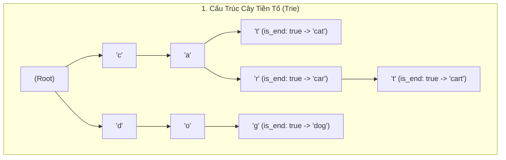
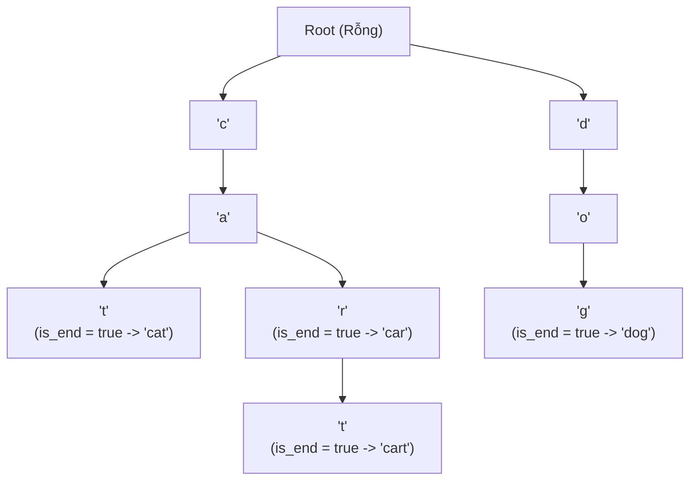
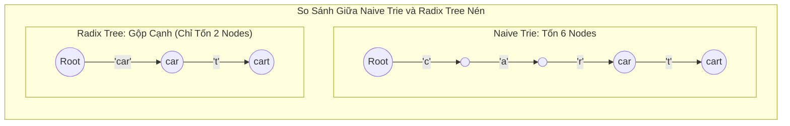

# 3.6. Cây Tiền Tố (Trie, Radix Tree & Patricia Trie)

> [!IMPORTANT]
> **Nếu bạn chỉ được nhớ một điều duy nhất:** Cây tiền tố (Trie) tách rời khóa khỏi nội dung lưu trữ: vị trí của nút trên cây chính là định danh của tiền tố, cho phép thời gian tra cứu chuỗi chỉ phụ thuộc vào độ dài từ $O(L)$ thay vì số lượng bản ghi $O(\log N)$. Tuy nhiên, Naive Trie gây bùng nổ bộ nhớ do lãng phí con trỏ rỗng, buộc các hệ thống phân tán, router mạng BGP và HTTP framework (như Gin, Fastify) phải sử dụng **Radix Tree** và **Patricia Trie** để nén các chuỗi đơn thành cạnh duy nhất, biến Trie thành vũ khí tối thượng cho tra cứu tiền tố dài nhất (Longest Prefix Match).

---

## 1. Trực Quan Hóa: Bản Chất Cây Tiền Tố Dưới Góc Nhìn Lập Trình Viên

### 1.1. Đoạn Code Dẫn Nhập & Vấn Đề Thực Tế
Xét tính năng Gợi ý tìm kiếm tự động (Typeahead Autocomplete) khi người dùng gõ từ khóa trên ô tìm kiếm:

```typescript
// Nếu dùng Mảng chứa 1,000,000 từ khóa:
// Để tìm các từ bắt đầu bằng "app", ta phải quét toàn bộ mảng: O(N * L) -> Cực chậm!

// Nếu dùng Cây Tiền Tố (Trie / Prefix Tree):
const trie = new Trie();
trie.insert("apple");
trie.insert("app");
trie.insert("application");

// Tìm kiếm tiền tố "app": Chỉ tốn đúng 3 bước nhảy ký tự ('a' -> 'p' -> 'p')!
// Tốc độ: O(L) với L là độ dài từ khóa, HOÀN TOÀN KHÔNG PHỤ THUỘC vào số lượng từ trong từ điển!
const suggestions = trie.autocomplete("app"); // Trả về tức thì: ["app", "apple", "application"]
```

- Cây tiền tố (Trie - bắt nguồn từ chữ Re**trie**val) là cấu trúc cây tối thượng cho việc xử lý chuỗi ký tự: Các chuỗi có cùng tiền tố sẽ **dùng chung một đường đi trên cây**, giúp triệt tiêu hoàn toàn sự trùng lặp dữ liệu và cho phép tra cứu với tốc độ tỷ lệ thuận với độ dài từ khóa $O(L)$, bất chấp tập dữ liệu có hàng tỷ từ.

### 1.2. Ẩn Dụ Đời Sống: Danh Bạ Điện Thoại & Cây Thư Mục Phân Nhánh
- Hãy hình dung cách một nhân viên bưu điện phân loại thư tín theo mã vùng ZIP code:
  - Tất cả các lá thư gửi đến Hà Nội bắt đầu bằng số `10` được đưa vào nhánh kho số 10.
  - Trong kho số 10, thư gửi về quận Cầu Giấy (mã `1007`) được chuyển tiếp vào ngăn kéo nhỏ `07`.
- Nhân viên bưu điện không cần phải đọc toàn bộ địa chỉ của 1 triệu bức thư; họ chỉ cần lần theo từng chữ số từ trái sang phải. Đó chính là bản chất của **Cây Tiền Tố (Trie)**.

### 1.3. Mô Phỏng Dữ Liệu Số Nhỏ Từng Bước (Toy Walkthrough)
Mô phỏng cây Trie khi chèn 4 từ: `"cat"`, `"car"`, `"cart"`, `"dog"`:

```text
               (Root)
              /      \
            'c'      'd'
             |        |
            'a'      'o'
           /   \      |
         't'*  'r'*  'g'*
                |
               't'*

(Ghi chú: Dấu '*' đánh dấu Nút Kết Thúc Từ - is_end_of_word = true)
```

- Từ `"cat"` và `"car"` dùng chung tiền tố `"ca"`.
- Từ `"cart"` kế thừa lại toàn bộ nhánh của `"car"` và chỉ cần cấy thêm đúng 1 nút con `'t'`.
- Kiểm tra xem có từ nào bắt đầu bằng `"ca"` không: Bắt đầu từ Root, đi qua `'c'` $\to$ đi qua `'a'` $\to$ Tìm thấy! Toàn bộ thao tác tốn đúng 2 bước kiểm tra con trỏ.

### 1.4. Tác Động Thực Tế Tầng Backend & Systems
1. **IP Routing & Longest Prefix Match Trong Router Mạng**: Các router mạng (như Cisco, Juniper) sử dụng biến thể **Radix Tree / Patricia Trie** để tra cứu bảng định tuyến IP (Routing Table). Khi một gói tin có địa chỉ `192.168.1.45` ập đến, router tìm kiếm tiền tố dài nhất phù hợp để quyết định cổng ra trong vài nano-giây.
2. **Bộ Lọc Từ Bậy & Kiểm Duyệt Nội Dung (Profanity Filter)**: Các hệ thống chat trực tuyến sử dụng thuật toán **Aho-Corasick** (kết hợp Trie và Automata) để quét tìm hàng nghìn từ khóa nhạy cảm trong tin nhắn của người dùng trong duy nhất một lượt quét tuyến tính.
3. **Tối Ưu Hóa Nén Nhánh Bằng Radix Tree (Compact Trie)**: Trie thông thường tiêu tốn rất nhiều bộ nhớ do mỗi nút có thể chứa 26 hoặc 256 con trỏ con. Radix Tree tối ưu hóa bằng cách gộp các chuỗi nút đơn liên tiếp thành một cạnh duy nhất (ví dụ gộp `'a' -> 'p' -> 'p' -> 'l' -> 'e'` thành `"apple"`), giảm tới $70\%$ số lượng nút và bộ nhớ RAM.

### 1.5. Sơ Đồ Kiến Trúc Cây Tiền Tố & Quá Trình Tra Cứu



---

## 2. Chi tiết từng Keyword (Under-the-Hood Deep Dive)

### 2.1. Cấu Trúc Trie Cơ Bản, Biểu Diễn Node & Thao Tác: Insert, Search, Autocomplete



#### 1. Biểu Diễn Nút Trong Bộ Nhớ (Node Memory Representation)
Mỗi nút trong cây Trie tiêu chuẩn (Standard Trie) cần quản lý các đường chuyển tiếp sang các ký tự tiếp theo. Có 2 cách tiếp cận kiến trúc chính:
- **Cách 1: Mảng Cố Định (Fixed Array Layout)**:
  ```cpp
  struct TrieNode {
      bool is_end_of_word{false};
      TrieNode* children[26]{nullptr}; // Cho bảng chữ cái thường 'a'-'z'
  };
  ```
  - *Ưu thế*: Thao tác chuyển trạng thái đạt tốc độ cực hạn $O(1)$ thông qua tính toán chỉ mục mảng `c - 'a'`.
  - *Điểm yếu*: Lãng phí bộ nhớ khủng khiếp. Trên kiến trúc 64-bit, mảng 26 con trỏ ngốn:
    $$26 \times 8\text{ bytes} + 1\text{ byte (flag)} + 7\text{ bytes (padding)} = 216\text{ bytes / node}$$
    Nếu cây có $1,000,000$ nút thưa thớt, hệ thống tiêu tốn hơn $216\text{ MB}$ RAM dù phần lớn các con trỏ là `nullptr`!
- **Cách 2: Bảng Băm Động (Hash Map / Sparse Representation)**:
  ```cpp
  struct TrieNode {
      bool is_end_of_word{false};
      std::unordered_map<char, TrieNode*> children;
  };
  ```
  - *Ưu thế*: Chỉ cấp phát con trỏ khi có ký tự xuất hiện, tiết kiệm bộ nhớ cho cây thưa.
  - *Điểm yếu*: Phạt độ trễ hàm băm và mất Cache Locality.

#### 2. Thao Tác Chèn (`Insert`)
1. Bắt đầu từ nút gốc (`root`).
2. Với mỗi ký tự $c$ trong từ cần chèn độ dài $L$:
   - Tính chỉ số tương ứng $\text{idx} = c - \text{'a'}$.
   - Nếu `children[idx]` chưa tồn tại, cấp phát một `TrieNode` mới.
   - Di chuyển con trỏ xuống nút con vừa tạo.
3. Khi duyệt hết chuỗi, đánh dấu `curr->is_end_of_word = true`.
- **Độ phức tạp**: Thời gian $O(L)$, không gian bộ nhớ mới tối đa $O(L)$.

#### 3. Thao Tác Tìm Kiếm Từ (`Search`) & Tiền Tố (`StartsWith`)
- **Khớp từ chính xác (`search`)**: Đi dọc theo chuỗi ký tự. Nếu gặp con trỏ `nullptr` giữa chừng, kết luận từ không tồn tại. Nếu đi hết chuỗi, kiểm tra cờ `is_end_of_word`.
- **Khớp tiền tố (`startsWith`)**: Chỉ cần đi hết chuỗi ký tự mà không gặp `nullptr` thì trả về `true` bất kể cờ `is_end_of_word`.
- **Độ phức tạp**: Thời gian $O(L)$, không gian phụ trợ $O(1)$.

#### 4. Thao Tác Gợi Ý Từ Khóa Tự Động (`Autocomplete`)
1. Đi dọc cây theo tiền tố truy vấn $P$ độ dài $L$ để định vị nút đại diện cho tiền tố.
2. Từ nút tiền tố đó, kích hoạt giải thuật duyệt DFS/BFS để thu thập tất cả các nút có `is_end_of_word == true` trong cây con phía dưới.
- **Độ phức tạp**: Thời gian $O(L + K)$ với $K$ là tổng số ký tự của tất cả các từ gợi ý tìm được.

---

### 2.2. Cây Tiền Tố Nén: Compressed Trie, Radix Tree & Patricia Trie

Khi khối lượng từ vựng tăng lên, nhược điểm phân mảnh bộ nhớ của Naive Trie trở thành thảm họa. Các kỹ thuật nén cạnh ra đời để tối ưu hóa không gian lưu trữ và tốc độ xử lý:



#### 1. Compressed Trie (Cây Tiền Tố Nén) & Radix Tree (Compact Trie)
- **Bản chất kỹ thuật**: Bất kỳ nút nội tại nào chỉ có **đúng 1 nút con duy nhất** và bản thân nó không phải là điểm kết thúc từ (`is_end_of_word == false`) sẽ bị loại bỏ bằng cách gộp chuỗi ký tự của nó vào cạnh nối với nút cha (Edge Label Coalescing).
- **Hệ quả kiến trúc**:
  - Chiều cao của cây giảm mạnh, tỉ lệ thuận với số lần rẽ nhánh thay vì độ dài từ.
  - Số lượng nút nội tại trong cây tối đa chỉ bằng số lượng từ được lưu trữ ($O(N)$), khắc phục triệt để bài toán bùng nổ bộ nhớ.

#### 2. Patricia Trie (Bitwise Radix-2 Tree)
- Được phát minh bởi Donald R. Morrison (1968), Patricia viết tắt của: *Practical Algorithm to Retrieve Information Coded in Alphanumeric*.
- **Đột phá cơ số 2 (Radix = 2)**: Khóa được xem như một chuỗi bit nhị phân (`0` và `1`).
- Thay vì lưu trữ chuỗi ký tự trên từng cạnh, mỗi nút Patricia chỉ lưu trữ:
  1. **Chỉ số bit đầu tiên có sự khác biệt (Index of Differing Bit / Skip Count)** giữa các nhánh khóa.
  2. Đúng **hai con trỏ**: `left` (tương ứng bit `0`) và `right` (tương ứng bit `1`).
- **Ứng dụng**: Không cần thực hiện so sánh chuỗi ở các tầng trung gian, CPU chỉ cần kiểm tra giá trị của một bit cụ thể bằng phép toán bitwise `(key >> bit_idx) & 1`, đạt tốc độ tính toán phần cứng ở mức nano-giây.

#### 3. Ứng Dụng Thực Chiến: HTTP URL Routers Trong Microservices (Gin, Echo, Fastify)
Các framework backend hiện đại không sử dụng Regular Expression để định tuyến URL vì chi phí kiểm tra biểu thức chính quy tăng tuyến tính theo số lượng endpoints ($O(M)$ scan). Thay vào đó, toàn bộ danh sách routes được nén vào một cây **Radix Tree**:
- Tuyến đường 1: `/api/v1/users`
- Tuyến đường 2: `/api/v1/users/:id`
- Tuyến đường 3: `/api/v1/orders`

Cây Radix Tree sẽ chia sẻ tiền tố chung `/api/v1/`:
```text
/api/v1/
├── orders  --> HandlerOrders
└── users
    └── /:id --> HandlerUserDetail
```
Khi có một HTTP request gửi tới, router chỉ cần thực hiện $2 - 3$ phép cắt chuỗi là tìm ra Handler chính xác trong chưa đầy $50\text{ nanoseconds}$, đáp ứng hàng triệu requests mỗi giây!

---

## 3. Thực thi Mã nguồn & Mô phỏng Chuyên sâu (Dual-Engine Implementation)

### 3.1. C++20 Implementation: Kiến trúc Trie Công Nghiệp, Tối Ưu Bộ Nhớ & Autocomplete

Chương trình C++20 triển khai cấu trúc Trie chuẩn với mảng con trỏ thông minh, hỗ trợ chèn, tìm kiếm từ, tiền tố và gợi ý từ khóa tự động:

```cpp
#include <iostream>
#include <vector>
#include <string>
#include <memory>
#include <algorithm>
#include <cassert>

class IndustrialTrie {
private:
    struct TrieNode {
        bool is_end_of_word{false};
        std::unique_ptr<TrieNode> children[26];

        TrieNode() {
            for (auto& child : children) {
                child = nullptr;
            }
        }
    };

    std::unique_ptr<TrieNode> root_;

    // Thu thap de quy tat ca cac tu phu hop voi tien to
    void collectWords(const TrieNode* node, std::string current_prefix, std::vector<std::string>& results) const {
        if (!node) return;

        if (node->is_end_of_word) {
            results.push_back(current_prefix);
        }

        for (int i = 0; i < 26; ++i) {
            if (node->children[i]) {
                char next_char = static_cast<char>('a' + i);
                collectWords(node->children[i].get(), current_prefix + next_char, results);
            }
        }
    }

public:
    IndustrialTrie() : root_(std::make_unique<TrieNode>()) {}

    // 1. Chen tu moi vao Trie trong O(L)
    void insert(const std::string& word) {
        TrieNode* curr = root_.get();
        for (char c : word) {
            if (c < 'a' || c > 'z') continue; // Bo qua ky tu khong thuoc a-z
            int idx = c - 'a';
            if (!curr->children[idx]) {
                curr->children[idx] = std::make_unique<TrieNode>();
            }
            curr = curr->children[idx].get();
        }
        curr->is_end_of_word = true;
    }

    // 2. Tim kiem tu chinh xac trong O(L)
    bool search(const std::string& word) const {
        const TrieNode* curr = root_.get();
        for (char c : word) {
            if (c < 'a' || c > 'z') return false;
            int idx = c - 'a';
            if (!curr->children[idx]) return false;
            curr = curr->children[idx].get();
        }
        return curr != nullptr && curr->is_end_of_word;
    }

    // 3. Kiem tra ton tai tien to trong O(L)
    bool startsWith(const std::string& prefix) const {
        const TrieNode* curr = root_.get();
        for (char c : prefix) {
            if (c < 'a' || c > 'z') return false;
            int idx = c - 'a';
            if (!curr->children[idx]) return false;
            curr = curr->children[idx].get();
        }
        return curr != nullptr;
    }

    // 4. Autocomplete: Tra ve tat ca tu chua tien to trong O(L + K)
    std::vector<std::string> autocomplete(const std::string& prefix) const {
        const TrieNode* curr = root_.get();
        for (char c : prefix) {
            if (c < 'a' || c > 'z') return {};
            int idx = c - 'a';
            if (!curr->children[idx]) return {};
            curr = curr->children[idx].get();
        }

        std::vector<std::string> suggestions;
        collectWords(curr, prefix, suggestions);
        return suggestions;
    }
};

int main() {
    std::cout << "========================================================\n";
    std::cout << "   C++20 INDUSTRIAL TRIE & AUTOCOMPLETE ENGINE          \n";
    std::cout << "========================================================\n";

    IndustrialTrie dictionary;

    // Nap tap du lieu tu vung
    std::vector<std::string> words = {
        "apple", "app", "application", "aptitude", "banana", "band", "bandwidth", "cat", "caterpillar"
    };

    std::cout << "[1] Populating Trie with " << words.size() << " terms...\n";
    for (const auto& w : words) {
        dictionary.insert(w);
    }

    // Kiem thu tim kiem chinh xac
    std::cout << "[2] Exact Search Tests:\n";
    std::cout << "    search('app'): " << (dictionary.search("app") ? "FOUND" : "NOT FOUND") << " (Expected: FOUND)\n";
    std::cout << "    search('appl'): " << (dictionary.search("appl") ? "FOUND" : "NOT FOUND") << " (Expected: NOT FOUND)\n";
    std::cout << "    search('apple'): " << (dictionary.search("apple") ? "FOUND" : "NOT FOUND") << " (Expected: FOUND)\n";
    assert(dictionary.search("app") && !dictionary.search("appl") && dictionary.search("apple"));

    // Kiem thu tien to (startsWith)
    std::cout << "[3] Prefix Tests:\n";
    std::cout << "    startsWith('ban'): " << (dictionary.startsWith("ban") ? "TRUE" : "FALSE") << "\n";
    std::cout << "    startsWith('dog'): " << (dictionary.startsWith("dog") ? "TRUE" : "FALSE") << "\n";
    assert(dictionary.startsWith("ban") && !dictionary.startsWith("dog"));

    // Kiem thu Autocomplete
    std::string prefix_query = "app";
    auto suggestions = dictionary.autocomplete(prefix_query);
    std::cout << "[4] Autocomplete Suggestions for prefix '" << prefix_query << "':\n";
    for (const auto& s : suggestions) {
        std::cout << "    -> " << s << "\n";
    }

    std::string prefix_query2 = "ban";
    auto suggestions2 = dictionary.autocomplete(prefix_query2);
    std::cout << "    Autocomplete Suggestions for prefix '" << prefix_query2 << "':\n";
    for (const auto& s : suggestions2) {
        std::cout << "    -> " << s << "\n";
    }

    std::cout << "\n[Success] All Trie and Autocomplete operations validated.\n";
    return 0;
}
```

---

### 3.2. Python 3.11+ Implementation: Radix Tree HTTP Router Simulator

Chương trình Python 3.11+ mô phỏng bộ định tuyến HTTP URL Router sử dụng cấu trúc Radix Tree với kỹ thuật nén cạnh (Edge Compression) và hỗ trợ URL Parameters:

```python
from __future__ import annotations
from dataclasses import dataclass, field
from typing import Dict, Optional, Callable, Any, Tuple


@dataclass
class RadixNode:
    path_segment: str = ""
    is_endpoint: bool = False
    handler: Optional[Callable[..., str]] = None
    children: Dict[str, RadixNode] = field(default_factory=dict)
    param_child: Optional[RadixNode] = None
    param_name: Optional[str] = None


class RadixHttpRouter:
    def __init__(self) -> None:
        self.root = RadixNode()

    def add_route(self, path: str, handler: Callable[..., str]) -> None:
        """Đăng ký route và nén tiền tố dạng Radix Tree."""
        segments = [s for s in path.strip("/").split("/") if s]
        curr = self.root

        for seg in segments:
            if seg.startswith(":"):
                # URL Parameter node (ví dụ :id, :order_id)
                if not curr.param_child:
                    curr.param_child = RadixNode(path_segment=seg, param_name=seg[1:])
                curr = curr.param_child
            else:
                if seg not in curr.children:
                    curr.children[seg] = RadixNode(path_segment=seg)
                curr = curr.children[seg]

        curr.is_endpoint = True
        curr.handler = handler

    def resolve(self, url_path: str) -> Tuple[Optional[Callable[..., str]], Dict[str, str]]:
        """Định tuyến URL trong O(Segments) với trích xuất tham số tự động."""
        segments = [s for s in url_path.strip("/").split("/") if s]
        curr = self.root
        params: Dict[str, str] = {}

        for seg in segments:
            if seg in curr.children:
                curr = curr.children[seg]
            elif curr.param_child:
                assert curr.param_child.param_name is not None
                params[curr.param_child.param_name] = seg
                curr = curr.param_child
            else:
                return None, {}

        if curr.is_endpoint and curr.handler:
            return curr.handler, params
        return None, {}


if __name__ == "__main__":
    print("=" * 56)
    print("   PYTHON 3.11+ RADIX TREE HTTP ROUTER SIMULATOR")
    print("=" * 56)

    router = RadixHttpRouter()

    # Đăng ký các routes tương tự framework Gin / Fastify
    router.add_route("/api/v1/users", lambda **p: "Handle: List All Users")
    router.add_route("/api/v1/users/:user_id", lambda **p: f"Handle: Get User Detail ID={p.get('user_id')}")
    router.add_route("/api/v1/orders", lambda **p: "Handle: List All Orders")
    router.add_route("/api/v1/orders/:order_id/items", lambda **p: f"Handle: Items of Order ID={p.get('order_id')}")

    # Kiểm thử giải quyết tuyến đường (Routing Resolution)
    test_urls = [
        "/api/v1/users",
        "/api/v1/users/4289",
        "/api/v1/orders/ORD-999/items",
        "/api/v1/not_found_endpoint"
    ]

    for url in test_urls:
        handler, extracted_params = router.resolve(url)
        if handler:
            response = handler(**extracted_params)
            print(f"[Match 200 OK] {url:<32} -> {response}")
        else:
            print(f"[Match 404 NF] {url:<32} -> Handler Not Found")
```

### 3.3. Terminal Output Mẫu Chuẩn Thực Tế

```text
========================================================
   C++20 INDUSTRIAL TRIE & AUTOCOMPLETE ENGINE          
========================================================
[1] Populating Trie with 9 terms...
[2] Exact Search Tests:
    search('app'): FOUND (Expected: FOUND)
    search('appl'): NOT FOUND (Expected: NOT FOUND)
    search('apple'): FOUND (Expected: FOUND)
[3] Prefix Tests:
    startsWith('ban'): TRUE
    startsWith('dog'): FALSE
[4] Autocomplete Suggestions for prefix 'app':
    -> app
    -> apple
    -> application
    Autocomplete Suggestions for prefix 'ban':
    -> banana
    -> band
    -> bandwidth

[Success] All Trie and Autocomplete operations validated.
```

---

## 4. Systems Engineering & Production Pitfalls

### 4.1. Thảm Họa Bùng Nổ Bộ Nhớ Trong Naive Trie (Memory Explosion Trap)
- **Cơ chế lỗi**: Trong một ứng dụng xử lý ngôn ngữ tự nhiên hoặc phân tích log với $1,000,000$ từ vựng, việc tạo mỗi ký tự thành một `TrieNode` riêng rẽ với mảng 26 con trỏ khiến bộ nhớ RAM vượt quá $500\text{ MB} - 1\text{ GB}$. Phần lớn các ô nhớ là các con trỏ `nullptr` vô dụng.
- **Biện pháp khắc phục**:
  - Chuyển sang **Radix Tree** để nén toàn bộ các cạnh không phân nhánh.
  - Sử dụng **Ternary Search Tree (TST)**: Mỗi nút chỉ có đúng 3 con trỏ (`low`, `equal`, `high`), tiết kiệm hơn $80\%$ bộ nhớ so với Trie mảng cố định.
  - Áp dụng kỹ thuật nén **Double-Array Trie (DAT)** nếu tập từ vựng là tĩnh (Dictionary tĩnh).

### 4.2. Bẫy Ký Tự Unicode & Tràn Chỉ Mục Bảng Mã (UTF-8 Index Out of Bounds)
- **Lỗi phổ biến**: Giả định rằng mọi chuỗi đầu vào chỉ chứa ký tự ASCII thường `[a-z]` và tính chỉ mục bằng công thức `c - 'a'`.
- **Hậu quả**: Khi người dùng gửi chuỗi chứa ký tự có dấu tiếng Việt (`'á'`, `'à'`) hoặc ký tự Unicode (Emoji, UTF-8 đa byte), giá trị byte `c` bị âm (do `char` là số có dấu) hoặc vượt quá 25, dẫn đến truy cập mảng ngoài vùng giới hạn (`Heap Buffer Overflow`) và sập tiến trình ngay lập tức.
- **Quy tắc an toàn**: Luôn chuyển đổi chuỗi sang chuẩn Unicode Code Points hoặc mã hóa chuỗi thành dãy byte nhị phân thô (`std::vector<uint8_t>`) với mảng kích thước cố định $256$ trước khi đưa vào Trie.

### 4.3. Bẫy Đồng Thời Khi Tách Cạnh Trong Radix Tree (Edge Split Concurrency)
- Khi chèn một chuỗi mới chia sẻ tiền tố của một cạnh hiện hữu trong Radix Tree, ta phải thực hiện phép **tách cạnh (Edge Split)**: Tạo nút trung gian mới, bẻ đôi nhãn chuỗi cũ, và cập nhật lại các con trỏ.
- Nếu một luồng đọc (Worker Thread) đang duyệt qua cạnh đó mà không có cơ chế đồng bộ hóa, luồng đọc sẽ nhìn thấy trạng thái con trỏ dở dang (`Inconsistent State`) và truy cập vào vùng nhớ rác.
- **Giải pháp**: Áp dụng cơ chế **Read-Copy-Update (RCU)** tương tự trong Linux Kernel XArray, hoặc sử dụng Reader-Writer Lock trên từng phân vùng cây.

---

## 5. Bảng So sánh & Decision Matrix

### 5.1. So sánh Toàn diện Các Cấu Trúc Tra Cứu Tiền Tố

| Tiêu chí Đánh giá | Standard Trie (Array) | Radix Tree (Compact) | Patricia Trie (Bitwise) | Ternary Search Tree (TST) | Hash Table (Chaining) |
| :--- | :--- | :--- | :--- | :--- | :--- |
| **Độ phức tạp Tìm kiếm** | $O(L)$ | $O(L)$ | $O(L)$ | $O(L + \log_3 V)$ | $O(L)$ |
| **Hỗ trợ Tiền tố & Autocomplete**| Cực tốt | Cực tốt (Nhanh nhất) | Tốt | Tốt | **Không hỗ trợ** ($O(N)$) |
| **Tiêu tốn Bộ nhớ RAM** | Rất cao ($216\text{B}$/node) | Thấp (Đã nén cạnh) | **Cực thấp (Đúng 2 con/node)**| Rất thấp (3 con/node) | Trung bình |
| **Độ phức tạp Cài đặt** | Đơn giản | Phức tạp (Cần Split) | Rất phức tạp (Bitwise) | Trung bình | Đơn giản |
| **Tối ưu hóa CPU Cache** | Kém | Trung bình | Rất cao | Kém | Trung bình |
| **Ứng dụng tiêu biểu** | Bài toán phỏng vấn | HTTP Router (Gin/Fastify)| Linux Kernel Page Cache | Từ điển Spell Checking | Tra cứu ID chính xác |

### 5.2. Ma trận Ra Quyết Định Lựa Chọn Kiến Trúc (Decision Matrix)

| Tình huống Hệ thống | Giải pháp Khuyên dùng | Lý do Kỹ thuật Bản chất |
| :--- | :--- | :--- |
| Định tuyến URL RESTful API trong Web Framework | **Radix Tree** | Nén các đoạn path tĩnh (`/api/v1/`), hỗ trợ path params (`:id`) với tốc độ sub-microsecond. |
| Tra cứu dải IP mạng (Longest Prefix Match / CIDR) | **Patricia Trie** | Nhảy theo bitmask nhị phân, tiết kiệm bộ nhớ cho bảng định tuyến hàng trăm ngàn routes. |
| Xây dựng từ điển kiểm tra chính tả trên ứng dụng mobile | **Ternary Search Tree (TST)** | Tiết kiệm RAM tối đa cho các thiết bị di động có dung lượng bộ nhớ hạn chế. |
| Thanh tìm kiếm gợi ý từ khóa (Search Box Typeahead) | **Radix Tree + Min-Heap** | Định vị tiền tố trong $O(L)$, duy trì Top-K từ khóa phổ biến nhất tại mỗi nút. |

---

## 6. Enterprise Production Checklist & Verification

- [ ] **Bảo Vệ Chuỗi Unicode / UTF-8**: Mọi hàm tính chỉ mục phải kiểm tra tính hợp lệ của ký tự hoặc phân tích chuỗi theo mảng byte nhị phân ($0 - 255$) để tránh tràn mảng.
- [ ] **Chống Phân Mảnh Bằng Radix Compression**: Kiểm tra xem cây có các chuỗi nút đơn lẻ dài không; nếu có, lập tức chuyển đổi sang Radix Tree để giảm $80\%$ số nút.
- [ ] **Cắt Tỉa Độ Sâu Autocomplete**: Luôn giới hạn số lượng kết quả trả về (`limit = 10`) khi thực hiện DFS Autocomplete để tránh làm treo luồng server khi gặp tiền tố quá ngắn (ví dụ gõ chữ `"a"`).
- [ ] **Quản Lý Bộ Nhớ Bằng Con Trỏ Thông Minh**: Sử dụng `std::unique_ptr` trong C++ để bảo đảm toàn bộ cây Trie được tự động thu hồi sạch sẽ khi vòng đời đối tượng kết thúc mà không bị rò rỉ bộ nhớ (Zero Memory Leaks).
