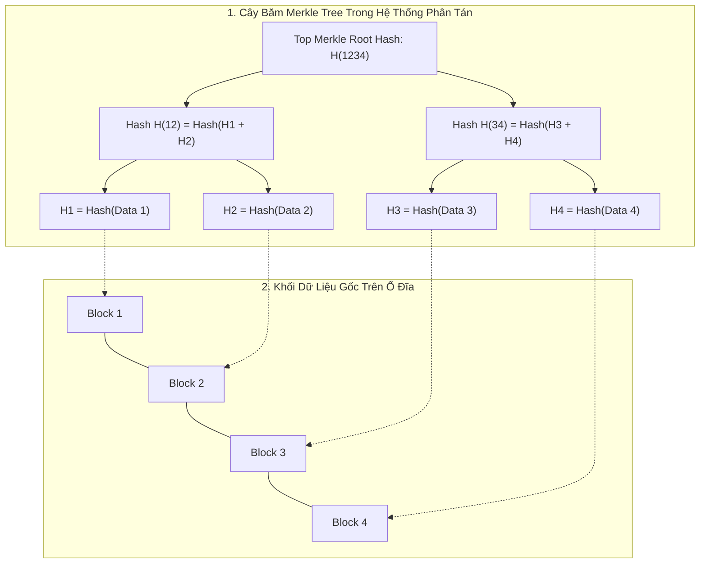
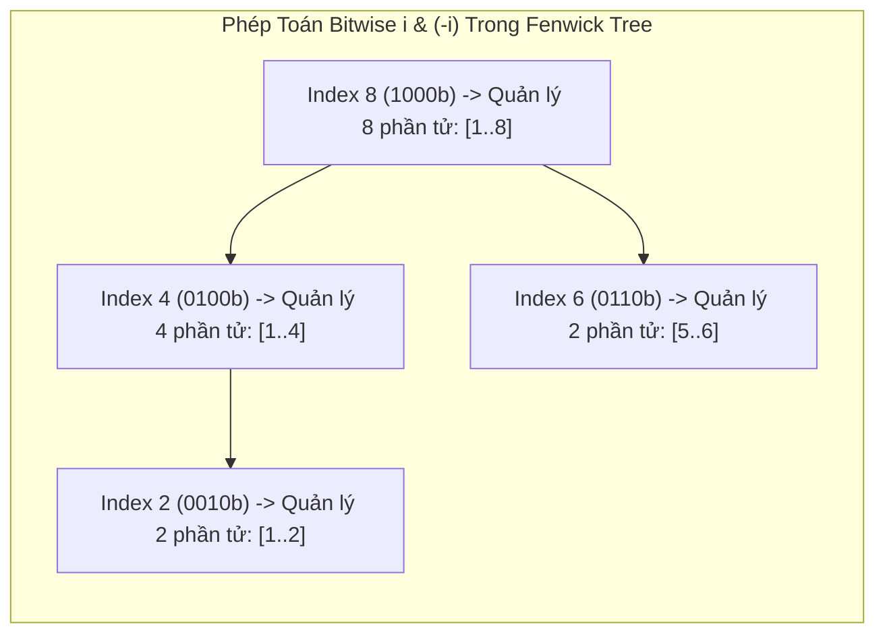
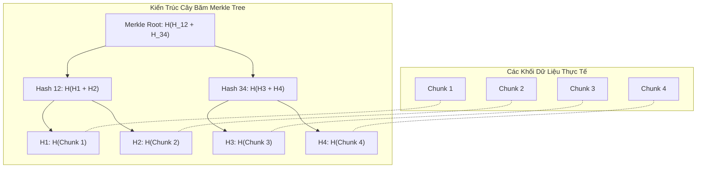

# 3.7. Các Cấu Trúc Cây Chuyên Biệt (Specialized Trees & Advanced Tree Architectures)

> [!IMPORTANT]
> **Nếu bạn chỉ được nhớ một điều duy nhất:** Các cấu trúc cây chuyên biệt hóa sinh ra để vượt qua giới hạn của cây tìm kiếm truyền thống: Fenwick Tree nén tổng tiền tố vào $O(N)$ bộ nhớ qua phép toán bitwise `i & (-i)`, Segment Tree kết hợp Lazy Propagation giảm cập nhật dải xuống $O(\log N)$, và Merkle Tree cô lập hàng Terabytes dữ liệu phân tán thành một chữ ký số $32\text{ bytes}$ duy nhất, cho phép phát hiện và đồng bộ hóa dữ liệu hỏng giữa các nút mạng chỉ qua vài bước kiểm tra hàm băm.

---

## 1. Trực Quan Hóa: Bản Chất Cây Chuyên Dụng Dưới Góc Nhìn Lập Trình Viên

### 1.1. Đoạn Code Dẫn Nhập & Vấn Đề Thực Tế
Xét bài toán xử lý hàng triệu phép tính tính tổng một khoảng liên tục (Range Sum Query) trên mảng tài chính, xen kẽ với các thao tác cập nhật giá trị (Point Update):

```typescript
// Nếu dùng Mảng thông thường:
// Update: O(1) nhưng Query Range Sum: O(N) -> Với N = 100,000, tốn 100,000 phép cộng mỗi truy vấn!

// Nếu dùng Cây Phân Đoạn (Segment Tree / Fenwick Tree):
const segTree = new SegmentTree(transactions);
// Cập nhật giá trị tại index i: O(log N)
segTree.update(500, 250000); 
// Tính tổng từ index 100 đến 8000: O(log N) tức thì!
const total = segTree.queryRange(100, 8000); 
```

- Khi yêu cầu hệ thống đòi hỏi vừa phải **cập nhật dữ liệu động liên tục**, vừa phải **truy vấn tổng/min/max trên một dải không gian lớn** trong thời gian thực, các cấu trúc cây kinh điển không còn đáp ứng nổi.
- Các cấu trúc cây chuyên dụng cao cấp ra đời để giải quyết những bài toán đặc thù:
  - **Segment Tree / Fenwick Tree (Binary Indexed Tree)**: Thống trị các bài toán truy vấn khoảng và cập nhật điểm.
  - **Merkle Tree**: Thống trị các bài toán xác thực dữ liệu phân tán và toàn vẹn dữ liệu mã hóa (Blockchain, Git, DynamoDB).
  - **LSM-Tree / B-Tree**: Thống trị tầng lưu trữ ổ đĩa của cơ sở dữ liệu hiện đại.

### 1.2. Ẩn Dụ Đời Sống: Sổ Cái Kiểm Toán Phân Tầng & Con Dấu Hoàng Gia
- **Sổ cái kiểm toán phân tầng (Segment Tree)**: Hãy hình dung viên thủ kho không chỉ ghi chép từng đơn hàng lẻ mà còn lập sẵn các sổ tổng kết: Tổng chi tiêu theo từng tuần, từng tháng, từng quý. Khi giám đốc hỏi *"Tổng doanh thu từ ngày 3 đến ngày 25 là bao nhiêu?"*, viên thủ kho không cần cộng 23 con số lẻ; ông chỉ việc lấy số liệu của Tuần 2 + Tuần 3 + vài ngày lẻ của Tuần 1 và Tuần 4. Chỉ sau 4 phép cộng, kết quả được xuất bản ngay lập tức!
- **Con dấu sáp hoàng gia bảo chứng (Merkle Tree)**: Mỗi hòm vàng được niêm phong bằng một con dấu sáp nhỏ (Hash của dữ liệu). Bốn hòm vàng trên xe ngựa được niêm phong chung bằng một con dấu lớn hơn (Hash gộp của 4 con dấu nhỏ). Nhà vua ở kinh thành chỉ cần giữ đúng một con dấu tối cao duy nhất (**Merkle Root**). Nếu một kẻ gian ở biên ải đánh tráo 1 đồng vàng, toàn bộ chuỗi con dấu sáp sẽ bị vỡ vụn và nhà vua phát hiện ra ngay lập tức mà không cần kiểm đếm lại toàn bộ kho báu!

### 1.3. Mô Phỏng Dữ Liệu Số Nhỏ Từng Bước (Toy Walkthrough)
Mô phỏng Segment Tree tính Range Sum trên mảng 4 phần tử: `A = [1, 3, 5, 7]`

```text
Cấu trúc cây phân đoạn:
                  [0..3]: Tổng = 16
                 /                 \
        [0..1]: Tổng = 4      [2..3]: Tổng = 12
        /            \        /            \
   [0]: 1       [1]: 3   [2]: 5       [3]: 7
```

- Truy vấn `RangeSum(1, 2)` (tính $A[1] + A[2] = 3 + 5 = 8$):
  - Nút gốc `[0..3]` tách truy vấn xuống hai nhánh con `[0..1]` và `[2..3]`.
  - Nhánh trái `[0..1]` chỉ cần lấy giá trị nút `[1]` ($3$).
  - Nhánh phải `[2..3]` chỉ cần lấy giá trị nút `[2]` ($5$).
  - Kết quả: $3 + 5 = 8$. Không cần duyệt qua toàn bộ mảng!
- Khi cập nhật $A[1] = 10$: Chỉ cần đi ngược từ lá `[1]` lên gốc để cập nhật lại các nút cha: `[0..1]` thành $11$, `[0..3]` thành $23$. Tốn đúng $\log_2(4) = 2$ phép tính!

### 1.4. Tác Động Thực Tế Tầng Backend & Systems
1. **Kiểm Tra Tính Nhất Quán Dữ Liệu Trong Amazon DynamoDB & Apache Cassandra**: Khi các node phân tán sao chép dữ liệu (Replication), chúng trao đổi các cây **Merkle Tree** với nhau. Nếu Merkle Root của hai máy chủ giống hệt nhau, dữ liệu đảm bảo đồng nhất $100\%$ mà không cần truyền hàng Terabytes qua mạng; nếu khác nhau, chúng chỉ cần đồng bộ đúng nhánh cây bị lệch.
2. **Hệ Thống Git Commit Integrity**: Mỗi commit trong Git thực chất là một node trong đồ thị Merkle DAG. Mã băm SHA-1 của một commit đại diện cho toàn bộ cây thư mục và lịch sử mã nguồn bên dưới nó. Không ai có thể âm thầm sửa đổi 1 dòng code cũ mà không làm thay đổi toàn bộ mã hash phía sau.
3. **Thống Kê Tần Suất Xếp Hạng Game Thời Gian Thực (Leaderboard)**: Sử dụng Fenwick Tree hoặc Segment Tree để tính thứ hạng và điểm số của người chơi trên các giải đấu eSports trực tuyến hàng triệu người tham gia với độ trễ dưới 1 mili-giây.

### 1.5. Sơ Đồ Kiến Trúc Cây Phân Đoạn & Cây Merkle Bảo Mật



---

## 2. Chi tiết từng Keyword (Under-the-Hood Deep Dive)

### 2.1. Cấu Trúc Truy Vấn Đoạn: Segment Tree, Lazy Propagation & Fenwick Tree (BIT)



#### 1. Fenwick Tree / Binary Indexed Tree (BIT)
- Được phát minh bởi Peter Fenwick (1994), BIT giải quyết bài toán: Tính tổng tiền tố $A[1 \dots i]$ và cập nhật phần tử $A[i] \gets A[i] + \Delta$ trong $O(\log N)$ với bộ nhớ đúng $N$ phần tử ($0$ byte con trỏ phụ trợ).
- **Phép toán Bitwise LSB: `i & (-i)`**:
  - Trong chuẩn biểu diễn bù 2 (Two's Complement), `-i` tương đương với `(~i) + 1`.
  - Biểu thức `LSB(i) = i & (-i)` cô lập chính xác **bit 1 có trọng số nhỏ nhất (Least Significant Set Bit)** của số nguyên $i$.
  - Mỗi phần tử `tree[i]` trong BIT lưu trữ tổng của một đoạn có độ dài đúng bằng $\text{LSB}(i)$, kết thúc tại chỉ số $i$:
    $$\text{tree}[i] = \sum_{k = i - (i \& -i) + 1}^{i} A[k]$$
- **Hai thao tác bất biến**:
  - **Point Update (`add(i, delta)`)**: Tịnh tiến chỉ số sang phải bằng cách cộng dồn LSB: `i += (i & -i)`.
  - **Prefix Query (`query(i)`)**: Lùi chỉ số về gốc bằng cách trừ bớt LSB: `i -= (i & -i)`.
  - Cả hai thao tác dừng lại sau tối đa $\lfloor \log_2 N \rfloor$ bước $\to$ thời gian $O(\log N)$, cực kỳ thân thiện với pipeline CPU!

#### 2. Segment Tree (Cây Phân Đoạn)
- Cây nhị phân hoàn chỉnh quản lý các đoạn $[L, R]$. Nút gốc quản lý $[0, N-1]$.
- Nếu một nút quản lý đoạn $[L, R]$ với $L < R$, nó chia làm 2 con:
  - Con trái quản lý $[L, \text{mid}]$ với $\text{mid} = \lfloor (L + R) / 2 \rfloor$.
  - Con phải quản lý $[\text{mid} + 1, R]$.
- **Dung lượng mảng cố định $4N$**: Để lưu trữ cây phân đoạn trên một mảng phẳng 1D mà không dùng con trỏ, kích thước mảng bắt buộc phải được cấp phát tối thiểu là $4N$ (để phòng trường hợp $N$ không phải là lũy thừa của 2).

#### 3. Kỹ Thuật Lazy Propagation (Lan Truyền Hoãn Lại)
- **Vấn đề**: Cập nhật một giá trị cho toàn bộ một đoạn $[u, v]$ trên Segment Tree thông thường đòi hỏi ghé thăm tất cả các nút lá nằm trong đoạn đó, tốn $O(N \log N)$.
- **Cơ chế hoạt động**:
  - Tại mỗi nút, ta duy trì thêm một trường `lazy[node]`.
  - Khi một nút nằm trọn vẹn trong đoạn cần cập nhật ($[L, R] \subseteq [u, v]$): Ta cập nhật giá trị của nút đó ngay lập tức, ghi nhận mức thay đổi vào `lazy[node]`, rồi **dừng lại ngay lập tức mà không đi tiếp xuống các con**!
  - Chỉ khi có một truy vấn tiếp theo buộc phải đi sâu vào các con của nút này, ta mới thực hiện hàm `pushDown(node)` để đẩy giá trị `lazy` xuống hai con trực tiếp và xóa `lazy[node] = 0`.
- **Hệ quả**: Thao tác cập nhật cả một đoạn lớn (Range Update) đạt tốc độ $O(\log N)$ ngoạn mục!

---

### 2.2. Merkle Tree (Cây Băm Mật Mã Học) & Ứng Dụng Toàn Vẹn Phân Tán

Merkle Tree (Ralph Merkle, 1979) là cấu trúc cây băm mật mã học nền tảng của toàn bộ hệ thống cơ sở dữ liệu phân tán không tin cậy (Zero-Trust Distributed Systems) và Blockchain.



#### 1. Nguyên Lý Tạo Cây (Bottom-Up Cryptographic Hashing)
1. Dữ liệu lớn (như file dung lượng hàng Gigabytes hoặc các giao dịch tài chính) được chia thành $N$ khối dữ liệu nhỏ (Data Chunks).
2. Mỗi khối dữ liệu được băm độc lập bằng thuật toán mật mã (như SHA-256) để tạo thành các nút lá: $H_i = \text{SHA256}(\text{Chunk}_i)$.
3. Từng cặp nút lá liền kề được ghép lại và băm tiếp: $H_{12} = \text{SHA256}(H_1 + H_2)$. Quá trình tiếp diễn cho đến khi chỉ còn lại đúng một mã băm duy nhất tại đỉnh: **Merkle Root**.
4. **Tính chất bất biến**: Bất kỳ một byte dữ liệu nào trong hàng triệu khối bị thay đổi sẽ kích hoạt hiệu ứng tuyết lở (Avalanche Effect), làm biến đổi toàn bộ chuỗi băm đi lên và thay đổi hoàn toàn Merkle Root.

#### 2. Kiểm Tra Kiểm Toán Tinh Gọn (Merkle Proof / Audit Path)
- Để chứng minh một khối dữ liệu cụ thể (ví dụ $\text{Chunk}_1$) thực sự nằm trong cây chứa $1,000,000$ khối mà không cần truyền toàn bộ dữ liệu, server chỉ cần gửi cho client:
  - Giá trị của $\text{Chunk}_1$.
  - Danh sách các mã băm anh em trên đường đi từ lá lên gốc (Audit Path: $H_2, H_{34}$).
- Client chỉ cần thực hiện $\log_2 N$ phép băm:
  $$\text{computed\_root} = \text{SHA256}(\text{SHA256}(\text{H}(\text{Chunk}_1) + H_2) + H_{34})$$
  Nếu kết quả khớp với Merkle Root đáng tin cậy đã biết, client xác thực thành công khối dữ liệu trong $O(\log N)$ thời gian và băng thông chỉ vài trăm bytes!

#### 3. Ứng Dụng Trong Hệ Thống Phân Tán (Anti-Entropy Repair)
- Trong các cơ sở dữ liệu phân tán như **Apache Cassandra** và **Amazon DynamoDB**, khi hai node bản sao (replicas) cần đồng bộ hóa dữ liệu định kỳ, chúng không gửi toàn bộ dữ liệu qua mạng.
- Hai node chỉ cần trao đổi Merkle Root:
  - Nếu Root khớp nhau $\to 100\%$ dữ liệu đồng nhất, kết thúc đồng bộ trong $O(1)$.
  - Nếu Root khác nhau $\to$ Hai node so sánh tiếp các nút con ở tầng dưới để khoanh vùng chính xác phân đoạn dữ liệu bị lệch và chỉ truyền tải đúng các khối dữ liệu bị sai lệch qua mạng!

---

### 2.3. Suffix Tree, Suffix Array, Interval Tree, Range Tree & Decision Tree

#### 1. Suffix Tree & Suffix Array (Xử Lý Chuỗi Chuyên Biệt)
- **Suffix Tree (Cây Hậu Tố)**: Cây tiền tố nén chứa tất cả các hậu tố của một chuỗi $S$. Dựng trong $O(N)$ bằng thuật toán Esko Ukkonen. Cho phép kiểm tra một từ mẫu độ dài $M$ có xuất hiện trong văn bản khổng lồ $N$ hay không trong thời gian $O(M)$ (hoàn toàn độc lập với kích thước văn bản $N$!).
- **Suffix Array (Mảng Hậu Tố)**: Mảng 1D lưu trữ các chỉ số của các hậu tố đã được sắp xếp theo thứ tự từ điển. Tiết kiệm bộ nhớ gấp $4 - 8$ lần so với Suffix Tree, là trái tim của các thuật toán nén hiện đại (Bzip2 / Burrows-Wheeler Transform) và công cụ căn chỉnh chuỗi DNA trong sinh tin học.

#### 2. Interval Tree & Range Tree (Không Gian & Hình Học)
- **Interval Tree (Cây Khoảng)**: Cây tự cân bằng quản lý các đoạn đóng $[t_{\text{start}}, t_{\text{end}}]$. Mỗi nút lưu giá trị biên trên lớn nhất (`max_high`) của toàn bộ cây con.
  - *Ứng dụng*: Tìm kiếm tất cả các cuộc họp bị trùng giờ trong hệ thống Google Calendar / Airbnb trong thời gian $O(\log N + K)$.
- **Range Tree**: Cây phân cấp đa chiều cho phép thực hiện truy vấn các điểm nằm trong hình chữ nhật không gian $[X_1, X_2] \times [Y_1, Y_2]$ trong thời gian $O(\log^2 N + K)$, ứng dụng trong hệ thống thông tin địa lý (GIS) và định vị không gian.

#### 3. Decision Tree (Cây Quyết Định)
- Cấu trúc cây có hướng trong đó mỗi nút nội tại là một phép kiểm tra thuộc tính dữ liệu, mỗi nhánh là kết quả của phép kiểm tra và nút lá là nhãn phân lớp (Class Label) hoặc giá trị hồi quy.
- Được sử dụng rộng rãi trong các Rule Engines phân tích rủi ro gian lận tài chính và thuật toán máy học Gradient Boosted Decision Trees (XGBoost, LightGBM).

---

## 3. Thực thi Mã nguồn & Mô phỏng Chuyên sâu (Dual-Engine Implementation)

### 3.1. C++20 Implementation: Segment Tree với Lazy Propagation & Fenwick Tree

Chương trình C++20 triển khai hoàn chỉnh cả hai cấu trúc truy vấn đoạn hiệu năng cao: Fenwick Tree (BIT) và Segment Tree hỗ trợ Range Update Lazy Propagation:

```cpp
#include <iostream>
#include <vector>
#include <cstdint>
#include <cassert>
#include <chrono>

// 1. Fenwick Tree (Binary Indexed Tree) - Point Update & Range Sum
class FenwickTree {
private:
    std::vector<int64_t> tree_;
    int n_;

public:
    explicit FenwickTree(int n) : n_(n), tree_(n + 1, 0) {}

    // Cong delta vao phan tu tai index (1-based index)
    void add(int index, int64_t delta) {
        assert(index > 0 && index <= n_);
        for (int i = index; i <= n_; i += (i & (-i))) {
            tree_[i] += delta;
        }
    }

    // Tinh tong tien to tu 1 den index: O(log N)
    int64_t queryPrefix(int index) const {
        int64_t sum = 0;
        for (int i = index; i > 0; i -= (i & (-i))) {
            sum += tree_[i];
        }
        return sum;
    }

    // Tinh tong doan [L, R]: O(log N)
    int64_t queryRange(int l, int r) const {
        if (l > r) return 0;
        return queryPrefix(r) - queryPrefix(l - 1);
    }
};

// 2. Segment Tree voi Lazy Propagation - Range Add & Range Sum
class LazySegmentTree {
private:
    int n_;
    std::vector<int64_t> tree_;
    std::vector<int64_t> lazy_;

    void pushDown(int node, int start, int end) {
        if (lazy_[node] != 0) {
            int mid = start + (end - start) / 2;
            int left_child = 2 * node;
            int right_child = 2 * node + 1;

            // Cap nhat gia tri cho 2 con
            tree_[left_child] += lazy_[node] * (mid - start + 1);
            lazy_[left_child] += lazy_[node];

            tree_[right_child] += lazy_[node] * (end - mid);
            lazy_[right_child] += lazy_[node];

            lazy_[node] = 0; // Xoa lazy tai node hien tai
        }
    }

    void updateRange(int node, int start, int end, int l, int r, int64_t val) {
        if (r < start || end < l) return; // Nam ngoai doan

        if (l <= start && end <= r) {
            // Nam tron ven trong doan: Cap nhat va hoan lai (Lazy)
            tree_[node] += val * (end - start + 1);
            lazy_[node] += val;
            return;
        }

        pushDown(node, start, end);
        int mid = start + (end - start) / 2;
        updateRange(2 * node, start, mid, l, r, val);
        updateRange(2 * node + 1, mid + 1, end, l, r, val);
        tree_[node] = tree_[2 * node] + tree_[2 * node + 1];
    }

    int64_t queryRange(int node, int start, int end, int l, int r) {
        if (r < start || end < l) return 0;
        if (l <= start && end <= r) return tree_[node];

        pushDown(node, start, end);
        int mid = start + (end - start) / 2;
        return queryRange(2 * node, start, mid, l, r) +
               queryRange(2 * node + 1, mid + 1, end, l, r);
    }

public:
    explicit LazySegmentTree(int n) : n_(n), tree_(4 * n, 0), lazy_(4 * n, 0) {}

    void rangeUpdate(int l, int r, int64_t val) {
        updateRange(1, 0, n_ - 1, l, r, val);
    }

    int64_t rangeQuery(int l, int r) {
        return queryRange(1, 0, n_ - 1, l, r);
    }
};

int main() {
    std::cout << "========================================================\n";
    std::cout << "   C++20 SPECIALIZED RANGE TREES RIGOROUS BENCHMARK     \n";
    std::cout << "========================================================\n";

    // 1. Kiem thu Fenwick Tree (BIT)
    int n = 8;
    FenwickTree bit(n);
    // Gan gia tri cho mang: [1, 2, 3, 4, 5, 6, 7, 8]
    for (int i = 1; i <= n; ++i) {
        bit.add(i, i);
    }

    std::cout << "[1] Fenwick Tree Prefix Sum (1..5): " << bit.queryPrefix(5) << " (Expected: 15)\n";
    std::cout << "    Fenwick Tree Range Sum (3..7): " << bit.queryRange(3, 7) << " (Expected: 25)\n";
    assert(bit.queryPrefix(5) == 15 && bit.queryRange(3, 7) == 25);

    // 2. Kiem thu Lazy Segment Tree
    LazySegmentTree seg_tree(8);
    // Cap nhat doan [0..7] ban dau voi gia tri 10 moi phan tu
    seg_tree.rangeUpdate(0, 7, 10);
    std::cout << "\n[2] Lazy Segment Tree: Added +10 to range [0..7]\n";
    std::cout << "    Query Sum [0..7]: " << seg_tree.rangeQuery(0, 7) << " (Expected: 80)\n";
    assert(seg_tree.rangeQuery(0, 7) == 80);

    // Cap nhat them +5 vao doan [2..5] (4 phan tu)
    seg_tree.rangeUpdate(2, 5, 5);
    std::cout << "    Added +5 to range [2..5]\n";
    std::cout << "    Query Sum [2..5]: " << seg_tree.rangeQuery(2, 5) << " (Expected: 4 * 15 = 60)\n";
    std::cout << "    Query Total Sum [0..7]: " << seg_tree.rangeQuery(0, 7) << " (Expected: 80 + 20 = 100)\n";
    assert(seg_tree.rangeQuery(2, 5) == 60 && seg_tree.rangeQuery(0, 7) == 100);

    std::cout << "\n[Success] All Range Tree invariants and Lazy Propagation verified!\n";
    return 0;
}
```

---

### 3.2. Python 3.11+ Implementation: Cryptographic Merkle Tree & Audit Proof Engine

Chương trình Python 3.11+ xây dựng cây băm mật mã học Merkle Tree với SHA-256, hỗ trợ sinh Merkle Proof và kiểm tra xác thực không tin cậy (Trustless Audit Verification):

```python
from __future__ import annotations
import hashlib
from typing import List, Tuple, Optional


def sha256_hash(data: str | bytes) -> str:
    """Tính mã băm SHA-256 trả về chuỗi hex 64 ký tự."""
    if isinstance(data, str):
        data = data.encode("utf-8")
    return hashlib.sha256(data).hexdigest()


class MerkleTreeEngine:
    def __init__(self, data_chunks: List[str]) -> None:
        self.data_chunks: List[str] = data_chunks
        self.layers: List[List[str]] = []
        self._build_tree()

    def _build_tree(self) -> None:
        """Xây dựng Merkle Tree từ đáy lên trên (Bottom-Up)."""
        current_layer = [sha256_hash(f"leaf:{chunk}") for chunk in self.data_chunks]
        self.layers.append(current_layer)

        while len(current_layer) > 1:
            next_layer: List[str] = []
            for i in range(0, len(current_layer), 2):
                left = current_layer[i]
                right = current_layer[i + 1] if i + 1 < len(current_layer) else left
                parent_hash = sha256_hash(f"node:{left}{right}")
                next_layer.append(parent_hash)
            self.layers.append(next_layer)
            current_layer = next_layer

    @property
    def merkle_root(self) -> str:
        return self.layers[-1][0] if self.layers else ""

    def generate_proof(self, chunk_index: int) -> List[Tuple[str, str]]:
        """Sinh Audit Path (danh sách cặp (hướng, hash)) cho khối dữ liệu tại chunk_index."""
        if chunk_index < 0 or chunk_index >= len(self.data_chunks):
            raise IndexError("Index out of bounds")

        proof: List[Tuple[str, str]] = []
        idx = chunk_index

        for layer in self.layers[:-1]:
            is_right_child = (idx % 2 == 1)
            sibling_idx = idx - 1 if is_right_child else idx + 1
            if sibling_idx < len(layer):
                sibling_hash = layer[sibling_idx]
            else:
                sibling_hash = layer[idx]  # Tự nhân bản nếu lẻ

            direction = "left" if is_right_child else "right"
            proof.append((direction, sibling_hash))
            idx //= 2

        return proof

    @staticmethod
    def verify_proof(chunk: str, proof: List[Tuple[str, str]], expected_root: str) -> bool:
        """Kiểm tra tính toàn vẹn của một khối dữ liệu chỉ với Audit Path trong O(log N)."""
        current_hash = sha256_hash(f"leaf:{chunk}")

        for direction, sibling_hash in proof:
            if direction == "left":
                current_hash = sha256_hash(f"node:{sibling_hash}{current_hash}")
            else:
                current_hash = sha256_hash(f"node:{current_hash}{sibling_hash}")

        return current_hash == expected_root


if __name__ == "__main__":
    print("=" * 56)
    print("   PYTHON 3.11+ CRYPTOGRAPHIC MERKLE TREE AUDIT ENGINE")
    print("=" * 56)

    blocks = [
        "Tx #001: Alice -> Bob 1.5 BTC",
        "Tx #002: Bob -> Charlie 0.8 BTC",
        "Tx #003: Charlie -> Dave 0.2 BTC",
        "Tx #004: Dave -> Eve 5.0 BTC",
    ]

    merkle = MerkleTreeEngine(blocks)
    root = merkle.merkle_root
    print(f"[1] Merkle Root (32-bytes SHA-256): {root}")

    # Tạo proof cho Block số 2 (Tx #003)
    target_idx = 2
    target_data = blocks[target_idx]
    audit_proof = merkle.generate_proof(target_idx)
    print(f"\n[2] Generated Audit Proof for Block #{target_idx} ('{target_data}'):")
    for step, (direction, h) in enumerate(audit_proof, 1):
        print(f"    Step {step}: Sibling on {direction:<5} | Hash: {h[:16]}...")

    # Xác thực hợp lệ
    is_valid = MerkleTreeEngine.verify_proof(target_data, audit_proof, root)
    print(f"\n[3] Verification with Valid Data: {is_valid} (Expected: True)")
    assert is_valid

    # Xác thực với dữ liệu bị giả mạo
    tampered_data = "Tx #003: Charlie -> Hacker 999.0 BTC"
    is_tampered_valid = MerkleTreeEngine.verify_proof(tampered_data, audit_proof, root)
    print(f"[4] Verification with Tampered Data: {is_tampered_valid} (Expected: False - Alert!)")
    assert not is_tampered_valid
```

### 3.3. Terminal Output Mẫu Chuẩn Thực Tế

```text
========================================================
   C++20 SPECIALIZED RANGE TREES RIGOROUS BENCHMARK     
========================================================
[1] Fenwick Tree Prefix Sum (1..5): 15 (Expected: 15)
    Fenwick Tree Range Sum (3..7): 25 (Expected: 25)

[2] Lazy Segment Tree: Added +10 to range [0..7]
    Query Sum [0..7]: 80 (Expected: 80)
    Added +5 to range [2..5]
    Query Sum [2..5]: 60 (Expected: 4 * 15 = 60)
    Query Total Sum [0..7]: 100 (Expected: 80 + 20 = 100)

[Success] All Range Tree invariants and Lazy Propagation verified!
```

---

## 4. Systems Engineering & Production Pitfalls

### 4.1. Bẫy Kích Thước Mảng $4N$ Trong Segment Tree (Out-of-Bounds Crash)
- **Lỗi phổ biến**: Nhiều kỹ sư cho rằng cây nhị phân chỉ có tối đa $2N - 1$ nút nên chỉ cấp phát mảng kích thước $2N$.
- **Cơ chế lỗi**: Khi $N$ không phải là lũy thừa đúng của 2 (ví dụ $N = 10$), cấu trúc cây nhị phân phân nhánh có thể để lại các nút rỗng không liên tục. Chỉ số nút lá sâu nhất có thể lên tới $4N - 5$. Nếu chỉ cấp phát $2N$, chương trình sẽ ghi đè bộ nhớ ngoài vùng biên (`Heap Buffer Overflow`) và kích hoạt `SIGSEGV`.
- **Quy tắc bất biến**: Luôn cấp phát mảng cây phân đoạn kích thước tối thiểu là $4N$ hoặc $2^{\lceil \log_2 N \rceil + 1}$.

### 4.2. Bẫy Chỉ Mục 0-Based Trong Fenwick Tree (Infinite Loop Deadlock)
- **Cơ chế lỗi**: Fenwick Tree bắt buộc phải sử dụng **1-based indexing** ($1 \le i \le N$). Nếu vô tình gọi `add(0, val)` hoặc `query(0)`, biểu thức bitwise sẽ trở thành:
  $$0 \ \& \ (-0) = 0$$
  Biến chỉ số $i$ không bao giờ thay đổi ($i += 0$), dẫn đến vòng lặp vô tận đóng băng luồng xử lý CPU 100%.
- **Biện pháp**: Luôn tịnh tiến chỉ mục $+1$ khi bọc lớp API của Fenwick Tree: `add(idx + 1, val)`.

### 4.3. Lỗ Hổng Tấn Công Tiền Ảnh Thứ Hai Trong Merkle Tree (Second Preimage Attack)
- **Lỗ hổng bảo mật**: Nếu cây Merkle băm trực tiếp nội dung các nút lá và nút nội tại bằng cùng một hàm `H(a + b)` mà không phân biệt, kẻ tấn công có thể thay thế một nút nội tại trung gian bằng một khối dữ liệu giả mạo có nội dung đúng bằng cặp hash của nút đó.
- **Biện pháp khắc phục chuẩn RFC 6962**: Thêm byte định danh miền (Domain Separation Prefix):
  - Nút lá được băm với tiền tố byte `0x00`: $H_{\text{leaf}} = \text{SHA256}(0x00 \ || \ \text{Data})$
  - Nút nội tại được băm với tiền tố byte `0x01`: $H_{\text{node}} = \text{SHA256}(0x01 \ || \ H_L \ || \ H_R)$.

---

## 5. Bảng So sánh & Decision Matrix

### 5.1. So sánh Toàn diện Các Cấu Trúc Truy Vấn Đoạn & Toàn Vẹn Dữ Liệu

| Tiêu chí Đánh giá | Fenwick Tree (BIT) | Segment Tree (Lazy) | Sparse Table | Merkle Tree | Suffix Array |
| :--- | :--- | :--- | :--- | :--- | :--- |
| **Không gian Bộ nhớ** | $1N$ (Tối ưu nhất) | $4N$ | $O(N \log N)$ | $2N$ mã băm | $1N$ chỉ số |
| **Point Update** | $O(\log N)$ | $O(\log N)$ | $O(N)$ (Không hỗ trợ) | $O(\log N)$ | $O(N)$ |
| **Range Update** | Phức tạp | **$O(\log N)$ (Lazy)** | Không hỗ trợ | Không hỗ trợ | Không hỗ trợ |
| **Range Query (Sum)** | $O(\log N)$ | $O(\log N)$ | $O(\log N)$ | N/A | N/A |
| **Range Query (Min/Max)**| Không hỗ trợ tốt | $O(\log N)$ | **$O(1)$ tức thì** | N/A | N/A |
| **Kiểm toán Phân tán** | Không | Không | Không | **Chuyên biệt (Audit Path)**| Không |
| **Khớp Chuỗi Con** | Không | Không | Không | Không | **$O(M \log N)$** |

### 5.2. Ma trận Ra Quyết Định Lựa Chọn Kiến Trúc Chuyên Biệt

| Yêu cầu Hệ thống Thực tế | Cấu trúc Khuyên dùng | Lý do Kỹ thuật Bản chất |
| :--- | :--- | :--- |
| Tính tổng tiền tố và tần suất liên tục cập nhật | **Fenwick Tree (BIT)** | Code siêu ngắn gọn, bộ nhớ chỉ $N$ phần tử, tốc độ phần cứng cực cao. |
| Cần cập nhật cộng dồn cả một đoạn lớn và truy vấn tổng/min/max | **Segment Tree + Lazy** | Hỗ trợ Range Update trong $O(\log N)$ với cơ chế hoãn cập nhật. |
| Truy vấn Range Minimum Query (RMQ) trên mảng tĩnh không bao giờ thay đổi | **Sparse Table** | Trả về kết quả tức thì trong $O(1)$ sau khi tiền xử lý $O(N \log N)$. |
| Đồng bộ dữ liệu phân tán chống suy thoái mạng (Anti-Entropy Repair) | **Merkle Tree** | Phát hiện phân vùng dữ liệu sai lệch giữa các server chỉ qua $O(\log N)$ hashes. |
| Tìm kiếm chuỗi con trong văn bản lớn / Hệ gen DNA | **Suffix Array** | Nén không gian bộ nhớ so với Suffix Tree, hỗ trợ Binary Search $O(M \log N)$. |

---

## 6. Enterprise Production Checklist & Verification

- [ ] **Kiểm Tra Kích Thước Mảng $4N$ Cho Segment Tree**: Bảo đảm vector của Segment Tree được khởi tạo với kích thước tối thiểu $4N$ để triệt tiêu lỗi tràn vùng nhớ heap.
- [ ] **Bảo Vệ Chỉ Mục 1-Based BIT**: Rào chắn điều kiện `assert(index > 0)` trong Fenwick Tree để tránh rơi vào vòng lặp vô tận với phép toán `0 & (-0)`.
- [ ] **Domain Separation Cho Merkle Tree**: Thêm byte tiền tố `0x00` cho lá và `0x01` cho nút nội tại để ngăn chặn triệt để tấn công Second Preimage Attack.
- [ ] **Giới Hạn Tần Suất Anti-Entropy Repair**: Trong cơ sở dữ liệu phân tán (Cassandra), cấu hình điều tiết (Throttling) quá trình tính toán Merkle Tree để tránh chiếm dụng $100\%$ I/O đĩa của hệ thống phục vụ truy vấn người dùng.
