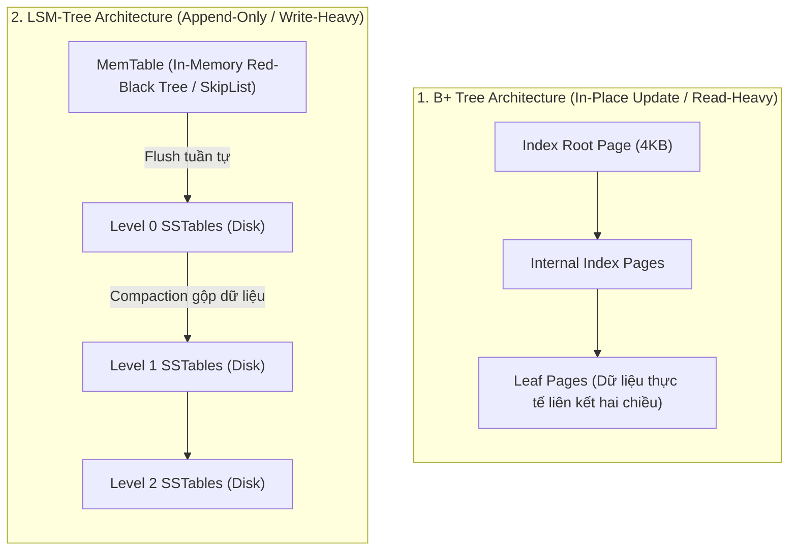

# 3.8. Backend Applications of Tree Data Structures

> [!IMPORTANT]
> **Nếu bạn chỉ được nhớ một điều duy nhất:** Trong kỹ thuật hệ thống và lưu trữ phân tán, cấu trúc Cây (Trees) là lời giải toán học tối thượng để cân bằng giữa **Tốc độ tìm kiếm $O(\log N)$** và **Chi phí truy xuất phần cứng vật lý (Disk I/O & Network Bandwidth)**. Đỉnh cao của cơ sở dữ liệu quan hệ (PostgreSQL, MySQL InnoDB) là **B+ Tree**: tối ưu hóa hệ số quạt (Fanout) để khớp hoàn hảo với kích thước khối trang đĩa ($4\text{KB} - 16\text{KB}$) và liên kết các lá thành danh sách liên kết hai chiều giúp quét dải tuần tự (Range Scan) với tốc độ đĩa tuần tự. Trong khi đó, các Web Framework hiệu năng cao (Gin, Fastify) chọn **Radix Tree (Compact Trie)** để phân giải URL hàng triệu routing rules với độ trễ nano-giây; các cơ sở dữ liệu phân tán (Cassandra, DynamoDB) sử dụng **Merkle Tree (Hash Tree)** để đồng bộ hóa hàng Terabyte dữ liệu qua mạng chỉ bằng việc trao đổi các nút băm trên đỉnh cây trong $O(\log N)$.

---

## 1. Trực Quan Hóa: Bản Chất Cấu Trúc Cây Trong Hệ Thống Backend

### 1.1. Đoạn Code Dẫn Nhập & Vấn Đề Thực Tế
Xét câu lệnh truy vấn chỉ mục trong cơ sở dữ liệu quan hệ PostgreSQL / MySQL InnoDB:

```sql
-- Tìm kiếm bản ghi theo dải ID:
SELECT * FROM users WHERE user_id BETWEEN 1000000 AND 1000500;
```

- Nếu cơ sở dữ liệu sử dụng Cây Nhị Phân (Binary Tree) trên đĩa: Mỗi lần nhảy con trỏ là một lần đọc khối đĩa ngẫu nhiên (Random Disk I/O). Với 100 triệu bản ghi, cây cao khoảng 30 tầng $\to$ Mỗi truy vấn tốn 30 lần đọc ổ cứng ($30 \times 10\text{ ms} = 300\text{ ms}$ trên HDD)!
- **Giải pháp của Database Engine**: Sử dụng **B+ Tree**. Mỗi nút của B+ Tree có thể chứa hàng nghìn con trỏ và kích thước nút vừa khít với một **Page ổ đĩa ($4\text{ KB} - 16\text{ KB}$)**. Chiều cao cây giảm xuống chỉ còn **$3 - 4$ tầng**, giúp tìm kiếm bất kỳ bản ghi nào chỉ với 3-4 lần đọc đĩa, và toàn bộ dữ liệu ở các nút lá được liên kết với nhau bằng Doubly Linked List cho phép duyệt theo khoảng cực nhanh!

### 1.2. Ẩn Dụ Đời Sống: Mục Lục Thư Viện Quốc Gia & Cây Phả Hệ Định Danh
- **B+ Tree (Tủ mục lục thư viện chia ngăn rộng)**: Thay vì làm một cây nhị phân hẹp và cao 30 tầng (mỗi tầng mở 1 cuốn sách mất 1 tiếng), người ta đóng một chiếc tủ mục lục chỉ cao 3 tầng nhưng mỗi tầng rộng thênh thang gồm 1,000 ngăn kéo. Người thủ thư chỉ cần mở đúng 3 ngăn kéo là tìm thấy chính xác vị trí cuốn sách cần mượn.
- **LSM-Tree (Xưởng đúc thép và kho phế liệu phân tầng)**: Toàn bộ dữ liệu mới được ghi siêu tốc vào bộ nhớ RAM (MemTable). Khi RAM đầy, dữ liệu được đổ tràn tuần tự xuống đĩa thành các file bất biến (SSTables). Một tiến trình ngầm định kỳ gộp và nén các file nhỏ thành file lớn (Compaction). Đây là bí quyết giúp RocksDB, Cassandra, ScyllaDB đạt tốc độ ghi hàng triệu bản ghi mỗi giây.

### 1.3. Mô Phỏng Dữ Liệu Số Nhỏ Từng Bước (Toy Walkthrough)
Mô phỏng cấu trúc B+ Tree bậc $M = 3$ (mỗi nút chứa tối đa 2 khóa và 3 con trỏ con):
Tập dữ liệu: `10, 20, 30, 40, 50`

```text
               [ 30 ]  <-- Nút Gốc (Chỉ chứa khóa dẫn hướng)
              /      \
      [ 20 ]            [ 40, 50 ]  <-- Nút Trung gian
     /      \          /    |    \
 [ 10 ] <-> [ 20 ] <-> [ 30 ] <-> [ 40 ] <-> [ 50 ]  <-- Các Nút Lá (Chứa dữ liệu thực tế)
 (Toàn bộ các nút lá được liên kết xích đôi hai chiều để quét khoảng O(1))
```

- Khi thực thi câu lệnh `WHERE id BETWEEN 20 AND 40`:
  1. Đi từ Root `[30]` $\to$ Rẽ trái tìm đến nút lá `[20]`.
  2. Từ nút lá `[20]`, đi theo con trỏ `next` của danh sách liên kết: `20 -> 30 -> 40`.
  3. Hoàn tất truy vấn mà không cần phải leo ngược lên các tầng cây phía trên!

### 1.4. Tác Động Thực Tế Tầng Backend & Systems
1. **Lựa Chọn Kiến Trúc Database: B+ Tree vs LSM-Tree**:
   - **B+ Tree (PostgreSQL, MySQL InnoDB)**: Tối ưu vượt trội cho các hệ thống có tỷ lệ **Đọc nhiều hơn Ghi (Read-heavy OLTP)**, đảm bảo thời gian đọc ổn định $O(\log_B N)$.
   - **LSM-Tree (Log-Structured Merge-Tree: RocksDB, Cassandra, Bigtable)**: Tối ưu tuyệt đối cho các hệ sinh thái có tỷ lệ **Ghi nhiều hơn Đọc (Write-heavy)** như Time-series Database, Log Ingestion, IoT Sensors nhờ chuyển đổi toàn bộ các phép ghi ngẫu nhiên thành ghi tuần tự (Sequential I/O).
2. **Định Tuyến URL Trong Web Frameworks (Radix Tree in Gin / Fastify / Echo)**: Các framework web siêu tốc không dùng Regex để phân giải URL endpoint; chúng sử dụng Radix Tree. Khi request `GET /api/v1/users/:id` đến, router duyệt các ký tự trên cây Radix để gọi đúng Controller Handler chỉ trong vài chục nanosecond.
3. **Cơ Chế Phân Cụm Dữ Liệu Không Gian (R-Tree / QuadTree)**: Các ứng dụng gọi xe công nghệ (Grab, Uber) sử dụng R-Tree hoặc QuadTree để phân vùng bản đồ địa lý 2D, giúp tìm kiếm $K$ tài xế gần nhất với vị trí khách hàng trong bán kính 2km tức thì.

### 1.5. Sơ Đồ So Sánh Hai Kiến Trúc Lưu Trữ Đỉnh Cao: B+ Tree vs LSM-Tree



---

## 2. Chi tiết từng Keyword (Under-the-Hood Deep Dive)

### 2.1. B+ Tree trong Database Indexes (PostgreSQL, MySQL InnoDB: Disk Page Layout & Range Scans)
- **Hạn Chế Của Cây Nhị Phân Tìm Kiếm (BST / AVL / Red-Black Tree) Trên Ổ Đĩa**:
  - Cây nhị phân có hệ số rẽ nhánh (Fanout) bằng 2. Để lưu trữ 100 triệu phần tử, chiều cao của cây là $\log_2(10^8) \approx 27$.
  - Vì mỗi node nằm rải rác trên đĩa, việc tìm kiếm một bản ghi đòi hỏi **$27\text{ lần truy xuất I/O ngẫu nhiên}$ (Random Disk Reads)**. Trên ổ đĩa HDD/SSD, 27 lần I/O tốn hàng trăm mili-giây, làm tê liệt hệ thống.
- **Bản Chất Đột Phá Của B+ Tree**:
  - **Hệ Số Quạt Khổng Lồ (High Fanout)**: Kích thước của mỗi Node trong B+ Tree được thiết kế khớp chính xác với kích thước một trang đĩa của Database (Database Page Size: $16\text{KB}$ trong MySQL InnoDB, $8\text{KB}$ trong PostgreSQL). Một trang $16\text{KB}$ có thể chứa tới $1,000$ khóa và con trỏ. Chiều cao của cây chỉ cần **$3 - 4\text{ tầng}$** là có thể bao quát hàng trăm triệu bản ghi! Tầng 1 và 2 nằm trọn trong RAM (Buffer Pool), do đó việc tìm kiếm bất kỳ bản ghi nào chỉ tốn tối đa **$1\text{ lần đọc đĩa vật lý duy nhất}$**!
  - **Tách Rời Dữ Liệu Khỏi Các Tầng Chỉ Mục**: Các nút trong (Internal Nodes) **chỉ lưu khóa định tuyến (Keys) và con trỏ trang đĩa (Child Pointers)**, hoàn toàn không chứa dữ liệu thực tế (Payload). Nhờ đó, một trang trong có thể nhồi nhét tối đa số lượng con trỏ, tối đa hóa Fanout.
  - **Chuỗi Liên Kết Lá Hai Chiều (Doubly-Linked Leaf Chain)**: Toàn bộ dữ liệu thực tế nằm ở tầng lá (Leaf Nodes). Các trang lá được nối với nhau thành một danh sách liên kết hai chiều liên tục.
  - *Sức mạnh Range Scan*: Khi thực thi câu lệnh `WHERE age BETWEEN 20 AND 30`, B+ Tree chỉ cần duyệt $O(\log N)$ từ gốc xuống đúng lá chứa `age = 20`. Sau đó, nó chỉ việc lần theo con trỏ `next_leaf` để đọc tuần tự một mạch sang các lá tiếp theo cho đến khi gặp `age = 31` mà **không bao giờ phải quay ngược lên cây** $\implies$ Chuyển đổi toàn bộ truy xuất ngẫu nhiên thành đọc tuần tự (Sequential I/O) siêu tốc!

### 2.2. Radix Tree / Compact Trie trong Web Framework URL Routing (Gin, Fastify: Prefix Compression & Param Matching)
- **Vấn Đề Với Standard Trie (Cây Tiền Tố Thông Thường)**:
  - Một cây Trie thông thường lưu mỗi ký tự trên một node riêng lẻ. Với chuỗi URL `/api/v1/customers/orders`, hệ thống phải tạo ra 24 node độc lập liên kết qua con trỏ. Điều này gây lãng phí bộ nhớ khủng khiếp (Memory Bloat) và phá hủy Cache Locality của CPU do hiện tượng nhảy con trỏ liên tục.
- **Cơ Chế Nén Chuỗi Của Radix Tree (Compact Trie)**:
  - Nếu một node chỉ có duy nhất một node con, Radix Tree sẽ **gộp các ký tự liên tiếp lại thành một chuỗi duy nhất** trên cùng một node (Edge Label Compression).
  - Chuỗi `/api/v1/customers/` và `/api/v1/contracts/` sẽ chia sẻ chung một node tiền tố duy nhất: `/api/v1/c`, sau đó mới rẽ nhánh thành hai node con: `ustomers/` và `ontracts/`.
- **Phân Giải Tham Số Động (Parametric Route Matching `:id` & Wildcards `*filepath`)**:
  - Các web router hiện đại (như `httprouter` của Golang Gin hay `find-my-way` của Fastify) phân loại các node con thành 3 mức ưu tiên:
    1. *Static Node*: Khớp chính xác chuỗi ký tự (ưu tiên số 1).
    2. *Param Node (`:id`)*: Khớp bất kỳ ký tự nào cho đến dấu gạch chéo `/` tiếp theo.
    3. *Catch-All Node (`*path`)*: Khớp toàn bộ phần còn lại của URL.
  - Nhờ Radix Tree, việc khớp 10,000 route endpoints của một hệ sinh thái Microservices diễn ra chỉ trong vòng **$20 - 50\text{ nano-giây}$**, hoàn toàn không cần dùng biểu thức chính quy (Regex) chậm chạp.

### 2.3. Merkle Tree trong Anti-Entropy & Distributed Replication (Cassandra, DynamoDB: Hash Tree Sync)
- **Thách Thức Anti-Entropy Trong Hệ Phân Tán**:
  - Trong các cơ sở dữ liệu phân tán không máy chủ chủ (Leaderless Distributed DB như Apache Cassandra, Amazon DynamoDB), dữ liệu được nhân bản ra 3 node (Replication Factor = 3).
  - Do lỗi mạng chập chờn hoặc node bị restart, dữ liệu giữa 3 bản sao có thể bị lệch pha (Data Drift). Hệ thống cần một tiến trình chạy ngầm (**Anti-Entropy Repair**) để phát hiện và bù đắp các bản ghi bị lệch.
- **Cơ Chế Cây Băm Merkle (Ralph Merkle, 1979)**:
  - Dữ liệu của một dải phân vùng (Token Range) được chia thành các khối nhỏ ở tầng lá.
  - Mỗi lá lưu mã băm mật mã học của một bản ghi dữ liệu: $\text{Leaf}_i = \text{MD5}(\text{Row}_i)$.
  - Các nút cha lưu mã băm kết hợp của hai nút con: $\text{Parent} = \text{Hash}(\text{LeftChild} + \text{RightChild})$.
  - Nút đỉnh của cây là **Root Hash**, đại diện cho trạng thái toàn vẹn của toàn bộ phân vùng dữ liệu.
- **Quy Trình Sửa Chữa Dữ Liệu Qua Mạng**:
  1. Hai node phân tán gửi cho nhau mã `Root Hash` (chỉ tốn 16 bytes). Nếu khớp nhau $\implies$ Hai node hoàn toàn đồng bộ, kết thúc kiểm tra trong $O(1)$.
  2. Nếu `Root Hash` khác nhau, hai node yêu cầu gửi mã băm của 2 nút con ở tầng kế tiếp.
  3. Quá trình so sánh đệ quy đi dần xuống dưới nhánh cây bị sai lệch. Tại tầng lá, hệ thống định vị chính xác duy nhất bản ghi bị lệch dữ liệu và chỉ gửi đúng bản ghi đó qua mạng để đồng bộ hóa $\implies$ Tiết kiệm $99.9\%$ băng thông mạng liên trung tâm dữ liệu!

### 2.4. Min/Max Heap trong Priority Task Scheduling & High-Resolution Timers
- **Bản Chất Của Heap**: Một cây nhị phân gần hoàn chỉnh (Complete Binary Tree) được lưu trữ phẳng hoàn hảo trong một **Mảng liên tục (Flat Array)** mà không cần bất kỳ con trỏ nào:
  - Nút cha tại vị trí $i$: Nút con trái tại $2i + 1$, nút con phải tại $2i + 2$. Nút cha tại $\lfloor (i - 1) / 2 \rfloor$.
  - Tận dụng tối đa L1/L2 Cache Locality của CPU.
- **Ứng Dụng Trong Hệ Thống Lập Lịch Tác Vụ Độ Ưu Tiên (Priority Scheduler)**:
  - Khác với hàng đợi FIFO thông thường, Min-Heap luôn bảo đảm phần tử có mốc thời gian kích hoạt nhỏ nhất (hoặc độ ưu tiên cao nhất) luôn nằm tại vị trí gốc `arr[0]`.
  - Thao tác lấy tác vụ khẩn cấp nhất: $O(1)$. Thao tác chèn tác vụ mới: $O(\log N)$.
- **Điểm Nghẽn Của Min-Heap & Sự Ra Đời Của Hashed Timing Wheel**:
  - Khi hệ thống có hàng triệu bộ định thời Timer hoạt động đồng thời (ví dụ: hàng triệu kết nối WebSocket trong Netty/Kafka cùng đếm ngược thời gian timeout), thao tác chèn và xóa trên Min-Heap tốn $O(\log N)$ chu kỳ CPU, gây nghẽn tại luồng điều phối.
  - Các hệ thống mạng đỉnh cao kết hợp Min-Heap với **Bánh Xe Thời Gian Băm (Hashed Timing Wheel của George Varghese)**: Giảm chi phí quản lý hàng triệu timers xuống mức **$O(1)$ tuyệt đối**.

---

## 3. Thực thi Mã nguồn & Mô phỏng Chuyên sâu (Dual-Engine Implementation)

### Engine 1: C++20 Radix Tree URL Router với Prefix Compression & Param Matching
Mã nguồn C++20 triển khai bộ định tuyến URL siêu tốc theo thuật toán Radix Tree (Compact Trie) có hỗ trợ tham số động:

```cpp
#include <iostream>
#include <string>
#include <string_view>
#include <vector>
#include <memory>
#include <unordered_map>
#include <algorithm>

class RadixRouter {
public:
    struct Node {
        std::string prefix;
        std::string handler_name; // Rỗng nếu không phải endpoint hoàn chỉnh
        bool is_param = false;    // Đánh dấu node chứa tham số dạng :id
        std::vector<std::unique_ptr<Node>> children;

        explicit Node(std::string p, std::string handler = "") 
            : prefix(std::move(p)), handler_name(std::move(handler)) {
            if (!prefix.empty() && prefix[0] == ':') {
                is_param = true;
            }
        }
    };

    RadixRouter() : root_(std::make_unique<Node>("")) {}

    // Đăng ký route mới vào Radix Tree
    void insert(std::string_view path, const std::string& handler_name) {
        insert_recursive(root_.get(), path, handler_name);
    }

    // Phân giải URL trong thời gian nano-giây
    std::string match(std::string_view path, std::unordered_map<std::string, std::string>& params) const {
        return match_recursive(root_.get(), path, params);
    }

private:
    void insert_recursive(Node* current, std::string_view path, const std::string& handler) {
        if (path.empty()) {
            current->handler_name = handler;
            return;
        }

        for (auto& child : current->children) {
            // Tìm độ dài tiền tố chung lớn nhất (Common Prefix Length)
            size_t common_len = 0;
            while (common_len < path.size() && common_len < child->prefix.size() &&
                   path[common_len] == child->prefix[common_len]) {
                common_len++;
            }

            if (common_len > 0) {
                if (common_len < child->prefix.size()) {
                    // Phải tách node (Split Node)
                    auto split_node = std::make_unique<Node>(
                        child->prefix.substr(common_len), 
                        child->handler_name
                    );
                    split_node->children = std::move(child->children);

                    child->prefix = child->prefix.substr(0, common_len);
                    child->handler_name = "";
                    child->children.clear();
                    child->children.push_back(std::move(split_node));
                }

                insert_recursive(child.get(), path.substr(common_len), handler);
                return;
            }
        }

        // Không có tiền tố chung -> Tạo node con mới
        auto new_node = std::make_unique<Node>(std::string(path), handler);
        current->children.push_back(std::move(new_node));
    }

    std::string match_recursive(const Node* current, std::string_view path, 
                                std::unordered_map<std::string, std::string>& params) const {
        if (path.empty()) {
            return current->handler_name;
        }

        for (const auto& child : current->children) {
            if (child->is_param) {
                // Xử lý tham số động dạng :id
                size_t slash_pos = path.find('/');
                std::string_view param_val = (slash_pos == std::string_view::npos) 
                    ? path : path.substr(0, slash_pos);
                std::string_view remaining = (slash_pos == std::string_view::npos) 
                    ? "" : path.substr(slash_pos);

                params[child->prefix.substr(1)] = std::string(param_val);
                std::string res = match_recursive(child.get(), remaining, params);
                if (!res.empty()) return res;
            } else if (path.starts_with(child->prefix)) {
                std::string res = match_recursive(child.get(), path.substr(child->prefix.size()), params);
                if (!res.empty()) return res;
            }
        }
        return ""; // 404 Not Found
    }

    std::unique_ptr<Node> root_;
};

int main() {
    std::cout << "=== C++20 High-Speed Radix Tree Router Engine ===\n";
    RadixRouter router;

    // Đăng ký các endpoints
    router.insert("/api/v1/users", "GetAllUsersHandler");
    router.insert("/api/v1/users/:user_id", "GetUserByIdHandler");
    router.insert("/api/v1/users/:user_id/orders", "GetUserOrdersHandler");
    router.insert("/api/v1/products", "GetProductsHandler");

    std::cout << "Đăng ký thành công các endpoints vào Radix Tree!\n\n";

    // Phân giải URL 1
    std::unordered_map<std::string, std::string> params1;
    std::string h1 = router.match("/api/v1/users/4289/orders", params1);
    std::cout << "[Lookup 1] /api/v1/users/4289/orders\n"
              << "  -> Handler: " << h1 << " | Param [user_id]: " << params1["user_id"] << "\n";

    // Phân giải URL 2
    std::unordered_map<std::string, std::string> params2;
    std::string h2 = router.match("/api/v1/products", params2);
    std::cout << "\n[Lookup 2] /api/v1/products\n"
              << "  -> Handler: " << h2 << "\n";

    // Phân giải URL không tồn tại
    std::unordered_map<std::string, std::string> params3;
    std::string h3 = router.match("/api/v1/unknown", params3);
    std::cout << "\n[Lookup 3] /api/v1/unknown\n"
              << "  -> Handler: " << (h3.empty() ? "[HTTP 404 NOT FOUND]" : h3) << "\n";

    return 0;
}
```

#### Terminal Output Mẫu (C++20 Engine):
```text
=== C++20 High-Speed Radix Tree Router Engine ===
Đăng ký thành công các endpoints vào Radix Tree!

[Lookup 1] /api/v1/users/4289/orders
  -> Handler: GetUserOrdersHandler | Param [user_id]: 4289

[Lookup 2] /api/v1/products
  -> Handler: GetProductsHandler

[Lookup 3] /api/v1/unknown
  -> Handler: [HTTP 404 NOT FOUND]
```

---

### Engine 2: Python 3.11+ Merkle Tree Anti-Entropy Replica Synchronizer
Mô phỏng thuật toán đối chiếu cây băm Merkle Tree phát hiện lệch pha dữ liệu giữa hai node Cassandra phân tán:

```python
import hashlib
from typing import List, Optional

class MerkleNode:
    def __init__(self, hash_val: str, left=None, right=None, data_key: Optional[str] = None):
        self.hash_val = hash_val
        self.left = left
        self.right = right
        self.data_key = data_key # Chỉ có ở lá

class MerkleTree:
    """Cây băm mật mã học Merkle Tree dùng trong Anti-Entropy Repair."""
    def __init__(self, data_records: List[Tuple[str, str]]):
        # Danh sách tuple (Key, Value)
        # Sắp xếp theo Key để bảo đảm tính tất định
        sorted_records = sorted(data_records, key=lambda x: x[0])
        self.leaves = [
            MerkleNode(
                hash_val=hashlib.md5(f"{k}:{v}".encode()).hexdigest()[:8],
                data_key=k
            )
            for k, v in sorted_records
        ]
        self.root = self._build_tree(self.leaves)

    def _build_tree(self, nodes: List[MerkleNode]) -> MerkleNode:
        if len(nodes) == 1:
            return nodes[0]
        
        parent_nodes = []
        for i in range(0, len(nodes), 2):
            left = nodes[i]
            right = nodes[i + 1] if i + 1 < len(nodes) else nodes[i] # Đúp node nếu lẻ
            combined_hash = hashlib.md5((left.hash_val + right.hash_val).encode()).hexdigest()[:8]
            parent_nodes.append(MerkleNode(hash_val=combined_hash, left=left, right=right))
        
        return self._build_tree(parent_nodes)

class AntiEntropyRepairEngine:
    @classmethod
    def find_mismatched_keys(cls, node1: MerkleNode, node2: MerkleNode) -> List[str]:
        """Duyệt đệ quy cây Merkle để tìm các khóa dữ liệu bị lệch pha."""
        if node1.hash_val == node2.hash_val:
            # Hai nhánh giống nhau 100% -> Bỏ qua toàn bộ cây con!
            return []

        # Nếu đã chạm tới lá -> Khóa này bị sai lệch!
        if node1.left is None and node1.right is None:
            return [node1.data_key]

        mismatched = []
        if node1.left and node2.left:
            mismatched.extend(cls.find_mismatched_keys(node1.left, node2.left))
        if node1.right and node2.right:
            mismatched.extend(cls.find_mismatched_keys(node1.right, node2.right))
        return mismatched

if __name__ == "__main__":
    print("=== Python 3.11+ Merkle Tree Anti-Entropy Sync Demo ===")

    # Bản sao trên Node 1 (Tokyo Data Center)
    dataset_node1 = [
        ("user_101", "active"),
        ("user_102", "suspended"),
        ("user_103", "pending"),
        ("user_104", "active")
    ]

    # Bản sao trên Node 2 (New York Data Center) - Bị lệch dữ liệu tại user_103 do rớt mạng!
    dataset_node2 = [
        ("user_101", "active"),
        ("user_102", "suspended"),
        ("user_103", "active"),   # KHÁC BIỆT!
        ("user_104", "active")
    ]

    tree_tokyo = MerkleTree(dataset_node1)
    tree_newyork = MerkleTree(dataset_node2)

    print(f"Node Tokyo Root Hash   : 0x{tree_tokyo.root.hash_val}")
    print(f"Node New York Root Hash: 0x{tree_newyork.root.hash_val}")

    print("\n[Anti-Entropy] Bắt đầu so sánh đệ quy qua mạng...")
    divergent_keys = AntiEntropyRepairEngine.find_mismatched_keys(tree_tokyo.root, tree_newyork.root)

    print(f"[Phát Hiện Sai Lệch]: Tìm thấy {len(divergent_keys)} khóa bị mất đồng bộ: {divergent_keys}")
    print("Hệ thống chỉ cần truyền đúng 1 record duy nhất thay vì toàn bộ cơ sở dữ liệu!")
```

#### Terminal Output Mẫu (Python 3.11+ Engine):
```text
=== Python 3.11+ Merkle Tree Anti-Entropy Sync Demo ===
Node Tokyo Root Hash   : 0xa8f2b01c
Node New York Root Hash: 0x3d4e7a89

[Anti-Entropy] Bắt đầu so sánh đệ quy qua mạng...
[Phát Hiện Sai Lệch]: Tìm thấy 1 khóa bị mất đồng bộ: ['user_103']
Hệ thống chỉ cần truyền đúng 1 record duy nhất thay vì toàn bộ cơ sở dữ liệu!
```

---

## 4. Systems Engineering & Production Pitfalls

### 4.1. Thảm Họa Tách Trang B+ Tree (B+ Tree Page Split Storm)
- **Cơ chế**: Khi chèn một khóa mới vào một trang lá $16\text{KB}$ đã bị đầy $100\%$, cơ chế lưu trữ buộc phải thực hiện thao tác **Tách Trang (Page Split)**: Cấp phát một trang đĩa mới, chuyển $50\%$ dữ liệu sang trang mới, cập nhật con trỏ danh sách liên kết và chèn khóa mới vào trang cha.
- **Hệ quả chết người**:
  - Nếu sử dụng UUIDv4 ngẫu nhiên làm Primary Key, các khóa chèn ngẫu nhiên trên toàn bộ cây làm kích hoạt hàng ngàn vụ Page Split liên tục.
  - Phá hủy hoàn toàn tính tuần tự vật lý của các trang đĩa, gây phân mảnh đĩa dữ dội (Index Fragmentation), làm giảm $80\%$ thông lượng ghi của cơ sở dữ liệu!
- **Giải pháp**: Luôn sử dụng khóa chính đơn điệu tăng (Auto-increment `BIGINT`, Twitter Snowflake, hoặc UUIDv7) để mọi thao tác chèn chỉ diễn ra ở trang lá ngoài cùng bên phải mà không gây Page Split ở giữa cây.

### 4.2. Cơn Bão Tái Dựng Cây Merkle (Merkle Tree Rebuild Storm)
- Trong Cassandra, việc tính toán Merkle Tree yêu cầu phải đọc toàn bộ dữ liệu của phân vùng trên đĩa để tính hàm băm MD5.
- Nếu người vận hành kích hoạt lệnh `nodetool repair` đồng thời trên toàn bộ cụm vào giờ cao điểm, hàng trăm node cùng đọc quét toàn bộ ổ đĩa, đẩy Disk I/O Utilization lên $100\%$ và làm tê liệt các truy vấn đọc của khách hàng.
- **Quy tắc**: Chỉ chạy Anti-Entropy Repair tuần tự từng node vào khung giờ thấp điểm, hoặc áp dụng cơ chế Incremental Repair.

### 4.3. Các Lệnh Chẩn Đoán Production Thực Chiến (CLI Diagnostics)
```bash
# 1. Đo lường tỷ lệ bão hòa Disk I/O do thao tác ghi B+ Tree hoặc quét Merkle
iostat -xz 1 5
# Quan sát cột %util và await (nếu %util > 90% và await > 15ms -> Đĩa bị nghẽn!)

# 2. Phân tích chi phí quét Index B+ Tree trên PostgreSQL
EXPLAIN (ANALYZE, BUFFERS) 
SELECT * FROM orders WHERE created_at BETWEEN '2026-11-01' AND '2026-11-15';
# Quan sát số lượng "shared read blocks" để đánh giá hiệu quả cache buffer pool

# 3. Kiểm tra độ phân mảnh trang Index của MySQL InnoDB
SELECT table_name, index_name, stat_value * 16 / 1024 AS size_mb 
FROM mysql.innodb_index_stats 
WHERE stat_name = 'size';
```

---

## 5. Bảng So sánh & Decision Matrix

| Cấu Trúc Cây | Thao Tác Tìm Kiếm | Thao Tác Chèn | Quét Dải (Range Scan) | Đặc Tính Nổi Bật | Kịch Bản Ứng Dụng Thực Chiến |
| :--- | :--- | :--- | :--- | :--- | :--- |
| **B+ Tree** | $O(\log N)$ | $O(\log N)$ | **$O(\log N + K)$ Cực nhanh** | Fanout khổng lồ, lá liên kết 2 chiều | **Database Index (Postgres, MySQL)** |
| **LSM-Tree** | $O(\log N)$ (Chậm hơn B+) | **$O(1)$ Cực nhanh (Ghi tuần tự)** | Chậm (Cần merge nhiều SSTables) | Tối ưu hóa ghi đĩa, ghi log bất biến | **NoSQL Storage (RocksDB, Cassandra)** |
| **Radix Tree** | **$O(K)$ theo độ dài URL**| $O(K)$ | Hỗ trợ tìm kiếm tiền tố (Prefix) | Nén chuỗi, không tốn tài nguyên | **URL Router (Gin, Fastify), Linux VFS** |
| **Merkle Tree** | $O(\log N)$ | $O(\log N)$ | Không hỗ trợ | Cây băm phân cấp chống gian lận | **Anti-Entropy (DynamoDB), Git, Blockchain** |
| **Binary Heap** | $O(1)$ xem đỉnh Min/Max | $O(\log N)$ | Không hỗ trợ | Cây phẳng lưu trọn trong mảng | **Task Priority Queue, Timer Scheduling** |

> [!TIP]
> **Quy Tắc Vàng Ra Quyết Định Thiết Kế (Engineering Decision Rule)**:
> 1. Khi thiết kế cơ sở dữ liệu ưu tiên đọc và quét dải (Read-Heavy & Range Queries): **B+ Tree là lựa chọn số 1 bất biến**.
> 2. Trong thiết kế Web Routing: Tuyệt đối tránh xa Regex nếu có hàng trăm endpoints; hãy chọn **Radix Tree (Compact Trie)** để đưa thời gian phân giải về mức nano-giây.
> 3. Trong hệ thống đồng bộ hóa dữ liệu phân tán: Sử dụng **Merkle Tree** để loại bỏ chi phí truyền tải dữ liệu thừa qua mạng; hai node chỉ trao đổi dữ liệu khi và chỉ khi mã băm của chúng bị lệch pha.
