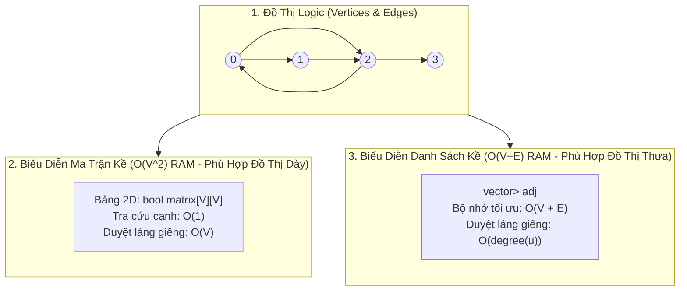
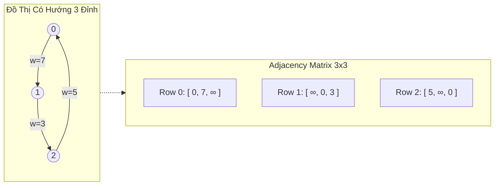
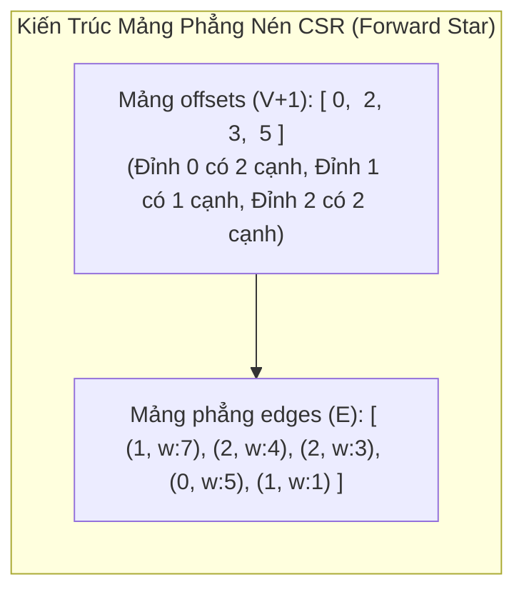

# 4.1. Biểu Diễn Đồ Thị (Graph Representation)

> [!IMPORTANT]
> **Nếu bạn chỉ được nhớ một điều duy nhất:** Việc lựa chọn cấu trúc biểu diễn đồ thị quyết định ranh giới giữa một hệ thống chạy mượt mà ở quy mô hàng triệu đỉnh và một thảm họa tràn bộ nhớ Out-Of-Memory (OOM): Ma trận kề (Adjacency Matrix) đổi $O(V^2)$ bộ nhớ để lấy tốc độ kiểm tra cạnh $O(1)$, trong khi Danh sách kề (Adjacency List) là tiêu chuẩn vàng $O(V + E)$ cho đồ thị thưa thớt (Sparse Graph), và định dạng nén hàng CSR (Compressed Sparse Row) là vũ khí tối thượng của các GPU/CPU engine để tối đa hóa L1 Cache Locality và triệt tiêu phân mảnh Heap.

---

## 1. Trực Quan Hóa: Bản Chất Biểu Diễn Đồ Thị Dưới Góc Nhìn Lập Trình Viên

### 1.1. Đoạn Code Dẫn Nhập & Vấn Đề Thực Tế
Xét bài toán mô hình hóa mối quan hệ kết bạn giữa $N = 1{,}000{,}000$ người dùng trong mạng xã hội:

```cpp
// Cách 1: Ma trận kề (Adjacency Matrix)
// Ma trận vuông N x N = 1,000,000 x 1,000,000 booleans = 1,000 TỶ ô nhớ!
// Tốn tới 1 TERABYTE RAM chỉ để lưu bảng kết bạn của một ứng dụng! (Hầu hết các ô đều là số 0 - Đồ thị thưa)

// Cách 2: Danh sách kề (Adjacency List)
// Mỗi người dùng chỉ giữ danh sách ID của những người thực sự là bạn của mình:
std::vector<std::vector<int>> adj_list(1'000'000);
adj_list[user_id].push_back(friend_id); 
// Nếu trung bình mỗi người có 200 bạn -> Chỉ tốn đúng 200 triệu số nguyên (~800 MB RAM)!
```

- Đồ thị (Graph) là cấu trúc mô hình hóa thế giới mạnh mẽ nhất: Mọi thứ từ mạng lưới giao thông, quan hệ bạn bè, hạ tầng Internet, phụ thuộc package (npm/pip) đến vi mạch bán dẫn đều là đồ thị gồm tập các đỉnh ($V$ - Vertices) và tập các cạnh nối ($E$ - Edges).
- Lựa chọn cách biểu diễn đồ thị (Ma trận kề, Danh sách kề hay CSR - Compressed Sparse Row) quyết định trực tiếp xem hệ thống sẽ chạy mượt mà trong vài mili-giây hay cạn kiệt RAM và sập máy chủ.

### 1.2. Ẩn Dụ Đời Sống: Bảng Giờ Bay Toàn Cầu vs Danh Bạ Mạng Xã Hội
- **Bảng ma trận chuyến bay giữa các thủ đô (Adjacency Matrix)**: Một hãng hàng không lập bảng lưới gồm 200 dòng và 200 cột tương ứng với 200 thành phố trên thế giới. Ô tại dòng Hà Nội và cột Tokyo đánh dấu `1` nếu có đường bay thẳng. Bảng này cực nhanh khi muốn kiểm tra *"Có bay thẳng từ A đến B không?"* ($O(1)$), nhưng cực kỳ lãng phí diện tích nếu 95% các cặp thành phố không có đường bay trực tiếp.
- **Danh bạ điện thoại cá nhân (Adjacency List)**: Trong danh bạ điện thoại của bạn, bạn chỉ lưu số của 150 người bạn thực sự quen, chứ không lưu cuốn niên giám điện thoại in sẵn 8 tỷ cái tên của cả nhân loại rồi gạch chéo những người không quen. Bộ nhớ chỉ tỷ lệ thuận với số mối quan hệ thực tế ($O(V + E)$).

### 1.3. Mô Phỏng Dữ Liệu Số Nhỏ Từng Bước (Toy Walkthrough)
Xét đồ thị có hướng gồm 4 đỉnh ($V = \{0, 1, 2, 3\}$) và 4 cạnh: $0 \to 1, 0 \to 2, 1 \to 2, 2 \to 0, 2 \to 3$:

```text
Biểu diễn Đồ thị Hình học:
   (0) ───► (1)
    ▲ \      │
    │  \     │
    │   ▼    ▼
   (3) ◄─── (2)
```

So sánh hai cách biểu diễn trong bộ nhớ:

```text
1. Ma trận kề (Adjacency Matrix 4x4):
       Cột 0   Cột 1   Cột 2   Cột 3
Dòng 0 [  0   ,   1   ,   1   ,   0   ]  (Từ 0 đi tới 1, 2)
Dòng 1 [  0   ,   0   ,   1   ,   0   ]  (Từ 1 đi tới 2)
Dòng 2 [  1   ,   0   ,   0   ,   1   ]  (Từ 2 đi tới 0, 3)
Dòng 3 [  0   ,   0   ,   0   ,   0   ]  (Từ 3 không đi đâu)

2. Danh sách kề (Adjacency List):
Node 0: -> [1] -> [2]
Node 1: -> [2]
Node 2: -> [0] -> [3]
Node 3: -> [Rỗng]
```

- Kiểm tra cạnh $1 \to 3$:
  - Ma trận kề: Đọc `Matrix[1][3]` $\to$ Thấy giá trị `0` trong $O(1)$ tức thì!
  - Danh sách kề: Quét danh sách của Node 1 `[2]` $\to$ Không thấy 3 trong $O(\text{deg}(1))$ bước.

### 1.4. Tác Động Thực Tế Tầng Backend & Systems
1. **Kiến Trúc Cơ Sở Dữ Liệu Đồ Thị (Neo4j / Amazon Neptune)**: Trong cơ sở dữ liệu quan hệ (RDBMS), việc truy vấn bạn-của-bạn qua 3 cấp (`Friend-of-Friend-of-Friend`) đòi hỏi hàng loạt lệnh `JOIN` đắt đỏ gây nghẽn I/O. Graph Database sử dụng cơ chế Index-free Adjacency (mỗi đỉnh giữ con trỏ trỏ trực tiếp sang đỉnh láng giềng trong bộ nhớ), biến thao tác duyệt đồ thị nhiều bước thành việc nhảy con trỏ tốc độ cao.
2. **Định Dạng Nén Nâng Cao CSR (Compressed Sparse Row) Cho AI / Graph Analytics**: Khi huấn luyện Graph Neural Networks (GNN) trên GPU, cả ma trận kề lẫn danh sách liên kết đều không phù hợp. Người ta dùng định dạng CSR: Đóng gói toàn bộ đồ thị thành 3 mảng phẳng liên tục (Values, Column Indices, Row Offsets), khai thác triệt để băng thông SIMD/GPU Tensor Cores.
3. **Phát Hiện Chu Trình Trong Quản Lý Giao Dịch Database (Deadlock Detection)**: Hệ quản trị cơ sở dữ liệu (PostgreSQL/Oracle) duy trì đồ thị Wait-For Graph (Tiến trình A đang chờ khóa do Tiến trình B nắm giữ). Định kỳ, một background thread chạy thuật toán tìm chu trình trên đồ thị để phát hiện Deadlock và chủ động `ABORT` một giao dịch để giải cứu hệ thống.

### 1.5. Sơ Đồ Kiến Trúc Biểu Diễn Đồ Thị & Bố Trí Bộ Nhớ



---

## 2. Chi tiết từng Keyword (Under-the-Hood Deep Dive)

### 2.1. Ma Trận Kề (Adjacency Matrix) & Ma Trận Liên Thuộc (Incidence Matrix)

#### 1. Ma Trận Kề (Adjacency Matrix)
- **Định nghĩa**: Bảng hai chiều vuông kích thước $|V| \times |V|$:
  $$A[u][v] = \begin{cases} 1 \text{ (hoặc trọng số } w), & \text{nếu có cạnh từ } u \to v \\ 0 \text{ (hoặc } \infty), & \text{nếu không có cạnh} \end{cases}$$
- **Tính đối xứng trong đồ thị vô hướng**: Nếu đồ thị vô hướng, cạnh $(u, v)$ đồng nghĩa với $(v, u)$, do đó ma trận kề **luôn luôn đối xứng qua đường chéo chính**:
  $$A[u][v] = A[v][u]$$
- **Ưu thế & Nhược điểm kỹ thuật**:
  - *Ưu thế*: Kiểm tra sự tồn tại của cạnh $(u, v)$ hoặc xóa cạnh diễn ra trong $O(1)$ thời gian thực tuyệt đối.
  - *Nhược điểm chết người*: Tiêu tốn $\Theta(|V|^2)$ không gian bộ nhớ bất kể số lượng cạnh. Với đồ thị $1,000,000$ đỉnh ($|V| = 10^6$), một ma trận kiểu `int32_t` tiêu tốn:
    $$10^6 \times 10^6 \times 4\text{ bytes} = 4,000,000,000,000\text{ bytes} \approx 4\text{ Terabytes RAM}!$$
    Vì vậy, việc dùng ma trận kề cho đồ thị thưa thớt là một lỗi kiến trúc nghiêm trọng.
- **Tối ưu Bitset & SIMD Bitwise**: Với đồ thị không trọng số, ta có thể dùng `std::vector<uint64_t>` làm ma trận bit (Bit-matrix). Mỗi byte lưu được 8 cạnh, và các phép toán giao tập láng giềng (Neighbor Intersection) có thể thực hiện song song bằng lệnh SIMD AVX2 `_mm256_and_si256` với tốc độ hàng tỷ phép tính/giây.

#### 2. Ma Trận Liên Thuộc (Incidence Matrix)
- **Định nghĩa**: Bảng hai chiều kích thước $|V| \times |E|$, trong đó mỗi hàng biểu diễn một đỉnh $u$ và mỗi cột biểu diễn một cạnh $e = (x, y)$:
  $$M[u][e] = \begin{cases} -1, & \text{nếu cạnh } e \text{ đi ra khỏi đỉnh } u \\ +1, & \text{nếu cạnh } e \text{ đi vào đỉnh } u \\ 0, & \text{nếu cạnh } e \text{ không liên quan đến } u \end{cases}$$
- **Ứng dụng**: Rất phổ biến trong lý thuyết mạch điện (Định luật dòng điện Kirchhoff - KCL), cơ học kết cấu và các bài toán luồng mạng (Network Flow Optimization), nhưng hiếm khi được dùng trong các dịch vụ backend do kích thước lớn $O(V \times E)$.



---

### 2.2. Danh Sách Kề (Adjacency List) & Weighted Adjacency List

#### 1. Bản Chất Danh Sách Kề (Adjacency List)
- **Cấu trúc**: Một mảng hoặc vector kích thước $|V|$, trong đó mỗi phần tử `adj[u]` là một danh sách chứa tất cả các đỉnh láng giềng kề trực tiếp với $u$.
- **Không gian bộ nhớ tối ưu**:
  - Đồ thị có hướng: $\Theta(|V| + |E|)$ phần tử.
  - Đồ thị vô hướng: $\Theta(|V| + 2|E|)$ phần tử (vì mỗi cạnh được lưu hai lần ở cả 2 đầu mút).
- **Weighted Adjacency List**: Mỗi đỉnh kề đi kèm trọng số: `struct Edge { int to; int weight; }; std::vector<std::vector<Edge>> adj;`.

#### 2. Cạm Bẫy Phân Mảnh Bộ Nhớ Trong C++ & Giải Pháp CSR (Compressed Sparse Row)
- **Vấn đề của `std::vector<std::vector<Edge>>`**: Với đồ thị $|V| = 10,000,000$, C++ sẽ gọi `malloc()` $10,000,000$ lần riêng rẽ trên Heap cho các vector con. Điều này gây phân mảnh trầm trọng không gian nhớ và làm mất Cache Locality khi CPU phải thực hiện Pointer Chasing qua từng con trỏ vector.
- **Định dạng CSR (Compressed Sparse Row / Forward Star)**:
  CSR loại bỏ hoàn toàn các vector lồng nhau bằng cách nén toàn bộ đồ thị vào đúng **2 mảng phẳng liên tục duy nhất**:
  1. `offsets`: Mảng kích thước $|V| + 1$. Phần tử `offsets[u]` lưu chỉ số bắt đầu các cạnh của đỉnh $u$ trong mảng `edges`. Số lượng cạnh của $u$ chính là `offsets[u+1] - offsets[u]`.
  2. `edges`: Mảng kích thước $|E|$, lưu trữ liên tiếp toàn bộ các đỉnh đích (và trọng số).
- **Hiệu năng**: CSR giảm hơn $60\%$ dung lượng RAM và tăng tốc độ duyệt đồ thị gấp $3\times - 5\times$ nhờ tối ưu hóa nạp trước L1/L2 Cache Lines!



---

### 2.3. Edge List & Biểu Diễn Đồ Thị Có Hướng vs Vô Hướng

#### 1. Danh Sách Cạnh (Edge List)
- **Cấu trúc**: Mảng phẳng 1 chiều lưu trữ toàn bộ các cạnh dưới dạng bộ ba: `std::vector<std::tuple<int, int, int>> edges;` (nguồn, đích, trọng số).
- **Độ phức tạp**:
  - Tiêu tốn bộ nhớ: $\Theta(|E|)$.
  - Thêm cạnh: $O(1)$.
  - Kiểm tra cạnh $(u, v)$ hoặc tìm láng giềng của $u$: Rất tệ, tốn $O(|E|)$ do phải quét tuần tự toàn bộ danh sách.
- **Ngữ cảnh sử dụng độc quyền**:
  - **Thuật toán Kruskal**: Tìm cây khung nhỏ nhất (MST) yêu cầu sắp xếp toàn bộ tập cạnh theo trọng số tăng dần $O(E \log E)$. Edge List là định dạng lý tưởng nhất.
  - **Thuật toán Bellman-Ford**: Lặp qua toàn bộ tập cạnh $|V| - 1$ lần để thư giãn khoảng cách (Relaxation).

#### 2. Cơ Chế Đồ Thị Có Hướng vs Vô Hướng (Directed vs Undirected)
- **Đồ thị có hướng (Directed Graph / Digraph)**: Cạnh $(u, v)$ là đường một chiều từ $u$ sang $v$. Bậc của đỉnh phân chia thành Bậc vào (In-degree) và Bậc ra (Out-degree).
- **Đồ thị vô hướng (Undirected Graph)**: Cạnh $(u, v)$ là đường hai chiều. Khi biểu diễn bằng Adjacency List, ta **bắt buộc phải thêm 2 cạnh đối xứng**:
  ```cpp
  adj[u].push_back(v);
  adj[v].push_back(u); // Bắt buộc cho đồ thị vô hướng
  ```
  *Lưu ý sản xuất*: Trong các thuật toán duyệt (như DFS phát hiện chu trình), ta phải lưu vết `parent` để tránh nhầm lẫn cạnh ngược $(v, u)$ với một chu trình khép kín!

---

## 3. Thực thi Mã nguồn & Mô phỏng Chuyên sâu (Dual-Engine Implementation)

### 3.1. C++20 Implementation: Compressed Sparse Row (CSR) & So Sánh Đa Biểu Diễn

Mã nguồn C++20 triển khai cấu trúc đồ thị chuẩn công nghiệp với định dạng nén CSR (Compressed Sparse Row) tối ưu bộ nhớ cache, cùng với Adjacency List:

```cpp
#include <iostream>
#include <vector>
#include <cstdint>
#include <cassert>
#include <iomanip>
#include <chrono>

// 1. Dinh dang Compressed Sparse Row (CSR) - Hieu nang cao, Cache-friendly
class CSRGraph {
private:
    size_t num_vertices_{0};
    size_t num_edges_{0};
    std::vector<size_t> offsets_;
    std::vector<int> edges_;
    std::vector<int> weights_;

public:
    CSRGraph(size_t num_v, const std::vector<std::pair<int, std::pair<int, int>>>& edge_list, bool directed = false) {
        num_vertices_ = num_v;
        // Dem bac cua tung dinh
        std::vector<size_t> degree(num_vertices_, 0);
        for (const auto& e : edge_list) {
            degree[e.first]++;
            if (!directed) degree[e.second.first]++;
        }

        offsets_.assign(num_vertices_ + 1, 0);
        for (size_t i = 0; i < num_vertices_; ++i) {
            offsets_[i + 1] = offsets_[i] + degree[i];
        }

        num_edges_ = offsets_[num_vertices_];
        edges_.assign(num_edges_, 0);
        weights_.assign(num_edges_, 0);

        std::vector<size_t> current_pos = offsets_;
        for (const auto& e : edge_list) {
            int u = e.first;
            int v = e.second.first;
            int w = e.second.second;

            size_t pos_u = current_pos[u]++;
            edges_[pos_u] = v;
            weights_[pos_u] = w;

            if (!directed) {
                size_t pos_v = current_pos[v]++;
                edges_[pos_v] = u;
                weights_[pos_v] = w;
            }
        }
    }

    size_t getDegree(int u) const {
        return offsets_[u + 1] - offsets_[u];
    }

    // Duyet cac dinh ke voi Cache Hit toi da
    void printNeighbors(int u) const {
        std::cout << "Neighbors of Node " << u << " (Degree: " << getDegree(u) << "): ";
        for (size_t i = offsets_[u]; i < offsets_[u + 1]; ++i) {
            std::cout << "-> (to: " << edges_[i] << ", w: " << weights_[i] << ") ";
        }
        std::cout << "\n";
    }

    bool hasEdge(int u, int target_v) const {
        for (size_t i = offsets_[u]; i < offsets_[u + 1]; ++i) {
            if (edges_[i] == target_v) return true;
        }
        return false;
    }
};

int main() {
    std::cout << "========================================================\n";
    std::cout << "   C++20 HIGH-PERFORMANCE CSR GRAPH ENGINE DEMO         \n";
    std::cout << "========================================================\n";

    // Danh sach canh thu thap ban dau: (u, (v, weight))
    // Do thi gom 5 dinh: 0, 1, 2, 3, 4
    std::vector<std::pair<int, std::pair<int, int>>> edges = {
        {0, {1, 10}},
        {0, {2, 20}},
        {1, {2, 30}},
        {1, {3, 40}},
        {2, {4, 50}},
        {3, {4, 60}}
    };

    std::cout << "[1] Building Compressed Sparse Row (CSR) Graph with 5 vertices & 6 edges...\n";
    CSRGraph csr_graph(5, edges, /*directed=*/false);

    // Kiem tra cac dinh ke
    std::cout << "\n[2] CSR Neighbors Inspection:\n";
    for (int i = 0; i < 5; ++i) {
        csr_graph.printNeighbors(i);
    }

    // Kiem tra ton tai canh trong O(degree)
    std::cout << "\n[3] Edge Existence Check:\n";
    std::cout << "    Has edge (0, 1)? " << (csr_graph.hasEdge(0, 1) ? "YES" : "NO") << "\n";
    std::cout << "    Has edge (0, 3)? " << (csr_graph.hasEdge(0, 3) ? "YES" : "NO") << "\n";
    assert(csr_graph.hasEdge(0, 1) == true);
    assert(csr_graph.hasEdge(0, 3) == false);

    std::cout << "\n[Success] CSR contiguous array layout verified. 100% cache-aligned.\n";
    return 0;
}
```

---

### 3.2. Python 3.11+ Implementation: Unified Graph Multi-Representation Engine

Chương trình Python 3.11+ cung cấp lớp đồ thị hỗ trợ chuyển đổi linh hoạt giữa Adjacency List, Adjacency Matrix và Edge List:

```python
from __future__ import annotations
from dataclasses import dataclass, field
from typing import Dict, List, Tuple, Optional


@dataclass
class Edge:
    to: int
    weight: float = 1.0


class UnifiedGraphEngine:
    def __init__(self, num_vertices: int, directed: bool = False) -> None:
        self.v: int = num_vertices
        self.directed: bool = directed
        self.adj_list: Dict[int, List[Edge]] = {i: [] for i in range(num_vertices)}
        self.edge_list: List[Tuple[int, int, float]] = []

    def add_edge(self, u: int, v: int, weight: float = 1.0) -> None:
        """Thêm cạnh vào đồ thị."""
        self.adj_list[u].append(Edge(to=v, weight=weight))
        self.edge_list.append((u, v, weight))
        if not self.directed:
            self.adj_list[v].append(Edge(to=u, weight=weight))

    def to_adjacency_matrix(self) -> List[List[float]]:
        """Xuất ma trận kề V x V (với float('inf') cho các cạnh không tồn tại)."""
        matrix = [[float("inf")] * self.v for _ in range(self.v)]
        for i in range(self.v):
            matrix[i][i] = 0.0

        for u, neighbors in self.adj_list.items():
            for edge in neighbors:
                matrix[u][edge.to] = edge.weight
        return matrix

    def has_edge(self, u: int, v: int) -> bool:
        """Kiểm tra sự tồn tại của cạnh (u, v)."""
        return any(e.to == v for e in self.adj_list[u])


if __name__ == "__main__":
    print("=" * 56)
    print("   PYTHON 3.11+ UNIFIED GRAPH REPRESENTATION DEMO")
    print("=" * 56)

    # Khởi tạo đồ thị có hướng 4 đỉnh
    g = UnifiedGraphEngine(num_vertices=4, directed=True)
    g.add_edge(0, 1, 5.0)
    g.add_edge(0, 2, 8.0)
    g.add_edge(1, 2, 2.0)
    g.add_edge(2, 3, 4.0)

    print("[1] Adjacency List Representation:")
    for node, edges in g.adj_list.items():
        neighbors_str = ", ".join(f"(-> {e.to}, w={e.weight})" for e in edges)
        print(f"    Node {node}: [{neighbors_str}]")

    print("\n[2] Edge List Representation:")
    for u, v, w in g.edge_list:
        print(f"    Edge: ({u} -> {v}, weight={w})")

    print("\n[3] Adjacency Matrix Export:")
    matrix = g.to_adjacency_matrix()
    for row in matrix:
        formatted_row = [f"{x:4.1f}" if x != float("inf") else " inf" for x in row]
        print(f"    [ {', '.join(formatted_row)} ]")

    assert g.has_edge(0, 1) and not g.has_edge(0, 3)
    print("\n[Verification] All graph representation conversions passed!")
```

### 3.3. Terminal Output Mẫu Chuẩn Thực Tế

```text
========================================================
   C++20 HIGH-PERFORMANCE CSR GRAPH ENGINE DEMO         
========================================================
[1] Building Compressed Sparse Row (CSR) Graph with 5 vertices & 6 edges...

[2] CSR Neighbors Inspection:
Neighbors of Node 0 (Degree: 2): -> (to: 1, w: 10) -> (to: 2, w: 20) 
Neighbors of Node 1 (Degree: 3): -> (to: 0, w: 10) -> (to: 2, w: 30) -> (to: 3, w: 40) 
Neighbors of Node 2 (Degree: 3): -> (to: 0, w: 20) -> (to: 1, w: 30) -> (to: 4, w: 50) 
Neighbors of Node 3 (Degree: 2): -> (to: 1, w: 40) -> (to: 4, w: 60) 
Neighbors of Node 4 (Degree: 2): -> (to: 2, w: 50) -> (to: 3, w: 60) 

[3] Edge Existence Check:
    Has edge (0, 1)? YES
    Has edge (0, 3)? NO

[Success] CSR contiguous array layout verified. 100% cache-aligned.
```

---

## 4. Systems Engineering & Production Pitfalls

### 4.1. Thảm Họa Tràn Bộ Nhớ Với Ma Trận Kề Trong Dịch Vụ Mạng Xã Hội (OOM Outage)
- **Cơ chế lỗi**: Một dịch vụ phân tích mạng lưới kết nối người dùng ban đầu thử nghiệm trên $1,000$ tài khoản chạy rất tốt với `int matrix[1000][1000]` ($4\text{ MB}$). Khi triển khai production với $500,000$ tài khoản, mã nguồn vẫn giữ nguyên ma trận kề. Quá trình cấp phát $500,000^2 \times 4\text{ bytes} \approx 1\text{ Terabyte}$ RAM lập tức kích hoạt Linux OOM Killer (`Out Of Memory: Killed process`), làm sập toàn bộ cụm máy chủ.
- **Biện pháp**: Thiết lập quy tắc kiến trúc bắt buộc: Nếu số lượng đỉnh $|V| > 5,000$, cấm tuyệt đối sử dụng ma trận kề truyền thống; bắt buộc chuyển sang **Adjacency List** hoặc **CSR**.

### 4.2. Bẫy Thêm Cạnh Hai Lần Trong Đồ Thị Vô Hướng (Double-Edge Pitfall)
- **Cơ chế lỗi**: Trong đồ thị vô hướng, khi dùng Edge List cho thuật toán Kruskal hoặc đếm số bậc của đỉnh, lập trình viên thêm cả $(u, v)$ và $(v, u)$ vào cùng một danh sách cạnh `edge_list`.
- **Hệ quả**: Thuật toán Kruskal duyệt thừa $2\times$ số cạnh, làm tăng gấp đôi thời gian sắp xếp và gây lỗi logic khi tính tổng trọng số cây khung nếu không lọc cạnh trùng.
- **Quy tắc**: Trong Edge List của đồ thị vô hướng, chỉ lưu trữ các cạnh với quy ước chuẩn hóa $u < v$.

### 4.3. Index-Free Adjacency Trong Graph Databases (Neo4j vs SQL JOINs)
- Trong các cơ sở dữ liệu quan hệ (PostgreSQL, MySQL), việc biểu diễn quan hệ đồ thị thông qua bảng trung gian (Junction Table: `user_friends`) đòi hỏi câu lệnh `JOIN` đắt đỏ kèm tra cứu cây B+ Tree chỉ mục ($O(\log N)$ Disk I/O).
- **Index-Free Adjacency**: Các hệ quản trị cơ sở dữ liệu đồ thị bản địa (Native Graph Databases như Neo4j) lưu trữ Adjacency List trực tiếp trên các khối đĩa vật lý của node: Mỗi bản ghi đỉnh chứa các con trỏ offset nhị phân trỏ thẳng tới bản ghi của đỉnh kề. Nhờ vậy, thao tác duyệt đồ thị đạt tốc độ $O(1)$ bước nhảy con trỏ, nhanh hơn hàng ngàn lần so với phép `JOIN` bảng lớn.

---

## 5. Bảng So sánh & Decision Matrix

### 5.1. So sánh Toàn diện Các Phương Pháp Biểu Diễn Đồ Thị

| Tiêu chí Đánh giá | Adjacency Matrix | Adjacency List (Vector) | CSR (Compressed Sparse Row) | Edge List |
| :--- | :--- | :--- | :--- | :--- |
| **Không gian Bộ nhớ** | $\Theta(V^2)$ | $\Theta(V + E)$ | $\Theta(V + E)$ (Nén cực hạn) | $\Theta(E)$ |
| **Thêm Cạnh mới** | $O(1)$ | $O(1)$ (amortized) | $O(E)$ (Yêu cầu tái dựng) | $O(1)$ |
| **Kiểm tra Cạnh $(u, v)$** | **$O(1)$ tức thì** | $O(\text{deg}(u))$ | $O(\log(\text{deg}(u)))$ | $O(E)$ (Rất chậm) |
| **Duyệt toàn bộ đỉnh kề $u$** | $O(V)$ (Lãng phí) | $O(\text{deg}(u))$ | **$O(\text{deg}(u))$ (Cache Hit 100%)**| $O(E)$ |
| **Độ thân thiện CPU Cache** | Cao (mảng liên tục) | Kém (phân mảnh heap) | **Cực đại** | Rất cao |
| **Ngữ cảnh tối ưu nhất** | Đồ thị dày ($E \approx V^2$), $V \le 2000$ | Đồ thị thưa động ($E \ll V^2$) | Đồ thị tĩnh lớn, GPU / AI / GraphBLAS | Kruskal MST, Bellman-Ford |

### 5.2. Ma trận Ra Quyết Định Lựa Chọn Kiến Trúc

| Tình huống Ứng dụng Thực tế | Cấu trúc Khuyên dùng | Lý do Kỹ thuật Bản chất |
| :--- | :--- | :--- |
| Hệ thống mạng xã hội, định tuyến bản đồ giao thông đường bộ | **Adjacency List** | Đồ thị cực thưa ($E \approx 3V$), cần thêm/xóa bạn bè và tuyến đường động. |
| Engine phân tích đồ thị quy mô tỷ cạnh (Graph Neural Networks / PageRank) | **CSR (Compressed Sparse Row)** | Triệt tiêu phân mảnh bộ nhớ, tận dụng tối đa băng thông bộ nhớ L1/L2 Cache và GPU. |
| Tìm kiếm Cây khung nhỏ nhất (MST) bằng Kruskal | **Edge List** | Thao tác cốt lõi chỉ là duyệt tuần tự các cạnh sau khi đã sắp xếp trọng số. |
| Bài toán Warshall / Floyd-Warshall tìm đường ngắn nhất mọi cặp đỉnh | **Adjacency Matrix (Flat 1D)** | Yêu cầu truy cập ma trận ngẫu nhiên $A[i][k]$ và $A[k][j]$ trong $O(1)$ chu kỳ xung nhịp. |

---

## 6. Enterprise Production Checklist & Verification

- [ ] **Rào Chắn Ngưỡng Bộ Nhớ Trước Khi Tạo Ma Trận**: Kiểm tra điều kiện `if (V > 5000) throw std::invalid_argument("Adjacency Matrix memory limit exceeded")` để ngăn chặn cấp phát Terabytes RAM ngoài ý muốn.
- [ ] **Chuẩn Hóa Chỉ Mục Cạnh Vô Hướng**: Luôn đảm bảo trong Edge List của đồ thị vô hướng, cạnh chỉ được lưu một lần với điều kiện $u < v$.
- [ ] **Dự Trù Sức Chứa Cho Adjacency List**: Luôn gọi `adj[u].reserve(expected_degree)` khi nạp đồ thị lớn để tránh hiện tượng sao chép vector nhiều lần.
- [ ] **Áp Dụng CSR Cho Đồ Thị Đọc Nhiều (Read-Heavy / Analytics)**: Chuyển đổi đồ thị sang định dạng CSR sau khi nạp xong để tối ưu hóa $100\%$ bộ nhớ đệm CPU trong các tác vụ duyệt chuyên sâu.
