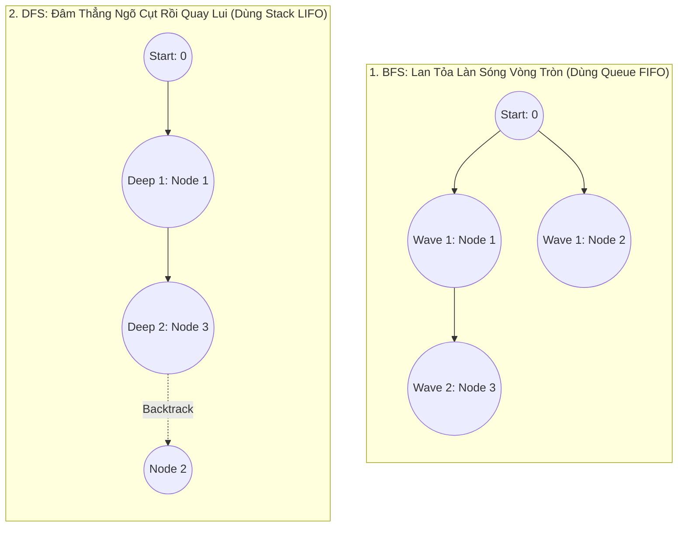
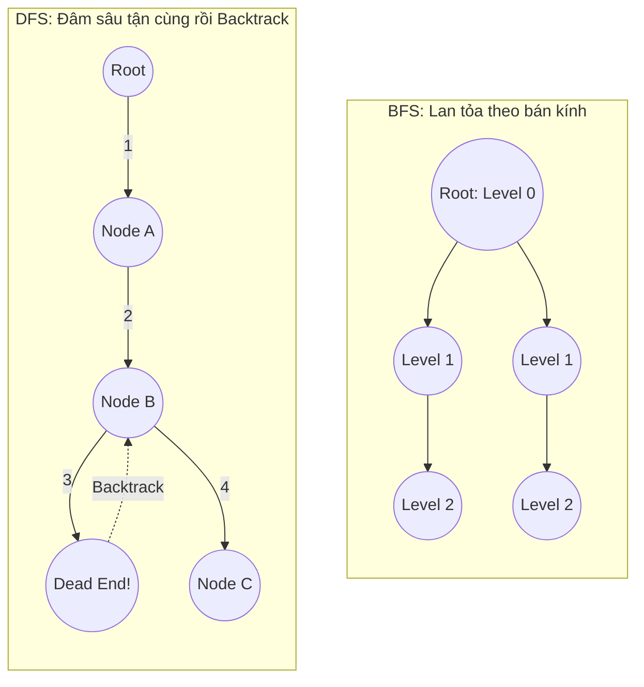
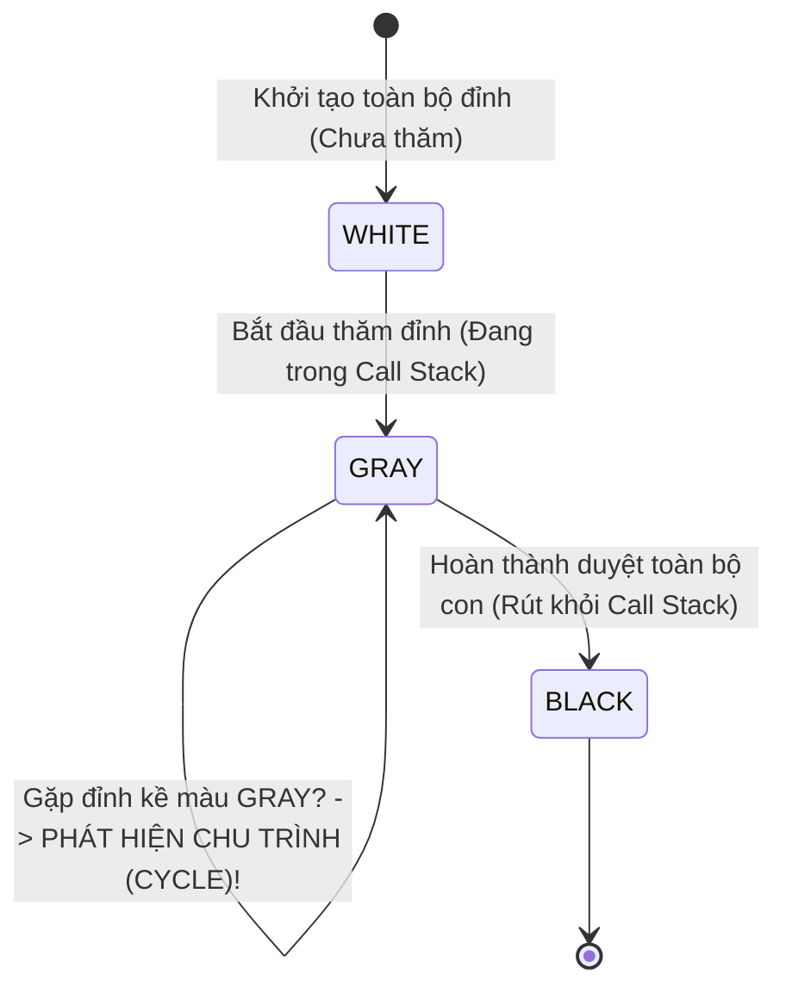
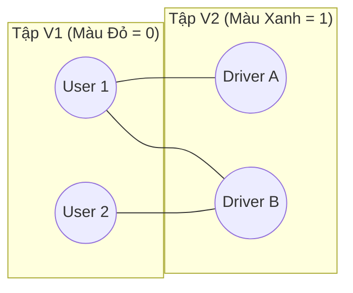

# 4.2. Duyệt Đồ Thị (Graph Traversal & Topological Properties)

> [!IMPORTANT]
> **Nếu bạn chỉ được nhớ một điều duy nhất:** Mọi bài toán phân tích đồ thị đều bắt đầu từ việc kiểm soát trạng thái duyệt: BFS lan tỏa theo từng tầng sóng để tìm đường đi ngắn nhất không trọng số trong $O(V + E)$, DFS đâm sâu vào các nhánh để phát hiện chu trình bằng máy trạng thái 3 màu (White-Gray-Black) và phân loại cạnh (Tree, Back, Forward, Cross), và việc đánh dấu vết `visited` là ranh giới duy nhất ngăn thuật toán rơi vào vòng lặp vô tận chết người do chu trình gây ra.

---

## 1. Trực Quan Hóa: Bản Chất Duyệt Đồ Thị Dưới Góc Nhìn Lập Trình Viên

### 1.1. Đoạn Code Dẫn Nhập & Vấn Đề Thực Tế
Xét bài toán tìm kiếm xem giữa hai người dùng trên Facebook có quen nhau qua cầu nối bạn chung không (Tìm đường đi ngắn nhất theo số lượng bạn bè trung gian):

```typescript
// Tìm kiếm theo chiều rộng (BFS): Đảm bảo tìm ra đường đi ngắn nhất theo số cạnh!
function findShortestFriendConnection(startUser: string, targetUser: string, adj: Map<string, string[]>): number {
  const queue: Array<{ id: string; dist: number }> = [{ id: startUser, dist: 0 }];
  const visited = new Set<string>([startUser]); // BẮT BUỘC có visited để chống lặp vô tận do đồ thị có chu trình!

  while (queue.length > 0) {
    const { id, dist } = queue.shift()!;
    if (id === targetUser) return dist; // Tìm thấy khoảng cách ngắn nhất!

    for (const friend of adj.get(id) || []) {
      if (!visited.has(friend)) {
        visited.add(friend);
        queue.push({ id: friend, dist: dist + 1 });
      }
    }
  }
  return -1; // Không có đường đi
}
```

- Duyệt đồ thị (Graph Traversal) là thao tác nền tảng của mọi bài toán: Thăm toàn bộ các đỉnh và cạnh một cách có hệ thống mà không bị rơi vào vòng lặp vô tận (Infinite Loop) do **chu trình (Cycles)**.
- Hai trường phái duyệt kinh điển:
  - **BFS (Breadth-First Search)**: Lan tỏa theo từng làn sóng vòng tròn đồng tâm, sử dụng **Hàng đợi (Queue)** $\to$ Thống trị bài toán tìm đường đi ngắn nhất trên đồ thị không trọng số.
  - **DFS (Depth-First Search)**: Đâm sâu thăm thẳm một lối mòn cho đến ngõ cụt rồi mới quay lui, sử dụng **Ngăn xếp (Stack/Recursion)** $\to$ Thống trị bài toán phát hiện chu trình, sắp xếp topo và phân tích thành phần liên thông.

### 1.2. Ẩn Dụ Đời Sống: Sóng Radar Tìm Kiếm Cứu Nạn vs Cuộn Chỉ Trong Mê Cung
- **Sóng Radar cứu hộ lan tỏa (BFS)**: Khi một con tàu gặp nạn trên biển, đài cứu hộ phát sóng radar quét tròn từ cự ly 1km, 2km, 3km ra xung quanh. Mọi địa điểm ở cự ly gần được thám hiểm trước; bất kỳ mục tiêu nào được phát hiện đầu tiên chắc chắn là ở cự ly gần nhất có thể. Đó là tính chất tối ưu khoảng cách của BFS.
- **Dũng sĩ Theseus thả cuộn chỉ lần theo mê cung (DFS)**: Bước vào mê cung của quái vật Minotaur, dũng sĩ chọn một lối đi và cắm đầu đi thẳng mãi vào sâu thẳm, vừa đi vừa thả một sợi chỉ đánh dấu lối mòn (`visited`). Khi chạm vào bức tường cụt, dũng sĩ lần ngược theo sợi chỉ (`Backtracking`) về ngã rẽ gần nhất và thử một nhánh rẽ khác. Đó là bản chất đệ quy quay lui của DFS.

### 1.3. Mô Phỏng Dữ Liệu Số Nhỏ Từng Bước (Toy Walkthrough)
Xét đồ thị gồm 4 đỉnh: `0 -- 1`, `0 -- 2`, `1 -- 3`, `2 -- 3` (Đồ thị hình quả trám có chu trình).
Mô phỏng BFS và DFS bắt đầu từ đỉnh `0`:

```text
Đồ thị:
      (0)
     /   \
   (1)   (2)
     \   /
      (3)
```

| Thuật toán | Cấu trúc dữ liệu điều khiển | Thứ tự thăm các đỉnh | Đường đi đến đỉnh 3 |
| :--- | :--- | :--- | :--- |
| **BFS (Chiều Rộng)** | Hàng đợi `Queue`: Đẩy 0 $\to$ Thăm 0 $\to$ Đẩy láng giềng 1, 2 $\to$ Thăm 1 $\to$ Đẩy 3 $\to$ Thăm 2 $\to$ Thăm 3 | `0, 1, 2, 3` | $0 \to 1 \to 3$ (hoặc $0 \to 2 \to 3$): **Độ dài 2 cạnh (Ngắn nhất!)** |
| **DFS (Chiều Sâu)** | Ngăn xếp `Stack`: Đẩy 0 $\to$ Đi sâu vào 1 $\to$ Đi sâu tiếp vào 3 $\to$ Chạm 3 $\to$ Lần ngược về 2 | `0, 1, 3, 2` | $0 \to 1 \to 3$: Đi thẳng một mạch tới đích |

- Nhờ mảng `visited`, khi DFS hoặc BFS đứng tại đỉnh 3 nhìn sang đỉnh 2 (hoặc ngược lại), chúng nhận diện đỉnh đó đã được thăm và không bao giờ quay ngược lại đỉnh cũ!

### 1.4. Tác Động Thực Tế Tầng Backend & Systems
1. **Web Crawler Của Google Search (Crawl Frontier)**: Robot thu thập dữ liệu của công cụ tìm kiếm sử dụng BFS phân tán để cào dữ liệu Internet. Nó ưu tiên cào toàn bộ các liên kết trang chủ (`Depth 1`) trước khi cào sâu vào các bài viết con (`Depth 2, 3`), tránh việc bị sa lầy vào những website vô tận có cấu trúc bẫy sâu.
2. **Garbage Collection (Tracing Mark Phase)**: Trình dọn rác của V8 / JVM thực chất là một thuật toán duyệt đồ thị đồ sộ (BFS/DFS) xuất phát từ các `GC Roots` (thanh ghi, biến toàn cục). Bất kỳ ô nhớ nào không thể vươn tới được sau chu trình duyệt chính là rác cần thu hồi.
3. **Phát Hiện Rò Rỉ Vòng Lặp Phụ Thuộc (Circular Dependency Detection)**: Khi bạn `npm install` hoặc nạp module ES6, Node.js chạy thuật toán DFS với mảng trạng thái 3 màu (Trắng/Xám/Đen) để phát hiện và báo lỗi ngay lập tức nếu Module A `require` B và B `require` lại A.

### 1.5. Sơ Đồ Cơ Chế BFS vs DFS



---

## 2. Chi tiết từng Keyword (Under-the-Hood Deep Dive)

### 2.1. BFS & DFS Mechanics (Recursive vs Iterative, Visited Tracking)



#### 1. Cơ Chế Lưu Vết `visited` (Visited State Management)
- Đồ thị không giống như cây (Tree) — đồ thị có thể chứa chu trình (Cycles) và nhiều đường đi khác nhau cùng dẫn tới một đỉnh.
- Nếu không đánh dấu trạng thái `visited`, thuật toán sẽ di chuyển qua lại vô tận giữa hai đỉnh có cạnh nối ($u \to v \to u \to v\dots$), làm cạn kiệt bộ nhớ hoặc treo CPU $100\%$.
- **Lựa chọn cấu trúc dữ liệu**:
  - Khi đỉnh là số nguyên liên tục $0 \le u < V$: Dùng mảng phẳng `std::vector<bool> visited(V, false)` hoặc `std::vector<uint8_t>` để tối ưu hóa bộ nhớ RAM và CPU Cache.
  - Khi đỉnh là định danh tùy ý (String, UUID, Object Hash): Dùng bảng băm `std::unordered_set<NodeID>`.

#### 2. Cơ Chế Hoạt Động của BFS (Breadth-First Search)
1. Đẩy đỉnh xuất phát `start` vào hàng đợi `std::queue<int> q` và đánh dấu `visited[start] = true`.
2. Lặp lại khi hàng đợi chưa rỗng:
   - Lấy đỉnh đầu hàng đợi: `curr = q.front(); q.pop();`.
   - Lặp qua tất cả các đỉnh láng giềng $v$ của `curr`: Nếu $v$ chưa thăm (`!visited[v]`), đánh dấu `visited[v] = true`, ghi nhận khoảng cách `dist[v] = dist[curr] + 1`, và đẩy $v$ vào hàng đợi.
- **Độ phức tạp**: Thời gian $O(V + E)$ (mỗi đỉnh vào queue 1 lần, mỗi cạnh duyệt 1 hoặc 2 lần), không gian bộ nhớ $O(V)$ cho hàng đợi.

#### 3. Cơ Chế Hoạt Động của DFS (Depth-First Search) & Đệ Quy vs Vòng Lặp
- **Recursive DFS (Đệ quy Call Stack)**: Cực kỳ ngắn gọn và tự nhiên, nhưng phụ thuộc hoàn toàn vào giới hạn ngăn xếp của hệ điều hành (mặc định Linux là $8\text{ MB}$). Nếu đồ thị có đường đi dạng sợi chỉ dài $500,000$ đỉnh, chương trình sẽ lập tức sập vì lỗi `StackOverflowError` (`SIGSEGV`).
- **Iterative DFS (Ngăn xếp tường minh trên Heap)**: Thay thế Call Stack bằng một `std::stack<int>` được cấp phát trên Heap bộ nhớ RAM. Cho phép duyệt an toàn qua đồ thị hàng chục triệu đỉnh mà không sợ tràn stack.

#### 4. Phân Loại Cạnh Trong Rừng Cây DFS (DFS Edge Classification)
Khi chạy DFS trên đồ thị có hướng, các cạnh được phân loại chính xác thành 4 nhóm:
1. **Tree Edge (Cạnh cây)**: Cạnh dẫn tới một đỉnh chưa từng được thăm (khám phá đỉnh con mới).
2. **Back Edge (Cạnh ngược)**: Cạnh trỏ ngược về một đỉnh tổ tiên đang nằm trong Call Stack $\to$ **Dấu hiệu toán học khẳng định chắc chắn đồ thị có chu trình (Cycle)**!
3. **Forward Edge (Cạnh tới)**: Cạnh trỏ từ tổ tiên tới một con cháu đã duyệt xong hoàn toàn.
4. **Cross Edge (Cạnh chéo)**: Cạnh nối giữa hai nhánh cây DFS khác nhau không có quan hệ tổ tiên.

---

### 2.2. Thành Phần Liên Thông (Connected Components) & Cycle Detection

#### 1. Đếm Thành Phần Liên Thông (Connected Components)
- Trong đồ thị vô hướng, hai đỉnh $u$ và $v$ thuộc cùng một thành phần liên thông nếu tồn tại một đường đi nối giữa chúng.
- **Giải thuật đếm**: Khởi tạo mảng `visited` toàn `false`. Lặp qua từng đỉnh $i$ từ $0$ đến $V-1$:
  - Nếu đỉnh $i$ chưa được thăm: Tăng biến đếm thành phần liên thông `component_count++`, sau đó kích hoạt BFS hoặc DFS từ đỉnh $i$ để đánh dấu toàn bộ các đỉnh có thể đến được từ $i$.
- **Độ phức tạp**: Thời gian đúng $O(V + E)$, không lặp lại bất kỳ đỉnh nào.



#### 2. Phát Hiện Chu Trình Trong Đồ Thị Vô Hướng (Undirected Cycle Detection)
- Trong đồ thị vô hướng, cạnh là liên kết hai chiều. Do đó, nếu đỉnh $u$ duyệt sang $v$, thì $v$ sẽ nhìn thấy $u$ là đỉnh kề đã thăm. Đây không phải là chu trình!
- **Quy tắc**: Ta phải truyền kèm biến `parent` trong hàm duyệt. Nếu gặp đỉnh kề $v$ đã thăm (`visited[v] == true`) và $v \ne \text{parent}$, thì chắc chắn đồ thị có chu trình.

#### 3. Phát Hiện Chu Trình Trong Đồ Thị Có Hướng Bằng Máy Trạng Thái 3 Màu (3-Color State Machine)
Đồ thị có hướng phức tạp hơn: việc gặp một đỉnh đã thăm chưa chắc là chu trình (nó có thể là Cross Edge hoặc Forward Edge). Ta bắt buộc phải dùng thuật toán **Tô màu 3 trạng thái**:
1. **WHITE (Trắng - 0)**: Đỉnh chưa từng được ghé thăm.
2. **GRAY (Xám - 1)**: Đỉnh đang nằm trong Call Stack (đang duyệt dở dang các nhánh con của nó).
3. **BLACK (Đen - 2)**: Đỉnh đã duyệt xong toàn bộ cây con bên dưới và đã rút khỏi Call Stack.
- **Quy tắc bất biến**: Nếu trong quá trình duyệt từ đỉnh $u$, ta phát hiện một cạnh trỏ tới đỉnh $v$ đang có màu **GRAY** $\implies$ Đỉnh $v$ là tổ tiên đang chờ $u$ $\implies$ **Tồn tại Back-Edge $\implies$ Phát hiện chu trình khép kín (Deadlock / Infinite Loop)**!

---

### 2.3. Bipartite Checking (Kiểm Tra Đồ Thị Hai Phía)

#### 1. Khái Niệm Bản Chất & Định Lý Toán Học
- **Bipartite Graph (Đồ thị hai phía)**: Đồ thị mà tập đỉnh $V$ có thể chia làm 2 tập con rời rạc $V_1$ và $V_2$ ($V_1 \cup V_2 = V, V_1 \cap V_2 = \emptyset$) sao cho **mọi cạnh trong $E$ chỉ nối một đỉnh thuộc $V_1$ với một đỉnh thuộc $V_2$**, không có bất kỳ cạnh nào nối giữa hai đỉnh cùng một tập.
- **Định lý Bipartite**: Một đồ thị là đồ thị hai phía khi và chỉ khi **nó không chứa bất kỳ chu trình độ dài lẻ (Odd Cycle) nào**. (Chu trình 3 cạnh, 5 cạnh... phá vỡ tính chất hai phía).



#### 2. Thuật Toán Tô 2 Màu (2-Coloring Algorithm via BFS)
1. Khởi tạo mảng màu `colors(V, -1)` (với `-1` nghĩa là chưa tô màu).
2. Lặp qua tất cả các đỉnh (để xử lý cả đồ thị không liên thông):
   - Nếu đỉnh $i$ có `colors[i] == -1`: Gán `colors[i] = 0` và đẩy vào Queue.
   - Khi lấy đỉnh $u$ ra khỏi Queue với màu `c`:
     - Với mỗi đỉnh láng giềng $v$ của $u$:
       - Nếu $v$ chưa tô màu: Gán `colors[v] = 1 - c` (đổi màu nghịch đảo) và đẩy $v$ vào Queue.
       - Nếu $v$ đã tô màu và `colors[v] == c` (hai đỉnh kề nhau có cùng màu) $\to$ **Kết luận ngay lập tức: Đồ thị KHÔNG PHẢI là Bipartite**!
3. Nếu duyệt hết toàn bộ đồ thị mà không gặp xung đột màu, đồ thị là Bipartite.
- **Độ phức tạp**: Thời gian $O(V + E)$, bộ nhớ $O(V)$.

---

## 3. Thực thi Mã nguồn & Mô phỏng Chuyên sâu (Dual-Engine Implementation)

### 3.1. C++20 Implementation: Công Cụ Toàn Diện Duyệt Đồ Thị, Phát Hiện Chu Trình & Kiểm Tra Bipartite

Mã nguồn C++20 công nghiệp thực thi đầy đủ các thuật toán: BFS, DFS lặp (Iterative DFS), Đếm thành phần liên thông, Phát hiện chu trình có hướng (3 màu) và Kiểm tra đồ thị hai phía:

```cpp
#include <iostream>
#include <vector>
#include <queue>
#include <stack>
#include <cassert>
#include <iomanip>

class GraphTraversalEngine {
private:
    int num_vertices_;
    std::vector<std::vector<int>> adj_;

    enum class Color { WHITE, GRAY, BLACK };

    bool hasCycleDirectedDFS(int u, std::vector<Color>& color) const {
        color[u] = Color::GRAY; // Dang duyet trong Call Stack

        for (int v : adj_[u]) {
            if (color[v] == Color::GRAY) {
                return true; // Phat hien Back-Edge -> Co chu trinh!
            }
            if (color[v] == Color::WHITE && hasCycleDirectedDFS(v, color)) {
                return true;
            }
        }

        color[u] = Color::BLACK; // Hoan thanh duyet nhanh con
        return false;
    }

public:
    explicit GraphTraversalEngine(int v) : num_vertices_(v), adj_(v) {}

    void addEdge(int u, int v, bool directed = false) {
        adj_[u].push_back(v);
        if (!directed) {
            adj_[v].push_back(u);
        }
    }

    // 1. BFS Level-by-level
    std::vector<int> bfs(int start_node) const {
        std::vector<int> traversal_order;
        std::vector<bool> visited(num_vertices_, false);
        std::queue<int> q;

        visited[start_node] = true;
        q.push(start_node);

        while (!q.empty()) {
            int curr = q.front();
            q.pop();
            traversal_order.push_back(curr);

            for (int neighbor : adj_[curr]) {
                if (!visited[neighbor]) {
                    visited[neighbor] = true;
                    q.push(neighbor);
                }
            }
        }
        return traversal_order;
    }

    // 2. Iterative DFS tren Heap Stack (Chong Stack Overflow)
    std::vector<int> dfsIterative(int start_node) const {
        std::vector<int> traversal_order;
        std::vector<bool> visited(num_vertices_, false);
        std::stack<int> s;

        s.push(start_node);

        while (!s.empty()) {
            int curr = s.top();
            s.pop();

            if (visited[curr]) continue;
            visited[curr] = true;
            traversal_order.push_back(curr);

            // Day cac dinh ke vao stack
            for (auto it = adj_[curr].rbegin(); it != adj_[curr].rend(); ++it) {
                if (!visited[*it]) {
                    s.push(*it);
                }
            }
        }
        return traversal_order;
    }

    // 3. Dem so thanh phan lien thong (Connected Components)
    int countConnectedComponents() const {
        std::vector<bool> visited(num_vertices_, false);
        int count = 0;

        for (int i = 0; i < num_vertices_; ++i) {
            if (!visited[i]) {
                count++;
                // Chay BFS de danh dau toan bo dinh lien thong
                std::queue<int> q;
                visited[i] = true;
                q.push(i);
                while (!q.empty()) {
                    int curr = q.front();
                    q.pop();
                    for (int neighbor : adj_[curr]) {
                        if (!visited[neighbor]) {
                            visited[neighbor] = true;
                            q.push(neighbor);
                        }
                    }
                }
            }
        }
        return count;
    }

    // 4. Kiem tra Chu trinh tren Do thi co huong bang May trang thai 3 mau
    bool hasCycleDirected() const {
        std::vector<Color> color(num_vertices_, Color::WHITE);
        for (int i = 0; i < num_vertices_; ++i) {
            if (color[i] == Color::WHITE) {
                if (hasCycleDirectedDFS(i, color)) return true;
            }
        }
        return false;
    }

    // 5. Kiem tra Do thi hai phia (Bipartite 2-Coloring)
    bool isBipartite() const {
        std::vector<int> colors(num_vertices_, -1); // -1: Chua to mau

        for (int i = 0; i < num_vertices_; ++i) {
            if (colors[i] != -1) continue;

            std::queue<int> q;
            colors[i] = 0;
            q.push(i);

            while (!q.empty()) {
                int curr = q.front();
                q.pop();

                for (int neighbor : adj_[curr]) {
                    if (colors[neighbor] == -1) {
                        colors[neighbor] = 1 - colors[curr]; // Doi mau nghich dao
                        q.push(neighbor);
                    } else if (colors[neighbor] == colors[curr]) {
                        return false; // Xung dot mau! Khong phai Bipartite
                    }
                }
            }
        }
        return true;
    }
};

int main() {
    std::cout << "========================================================\n";
    std::cout << "   C++20 GRAPH TRAVERSAL & TOPOLOGY ANALYSIS ENGINE     \n";
    std::cout << "========================================================\n";

    // 1. Kiem thu BFS va Iterative DFS tren do thi vo huong
    GraphTraversalEngine g1(6);
    g1.addEdge(0, 1);
    g1.addEdge(0, 2);
    g1.addEdge(1, 3);
    g1.addEdge(1, 4);
    g1.addEdge(2, 5);

    auto bfs_order = g1.bfs(0);
    std::cout << "[1] BFS Traversal Order from Node 0: ";
    for (int v : bfs_order) std::cout << v << " ";
    std::cout << "\n";

    auto dfs_order = g1.dfsIterative(0);
    std::cout << "    Iterative DFS Order from Node 0: ";
    for (int v : dfs_order) std::cout << v << " ";
    std::cout << "\n";

    // 2. Kiem thu Thanh phan lien thong
    GraphTraversalEngine g2(7);
    g2.addEdge(0, 1); // Component 1: {0, 1}
    g2.addEdge(2, 3); // Component 2: {2, 3, 4}
    g2.addEdge(3, 4);
    // Node 5, 6 la cac dinh doc lap (Component 3 & Component 4)
    std::cout << "\n[2] Connected Components Count: " << g2.countConnectedComponents() << " (Expected: 4)\n";
    assert(g2.countConnectedComponents() == 4);

    // 3. Kiem thu Phat hien Chu trinh co huong (3-Color State Machine)
    GraphTraversalEngine g_cyclic(3);
    g_cyclic.addEdge(0, 1, /*directed=*/true);
    g_cyclic.addEdge(1, 2, /*directed=*/true);
    g_cyclic.addEdge(2, 0, /*directed=*/true); // Chu trinh 0 -> 1 -> 2 -> 0
    std::cout << "\n[3] Directed Cycle Test (Cyclic Graph): " 
              << (g_cyclic.hasCycleDirected() ? "CYCLE DETECTED" : "NO CYCLE") << "\n";
    assert(g_cyclic.hasCycleDirected() == true);

    GraphTraversalEngine g_dag(3);
    g_dag.addEdge(0, 1, /*directed=*/true);
    g_dag.addEdge(1, 2, /*directed=*/true);
    std::cout << "    Directed Cycle Test (DAG Graph): " 
              << (g_dag.hasCycleDirected() ? "CYCLE DETECTED" : "NO CYCLE (Valid DAG)") << "\n";
    assert(g_dag.hasCycleDirected() == false);

    // 4. Kiem thu Bipartite Graph
    GraphTraversalEngine g_bipartite(4);
    g_bipartite.addEdge(0, 1);
    g_bipartite.addEdge(1, 2);
    g_bipartite.addEdge(2, 3);
    g_bipartite.addEdge(3, 0); // Chu trinh do dai chan = 4 -> Bipartite!
    std::cout << "\n[4] Bipartite Check (Even Cycle Graph): " 
              << (g_bipartite.isBipartite() ? "IS BIPARTITE" : "NOT BIPARTITE") << "\n";
    assert(g_bipartite.isBipartite() == true);

    GraphTraversalEngine g_odd_cycle(3);
    g_odd_cycle.addEdge(0, 1);
    g_odd_cycle.addEdge(1, 2);
    g_odd_cycle.addEdge(2, 0); // Tam giac: Chu trinh do dai le = 3 -> NOT Bipartite!
    std::cout << "    Bipartite Check (Triangle Odd Cycle): " 
              << (g_odd_cycle.isBipartite() ? "IS BIPARTITE" : "NOT BIPARTITE") << "\n";
    assert(g_odd_cycle.isBipartite() == false);

    std::cout << "\n[Success] All Graph Traversal and Topology verifications passed.\n";
    return 0;
}
```

---

### 3.2. Python 3.11+ Implementation: Bipartite Matching & Circular Dependency Detector

Chương trình Python 3.11+ triển khai bộ phát hiện phụ thuộc vòng tròn (Circular Dependency) trong hệ thống Package Manager và kiểm tra tính chất hai phía:

```python
from __future__ import annotations
from typing import Dict, List, Set, Optional
from collections import deque


class DependencyGraphAnalyzer:
    def __init__(self) -> None:
        self.adj: Dict[str, List[str]] = {}

    def add_dependency(self, module: str, depends_on: str) -> None:
        """Đăng ký phụ thuộc: module phụ thuộc vào depends_on."""
        if module not in self.adj:
            self.adj[module] = []
        if depends_on not in self.adj:
            self.adj[depends_on] = []
        self.adj[module].append(depends_on)

    def detect_circular_dependencies(self) -> List[str]:
        """Phát hiện chu trình phụ thuộc bằng thuật toán 3-Coloring DFS."""
        # 0: WHITE (chưa thăm), 1: GRAY (đang trong call stack), 2: BLACK (đã xong)
        colors: Dict[str, int] = {node: 0 for node in self.adj}
        cycle_nodes: List[str] = []

        def dfs(u: str) -> bool:
            colors[u] = 1  # GRAY
            for v in self.adj[u]:
                if colors[v] == 1:
                    cycle_nodes.append(f"{u} -> {v}")
                    return True
                if colors[v] == 0:
                    if dfs(v):
                        cycle_nodes.append(f"{u} -> {v}")
                        return True
            colors[u] = 2  # BLACK
            return False

        for node in list(self.adj.keys()):
            if colors[node] == 0:
                if dfs(node):
                    break
        return cycle_nodes

    @staticmethod
    def is_bipartite(graph: Dict[int, List[int]]) -> bool:
        """Kiểm tra đồ thị hai phía bằng thuật toán tô 2 màu BFS."""
        color_map: Dict[int, int] = {}

        for node in graph:
            if node in color_map:
                continue

            queue: deque[int] = deque([node])
            color_map[node] = 0

            while queue:
                curr = queue.popleft()
                curr_color = color_map[curr]

                for neighbor in graph.get(curr, []):
                    if neighbor not in color_map:
                        color_map[neighbor] = 1 - curr_color
                        queue.append(neighbor)
                    elif color_map[neighbor] == curr_color:
                        return False
        return True


if __name__ == "__main__":
    print("=" * 56)
    print("   PYTHON 3.11+ DEPENDENCY CYCLE & BIPARTITE DEMO")
    print("=" * 56)

    # 1. Phát hiện Circular Dependency trong hệ thống Build
    dep_engine = DependencyGraphAnalyzer()
    dep_engine.add_dependency("AuthService", "DatabaseClient")
    dep_engine.add_dependency("DatabaseClient", "ConfigLoader")
    dep_engine.add_dependency("ConfigLoader", "AuthService")  # Tạo chu trình chết người!

    cycles = dep_engine.detect_circular_dependencies()
    print("[1] Circular Dependency Detection:")
    if cycles:
        print(f"    ALERT: Circular Dependency detected: {' -> '.join(reversed(cycles))}")
    else:
        print("    SUCCESS: No circular dependencies found.")
    assert len(cycles) > 0

    # 2. Kiểm tra Bipartite (Ghép cặp Tài xế - Hành khách)
    # 0, 1: Passengers; 2, 3: Drivers
    matching_graph = {
        0: [2, 3],
        1: [2],
        2: [0, 1],
        3: [0]
    }
    bipartite_res = DependencyGraphAnalyzer.is_bipartite(matching_graph)
    print(f"\n[2] Ride-hailing Matching Graph is Bipartite? {bipartite_res} (Expected: True)")
    assert bipartite_res is True
```

### 3.3. Terminal Output Mẫu Chuẩn Thực Tế

```text
========================================================
   C++20 GRAPH TRAVERSAL & TOPOLOGY ANALYSIS ENGINE     
========================================================
[1] BFS Traversal Order from Node 0: 0 1 2 3 4 5 
    Iterative DFS Order from Node 0: 0 1 3 4 2 5 

[2] Connected Components Count: 4 (Expected: 4)

[3] Directed Cycle Test (Cyclic Graph): CYCLE DETECTED
    Directed Cycle Test (DAG Graph): NO CYCLE (Valid DAG)

[4] Bipartite Check (Even Cycle Graph): IS BIPARTITE
    Bipartite Check (Triangle Odd Cycle): NOT BIPARTITE

[Success] All Graph Traversal and Topology verifications passed.
```

---

## 4. Systems Engineering & Production Pitfalls

### 4.1. Thảm Họa Tràn Ngăn Xếp Khi Dùng Recursive DFS Trong Microservices (Stack Overflow Crash)
- **Cơ chế lỗi**: Trong hệ thống phân tán xử lý chuỗi sự kiện giao dịch (Transaction Event Chaining) hoặc danh mục sản phẩm phân cấp nhiều tầng, các kỹ sư thường dùng hàm DFS đệ quy ngắn gọn. Khi dữ liệu người dùng tạo ra một chuỗi phụ thuộc dài $200,000$ mắt xích, đệ quy tạo ra $200,000$ Stack Frames.
- **Hệ quả**: Kích thước ngăn xếp hệ điều hành $8\text{ MB}$ bị cạn kiệt chỉ sau vài chục ngàn bước nhảy, tiến trình nhận tín hiệu `SIGSEGV` (Segmentation Fault) và sập server ngay lập tức.
- **Quy tắc công nghiệp**: Chuyển toàn bộ các giải thuật DFS sản xuất sang **Iterative DFS** sử dụng `std::stack` cấp phát trên Heap, hoặc giới hạn độ sâu tối đa `if (depth > MAX_SAFE_DEPTH) throw DepthLimitExceeded();`.

### 4.2. Bẫy Deadlock Detection Trong Cơ Sở Dữ Liệu (Wait-For Graph Overhead)
- Các hệ quản trị cơ sở dữ liệu (PostgreSQL, MySQL InnoDB) phát hiện Deadlock giữa các transactions bằng cách dựng đồ thị có hướng **Wait-For Graph** (Giao dịch $A$ chờ khóa của $B$).
- **Lỗ hổng hiệu năng**: Nếu chạy thuật toán phát hiện chu trình 3 màu liên tục sau mỗi mili-giây, chi phí quét đồ thị $O(V + E)$ sẽ chiếm dụng $50\% - 80\%$ CPU của database engine khi có hàng ngàn transactions đồng thời.
- **Giải pháp**: Chỉ kích hoạt thuật toán phát hiện chu trình khi một transaction đã chờ vượt ngưỡng timeout nhất định (ví dụ: `deadlock_timeout = 1000ms`).

### 4.3. Bẫy Tranh Chấp Trạng Thái Visited Trong Web Crawlers Đa Luồng (Race Conditions)
- Trong các hệ thống thu thập dữ liệu web phân tán (Web Scrapers / Crawlers), nhiều luồng worker cùng lấy URL từ một BFS Queue dùng chung.
- **Lỗi ngầm**: Nếu kiểm tra `visited.contains(url)` và thêm `visited.insert(url)` không phải là một thao tác nguyên tử (Atomic Operation), hai luồng khác nhau có thể đồng thời nhìn thấy `visited == false` cho cùng một URL và tải về hai lần, gây lãng phí băng thông và trùng lặp dữ liệu.
- **Phòng vệ**: Áp dụng **Concurrent Bitset** hoặc bộ lọc Bloom Filter phân tán kết hợp Redis/Memcached atomic check-and-set.

---

## 5. Bảng So sánh & Decision Matrix

### 5.1. So sánh Toàn diện Các Chiến Lược Duyệt Đồ Thị

| Tiêu chí Đánh giá | BFS (Breadth-First) | DFS (Depth-First) | Bidirectional BFS | A* Search |
| :--- | :--- | :--- | :--- | :--- |
| **Cấu trúc Dữ liệu** | Queue (FIFO) | Stack (LIFO) / Call Stack | 2 Queues (Đầu & Cuối) | Priority Queue (Min-Heap) |
| **Độ phức tạp Thời gian**| $O(V + E)$ | $O(V + E)$ | $O(b^{d/2})$ (Nhanh gấp bội) | $O(E)$ (Phụ thuộc Heuristic) |
| **Không gian Bộ nhớ** | $O(V)$ (Lớn tại tầng đáy) | $O(H)$ (Nhỏ, theo độ sâu) | $O(b^{d/2})$ | $O(V)$ |
| **Đường đi Ngắn nhất** | **Tối ưu (Không trọng số)**| Không đảm bảo | **Tối ưu (Không trọng số)**| **Tối ưu (Có trọng số)** |
| **Phát hiện Chu trình** | Được (Khó hơn trên đồ thị có hướng)| **Lý tưởng (3-Color State)**| Không phù hợp | Không phù hợp |
| **Sắp xếp Tô-pô (Topo)**| Khan's Algorithm (In-degree) | **Postorder Reversal** | Không | Không |

### 5.2. Ma trận Ra Quyết Định Lựa Chọn Thuật Toán Duyệt

| Tình huống Ứng dụng Thực tế | Thuật toán Khuyên dùng | Lý do Kỹ thuật Bản chất |
| :--- | :--- | :--- |
| Tìm số bước ngắn nhất giải mê cung / trò chơi (Số bước tối thiểu) | **BFS** | Đảm bảo phần tử đầu tiên chạm đích luôn là đường đi có ít cạnh nhất. |
| Phát hiện tham chiếu vòng tròn trong module code / Deadlock DB | **DFS (3 Colors)** | Back-Edge chỉ ra chính xác chuỗi mắt xích gây tắc nghẽn. |
| Phân tích các cụm mạng xã hội độc lập (User Clusters) | **BFS hoặc DFS** | Đếm thành phần liên thông trong $O(V + E)$ thời gian tuyến tính. |
| Phân bổ tài nguyên / Ghép cặp hai nhóm đối tượng (Uber/Tinder) | **BFS 2-Coloring** | Xác thực đồ thị hai phía trước khi chạy thuật toán luồng cực đại (Hopcroft-Karp). |

---

## 6. Enterprise Production Checklist & Verification

- [ ] **Chuyển DFS Đệ Quy Sang Dạng Lặp**: Đảm bảo không sử dụng đệ quy cho đồ thị không rõ giới hạn độ sâu; dùng `std::stack` cấp phát trên Heap.
- [ ] **Rào Chắn Visited Tuyệt Đối**: Kiểm tra mọi hàm duyệt đều đánh dấu `visited = true` ngay khi đẩy vào Queue/Stack để tránh tràn hàng đợi do phần tử trùng lặp.
- [ ] **Lưu Vết Parent Cho Đồ Thị Vô Hướng**: Khi tìm chu trình trên đồ thị vô hướng, luôn kiểm tra `neighbor != parent` để tránh nhầm lẫn cạnh phản chiếu hai chiều thành chu trình.
- [ ] **Điều Tiết Tần Suất Quét Chu Trình**: Cấu hình thời gian trễ (Timeout Threshold) cho các bộ quét Wait-For Graph để tránh suy giảm thông lượng CPU cơ sở dữ liệu.
