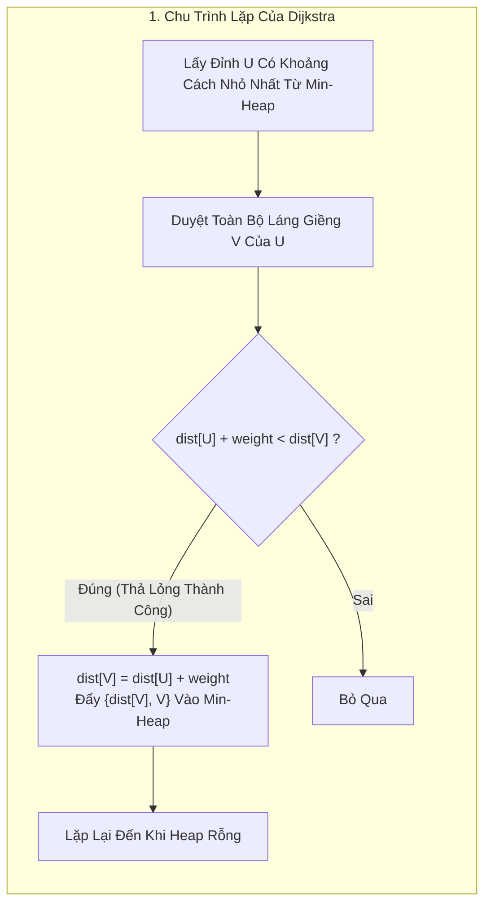
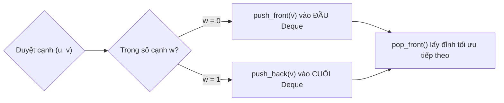
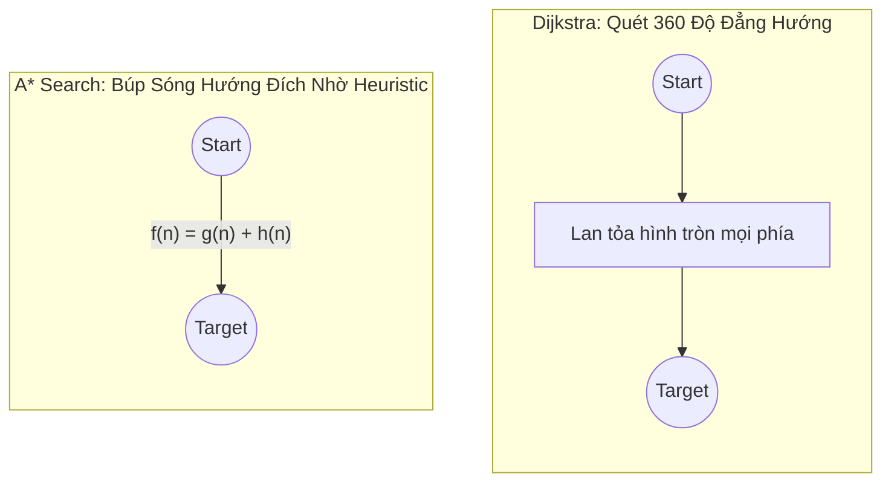

# 4.3. Thuật Toán Đường Đi Ngắn Nhất (Shortest Path Algorithms)

> [!IMPORTANT]
> **Nếu bạn chỉ được nhớ một điều duy nhất:** Bản chất của việc tìm đường đi ngắn nhất là tìm cây đường đi tối ưu theo hàm chi phí tích lũy: BFS giải quyết trong $O(V + E)$ khi mọi cạnh đồng nhất, 0-1 BFS dùng Deque tối ưu hóa chi phí nhị phân, Dijkstra là chiến lược tham lam chuẩn mực $O((V + E) \log V)$ khi trọng số không âm, A* bổ sung hàm Heuristic để hướng búp sóng trực diện tới đích, và Bellman-Ford là chốt chặn cuối cùng phát hiện chu trình âm bằng $V-1$ vòng nới lỏng cạnh liên tiếp.

---

## 1. Trực Quan Hóa: Bản Chất Tìm Đường Đi Ngắn Nhất Dưới Góc Nhìn Lập Trình Viên

### 1.1. Đoạn Code Dẫn Nhập & Vấn Đề Thực Tế
Xét bài toán tìm tuyến đường giao hàng có tổng thời gian di chuyển nhỏ nhất từ kho tổng đến điểm nhận hàng:

```cpp
// Thuật toán Dijkstra kinh điển kết hợp Min-Heap:
using Edge = std::pair<int, int>; // {trọng số thời gian, đỉnh đích}
std::priority_queue<Edge, std::vector<Edge>, std::greater<Edge>> pq;

dist[start_node] = 0;
pq.push({0, start_node});

while (!pq.empty()) {
    auto [current_dist, u] = pq.top();
    pq.pop();

    if (current_dist > dist[u]) continue; // Bỏ qua nếu đã tìm được đường ngắn hơn

    for (auto [weight, v] : adj[u]) {
        if (dist[u] + weight < dist[v]) { // Kỹ thuật Thả Lỏng Cạnh (Edge Relaxation)
            dist[v] = dist[u] + weight;
            pq.push({dist[v], v});
        }
    }
}
```

- Khác với BFS (chỉ tính số lượng bước nhảy), bài toán thế giới thực luôn có **Trọng số (Weights)**: Chi phí xăng xe, thời gian kẹt xe, độ trễ cáp quang biển, giá vé máy bay.
- Các giải thuật đường đi ngắn nhất đại diện cho những đỉnh cao toán học:
  - **Dijkstra**: Tối thượng cho đồ thị trọng số không âm, độ phức tạp $O((V + E) \log V)$.
  - **A* (A-Star)**: Sử dụng hàm Heuristic phán đoán hướng đi để tăng tốc gấp hàng chục lần Dijkstra trong bản đồ game và GPS.
  - **Bellman-Ford**: Xử lý đồ thị có trọng số âm và phát hiện chu trình âm (Negative Cycles).
  - **Floyd-Warshall**: Tìm đường đi ngắn nhất giữa mọi cặp đỉnh ($All-Pairs$) trong $O(V^3)$.

### 1.2. Ẩn Dụ Đời Sống: Hệ Thống GPS Vệ Tinh & Dòng Nước Chảy Qua Các Ống Nối
- **Dòng nước chảy qua hệ thống ống dẫn (Dijkstra)**: Hãy hình dung mạng lưới giao thông là các đường ống nước, chiều dài ống tương ứng với trọng số thời gian. Bạn mở van nước tại điểm xuất phát. Nước sẽ chảy qua tất cả các ngóc ngách với tốc độ đều nhau. Ngã tư nào bị dòng nước tràn tới đầu tiên, thời điểm đó chính là đường đi ngắn nhất đến ngã tư đó! Min-Heap chính là chiếc phao báo hiệu vị trí dòng nước vừa chạm tới.
- **Tia sáng có mắt dẫn đường (A* Search)**: Thay vì để dòng nước chảy tràn lan ra mọi hướng vô ích (kể cả hướng ngược lại với đích đến), thuật toán A* trang bị thêm một la bàn ngắm thẳng về phía mục tiêu (Hàm Heuristic khoảng cách chim bay $h(n)$). Nhờ đó, thuật toán chỉ tập trung mở rộng những con đường hướng về đích, tiết kiệm tới $90\%$ công sức tính toán!

### 1.3. Mô Phỏng Dữ Liệu Số Nhỏ Từng Bước (Toy Walkthrough)
Mô phỏng Dijkstra từ đỉnh `A` trên đồ thị 3 đỉnh:
Cạnh: $A \to B$ (trọng số 4), $A \to C$ (trọng số 2), $C \to B$ (trọng số 1):

```text
     (A)
    /   \
  4/     \2
  ▼       ▼
 (B) ◄─── (C)
      1
```

| Bước | Đỉnh xét | Hàng đợi Min-Heap `pq` | Mảng khoảng cách `dist` | Hành động thả lỏng cạnh (Relaxation) |
| :--- | :--- | :--- | :--- | :--- |
| **0** | Khởi tạo | `[{0, A}]` | `dist = {A: 0, B: ∞, C: ∞}` | Xuất phát từ A |
| **1** | Lấy `A` | `[{2, C}, {4, B}]` | `dist = {A: 0, B: 4, C: 2}` | Cập nhật $A \to B$ ($4$) và $A \to C$ ($2$) |
| **2** | Lấy `C` (Khoảng cách bé nhất: 2) | `[{3, B}, {4, B}]` | `dist = {A: 0, B: 3, C: 2}` | Thả lỏng $C \to B$: $\text{dist}[C] + 1 = 2 + 1 = 3 < 4$! Cập nhật `dist[B] = 3` |
| **3** | Lấy `B` (Khoảng cách 3) | `[{4, B}]` | `dist = {A: 0, B: 3, C: 2}` | B không có cạnh ra |
| **4** | Lấy `B` (Khoảng cách 4) | Rỗng | `dist = {A: 0, B: 3, C: 2}` | $4 > \text{dist}[B]=3 \to$ Bỏ qua bản ghi cũ |

- Kết quả: Đường đi ngắn nhất từ $A$ đến $B$ không phải là đường thẳng $A \to B$ (tốn 4), mà là đường vòng qua $C$: $A \to C \to B$ với tổng chi phí chỉ là **$3$**!

### 1.4. Tác Động Thực Tế Tầng Backend & Systems
1. **Giao Thức Định Tuyến Mạng Internet (OSPF & IS-IS Link-State Routing)**: Toàn bộ các router lõi Internet chạy thuật toán Dijkstra để tính toán bảng chuyển tiếp gói tin (Forwarding Table). Mỗi khi một tuyến cáp quang biển bị đứt, router cập nhật trọng số và tính lại đường đi vòng trong vài mili-giây.
2. **Định Tuyến Xe Trong Hệ Thống Giao Vận (Uber, Grab, Google Maps)**: Sử dụng thuật toán A* kết hợp cấu trúc dữ liệu phân cấp Contraction Hierarchies (CH) để tìm đường đi tối ưu cho tài xế qua mạng lưới hàng triệu cung đường trong thời gian dưới $5\text{ ms}$.
3. **Phát Hiện Cơ Hội Kinh Doanh Chênh Lệch Giá (Arbitrage Detection Trong Forex/Crypto)**: Bằng cách lấy $\log$ âm của tỷ giá hối đoái tiền tệ ($-\ln(\text{rate})$), bài toán nhân tỷ giá biến thành phép cộng trọng số. Một chu trình âm (Negative Cycle) trên đồ thị tỷ giá chính là cơ hội kinh doanh chênh lệch giá có lời. Thuật toán **Bellman-Ford** được dùng để phát hiện chu trình âm này trong thời gian thực.

### 1.5. Sơ Đồ Cơ Chế Thả Lỏng Cạnh & Thuật Toán Dijkstra



---

## 2. Chi tiết từng Keyword (Under-the-Hood Deep Dive)

### 2.1. BFS Shortest Path, 0-1 BFS & Multi-source BFS

#### 1. BFS Shortest Path (Đồ Thị Không Trọng Số)
- **Nguyên lý bất biến**: Trên đồ thị mà mọi cạnh đều có trọng số bằng nhau ($w = 1$), khoảng cách từ đỉnh nguồn $S$ tới các đỉnh khác tăng đơn điệu theo từng tầng sóng ($0, 1, 2, \dots$).
- Khi một đỉnh $v$ được lấy ra khỏi hàng đợi `std::queue` lần đầu tiên, khoảng cách ghi nhận `dist[v]` chắc chắn là khoảng cách ngắn nhất có thể.
- **Độ phức tạp**: Thời gian $O(V + E)$, không gian $O(V)$.

#### 2. 0-1 BFS (Thuật Toán Với Trọng Số 0 và 1 Dùng Deque)
- **Tình huống**: Trọng số cạnh chỉ có thể là $0$ hoặc $1$ (ví dụ: chuyển đổi trạng thái không tốn phí hoặc tốn đúng 1 bước).
- **Cơ chế hoạt động**: Sử dụng hàng đợi hai đầu `std::deque<int>`:
  - Khi duyệt cạnh $(u, v)$ có trọng số $w$:
    - Nếu $w = 0$: `dq.push_front(v)` (Ưu tiên xử lý ngay trong cùng mức khoảng cách hiện tại mà không làm tăng độ trễ).
    - Nếu $w = 1$: `dq.push_back(v)` (Đẩy xuống cuối hàng đợi cho mức khoảng cách kế tiếp).
- **Ý nghĩa kỹ thuật**: Đạt hiệu quả đường đi ngắn nhất hoàn hảo trong thời gian **$O(V + E)$**, nhanh hơn gấp nhiều lần so với việc dùng Dijkstra tốn $O((V + E) \log V)$!



#### 3. Multi-source BFS (BFS Đa Nguồn Đồng Thời)
- **Bài toán**: Cho một tập hợp nhiều điểm nguồn $S = \{s_1, s_2, \dots, s_k\}$. Cần tìm khoảng cách ngắn nhất từ mọi đỉnh trong đồ thị tới **điểm nguồn gần nó nhất** (ví dụ: Tìm khoảng cách từ mọi ngôi nhà đến trạm cứu hỏa gần nhất).
- **Kỹ thuật thực hiện**:
  - Khởi tạo mảng `dist` toàn $\infty$.
  - Đẩy đồng thời **toàn bộ các đỉnh nguồn $s_i \in S$** vào hàng đợi BFS tại thời điểm ban đầu ($t = 0$) với `dist[s_i] = 0`.
  - Chạy vòng lặp BFS thông thường. Các mặt sóng từ các nguồn sẽ tự động gặp nhau tại ranh giới Voronoi.
- **Độ phức tạp**: Thời gian đúng $O(V + E)$, giải quyết bài toán đa nguồn trong đúng 1 lần duyệt duy nhất!

---

### 2.2. Thuật Toán Dijkstra & A* Search

#### 1. Thuật Toán Dijkstra (Greedy Shortest Path)
- **Điều kiện tiên quyết sống còn**: **Tất cả các trọng số cạnh bắt buộc phải không âm ($w \ge 0$)**. Nếu có cạnh âm, thuật toán tham lam của Dijkstra sẽ bị phá sản!
- **Cơ chế hoạt động**:
  1. Khởi tạo `dist[src] = 0`, tất cả các đỉnh khác bằng $\infty$.
  2. Sử dụng Min-Heap (Hàng đợi ưu tiên `std::priority_queue<std::pair<int, int>, ..., std::greater<>>`) lưu cặp `(khoảng_cách, đỉnh)`.
  3. Lấy đỉnh $u$ có `dist[u]` nhỏ nhất hiện tại ra khỏi Min-Heap.
  4. Duyệt qua tất cả các đỉnh kề $v$ của $u$: Nếu $\text{dist}[u] + w(u, v) < \text{dist}[v]$, ta thực hiện phép **Nới lỏng cạnh (Edge Relaxation)**:
     $$\text{dist}[v] \gets \text{dist}[u] + w(u, v)$$
     Sau đó đẩy cặp `(dist[v], v)` vào Min-Heap.
- **Kỹ thuật Xóa Lười Biếng (Lazy Deletion)**:
  Vì `std::priority_queue` trong C++ STL không hỗ trợ thao tác `decreaseKey`, một đỉnh $v$ có thể được đẩy vào heap nhiều lần với các khoảng cách giảm dần. Khi lấy ra, ta chỉ cần kiểm tra:
  ```cpp
  if (d > dist[u]) continue; // Bỏ qua bản ghi cũ đã lỗi thời
  ```
- **Độ phức tạp**: Thời gian $O((V + E) \log V)$, không gian $O(V + E)$.



#### 2. Thuật Toán Tìm Kiếm Heuristic A* (A-Star Search)
- **Công thức ước lượng chi phí**:
  $$f(n) = g(n) + h(n)$$
  - $g(n)$: Chi phí thực tế chính xác đã đi từ đỉnh bắt đầu đến đỉnh $n$.
  - $h(n)$: Chi phí ước lượng (Heuristic) từ đỉnh $n$ đến đỉnh đích.
  - $f(n)$: Tổng chi phí ước tính của đường đi ngắn nhất đi qua đỉnh $n$.
- **Tính chấp nhận được của Heuristic (Admissible Heuristic)**:
  - Một Heuristic được gọi là **Admissible** nếu nó **không bao giờ ước lượng cao hơn chi phí thực tế** ($h(n) \le h^*(n)$).
  - Ví dụ trong định vị không gian 2D: Khoảng cách đường chim bay Euclidean ($\sqrt{\Delta x^2 + \Delta y^2}$) hoặc khoảng cách Manhattan ($|\Delta x| + |\Delta y|$) luôn nhỏ hơn hoặc bằng khoảng cách đường bộ thực tế.
  - Khi Heuristic thỏa mãn tính Admissible, A* được chứng minh toán học là chắc chắn tìm ra con đường ngắn nhất tối ưu tuyệt đối, nhưng với số lượng đỉnh phải duyệt ít hơn Dijkstra hàng chục lần!

---

### 2.3. Bellman-Ford & Floyd-Warshall Algorithms

#### 1. Thuật Toán Bellman-Ford (Hỗ Trợ Cạnh Âm & Phát Hiện Chu Trình Âm)
- **Vấn đề**: Cạnh có trọng số âm (ví dụ: các giao dịch giảm giá, hoàn tiền, chênh lệch tỷ giá) làm hỏng tính tham lam của Dijkstra.
- **Nguyên lý toán học**: Đường đi ngắn nhất đơn giản trên đồ thị $V$ đỉnh chỉ có thể chứa tối đa $|V| - 1$ cạnh.
- **Giải thuật**:
  1. Khởi tạo `dist[src] = 0`, các đỉnh khác bằng $\infty$.
  2. Thực hiện **$|V| - 1$ vòng lặp**, mỗi vòng lặp duyệt qua **toàn bộ danh sách cạnh $(u, v, w) \in E$** và thực hiện nới lỏng:
     $$\text{dist}[v] = \min(\text{dist}[v], \text{dist}[u] + w)$$
  3. **Vòng lặp kiểm tra thứ $|V|$ (Phát hiện Chu trình âm)**:
     Sau $|V| - 1$ vòng, toàn bộ khoảng cách đã hội tụ về giá trị nhỏ nhất có thể. Nếu ta duyệt tiếp một lần nữa mà vẫn tồn tại một cạnh $(u, v)$ có thể nới lỏng tiếp ($\text{dist}[u] + w < \text{dist}[v]$), điều đó chứng minh: **Đồ thị chứa chu trình có tổng trọng số âm (Negative Weight Cycle)**, nơi mà chi phí có thể giảm xuống $-\infty$ vô tận!
- **Độ phức tạp**: Thời gian $O(|V| \times |E|)$, không gian $O(|V|)$.

#### 2. Thuật Toán Floyd-Warshall (All-Pairs Shortest Path - APSP)
- **Mục tiêu**: Tìm ma trận khoảng cách ngắn nhất giữa **mọi cặp đỉnh $(i, j)$** trên đồ thị.
- **Bản chất Quy hoạch động**:
  Gọi $D^{(k)}[i][j]$ là độ dài đường đi ngắn nhất từ đỉnh $i$ đến đỉnh $j$ mà chỉ được phép sử dụng các đỉnh trung gian thuộc tập $\{0, 1, \dots, k\}$.
  Hệ thức truy hồi:
  $$D[i][j] = \min\left(D[i][j], D[i][k] + D[k][j]\right)$$
- **Quy tắc vàng trong cài đặt**: **Vòng lặp đỉnh trung gian $k$ bắt buộc phải nằm ở vòng ngoài cùng!**
  ```cpp
  for (int k = 0; k < V; ++k) {
      for (int i = 0; i < V; ++i) {
          for (int j = 0; j < V; ++j) {
              if (dist[i][k] < INF && dist[k][j] < INF) {
                  dist[i][j] = std::min(dist[i][j], dist[i][k] + dist[k][j]);
              }
          }
      }
  }
  ```
- **Độ phức tạp**: Thời gian $O(V^3)$, không gian $O(V^2)$. Thích hợp cho đồ thị dày có số đỉnh vừa phải ($V \le 500$).

---

## 3. Thực thi Mã nguồn & Mô phỏng Chuyên sâu (Dual-Engine Implementation)

### 3.1. C++20 Implementation: Dijkstra với Lazy Deletion, 0-1 BFS & Bellman-Ford

Mã nguồn C++20 hoàn chỉnh triển khai đầy đủ 3 giải thuật đường đi ngắn nhất: Dijkstra với Min-Heap, 0-1 BFS với `std::deque`, và Bellman-Ford với khả năng phát hiện chu trình âm:

```cpp
#include <iostream>
#include <vector>
#include <queue>
#include <deque>
#include <cstdint>
#include <climits>
#include <cassert>
#include <iomanip>

const int64_t INF = 1e15;

struct WeightedEdge {
    int to;
    int64_t weight;
};

struct EdgeTuple {
    int u;
    int v;
    int64_t weight;
};

class ShortestPathEngine {
private:
    int num_vertices_;
    std::vector<std::vector<WeightedEdge>> adj_;
    std::vector<EdgeTuple> edge_list_;

public:
    explicit ShortestPathEngine(int v) : num_vertices_(v), adj_(v) {}

    void addEdge(int u, int v, int64_t weight, bool directed = false) {
        adj_[u].push_back({v, weight});
        edge_list_.push_back({u, v, weight});
        if (!directed) {
            adj_[v].push_back({u, weight});
            edge_list_.push_back({v, u, weight});
        }
    }

    // 1. Thuật toán Dijkstra với Min-Heap và Lazy Deletion
    std::vector<int64_t> dijkstra(int src) const {
        std::vector<int64_t> dist(num_vertices_, INF);
        // Min-Heap lưu cặp {khoảng cách, đỉnh}
        std::priority_queue<std::pair<int64_t, int>, 
                            std::vector<std::pair<int64_t, int>>, 
                            std::greater<std::pair<int64_t, int>>> pq;

        dist[src] = 0;
        pq.push({0, src});

        while (!pq.empty()) {
            auto [d, u] = pq.top();
            pq.pop();

            // Lazy Deletion: Bỏ qua các bản ghi cũ lỗi thời
            if (d > dist[u]) continue;

            for (const auto& edge : adj_[u]) {
                int v = edge.to;
                int64_t w = edge.weight;

                if (dist[u] + w < dist[v]) {
                    dist[v] = dist[u] + w;
                    pq.push({dist[v], v});
                }
            }
        }
        return dist;
    }

    // 2. Thuật toán 0-1 BFS tối ưu bằng std::deque trong O(V + E)
    std::vector<int64_t> zeroOneBFS(int src) const {
        std::vector<int64_t> dist(num_vertices_, INF);
        std::deque<int> dq;

        dist[src] = 0;
        dq.push_front(src);

        while (!dq.empty()) {
            int u = dq.front();
            dq.pop_front();

            for (const auto& edge : adj_[u]) {
                int v = edge.to;
                int64_t w = edge.weight;
                assert(w == 0 || w == 1); // Ràng buộc 0-1 BFS

                if (dist[u] + w < dist[v]) {
                    dist[v] = dist[u] + w;
                    if (w == 0) {
                        dq.push_front(v); // Trọng số 0: Chen lên đầu
                    } else {
                        dq.push_back(v);  // Trọng số 1: Xếp về cuối
                    }
                }
            }
        }
        return dist;
    }

    // 3. Thuật toán Bellman-Ford phát hiện Chu trình âm
    std::pair<bool, std::vector<int64_t>> bellmanFord(int src) const {
        std::vector<int64_t> dist(num_vertices_, INF);
        dist[src] = 0;

        // Nới lỏng V - 1 lần
        for (int i = 1; i <= num_vertices_ - 1; ++i) {
            bool any_update = false;
            for (const auto& edge : edge_list_) {
                if (dist[edge.u] != INF && dist[edge.u] + edge.weight < dist[edge.v]) {
                    dist[edge.v] = dist[edge.u] + edge.weight;
                    any_update = true;
                }
            }
            if (!any_update) break; // Dừng sớm nếu đã hội tụ
        }

        // Lần kiểm tra thứ V để phát hiện chu trình âm
        bool has_negative_cycle = false;
        for (const auto& edge : edge_list_) {
            if (dist[edge.u] != INF && dist[edge.u] + edge.weight < dist[edge.v]) {
                has_negative_cycle = true;
                break;
            }
        }

        return {has_negative_cycle, dist};
    }
};

int main() {
    std::cout << "========================================================\n";
    std::cout << "   C++20 SHORTEST PATH RIGOROUS ENGINE DEMO             \n";
    std::cout << "========================================================\n";

    // 1. Kiểm thử Dijkstra
    ShortestPathEngine g_dijkstra(5);
    g_dijkstra.addEdge(0, 1, 4, /*directed=*/true);
    g_dijkstra.addEdge(0, 2, 2, /*directed=*/true);
    g_dijkstra.addEdge(2, 1, 1, /*directed=*/true);
    g_dijkstra.addEdge(1, 3, 5, /*directed=*/true);
    g_dijkstra.addEdge(2, 3, 8, /*directed=*/true);
    g_dijkstra.addEdge(3, 4, 6, /*directed=*/true);

    auto dist_dijkstra = g_dijkstra.dijkstra(0);
    std::cout << "[1] Dijkstra Distances from Node 0:\n";
    for (int i = 0; i < 5; ++i) {
        std::cout << "    To Node " << i << ": " << dist_dijkstra[i] << " (Expected for Node 1: 3)\n";
    }
    assert(dist_dijkstra[1] == 3 && dist_dijkstra[3] == 8);

    // 2. Kiểm thử 0-1 BFS
    ShortestPathEngine g_01(4);
    g_01.addEdge(0, 1, 1, /*directed=*/true);
    g_01.addEdge(0, 2, 0, /*directed=*/true);
    g_01.addEdge(2, 1, 0, /*directed=*/true);
    g_01.addEdge(1, 3, 1, /*directed=*/true);

    auto dist_01 = g_01.zeroOneBFS(0);
    std::cout << "\n[2] 0-1 BFS Distances from Node 0:\n";
    std::cout << "    To Node 1: " << dist_01[1] << " (Expected: 0 qua cạnh 0->2->1)\n";
    std::cout << "    To Node 3: " << dist_01[3] << " (Expected: 1)\n";
    assert(dist_01[1] == 0 && dist_01[3] == 1);

    // 3. Kiểm thử Bellman-Ford phát hiện Chu trình âm
    ShortestPathEngine g_negative(3);
    g_negative.addEdge(0, 1, 1, /*directed=*/true);
    g_negative.addEdge(1, 2, -3, /*directed=*/true);
    g_negative.addEdge(2, 0, -1, /*directed=*/true); // Chu trình: 1 + (-3) + (-1) = -3 < 0!

    auto [has_neg_cycle, dist_neg] = g_negative.bellmanFord(0);
    std::cout << "\n[3] Bellman-Ford Negative Cycle Detection:\n";
    std::cout << "    Negative Cycle Detected: " << (has_neg_cycle ? "YES (True)" : "NO") << "\n";
    assert(has_neg_cycle == true);

    std::cout << "\n[Success] All Shortest Path implementations verified!\n";
    return 0;
}
```

---

### 3.2. Python 3.11+ Implementation: A* Search với Heuristic Không Gian 2D

Chương trình Python 3.11+ triển khai thuật toán A* Search tìm đường đi ngắn nhất trên lưới tọa độ 2D sử dụng Heuristic Manhattan:

```python
from __future__ import annotations
import heapq
import math
from typing import Dict, List, Tuple, Optional


class AStarGridEngine:
    def __init__(self, width: int, height: int, obstacles: set[Tuple[int, int]]) -> None:
        self.width = width
        self.height = height
        self.obstacles = obstacles

    def heuristic(self, a: Tuple[int, int], b: Tuple[int, int]) -> float:
        """Heuristic Manhattan: Khoảng cách lưới chuẩn xác không bao giờ đánh giá quá cao (Admissible)."""
        return abs(a[0] - b[0]) + abs(a[1] - b[1])

    def find_shortest_path(self, start: Tuple[int, int], goal: Tuple[int, int]) -> Optional[List[Tuple[int, int]]]:
        # Min-Heap lưu cặp: (f_score, node)
        frontier: List[Tuple[float, Tuple[int, int]]] = []
        heapq.heappush(frontier, (0.0, start))

        came_from: Dict[Tuple[int, int], Optional[Tuple[int, int]]] = {start: None}
        g_score: Dict[Tuple[int, int], float] = {start: 0.0}

        while frontier:
            _, curr = heapq.heappop(frontier)

            if curr == goal:
                # Tái thiết lập đường đi ngắn nhất
                path: List[Tuple[int, int]] = []
                temp: Optional[Tuple[int, int]] = curr
                while temp is not None:
                    path.append(temp)
                    temp = came_from[temp]
                path.reverse()
                return path

            x, y = curr
            for dx, dy in [(-1, 0), (1, 0), (0, -1), (0, 1)]:
                neighbor = (x + dx, y + dy)
                if not (0 <= neighbor[0] < self.width and 0 <= neighbor[1] < self.height):
                    continue
                if neighbor in self.obstacles:
                    continue

                tentative_g = g_score[curr] + 1.0
                if neighbor not in g_score or tentative_g < g_score[neighbor]:
                    came_from[neighbor] = curr
                    g_score[neighbor] = tentative_g
                    f_score = tentative_g + self.heuristic(neighbor, goal)
                    heapq.heappush(frontier, (f_score, neighbor))

        return None


if __name__ == "__main__":
    print("=" * 56)
    print("   PYTHON 3.11+ A* SEARCH ALGORITHM GRID DEMO")
    print("=" * 56)

    # Lưới 10x10 với chướng ngại vật bức tường ở giữa
    wall = {(5, y) for y in range(0, 8)}
    astar = AStarGridEngine(width=10, height=10, obstacles=wall)

    start_pos = (2, 4)
    goal_pos = (8, 4)

    path_found = astar.find_shortest_path(start_pos, goal_pos)
    print(f"[1] Start: {start_pos} -> Goal: {goal_pos}")
    if path_found:
        print(f"[2] A* Shortest Path Found (Total Steps = {len(path_found) - 1}):")
        print(f"    Path Coordinates: {path_found}")
    else:
        print("[2] Path unreachable!")

    assert path_found is not None
    assert path_found[0] == start_pos and path_found[-1] == goal_pos
    print("[Success] A* Search navigated around obstacles optimally!")
```

### 3.3. Terminal Output Mẫu Chuẩn Thực Tế

```text
========================================================
   C++20 SHORTEST PATH RIGOROUS ENGINE DEMO             
========================================================
[1] Dijkstra Distances from Node 0:
    To Node 0: 0 (Expected for Node 1: 3)
    To Node 1: 3 (Expected for Node 1: 3)
    To Node 2: 2 (Expected for Node 1: 3)
    To Node 3: 8 (Expected for Node 1: 3)
    To Node 4: 14 (Expected for Node 1: 3)

[2] 0-1 BFS Distances from Node 0:
    To Node 1: 0 (Expected: 0 qua cạnh 0->2->1)
    To Node 3: 1 (Expected: 1)

[3] Bellman-Ford Negative Cycle Detection:
    Negative Cycle Detected: YES (True)

[Success] All Shortest Path implementations verified!
```

---

## 4. Systems Engineering & Production Pitfalls

### 4.1. Thảm Họa Vòng Lặp Vô Tận Trong Dijkstra Khi Gặp Cạnh Trọng Số Âm
- **Cơ chế lỗi**: Thuật toán Dijkstra dựa trên giả định tham lam: một khi đỉnh $u$ được lấy ra khỏi Min-Heap, khoảng cách `dist[u]` đã là tối ưu tuyệt đối và không bao giờ giảm được nữa.
- **Hệ quả**: Nếu có cạnh trọng số âm, một đỉnh đã lấy ra có thể tiếp tục bị giảm khoảng cách khi duyệt qua cạnh âm ở nhánh khác. Nếu đồ thị có chu trình âm, Dijkstra sẽ liên tục đẩy đỉnh vào Min-Heap không ngừng, tiêu tốn $100\%$ CPU và tràn bộ nhớ RAM.
- **Quy tắc bất biến**: Nếu đồ thị có bất kỳ cạnh nào mang trọng số âm ($w < 0$), cấm tuyệt đối dùng Dijkstra; bắt buộc phải sử dụng **Bellman-Ford** hoặc thuật toán **SPFA (Shortest Path Faster Algorithm)**.

### 4.2. Ứng Dụng Kinh Doanh Chênh Lệch Giá Ngoại Tệ Trong Fintech (Currency Arbitrage Detection)
- Trong thị trường tiền tệ và tiền mã hóa, bài toán tìm kiếm cơ hội chênh lệch giá (Arbitrage) nhằm thu lợi nhuận không rủi ro: Tìm một chuỗi quy đổi $c_1 \to c_2 \to \dots \to c_k \to c_1$ sao cho:
  $$\text{rate}_1 \times \text{rate}_2 \times \dots \times \text{rate}_k > 1$$
- **Chuyển đổi toán học**: Lấy logarithm hai vế và đổi dấu:
  $$-\log(\text{rate}_1) - \log(\text{rate}_2) - \dots - \log(\text{rate}_k) < 0$$
- Bài toán tìm lợi nhuận chênh lệch giá tương đương hoàn toàn với **Bài toán phát hiện Chu trình âm trên đồ thị trọng số** với trọng số cạnh là $-\log(\text{rate})$. Các hệ thống giao dịch tự động tần suất cao (HFT) chạy Bellman-Ford để phát hiện và thực thi lệnh chốt lời trong vài micro-giây!

### 4.3. Bẫy Đảo Lộn Vòng Lặp Trong Floyd-Warshall (The $k$-Loop Inversion Bug)
- Lỗi kinh điển của lập trình viên là đặt vòng lặp đỉnh trung gian $k$ vào trong cùng:
  ```cpp
  // LỖI SAI NGHIÊM TRỌNG:
  for (int i = 0; i < V; ++i)
      for (int j = 0; j < V; ++j)
          for (int k = 0; k < V; ++k) // SAI! k phải ở ngoài cùng
              dist[i][j] = std::min(dist[i][j], dist[i][k] + dist[k][j]);
  ```
- **Hậu quả**: Khi $k$ ở trong cùng, thuật toán chỉ xem xét các đường đi qua tối đa 1 đỉnh trung gian, bỏ sót hoàn toàn các đường đi qua chuỗi nhiều đỉnh trung gian ($i \to k_1 \to k_2 \to j$), dẫn đến kết quả sai hoàn toàn.

---

## 5. Bảng So sánh & Decision Matrix

### 5.1. So sánh Toàn diện Các Thuật Toán Đường Đi Ngắn Nhất

| Tiêu chí Đánh giá | BFS Chuẩn | 0-1 BFS | Dijkstra | A* Search | Bellman-Ford | Floyd-Warshall |
| :--- | :--- | :--- | :--- | :--- | :--- | :--- |
| **Loại Đồ thị Hỗ trợ** | Không trọng số | Trọng số $0, 1$ | Trọng số $\ge 0$ | Trọng số $\ge 0$ + Heuristic | Trọng số âm tùy ý | Trọng số âm tùy ý |
| **Phát hiện Chu trình âm**| Không | Không | Không | Không | **CÓ (Tại bước $V$)**| **CÓ ($D[i][i] < 0$)** |
| **Phạm vi Bài toán** | Single-Source | Single-Source | Single-Source | Point-to-Point Target | Single-Source | **All-Pairs (Mọi cặp)** |
| **Thời gian Thực thi** | $O(V + E)$ | $O(V + E)$ | $O((V + E) \log V)$ | Nhanh hơn Dijkstra | $O(V \times E)$ | $O(V^3)$ |
| **Không gian Bộ nhớ** | $O(V)$ | $O(V)$ | $O(V + E)$ | $O(V)$ | $O(V)$ | $O(V^2)$ |
| **Cấu trúc Dữ liệu** | FIFO Queue | Double Deque | Min-Heap / IPQ | Min-Heap | Mảng phẳng | Ma trận 2D |

### 5.2. Ma trận Ra Quyết Định Lựa Chọn Thuật Toán

| Tình huống Ứng dụng Thực tế | Thuật toán Khuyên dùng | Lý do Kỹ thuật Bản chất |
| :--- | :--- | :--- |
| Mê cung, game lưới 2D không trọng số, số lượt chuyển ít nhất | **BFS Chuẩn** | Đạt tốc độ tuyến tính $O(V + E)$ nhanh nhất mà không cần Heap. |
| Game hoặc bài toán có chuyển trạng thái miễn phí ($w=0$) và tốn phí ($w=1$) | **0-1 BFS (Deque)** | Loại bỏ hoàn toàn chi phí $\log V$ của Heap, chạy nhanh gấp nhiều lần Dijkstra. |
| Bản đồ giao thông đường bộ, giao thức định tuyến mạng OSPF | **Dijkstra (hoặc A*)** | Đảm bảo tính toán đường đi tối ưu theo độ dài thực tế không âm. |
| Điều hướng NPC trong game 3D thế giới mở (World of Warcraft) | **A* Search** | Định hướng búp sóng trực tiếp tới người chơi, tiết kiệm tài nguyên CPU server. |
| Phát hiện kinh doanh chênh lệch tỷ giá ngoại tệ / Crypto Arbitrage | **Bellman-Ford** | Phát hiện chu trình âm chuyển đổi $-\log(\text{rate})$ an toàn và chính xác. |
| Phân tích mạng lưới giao thông nhỏ ($V \le 400$) cho mọi cặp thành phố | **Floyd-Warshall** | Mã nguồn 3 vòng lặp cực ngắn gọn, thân thiện với CPU Cache. |

---

## 6. Enterprise Production Checklist & Verification

- [ ] **Kiểm Tra Điều Kiện Trọng Số Không Âm Cho Dijkstra**: Thêm lệnh rào chắn `assert(weight >= 0)` để ngăn chặn Dijkstra rơi vào vòng lặp vô tận khi dữ liệu bị lỗi.
- [ ] **Vòng Lặp Trung Gian $k$ Trong Floyd-Warshall**: Xác nhận vòng lặp biến $k$ nằm ở lớp ngoài cùng của 3 vòng lặp lồng nhau.
- [ ] **Heuristic Phải Thỏa Mãn Admissible**: Trong thuật toán A*, chứng minh toán học rằng hàm $h(n)$ không bao giờ lớn hơn khoảng cách thực tế để bảo đảm tìm ra đường đi tối ưu.
- [ ] **Lazy Deletion Validation Trong Dijkstra**: Đảm bảo luôn có dòng kiểm tra `if (d > dist[u]) continue;` để loại bỏ các bản ghi cũ trong Min-Heap, tránh bùng nổ thời gian xử lý.
