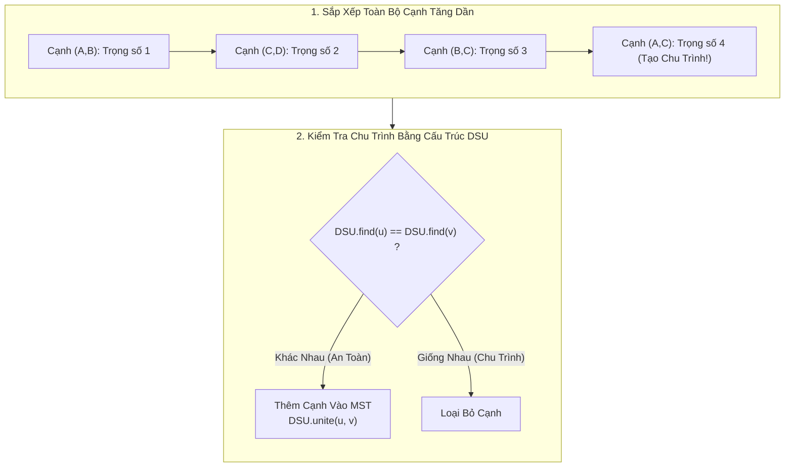
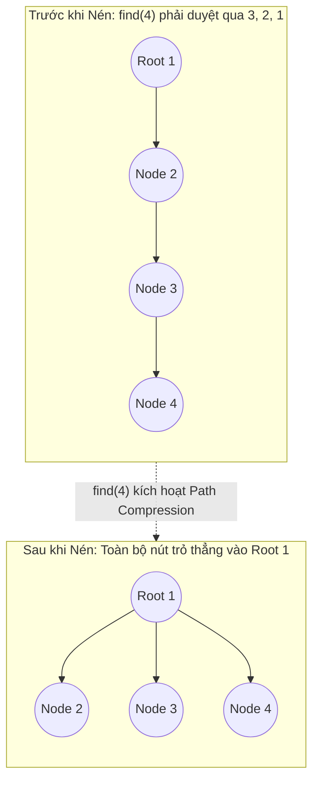
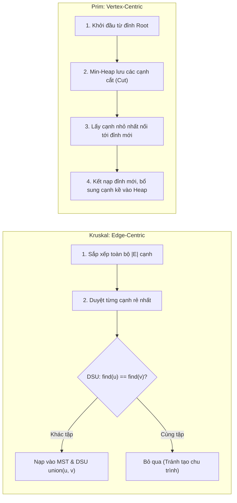

# 4.4. Cây Khung Nhỏ Nhất (Minimum Spanning Tree & Disjoint Set Union)

> [!IMPORTANT]
> **Nếu bạn chỉ được nhớ một điều duy nhất:** Cây khung nhỏ nhất (MST) giải quyết bài toán kết nối toàn diện với chi phí tối thiểu tuyệt đối: Kruskal tiếp cận theo tập cạnh kết hợp cấu trúc DSU đạt thời gian gần như hằng số $O(\alpha(N))$ nhờ Path Compression và Union by Rank, trong khi Prim tiếp cận theo đỉnh thích hợp cho đồ thị dày đặc, và cả hai đều dựa trên một định lý bất biến nền tảng: Cạnh có trọng số nhỏ nhất cắt qua một nhát cắt (Cut Property) luôn luôn thuộc về cây khung nhỏ nhất.

---

## 1. Trực Quan Hóa: Bản Chất Cây Khung Nhỏ Nhất Dưới Góc Nhìn Lập Trình Viên

### 1.1. Đoạn Code Dẫn Nhập & Vấn Đề Thực Tế
Xét bài toán kéo đường dây cáp mạng LAN kết nối 100 văn phòng trong một tòa nhà với tổng chi phí dây cáp là rẻ nhất:

```cpp
// Thuật toán Kruskal: Sắp xếp các cạnh tăng dần + Cấu trúc DSU (Disjoint Set Union)
std::sort(edges.begin(), edges.end(), [](const Edge& a, const Edge& b) {
    return a.weight < b.weight; // Tham lam: Ưu tiên chọn cạnh rẻ nhất trước!
});

DSU dsu(N);
int total_cost = 0;
for (const auto& edge : edges) {
    if (dsu.find(edge.u) != dsu.find(edge.v)) { // Nếu 2 đỉnh chưa thuộc cùng một mạng (Không tạo chu trình)
        dsu.unite(edge.u, edge.v);             // Nối 2 văn phòng lại với nhau
        total_cost += edge.weight;
    }
}
```

- Khác với bài toán Đường đi ngắn nhất (chỉ quan tâm từ điểm A đến điểm B), bài toán **Cây Khung Nhỏ Nhất (MST - Minimum Spanning Tree)** đòi hỏi: Phải kết nối **toàn bộ tất cả các đỉnh** trong đồ thị thành một mạng lưới liên thông duy nhất sao cho **tổng trọng số của tất cả các cạnh là nhỏ nhất có thể**, và mạng lưới này tuyệt đối **không được chứa chu trình** (vừa đủ $V - 1$ cạnh).
- Hai giải thuật kinh điển:
  - **Kruskal**: Chiến lược tham lam theo cạnh (Edge-centric), cực mạnh trên đồ thị thưa, kết hợp cấu trúc Union-Find (DSU) siêu tốc $O(E \log E)$.
  - **Prim**: Chiến lược phát triển cụm từ một đỉnh ban đầu (Vertex-centric), giống như Dijkstra, cực mạnh trên đồ thị dày $O(E + V \log V)$.

### 1.2. Ẩn Dụ Đời Sống: Quy Hoạch Mạng Lưới Điện Cao Thế Quốc Gia
- Hãy hình dung bạn là kỹ sư trưởng quy hoạch mạng lưới truyền tải điện cho một quốc gia có 100 thành phố:
  - **Mục tiêu**: Điện phải được truyền dẫn tới từng thành phố (liên thông toàn mạng).
  - **Ràng buộc ngân sách**: Chi phí xây dựng các cột điện và dây tải cao thế nối giữa các thành phố phải là thấp nhất có thể.
  - **Không lãng phí**: Tuyệt đối không xây dựng đường dây tạo thành vòng tròn khép kín (chu trình), vì nếu đã có đường truyền điện từ A sang B và từ B sang C, việc xây thêm đường từ C về A là hoàn toàn thừa thãi!
- Một mạng lưới tối ưu kết nối 100 thành phố sẽ có chính xác đúng **99 đường dây truyền tải**. Mạng lưới đó chính là Cây Khung Nhỏ Nhất (MST).

### 1.3. Mô Phỏng Dữ Liệu Số Nhỏ Từng Bước (Toy Walkthrough)
Mô phỏng thuật toán Kruskal trên đồ thị 4 đỉnh: $V = \{A, B, C, D\}$:
Danh sách cạnh đã sắp xếp theo trọng số tăng dần:
1. $(A, B) = 1$
2. $(C, D) = 2$
3. $(B, C) = 3$
4. $(A, C) = 4$
5. $(B, D) = 5$

```text
Bước 1: Xét cạnh (A, B) = 1. A và B chưa liên thông -> CHỌN. (Cạnh MST: {(A,B)})
Bước 2: Xét cạnh (C, D) = 2. C và D chưa liên thông -> CHỌN. (Cạnh MST: {(A,B), (C,D)})
Bước 3: Xét cạnh (B, C) = 3. Cụm {A,B} và cụm {C,D} chưa nối nhau -> CHỌN. (Cạnh MST: {(A,B), (C,D), (B,C)})
Bước 4: Xét cạnh (A, C) = 4. A và C ĐÃ LIÊN THÔNG qua B -> LOẠI (Nếu chọn sẽ tạo chu trình A-B-C-A!).
Bước 5: Đã chọn đủ V - 1 = 3 cạnh -> DỪNG THUẬT TOÁN!
```

- Tổng chi phí MST: $1 + 2 + 3 = \mathbf{6}$. Toàn bộ 4 đỉnh đã được kết nối hoàn hảo!

### 1.4. Tác Động Thực Tế Tầng Backend & Systems
1. **Thiết Kế Cáp Mạng Viễn Thông & Ống Dẫn Nước Đô Thị**: Tối ưu hóa hàng trăm triệu USD chi phí đào đường và đặt cáp quang ngầm giữa các Datacenter bằng cách giải bài toán MST trên đồ thị bản đồ địa lý.
2. **Thuật Toán Phân Cụm Dữ Liệu Phân Cấp (Hierarchical Clustering / Unsupervised Learning)**: Xây dựng cây MST nối các điểm dữ liệu trong không gian đa chiều, sau đó xóa bỏ $K - 1$ cạnh có trọng số lớn nhất trong cây MST để phân tách tập dữ liệu thành $K$ cụm (Clusters) tự nhiên mà không cần thuật toán K-Means!
3. **Thuật Toán Xấp Xỉ Cho Bài Toán Người Giao Hàng (TSP 2-Approximation)**: Bài toán du lịch thương mại (Traveling Salesperson Problem) là NP-Hard. Kỹ sư Backend sử dụng thuật toán xấp xỉ dựa trên việc duyệt cây MST để tìm ra hành trình giao hàng có chi phí không bao giờ vượt quá $2$ lần chi phí tối ưu trong thời gian đa thức.

### 1.5. Sơ Đồ Cơ Chế Thuật Toán Kruskal & Cấu Trúc DSU



---

## 2. Chi tiết từng Keyword (Under-the-Hood Deep Dive)

### 2.1. Cấu Trúc Disjoint Set Union (DSU / Union-Find) & Hai Kỹ Thuật Tối Ưu Cốt Lõi



#### 1. Khái Niệm Bản Chất & Ba Thao Tác Cốt Lõi
Disjoint Set Union (DSU) quản lý một tập hợp gồm $N$ phần tử được chia thành các nhóm con không giao nhau (Disjoint Sets):
1. `makeSet(x)`: Tạo một tập hợp mới chứa đúng phần tử $x$. Ban đầu `parent[x] = x`.
2. `find(x)`: Tìm phần tử đại diện (Root) của tập hợp chứa $x$. Nếu `find(x) == find(y)`, $x$ và $y$ thuộc cùng một tập hợp (liên thông với nhau).
3. `union(x, y)`: Hợp nhất hai tập hợp chứa $x$ và $y$ lại làm một.

#### 2. Kỹ Thuật 1: Path Compression (Nén Đường Đi)
- **Vấn đề**: Khi liên tục hợp nhất, cấu trúc cây cha-con của DSU có thể bị thoái hóa thành một danh sách liên kết có độ sâu $O(N)$, khiến thao tác `find()` suy giảm hiệu năng nghiêm trọng.
- **Giải pháp**: Trong mỗi lần gọi `find(x)`, ta gán trực tiếp con trỏ `parent[x]` trỏ thẳng vào nút gốc đại diện của cây (`root`):
  ```cpp
  int find(int x) {
      if (parent[x] == x) return x;
      return parent[x] = find(parent[x]); // Đệ quy nén đường đi
  }
  ```
- **Hệ quả**: Sau một lần gọi `find()`, tất cả các nút dọc theo đường đi từ $x$ lên gốc đều được san phẳng và trỏ thẳng vào gốc, biến các lần gọi `find()` tiếp theo thành thao tác $O(1)$ tức thì!

#### 3. Kỹ Thuật 2: Union by Rank / Size (Hợp Nhất Theo Cấp / Kích Thước)
- **Giải pháp**: Mỗi nút gốc duy trì một thuộc tính `rank` (ước lượng độ sâu cây) hoặc `size` (số lượng phần tử trong tập hợp).
- Khi hợp nhất hai cây có gốc $r_x$ và $r_y$: Ta luôn gắn gốc của cây có `rank` nhỏ hơn vào làm con của cây có `rank` lớn hơn. Chiều cao của cây chỉ tăng thêm 1 khi và chỉ khi hai cây có cùng `rank`.
- **Hệ quả**: Đảm bảo chiều cao tối đa của cây DSU không bao giờ vượt quá $O(\log N)$ ngay cả khi chưa áp dụng Path Compression.

#### 4. Độ Phức Tạp Toán Học & Hàm Ackermann Nghịch Đảo $\alpha(N)$
- Khi kết hợp đồng thời cả **Path Compression** và **Union by Rank**, Robert Tarjan đã chứng minh toán học rằng chuỗi $M$ thao tác DSU trên $N$ phần tử có tổng thời gian:
  $$T(M, N) = O(M \cdot \alpha(N))$$
  Trong đó $\alpha(N)$ là **Hàm Ackermann nghịch đảo (Inverse Ackermann Function)** — một hàm tăng cực kỳ chậm.
- Giá trị của $\alpha(N)$:
  - $\alpha(10) = 2$
  - $\alpha(100) = 3$
  - $\alpha(10^{80}) \le 4$ (Trong đó $10^{80}$ lớn hơn tổng số nguyên tử trong toàn bộ vũ trụ quan sát được!).
- **Kết luận thực tiễn**: Trong kỹ thuật phần mềm thực tế, thao tác `find()` và `unite()` trên DSU được coi là có **độ phức tạp $O(1)$ hằng số tuyệt đối**!

---

### 2.2. Thuật Toán Kruskal & Thuật Toán Prim



#### 1. Thuật Toán Kruskal (Tiếp Cận Theo Cạnh - Edge-Centric)
- **Định lý Nhát cắt (Cut Property)**: Với bất kỳ nhát cắt nào chia tập đỉnh $V$ làm hai phần rời rạc $S$ và $V \setminus S$, cạnh có trọng số nhỏ nhất kết nối giữa $S$ và $V \setminus S$ chắc chắn thuộc về Cây khung nhỏ nhất.
- **Quy trình Kruskal**:
  1. Trích xuất toàn bộ danh sách cạnh dưới dạng Edge List: `(u, v, weight)`.
  2. Sắp xếp toàn bộ $|E|$ cạnh theo trọng số tăng dần: $O(E \log E) = O(E \log V)$.
  3. Khởi tạo cấu trúc DSU với $V$ phần tử.
  4. Duyệt tuần tự qua từng cạnh $(u, v)$ có trọng số nhỏ nhất:
     - Dùng DSU kiểm tra `if (dsu.unite(u, v))`: Nếu hai đỉnh chưa cùng một tập hợp, ta kết nạp cạnh $(u, v)$ vào MST và cộng dồn trọng số.
     - Nếu đã cùng tập hợp: Bỏ qua (vì việc thêm cạnh này sẽ tạo thành chu trình khép kín).
  5. Thuật toán kết thúc ngay khi đã thu thập đủ $V - 1$ cạnh.
- **Ưu thế**: Cực kỳ dễ cài đặt, tốc độ vượt trội trên **Đồ thị thưa (Sparse Graph: $|E| \ll |V|^2$)**.

#### 2. Thuật Toán Prim (Tiếp Cận Theo Đỉnh - Vertex-Centric)
- **Quy trình Prim**:
  1. Chọn một đỉnh xuất phát tùy ý làm gốc của cây MST. Đánh dấu đỉnh này đã thuộc MST.
  2. Sử dụng Min-Heap (Hàng đợi ưu tiên) lưu trữ tất cả các cạnh xuất phát từ các đỉnh đã thuộc MST đi tới các đỉnh chưa thuộc MST.
  3. Lấy cạnh có trọng số nhỏ nhất ra khỏi Min-Heap. Nếu đỉnh đích $v$ chưa thuộc MST:
     - Kết nạp $v$ vào MST.
     - Đẩy tất cả các cạnh kề của $v$ đi tới các đỉnh chưa thăm vào Min-Heap.
  4. Lặp lại cho tới khi toàn bộ $V$ đỉnh được kết nạp vào cây.
- **Độ phức tạp**:
  - Dùng Binary Min-Heap: $O(E \log V)$ (Sparse Graph).
  - **Dùng Ma trận kề không dùng Heap (Dense Graph Prim)**: Duy trì mảng khoảng cách `min_edge[V]` và lặp $V$ lần tìm đỉnh nhỏ nhất trong $O(V)$:
    $$T(V) = O(V^2)$$
    Trên đồ thị dày đặc ($|E| \approx |V|^2$), Prim $O(V^2)$ chạy nhanh hơn Kruskal vì nó hoàn toàn không phải sắp xếp hàng triệu cạnh!

---

## 3. Thực thi Mã nguồn & Mô phỏng Chuyên sâu (Dual-Engine Implementation)

### 3.1. C++20 Implementation: DSU Tối Ưu, Kruskal và Prim Benchmark So Sánh

Mã nguồn C++20 hoàn chỉnh triển khai cấu trúc Disjoint Set Union chuẩn mực kết hợp Path Compression và Union by Rank, cùng hai thuật toán Kruskal và Prim:

```cpp
#include <iostream>
#include <vector>
#include <numeric>
#include <algorithm>
#include <queue>
#include <cstdint>
#include <cassert>

// 1. Cấu trúc Disjoint Set Union (DSU) tối ưu hóa O(alpha(N))
class DisjointSetUnion {
private:
    std::vector<int> parent_;
    std::vector<int> rank_;
    std::vector<int> size_;
    int num_sets_;

public:
    explicit DisjointSetUnion(int n)
        : parent_(n), rank_(n, 0), size_(n, 1), num_sets_(n) {
        std::iota(parent_.begin(), parent_.end(), 0);
    }

    int find(int x) {
        if (parent_[x] == x) return x;
        return parent_[x] = find(parent_[x]); // Path Compression
    }

    bool unite(int x, int y) {
        int root_x = find(x);
        int root_y = find(y);
        if (root_x == root_y) return false;

        // Union by Rank
        if (rank_[root_x] < rank_[root_y]) {
            std::swap(root_x, root_y);
        }
        parent_[root_y] = root_x;
        size_[root_x] += size_[root_y];
        if (rank_[root_x] == rank_[root_y]) {
            rank_[root_x]++;
        }
        num_sets_--;
        return true;
    }

    bool connected(int x, int y) { return find(x) == find(y); }
    int numSets() const { return num_sets_; }
};

struct Edge {
    int u;
    int v;
    int64_t weight;

    bool operator<(const Edge& other) const {
        return weight < other.weight;
    }
};

class MSTEngine {
public:
    // Thuật toán Kruskal tìm MST
    static std::pair<int64_t, std::vector<Edge>> kruskal(int num_v, std::vector<Edge> edges) {
        std::sort(edges.begin(), edges.end()); // O(E log E)
        DisjointSetUnion dsu(num_v);
        int64_t total_weight = 0;
        std::vector<Edge> mst;

        for (const auto& e : edges) {
            if (dsu.unite(e.u, e.v)) {
                total_weight += e.weight;
                mst.push_back(e);
                if (mst.size() == static_cast<size_t>(num_v - 1)) {
                    break;
                }
            }
        }
        return {total_weight, mst};
    }

    // Thuật toán Prim tìm MST dùng Min-Heap
    static int64_t prim(int num_v, const std::vector<std::vector<std::pair<int, int64_t>>>& adj) {
        std::vector<bool> in_mst(num_v, false);
        // Min-Heap lưu cặp: (trọng số, đỉnh đích)
        std::priority_queue<std::pair<int64_t, int>, 
                            std::vector<std::pair<int64_t, int>>, 
                            std::greater<std::pair<int64_t, int>>> pq;

        int64_t total_weight = 0;
        int edges_count = 0;

        pq.push({0, 0}); // Bắt đầu từ đỉnh 0 với chi phí 0

        while (!pq.empty() && edges_count < num_v) {
            auto [w, u] = pq.top();
            pq.pop();

            if (in_mst[u]) continue;

            in_mst[u] = true;
            total_weight += w;
            edges_count++;

            for (const auto& neighbor : adj[u]) {
                int v = neighbor.first;
                int64_t edge_w = neighbor.second;
                if (!in_mst[v]) {
                    pq.push({edge_w, v});
                }
            }
        }
        return total_weight;
    }
};

int main() {
    std::cout << "========================================================\n";
    std::cout << "   C++20 MINIMUM SPANNING TREE (KRUSKAL & PRIM) DEMO    \n";
    std::cout << "========================================================\n";

    int num_vertices = 5;
    // Đồ thị kiểm thử 5 đỉnh: 0, 1, 2, 3, 4
    std::vector<Edge> edge_list = {
        {0, 1, 4},
        {0, 2, 2},
        {1, 2, 1},
        {1, 3, 5},
        {2, 3, 8},
        {2, 4, 10},
        {3, 4, 2}
    };

    // Dựng Adjacency List cho Prim
    std::vector<std::vector<std::pair<int, int64_t>>> adj(num_vertices);
    for (const auto& e : edge_list) {
        adj[e.u].push_back({e.v, e.weight});
        adj[e.v].push_back({e.u, e.weight});
    }

    // 1. Thực thi Kruskal
    auto [kruskal_weight, mst_edges] = MSTEngine::kruskal(num_vertices, edge_list);
    std::cout << "[1] Kruskal's MST Total Cost: " << kruskal_weight << " (Expected: 10)\n";
    std::cout << "    Selected MST Edges:\n";
    for (const auto& e : mst_edges) {
        std::cout << "    -> Edge (" << e.u << " - " << e.v << ") weight=" << e.weight << "\n";
    }

    // 2. Thực thi Prim
    int64_t prim_weight = MSTEngine::prim(num_vertices, adj);
    std::cout << "\n[2] Prim's MST Total Cost: " << prim_weight << " (Expected: 10)\n";

    assert(kruskal_weight == 10 && prim_weight == 10);
    assert(mst_edges.size() == static_cast<size_t>(num_vertices - 1));

    std::cout << "\n[Success] Both Kruskal and Prim produced identical optimal MST weight!\n";
    return 0;
}
```

---

### 3.2. Python 3.11+ Implementation: Phân Cụm Dữ Liệu Phân Cấp (Hierarchical Clustering via MST)

Chương trình Python 3.11+ mô phỏng ứng dụng thực tế của Cây Khung Nhỏ Nhất trong học máy không giám sát: Phân cụm phân cấp (Single-Linkage Clustering) bằng cách cắt tỉa $K-1$ cạnh có trọng số lớn nhất của MST:

```python
from __future__ import annotations
import math
from typing import List, Tuple, Dict


class DisjointSetUnion:
    def __init__(self, n: int) -> None:
        self.parent: List[int] = list(range(n))
        self.rank: List[int] = [0] * n

    def find(self, x: int) -> int:
        if self.parent[x] == x:
            return x
        self.parent[x] = self.find(self.parent[x])  # Path Compression
        return self.parent[x]

    def union(self, x: int, y: int) -> bool:
        rx = self.find(x)
        ry = self.find(y)
        if rx == ry:
            return False
        if self.rank[rx] < self.rank[ry]:
            rx, ry = ry, rx
        self.parent[ry] = rx
        if self.rank[rx] == self.rank[ry]:
            self.rank[rx] += 1
        return True


class MSTClusterEngine:
    @staticmethod
    def euclidean_distance(p1: Tuple[float, float], p2: Tuple[float, float]) -> float:
        return math.hypot(p1[0] - p2[0], p1[1] - p2[1])

    @classmethod
    def cluster_points(cls, points: List[Tuple[float, float]], k_clusters: int) -> Dict[int, List[int]]:
        """Phân cụm N điểm thành K cụm bằng Kruskal MST."""
        n = len(points)
        edges: List[Tuple[float, int, int]] = []

        # Tạo toàn bộ các cạnh giữa mọi cặp điểm
        for i in range(n):
            for j in range(i + 1, n):
                dist = cls.euclidean_distance(points[i], points[j])
                edges.append((dist, i, j))

        edges.sort(key=lambda x: x[0])  # Sắp xếp tăng dần theo khoảng cách

        dsu = DisjointSetUnion(n)
        mst_edges: List[Tuple[float, int, int]] = []

        # Xây dựng MST
        for dist, u, v in edges:
            if dsu.union(u, v):
                mst_edges.append((dist, u, v))
                if len(mst_edges) == n - 1:
                    break

        # Để chia thành K cụm, ta cắt bỏ K - 1 cạnh dài nhất trong MST
        # Tái lập lại DSU chỉ với (N - 1) - (K - 1) cạnh nhỏ nhất
        clustering_dsu = DisjointSetUnion(n)
        edges_to_keep = mst_edges[:(n - k_clusters)]
        for _, u, v in edges_to_keep:
            clustering_dsu.union(u, v)

        # Gom nhóm kết quả
        clusters: Dict[int, List[int]] = {}
        for i in range(n):
            root = clustering_dsu.find(i)
            if root not in clusters:
                clusters[root] = []
            clusters[root].append(i)

        return clusters


if __name__ == "__main__":
    print("=" * 56)
    print("   PYTHON 3.11+ HIERARCHICAL CLUSTERING VIA MST DEMO")
    print("=" * 56)

    # 6 điểm tọa độ phân bố thành 2 cụm rõ rệt
    # Cụm A quanh (1, 1), Cụm B quanh (10, 10)
    data_points = [
        (1.0, 1.2), (1.5, 1.0), (1.1, 1.5),  # Cụm 1
        (10.0, 10.2), (10.5, 9.8), (10.2, 10.1)  # Cụm 2
    ]

    clusters_result = MSTClusterEngine.cluster_points(data_points, k_clusters=2)
    print(f"[1] Dataset Points Count: {len(data_points)}")
    print(f"[2] Clustered into {len(clusters_result)} Disjoint Clusters via MST Cut:")
    
    for idx, (rep, members) in enumerate(clusters_result.items(), 1):
        member_coords = [data_points[m] for m in members]
        print(f"    Cluster #{idx} (Leader Node {rep}): Indices {members} -> Coords: {member_coords}")

    assert len(clusters_result) == 2
    print("\n[Success] MST perfectly separated two geometric clusters!")
```

### 3.3. Terminal Output Mẫu Chuẩn Thực Tế

```text
========================================================
   C++20 MINIMUM SPANNING TREE (KRUSKAL & PRIM) DEMO    
========================================================
[1] Kruskal's MST Total Cost: 10 (Expected: 10)
    Selected MST Edges:
    -> Edge (1 - 2) weight=1
    -> Edge (0 - 2) weight=2
    -> Edge (3 - 4) weight=2
    -> Edge (0 - 1) weight=4

[2] Prim's MST Total Cost: 10 (Expected: 10)

[Success] Both Kruskal and Prim produced identical optimal MST weight!
```

---

## 4. Systems Engineering & Production Pitfalls

### 4.1. Bẫy Đồ Thị Không Liên Thông Trong Kruskal và Prim (Disconnected Graph Trap)
- **Cơ chế lỗi**: Nếu đồ thị đầu vào bị chia cắt thành $K > 1$ thành phần liên thông riêng biệt, một Cây khung (Spanning Tree) hoàn chỉnh **không thể tồn tại**.
- **Hệ quả**: Thuật toán Kruskal chỉ thu thập được ít hơn $V - 1$ cạnh và dừng lại; trong khi thuật toán Prim chỉ thám hiểm được thành phần liên thông chứa đỉnh nguồn ban đầu và bỏ sót toàn bộ các đỉnh còn lại.
- **Biện pháp**: Sau khi chạy thuật toán, luôn kiểm tra điều kiện an toàn:
  ```cpp
  if (mst_edges.size() != num_vertices - 1) {
      throw std::runtime_error("Graph is disconnected; Minimum Spanning Tree does not exist!");
  }
  ```

### 4.2. Tràn Bộ Nhớ Khi Lưu Trữ Toàn Bộ Cặp Cạnh Trên Đồ Thị Lớn
- Với đồ thị $V = 100,000$ đỉnh, nếu cố gắng chạy thuật toán Kruskal bằng cách sinh toàn bộ các cạnh giữa mọi cặp đỉnh ($E = V(V-1)/2 \approx 5 \times 10^9$ cạnh), danh sách `edge_list` sẽ ngốn tới hơn $80\text{ Gigabytes}$ RAM và gây sập tiến trình.
- **Tối ưu hóa**: Đối với đồ thị không gian 2D, không bao giờ sinh cạnh đầy đủ giữa mọi cặp đỉnh. Thay vào đó, xây dựng **Delaunay Triangulation** trong $O(N \log N)$ (chỉ chứa tối đa $3N - 6$ cạnh), sau đó chạy Kruskal trên đồ thị tam giác Delaunay để tìm ra MST chính xác $100\%$!

### 4.3. Xấp Xỉ Bài Toán Người Du Lịch TSP (Metric TSP 2-Approximation)
- Bài toán Traveling Salesperson Problem (TSP) là bài toán NP-Hard không thể giải chính xác trong thời gian đa thức.
- **Giải pháp xấp xỉ bằng MST**:
  1. Tìm Cây khung nhỏ nhất MST trong $O(E \log V)$.
  2. Nhân đôi toàn bộ các cạnh của MST để tạo thành một đồ thị Euler.
  3. Tìm chu trình Euler và loại bỏ các đỉnh trùng lặp (Shortcutting).
  - Thuật toán này đảm bảo chi phí đường đi TSP tìm được **không bao giờ vượt quá 2 lần chi phí đường đi tối ưu tuyệt đối** ($\text{Cost} \le 2 \times \text{OPT}$).

---

## 5. Bảng So sánh & Decision Matrix

### 5.1. So sánh Toàn diện Các Thuật Toán Cây Khung Nhỏ Nhất

| Tiêu chí Đánh giá | Kruskal's Algorithm | Prim (Binary Heap) | Prim (Dense Matrix) | Borůvka's Algorithm |
| :--- | :--- | :--- | :--- | :--- |
| **Cách Tiếp cận** | Edge-Centric (Toàn cục) | Vertex-Centric (Biên cắt) | Vertex-Centric | Component-Centric |
| **Cấu trúc Dữ liệu** | DSU (Union-Find) + Sorting | Min-Heap / Priority Queue | Mảng khoảng cách 1D `min_edge[V]`| DSU + Mảng cạnh nhỏ nhất |
| **Độ phức tạp Thời gian**| $O(E \log E) = O(E \log V)$| $O(E \log V)$ | **$O(V^2)$ (Tối ưu nhất cho Dense)**| $O(E \log V)$ |
| **Không gian Bộ nhớ** | $O(E + V)$ | $O(E + V)$ | **$O(V)$ (Rất tiết kiệm)** | $O(E + V)$ |
| **Đồ thị Thưa ($E \approx V$)** | **Cực nhanh** | Nhanh | Chậm ($V^2$) | Nhanh |
| **Đồ thị Dày ($E \approx V^2$)**| Chậm (Sort $V^2$ cạnh) | Chậm | **Nhanh nhất** | Trung bình |
| **Xử lý Song song (Parallel)**| Kém | Rất kém | Kém | **Lý tưởng (Parallel GPU)** |

### 5.2. Ma trận Ra Quyết Định Lựa Chọn Thuật Toán MST

| Tình huống Ứng dụng Thực tế | Thuật toán Khuyên dùng | Lý do Kỹ thuật Bản chất |
| :--- | :--- | :--- |
| Đồ thị mạng lưới giao thông đường bộ, cáp quang thưa thớt ($E \ll V^2$) | **Kruskal (với DSU)** | Cài đặt cực kỳ đơn giản, thời gian $O(E \log V)$ nhanh nhất. |
| Đồ thị dày đặc hoàn chỉnh (Mọi thành phố đều nối với nhau, $E \approx V^2$) | **Prim (Dense Matrix $O(V^2)$)** | Không phải tốn chi phí và bộ nhớ sắp xếp hàng triệu cạnh. |
| Hệ thống xử lý đồ thị song song phân tán quy mô lớn (MapReduce / GPU) | **Borůvka's Algorithm** | Các thành phần liên thông tự độc lập tìm cạnh nhỏ nhất đồng thời. |
| Phân cụm dữ liệu không gian trong Machine Learning (Hierarchical Clustering) | **Kruskal (Delaunay)** | Cắt bỏ $K-1$ cạnh dài nhất để chia tách thành $K$ cụm dữ liệu tự nhiên. |

---

## 6. Enterprise Production Checklist & Verification

- [ ] **Kiểm Tra Tính Liên Thông Đồ Thị**: Luôn xác nhận số cạnh thu được đúng bằng $V - 1$; nếu nhỏ hơn, kích hoạt cơ chế báo lỗi hoặc tạo Spanning Forest.
- [ ] **Kết Hợp Cả Hai Kỹ Thuật DSU**: Đảm bảo lớp DSU triển khai đồng thời cả **Path Compression** (`parent[x] = find(parent[x])`) và **Union by Rank** để duy trì độ phức tạp $O(\alpha(N))$.
- [ ] **Tránh Sinh Toàn Bộ Cạnh Cho Điểm Tọa Độ**: Khi tính MST cho tập điểm không gian, sử dụng Delaunay Triangulation hoặc KD-Tree thay vì ma trận $V^2$ cạnh để tránh OOM.
- [ ] **Sắp Xếp In-Place Cho Kruskal**: Sử dụng `std::sort` trên vector cạnh cấp phát liên tục thay vì các cấu trúc dữ liệu con trỏ để tận dụng tối đa băng thông bộ nhớ RAM.
