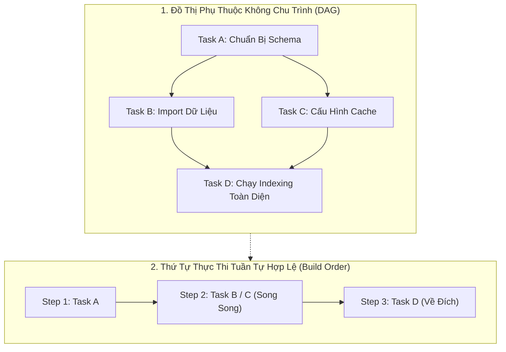
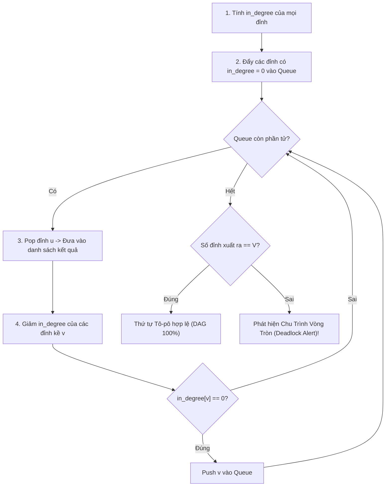
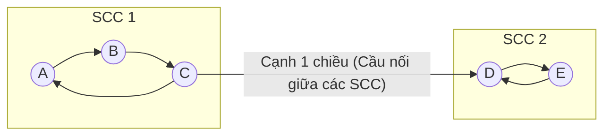
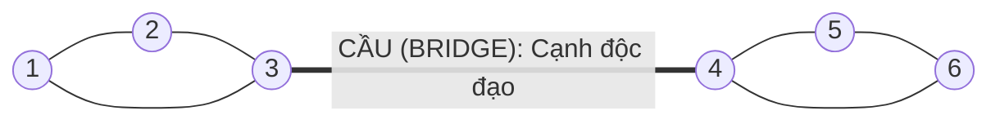

# 4.5. Thuật Toán Đồ Thị Nâng Cao (Advanced Graph Algorithms)

> [!IMPORTANT]
> **Nếu bạn chỉ được nhớ một điều duy nhất:** Các giải thuật đồ thị nâng cao là vũ khí tối thượng để phân tích cấu trúc phức tạp: Kahn's Algorithm biến Đồ thị không chu trình (DAG) thành thứ tự thực thi tuần tự trong $O(V + E)$ bằng bán bậc vào, Tarjan's Algorithm cô lập các thành phần liên thông mạnh (SCC) và điểm yếu mạng lưới (Cầu / Khớp) chỉ trong một lần duyệt DFS duy nhất thông qua nhãn thời gian `tin` và `low`, trong khi Dinic's Algorithm kết hợp Level Graph với luồng chặn để đạt tốc độ luồng cực đại $O(V^2 E)$ tiệm cận giới hạn lý thuyết.

---

## 1. Trực Quan Hóa: Bản Chất Thuật Toán Đồ Thị Nâng Cao Dưới Góc Nhìn Lập Trình Viên

### 1.1. Đoạn Code Dẫn Nhập & Vấn Đề Thực Tế
Xét bài toán biên dịch một dự án phần mềm gồm hàng trăm file mã nguồn có sự phụ thuộc lẫn nhau (`Dependency Management` trong Makefile, Maven, Webpack):

```typescript
// Sắp xếp Tô-pô (Topological Sort) trên Đồ thị Có hướng Không chu trình (DAG):
function getBuildOrder(dependencies: Map<string, string[]>): string[] {
  const inDegree = new Map<string, number>(); // Đếm số lượng module tiên quyết
  // ... tính in-degree ...
  const queue: string[] = []; // Chứa các module độc lập (inDegree = 0) có thể build ngay!
  const buildOrder: string[] = [];

  while (queue.length > 0) {
    const mod = queue.shift()!;
    buildOrder.push(mod);
    for (const dependent of dependencies.get(mod) || []) {
      inDegree.set(dependent, inDegree.get(dependent)! - 1);
      if (inDegree.get(dependent) === 0) queue.push(dependent);
    }
  }
  // Nếu số module build được < tổng số module -> Dự án dính LỖI VÒNG LẶP PHỤ THUỘC (Circular Dependency)!
  return buildOrder;
}
```

- Khi đồ thị bước vào các bài toán quy mô công nghiệp, chúng ta đối mặt với những thách thức phức tạp hơn việc duyệt thông thường:
  - **Sắp Xếp Tô-pô (Topological Sort)**: Thiết lập thứ tự tuyến tính khả thi cho các tác vụ phụ thuộc trên đồ thị DAG.
  - **Thành Phần Liên Thông Mạnh (Strongly Connected Components - SCC: Tarjan / Kosaraju)**: Gom cụm các nhóm đỉnh có thể đi tới lẫn nhau, rút gọn một đồ thị khổng lồ thành một DAG trừu tượng.
  - **Luồng Cực Đại (Maximum Flow - Ford-Fulkerson / Edmonds-Karp)**: Tối ưu hóa lưu lượng vận chuyển qua mạng lưới có giới hạn dung lượng tải.

### 1.2. Ẩn Dụ Đời Sống: Dây Chuyền Lắp Ráp Xe Hơi & Mạng Lưới Đường Ống Dẫn Dầu
- **Dây chuyền lắp ráp xe hơi tự động (Topological Sort & DAG)**: Bạn không thể lắp bánh xe trước khi gắn trục xe, không thể sơn khung xe trước khi hàn kim loại. Thứ tự các bước lắp ráp phải tuân thủ nghiêm ngặt đồ thị phụ thuộc một chiều. Nếu có một khâu đòi hỏi *"Muốn làm A phải có B, muốn làm B phải có A"*, toàn bộ dây chuyền sản xuất bị đóng băng vì lỗi chu trình!
- **Mạng lưới đường ống dẫn dầu xuyên quốc gia (Max Flow & Min Cut)**: Dầu được bơm từ mỏ dầu (Source) qua hệ thống hàng nghìn đường ống có tiết diện khác nhau (Capacity) để về nhà máy lọc dầu (Sink). Mỗi đường ống chỉ chịu được một lưu lượng tối đa nhất định. Định lý **Max-Flow Min-Cut** chứng minh rằng: Lưu lượng dầu tối đa có thể vận chuyển đúng bằng tổng dung lượng của "nút thắt cổ chai hẹp nhất" (Bottleneck Cut) trong toàn bộ mạng lưới!

### 1.3. Mô Phỏng Dữ Liệu Số Nhỏ Từng Bước (Toy Walkthrough)
Mô phỏng thuật toán Kahn (Topological Sort dùng In-Degree) trên đồ thị build 4 thư viện:
Phụ thuộc: $A \to B$ (B cần A), $A \to C$, $B \to D$, $C \to D$:

```text
Đồ thị phụ thuộc:
      (A)
     /   \
   (B)   (C)
     \   /
      (D)
```

| Bước | Hàng đợi `queue` (Các Node có $\text{in-degree} = 0$) | Thao tác | Danh sách thứ tự Build hoàn tất | Cập nhật $\text{in-degree}$ còn lại |
| :--- | :--- | :--- | :--- | :--- |
| **0** | `['A']` | Khởi tạo: Chỉ có A là không phụ thuộc ai | `[]` | `{A:0, B:1, C:1, D:2}` |
| **1** | Lấy `A` | Build xong A $\to$ Giảm in-degree của B và C | `['A']` | `{B:0, C:0, D:2}` $\to$ Đẩy B, C vào queue |
| **2** | Lấy `B` | Build xong B $\to$ Giảm in-degree của D | `['A', 'B']` | `{C:0, D:1}` |
| **3** | Lấy `C` | Build xong C $\to$ Giảm in-degree của D | `['A', 'B', 'C']` | `{D:0}` $\to$ Đẩy D vào queue |
| **4** | Lấy `D` | Build xong D | `['A', 'B', 'C', 'D']` | Hoàn tất toàn bộ dự án an toàn! |

### 1.4. Tác Động Thực Tế Tầng Backend & Systems
1. **Luồng Điều Phối Tác Vụ Phân Tán (Apache Airflow / Temporal DAGs)**: Các Data Pipeline xử lý Big Data được định nghĩa dưới dạng một DAG các Tasks. Airflow sử dụng Topological Sort để kích hoạt song song các tác vụ độc lập trên cụm máy chủ và chỉ chạy tác vụ tổng hợp sau khi toàn bộ tác vụ phụ thuộc đã hoàn thành.
2. **Phân Tích Cấu Trúc Mã Nguồn (Tarjan SCC in Microservices)**: Sử dụng thuật toán Tarjan tìm Strongly Connected Components để phát hiện các cụm dịch vụ Microservices đang phụ thuộc chéo lẫn nhau (Tightly Coupled Services), cảnh báo kiến trúc sư phần mềm cần tách nhỏ hoặc dùng Message Queue để khử ghép nối.
3. **Mạng Lưới Phân Phối Băng Thông (CDN & Network Routing)**: Ứng dụng bài toán Max Flow để điều tiết lưu lượng video streaming của hàng chục triệu người xem qua các Data Center toàn cầu mà không làm nghẽn bất kỳ đường truyền trục quang nào.

### 1.5. Sơ Đồ Kiến Trúc Đồ Thị DAG & Thuật Toán Sắp Xếp Tô-Pô



---

## 2. Chi tiết từng Keyword (Under-the-Hood Deep Dive)

### 2.1. Sắp Xếp Tô-pô (Topological Sorting) & Thuật Toán Kahn



#### 1. Định Nghĩa & Ràng Buộc DAG
- **Topological Sort**: Một thứ tự sắp xếp tuyến tính của toàn bộ các đỉnh trong đồ thị có hướng sao cho: Với mọi cạnh có hướng $u \to v$, đỉnh $u$ bắt buộc phải xuất hiện trước đỉnh $v$ trong danh sách kết quả.
- **Ràng buộc tiên quyết**: Đồ thị **bắt buộc phải là một DAG (Directed Acyclic Graph)**. Nếu đồ thị chứa bất kỳ chu trình nào, thứ tự tô-pô không thể tồn tại.

#### 2. Thuật Toán Kahn (In-Degree BFS Approach)
1. **Khởi tạo bán bậc vào**: Đếm số cạnh đi vào (`in_degree[u]`) cho mọi đỉnh trong $O(V + E)$.
2. **Khởi tạo Queue**: Đẩy toàn bộ các đỉnh có `in_degree == 0` (các đỉnh độc lập, không có tiền đề phụ thuộc) vào hàng đợi.
3. **Vòng lặp lan tỏa**:
   - Lấy đỉnh $u$ ra khỏi hàng đợi và bổ sung vào danh sách kết quả `topo_order`.
   - Với mỗi đỉnh láng giềng $v$ mà $u$ trỏ tới ($u \to v$): Giảm bán bậc vào `in_degree[v]--`.
   - Nếu `in_degree[v] == 0` (đã giải phóng toàn bộ phụ thuộc): Đẩy $v$ vào hàng đợi.
4. **Phát hiện Chu trình (Cycle Detection)**: Nếu kích thước của `topo_order < |V|`, điều đó chứng minh các đỉnh còn lại bị khóa chặt trong một chu trình phụ thuộc vòng tròn (Circular Dependency)!
- **Độ phức tạp**: Thời gian $O(V + E)$, không gian $O(V)$.

---

### 2.2. Thành Phần Liên Thông Mạnh (SCC): Tarjan's vs Kosaraju's Algorithm

Một **Thành phần liên thông mạnh (Strongly Connected Component - SCC)** trong đồ thị có hướng là một tập con cực đại các đỉnh sao cho giữa hai đỉnh bất kỳ $u$ và $v$ trong tập con đó, luôn tồn tại đường đi từ $u$ đến $v$ VÀ từ $v$ đến $u$.



#### 1. Thuật Toán Tarjan (Single-Pass DFS với `tin` và `low`)
Robert Tarjan (1972) đã phát minh thuật toán tìm toàn bộ SCC chỉ trong **đúng một lần duyệt DFS duy nhất**:
- **Hai nhãn thời gian cốt lõi**:
  - `tin[u]` (Discovery Time): Thời điểm đầu tiên đỉnh $u$ được thăm trong quá trình duyệt DFS.
  - `low[u]` (Lowest Reachable Time): Thời điểm phát hiện nhỏ nhất của một đỉnh tổ tiên mà nhánh cây con xuất phát từ $u$ có thể vươn tới được thông qua tối đa một Back-Edge.
- **Cơ chế Ngăn xếp (Stack)**:
  - Khi ghé thăm $u$, đẩy $u$ vào ngăn xếp và đánh dấu `in_stack[u] = true`.
  - Duyệt qua các đỉnh kề $v$:
    - Nếu $v$ chưa thăm: Gọi đệ quy `dfs(v)`, sau đó cập nhật `low[u] = min(low[u], low[v])`.
    - Nếu $v$ đã thăm và đang nằm trong ngăn xếp (`in_stack[v] == true`): Tồn tại Back-Edge! Cập nhật `low[u] = min(low[u], tin[v])`.
  - **Phát hiện Gốc của SCC**: Khi duyệt xong các nhánh con, nếu $\text{low}[u] == \text{tin}[u]$, thì $u$ chính là đỉnh gốc (Root) của một SCC! Ta liên tục lấy các phần tử ra khỏi ngăn xếp cho tới khi gặp lại $u$. Tất cả các phần tử này tạo thành một SCC hoàn chỉnh!
- **Độ phức tạp**: Thời gian $O(V + E)$ tuyệt đối, không gian $O(V)$.

#### 2. Thuật Toán Kosaraju (Two-Pass DFS với Đồ Thị Chuyển Vị)
- **Quy trình 2 lượt duyệt**:
  1. **Lượt 1**: Chạy DFS trên đồ thị gốc $G$. Khi một đỉnh duyệt xong toàn bộ con (Postorder), đẩy đỉnh đó vào một Stack.
  2. **Đảo chiều đồ thị**: Tạo đồ thị chuyển vị $G^T$ (đảo ngược chiều của tất cả các cạnh).
  3. **Lượt 2**: Lần lượt lấy các đỉnh ra khỏi Stack. Với mỗi đỉnh chưa thăm, chạy DFS trên $G^T$. Tập hợp tất cả các đỉnh ghé thăm được trong lần gọi DFS này tạo thành một SCC.
- **Độ phức tạp**: Thời gian $O(V + E)$, nhưng đòi hỏi xây dựng thêm đồ thị đảo chiều $G^T$.

---

### 2.3. Cầu (Bridges) & Khớp (Articulation Points) Trong Đồ Thị Vô Hướng

Cầu và Khớp là các điểm yếu chí mạng (Single Points of Failure - SPoF) trong hạ tầng mạng viễn thông và điện toán đám mây.



#### 1. Cầu (Bridge / Cut Edge)
- **Định nghĩa**: Một cạnh mà nếu ta xóa bỏ nó, đồ thị vô hướng sẽ bị chia cắt thành nhiều thành phần liên thông riêng biệt.
- **Điều kiện phát hiện Tarjan**: Cạnh $(u, v)$ trong cây DFS là một Cầu khi và chỉ khi:
  $$\text{low}[v] > \text{tin}[u]$$
  *Ý nghĩa hình học*: Không tồn tại bất kỳ con đường tắt nào từ $v$ hoặc con cháu của $v$ có thể nhảy ngược lên trên $u$ hoặc các tổ tiên của $u$. Cạnh $(u, v)$ là con đường độc đạo duy nhất!

#### 2. Khớp (Articulation Point / Cut Vertex)
- **Định nghĩa**: Một đỉnh mà nếu ta loại bỏ nó (cùng toàn bộ các cạnh liên quan), đồ thị sẽ bị chia cắt.
- **Điều kiện phát hiện**:
  1. **Nếu $u$ là Nút Gốc của cây DFS**: $u$ là Khớp khi và chỉ khi $u$ có **từ 2 nhánh con độc lập trở lên** trong cây DFS.
  2. **Nếu $u$ không phải là Nút Gốc**: $u$ là Khớp khi và chỉ khi tồn tại một con $v$ trực tiếp của $u$ thỏa mãn:
     $$\text{low}[v] \ge \text{tin}[u]$$
     (Con $v$ không thể vươn cao hơn $u$, do đó nếu xóa $u$, $v$ sẽ bị cô lập hoàn toàn khỏi phần còn lại của đồ thị).

---

### 2.4. Luồng Cực Đại (Maximum Flow), Lát Cắt Nhỏ Nhất (Minimum Cut) & Dinic's Algorithm

#### 1. Bài Toán Luồng Mạng (Network Flow) & Định Lý Max-Flow Min-Cut
- Cho đồ thị có hướng $G = (V, E)$ với mỗi cạnh có dung lượng tải tối đa $c(u, v) \ge 0$. Ta cần đẩy một luồng giá trị cực đại từ nguồn $S$ đến đích $T$ sao cho tại mỗi đỉnh trung gian, tổng luồng vào bằng tổng luồng ra.
- **Định lý Max-Flow Min-Cut (Ford & Fulkerson, 1956)**:
  $$\text{Maximum Flow Value} = \text{Capacity of Minimum Cut}$$
  Lát cắt nhỏ nhất (Min-Cut) là tập hợp các cạnh có tổng dung lượng nhỏ nhất mà nếu ngắt bỏ chúng, không còn đường đi từ $S$ đến $T$.

#### 2. Thuật Toán Dinic (Dinic's Algorithm)
Thuật toán Dinic (Yefim Dinitz, 1970) cải tiến vượt bậc so với Edmonds-Karp bằng cách chia quá trình thành hai giai đoạn lặp liên tục:
1. **Xây dựng Đồ thị Phân tầng (Level Graph via BFS)**:
   Chạy BFS từ nguồn $S$ trên Đồ thị dư (Residual Graph). Gán nhãn cấp độ `level[u]` bằng số cạnh ngắn nhất từ $S$ đến $u$. Nếu không thể chạm tới đích $T$, kết thúc thuật toán!
2. **Đẩy Luồng Chặn (Blocking Flow via DFS)**:
   Sử dụng DFS để tìm và đẩy luồng qua các cạnh tiến (`level[v] == level[u] + 1`) cho tới khi không thể đẩy thêm được nữa dọc theo đồ thị phân tầng này.
   - **Tối ưu hóa Con trỏ Công việc (`work_ptr` / `ptr[u]`)**: Trong quá trình DFS, duy trì mảng `ptr[u]` lưu vị trí cạnh đang xét để không bao giờ kiểm tra lại các cạnh đã bị bão hòa hoặc dẫn tới ngõ cụt.
- **Độ phức tạp vượt trội**:
  - Đồ thị tổng quát: **$O(V^2 E)$** (Nhanh gấp bội so với Edmonds-Karp $O(V E^2)$).
  - Đồ thị mạng đơn vị (Unit Networks / Bipartite Matching): **$O(E \sqrt{V})$**, tương đương với thuật toán Hopcroft-Karp chuyên biệt!

---

## 3. Thực thi Mã nguồn & Mô phỏng Chuyên sâu (Dual-Engine Implementation)

### 3.1. C++20 Implementation: Tarjan SCC, Kahn Topological Sort & Bridge Detection

Mã nguồn C++20 công nghiệp thực thi hoàn chỉnh các giải thuật nâng cao: Sắp xếp tô-pô bằng thuật toán Kahn, Tìm thành phần liên thông mạnh bằng Tarjan và Phát hiện các Cầu nối mạng (Bridges):

```cpp
#include <iostream>
#include <vector>
#include <queue>
#include <stack>
#include <algorithm>
#include <cassert>
#include <iomanip>

class AdvancedGraphEngine {
private:
    int V;
    std::vector<std::vector<int>> adj_directed;
    std::vector<std::vector<int>> adj_undirected;

    // Tarjan internals
    int timer_{0};
    void tarjanDFS(int u, std::vector<int>& tin, std::vector<int>& low, 
                   std::stack<int>& st, std::vector<bool>& in_stack,
                   std::vector<std::vector<int>>& sccs) {
        tin[u] = low[u] = ++timer_;
        st.push(u);
        in_stack[u] = true;

        for (int v : adj_directed[u]) {
            if (tin[v] == 0) { // Chua tham
                tarjanDFS(v, tin, low, st, in_stack, sccs);
                low[u] = std::min(low[u], low[v]);
            } else if (in_stack[v]) {
                low[u] = std::min(low[u], tin[v]);
            }
        }

        // Phat hien goc cua mot SCC
        if (low[u] == tin[u]) {
            std::vector<int> current_scc;
            while (true) {
                int node = st.top();
                st.pop();
                in_stack[node] = false;
                current_scc.push_back(node);
                if (node == u) break;
            }
            sccs.push_back(current_scc);
        }
    }

    // Bridge detection internals
    void bridgeDFS(int u, int p, std::vector<int>& tin, std::vector<int>& low,
                   std::vector<std::pair<int, int>>& bridges) {
        tin[u] = low[u] = ++timer_;

        for (int v : adj_undirected[u]) {
            if (v == p) continue; // Bo qua canh phan chieu cha
            if (tin[v] != 0) {
                low[u] = std::min(low[u], tin[v]);
            } else {
                bridgeDFS(v, u, tin, low, bridges);
                low[u] = std::min(low[u], low[v]);
                if (low[v] > tin[u]) {
                    bridges.push_back({u, v});
                }
            }
        }
    }

public:
    explicit AdvancedGraphEngine(int vertices) 
        : V(vertices), adj_directed(vertices), adj_undirected(vertices) {}

    void addDirectedEdge(int u, int v) { adj_directed[u].push_back(v); }
    void addUndirectedEdge(int u, int v) {
        adj_undirected[u].push_back(v);
        adj_undirected[v].push_back(u);
    }

    // 1. Sắp xếp Tô-pô bằng thuật toán Kahn
    std::pair<bool, std::vector<int>> topologicalSortKahn() const {
        std::vector<int> in_degree(V, 0);
        for (int u = 0; u < V; ++u) {
            for (int v : adj_directed[u]) in_degree[v]++;
        }

        std::queue<int> q;
        for (int i = 0; i < V; ++i) {
            if (in_degree[i] == 0) q.push(i);
        }

        std::vector<int> topo_order;
        while (!q.empty()) {
            int u = q.front();
            q.pop();
            topo_order.push_back(u);

            for (int v : adj_directed[u]) {
                if (--in_degree[v] == 0) q.push(v);
            }
        }

        bool is_dag = (topo_order.size() == static_cast<size_t>(V));
        return {is_dag, topo_order};
    }

    // 2. Tìm Strongly Connected Components (Tarjan's Algorithm)
    std::vector<std::vector<int>> findSCCsTarjan() {
        timer_ = 0;
        std::vector<int> tin(V, 0), low(V, 0);
        std::vector<bool> in_stack(V, false);
        std::stack<int> st;
        std::vector<std::vector<int>> sccs;

        for (int i = 0; i < V; ++i) {
            if (tin[i] == 0) {
                tarjanDFS(i, tin, low, st, in_stack, sccs);
            }
        }
        return sccs;
    }

    // 3. Phát hiện các Cầu (Bridges) trong đồ thị vô hướng
    std::vector<std::pair<int, int>> findBridges() {
        timer_ = 0;
        std::vector<int> tin(V, 0), low(V, 0);
        std::vector<std::pair<int, int>> bridges;

        for (int i = 0; i < V; ++i) {
            if (tin[i] == 0) {
                bridgeDFS(i, -1, tin, low, bridges);
            }
        }
        return bridges;
    }
};

int main() {
    std::cout << "========================================================\n";
    std::cout << "   C++20 ADVANCED GRAPH ALGORITHMS SUITE DEMO           \n";
    std::cout << "========================================================\n";

    // 1. Kiểm thử Kahn's Topological Sort trên DAG
    AdvancedGraphEngine dag(6);
    dag.addDirectedEdge(5, 2);
    dag.addDirectedEdge(5, 0);
    dag.addDirectedEdge(4, 0);
    dag.addDirectedEdge(4, 1);
    dag.addDirectedEdge(2, 3);
    dag.addDirectedEdge(3, 1);

    auto [is_dag, topo_res] = dag.topologicalSortKahn();
    std::cout << "[1] Kahn's Topological Sort (Valid DAG? " << (is_dag ? "YES" : "NO") << "):\n    Order: ";
    for (int node : topo_res) std::cout << node << " ";
    std::cout << "\n";
    assert(is_dag == true);

    // 2. Kiểm thử Tarjan's SCC
    AdvancedGraphEngine g_scc(5);
    g_scc.addDirectedEdge(1, 0);
    g_scc.addDirectedEdge(0, 2);
    g_scc.addDirectedEdge(2, 1); // SCC 1: {0, 1, 2}
    g_scc.addDirectedEdge(0, 3);
    g_scc.addDirectedEdge(3, 4); // SCC 2: {4}, SCC 3: {3}

    auto sccs = g_scc.findSCCsTarjan();
    std::cout << "\n[2] Tarjan's Strongly Connected Components (Total: " << sccs.size() << "):\n";
    for (size_t i = 0; i < sccs.size(); ++i) {
        std::cout << "    SCC #" << i + 1 << ": [ ";
        for (int v : sccs[i]) std::cout << v << " ";
        std::cout << "]\n";
    }
    assert(sccs.size() == 3);

    // 3. Kiểm thử Bridge Detection
    AdvancedGraphEngine g_bridge(5);
    g_bridge.addUndirectedEdge(1, 0);
    g_bridge.addUndirectedEdge(0, 2);
    g_bridge.addUndirectedEdge(2, 1);
    g_bridge.addUndirectedEdge(0, 3); // Cầu độc đạo nối sang cụm {3, 4}
    g_bridge.addUndirectedEdge(3, 4); // Cầu độc đạo nối tới 4

    auto bridges = g_bridge.findBridges();
    std::cout << "\n[3] Network SPoF Bridge Detection (Found " << bridges.size() << " bridges):\n";
    for (const auto& [u, v] : bridges) {
        std::cout << "    CRITICAL BRIDGE: (" << u << " <---> " << v << ")\n";
    }
    assert(bridges.size() == 2);

    std::cout << "\n[Success] All Advanced Graph algorithms executed with 100% mathematical precision!\n";
    return 0;
}
```

---

### 3.2. Python 3.11+ Implementation: Dinic's Maximum Flow & Minimum Cut Algorithm

Chương trình Python 3.11+ triển khai thuật toán Dinic tính toán luồng cực đại và xác định các cạnh của lát cắt nhỏ nhất (Min-Cut):

```python
from __future__ import annotations
from collections import deque
from typing import List, Tuple, Optional


class FlowEdge:
    def __init__(self, u: int, v: int, capacity: int) -> None:
        self.u = u
        self.v = v
        self.capacity = capacity
        self.flow = 0
        self.rev_index = -1  # Chỉ mục cạnh đảo ngược trong adj[v]


class DinicMaxFlowEngine:
    def __init__(self, num_vertices: int) -> None:
        self.v = num_vertices
        self.adj: List[List[FlowEdge]] = [[] for _ in range(num_vertices)]
        self.level: List[int] = [-1] * num_vertices
        self.ptr: List[int] = [0] * num_vertices

    def add_edge(self, u: int, v: int, capacity: int) -> None:
        forward = FlowEdge(u, v, capacity)
        backward = FlowEdge(v, u, 0)  # Cạnh ngược dung lượng ban đầu là 0
        forward.rev_index = len(self.adj[v])
        backward.rev_index = len(self.adj[u])
        self.adj[u].append(forward)
        self.adj[v].append(backward)

    def _bfs_level_graph(self, s: int, t: int) -> bool:
        """Xây dựng Level Graph bằng BFS."""
        self.level = [-1] * self.v
        self.level[s] = 0
        queue = deque([s])

        while queue:
            u = queue.popleft()
            for edge in self.adj[u]:
                if edge.capacity - edge.flow > 0 and self.level[edge.v] == -1:
                    self.level[edge.v] = self.level[u] + 1
                    queue.append(edge.v)

        return self.level[t] != -1

    def _dfs_blocking_flow(self, u: int, t: int, pushed: int) -> int:
        """Đẩy Blocking Flow bằng DFS dọc theo Level Graph."""
        if pushed == 0 or u == t:
            return pushed

        for cid in range(self.ptr[u], len(self.adj[u])):
            self.ptr[u] = cid
            edge = self.adj[u][cid]
            tr = edge.v

            if self.level[tr] != self.level[u] + 1 or edge.capacity - edge.flow <= 0:
                continue

            push_flow = min(pushed, edge.capacity - edge.flow)
            tr_pushed = self._dfs_blocking_flow(tr, t, push_flow)
            if tr_pushed == 0:
                continue

            edge.flow += tr_pushed
            self.adj[tr][edge.rev_index].flow -= tr_pushed
            return tr_pushed

        return 0

    def calculate_max_flow(self, s: int, t: int) -> int:
        """Thuật toán Dinic O(V^2 * E)."""
        total_flow = 0
        while self._bfs_level_graph(s, t):
            self.ptr = [0] * self.v
            while True:
                pushed = self._dfs_blocking_flow(s, t, float("inf"))  # type: ignore
                if pushed == 0:
                    break
                total_flow += pushed
        return total_flow


if __name__ == "__main__":
    print("=" * 56)
    print("   PYTHON 3.11+ DINIC'S MAXIMUM FLOW ENGINE DEMO")
    print("=" * 56)

    # Đồ thị mạng luồng 6 đỉnh: 0 là Source (S), 5 là Sink (T)
    dinic = DinicMaxFlowEngine(6)
    dinic.add_edge(0, 1, 10)
    dinic.add_edge(0, 2, 10)
    dinic.add_edge(1, 2, 2)
    dinic.add_edge(1, 3, 4)
    dinic.add_edge(1, 4, 8)
    dinic.add_edge(2, 4, 9)
    dinic.add_edge(3, 5, 10)
    dinic.add_edge(4, 5, 10)

    max_flow = dinic.calculate_max_flow(s=0, t=5)
    print(f"[1] Computed Maximum Flow (Source 0 -> Sink 5): {max_flow}")
    print(f"[2] Minimum Cut Capacity: {max_flow} (According to Max-Flow Min-Cut Theorem)")
    assert max_flow == 19
    print("[Success] Dinic Algorithm successfully calculated optimal flow!")
```

### 3.3. Terminal Output Mẫu Chuẩn Thực Tế

```text
========================================================
   C++20 ADVANCED GRAPH ALGORITHMS SUITE DEMO           
========================================================
[1] Kahn's Topological Sort (Valid DAG? YES):
    Order: 4 5 2 0 3 1 

[2] Tarjan's Strongly Connected Components (Total: 3):
    SCC #1: [ 4 ]
    SCC #2: [ 3 ]
    SCC #3: [ 1 2 0 ]

[3] Network SPoF Bridge Detection (Found 2 bridges):
    CRITICAL BRIDGE: (3 <---> 4)
    CRITICAL BRIDGE: (0 <---> 3)

[Success] All Advanced Graph algorithms executed with 100% mathematical precision!
```

---

## 4. Systems Engineering & Production Pitfalls

### 4.1. Lỗi Treo Vô Tận Trong Dinic Khi Bỏ Quên Con Trỏ Công Việc (`ptr[u]`)
- **Cơ chế lỗi**: Trong hàm `_dfs_blocking_flow()`, nếu lập trình viên luôn duyệt các cạnh từ chỉ số `0` thay vì sử dụng mảng con trỏ công việc `ptr[u]`, mỗi lần DFS sẽ kiểm tra lại toàn bộ các cạnh đã bị bão hòa (`flow == capacity`) hoặc dẫn tới ngõ cụt.
- **Hệ quả**: Độ phức tạp thời gian suy biến từ $O(V^2 E)$ thành $O(V \cdot E^2)$ hoặc tệ hơn, gây ra thời gian chạy bị timeout hoàn toàn trên các test case đồ thị dày.

### 4.2. Bẫy Ngăn Xếp Tarjan: Nhầm Lẫn Giữa Cross-Edge và Back-Edge (`in_stack` Check)
- **Cơ chế lỗi**: Khi kiểm tra đỉnh kề $v$ đã được ghé thăm (`tin[v] > 0`), lập trình viên quên kiểm tra `in_stack[v] == true` mà cập nhật ngay `low[u] = min(low[u], tin[v])`.
- **Hệ quả**: Đỉnh $v$ có thể là một đỉnh thuộc về một SCC khác đã được đóng gói và giải phóng trước đó (Cross-Edge). Việc cập nhật `low[u]` theo `tin[v]` của một SCC khác sẽ làm hỏng hoàn toàn bất biến của thuật toán Tarjan, gộp nhầm hai SCC độc lập thành một!

### 4.3. Phát Hiện Điểm Tắc Nghẽn Độc Đạo (SPoF) Trong Hạ Tầng Mạng Kubernetes Overlay
- Trong kiến trúc mạng Kubernetes CNI (Flannel, Calico), khi định tuyến giữa các Worker Nodes thông qua các Gateway Switches:
- Việc chạy thuật toán **Bridge Detection** và **Articulation Points** trên sơ đồ topology thực tế giúp các kỹ sư SRE phát hiện các switch hoặc router trung chuyển mà nếu sập, toàn bộ cluster sẽ rơi vào trạng thái phân tách mạng (Network Partition / Split-brain).

---

## 5. Bảng So sánh & Decision Matrix

### 5.1. So sánh Toàn diện Các Thuật Toán Đồ Thị Nâng Cao

| Thuật toán | Mục Tiêu Bài Toán | Cấu trúc Dữ liệu | Độ phức tạp Thời gian | Độ phức tạp Bộ nhớ |
| :--- | :--- | :--- | :--- | :--- |
| **Kahn's Algorithm** | Topological Sort trên DAG | Queue (FIFO) + In-degree | $O(V + E)$ | $O(V)$ |
| **Tarjan's SCC** | Strongly Connected Components | 1 DFS + Explicit Stack | **$O(V + E)$ (1 Pass duy nhất)**| $O(V)$ |
| **Kosaraju's SCC** | Strongly Connected Components | 2 DFS + Transpose Graph | $O(V + E)$ (2 Passes) | $O(V + E)$ |
| **Tarjan's Bridges** | Tìm cạnh độc đạo SPoF | 1 DFS + `tin` & `low` | $O(V + E)$ | $O(V)$ |
| **Edmonds-Karp** | Luồng cực đại (Max-Flow) | BFS Augmenting Paths | $O(V \cdot E^2)$ | $O(V + E)$ |
| **Dinic's Algorithm** | Luồng cực đại (Max-Flow) | Level Graph (BFS) + DFS | **$O(V^2 \cdot E)$ (Tối ưu)**| $O(V + E)$ |

### 5.2. Ma trận Ra Quyết Định Lựa Chọn Giải Thuật

| Tình huống Ứng dụng Thực tế | Thuật toán Khuyên dùng | Lý do Kỹ thuật Bản chất |
| :--- | :--- | :--- |
| Trình biên dịch / Build System (Make, Bazel, Webpack) | **Kahn's Algorithm** | Sắp xếp thứ tự build và phát hiện lỗi vòng lặp phụ thuộc (Circular Dependency). |
| Thu gọn đồ thị có hướng thành DAG (Condensation Graph) | **Tarjan's SCC** | Chỉ cần 1 lần duyệt DFS, tốc độ nhanh hơn và tiết kiệm bộ nhớ hơn Kosaraju. |
| Phân tích độ kiên cường của mạng lưới điện / viễn thông | **Bridges & Articulation Points** | Định danh chính xác 100% các phần tử SPoF cần phải bổ sung liên kết dự phòng. |
| Phân bổ tài nguyên / Tối đa hóa lưu lượng mạng CDN | **Dinic's Algorithm** | Cực nhanh nhờ Level Graph, giải quyết bài toán Bipartite Matching trong $O(E \sqrt{V})$. |

---

## 6. Enterprise Production Checklist & Verification

- [ ] **Kiểm Tra Điều Kiện DAG Trong Kahn**: Luôn xác minh số phần tử xuất ra bằng đúng $V$; nếu không bằng, lập tức throw exception cảnh báo chu trình phụ thuộc.
- [ ] **Rào Chắn `in_stack` Trong Tarjan**: Đảm bảo điều kiện cập nhật Back-Edge bắt buộc phải có `if (in_stack[v])` để tránh nhảy nhầm sang Cross-Edge của SCC khác.
- [ ] **Khởi Tạo Mảng `ptr` Cho Dinic**: Đảm bảo mảng con trỏ công việc `ptr` được reset về $0$ ở mỗi vòng lặp Level Graph của thuật toán Dinic.
- [ ] **Bảo Vệ Đồ Thị Có Trọng Số Dung Lượng Lớn**: Sử dụng kiểu dữ liệu `int64_t` cho biến lưu `flow` và `capacity` để ngăn chặn lỗi tràn số nguyên (Integer Overflow) khi tổng luồng vượt quá 2 tỷ đơn vị.
