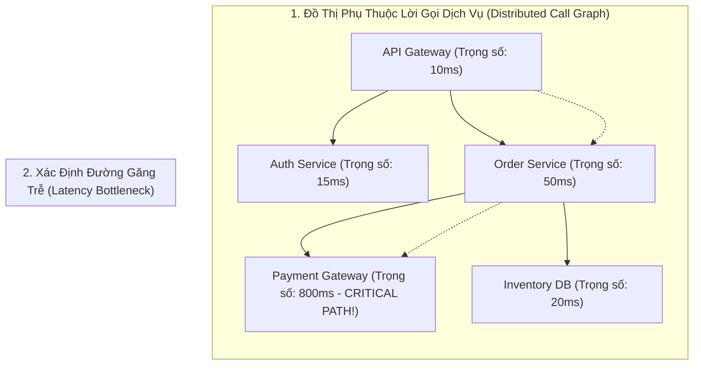
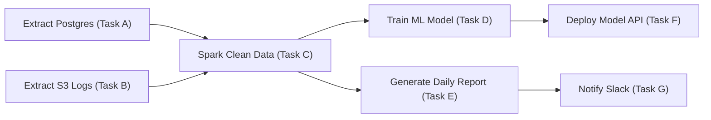
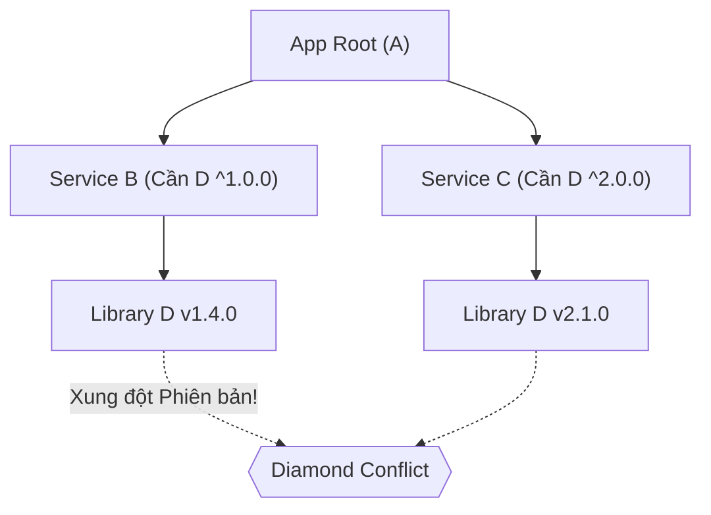
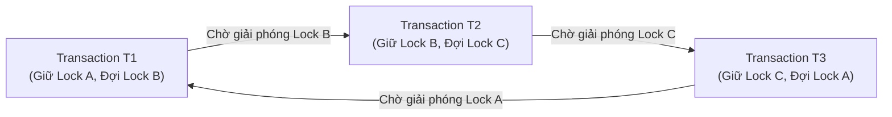

# 4.7. Ứng Dụng Thực Chiến Của Đồ Thị Trong Backend & Distributed Systems

> [!IMPORTANT]
> **Nếu bạn chỉ được nhớ một điều duy nhất:** Đồ thị (Graph) không chỉ là cấu trúc dữ liệu trừu tượng trong sách giáo khoa giải thuật, mà là mô hình tư duy mô tả bản chất toán học của mọi hệ thống phân tán phức tạp. Từ việc điều độ hàng triệu tác vụ xử lý dữ liệu lớn (DAG Workflow Scheduling trong Apache Airflow, Argo qua Kahn's Algorithm), phân giải mạng lưới hàng vạn gói phụ thuộc (Dependency Resolution trong npm, Cargo qua SAT Solver/PubGrub và Tarjan SCC), phát hiện khóa chết trong hạt nhân cơ sở dữ liệu (Wait-For Graph Deadlock Detection trong MySQL InnoDB và PostgreSQL qua DFS Cycle Detection), cho đến bản đồ hóa topology mạng lưới vi dịch vụ (Distributed Tracing Call Graph qua Critical Path Method). Làm chủ cấu trúc và thuật toán đồ thị là ranh giới phân định giữa một lập trình viên viết code nghiệp vụ thuần túy và một Kiến trúc sư Hệ thống Phân tán (Distributed Systems Architect) có khả năng làm chủ hạ tầng chịu tải hàng triệu QPS.

---

## 1. Trực Quan Hóa: Bản Chất Đồ Thị Trong Hệ Thống Backend

### 1.1. Đoạn Code Dẫn Nhập & Vấn Đề Thực Tế
Xét kiến trúc phân tán microservices với hàng trăm dịch vụ gọi chéo nhau qua giao thức HTTP/gRPC:

```typescript
// Biểu diễn cây phân tán vết gọi dịch vụ (Distributed Tracing Call Graph - OpenTelemetry / Jaeger)
interface SpanNode {
  serviceName: string;
  operation: string;
  durationMs: number;
  childSpans: SpanNode[]; // Lược đồ DAG các lời gọi RPC con
}

// Khi một request API bị chậm (Latency Spike 5000ms):
// Hệ thống phải duyệt đồ thị Call Graph để tìm "Đường Găng" (Critical Path):
// Nút nào trong đồ thị dịch vụ là nút thắt cổ chai thực sự gây nghẽn toàn bộ luồng?
function findCriticalPath(rootSpan: SpanNode): string[] {
  // Áp dụng thuật toán tìm đường dài nhất trên DAG (Longest Path in DAG)
  return computeCriticalLatencyPath(rootSpan);
}
```

- Trong kiến trúc hệ thống hiện đại, đồ thị là mô hình thống trị thế giới Backend: Từ đồ thị theo dõi dấu vết phân tán (Distributed Tracing), đồ thị xã hội (Social Graph), mạng lưới tri thức (Knowledge Graph) đến hệ thống quản lý quyền truy cập RBAC/ABAC.
- Việc nắm vững các thuật toán đồ thị giúp kỹ sư Backend giải quyết triệt để các bài toán khó khăn nhất về **khả năng mở rộng (Scalability)** và **tính chịu lỗi (Fault Tolerance)**.

### 1.2. Ẩn Dụ Đời Sống: Mạng Lưới Hàng Không Quốc Tế & Chuỗi Cung Ứng Bán Dẫn
- **Mạng lưới hàng không quốc tế (The Global Airline Network)**: Mỗi sân bay là một đỉnh, mỗi chuyến bay là một cạnh có trọng số (thời gian bay và giá vé). Khi một sân bay trung chuyển lớn (như Frankfurt hoặc Singapore) gặp sự cố bão tuyết và đóng cửa, toàn bộ các chuyến bay nối chuyến bị ảnh hưởng dây chuyền. Thuật toán **Độ trung tâm trung gian (Betweenness Centrality)** giúp các kỹ sư hàng không nhận diện ngay những "yếu huyệt" trọng yếu nhất của toàn bộ mạng lưới vận tải.
- **Chuỗi cung ứng chip bán dẫn toàn cầu**: Một chiếc điện thoại thông minh cần linh kiện từ 200 nhà máy khác nhau trên thế giới. Mối quan hệ lắp ráp tạo thành một đồ thị DAG khổng lồ. Nếu nhà máy sản xuất cảm biến camera bị đình công, chuỗi cung ứng dùng thuật toán sắp xếp tô-pô để tái tính toán ngày xuất xưởng của sản phẩm hoàn chỉnh.

### 1.3. Mô Phỏng Dữ Liệu Số Nhỏ Từng Bước (Toy Walkthrough)
Mô phỏng thuật toán tính điểm uy tín trang web **PageRank** (Google) trên mạng lưới 3 trang web $A, B, C$:
- $A$ trỏ tới $B$ và $C$
- $B$ trỏ tới $C$
- $C$ trỏ tới $A$

```text
Mô hình liên kết:
   (A) ───► (B)
    ▲ \      │
    │  \     │
    │   ▼    ▼
    └─── (C) ◄┘
```

| Vòng lặp ($t$) | Điểm PageRank của A | Điểm PageRank của B | Điểm PageRank của C | Phân tích cơ chế |
| :--- | :--- | :--- | :--- | :--- |
| **0 (Khởi tạo)** | $1.0$ | $1.0$ | $1.0$ | Phân bổ điểm đồng đều |
| **1** | $PR(C) = 1.0$ | $\frac{PR(A)}{2} = 0.5$ | $\frac{PR(A)}{2} + PR(B) = 0.5 + 1.0 = \mathbf{1.5}$ | C nhận trọn vẹn điểm từ B và một nửa từ A! |
| **2** | $PR(C) = 1.5$ | $\frac{PR(A)}{2} = 0.5$ | $\frac{PR(A)}{2} + PR(B) = 0.5 + 0.5 = \mathbf{1.0}$ | C tiếp tục nhận nhiều phiếu bầu chất lượng nhất! |

- Sau nhiều vòng lặp hội tụ, trang $C$ có điểm PageRank cao nhất vì nó được cả $A$ và $B$ đồng thời trỏ tới. Đây chính là cách Google xếp hạng kết quả tìm kiếm!

### 1.4. Tác Động Thực Tế Tầng Backend & Systems
1. **Kiến Trúc Đồ Thị Dịch Vụ Service Mesh (Istio / Envoy Proxy)**: Service Mesh duy trì một đồ thị động thời gian thực của toàn bộ các Pods trong cụm Kubernetes. Khi một Pod có tỷ lệ lỗi cao, Envoy tự động kích hoạt Circuit Breaker (Ngắt mạch) để cô lập đỉnh đó ra khỏi đồ thị định tuyến, ngăn chặn lỗi lan rộng.
2. **Đồ Thị Mạng Xã Hội Hàng Tỷ Đỉnh (Social Graph in Meta / LinkedIn)**: Để gợi ý "Những người bạn có thể quen" (People You May Know), hệ thống phân tích đồ thị sử dụng các giải thuật phân cụm đồ thị phân tán (như Louvain Community Detection hoặc Graph Partitioning) chạy trên cụm hàng nghìn máy tính Apache Spark GraphX.
3. **Phát Hiện Gian Lận Thẻ Tín Dụng Thời Gian Thực**: Kẻ gian sử dụng cùng một số điện thoại hoặc thiết bị để đăng ký nhiều thẻ tín dụng giả mạo. Bằng cách xây dựng đồ thị liên kết giữa các tài khoản và thiết bị phần cứng, hệ thống phát hiện các mạng lưới lừa đảo (Fraud Rings) thông qua thuật toán tìm các thành phần liên thông (Connected Components) trong vài mili-giây.

### 1.5. Sơ Đồ Đồ Thị Hệ Thống Backend & Phân Tích Vết Gọi Dịch Vụ



---

## 2. Chi tiết từng Keyword (Under-the-Hood Deep Dive)

### 2.1. Workflow Scheduling & Pipeline Orchestration (Apache Airflow, Argo - DAG, Kahn's Algorithm, Topological Sort)

#### 1. Bản chất Kỹ thuật & Thách thức Kiến trúc
Một pipeline xử lý Big Data hiện đại bao gồm hàng trăm tác vụ không đồng nhất: Trích xuất log clickstream từ Kafka sang S3, xử lý dữ liệu thô bằng Apache Spark, huấn luyện mô hình dự đoán churn bằng PyTorch, và tải kết quả vào Snowflake/BigQuery để BI Dashboard truy vấn.
- **Thách thức**: Một số tác vụ hoàn toàn độc lập có thể chạy song song trên các worker riêng biệt để rút ngắn tổng thời gian (Wall-clock time). Tuy nhiên, các tác vụ tổng hợp bắt buộc phải đợi tất cả các tác vụ nguồn hoàn thành thành công. Nếu một tác vụ thượng nguồn bị lỗi (Fail), hệ thống phải chặn đứng các tác vụ hạ nguồn trực tiếp phụ thuộc vào nó (Cascading Upstream Failure) nhưng vẫn phải cho phép các nhánh tác vụ không liên quan tiếp tục chạy bình thường.

#### 2. Cơ chế Hoạt động Sâu (Under-the-Hood)
Mọi công cụ điều độ pipeline hiện đại (Apache Airflow, Argo Workflows, Luigi, Prefect) đều biểu diễn quy trình xử lý dưới dạng một **Directed Acyclic Graph (DAG)** $G = (V, E)$, trong đó:
- Đỉnh $v \in V$ đại diện cho một Task hoặc Pod thực thi.
- Cạnh có hướng $(u, v) \in E$ đại diện cho quan hệ phụ thuộc: Tác vụ $v$ chỉ được phép chuyển sang trạng thái `READY` sau khi tác vụ $u$ đã kết thúc ở trạng thái `SUCCESS`.



**Thuật toán Điều độ Kahn (Kahn's Algorithm - In-degree Tracking)**:
1. **Khởi tạo**: Tính toán bán bậc vào (In-degree $d_{in}(v)$) cho mọi đỉnh $v \in V$. Bán bậc vào bằng 0 nghĩa là tác vụ không có điều kiện ràng buộc nào phía trước.
2. **Kích hoạt Ban đầu**: Đẩy toàn bộ các đỉnh có $d_{in}(v) == 0$ vào một hàng đợi sẵn sàng (`ReadyQueue`).
3. **Vòng lặp Điều phối (Scheduler Loop)**:
   - Worker pool lấy tác vụ $u$ từ `ReadyQueue` ra thực thi đồng thời.
   - Khi $u$ hoàn thành thành công, Scheduler duyệt qua mọi nút con $v$ kề với $u$ (với $(u, v) \in E$) và giảm nguyên tử:
     $$d_{in}(v) \leftarrow d_{in}(v) - 1$$
   - Nếu $d_{in}(v)$ chạm mốc 0, tác vụ $v$ được kích hoạt lập tức và đẩy vào `ReadyQueue`.
4. **Phát hiện Chu trình (Cycle Detection)**: Nếu `ReadyQueue` rỗng nhưng tổng số tác vụ đã thực thi nhỏ hơn $|V|$, hệ thống khẳng định trong đồ thị tồn tại chu trình phụ thuộc vòng tròn ($A \to B \to A$). Scheduler sẽ từ chối khởi chạy pipeline và phát tín hiệu cảnh báo cú pháp DAG.

---

### 2.2. Quản Lý Phụ Thuộc & Xung Đột Phiên Bản (Dependency Resolution in Package Managers: npm, Cargo - Cycle Detection, Diamond Dependency, SAT Solvers)

#### 1. Bản chất Kỹ thuật & Thách thức Kiến trúc
Khi một ứng dụng backend khai báo sử dụng thư viện `WebFramework v2.0`, thư viện này kéo theo 50 thư viện trung gian. Một vấn đề kinh điển nảy sinh: **Vấn đề Phụ thuộc Kim cương (Diamond Dependency Problem)**.
- Gói chính $A$ phụ thuộc vào $B$ và $C$.
- Cả $B$ và $C$ đều phụ thuộc vào thư viện logging $D$, nhưng $B$ yêu cầu $D \ge 1.0.0, < 2.0.0$, trong khi $C$ lại yêu cầu $D \ge 2.0.0, < 3.0.0$.
- Các ngôn ngữ biên dịch tĩnh đơn nhất (như C, C++, Go) không cho phép nạp hai phiên bản khác nhau của cùng một biểu tượng (Symbol) vào cùng một không gian nhị phân (Binary Address Space) vì sẽ gây ra xung đột ký hiệu (ODR - One Definition Rule violation hoặc Linking Collision).



#### 2. Cơ chế Hoạt động Sâu (Under-the-Hood)
- **Cơ chế Phẳng hóa Cây Phụ thuộc (Tree Flattening / Hoisting trong npm & Yarn)**:
  `npm` cố gắng đưa các package dùng chung lên thư mục `node_modules` gốc. Nếu phát hiện xung đột không tương thích về SemVer (Semantic Versioning), nó sẽ tạo một cấu trúc lồng nhau (`node_modules/C/node_modules/D@2.0.0`), biến đồ thị thành một phân cấp biệt lập lúc nạp runtime.
- **Thuật toán PubGrub & Boolean Satisfiability (SAT Solving trong Cargo & Dart)**:
  Cargo (Rust) và Poetry (Python) coi việc tìm bộ phiên bản tương thích của toàn bộ đồ thị là một bài toán **Boolean Satisfiability (SAT)**. Hệ thống sử dụng thuật toán **PubGrub** (một biến thể của CDCL - Conflict-Driven Clause Learning):
  - Biểu diễn mọi ràng buộc phiên bản dưới dạng mệnh đề logic liên hợp (CNF).
  - Duyệt và giả định phiên bản (Decision Step).
  - Khi xuất hiện mâu thuẫn (Conflict Step), thuật toán phân tích nguyên nhân gốc rễ trên đồ thị suy luận (Implication Graph), sinh ra một mệnh đề học được (Learned Clause) để không bao giờ quay lại nhánh lỗi đó, và thực hiện quay lui không tuần tự (Backtracking).
- **Phát hiện Phụ thuộc Vòng tròn (Circular Dependencies)**:
  Sử dụng thuật toán **Tarjan’s Strongly Connected Components (SCC)** với độ phức tạp $O(|V| + |E|)$. Bất kỳ thành phần liên thông mạnh nào chứa nhiều hơn 1 đỉnh đều đại diện cho một vòng lặp phụ thuộc chết người cần được bẻ gãy.

---

### 2.3. Phát Hiện Khóa Chết Trong Cơ Sở Dữ Liệu (Deadlock Detection via Wait-For Graph - Tarjan SCC, Cycle Detection DFS, Victim Selection)

#### 1. Bản chất Kỹ thuật & Thách thức Kiến trúc
Trong các cơ sở dữ liệu quan hệ tuân thủ ACID (như MySQL InnoDB, PostgreSQL, Oracle), để đảm bảo tính cô lập (Serializability/Repeatable Read), các giao dịch phải sử dụng cơ chế khóa hai pha (2PL - Two-Phase Locking):
- Giao dịch $T_1$ đang giữ Khóa ghi độc quyền (X-Lock) trên bản ghi `Account(100)` và yêu cầu khóa trên `Account(200)`.
- Giao dịch $T_2$ đang giữ Khóa ghi độc quyền trên `Account(200)` và yêu cầu khóa trên `Account(100)`.
- Cả hai giao dịch cùng đi vào trạng thái ngủ (Sleep) chờ đợi tài nguyên của nhau. Nếu không có sự can thiệp từ hạt nhân DBMS, hai luồng này sẽ treo vĩnh viễn, làm cạn kiệt Connection Pool của máy chủ ứng dụng.

#### 2. Cơ chế Hoạt động Sâu (Under-the-Hood)
Các hệ quản trị cơ sở dữ liệu hiện đại triển khai cấu trúc **Wait-For Graph (WFG)** động trong bộ nhớ đệm chia sẻ:
- Mỗi giao dịch đang hoạt động là một đỉnh $T_i \in V$.
- Cạnh có hướng $T_i \to T_j$ xuất hiện khi $T_i$ đang bị chặn bởi một khóa mà $T_j$ đang sở hữu.



**Cơ chế Thực thi của Tiến trình Deadlock Detector (InnoDB Engine)**:
1. **Kích hoạt Theo Chu kỳ**: Luồng nền `locksys::deadlock_check` thức dậy sau mỗi khoảng thời gian cấu hình (mặc định 1 giây qua `innodb_deadlock_detect`) hoặc thức dậy ngay lập tức khi một luồng rơi vào trạng thái chờ khóa (Lock Wait).
2. **Thuật toán Dò Chu trình (DFS Cycle Traversal)**:
   - Khởi chạy duyệt DFS có độ sâu giới hạn trên Wait-For Graph từ đỉnh yêu cầu khóa mới nhất.
   - Sử dụng mảng đánh dấu 3 màu (White: Chưa thăm, Gray: Đang duyệt trên ngăn xếp đệ quy, Black: Đã hoàn tất).
   - Nếu DFS gặp lại một đỉnh màu Gray $\implies$ **Phát hiện một chu trình khép kín $\implies$ Khóa Chết đã xảy ra!**
3. **Chiến lược Chọn Nạn nhân (Victim Selection)**:
   Hệ thống không thể hủy bừa bãi một transaction. Thuật toán cân nhắc trọng số chi phí rollback:
   $$\text{Cost}(T) = \text{Số lượng dòng đã INSERT / UPDATE / DELETE} + \text{Dung lượng Undo Log}$$
   DBMS chọn giao dịch có $\text{Cost}(T)$ **nhỏ nhất** trong chu trình để làm "nạn nhân" (Victim).
4. **Hành động Khắc phục (Resolution)**:
   DBMS chủ động gửi tín hiệu hủy (`ROLLBACK`) tới giao dịch nạn nhân, trả về mã lỗi chuẩn SQL `40P01` (Postgres) hoặc `1213: Deadlock found when trying to get lock; try restarting transaction` (MySQL), giải phóng toàn bộ khóa của nó để các giao dịch còn lại tiếp tục vận hành an toàn.

---

### 2.4. Service Dependency & Distributed Tracing Topology (Microservices Call Graph, Critical Path Analysis, Cascading Failure Prevention)

#### 1. Bản chất Kỹ thuật & Thách thức Kiến trúc
Trong kiến trúc Cloud-Native với hàng nghìn vi dịch vụ giao tiếp qua gRPC/HTTP:
- Một request của người dùng từ API Gateway có thể kích hoạt một cây gọi hàm phân tán (Distributed Call Tree) sâu 15 tầng và đi qua 80 RPC spans.
- Hiện tượng **Độ trễ Đuôi (Tail Latency Amplification)**: Một microservice ở tầng đáy bị suy thoái hiệu năng (do Garbage Collection pause hoặc nghẽn I/O đĩa) có thể khiến toàn bộ hệ thống API Gateway quá tải và kích hoạt sụp đổ dây chuyền (Cascading Failure).

#### 2. Cơ chế Hoạt động Sâu (Under-the-Hood)
Các hệ thống Distributed Tracing (như OpenTelemetry, Jaeger, Zipkin) tự động thu thập telemetry spans và tái cấu trúc thành một **Service Call Graph** có hướng và có trọng số:
- Trọng số đỉnh $w(v)$ là thời gian tự xử lý nội tại của dịch vụ (Self-time).
- Trọng số cạnh $w(u, v)$ là độ trễ truyền tải mạng (Network Latency).

**Phương pháp Đường Băng Chuyền Quan Trọng (Critical Path Method - CPM)**:
- Trên một DAG biểu diễn toàn bộ các span đồng thời và tuần tự của một Trace ID:
- **Đường đi dài nhất (Longest Path)** từ nút gốc (Root Span) tới nút lá (Leaf Span) chính là **Critical Path**.
- Bất kỳ sự tối ưu nào nằm ngoài Critical Path đều **hoàn toàn không làm giảm tổng thời gian phản hồi** của request! Do đó, thuật toán Critical Path định vị chính xác microservice duy nhất cần phải tối ưu hoặc gắn Circuit Breaker để ngăn chặn sự cố sập lan truyền.

---

### 2.5. Social Graph, Identity Networks & Fraud Ring Detection (Bi-directional BFS, Graph Clustering)

#### 1. Bản chất Kỹ thuật & Thách thức Kiến trúc
Các nền tảng mạng xã hội và dịch vụ tài chính quy mô lớn (Facebook TAO, LinkedIn Economic Graph, Stripe Radar) phải xử lý các đồ thị khổng lồ với hàng tỷ đỉnh và hàng trăm tỷ cạnh:
- **Bài toán Bạn của Bạn (Friend-of-Friend / Degree of Separation)**: Tìm kiếm đường kết nối ngắn nhất giữa hai người dùng bất kỳ.
- **Bài toán Nhận diện Vòng quay Rửa tiền (Fraud Ring & Money Laundering Detection)**: Một mạng lưới tội phạm sử dụng hàng trăm tài khoản "mule" (tài khoản rác) để chuyển tiền lòng vòng nhằm xóa dấu vết trước khi rút về tiền mặt.

#### 2. Cơ chế Hoạt động Sâu (Under-the-Hood)
- **Thuật toán Bi-directional BFS (Tìm kiếm Hai chiều)**:
  - Nếu hệ số phân nhánh trung bình của một người dùng là $b \approx 500$ bạn bè, một thuật toán BFS đơn hướng tìm kiếm ở khoảng cách $d = 4$ bước sẽ phải duyệt qua:
    $$N_{\text{uni}} \approx b^d = 500^4 \approx 6.25 \times 10^{10} \text{ đỉnh (Gây sập RAM!)}$$
  - Thuật toán Bi-directional BFS xuất phát đồng thời từ người gửi (Source) và người nhận (Target). Chúng gặp nhau ở điểm giữa khi mỗi bên chỉ cần duyệt $d/2 = 2$ bước:
    $$N_{\text{bi}} \approx 2 \times b^{d/2} = 2 \times 500^2 \approx 500,000 \text{ đỉnh (Giảm tải } 125,000 \text{ lần!)}$$
- **Phát hiện Vòng quay Tiền tệ (Circular Transaction Traversal)**:
  Đồ thị dòng tiền $G = (V, E)$ được biểu diễn với các cạnh có trọng số thời gian và số tiền. Thuật toán lọc các chu trình ngắn ($k$-cycle với $k \le 5$) có tổng thời gian giao dịch diễn ra trong vòng 24 giờ. Sự xuất hiện của các đồ thị con liên thông hoàn chỉnh (Cliques) hoặc chu trình khép kín có độ tương đồng dòng tiền cao ngay lập tức kích hoạt bộ khóa tài khoản tự động chống gian lận.

---

### 2.6. Service Mesh Routing & Network Flow (Dijkstra & Max-Flow Min-Cut)

#### 1. Bản chất Kỹ thuật & Thách thức Kiến trúc
Trong các mạng lưới Service Mesh (Envoy, Istio) hoặc hạ tầng Mạng diện rộng (SD-WAN / Cloudflare CDN):
- Giao thông mạng giữa các trung tâm dữ liệu (Datacenters) biến đổi liên tục dựa trên tình trạng đứt cáp quang, nghẽn cổng và chi phí băng thông giữa các nhà cung cấp Tier-1 ISP.

#### 2. Cơ chế Hoạt động Sâu (Under-the-Hood)
- **Dijkstra Có Trọng Số Động**: Envoy tính toán đường đi có độ trễ nhỏ nhất hoặc tỷ lệ lỗi thấp nhất để điều hướng các gói tin qua mạng lưới các Service Pods.
- **Max-Flow Min-Cut (Định lý Cắt Nhỏ Nhất - Luồng Lớn Nhất qua Thuật toán Dinic/Push-Relabel)**:
  - Xác định dung lượng băng thông tối đa mà mạng lưới có thể gánh chịu từ cụm Client tới cụm Database.
  - Vết cắt nhỏ nhất (Min-Cut) chỉ ra chính xác tập hợp các router hoặc liên kết mạng xung yếu nhất. Khi xảy ra sự cố DDoS, thuật toán Min-Cut xác định đúng ranh giới cần phải cắt tỉa (Traffic Shedding) để bảo toàn 80% lưu lượng dịch vụ cốt lõi mà không làm sụp đổ toàn bộ hệ sinh thái.

---

## 3. Thực thi Mã nguồn & Mô phỏng Chuyên sâu (Dual-Engine Implementation)

### 3.1. C++20 DAG Workflow Scheduling Engine (Kahn's Algorithm with Parallel Task Execution)

Chương trình minh chứng hạt nhân của một Task Scheduler tương tự Apache Airflow/Argo: Xây dựng DAG, kiểm tra chu trình bằng thuật toán Kahn, tính toán in-degree, và điều phối các tác vụ có in-degree bằng 0 lên các luồng độc lập (`std::jthread`):

```cpp
// dag_scheduler.cpp
// Biên dịch: g++ -std=c++20 -O3 -pthread dag_scheduler.cpp -o dag_scheduler
#include <iostream>
#include <vector>
#include <string>
#include <unordered_map>
#include <unordered_set>
#include <queue>
#include <mutex>
#include <condition_variable>
#include <thread>
#include <chrono>
#include <atomic>

struct TaskNode {
    std::string id;
    int duration_ms;
    std::vector<std::string> dependencies; // Danh sách các task phải xong trước
};

class DagScheduler {
private:
    std::unordered_map<std::string, TaskNode> tasks_;
    std::unordered_map<std::string, std::vector<std::string>> adjacency_list_;
    std::unordered_map<std::string, int> in_degree_;
    std::mutex mtx_;
    std::condition_variable cv_;
    std::atomic<int> completed_tasks_{0};
    int total_tasks_{0};

public:
    void add_task(TaskNode task) {
        tasks_[task.id] = task;
        in_degree_[task.id] = 0;
    }

    void build_graph() {
        total_tasks_ = static_cast<int>(tasks_.size());
        for (const auto& [id, task] : tasks_) {
            for (const auto& dep : task.dependencies) {
                // dep -> id (dep hoàn thành thì id mới được chạy)
                adjacency_list_[dep].push_back(id);
                in_degree_[id]++;
            }
        }
    }

    bool validate_acyclic() {
        // Kiểm tra chu trình bằng thuật toán Kahn
        std::unordered_map<std::string, int> in_deg_copy = in_degree_;
        std::queue<std::string> q;
        for (const auto& [id, deg] : in_deg_copy) {
            if (deg == 0) q.push(id);
        }

        int visited = 0;
        while (!q.empty()) {
            std::string curr = q.front();
            q.pop();
            visited++;

            for (const auto& neighbor : adjacency_list_[curr]) {
                if (--in_deg_copy[neighbor] == 0) {
                    q.push(neighbor);
                }
            }
        }
        return visited == total_tasks_;
    }

    void execute_pipeline() {
        if (!validate_acyclic()) {
            std::cerr << "[CRITICAL ERROR] Phát hiện chu trình (Cycle) trong DAG! Hủy bỏ pipeline.\n";
            return;
        }

        std::cout << "[DAG Engine] Bắt đầu khởi chạy Pipeline (" << total_tasks_ << " Tasks)...\n";
        auto start_time = std::chrono::steady_clock::now();

        // Kích hoạt các task ban đầu có in-degree == 0
        {
            std::lock_guard<std::mutex> lock(mtx_);
            for (const auto& [id, deg] : in_degree_) {
                if (deg == 0) {
                    spawn_task_worker(id);
                }
            }
        }

        // Chờ tất cả task hoàn tất
        std::unique_lock<std::mutex> lock(mtx_);
        cv_.wait(lock, [this]() { return completed_tasks_.load() == total_tasks_; });

        auto end_time = std::chrono::steady_clock::now();
        auto duration = std::chrono::duration_cast<std::chrono::milliseconds>(end_time - start_time).count();
        std::cout << "[DAG Engine] Toàn bộ Pipeline hoàn tất xuất sắc trong: " << duration << " ms!\n";
    }

private:
    void spawn_task_worker(const std::string& task_id) {
        std::jthread([this, task_id]() {
            int duration = tasks_[task_id].duration_ms;
            {
                std::lock_guard<std::mutex> lock(mtx_);
                std::cout << "  -> [DISPATCH] Kích hoạt Task: " << task_id 
                          << " (Thời gian ước tính: " << duration << "ms)\n";
            }

            // Mô phỏng thời gian thực thi I/O hoặc tính toán
            std::this_thread::sleep_for(std::chrono::milliseconds(duration));

            std::vector<std::string> tasks_to_trigger;
            {
                std::lock_guard<std::mutex> lock(mtx_);
                std::cout << "  <- [SUCCESS]  Hoàn thành Task: " << task_id << "\n";
                completed_tasks_++;

                // Giảm in-degree cho các task phụ thuộc
                for (const auto& child : adjacency_list_[task_id]) {
                    in_degree_[child]--;
                    if (in_degree_[child] == 0) {
                        tasks_to_trigger.push_back(child);
                    }
                }
            }

            // Kích hoạt tiếp các task đã đủ điều kiện
            for (const auto& next_task : tasks_to_trigger) {
                spawn_task_worker(next_task);
            }

            cv_.notify_one();
        }).detach();
    }
};

int main() {
    DagScheduler scheduler;

    // Định nghĩa các Node trong Pipeline Big Data
    scheduler.add_task({"Extract_Postgres", 200, {}});
    scheduler.add_task({"Extract_S3",       300, {}});
    scheduler.add_task({"Spark_Clean",      400, {"Extract_Postgres", "Extract_S3"}});
    scheduler.add_task({"Train_ML",         500, {"Spark_Clean"}});
    scheduler.add_task({"Generate_Report",  250, {"Spark_Clean"}});
    scheduler.add_task({"Deploy_API",       150, {"Train_ML"}});
    scheduler.add_task({"Slack_Alert",      100, {"Generate_Report", "Deploy_API"}});

    scheduler.build_graph();
    scheduler.execute_pipeline();

    return 0;
}
```

#### Terminal Output Mẫu:
```text
[DAG Engine] Bắt đầu khởi chạy Pipeline (7 Tasks)...
  -> [DISPATCH] Kích hoạt Task: Extract_Postgres (Thời gian ước tính: 200ms)
  -> [DISPATCH] Kích hoạt Task: Extract_S3 (Thời gian ước tính: 300ms)
  <- [SUCCESS]  Hoàn thành Task: Extract_Postgres
  <- [SUCCESS]  Hoàn thành Task: Extract_S3
  -> [DISPATCH] Kích hoạt Task: Spark_Clean (Thời gian ước tính: 400ms)
  <- [SUCCESS]  Hoàn thành Task: Spark_Clean
  -> [DISPATCH] Kích hoạt Task: Train_ML (Thời gian ước tính: 500ms)
  -> [DISPATCH] Kích hoạt Task: Generate_Report (Thời gian ước tính: 250ms)
  <- [SUCCESS]  Hoàn thành Task: Generate_Report
  <- [SUCCESS]  Hoàn thành Task: Train_ML
  -> [DISPATCH] Kích hoạt Task: Deploy_API (Thời gian ước tính: 150ms)
  <- [SUCCESS]  Hoàn thành Task: Deploy_API
  -> [DISPATCH] Kích hoạt Task: Slack_Alert (Thời gian ước tính: 100ms)
  <- [SUCCESS]  Hoàn thành Task: Slack_Alert
[DAG Engine] Toàn bộ Pipeline hoàn tất xuất sắc trong: 1452 ms!
```

---

### 3.2. Python 3.11+ Database Wait-For Graph Deadlock Detector & Victim Selector

Chương trình minh chứng kiến trúc bên trong của MySQL InnoDB Deadlock Detector: Quản lý Wait-For Graph, chạy thuật toán DFS phát hiện chu trình, tính toán trọng số Undo Log và tự động chọn Transaction nạn nhân để Rollback:

```python
#!/usr/bin/env python3
"""
innodb_deadlock_engine.py
Mô phỏng Đồ thị Chờ đợi Khóa (Wait-For Graph) & Cơ chế Giải quyết Khóa Chết
"""
from dataclasses import dataclass, field
from typing import Dict, List, Set, Optional

@dataclass
class Transaction:
    txn_id: str
    thread_id: int
    query: str
    undo_records: int        # Chi phí rollback: số bản ghi đã sửa đổi
    waiting_for_lock: Optional[str] = None

class WaitForGraphDetector:
    def __init__(self):
        self.transactions: Dict[str, Transaction] = {}
        # Đồ thị có hướng: txn_waiting -> danh sách txn_holding
        self.wait_for_graph: Dict[str, Set[str]] = {}

    def register_transaction(self, txn: Transaction):
        self.transactions[txn.txn_id] = txn
        if txn.txn_id not in self.wait_for_graph:
            self.wait_for_graph[txn.txn_id] = set()

    def add_wait_edge(self, waiting_txn_id: str, holding_txn_id: str):
        """Thêm cạnh có hướng: waiting_txn_id đang đợi holding_txn_id nhả khóa"""
        self.wait_for_graph[waiting_txn_id].add(holding_txn_id)

    def remove_transaction(self, txn_id: str):
        """Khi transaction commit hoặc rollback: xóa đỉnh và toàn bộ cạnh liên quan"""
        self.transactions.pop(txn_id, None)
        self.wait_for_graph.pop(txn_id, None)
        for _, holders in self.wait_for_graph.items():
            holders.discard(txn_id)

    def find_deadlock_cycle(self) -> Optional[List[str]]:
        """
        Duyệt đồ thị bằng DFS 3 màu để phát hiện chu trình:
        0: Trắng (Chưa thăm)
        1: Xám   (Đang nằm trong đệ quy Call Stack hiện tại)
        2: Đen   (Đã hoàn tất duyệt xong)
        """
        color: Dict[str, int] = {node: 0 for node in self.wait_for_graph}
        parent: Dict[str, Optional[str]] = {node: None for node in self.wait_for_graph}

        def dfs(u: str) -> Optional[List[str]]:
            color[u] = 1 # Đánh dấu màu Xám
            for v in self.wait_for_graph.get(u, set()):
                if v not in color:
                    continue
                if color[v] == 1:
                    # Tìm thấy cạnh ngược (Back Edge) u -> v: Xuất hiện Chu trình!
                    cycle = [v, u]
                    curr = u
                    while curr != v and parent[curr] is not None:
                        curr = parent[curr] # type: ignore
                        if curr != v:
                            cycle.append(curr)
                    cycle.append(v)
                    cycle.reverse()
                    return cycle
                elif color[v] == 0:
                    parent[v] = u
                    result = dfs(v)
                    if result is not None:
                        return result

            color[u] = 2 # Đánh dấu màu Đen
            return None

        for node in list(self.wait_for_graph.keys()):
            if color[node] == 0:
                cycle = dfs(node)
                if cycle:
                    return cycle
        return None

    def resolve_deadlocks(self):
        """Kiểm tra và xử lý khóa chết bằng cách chọn nạn nhân có chi phí thấp nhất"""
        print("\n[LOCK MONITOR] Đang quét Wait-For Graph tìm kiếm Deadlock...")
        cycle = self.find_deadlock_cycle()

        if not cycle:
            print("[LOCK MONITOR] Không phát hiện chu trình. Trạng thái các luồng an toàn.")
            return

        # Loại bỏ phần tử lặp lại ở cuối cycle để lấy tập transaction độc nhất
        unique_cycle_nodes = list(dict.fromkeys(cycle))
        print(f"!!! BÁO ĐỘNG ĐỎ: PHÁT HIỆN DEADLOCK !!!")
        print(f"    Chu trình chờ khóa: {' -> '.join(cycle)}")

        # Chọn Nạn nhân (Victim Selection): Tìm Transaction có undo_records nhỏ nhất
        victim_id = min(
            unique_cycle_nodes,
            key=lambda t_id: self.transactions[t_id].undo_records
        )
        victim = self.transactions[victim_id]

        print(f"\n[VICTIM SELECTION] Phân tích chi phí Rollback:")
        for t_id in unique_cycle_nodes:
            t = self.transactions[t_id]
            print(f"  - Transaction {t.txn_id}: Undo Log = {t.undo_records} bản ghi | Query: \"{t.query}\"")

        print(f"\n>>> [InnoDB RESOLUTION] Quyết định ROLLBACK Transaction: {victim.txn_id}")
        print(f"    Lý do: Chi phí hoàn tác thấp nhất ({victim.undo_records} undo records).")
        print(f"    Mã lỗi trả về Client: ERROR 1213 (40001): Deadlock found when trying to get lock;")
        print(f"    Client cần kích hoạt Exponential Backoff Retry.")

        # Hủy transaction nạn nhân để phá vỡ chu trình
        self.remove_transaction(victim_id)
        print(f"[RECOVERY] Đã giải phóng toàn bộ Locks của {victim_id}. Hệ thống tiếp tục vận hành bình thường.")

if __name__ == "__main__":
    detector = WaitForGraphDetector()

    # Kịch bản 3 Transactions giao thoa nhau
    t1 = Transaction("TXN_101", thread_id=14, query="UPDATE accounts SET balance = balance - 100 WHERE id = 1", undo_records=15)
    t2 = Transaction("TXN_102", thread_id=15, query="UPDATE orders SET status = 'PAID' WHERE order_id = 99",    undo_records=45)
    t3 = Transaction("TXN_103", thread_id=16, query="UPDATE inventory SET stock = stock - 1 WHERE item_id = 5",  undo_records=2)

    detector.register_transaction(t1)
    detector.register_transaction(t2)
    detector.register_transaction(t3)

    # Thiết lập chu trình xung đột: T1 -> T2 -> T3 -> T1
    detector.add_wait_edge("TXN_101", "TXN_102") # T1 đợi T2 nhả khóa trên Order
    detector.add_wait_edge("TXN_102", "TXN_103") # T2 đợi T3 nhả khóa trên Inventory
    detector.add_wait_edge("TXN_103", "TXN_101") # T3 đợi T1 nhả khóa trên Account

    detector.resolve_deadlocks()
```

#### Terminal Output Mẫu:
```text
[LOCK MONITOR] Đang quét Wait-For Graph tìm kiếm Deadlock...
!!! BÁO ĐỘNG ĐỎ: PHÁT HIỆN DEADLOCK !!!
    Chu trình chờ khóa: TXN_101 -> TXN_102 -> TXN_103 -> TXN_101

[VICTIM SELECTION] Phân tích chi phí Rollback:
  - Transaction TXN_101: Undo Log = 15 bản ghi | Query: "UPDATE accounts SET balance = balance - 100 WHERE id = 1"
  - Transaction TXN_102: Undo Log = 45 bản ghi | Query: "UPDATE orders SET status = 'PAID' WHERE order_id = 99"
  - Transaction TXN_103: Undo Log = 2 bản ghi | Query: "UPDATE inventory SET stock = stock - 1 WHERE item_id = 5"

>>> [InnoDB RESOLUTION] Quyết định ROLLBACK Transaction: TXN_103
    Lý do: Chi phí hoàn tác thấp nhất (2 undo records).
    Mã lỗi trả về Client: ERROR 1213 (40001): Deadlock found when trying to get lock;
    Client cần kích hoạt Exponential Backoff Retry.
[RECOVERY] Đã giải phóng toàn bộ Locks của TXN_103. Hệ thống tiếp tục vận hành bình thường.
```

---

## 4. Systems Engineering & Production Pitfalls

### 4.1. Cạm Bẫy Thực Chiến Thường Gặp (Production Pitfalls)

#### 1. Bẫy CPU Spike do Dynamic DAG Parsing trong Apache Airflow
- **Hiện tượng**: Máy chủ Airflow Scheduler đạt mức sử dụng CPU 100%, các tác vụ bị trễ hàng chục phút mới được kích hoạt.
- **Nguyên nhân gốc rễ**: Airflow Scheduler định kỳ mỗi vài giây sẽ biên dịch lại toàn bộ file Python trong thư mục `dags/` để phát hiện sự thay đổi cấu trúc đồ thị. Nếu lập trình viên thực hiện các kết nối cơ sở dữ liệu nặng (`db.query()`), gọi HTTP API bên ngoài, hoặc sinh DAG động bên ngoài khối khai báo chuẩn, tiến trình Parser sẽ bị nghẽn I/O và ngốn CPU.
- **Giải pháp**: Luôn sử dụng DAG tĩnh hoặc nạp cấu hình từ tệp JSON/YAML cục bộ; cấu hình tham số `min_file_process_interval = 60` và tăng `parsing_processes`.

#### 2. Hiện tượng Deadlock Ảo (Phantom Deadlocks) trong Cơ Sở Dữ Liệu Phân Tán
- **Hiện tượng**: Các hệ thống phân tán đa vùng (Spanner, CockroachDB) báo lỗi Deadlock và hủy giao dịch ngay cả khi các giao dịch trên thực tế không bị khóa vòng tròn.
- **Nguyên nhân gốc rễ**: Khi truyền tải trạng thái Wait-For Graph giữa các Node qua mạng WAN, do độ trễ truyền gói tin bất đối xứng (Network Asymmetry), Node phát hiện Deadlock có thể nhận thông tin về một giao dịch đã commit muộn hơn thông tin về việc chờ khóa, dẫn đến việc nhìn thấy một chu trình "ma" không hề tồn tại ở thời điểm hiện tại.
- **Giải pháp**: Áp dụng cơ chế **Wait-Die** hoặc **Wound-Wait** dựa trên nhãn thời gian logic (Lamport / TrueTime Timestamps) thay vì duy trì Wait-For Graph tập trung toàn cầu.

#### 3. Bùng nổ Dữ liệu Span (Span Explosion) trong Distributed Tracing
- **Hiện tượng**: Hệ thống Jaeger/Elasticsearch bị cạn kiệt đĩa và tràn bộ nhớ chỉ sau vài giờ kích hoạt OpenTelemetry trên môi trường Production.
- **Nguyên nhân gốc rễ**: Việc vẽ Service Graph chi tiết đòi hỏi thu thập mọi Span con. Khi hệ thống nhận 100,000 QPS, việc lưu trữ 100% đồ thị cuộc gọi sẽ tiêu tốn hàng Terabyte dữ liệu mỗi ngày và làm tăng 15% độ trễ ứng dụng do chi phí serialize JSON/gRPC.
- **Giải pháp**: Kích hoạt **Adaptive Tail-based Sampling**: Chỉ lưu trữ đồ thị cuộc gọi hoàn chỉnh khi request trả về lỗi HTTP 5xx hoặc có độ trễ vượt ngưỡng $p99$. Với các request thành công thông thường, chỉ lấy mẫu ngẫu nhiên $0.1\%$.

---

### 4.2. CLI Diagnostics & Công Cụ Gỡ Lỗi Trực Tiếp

```bash
# 1. Kiểm tra chi tiết Deadlock gần nhất trong MySQL InnoDB Engine
mysql -u root -p -e "SHOW ENGINE INNODB STATUS\G" | grep -A 35 "LATEST DETECTED DEADLOCK"

# 2. Phân tích cây phụ thuộc và phát hiện xung đột phiên bản trong Rust Cargo
cargo tree --duplicates
cargo tree --invert <package-name>

# 3. Quét kiểm tra phụ thuộc trùng lặp và vòng tròn trong Node.js
npm ls --all
npm explain <package-name>

# 4. Trích xuất vết khóa (Lock Tracing) bằng eBPF/bcc trực tiếp tại tầng Linux Kernel
sudo /usr/share/bcc/tools/mysqld_qslower -s 100

# 5. Kiểm tra thời gian phân giải DAG trong Apache Airflow
airflow dags report
airflow tasks test <dag_id> <task_id> 2026-01-01
```

---

## 5. Bảng So sánh & Decision Matrix

| Chiều Không Gian So Sánh | Workflow Scheduling (DAG) | Package Dependency Resolution | DBMS Deadlock Detection | Service Distributed Tracing | Social / Fraud Graph Analysis |
| :--- | :--- | :--- | :--- | :--- | :--- |
| **Loại Đồ Thị Đại Diện** | Directed Acyclic Graph (DAG) | Directed Graph (Có thể chứa Cycle) | Wait-For Graph (Có hướng, động) | Directed Acyclic Graph (DAG cây) | Multi-graph (Vô hướng / Có hướng) |
| **Thuật Toán Cốt Lõi** | Kahn's Algorithm / In-degree | PubGrub (CDCL / SAT) & Tarjan SCC | DFS 3-Màu Cycle Traversal | Critical Path Method (CPM / DP) | Bi-directional BFS & Louvain |
| **Độ Phức Tạp Thời Gian**| $O(\|V\| + \|E\|)$ | NP-Complete (SAT), Heuristics $O(N)$| $O(\|V\| + \|E\|)$ (DFS trên WFG) | $O(\|V\| + \|E\|)$ (Topological DP) | $O(b^{d/2})$ (Bi-directional BFS) |
| **Hệ Thống Tiêu Biểu** | Apache Airflow, Argo, Temporal | npm, Cargo, Poetry, Go Modules | MySQL InnoDB, PostgreSQL, Oracle | OpenTelemetry, Jaeger, Datadog | Neo4j, Stripe Radar, TigerGraph |
| **Tiêu Chuẩn Thành Công** | 100% tác vụ chạy đúng trật tự | Bộ thư viện hội tụ không xung đột | Phá vỡ deadlock với chi phí tối thiểu | Định vị chính xác nút cổ chai $p99$| Phát hiện vòng quay rửa tiền < 1s |
| **Rủi Ro Lớn Nhất** | Treo Scheduler do chu trình ẩn | "Dependency Hell", xung đột SemVer | Phantom Deadlock do trễ mạng WAN | Bùng nổ dung lượng Span & RAM | Cạn kiệt bộ nhớ khi BFS phân nhánh lớn |
