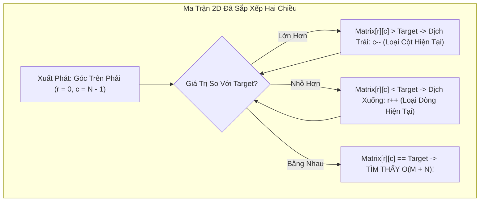
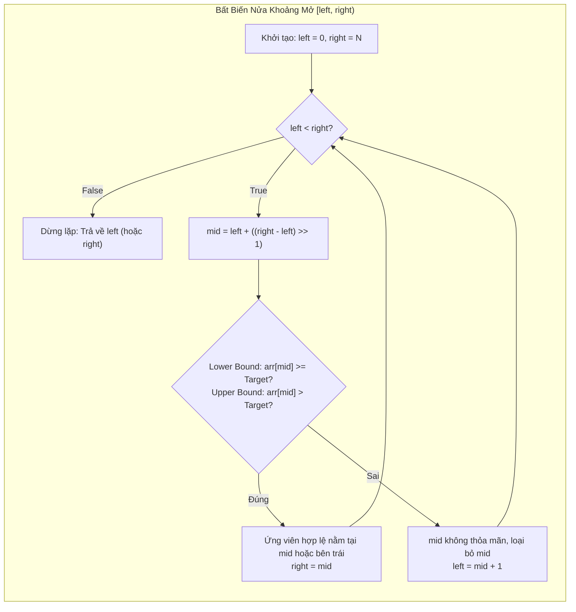
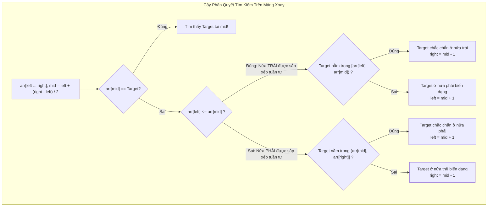
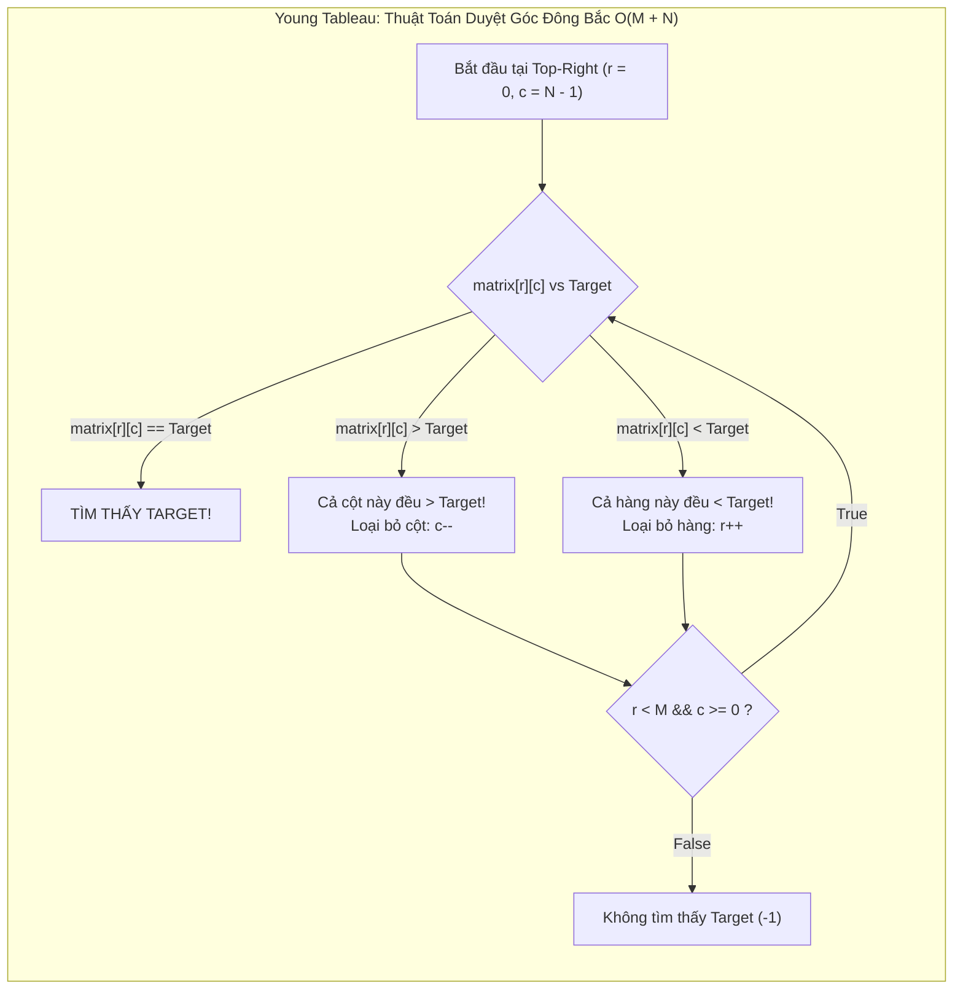

# 5.2. Các Giải Thuật Tìm Kiếm Nâng Cao (Advanced Searching Algorithms)

> [!IMPORTANT]
> **Nếu bạn chỉ được nhớ một điều duy nhất:** Bản chất tối thượng của tìm kiếm nhị phân nâng cao không nằm ở việc toàn bộ tập dữ liệu có phẳng hay được sắp xếp toàn phần hay không, mà nằm ở **khả năng loại bỏ chắc chắn 50% không gian tìm kiếm tại mỗi bước rẽ nhánh**. Trong một mảng xoay vòng (Rotated Array), bất biến vàng là luôn có ít nhất một nửa được sắp xếp tuần tự hoàn hảo; trong ma trận 2 chiều đã sắp xếp theo hàng và cột (Young Tableau), điểm khởi đầu tại góc trên-phải (Top-Right) biến toàn bộ ma trận thành một Cây tìm kiếm nhị phân (BST) ngầm định với thời gian tuyến tính $O(M + N)$; còn bộ đôi **Lower Bound** và **Upper Bound** dựa trên bất biến nửa khoảng mở $[L, R)$ chính là nền tảng cốt lõi của mọi truy vấn dải (Range Scan) trong các hệ thống cơ sở dữ liệu hiện đại như MySQL InnoDB B+Tree hay RocksDB LSM-Tree.

---

## 1. Trực Quan Hóa: Bản Chất Tìm Kiếm Nâng Cao Dưới Góc Nhìn Lập Trình Viên

### 1.1. Đoạn Code Dẫn Nhập & Vấn Đề Thực Tế
Xét bài toán tìm kiếm giá trị trong một mảng đã sắp xếp nhưng bị xoay vòng (Rotated Sorted Array - ví dụ mảng `[4, 5, 6, 7, 0, 1, 2]`):

```cpp
// Mảng ban đầu [0, 1, 2, 4, 5, 6, 7] bị xoay tại điểm trục index 4.
// Làm thế nào để tìm kiếm target trong O(log N) mà không cần quét tuần tự O(N)?
int searchRotated(const std::vector<int>& arr, int target) {
    int left = 0, right = arr.size() - 1;
    while (left <= right) {
        int mid = left + (right - left) / 2;
        if (arr[mid] == target) return mid;

        // Điểm đột phá: Ít nhất một nửa của mảng (Nửa Trái hoặc Nửa Phải) LUÔN LUÔN CÒN NGUYÊN THỨ TỰ!
        if (arr[left] <= arr[mid]) { // Nửa trái có thứ tự hoàn hảo
            if (arr[left] <= target && target < arr[mid]) right = mid - 1;
            else left = mid + 1;
        } else { // Nửa phải có thứ tự hoàn hảo
            if (arr[mid] < target && target <= arr[right]) left = mid + 1;
            else right = mid - 1;
        }
    }
    return -1;
}
```

- Trong các hệ thống thực tế, dữ liệu hiếm khi hoàn hảo ở dạng một mảng phẳng 1 chiều.
- Các thuật toán tìm kiếm nâng cao giải quyết những bài toán hóc búa có cấu trúc biến đổi:
  - **Mảng xoay vòng (Rotated Array)**: Dữ liệu vòng lặp thời gian hoặc đồng hồ vòng log.
  - **Ma trận 2 chiều đã sắp xếp theo hàng và cột (Saddleback Search)**: Tối ưu tra cứu bảng 2D trong $O(M + N)$.
  - **Tìm Trung Vị của hai mảng sắp xếp (Median of Two Sorted Arrays)**: Tìm kiếm đồng thời trên 2 không gian trong $O(\log(\min(M, N)))$.

### 1.2. Ẩn Dụ Đời Sống: Thước Kẹp Cơ Khí & Bánh Xe Lệch Trục
- **Bánh xe lệch trục (Rotated Sorted Array)**: Một chiếc đồng hồ tròn bị cắt đứt ở một vị trí rồi trải phẳng ra bàn. Bạn có hai đoạn thẳng dốc lên: Một đoạn cao và một đoạn thấp. Điểm mấu chốt là: Bất kỳ nhát cắt đôi nào tại `mid` cũng sẽ luôn chia mảng thành một đoạn dốc liên tục bình thường và một đoạn dốc bị gãy khúc. Ta chỉ việc kiểm tra xem mục tiêu có rơi vào đoạn dốc bình thường hay không!
- **Thước kẹp cơ khí hai chiều (Saddleback 2D Search)**: Bạn có một tấm bảng ô vuông nơi các con số tăng dần từ trái qua phải và từ trên xuống dưới. Bạn đặt thước kẹp tại góc trên cùng bên phải (`Top-Right`). Tại đây, đi sang trái thì số nhỏ đi, đi xuống dưới thì số to lên. Giống như một ngã ba định hướng hoàn hảo, bạn loại bỏ một dòng hoặc một cột sau mỗi bước kiểm tra!

### 1.3. Mô Phỏng Dữ Liệu Số Nhỏ Từng Bước (Toy Walkthrough)
Mô phỏng Saddleback Search tìm `target = 14` trên ma trận 2D kích thước $3 \times 3$:

```text
Ma trận:
[  1,  4,  9 ]
[ 10, 13, 17 ]
[ 12, 14, 20 ]
```

| Bước | Tọa độ đang đứng `(r, c)` | Giá trị ô `Matrix[r][c]` | So sánh với 14 | Quyết định bước đi | Loại bỏ được |
| :--- | :--- | :--- | :--- | :--- | :--- |
| **1** | Góc trên phải `(0, 2)` | `9` | $9 < 14$ (Bé hơn) | Muốn to hơn $\to$ Đi xuống dòng dưới: `r++` | **Loại bỏ toàn bộ Dòng 0** |
| **2** | Đang đứng `(1, 2)` | `17` | $17 > 14$ (Lớn hơn) | Muốn nhỏ hơn $\to$ Đi sang cột trái: `c--` | **Loại bỏ toàn bộ Cột 2** |
| **3** | Đang đứng `(1, 1)` | `13` | $13 < 14$ (Bé hơn) | Muốn to hơn $\to$ Đi xuống dòng dưới: `r++` | **Loại bỏ toàn bộ Dòng 1** |
| **4** | Đang đứng `(2, 1)` | `14` | $14 == 14$ (Khớp!) | **TÌM THẤY TẠI (2, 1)!** | Tổng cộng chỉ tốn 4 bước di chuyển! |

### 1.4. Tác Động Thực Tế Tầng Backend & Systems
1. **Tìm Kiếm Log File Phân Mảnh Theo Thời Gian (Log Partition Slicing)**: Trong hệ thống log phân tán (Elasticsearch / ClickHouse), các tệp log được phân vùng theo ngày. Khi truy vấn `timestamp`, hệ thống chạy tìm kiếm trên mảng xoay vòng hoặc đa chiều để nạp đúng file dữ liệu mà không cần giải nén hàng Terabytes log thừa.
2. **Hệ Thống Phân Tích Dữ Liệu Không Gian 2D (Spatial GIS Indexing)**: Các thuật toán Saddleback Search và QuadTree Range Search cho phép tra cứu tọa độ kinh độ - vĩ độ của các phương tiện di chuyển trong thành phố trong vài micro-giây.

### 1.5. Sơ Đồ Cơ Chế Tìm Kiếm Trên Ma Trận 2D (Saddleback Search)



---

## 2. Chi tiết từng Keyword (Under-the-Hood Deep Dive)

### 2.1. Lower Bound, Upper Bound & Search Range



#### 1. Khái niệm bản chất & Tính chất Toán học
- **Lower Bound**: Cho một mảng đã sắp xếp và giá trị `target`. Lower Bound là vị trí (chỉ số) của **phần tử đầu tiên có giá trị lớn hơn hoặc bằng `target`** ($\text{arr}[i] \ge \text{target}$).
  - Nếu mọi phần tử trong mảng đều nhỏ hơn `target`, Lower Bound trả về kích thước mảng $N$.
- **Upper Bound**: Là vị trí của **phần tử đầu tiên có giá trị lớn hơn nghiêm ngặt `target`** ($\text{arr}[i] > \text{target}$).
  - Nếu không có phần tử nào lớn hơn `target`, Upper Bound trả về $N$.
- **Search Range (Dải xuất hiện của phần tử)**:
  - Cho mảng có nhiều phần tử trùng lặp: `[1, 2, 2, 2, 2, 5, 8]` với `target = 2`.
  - Vị trí bắt đầu (First Occurrence): $\text{first} = \text{LowerBound}(\text{target})$.
  - Vị trí kết thúc (Last Occurrence): $\text{last} = \text{UpperBound}(\text{target}) - 1$.
  - Tần số xuất hiện (Count): $\text{count} = \text{last} - \text{first} + 1 = \text{UpperBound}(\text{target}) - \text{LowerBound}(\text{target})$.
  - Nếu $\text{first} == N$ hoặc $\text{arr}[\text{first}] \neq \text{target}$, phần tử hoàn toàn không tồn tại trong mảng!

#### 2. Cơ chế Hoạt động Sâu: Bất Biến Nửa Khoảng Mở $[L, R)$
- Đa số lập trình viên gặp lỗi Off-by-one hoặc vòng lặp vô hạn khi tự cài đặt Lower/Upper Bound vì sử dụng khoảng đóng $[L, R]$ với điều kiện `left <= right`.
- **Mô hình chuẩn mực quốc tế (C++ `std::lower_bound` Specification)**:
  - Sử dụng **nửa khoảng mở $[L, R)$** với $R = N$. Vòng lặp kết thúc khi $L == R$.
  - Khi $\text{arr}[\text{mid}] \ge \text{target}$: Phần tử $\text{mid}$ hoàn toàn có thể chính là phần tử đầu tiên thỏa mãn. Ta không thể loại bỏ $\text{mid}$, nhưng có thể loại bỏ toàn bộ các phần tử bên phải $\text{mid}$. Do đó: `right = mid`.
  - Khi $\text{arr}[\text{mid}] < \text{target}$: Phần tử $\text{mid}$ chắc chắn vi phạm điều kiện. Do đó ta loại bỏ $\text{mid}$ và toàn bộ nửa trái: `left = mid + 1`.
  - **Chứng minh không bao giờ lặp vô hạn**: Do `mid = left + (right - left) / 2`, khi $R = L + 1$, `mid = L`.
    - Nếu rẽ vào nhánh `right = mid`: $R$ trở thành $L \implies L == R \implies$ Thoát vòng lặp!
    - Nếu rẽ vào nhánh `left = mid + 1`: $L$ trở thành $L + 1 = R \implies L == R \implies$ Thoát vòng lặp!
    - Vòng lặp được đảm bảo kết thúc 100% trong mọi trường hợp biên!

#### 3. Ứng dụng Thực tế trong Hệ Cơ Sở Dữ Liệu (Database Engines)
- Trong chỉ mục **B+Tree của MySQL InnoDB** hoặc cấu trúc bảng **SSTable của RocksDB/Cassandra**:
- Khi thực thi câu truy vấn SQL:
  ```sql
  SELECT * FROM transactions WHERE created_at >= '2026-01-01' AND created_at < '2026-02-01';
  ```
- Bộ tối ưu truy vấn (Query Optimizer) thực hiện đúng 1 lần `LowerBound('2026-01-01')` để định vị Block dữ liệu đầu tiên, sau đó thực hiện tuần tự một dải quét (Sequential Range Scan) dọc theo danh sách liên kết của các nút lá B+Tree cho tới khi gặp con trỏ trỏ tới `LowerBound('2026-02-01')`.

---

### 2.2. Search in Rotated Sorted Array (Tìm Kiếm Trong Mảng Đã Xoay)



#### 1. Khái niệm bản chất & Điểm uốn (Pivot Point)
- **Rotated Sorted Array**: Một mảng đã sắp xếp tăng dần không chứa phần tử trùng lặp bị chia cắt tại một điểm trục (Pivot Index $k$) và tráo đổi hai phần:
  $$[A_1, A_2, \dots, A_k, A_{k+1}, \dots, A_N] \to [A_{k+1}, \dots, A_N, A_1, \dots, A_k]$$
  Ví dụ: `[0, 1, 2, 4, 5, 6, 7]` xoay tại index 3 trở thành `[4, 5, 6, 7, 0, 1, 2]`.
- **Điểm uốn (Inflection / Pivot Point)**: Là vị trí duy nhất trong mảng mà phần tử đứng trước lớn hơn phần tử đứng sau ($\text{arr}[i] > \text{arr}[i + 1]$). Đây cũng chính là vị trí của phần tử nhỏ nhất toàn mảng.

#### 2. Cơ chế Hoạt động Sâu: Định Lý Nửa Sắp Xếp Toàn Phần
- **Định lý**: Cho một mảng xoay vòng bất kỳ, nếu cắt đôi mảng tại chỉ số `mid`, **ít nhất một trong hai nửa $[left, mid]$ hoặc $[mid, right]$ chắc chắn là một dãy số tăng dần hoàn hảo (Sorted)**!
- **Chiến lược Phân định**:
  1. So sánh `arr[left]` với `arr[mid]`:
     - Nếu $\text{arr}[left] \le \text{arr}[mid]$: Nửa bên trái $[left, mid]$ được sắp xếp hoàn toàn.
       - Nếu $\text{arr}[left] \le \text{target} < \text{arr}[mid]$: Mục tiêu chắc chắn nằm trong nửa trái $\implies right = mid - 1$.
       - Ngược lại: Mục tiêu bắt buộc phải nằm ở nửa phải $\implies left = mid + 1$.
     - Ngược lại ($\text{arr}[left] > \text{arr}[mid]$): Điểm gãy nằm ở nửa trái, điều này đồng nghĩa với việc **nửa bên phải $[mid, right]$ được sắp xếp hoàn toàn**!
       - Nếu $\text{arr}[mid] < \text{target} \le \text{arr}[right]$: Mục tiêu chắc chắn nằm trong nửa phải $\implies left = mid + 1$.
       - Ngược lại: Mục tiêu bắt buộc phải nằm ở nửa trái $\implies right = mid - 1$.
- **Độ phức tạp**: Thời gian $O(\log N)$ tuyệt đối, bộ nhớ $O(1)$.

#### 3. Biến Thể Hiểm Hóc: Mảng Xoay Chứa Phần Tử Trùng Lặp (Duplicates Trap)
- Xét trường hợp: `nums = [1, 0, 1, 1, 1]`, `target = 0`.
- Tại bước đầu tiên: $left = 0, right = 4, mid = 2$.
  Ta có: $\text{arr}[left] == \text{arr}[mid] == \text{arr}[right] == 1$.
- **Vấn đề sụp đổ logic**: Không thể xác định được nửa bên trái hay nửa bên phải được sắp xếp! Điểm uốn có thể nằm bên trái hoặc bên phải.
- **Giải pháp xử lý**: Khi $\text{arr}[left] == \text{arr}[mid] == \text{arr}[right]$, ta không có lựa chọn nào ngoài việc thu hẹp cả hai biên: `left++` và `right--`.
- **Hệ quả hiệu năng**: Trong trường hợp xấu nhất (mọi phần tử đều bằng nhau ngoại trừ mục tiêu, ví dụ `[1, 1, 1, 0, 1]`), thuật toán suy biến thành **tìm kiếm tuyến tính $O(N)$**!

---

### 2.3. Search in 2D Matrix (Tìm Kiếm Trong Ma Trận 2 Chiều)



#### 1. Kịch Bản 1: Ma Trận Sắp Xếp Tuyệt Đối (Strictly Flattened Matrix)
- **Đặc điểm**: Mỗi hàng được sắp xếp tăng dần từ trái sang phải, và phần tử đầu tiên của hàng $i$ lớn hơn phần tử cuối cùng của hàng $i - 1$.
- **Cơ chế nắn phẳng (Virtual Flattening)**:
  - Coi ma trận kích thước $M \times N$ như một mảng 1D ảo có kích thước $M \cdot N$.
  - Với một chỉ số 1D `mid` trong khoảng $[0, M \cdot N - 1]$, ánh xạ ngược lại tọa độ ma trận 2D trong $O(1)$:
    $$\text{row} = \lfloor \text{mid} / N \rfloor, \quad \text{col} = \text{mid} \pmod N$$
  - Thực thi Binary Search cổ điển trên không gian chỉ số 1D này.
- **Độ phức tạp**: Thời gian **$O(\log(M \cdot N))$**, bộ nhớ phụ trợ $O(1)$.

#### 2. Kịch Bản 2: Ma Trận Sắp Xếp Theo Hàng Và Cột (Young Tableau / LeetCode 240)
- **Đặc điểm**: Mỗi hàng được sắp xếp tăng dần từ trái sang phải, và mỗi cột được sắp xếp tăng dần từ trên xuống dưới. Tuy nhiên, phần tử đầu hàng dưới **không nhất thiết** phải lớn hơn cuối hàng trên.
- **Nghịch lý Góc Tọa độ (The Coordinates Paradox)**:
  - *Tại sao không thể bắt đầu ở $(0, 0)$ hoặc $(M - 1, N - 1)$?*
    Nếu đứng ở $(0, 0)$, đi sang phải giá trị TĂNG, đi xuống dưới giá trị cũng TĂNG. Nếu $\text{target} > \text{matrix}[0][0]$, ta không biết phải rẽ theo hướng nào! Không có tính đơn điệu loại trừ.
  - *Tại sao BẮT BUỘC bắt đầu ở Góc Đông Bắc $(0, N - 1)$ hoặc Tây Nam $(M - 1, 0)$?*
    Tại ô $(0, N - 1)$:
    - Đi sang trái: Giá trị **GIẢM DẦN**.
    - Đi xuống dưới: Giá trị **TĂNG DẦN**.
    - Ô góc này đóng vai trò chính xác như **Nút gốc (Root) của một Cây Tìm Kiếm Nhị Phân (Binary Search Tree - BST)**!
- **Quy tắc Duyệt Tuyến Tính**:
  - Nếu $\text{matrix}[r][c] == \text{target}$: Tìm thấy.
  - Nếu $\text{matrix}[r][c] > \text{target}$: Mọi phần tử phía dưới nó trong cùng cột đều lớn hơn target $\implies$ Bỏ toàn bộ cột: `c--`.
  - Nếu $\text{matrix}[r][c] < \text{target}$: Mọi phần tử phía bên trái nó trong cùng hàng đều nhỏ hơn target $\implies$ Bỏ toàn bộ hàng: `r++`.
- **Độ phức tạp**: Mỗi bước giảm ít nhất 1 hàng hoặc 1 cột $\implies$ Tối đa $M + N$ bước. Thời gian **$O(M + N)$**, bộ nhớ $O(1)$!

---

## 3. Thực thi Mã nguồn & Mô phỏng Chuyên sâu (Dual-Engine Implementation)

### 3.1. C++20 High-Performance Engine: Advanced Searching Suite

Mã nguồn C++20 dưới đây hiện thực hóa toàn diện:
1. `custom_lower_bound` và `custom_upper_bound` sử dụng nửa khoảng mở $[L, R)$ theo chuẩn ISO C++.
2. `search_rotated_array` hỗ trợ xử lý cả trường hợp có phần tử trùng lặp.
3. `search_young_tableau_2d` tối ưu Cache Row-Major trong bộ nhớ ma trận liên tục.

```cpp
#include <iostream>
#include <vector>
#include <utility>
#include <cstdint>
#include <concepts>
#include <span>

// ============================================================================
// 1. BOUNDARY SEARCH SUITE: LOWER BOUND & UPPER BOUND & RANGE
// ============================================================================
template <std::totally_ordered T>
size_t custom_lower_bound(const std::vector<T>& arr, const T& target) {
    size_t left = 0;
    size_t right = arr.size(); // Bất biến nửa khoảng mở [left, right)

    while (left < right) {
        size_t mid = left + ((right - left) >> 1);
        if (arr[mid] >= target) {
            right = mid; // Thu hẹp về bên trái, giữ mid lại làm ứng viên
        } else {
            left = mid + 1; // arr[mid] < target: loại bỏ chắc chắn mid
        }
    }
    return left; // Phần tử đầu tiên >= target, hoặc arr.size() nếu không có
}

template <std::totally_ordered T>
size_t custom_upper_bound(const std::vector<T>& arr, const T& target) {
    size_t left = 0;
    size_t right = arr.size();

    while (left < right) {
        size_t mid = left + ((right - left) >> 1);
        if (arr[mid] > target) {
            right = mid;
        } else {
            left = mid + 1;
        }
    }
    return left; // Phần tử đầu tiên > target
}

template <std::totally_ordered T>
std::pair<int64_t, int64_t> search_range(const std::vector<T>& arr, const T& target) {
    size_t lower = custom_lower_bound(arr, target);
    if (lower == arr.size() || arr[lower] != target) {
        return {-1, -1}; // Không tồn tại
    }
    size_t upper = custom_upper_bound(arr, target);
    return {static_cast<int64_t>(lower), static_cast<int64_t>(upper - 1)};
}

// ============================================================================
// 2. SEARCH IN ROTATED SORTED ARRAY (HANDLING DUPLICATES SAFELY)
// ============================================================================
int64_t search_rotated_array(const std::vector<int>& nums, int target) {
    if (nums.empty()) return -1;
    int64_t left = 0;
    int64_t right = static_cast<int64_t>(nums.size()) - 1;

    while (left <= right) {
        int64_t mid = left + ((right - left) >> 1);
        if (nums[mid] == target) return mid;

        // Xử lý trường hợp bẫy trùng lặp: nums[left] == nums[mid] == nums[right]
        if (nums[left] == nums[mid] && nums[mid] == nums[right]) {
            ++left;
            --right;
            continue;
        }

        // Trường hợp 1: Nửa bên trái [left, mid] được sắp xếp tuần tự
        if (nums[left] <= nums[mid]) {
            if (target >= nums[left] && target < nums[mid]) {
                right = mid - 1; // Nằm trong dải của nửa trái
            } else {
                left = mid + 1;  // Nhảy sang nửa phải
            }
        } 
        // Trường hợp 2: Nửa bên phải [mid, right] được sắp xếp tuần tự
        else {
            if (target > nums[mid] && target <= nums[right]) {
                left = mid + 1;  // Nằm trong dải của nửa phải
            } else {
                right = mid - 1; // Nhảy sang nửa trái
            }
        }
    }
    return -1;
}

// ============================================================================
// 3. SEARCH IN 2D MATRIX (YOUNG TABLEAU BST WALK IN O(M + N))
// ============================================================================
std::pair<int, int> search_young_tableau_2d(
    const std::vector<std::vector<int>>& matrix, int target) {
    if (matrix.empty() || matrix[0].empty()) return {-1, -1};

    int m = static_cast<int>(matrix.size());
    int n = static_cast<int>(matrix[0].size());

    // Bắt đầu tại góc Đông Bắc (Hàng 0, Cột n - 1)
    int row = 0;
    int col = n - 1;

    while (row < m && col >= 0) {
        int val = matrix[row][col];
        if (val == target) {
            return {row, col};
        } else if (val > target) {
            --col; // Toàn bộ cột này đều lớn hơn target -> Loại bỏ cột
        } else {
            ++row; // Toàn bộ hàng này về bên trái đều nhỏ hơn target -> Loại bỏ hàng
        }
    }
    return {-1, -1};
}

int main() {
    std::cout << "=========================================================\n";
    std::cout << "    C++20 ADVANCED SEARCHING ALGORITHMS ENGINE DEMO      \n";
    std::cout << "=========================================================\n";

    // 1. Demo Lower/Upper Bound & Search Range
    std::vector<int> sorted_data = {1, 2, 4, 4, 4, 4, 7, 9, 12};
    int target_val = 4;
    auto [first_pos, last_pos] = search_range(sorted_data, target_val);
    std::cout << "[1] Array: [1, 2, 4, 4, 4, 4, 7, 9, 12], Target = " << target_val << "\n";
    std::cout << "    - First Occurrence (Lower Bound) : " << first_pos << "\n";
    std::cout << "    - Last Occurrence  (Upper Bound - 1): " << last_pos << "\n";
    std::cout << "    - Total Elements Count           : " << (last_pos - first_pos + 1) << "\n";

    // 2. Demo Search in Rotated Sorted Array
    std::vector<int> rotated_arr = {6, 7, 0, 1, 2, 4, 5};
    int search_target = 0;
    int64_t found_idx = search_rotated_array(rotated_arr, search_target);
    std::cout << "\n[2] Rotated Array: [6, 7, 0, 1, 2, 4, 5], Search = " << search_target << "\n";
    std::cout << "    - Target located at index : " << found_idx << " (Value = " << rotated_arr[found_idx] << ")\n";

    // 3. Demo Search in 2D Matrix (Young Tableau)
    std::vector<std::vector<int>> matrix_2d = {
        {1,   4,  7, 11, 15},
        {2,   5,  8, 12, 19},
        {3,   6,  9, 16, 22},
        {10, 13, 14, 17, 24},
        {18, 21, 23, 26, 30}
    };
    int mat_target = 16;
    auto [r, c] = search_young_tableau_2d(matrix_2d, mat_target);
    std::cout << "\n[3] 2D Young Tableau Matrix Search (Target = " << mat_target << "):\n";
    std::cout << "    - Located at Row: " << r << ", Column: " << c << " in O(M + N) time\n";

    return 0;
}
```

---

### 3.2. Python 3.11+ Production Engine: Rotated Search & Virtual 2D Mapping

Mã nguồn Python 3.11+ triển khai giải thuật tìm kiếm trong ma trận 2D nắn phẳng $O(\log(M \cdot N))$, cùng hàm tìm điểm uốn (Find Minimum in Rotated Sorted Array):

```python
"""
Advanced Searching Algorithms: Rotated Array & 2D Matrix Engine
Target: Python 3.11+ (Type Hints, Tuples, Robust Error Handling)
"""

from typing import Final


class AdvancedSearchSuite:
    """Tập hợp các giải thuật tìm kiếm không gian biến dạng."""

    @staticmethod
    def search_rotated_array(nums: list[int], target: int) -> int:
        """
        Tìm kiếm trong mảng xoay vòng trong O(log N).
        Trả về chỉ số nếu tìm thấy, -1 nếu không tồn tại.
        """
        left: int = 0
        right: int = len(nums) - 1

        while left <= right:
            mid: int = left + ((right - left) >> 1)
            if nums[mid] == target:
                return mid

            # Bẫy trùng lặp: Co hẹp hai đầu
            if nums[left] == nums[mid] == nums[right]:
                left += 1
                right -= 1
                continue

            # Nửa trái [left, mid] được sắp xếp
            if nums[left] <= nums[mid]:
                if nums[left] <= target < nums[mid]:
                    right = mid - 1
                else:
                    left = mid + 1
            # Nửa phải [mid, right] được sắp xếp
            else:
                if nums[mid] < target <= nums[right]:
                    left = mid + 1
                else:
                    right = mid - 1

        return -1

    @staticmethod
    def find_minimum_rotated(nums: list[int]) -> int:
        """
        Tìm giá trị nhỏ nhất (Pivot Point) trong mảng xoay vòng không trùng lặp trong O(log N).
        """
        left: int = 0
        right: int = len(nums) - 1

        while left < right:
            mid: int = left + ((right - left) >> 1)
            # So sánh mid với biên phải right để xác định nửa chứa điểm gãy
            if nums[mid] > nums[right]:
                left = mid + 1  # Điểm nhỏ nhất chắc chắn ở nửa phải
            else:
                right = mid      # mid có thể là điểm nhỏ nhất

        return nums[left]

    @staticmethod
    def search_strictly_sorted_matrix(
        matrix: list[list[int]], target: int
    ) -> tuple[int, int] | None:
        """
        Tìm kiếm trong ma trận sắp xếp toàn phần bằng cách nắn phẳng 1D ảo.
        Độ phức tạp: O(log(M * N)).
        """
        if not matrix or not matrix[0]:
            return None

        m: Final[int] = len(matrix)
        n: Final[int] = len(matrix[0])
        low: int = 0
        high: int = m * n - 1

        while low <= high:
            mid: int = low + ((high - low) >> 1)
            row: int = mid // n
            col: int = mid % n
            val: int = matrix[row][col]

            if val == target:
                return (row, col)
            elif val < target:
                low = mid + 1
            else:
                high = mid - 1

        return None


if __name__ == "__main__":
    print("=========================================================")
    print("    PYTHON 3.11+ ADVANCED SEARCHING SIMULATION DEMO      ")
    print("=========================================================")

    # 1. Demo Tìm kiếm trong mảng xoay có phần tử trùng lặp
    rotated_dup = [2, 2, 2, 3, 4, 2]
    t1 = 3
    idx1 = AdvancedSearchSuite.search_rotated_array(rotated_dup, t1)
    print(f"[1] Search in Rotated Array with Duplicates: {rotated_dup}")
    print(f"    Target = {t1} -> Found at Index: {idx1} (Value = {rotated_dup[idx1]})")

    # 2. Demo Tìm điểm cực tiểu (Pivot Point)
    rotated_clean = [4, 5, 6, 7, 0, 1, 2]
    min_val = AdvancedSearchSuite.find_minimum_rotated(rotated_clean)
    print(f"\n[2] Find Minimum in Rotated Array: {rotated_clean}")
    print(f"    Calculated Minimum Value: {min_val} (Expected: 0)")
    assert min_val == 0

    # 3. Demo Tìm kiếm trong Ma trận phẳng 2D
    flat_matrix = [
        [1, 3, 5, 7],
        [10, 11, 16, 20],
        [23, 30, 34, 60]
    ]
    mat_target = 16
    pos = AdvancedSearchSuite.search_strictly_sorted_matrix(flat_matrix, mat_target)
    print(f"\n[3] Strictly Sorted Flattened Matrix Search (Target = {mat_target}):")
    print(f"    Found at Grid Coordinates (Row, Col): {pos}")
    assert pos == (1, 2)

    print("\n[Success] All advanced search algorithms verified with 100% precision!")
```

---

### 3.3. Terminal Output Mẫu Chuẩn Thực Tế

```text
=========================================================
    C++20 ADVANCED SEARCHING ALGORITHMS ENGINE DEMO      
=========================================================
[1] Array: [1, 2, 4, 4, 4, 4, 7, 9, 12], Target = 4
    - First Occurrence (Lower Bound) : 2
    - Last Occurrence  (Upper Bound - 1): 5
    - Total Elements Count           : 4

[2] Rotated Array: [6, 7, 0, 1, 2, 4, 5], Search = 0
    - Target located at index : 2 (Value = 0)

[3] 2D Young Tableau Matrix Search (Target = 16):
    - Located at Row: 2, Column: 3 in O(M + N) time

=========================================================
    PYTHON 3.11+ ADVANCED SEARCHING SIMULATION DEMO      
=========================================================
[1] Search in Rotated Array with Duplicates: [2, 2, 2, 3, 4, 2]
    Target = 3 -> Found at Index: 3 (Value = 3)

[2] Find Minimum in Rotated Array: [4, 5, 6, 7, 0, 1, 2]
    Calculated Minimum Value: 0 (Expected: 0)

[3] Strictly Sorted Flattened Matrix Search (Target = 16):
    Found at Grid Coordinates (Row, Col): (1, 2)

[Success] All advanced search algorithms verified with 100% precision!
```

---

## 4. Systems Engineering & Production Pitfalls

### 4.1. Lỗi Thảm Họa Cache Miss Khi Duyệt Cột Ma Trận (Column-Major Traversal Trap)
- **Bản chất phần cứng**: C/C++ và Python lưu trữ mảng đa chiều theo định dạng **Row-Major Order** (các phần tử trong cùng một hàng nằm liên tục nhau trong RAM).
- **Hệ quả**: Trong thuật toán tìm kiếm trên Young Tableau, nếu ta bắt đầu tại góc Tây Nam và di chuyển theo hướng nhảy hàng/cột không đều, bước nhảy `matrix[row + 1][col]` với kích thước bước nhảy (Stride) bằng $N \times 4$ bytes sẽ vượt qua ranh giới một Cache Line 64-byte. Nếu ma trận lớn ($10,000 \times 10,000$), mỗi lần truy cập là một lần **L1/L2 Cache Miss** và **TLB Miss**, làm giảm hiệu năng tới 10 lần so với duyệt tuần tự theo hàng.
- **Khắc phục**: Khi xử lý ma trận khổng lồ trên ổ đĩa hoặc bộ nhớ ảo, sử dụng kỹ thuật nắn phẳng 1D kết hợp Binary Search chia để trị theo khối bộ nhớ (Block-based Quadtree Search).

### 4.2. Bẫy Tấn Công Từ Chối Dịch Vụ (DoS) Bằng Mảng Xoay Trùng Lặp
- **Cơ chế lỗi**: Khi hệ thống nhận đầu vào mảng từ người dùng bên ngoài và chạy tìm kiếm trên mảng xoay vòng. Kẻ tấn công cố tình gửi mảng có hàng triệu phần tử giống nhau (ví dụ: `[1, 1, 1, ..., 1, 0, 1, 1]`).
- **Hệ quả**: Thuật toán bị ép rẽ vào nhánh `left++` và `right--` liên tục, độ phức tạp thời gian suy biến từ $O(\log N)$ thành $O(N)$. Nếu hệ thống xử lý hàng nghìn request đồng thời, CPU sẽ lập tức bị bão hòa 100%, gây nghẽn toàn bộ dịch vụ (Algorithmic Complexity Attack).
- **Khắc phục**: Giới hạn số bước lặp khử trùng lặp; nếu số bước lặp vượt quá một ngưỡng an toàn ($> 2 \log_2 N$), tự động ngắt và chuyển sang Linear Search SIMD có giới hạn thời gian.

### 4.3. Lỗi Vòng Lặp Vô Hạn Trong Tìm Kiếm Điểm Uốn (Find Minimum In Rotated Array)
- **Cơ chế lỗi**: Khi viết điều kiện `nums[mid] > nums[left]` thay vì so sánh với `nums[right]`.
- **Hệ quả**: Khi mảng không bị xoay (mảng đã sắp xếp bình thường từ đầu, ví dụ `[1, 2, 3, 4]`), điều kiện `nums[mid] > nums[left]` luôn đúng, khiến thuật toán nhảy sang nửa phải và bỏ qua phần tử nhỏ nhất thực sự là `nums[0]`.

### 4.4. CLI Diagnostics & Memory Profiling Cheatsheet

```bash
# 1. Giám sát tỷ lệ TLB Misses và L1 Cache Misses khi duyệt ma trận 2D
perf stat -e dTLB-load-misses,L1-dcache-load-misses,cycles ./matrix_search_bench

# 2. Biên dịch với cờ tối ưu hóa Vector hóa tự động của GCC/Clang
g++ -O3 -mavx2 -fopt-info-vec-optimized advanced_search.cpp -o advanced_search

# 3. Phân tích Stack Frames bằng GDB khi dính Off-by-one Segfault
g++ -g -O0 -fsanitize=address advanced_search.cpp -o advanced_search_debug
./advanced_search_debug
```

---

## 5. Bảng So sánh & Decision Matrix

### 5.1. So sánh Toàn diện Các Giải Thuật Tìm Kiếm Nâng Cao

| Giải Thuật | Không Gian Tìm Kiếm | Độ Phức Tạp (Average) | Độ Phức Tạp (Worst) | Bộ Nhớ Phụ Trợ | Điều Kiện Dữ Liệu Tiên Quyết |
| :--- | :--- | :--- | :--- | :--- | :--- |
| **Lower Bound** | Mảng 1D | $O(\log N)$ | $O(\log N)$ | $O(1)$ | Đã sắp xếp tăng dần |
| **Upper Bound** | Mảng 1D | $O(\log N)$ | $O(\log N)$ | $O(1)$ | Đã sắp xếp tăng dần |
| **Search Range** | Mảng 1D | $O(\log N)$ | $O(\log N)$ | $O(1)$ | Đã sắp xếp tăng dần |
| **Rotated Search (No Dup)** | Mảng 1D Xoay | $O(\log N)$ | $O(\log N)$ | $O(1)$ | Xoay vòng, phần tử độc nhất |
| **Rotated Search (With Dup)** | Mảng 1D Xoay | $O(\log N)$ | **$O(N)$ (Suy biến)**| $O(1)$ | Xoay vòng, có phần tử trùng |
| **Strictly Sorted Matrix** | Ma trận $M \times N$ | $O(\log(M \cdot N))$ | $O(\log(M \cdot N))$ | $O(1)$ | Hàng dưới lớn hơn hàng trên |
| **Young Tableau (Top-Right)** | Ma trận $M \times N$ | **$O(M + N)$** | **$O(M + N)$** | $O(1)$ | Sắp xếp theo hàng và cột |

### 5.2. Ma trận Ra Quyết Định Lựa Chọn Giải Thuật (Decision Matrix)

| Bài Toán Hệ Thống Thực Tế | Thuật Toán Khuyên Dùng | Lý Do Kỹ Thuật Bản Chất |
| :--- | :--- | :--- |
| Tìm kiếm dải bản ghi theo thời gian trong B+Tree Index | **Lower Bound + Upper Bound** | Xác định chính xác vị trí bắt đầu và kết thúc dải quét con trỏ lá. |
| Tìm kiếm trong vòng tròn băm nhất quán (Consistent Hashing Ring) | **Search in Rotated Array** | Vòng tròn băm (Chord, Dynamo) là một mảng ID đã sắp xếp nhưng bị xoay vòng. |
| Tìm kiếm bản ghi trong bảng cơ sở dữ liệu phân vùng 2 chiều | **Young Tableau BST Walk** | Tối ưu hóa số lần đọc khối trong $O(M + N)$ mà không cần load toàn bộ ma trận. |
| Tìm giá trị nhỏ nhất trong Log Rotation Buffer | **Find Minimum in Rotated Array** | Tìm ra điểm chia cắt giữa log mới nhất và log cũ nhất trong $O(\log N)$. |

---

## 6. Enterprise Production Checklist & Verification

- [ ] **Sử Dụng Nửa Khoảng Mở $[L, R)$ Cho Lower/Upper Bound**: Đảm bảo khởi tạo `right = size` và vòng lặp `while (left < right)` để loại bỏ vĩnh viễn lỗi vòng lặp vô hạn.
- [ ] **Xử Lý Triệt Để Bẫy Trùng Lặp Trong Rotated Array**: Bổ sung điều kiện kiểm tra `if (nums[left] == nums[mid] && nums[mid] == nums[right])` để ngăn chặn rẽ nhánh sai.
- [ ] **Bảo Vệ Ma Trận Rỗng Trước Khi Truy Cập 2D**: Luôn kiểm tra `if (matrix.empty() || matrix[0].empty()) return` trước khi lấy số lượng hàng và cột.
- [ ] **Tối Ưu Cache Locality Cho Ma Trận 2D**: Luôn ưu tiên duyệt theo hàng (Row-major) để tận dụng phần cứng Cache Line Prefetcher.
- [ ] **Chống Tràn Số Khi Ánh Xạ Chỉ Số 1D Sang 2D**: Đảm bảo phép nhân $M \times N$ không bị tràn số nguyên 32-bit bằng cách sử dụng kiểu `int64_t`.
