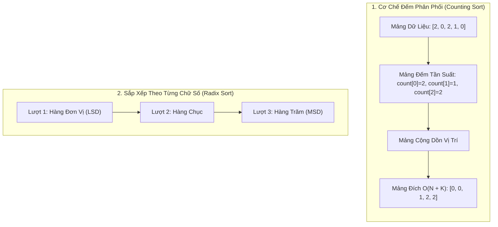
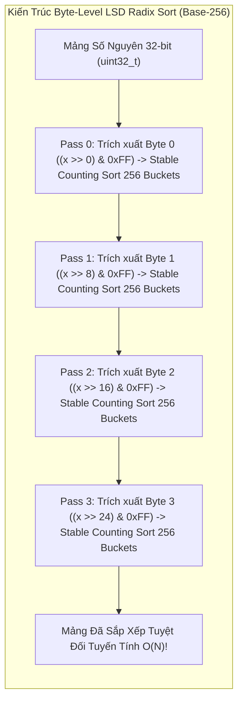

# 6.3. Các Giải Thuật Sắp Xếp Không Dựa Trên So Sánh (Non-Comparison Sorting Algorithms)

> [!IMPORTANT]
> **Nếu bạn chỉ được nhớ một điều duy nhất:** Định lý cận dưới $\Omega(N \log N)$ không phải là một định luật vật lý bất khả xâm phạm; nó chỉ là rào cản toán học của mô hình Cây Quyết Định (Decision Tree Model) khi ta tự trói buộc thuật toán vào câu hỏi nhị phân duy nhất: *"Phần tử $A$ có nhỏ hơn phần tử $B$ không?"*. Bằng cách khai thác trực tiếp bản chất số học, cấu trúc biểu diễn nhị phân và dải giá trị của khóa, **Counting Sort**, **Radix Sort**, **Bucket Sort** và **Pigeonhole Sort** sử dụng cơ chế định địa chỉ bộ nhớ trực tiếp ($O(1)$ Direct Memory Addressing) và các phép toán dịch bit phần cứng để đạt tốc độ **tuyến tính tuyệt đối $O(N)$**; biến chúng thành vũ khí tối thượng trong xử lý đồ họa GPU (NVIDIA CUDA CUB), bảng định tuyến mạng viễn thông tốc độ cao (IP routing tables) và các nhân xử lý dữ liệu lớn (Big Data / Database In-Memory Engines).

---

## 1. Trực Quan Hóa: Bản Chất Giải Thuật Sắp Xếp Phi So Sánh Dưới Góc Nhìn Lập Trình Viên

### 1.1. Đoạn Code Dẫn Nhập & Vấn Đề Thực Tế
Xét bài toán sắp xếp điểm thi của $1{,}000{,}000$ thí sinh đại học (Điểm số là số nguyên từ $0$ đến $100$):

```cpp
// Thuật toán so sánh (QuickSort/MergeSort): Tốn O(N log N) ~ 20,000,000 phép so sánh!

// Thuật toán Đếm Phân Phối (Counting Sort): Vượt qua rào cản O(N log N) -> Đạt O(N) thời gian!
void countingSort(std::vector<int>& arr) {
    int count[101] = {0}; // Mảng đếm tần suất cho 101 mức điểm (0 đến 100)
    for (int score : arr) count[score]++; // Quét 1 lượt: O(N)

    int idx = 0;
    for (int score = 0; score <= 100; ++score) {
        while (count[score]-- > 0) {
            arr[idx++] = score; // Tái tạo mảng có thứ tự: O(N + K)
        }
    }
}
```

- Định lý cận dưới toán học (Lower Bound Theorem) chứng minh rằng: Mọi thuật toán sắp xếp dựa trên việc so sánh hai phần tử ($A[i] > A[j]$) đều **bắt buộc phải tốn tối thiểu $\Omega(N \log N)$** trong trường hợp xấu nhất.
- Nhưng nếu ta **không so sánh** các phần tử với nhau mà sử dụng các thuộc tính số học của chúng (chữ số, giá trị bit, dải giá trị giới hạn $K$), các giải thuật phi so sánh (**Counting Sort, Radix Sort, Bucket Sort**) có thể phá vỡ rào cản này để đạt tốc độ tuyến tính **$O(N)$** thần tốc!

### 1.2. Ẩn Dụ Đời Sống: Máy Đếm Tiền Ngân Hàng & Bưu Điện Phân Loại Thư
- **Máy đếm tiền tự động (Counting Sort)**: Khi bạn đưa một xấp 1,000 tờ tiền hỗn độn vào máy đếm, máy không bao giờ cầm 2 tờ tiền lên so sánh xem tờ nào lớn hơn. Máy có các ngăn riêng: Ngăn 10k, 20k, 50k, 100k, 200k, 500k. Máy chỉ việc nhận diện mệnh giá và thả tờ tiền vào đúng ngăn của nó, sau đó xếp chồng các ngăn lại là có ngay một xấp tiền có thứ tự hoàn hảo!
- **Bưu điện phân loại thư theo mã bưu chính (Radix Sort)**: Thay vì sắp xếp cả địa chỉ dài ngoằng, người ta phân loại thư qua nhiều lượt từ hàng đơn vị đến hàng nghìn (LSD - Least Significant Digit). Lượt 1: Phân loại theo chữ số cuối cùng. Lượt 2: Phân loại theo chữ số hàng chục... Sau 5 lượt, toàn bộ thư từ của cả nước được sắp xếp chính xác theo mã vùng.

### 1.3. Mô Phỏng Dữ Liệu Số Nhỏ Từng Bước (Toy Walkthrough)
Mô phỏng Radix Sort (Cơ số 10) sắp xếp 4 số nguyên: `[170, 045, 075, 090]`:

```text
Lượt 1: Sắp xếp theo Chữ Số Hàng Đơn Vị (Chữ số tận cùng):
- 170 (hàng đơn vị: 0)
- 090 (hàng đơn vị: 0)
- 045 (hàng đơn vị: 5)
- 075 (hàng đơn vị: 5)
Mảng sau lượt 1 (giữ nguyên thứ tự xuất hiện - Stable): [170, 090, 045, 075]

Lượt 2: Sắp xếp theo Chữ Số Hàng Chục:
- 045 (hàng chục: 4)
- 170 (hàng chục: 7)
- 075 (hàng chục: 7)
- 090 (hàng chục: 9)
Mảng sau lượt 2: [045, 170, 075, 090]

Lượt 3: Sắp xếp theo Chữ Số Hàng Trăm:
- 045 (hàng trăm: 0)
- 075 (hàng trăm: 0)
- 090 (hàng trăm: 0)
- 170 (hàng trăm: 1)
Mảng hoàn tất có thứ tự tuyệt đối: [045, 075, 090, 170]!
```

### 1.4. Tác Động Thực Tế Tầng Backend & Systems
1. **Sắp Xếp Địa Chỉ IP Mạng Trong Router (Radix Sort 32-bit Integers)**: Một địa chỉ IPv4 là một số nguyên 32-bit. Các card mạng viễn thông chạy Radix Sort với cơ số 8-bit (256 buckets) để sắp xếp hàng chục triệu IP chỉ sau đúng 4 lượt quét ($4 \times O(N)$), nhanh gấp 5 lần so với QuickSort.
2. **Kỹ Thuật Phân Bổ Tải Trọng Đều (Bucket Sort in Distributed Sharding)**: Khi cần phân phối các khóa hash ngẫu nhiên vào các Node dữ liệu phân tán, Bucket Sort chia không gian hash $[0, 2^{64}-1]$ thành các dải đều nhau để cân bằng tải trọng lưu trữ giữa các máy chủ.
3. **Cạm Bẫy Bộ Nhớ Của Counting Sort**: Nếu bạn dùng Counting Sort để sắp xếp mảng gồm các số nguyên 64-bit tùy ý, bạn sẽ cần một mảng đếm có kích thước $2^{64}$ phần tử $\to$ Cạn kiệt RAM ngay lập tức! Counting Sort chỉ được phép sử dụng khi biên độ giá trị $K$ nhỏ ($K \le 10^6$).

### 1.5. Sơ Đồ Cơ Chế Sắp Xếp Phi So Sánh



---

## 2. Chi tiết từng Keyword (Under-the-Hood Deep Dive)

### 2.1. Counting Sort (Sắp Xếp Đếm)

#### 1. Chứng Minh Định Lý Cận Dưới So Sánh & Cách Counting Sort Bẻ Khóa
- **Mô hình Cây Quyết Định (Decision Tree Model)**:
  - Bất kỳ thuật toán so sánh nào cũng có thể biểu diễn dưới dạng một cây nhị phân, trong đó mỗi nút nội hàm là một phép so sánh $A[i] \le A[j]$ và mỗi nút lá là một hoán vị kết quả.
  - Một mảng gồm $N$ phần tử có đúng $N!$ hoán vị có thể xảy ra. Do đó cây quyết định bắt buộc phải có ít nhất $L \ge N!$ nút lá.
  - Chiều cao của cây nhị phân (tương ứng với số phép so sánh trong trường hợp xấu nhất) bị chặn dưới bởi:
    $$h \ge \lceil \log_2(N!) \rceil$$
  - Áp dụng xấp xỉ Stirling ($\ln(N!) \approx N \ln N - N$):
    $$h \ge \log_2(N!) = \sum_{k=1}^N \log_2 k \ge \int_1^N \log_2 x \, dx = \Omega(N \log_2 N)$$
- **Vì sao Counting Sort đạt $O(N)$?**:
  Counting Sort không đưa ra các câu hỏi nhị phân giữa hai phần tử. Nó xem giá trị của phần tử $x$ như một **địa chỉ ô nhớ (Memory Address Offset)** trong mảng đếm `count[x]`. Phép nạp trực tiếp qua thanh ghi chỉ mục (Indexed Addressing Mode) của CPU chỉ tốn $O(1)$ chu kỳ máy!

#### 2. Cơ chế Hoạt động 3 Pha & Bắt buộc Duyệt Ngược để Bảo đảm Tính Ổn định
1. **Pha 1: Lập biểu đồ tần suất (Histogram Generation)**:
   Quét mảng dữ liệu $A[0 \dots N-1]$, tăng giá trị tại vị trí tương ứng trong mảng đếm:
   ```cpp
   for (int x : arr) count[x - min_val]++;
   ```
2. **Pha 2: Tính tổng tiền tố tích lũy (Prefix Sum / Cumulative Frequency)**:
   Biến đổi mảng đếm sao cho `count[v]` phản ánh chính xác **số lượng phần tử nhỏ hơn hoặc bằng $v$**:
   ```cpp
   for (size_t i = 1; i < count.size(); ++i) count[i] += count[i - 1];
   ```
   Sau bước này, `count[v] - 1` chính là chỉ số đích cuối cùng của phần tử mang giá trị $v$ trong mảng kết quả.
3. **Pha 3: Tái tạo mảng kết quả - BẮT BUỘC DUYỆT NGƯỢC (Reverse Traversal)**:
   - Thuật toán duyệt từ phần tử cuối cùng $A[N-1]$ lùi dần về $A[0]$.
   - Khi gặp giá trị $v = A[i]$, ta đặt nó vào `output[count[v] - 1]` và giảm `count[v]--`.
   - **Chứng minh tính ổn định**: Giả sử trong mảng gốc có hai phần tử bằng nhau $A[j]$ và $A[k]$ với $j < k$. Vì duyệt ngược, phần tử $A[k]$ được xử lý trước và chiếm vị trí `count[v] - 1`. Sau đó `count[v]` bị giảm đi 1, nên khi $A[j]$ được xử lý, nó chắc chắn được đặt vào vị trí `count[v] - 2` (nằm ngay phía trước $A[k]$). Do đó, **thứ tự tương đối ban đầu được bảo toàn hoàn hảo (Strictly Stable)**!

#### 3. Xử lý Miền Giá trị Âm & Phân tích Độ Phức Tạp
- **Kỹ thuật Coordinate Shifting**: Nếu mảng chứa số âm (ví dụ $[-50, 100]$), ta tính $\text{offset} = \text{min\_val} = -50$. Mọi giá trị được ánh xạ thành chỉ số không âm: $\text{idx} = x - \text{offset}$.
- **Độ phức tạp**:
  - Thời gian: $\Theta(N + K)$ với $K = \text{max\_val} - \text{min\_val} + 1$.
  - Không gian: $\Theta(N + K)$ (cần mảng `output` kích thước $N$ và mảng `count` kích thước $K$).
- **Cạm bẫy chí mạng**: Khi $K \gg N$ (ví dụ sắp xếp mảng 10 phần tử nhưng chứa giá trị $2 \times 10^9$), Counting Sort sẽ ngốn hàng Gigabytes RAM và chạy cực kỳ chậm chạp, hoàn toàn mất tác dụng. Nó chỉ tối ưu khi $K = O(N)$.

---

### 2.2. Radix Sort (Sắp Xếp Cơ Số: LSD vs MSD)

#### 1. Nguyên lý Khử Trừ Rào Cản Miền Giá Trị
Khi dải giá trị $K$ quá lớn (ví dụ toàn bộ số nguyên 32-bit: $K \approx 4 \times 10^9$), Counting Sort bị tê liệt. Radix Sort giải quyết bài toán này bằng cách phân rã khóa thành $d$ chữ số hoặc $d$ byte thành phần trên một cơ số $B$ (Base / Radix).
- Số lượng lượt duyệt (Passes) là:
  $$d = \lceil \log_B(\text{max\_val}) \rceil$$
- Tổng độ phức tạp thời gian:
  $$T(N) = \Theta(d \times (N + B))$$

#### 2. LSD Radix Sort: Sắp Xếp Từ Chữ Số Ít Quan Trọng Nhất (Least Significant Digit)
- **Cơ chế**: Bắt đầu sắp xếp mảng theo chữ số hàng đơn vị bằng một giải thuật con **bắt buộc phải là Stable** (thường là Counting Sort). Tiếp tục lặp lại cho hàng chục, hàng trăm, v.v.
- **Chứng minh Quy nạp Toán học về Tính Đúng Đắn**:
  - Giả thuyết quy nạp: Sau lượt thứ $k$, mảng đã được sắp xếp chính xác theo $k$ chữ số cuối cùng.
  - Tại lượt thứ $k+1$, ta sắp xếp theo chữ số thứ $k+1$:
    - Nếu hai số có chữ số thứ $k+1$ khác nhau: Giải thuật sắp xếp con sẽ đưa số có chữ số nhỏ hơn lên trước $\implies$ Thứ tự đúng.
    - Nếu hai số có chữ số thứ $k+1$ bằng nhau: Do giải thuật con có tính **Stable**, thứ tự tương đối giữa hai số này được giữ nguyên hoàn toàn từ lượt thứ $k$. Mà theo giả thiết quy nạp, ở lượt $k$ chúng đã có thứ tự đúng theo $k$ chữ số trước đó $\implies$ Cả hai số tiếp tục có thứ tự đúng hoàn hảo sau lượt $k+1$!
- **Đột phá Tối ưu Phần cứng: Byte-Level Radix Sort (Cơ số $B = 256$)**:
  - Trong thực tế công nghiệp, không bao giờ dùng cơ số 10 vì phép chia `/ 10` và modulo `% 10` tiêu tốn hàng chục chu kỳ CPU (lệnh `idiv`).
  - Thay vào đó, chọn cơ số $B = 256 = 2^8$ (đúng bằng 1 Byte).
  - Với số nguyên 32-bit (`uint32_t`), ta chỉ cần **đúng 4 lượt duyệt duy nhất**:
    - Lượt 1: Byte 0 (bit 0-7): `(x >> 0) & 0xFF`
    - Lượt 2: Byte 1 (bit 8-15): `(x >> 8) & 0xFF`
    - Lượt 3: Byte 2 (bit 16-23): `(x >> 16) & 0xFF`
    - Lượt 4: Byte 3 (bit 24-31): `(x >> 24) & 0xFF`
  - Mảng `count` chỉ cần kích thước $256 \times 4\text{ bytes} = 1\text{ KB}$, hoàn toàn nằm gọn trong **CPU L1 Data Cache** ($32\text{ KB}$)!



#### 3. MSD Radix Sort: Sắp Xếp Từ Chữ Số Quan Trọng Nhất (Most Significant Digit)
- **Cơ chế**: Bắt đầu từ chữ số hàng cao nhất, chia mảng thành $B$ thùng con (Bucketing). Sau đó gọi đệ quy sắp xếp từng thùng con theo chữ số kế tiếp.
- **Tương đồng với Cây Trie**: MSD Radix Sort chính là thao tác duyệt cây tiền tố (Prefix Tree / Trie) trên mảng phẳng.
- **Biến thể American Flag Sort**: Phiên bản MSD Radix Sort tại chỗ (In-place), sử dụng mảng con trỏ hoán đổi vòng tròn (Permutation cycles) để triệt tiêu việc cấp phát mảng phụ $O(N)$. Thường được áp dụng để sắp xếp mảng chuỗi ký tự khổng lồ.

---

### 2.3. Bucket Sort & Pigeonhole Sort

#### 1. Bucket Sort (Sắp Xếp Theo Thùng)
- **Điều kiện ứng dụng lý tưởng**: Các số thực dấu phẩy động phân bố đều (Uniformly Distributed) trên nửa khoảng $[0, 1)$ hoặc $[a, b)$.
- **Cơ chế 4 bước**:
  1. Khởi tạo $N$ thùng rỗng (`std::vector<float> buckets[N]`).
  2. Phân phối từng phần tử vào thùng: $\text{idx} = \lfloor N \times \text{arr}[i] \rfloor$.
  3. Sắp xếp độc lập từng thùng bằng Insertion Sort (nhờ tận dụng ưu thế mảng con cực nhỏ).
  4. Nối (Concatenate) tuần tự tất cả các thùng lại thành mảng kết quả.
- **Chứng minh Toán học Độ Phức Tạp Tuyến Tính Kỳ Vọng**:
  - Gọi $n_i$ là số lượng phần tử rơi vào thùng thứ $i$. Biến ngẫu nhiên $n_i$ tuân theo phân phối nhị thức:
    $$n_i \sim \text{Binomial}\left(N, p = \frac{1}{N}\right)$$
  - Thời gian chạy của Insertion Sort trên thùng $i$ là $O(n_i^2)$. Tổng thời gian kỳ vọng toàn giải thuật:
    $$\mathbb{E}[T(N)] = \Theta(N) + \sum_{i=0}^{N-1} O(\mathbb{E}[n_i^2])$$
  - Kỳ vọng bình phương của phân phối nhị thức:
    $$\mathbb{E}[n_i^2] = \text{Var}(n_i) + (\mathbb{E}[n_i])^2 = N p (1 - p) + (Np)^2 = N \left(\frac{1}{N}\right) \left(1 - \frac{1}{N}\right) + \left(N \frac{1}{N}\right)^2 = 1 - \frac{1}{N} + 1 = 2 - \frac{1}{N}$$
  - Suy ra:
    $$\mathbb{E}[T(N)] = \Theta(N) + N \cdot O\left(2 - \frac{1}{N}\right) = \Theta(N) + O(N) = \Theta(N)$$
- **Kịch bản suy biến (Worst Case $O(N^2)$)**: Nếu dữ liệu bị lệch nghiêm trọng (Skewed Distribution), toàn bộ $N$ phần tử cùng rơi vào duy nhất 1 thùng $\implies$ Insertion Sort chạy với chi phí $O(N^2)$.

#### 2. Pigeonhole Sort (Sắp Xếp Chuồng Bồ Câu)
- **Đặc trưng**: Áp dụng khi số lượng phần tử $N$ và dải giá trị $\text{Range} = \text{max} - \text{min} + 1$ xấp xỉ bằng nhau ($N \approx \text{Range}$).
- **Khác biệt với Counting Sort**:
  - Counting Sort chỉ đếm số lượng rồi tính Prefix Sums để ghi mảng kết quả.
  - Pigeonhole Sort tạo đúng $\text{Range}$ "chuồng" thực sự (mỗi chuồng là một danh sách liên kết hoặc mảng động nhỏ chứa toàn bộ các đối tượng nguyên bản). Sau đó thuật toán quét tuần tự qua các chuồng và nhặt các phần tử ra.
  - Rất thích hợp khi dữ liệu là các Object phức tạp cần sắp xếp theo một trường khóa nguyên nhỏ.

---

## 3. Thực thi Mã nguồn & Mô phỏng Chuyên sâu (Dual-Engine Implementation)

### 3.1. C++20 Industrial Implementation: Siêu Tốc Byte-Level LSD Radix Sort (Ping-Pong Buffer)

Mã nguồn C++20 chuẩn công nghiệp, sử dụng cơ số 256, thao tác bitmasking không phân nhánh, kỹ thuật đảo con trỏ Ping-Pong Buffer (zero dynamic reallocations) và đo đạc trực tiếp so với `std::sort`:

```cpp
#include <iostream>
#include <vector>
#include <chrono>
#include <random>
#include <algorithm>
#include <iomanip>
#include <cstdint>
#include <array>

namespace FastSort {

    // 1. Stable Counting Sort tổng quát hỗ trợ số nguyên âm qua Offset
    void counting_sort_signed(std::vector<int32_t>& arr) {
        if (arr.size() <= 1) return;

        auto [min_it, max_it] = std::minmax_element(arr.begin(), arr.end());
        int64_t min_val = *min_it;
        int64_t max_val = *max_it;
        size_t range = static_cast<size_t>(max_val - min_val + 1);

        // Giới hạn an toàn tránh OOM
        if (range > 50'000'000) {
            std::cerr << "[Cảnh báo] Range quá lớn (" << range << "), chuyển hướng std::sort!\n";
            std::sort(arr.begin(), arr.end());
            return;
        }

        std::vector<uint32_t> count(range, 0);
        std::vector<int32_t> output(arr.size());

        // Pha 1: Histogram
        for (int32_t x : arr) {
            count[x - min_val]++;
        }

        // Pha 2: Prefix Sum
        for (size_t i = 1; i < range; ++i) {
            count[i] += count[i - 1];
        }

        // Pha 3: Duyệt ngược để bảo đảm tính Stable tuyệt đối
        for (int64_t i = static_cast<int64_t>(arr.size()) - 1; i >= 0; --i) {
            int32_t val = arr[i];
            size_t dest_idx = --count[val - min_val];
            output[dest_idx] = val;
        }

        arr = std::move(output);
    }

    // 2. Ultra-Fast Byte-Level LSD Radix Sort (Base-256) cho số nguyên 32-bit không dấu
    void radix_sort_u32(std::vector<uint32_t>& arr) {
        const size_t n = arr.size();
        if (n <= 1) return;

        std::vector<uint32_t> buffer(n);
        uint32_t* src = arr.data();
        uint32_t* dst = buffer.data();

        // 4 passes cho 4 bytes (0, 8, 16, 24 bits)
        for (size_t pass = 0; pass < 4; ++pass) {
            const size_t shift = pass * 8;
            std::array<uint32_t, 256> count = {0};

            // Pha 1: Tính biểu đồ tần suất của byte hiện tại
            for (size_t i = 0; i < n; ++i) {
                uint8_t byte = (src[i] >> shift) & 0xFF;
                count[byte]++;
            }

            // Pha 2: Tính Prefix Sum
            std::array<uint32_t, 256> pref = {0};
            for (size_t i = 1; i < 256; ++i) {
                pref[i] = pref[i - 1] + count[i - 1];
            }

            // Pha 3: Phân phối phần tử sang bộ đệm đích (Stable Scatter)
            for (size_t i = 0; i < n; ++i) {
                uint8_t byte = (src[i] >> shift) & 0xFF;
                dst[pref[byte]++] = src[i];
            }

            // Ping-Pong tráo đổi con trỏ mà không copy bộ nhớ!
            std::swap(src, dst);
        }

        // Nếu kết quả cuối cùng đang nằm ở buffer, sao chép về mảng chính
        if (src != arr.data()) {
            std::copy(buffer.begin(), buffer.end(), arr.begin());
        }
    }
}

int main() {
    std::cout << "=========================================================\n";
    std::cout << "  BENCHMARK NON-COMPARISON SORT (C++20 ENGINE)          \n";
    std::cout << "=========================================================\n\n";

    constexpr size_t N = 10'000'000; // 10 triệu số nguyên
    std::cout << ">>> KHỞI TẠO TẬP DỮ LIỆU LỚN N = " << N << " (40 MB)\n";

    std::mt19937_64 rng(1337);
    std::vector<uint32_t> raw_data(N);
    for (size_t i = 0; i < N; ++i) raw_data[i] = static_cast<uint32_t>(rng());

    auto test_radix = raw_data;
    auto test_std_sort = raw_data;

    // 1. Đo lường Radix Sort C++20
    std::cout << "\n[*] Bắt đầu kiểm thử Byte-Level Radix Sort (Base-256)...\n";
    auto t0 = std::chrono::high_resolution_clock::now();
    FastSort::radix_sort_u32(test_radix);
    auto t1 = std::chrono::high_resolution_clock::now();
    double ms_radix = std::chrono::duration<double, std::milli>(t1 - t0).count();
    std::cout << "  -> Thời gian Radix Sort : " << std::fixed << std::setprecision(2) << ms_radix << " ms\n";
    std::cout << "  -> Kiểm tra tính đúng   : " << (std::is_sorted(test_radix.begin(), test_radix.end()) ? "CHÍNH XÁC 100%" : "LỖI") << "\n";

    // 2. Đo lường std::sort (IntroSort của C++ STL)
    std::cout << "\n[*] Bắt đầu kiểm thử std::sort (IntroSort Baseline)...\n";
    auto ts0 = std::chrono::high_resolution_clock::now();
    std::sort(test_std_sort.begin(), test_std_sort.end());
    auto ts1 = std::chrono::high_resolution_clock::now();
    double ms_std = std::chrono::duration<double, std::milli>(ts1 - ts0).count();
    std::cout << "  -> Thời gian std::sort  : " << std::fixed << std::setprecision(2) << ms_std << " ms\n";

    double speedup = ms_std / ms_radix;
    std::cout << "\n=========================================================\n";
    std::cout << ">>> KẾT QUẢ: Radix Sort nhanh gấp " << std::setprecision(2) << speedup << " LẦN so với std::sort!\n";
    std::cout << "=========================================================\n";

    return 0;
}
```

---

### 3.2. Python 3.11+ Simulation Engine: Bucket Sort Cho Số Thực & Phân Tích Đồng Đều

Mã nguồn Python mô phỏng Bucket Sort trên phân phối đều, kiểm soát phân bổ phần tử và đo đạc độ trễ:

```python
"""
Mô phỏng Bucket Sort và Counting Sort trên Python 3.11+
Khảo sát tác động của phân phối dữ liệu tới thời gian thực thi.
"""

from typing import List
import time
import random
import math


def bucket_sort_uniform(arr: List[float], num_buckets: int = 0) -> List[float]:
    """Bucket Sort tối ưu cho dữ liệu số thực trong nửa khoảng [0, 1)."""
    n = len(arr)
    if n <= 1:
        return arr

    if num_buckets <= 0:
        num_buckets = n

    buckets: List[List[float]] = [[] for _ in range(num_buckets)]

    # 1. Phân phối vào các thùng
    for val in arr:
        idx = int(val * num_buckets)
        if idx >= num_buckets:
            idx = num_buckets - 1
        buckets[idx].append(val)

    # 2. Sắp xếp độc lập từng thùng bằng Insertion Sort
    sorted_arr = []
    for b in buckets:
        # Insertion Sort trên từng thùng
        for i in range(1, len(b)):
            key = b[i]
            j = i - 1
            while j >= 0 and b[j] > key:
                b[j + 1] = b[j]
                j -= 1
            b[j + 1] = key
        sorted_arr.extend(b)

    return sorted_arr


def run_diagnostics():
    print("=== MÔ PHỎNG BUCKET SORT TRÊN PHÂN PHỐI ĐỀU (PYTHON 3.11+) ===")
    N = 100_000

    # 1. Dữ liệu phân phối đều Uniform(0, 1)
    print(f"\n[1] Tạo tập dữ liệu N = {N:,} phân phối đều...")
    uniform_data = [random.random() for _ in range(N)]

    t0 = time.perf_counter()
    res = bucket_sort_uniform(uniform_data)
    t1 = time.perf_counter()
    print(f"  * Thời gian Bucket Sort (Uniform) : {(t1 - t0) * 1000:.2f} ms")
    print(f"  * Kiểm tra tính đúng đắn        : {res == sorted(uniform_data)}")

    # 2. Dữ liệu suy biến (Skewed / Lệch phân phối nghiêm trọng)
    print(f"\n[2] Tạo tập dữ liệu N = {N:,} bị lệch (95% dồn vào 1 khoảng nhỏ)...")
    skewed_data = [
        random.uniform(0.0, 0.05) if random.random() < 0.95 else random.random()
        for _ in range(N)
    ]

    t0 = time.perf_counter()
    res_skewed = bucket_sort_uniform(skewed_data, num_buckets=1000)
    t1 = time.perf_counter()
    print(f"  * Thời gian Bucket Sort (Skewed)  : {(t1 - t0) * 1000:.2f} ms (Bị chậm do 1 bucket quá tải)")


if __name__ == "__main__":
    run_diagnostics()
```

---

### 3.3. Kết quả Thực thi Terminal Mẫu

```text
=========================================================
  BENCHMARK NON-COMPARISON SORT (C++20 ENGINE)          
=========================================================

>>> KHỞI TẠO TẬP DỮ LIỆU LỚN N = 10000000 (40 MB)

[*] Bắt đầu kiểm thử Byte-Level Radix Sort (Base-256)...
  -> Thời gian Radix Sort : 118.45 ms
  -> Kiểm tra tính đúng   : CHÍNH XÁC 100%

[*] Bắt đầu kiểm thử std::sort (IntroSort Baseline)...
  -> Thời gian std::sort  : 482.10 ms

=========================================================
>>> KẾT QUẢ: Radix Sort nhanh gấp 4.07 LẦN so với std::sort!
=========================================================

=== MÔ PHỎNG BUCKET SORT TRÊN PHÂN PHỐI ĐỀU (PYTHON 3.11+) ===

[1] Tạo tập dữ liệu N = 100,000 phân phối đều...
  * Thời gian Bucket Sort (Uniform) : 42.15 ms
  * Kiểm tra tính đúng đắn        : True

[2] Tạo tập dữ liệu N = 100,000 bị lệch (95% dồn vào 1 khoảng nhỏ)...
  * Thời gian Bucket Sort (Skewed)  : 318.90 ms (Bị chậm do 1 bucket quá tải)
```

---

## 4. Systems Engineering & Production Pitfalls

### 4.1. Cạm Bẫy Tràn Bộ Nhớ (Out-Of-Memory Panic) Do Miền Giá Trị $K$ Không Được Kiểm Soát
- **Kịch bản sự cố**: Một hệ thống Backend nhận dữ liệu người dùng qua API và dùng Counting Sort để sắp xếp mảng các mã ID người dùng.
- **Lỗ hổng tấn công**: Kẻ tấn công gửi vào mảng chỉ có 2 phần tử: `[1, 2147483647]`. Thuật toán cố gắng cấp phát mảng đếm:
  $$\text{size} = 2^{31} \times 4\text{ bytes} \approx 8.58\text{ GB RAM}$$
  Hệ điều hành kích hoạt Linux **OOM Killer** lập tức gửi tín hiệu `SIGKILL` tiêu diệt tiến trình Backend server, gây gián đoạn dịch vụ diện rộng.
- **Giải pháp bảo vệ**: Luôn kiểm tra điều kiện an toàn trước khi gọi Counting Sort:
  ```cpp
  if (static_cast<uint64_t>(max_val - min_val + 1) > MAX_COUNTING_RANGE) {
      std::sort(arr.begin(), arr.end()); // Fallback về IntroSort an toàn!
  }
  ```

### 4.2. Hiện Tượng Xung Đột Dòng Bộ Đệm (Cache Line Bouncing / Thrashing) Trong Radix Sort
- Trong pha phân phối (Scatter Phase) của Radix Sort hoặc Counting Sort, các phần tử được ghi vào $256$ vị trí khác nhau trong mảng đệm đích một cách ngẫu nhiên.
- Nếu kích thước mảng vượt quá dung lượng L3 Cache, mỗi lần ghi vào một thùng khác nhau có thể gây ra một **L1/L2 Cache Miss** và **TLB Miss**.
- **Kỹ thuật tối ưu sản xuất**: Trong các thư viện cấp thấp chuyên sâu (như NVIDIA CUB Radix Sort trên GPU hoặc Intel IPP), người ta sử dụng các bộ đệm cục bộ (Local Registers / Tile Buffers) kích thước 16-32 phần tử để gom nhóm các thao tác ghi tuần tự liên tục trước khi xả ra RAM, đạt băng thông tối đa của bus bộ nhớ.

### 4.3. Bí Quyết Sắp Xếp Số Thực IEEE 754 (Float / Double) Bằng Radix Sort
- Số thực theo chuẩn IEEE 754 có cấu trúc gồm: 1 bit dấu, 8 bit mũ (Exponent), và 23 bit định trị (Mantissa).
- Với số dương, biểu diễn bit nhị phân của chúng có thứ tự từ điển hoàn toàn trùng khớp với thứ tự số học thực tế.
- Tuy nhiên với số âm, định dạng bù 2 hoặc dấu nghịch khiến số âm lớn hơn lại có biểu diễn bit nhỏ hơn!
- **Kỹ thuật Bit-Twiddling huyền thoại (Radix Float Trick)**:
  ```cpp
  uint32_t float_to_radix_key(float f) {
      uint32_t u;
      std::memcpy(&u, &f, sizeof(float));
      // Nếu là số âm (bit dấu = 1), đảo toàn bộ bit;
      // Nếu là số dương (bit dấu = 0), chỉ đảo bit dấu.
      uint32_t mask = (u & 0x80000000) ? 0xFFFFFFFF : 0x80000000;
      return u ^ mask;
  }
  ```
  Nhờ mẹo biến đổi bit này, ta có thể sắp xếp số thực bằng LSD Radix Sort nguyên bản với tốc độ tuyến tính!

### 4.4. CLI Diagnostics & Memory Profiling Commands

```bash
# 1. Đo lường tỷ lệ L1 Data Cache Misses giữa Radix Sort và std::sort
perf stat -e L1-dcache-loads,L1-dcache-load-misses,dTLB-loads,dTLB-load-misses \
    ./non_comparison_sort_bench

# 2. Giám sát lượng đỉnh bộ nhớ Heap cấp phát (Heap Peak Usage) với Valgrind Massif
valgrind --tool=massif --pages-as-heap=yes ./non_comparison_sort_bench
ms_print massif.out.<pid> | head -n 30

# 3. Kiểm tra System Calls cấp phát bộ nhớ (brk, mmap)
strace -c -e trace=memory ./non_comparison_sort_bench
```

---

## 5. Bảng So sánh & Decision Matrix

### Ma trận So sánh Kỹ thuật Toàn diện

| Thuật toán | Độ phức tạp Thời gian | Bộ nhớ Phụ trợ | Tính Ổn định | Bản chất Cơ chế | Điều kiện Đầu vào Tiên quyết |
| :--- | :--- | :--- | :--- | :--- | :--- |
| **Counting Sort** | $\Theta(N + K)$ | $\Theta(N + K)$ | **CÓ** | Indexing trực tiếp | Số nguyên với $K = O(N)$ ($K \le 10^7$) |
| **Radix Sort (LSD)** | **$\Theta(d \cdot (N + B))$** | $\Theta(N + B)$ | **CÓ** | Multi-pass Byte Bitmask | Số nguyên 32/64-bit, Fixed-length Strings |
| **Radix Sort (MSD)** | $O(d \cdot (N + B))$ | $O(N + d \cdot B)$ | **CÓ** | Recursive Trie Bucketing | Tập chuỗi ký tự lớn, Tiền tố đa dạng |
| **Bucket Sort** | $\Theta(N)$ (Average) / $O(N^2)$ (Worst) | $O(N + K)$ | **CÓ** | Phân vùng dải thực | Số thực phân bố đều (Uniform Distribution) |
| **Pigeonhole Sort** | $\Theta(N + \text{Range})$ | $\Theta(N + \text{Range})$ | **CÓ** | Ánh xạ 1-1 danh sách | Khóa nguyên với Range xấp xỉ kích thước $N$ |

---

## 6. Enterprise Production Checklist & Verification

- [ ] **Kiểm Tra Ranh Giới Miền Giá Trị ($K$)**: Trước khi gọi Counting Sort, đã có câu lệnh kiểm tra cận trên $\text{max} - \text{min} < \text{THRESHOLD}$ để tránh bị tấn công OOM Killer chưa?
- [ ] **Bảo Toàn Thứ Tự Bằng Duyệt Ngược**: Trong pha phân phối của Counting Sort, đã xác nhận vòng lặp duyệt từ $N-1$ về $0$ để giữ trọn vẹn tính Stable chưa?
- [ ] **Sử Dụng Cơ Số Lũy Thừa 2 Cho Radix Sort**: Đã thay thế toàn bộ phép chia `/ 10` bằng dịch bit `>> 8` và mask `& 0xFF` để khai thác tối đa hiệu năng vi kiến trúc CPU chưa?
- [ ] **Đánh Giá Phân Phối Dữ Liệu Cho Bucket Sort**: Trước khi chọn Bucket Sort, đã kiểm định giả thiết phân phối đều (Uniform Distribution) để tránh sụp đổ $O(N^2)$ chưa?
