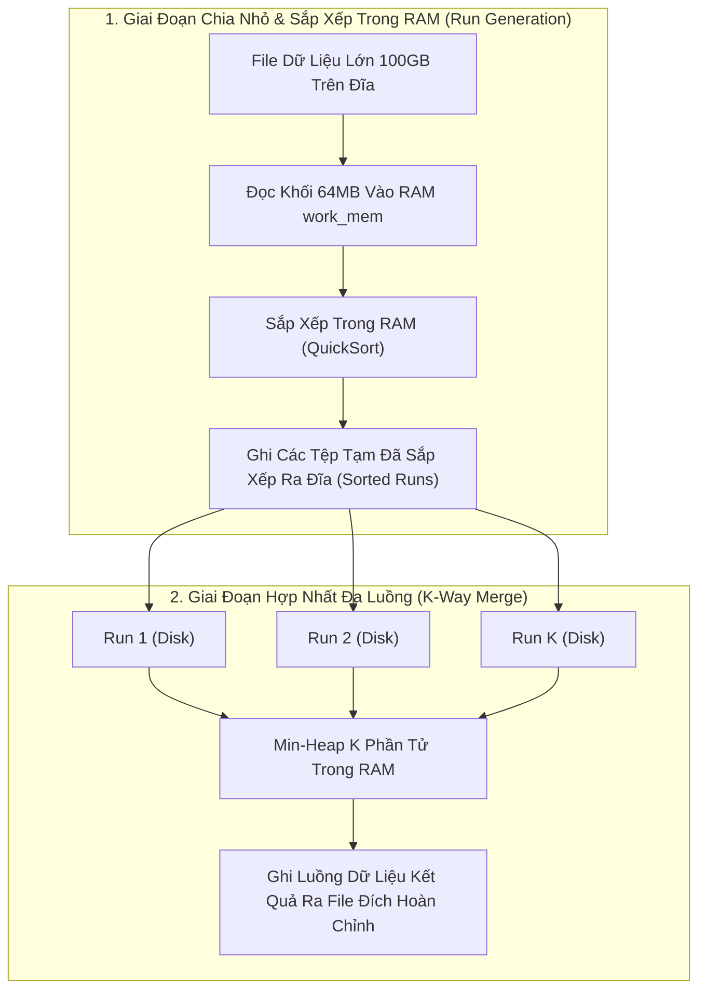
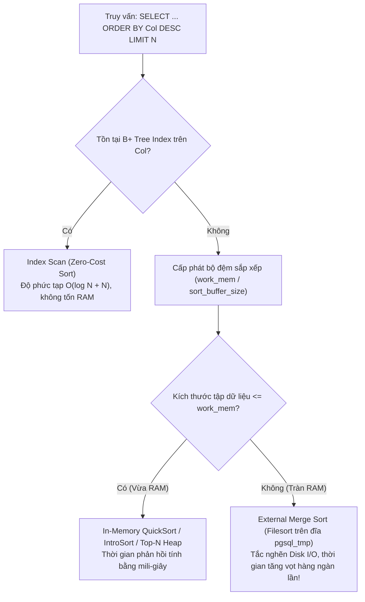

# 6.4. Thuộc Tính Sắp Xếp & Ứng Dụng Thực Chiến Trong Backend

> [!IMPORTANT]
> **Nếu bạn chỉ được nhớ một điều duy nhất:** Trong kỹ nghệ phần mềm Backend và hệ thống cơ sở dữ liệu quy mô lớn, thuật toán sắp xếp không bao giờ tồn tại trong môi trường chân không của lý thuyết Big-$O$. Giá trị sống còn của một kỹ sư hệ thống nằm ở việc làm chủ các **Thuộc tính hệ thống cốt lõi**: Tính ổn định (**Stability**) bảo đảm toàn vẹn ngữ nghĩa khi sắp xếp đa tiêu chí (Multi-column Order By), Tính tại chỗ (**In-place**) ngăn chặn sập máy chủ do OOM, và kỹ thuật **Sắp xếp bộ nhớ ngoài (External Sorting) kết hợp K-way Merge bằng Min-Heap/Loser-Tree** cho phép máy chủ xử lý mượt mà hàng Terabytes dữ liệu giao dịch với chỉ vài Gigabytes RAM. Hiểu rõ sự tương tác giữa cơ sở dữ liệu (PostgreSQL/MySQL Filesort, LSM-Tree Compaction trong ClickHouse/RocksDB), kiến trúc I/O đĩa và kỹ thuật phân trang Keyset Pagination là lằn ranh phân định giữa một hệ thống tê liệt vì Disk Thrashing và một hệ thống chịu tải hàng triệu QPS.

---

## 1. Trực Quan Hóa: Bản Chất Đặc Tính Sắp Xếp Trong Backend Dưới Góc Nhìn Lập Trình Viên

### 1.1. Đoạn Code Dẫn Nhập & Vấn Đề Thực Tế
Xét giao diện hiển thị danh sách đơn hàng của khách hàng trên trang thương mại điện tử:
Đầu tiên người dùng bấm sắp xếp theo **Thời Gian Đặt Hàng** (Mới nhất lên đầu). Sau đó, họ bấm tiếp sắp xếp theo **Trạng Thái Đơn Hàng** (`COMPLETED`, `PENDING`, `CANCELLED`).

```typescript
// Nếu thuật toán sắp xếp KHÔNG CÓ TÍNH ỔN ĐỊNH (Unstable Sort - ví dụ QuickSort thuần túy):
// Thứ tự thời gian của các đơn hàng có CÙNG trạng thái 'PENDING' sẽ bị XÁO TRỘN NGẪU NHIÊN!
// Khách hàng thấy đơn đặt hôm nay lại nhảy xuống dưới đơn đặt tuần trước -> Bug trải nghiệm người dùng!

// Nếu dùng Thuật toán Sắp xếp Ổn Định (Stable Sort - ví dụ Timsort / MergeSort):
orders.sort((a, b) => a.status.localeCompare(b.status));
// Các đơn hàng cùng trạng thái 'PENDING' ĐẢM BẢO giữ nguyên 100% thứ tự thời gian đặt trước đó!
```

- Trong môi trường công nghiệp, việc chọn giải thuật sắp xếp không chỉ là câu chuyện so đo số phép toán $O(N \log N)$, mà xoay quanh các đặc tính kỹ thuật cốt lõi:
  - **Tính ổn định (Stability)**: Giữ nguyên thứ tự tương đối của các phần tử có cùng khóa sắp xếp.
  - **Sắp xếp tại chỗ (In-Place)**: Bộ nhớ phụ trợ $O(1)$ để không làm phình to RAM của tiến trình.
  - **Khả năng thích ứng (Adaptivity)**: Thuật toán tự động chạy nhanh hơn ($O(N)$) khi dữ liệu đầu vào đã gần như có thứ tự (như **Timsort**).
  - **Sắp xếp ngoài (External Sorting)**: Giải bài toán sắp xếp tập dữ liệu lớn hơn cả dung lượng RAM vật lý của máy chủ.

### 1.2. Ẩn Dụ Đời Sống: Phòng Đọc Thư Viện Hạn Chế & Lễ Tân Khách Sạn
- **Lễ tân phân loại chìa khóa phòng (Stable Sort)**: Khi lễ tân xếp lại các chìa khóa theo số tầng (Tầng 1, Tầng 2, Tầng 3), đối với các phòng cùng ở Tầng 2, chìa khóa nào được khách gửi trước vẫn nằm phía trên chìa khóa gửi sau. Tính trật tự lịch sử không hề bị phá hủy.
- **Phòng đọc thư viện chật hẹp (In-Place Sorting)**: Một căn phòng chỉ có đúng 1 chiếc bàn để sách và không còn một khoảng trống nào để kê thêm bàn phụ ($O(1)$ Auxiliary Space). Toàn bộ việc sắp xếp phải được thực hiện bằng cách tráo đổi vị trí trực tiếp giữa các cuốn sách trên mặt bàn mà không được mang sách ra hành lang.

### 1.3. Mô Phỏng Dữ Liệu Số Nhỏ Từng Bước (Toy Walkthrough)
Mô phỏng tính ổn định (Stability) khi sắp xếp 3 sinh viên theo Điểm thi:
Danh sách gốc: `[ (Alice, 8), (Bob, 9), (Charlie, 8) ]` (Alice xuất hiện trước Charlie)

```text
Khóa so sánh: Điểm số

1. Sắp xếp bằng thuật toán Không Ổn Định (Unstable Sort - ví dụ HeapSort):
Kết quả có thể là: [ (Charlie, 8), (Alice, 8), (Bob, 9) ]
-> Thứ tự tương đối bị đảo ngược: Charlie nhảy lên trước Alice!

2. Sắp xếp bằng thuật toán Ổn Định (Stable Sort - ví dụ MergeSort):
Kết quả bắt buộc là: [ (Alice, 8), (Charlie, 8), (Bob, 9) ]
-> Alice đảm bảo luôn đứng trước Charlie như trạng thái ban đầu!
```

### 1.4. Tác Động Thực Tế Tầng Backend & Systems
1. **Động Cơ Sắp Xếp Mặc Định Trong V8 (Node.js/Chrome) & Python: Timsort**: Cả Python `list.sort()` lẫn JavaScript `Array.prototype.sort()` đều chọn **Timsort** (do Tim Peters sáng tạo năm 2002). Timsort là sự kết hợp thiên tài giữa Merge Sort và Insertion Sort: Nó quét tìm các đoạn dữ liệu con đã có sẵn thứ tự tự nhiên (Runs), tận dụng tối đa cấu trúc có sẵn để đạt tốc độ $O(N)$ trong trường hợp tốt nhất.
2. **Kỹ Thuật Sắp Xếp Ngoài Của Database Engine (External Merge Sort in PostgreSQL)**: Khi chạy lệnh `SELECT * FROM big_table ORDER BY created_at` trên bảng $100\text{ GB}$ trong khi cấu hình RAM `work_mem = 64MB`, PostgreSQL tự động chia bảng thành các tệp tạm thời trên đĩa SSD (Spill to Disk), sắp xếp từng phần rồi dùng bộ đệm Min-Heap để hợp nhất (2-way / K-way Merge) thành kết quả cuối cùng.

### 1.5. Sơ Đồ Kiến Trúc Sắp Xếp Ngoài Của Cơ Sở Dữ Liệu (External Merge Sort)



---

## 2. Chi tiết từng Keyword (Under-the-Hood Deep Dive)

### 2.1. Phân Loại Thuộc Tính: Stable, In-Place, Adaptive & Cận Dưới Lý Thuyết

#### 1. Tính Ổn Định (Stability) & Toán Học Bảo Toàn Thứ Tự Tương Đối
- **Định nghĩa hình thức**: Cho mảng $A[0 \dots N-1]$ và một ánh xạ hoán vị $\pi: \{0 \dots N-1\} \to \{0 \dots N-1\}$ sao cho mảng kết quả $B[i] = A[\pi(i)]$ có thứ tự tăng dần. Thuật toán được gọi là **Ổn định (Stable)** nếu và chỉ nếu:
  $$\forall i, j \in \{0 \dots N-1\}, \quad \left(A[i] = A[j] \land i < j\right) \implies \pi(i) < \pi(j)$$
- **Tầm quan trọng sống còn trong Cơ sở Dữ liệu & Hệ thống Multi-Column Sort**:
  Khi người dùng thực thi truy vấn phân tầng: `ORDER BY Department ASC, Salary DESC`:
  - Cơ sở dữ liệu có thể thực hiện sắp xếp 2 lượt: Lượt 1 sắp xếp toàn bộ theo `Salary DESC`. Lượt 2 sắp xếp theo `Department ASC`.
  - Nếu giải thuật ở Lượt 2 là **Stable**, thì trong cùng một phòng ban, thứ tự giảm dần của mức lương đã được tính toán ở Lượt 1 sẽ được **bảo toàn nguyên vẹn 100%**. Nếu giải thuật là Unstable, kết quả của Lượt 1 sẽ bị phá hủy hoàn toàn!
- **Kỹ thuật Biến Đổi Mọi Unstable Sort thành Stable (Decorate-Sort-Undecorate)**:
  Mọi giải thuật Unstable (như QuickSort hay HeapSort) đều có thể biến thành Stable bằng cách đính kèm chỉ số nguyên bản vào khóa để tạo thành một bộ đôi (Tuple):
  $$\text{Tuple}(x) = (A[x], x)$$
  với quy tắc so sánh: $(A[i], i) < (A[j], j) \iff A[i] < A[j] \lor (A[i] == A[j] \land i < j)$.
  *Cái giá phải trả*: Tăng dung lượng bộ nhớ thêm $O(N)$ và làm phình to kích thước dữ liệu chuyển qua Cache Line của CPU.

#### 2. Tính Tại Chỗ (In-Place Sorting) & Phân Loại Độ Phức Tạp Không Gian Hình Thức
- **Strictly In-Place ($DSPACE(1)$)**: Thuật toán chỉ sử dụng một số lượng cố định các biến con trỏ, không cấp phát thêm bất kỳ mảng phụ hay ngăn xếp nào. Ví dụ: **HeapSort, Selection Sort, Bubble Sort**.
- **In-Place với Ngăn Xếp Phụ Trợ ($DSPACE(\log N)$)**: Thuật toán không sao chép mảng dữ liệu, nhưng các khung ngăn xếp (Call Stack Frames) của các hàm đệ quy tiêu tốn không gian $O(\log N)$. Ví dụ: **QuickSort, IntroSort**. Trong kỹ nghệ thực tế, nhóm này vẫn được công nhận là In-Place.
- **Out-of-Place ($DSPACE(N)$)**: Bắt buộc phải cấp phát mảng phụ trợ tỷ lệ thuận với số lượng phần tử. Ví dụ: **MergeSort, CountingSort, TimSort**.

#### 3. Tính Thích Ứng (Adaptive Sorting) & Thước Đo Độ Có Thứ Tự (Presortedness)
Một thuật toán được gọi là Thích ứng nếu thời gian chạy của nó tỷ lệ thuận với mức độ mất trật tự ban đầu của dữ liệu:
- **Thước đo Cặp Nghịch Thế (Inversions $I(A)$)**: Insertion Sort đạt $O(N + I(A))$. Khi mảng đã có thứ tự sẵn ($I(A) = 0$), thời gian đạt $O(N)$.
- **Thước đo Số Lượng Run Tự Nhiên ($R(A)$)**: TimSort đạt thời gian $O(N + N \log R(A))$. Nếu dữ liệu chỉ gồm một vài đoạn tăng giảm xen kẽ ($R(A) = O(1)$), TimSort hoàn thành việc sắp xếp trong thời gian tuyến tính $O(N)$!

#### 4. Cận Dưới Lý Thuyết Thông Tin (Information-Theoretic Lower Bound)
- Trong mô hình so sánh, mỗi lần kiểm tra $A[i] < A[j]$ chỉ trả về kết quả nhị phân True/False, cung cấp tối đa **$1\text{ bit}$ thông tin entropy**.
- Không gian trạng thái gồm $N!$ hoán vị có lượng thông tin Shannon là:
  $$H = \log_2(N!) = \sum_{i=1}^N \log_2 i \approx N \log_2 N - N \log_2 e = \Omega(N \log N)$$
- Để phân biệt được $N!$ khả năng, cây quyết định bắt buộc phải có chiều cao tối thiểu $\lceil \log_2(N!) \rceil$. Không một thuật toán sắp xếp so sánh nào có thể chạy nhanh hơn $\Omega(N \log N)$ trong trường hợp xấu nhất.

---

### 2.2. External Sorting & K-way Merge (Sắp Xếp Bộ Nhớ Ngoài)

#### 1. Mô Hình Bộ Nhớ Ngoài Aggarwal-Vitter & Phân Tích Chi Phí I/O Đĩa
Khi tập dữ liệu vượt quá kích thước RAM, chi phí tính toán CPU trở nên không đáng kể so với **độ trễ đọc/ghi đĩa (Disk I/O Latency)**.
- **Mô hình I/O hai cấp**:
  - $N$: Tổng số bản ghi cần sắp xếp.
  - $M$: Dung lượng bộ nhớ RAM khả dụng ($M \ll N$).
  - $B$: Kích thước một khối chuyển dữ liệu đĩa (Disk Block / Page size, thường từ 4KB đến 64KB).
- **Định lý Số Lần Chuyển Khối I/O Tối Ưu**:
  $$\text{I/O Cost} = \Theta\left(\frac{N}{B} \log_{M/B} \frac{N}{B}\right) \text{ Block Transfers}$$
  Nhờ cơ số logarithm là $M/B$ (thường là hàng trăm hoặc hàng nghìn), thuật toán chỉ cần **1 hoặc 2 lượt đọc/ghi toàn bộ đĩa** là hoàn thành việc sắp xếp hàng trăm Gigabytes dữ liệu!

#### 2. Kỹ Thuật Sinh Run Nâng Cao: Replacement Selection (Độ dài Run Trung Bình $2M$)
- Trong phương pháp cơ bản, ta nạp $M$ bytes vào RAM, sắp xếp, rồi ghi ra đĩa $\implies$ Mỗi Run có độ dài đúng bằng $M$.
- **Replacement Selection (Thuật toán sàng lọc thay thế dùng Min-Heap)**:
  1. Nạp đầy RAM bằng một Min-Heap kích thước $H = M$.
  2. Rút phần tử nhỏ nhất ra ghi vào Run hiện tại trên đĩa.
  3. Đọc phần tử tiếp theo $x$ từ file đầu vào:
     - Nếu $x \ge$ phần tử vừa ghi: Nạp $x$ vào Min-Heap và gọi `siftDown()`.
     - Nếu $x <$ phần tử vừa ghi: $x$ không thể thuộc Run hiện tại nữa (vì sẽ phá vỡ thứ tự tăng dần). Ta đánh dấu $x$ thuộc về Run kế tiếp và tạm thời loại khỏi Heap hoạt động.
  4. Lặp lại cho đến khi toàn bộ Heap bị đóng băng $\implies$ Đóng Run hiện tại, mở Run mới và rã đông toàn bộ các phần tử đã tích lũy.
- **Ý nghĩa toán học**: Dưới phân bố ngẫu nhiên đồng đều, kỹ thuật Replacement Selection sinh ra các Run có **độ dài trung bình lên tới $2M$ (gấp đôi dung lượng RAM)**! Điều này giúp giảm một nửa số lượng Run file $K$, triệt tiêu hoàn toàn nhu cầu phải thực hiện Multi-pass Merge trên đĩa.

#### 3. Cấu Trúc Dữ Liệu Hợp Nhất K-Đường: Min-Heap vs Cây Kẻ Thua Cuộc (Loser Tree)
- **Min-Heap**:
  - Mỗi bước rút phần tử nhỏ nhất và nạp phần tử mới đòi hỏi $2 \log_2 K$ phép so sánh (tại mỗi tầng phải so sánh 2 con với nhau, rồi so sánh con nhỏ hơn với nút cha).
- **Loser Tree (Cây kẻ thua cuộc)**:
  - Cây nhị phân hoàn chỉnh gồm $K$ nút lá. Mỗi nút nội hàm lưu trữ kẻ thua cuộc (phần tử lớn hơn) của trận đấu tại nút đó, trong khi kẻ chiến thắng tiếp tục tiến lên tầng trên.
  - Khi một nút lá nạp phần tử mới, nó chỉ cần leo dọc theo đường dẫn duy nhất từ lá lên gốc. Tại mỗi nút nó đi qua, nó chỉ cần **đúng 1 phép so sánh duy nhất** với kẻ thua cuộc đang được lưu tại đó!
  - **Kết quả**: Giảm chính xác **50% số phép so sánh** (từ $2 \log_2 K$ xuống $\log_2 K$). Đây là lý do Loser Tree được lựa chọn trong mã nguồn nhân xử lý sắp xếp của **GNU Coreutils `sort`** và **PostgreSQL `tuplesort.c`**.

---

### 2.3. Ứng Dụng Thực Chiến Trong Backend Workloads

#### 1. Cơ Chế Thực Thi Truy Vấn `ORDER BY` Trong Cơ Sở Dữ Liệu (PostgreSQL & MySQL)
Khi thực hiện truy vấn:
```sql
SELECT user_id, transaction_amount, created_at 
FROM transactions 
WHERE status = 'SUCCESS' 
ORDER BY transaction_amount DESC 
LIMIT 50;
```
Bộ tối ưu hóa truy vấn (Query Optimizer) đứng trước 2 ngã rẽ thực thi:
1. **Index Scan (Zero-Cost Sort)**: Nếu bảng có chỉ mục B+ Tree trên `(status, transaction_amount)`, database chỉ cần định vị lá đầu tiên và quét tuần tự lùi (Index Backward Scan) lấy đúng 50 dòng $\implies$ Độ phức tạp I/O đĩa là $O(\log N)$ cực nhỏ, không tốn bất kỳ chu kỳ CPU nào cho việc sắp xếp!
2. **Sort / Filesort Operator**: Nếu không có chỉ mục phù hợp:
   - Toàn bộ dữ liệu thỏa mãn điều kiện lọc được nạp vào bộ đệm sắp xếp riêng biệt của phiên làm việc (`work_mem` trong PostgreSQL hoặc `sort_buffer_size` trong MySQL).
   - **Kịch bản RAM (In-Memory Sort)**: Nếu tổng kích thước dữ liệu $\le \text{work\_mem}$, database sử dụng **QuickSort / IntroSort** (hoặc Top-N Min-Heap nếu có mệnh đề `LIMIT`).
   - **Kịch bản Đĩa (External Filesort)**: Nếu kích thước vượt quá `work_mem`, database lập tức tạo các file nhị phân tạm thời trong thư mục `$PGDATA/base/pgsql_tmp/` và kích hoạt **External Merge Sort**, khiến thời gian phản hồi của truy vấn vọt từ vài mili-giây lên hàng chục giây!



#### 2. K-way Stream Merge Trong Kiến Trúc LSM-Tree Compaction (RocksDB, ClickHouse, Cassandra)
- Các cơ sở dữ liệu hiện đại tối ưu cho việc ghi (Write-Optimized) như RocksDB, Apache Cassandra, ScyllaDB và ClickHouse sử dụng kiến trúc **LSM-Tree (Log-Structured Merge-Tree)**.
- Dữ liệu ghi mới được tuần tự hóa vào MemTable (trong RAM) rồi định kỳ xả (Flush) xuống đĩa thành các file bất biến gọi là **SSTables (Sorted String Tables)**. Mỗi SSTable bên trong đã được sắp xếp sẵn theo Primary Key.
- Khi số lượng SSTables tăng lên, tiến trình nền **Compaction** được kích hoạt. Bản chất của Compaction chính là một thao tác **Streaming K-way Merge**:
  - Đọc song song từ $K$ file SSTables cũ.
  - Sử dụng Min-Heap để nhặt từng khóa nhỏ nhất.
  - Khử trùng lặp (Deduplication) các bản ghi bị ghi đè hoặc loại bỏ các bản ghi đã bị đánh dấu xóa (Tombstone).
  - Ghi tuần tự ra một file SSTable mới ở tầng sâu hơn.
  - Thao tác này hoàn toàn là **Sequential I/O**, đạt tốc độ bão hòa phần cứng NVMe SSD mà không làm gián đoạn các luồng đọc/ghi của người dùng!

#### 3. Keyset Pagination (Cursor Pagination) vs Offset Pagination Trong API Quy Mô Lớn
- **Cạm bẫy của Offset Pagination (`LIMIT 20 OFFSET 1000000`)**:
  Để lấy 20 bản ghi ở trang thứ 50.000, database bắt buộc phải đọc và sắp xếp **$1.000.020$ dòng dữ liệu**, sau đó ném bỏ $1.000.000$ dòng đầu tiên chỉ để giữ lại 20 dòng cuối cùng. Kỹ thuật này gây ra thảm họa Filesort và suy sụp hệ thống.
- **Giải pháp Keyset / Cursor Pagination với Stable Composite Ordering**:
  Sử dụng giá trị của dòng cuối cùng của trang trước làm mốc neo (Cursor):
  ```sql
  -- Phân trang an toàn, hiệu năng cao O(1)
  SELECT id, title, created_at 
  FROM articles 
  WHERE (created_at, id) < (:last_created_at, :last_id) 
  ORDER BY created_at DESC, id DESC 
  LIMIT 20;
  ```
  - **Vì sao bắt buộc phải có `id` đi kèm?**
    Nếu chỉ sắp xếp theo `created_at`, hai bài viết được tạo cùng một giây sẽ có khóa bằng nhau. Do thuật toán sắp xếp bên dưới có thể là Unstable hoặc dữ liệu mới được chèn vào giữa, các bản ghi này sẽ bị nhảy lộn xộn giữa các trang, khiến người dùng bị sót dữ liệu hoặc thấy bài viết bị trùng lặp.
  - Việc kết hợp `(created_at, id)` tạo ra một **Khóa Định Danh Duy Nhất Tuyệt Đối (Strict Total Order)**, bảo đảm tính ổn định và cho phép cơ sở dữ liệu nhảy thẳng tới vị trí cần thiết trên cây B+ Tree trong $O(\log N)$!

---

## 3. Thực thi Mã nguồn & Mô phỏng Chuyên sâu (Dual-Engine Implementation)

### 3.1. C++20 Industrial Implementation: External Sorter & K-way Merge Engine Hoàn Chỉnh

Mã nguồn C++20 mô phỏng toàn bộ quy trình: Tạo file nhị phân lớn trên đĩa, chia nhỏ thành các Chunk vừa với RAM, sắp xếp nội bộ bằng `std::sort`, ghi ra các Runs tạm thời, và dùng `std::priority_queue` (Min-Heap) thực hiện K-way Merge thành file kết quả duy nhất:

```cpp
#include <iostream>
#include <vector>
#include <queue>
#include <fstream>
#include <string>
#include <filesystem>
#include <random>
#include <chrono>
#include <iomanip>

namespace fs = std::filesystem;

namespace BackendSystems {

    struct StreamRecord {
        int64_t key;
        int32_t payload;
        size_t run_idx;

        // Toán tử so sánh ngược cho std::priority_queue (Min-Heap)
        bool operator>(const StreamRecord& other) const {
            if (key != other.key) return key > other.key;
            return payload > other.payload;
        }
    };

    class ExternalSorter {
    private:
        size_t ram_limit_elements_;
        fs::path temp_dir_;

    public:
        ExternalSorter(size_t ram_limit_elements, const fs::path& temp_dir)
            : ram_limit_elements_(ram_limit_elements), temp_dir_(temp_dir) {
            fs::create_directories(temp_dir_);
        }

        ~ExternalSorter() {
            fs::remove_all(temp_dir_);
        }

        // Giai đoạn 1: Chia file lớn thành các Runs đã sắp xếp
        std::vector<std::string> generate_sorted_runs(const std::string& input_file) {
            std::ifstream in(input_file, std::ios::binary);
            std::vector<std::string> run_filenames;
            std::vector<std::pair<int64_t, int32_t>> buffer;
            buffer.reserve(ram_limit_elements_);

            size_t run_counter = 0;
            while (in) {
                buffer.clear();
                int64_t k;
                int32_t p;
                while (buffer.size() < ram_limit_elements_ && in.read(reinterpret_cast<char*>(&k), sizeof(k))) {
                    in.read(reinterpret_cast<char*>(&p), sizeof(p));
                    buffer.emplace_back(k, p);
                }

                if (buffer.empty()) break;

                // Sắp xếp nội bộ trong RAM (C++ STL IntroSort)
                std::sort(buffer.begin(), buffer.end());

                // Ghi Sorted Run ra đĩa
                std::string run_name = (temp_dir_ / ("run_" + std::to_string(run_counter++) + ".tmp")).string();
                std::ofstream out(run_name, std::ios::binary);
                for (const auto& item : buffer) {
                    out.write(reinterpret_cast<const char*>(&item.first), sizeof(item.first));
                    out.write(reinterpret_cast<const char*>(&item.second), sizeof(item.second));
                }
                run_filenames.push_back(run_name);
            }
            return run_filenames;
        }

        // Giai đoạn 2: Hợp nhất K-đường bằng Min-Heap
        void k_way_merge(const std::vector<std::string>& run_files, const std::string& output_file) {
            const size_t k = run_files.size();
            std::vector<std::ifstream> streams(k);
            for (size_t i = 0; i < k; ++i) {
                streams[i].open(run_files[i], std::ios::binary);
            }

            std::priority_queue<StreamRecord, std::vector<StreamRecord>, std::greater<StreamRecord>> min_heap;

            // Nạp phần tử đầu tiên của mỗi stream vào Min-Heap
            for (size_t i = 0; i < k; ++i) {
                int64_t key;
                int32_t payload;
                if (streams[i].read(reinterpret_cast<char*>(&key), sizeof(key))) {
                    streams[i].read(reinterpret_cast<char*>(&payload), sizeof(payload));
                    min_heap.push({key, payload, i});
                }
            }

            std::ofstream out(output_file, std::ios::binary);
            uint64_t total_written = 0;

            // Streaming merge liên tục
            while (!min_heap.empty()) {
                StreamRecord top = min_heap.top();
                min_heap.pop();

                out.write(reinterpret_cast<const char*>(&top.key), sizeof(top.key));
                out.write(reinterpret_cast<const char*>(&top.payload), sizeof(top.payload));
                ++total_written;

                // Đọc phần tử tiếp theo từ stream tương ứng
                size_t src_run = top.run_idx;
                int64_t next_k;
                int32_t next_p;
                if (streams[src_run].read(reinterpret_cast<char*>(&next_k), sizeof(next_k))) {
                    streams[src_run].read(reinterpret_cast<char*>(&next_p), sizeof(next_p));
                    min_heap.push({next_k, next_p, src_run});
                }
            }
        }
    };
}

int main() {
    std::cout << "=========================================================\n";
    std::cout << "  MÔ PHỎNG EXTERNAL SORT & K-WAY MERGE (C++20 ENGINE)   \n";
    std::cout << "=========================================================\n\n";

    const std::string raw_file = "raw_transactions.bin";
    const std::string sorted_file = "sorted_transactions.bin";
    const fs::path temp_dir = "./external_sort_tmp";

    constexpr size_t TOTAL_RECORDS = 500'000;
    constexpr size_t RAM_CAPACITY = 50'000; // RAM chỉ chứa được 10% dữ liệu!

    std::cout << "[1] Đang sinh file dữ liệu nhị phân giả lập (" << TOTAL_RECORDS << " bản ghi)...\n";
    {
        std::ofstream out(raw_file, std::ios::binary);
        std::mt19937_64 rng(42);
        for (size_t i = 0; i < TOTAL_RECORDS; ++i) {
            int64_t k = static_cast<int64_t>(rng() % 10'000'000);
            int32_t p = static_cast<int32_t>(i);
            out.write(reinterpret_cast<const char*>(&k), sizeof(k));
            out.write(reinterpret_cast<const char*>(&p), sizeof(p));
        }
    }

    BackendSystems::ExternalSorter sorter(RAM_CAPACITY, temp_dir);

    // Đo lường Phase 1: Run Generation
    std::cout << "\n[2] Bắt đầu Pha 1: Sinh các Sorted Run files trên đĩa...\n";
    auto t0 = std::chrono::high_resolution_clock::now();
    auto runs = sorter.generate_sorted_runs(raw_file);
    auto t1 = std::chrono::high_resolution_clock::now();
    double ms_p1 = std::chrono::duration<double, std::milli>(t1 - t0).count();
    std::cout << "  * Đã tạo xong      : " << runs.size() << " Runs tạm thời trên đĩa\n";
    std::cout << "  * Thời gian Pha 1  : " << std::fixed << std::setprecision(2) << ms_p1 << " ms\n";

    // Đo lường Phase 2: K-way Merge
    std::cout << "\n[3] Bắt đầu Pha 2: Hợp nhất K-đường bằng Min-Heap (K = " << runs.size() << ")...\n";
    auto t2 = std::chrono::high_resolution_clock::now();
    sorter.k_way_merge(runs, sorted_file);
    auto t3 = std::chrono::high_resolution_clock::now();
    double ms_p2 = std::chrono::duration<double, std::milli>(t3 - t2).count();
    std::cout << "  * Thời gian Pha 2  : " << ms_p2 << " ms\n";
    std::cout << "  * Tổng thời gian   : " << ms_p1 + ms_p2 << " ms\n";

    // Kiểm tra tính đúng đắn của file kết quả
    std::cout << "\n[4] Kiểm định tính đúng đắn của file kết quả...\n";
    std::ifstream check(sorted_file, std::ios::binary);
    int64_t prev_k = -1, curr_k;
    int32_t p;
    bool is_valid = true;
    size_t count = 0;
    while (check.read(reinterpret_cast<char*>(&curr_k), sizeof(curr_k))) {
        check.read(reinterpret_cast<char*>(&p), sizeof(p));
        if (curr_k < prev_k) {
            is_valid = false;
            break;
        }
        prev_k = curr_k;
        ++count;
    }
    std::cout << "  * Tổng số bản ghi  : " << count << " / " << TOTAL_RECORDS << "\n";
    std::cout << "  * Trạng thái sort  : " << (is_valid && count == TOTAL_RECORDS ? "CHÍNH XÁC 100%" : "THẤT BẠI") << "\n";

    // Dọn dẹp files
    fs::remove(raw_file);
    fs::remove(sorted_file);

    return 0;
}
```

---

### 3.2. Python 3.11+ Industrial Engine: External Merge Sorter Với Streaming Generators & Heapq

Mã nguồn Python sử dụng kỹ thuật generator để stream dữ liệu từng dòng, bảo đảm RAM không bao giờ vượt ngưỡng giới hạn dù kích thước file lên tới hàng chục Gigabytes:

```python
"""
Triển khai Sắp xếp Bộ nhớ Ngoài (External Merge Sort) hoàn chỉnh trên Python 3.11+
Sử dụng heapq.merge generator để streaming dữ liệu với lượng RAM tối thiểu O(K).
"""

import tempfile
import heapq
import os
import time
import random
from typing import Iterator, List


def generate_large_input_file(filepath: str, num_lines: int):
    """Sinh file text gồm các số nguyên ngẫu nhiên."""
    with open(filepath, "w", encoding="utf-8") as f:
        for _ in range(num_lines):
            f.write(f"{random.randint(1, 10_000_000)}\n")


def external_sort_streaming(
    input_filepath: str, output_filepath: str, chunk_size: int = 50_000
):
    """External Merge Sort streaming: Bộ nhớ RAM chỉ tốn đúng O(chunk_size)."""
    temp_files: List[str] = []

    # Pha 1: Run Generation (Đọc từng chunk, sort trong RAM, ghi ra file tạm)
    with open(input_filepath, "r", encoding="utf-8") as infile:
        while True:
            lines = []
            for _ in range(chunk_size):
                line = infile.readline()
                if not line:
                    break
                lines.append(int(line.strip()))

            if not lines:
                break

            # Sắp xếp nội bộ trong RAM bằng TimSort (Native C)
            lines.sort()

            # Ghi ra file tạm
            tmp = tempfile.NamedTemporaryFile(
                mode="w", delete=False, encoding="utf-8"
            )
            for num in lines:
                tmp.write(f"{num}\n")
            tmp.close()
            temp_files.append(tmp.name)

    # Pha 2: K-way Merge bằng heapq.merge (Generator Streaming)
    def file_iterator(filename: str) -> Iterator[int]:
        with open(filename, "r", encoding="utf-8") as f:
            for line in f:
                yield int(line.strip())

    iterators = [file_iterator(fname) for fname in temp_files]

    # heapq.merge duy trì một Min-Heap kích thước K trên RAM!
    with open(output_filepath, "w", encoding="utf-8") as outfile:
        for item in heapq.merge(*iterators):
            outfile.write(f"{item}\n")

    # Dọn dẹp các file tạm
    for fname in temp_files:
        try:
            os.remove(fname)
        except OSError:
            pass


if __name__ == "__main__":
    print("=== MÔ PHỎNG EXTERNAL MERGE SORT STREAMING (PYTHON 3.11+) ===")
    test_in = "test_raw_data.txt"
    test_out = "test_sorted_data.txt"
    TOTAL_ITEMS = 200_000
    CHUNK_SIZE = 25_000  # RAM chỉ tải được 12.5% dữ liệu mỗi lần!

    print(f"[*] Đang sinh file đầu vào {TOTAL_ITEMS:,} dòng...")
    generate_large_input_file(test_in, TOTAL_ITEMS)

    t0 = time.perf_counter()
    external_sort_streaming(test_in, test_out, chunk_size=CHUNK_SIZE)
    t1 = time.perf_counter()

    print(f"[*] Quá trình External Sort hoàn tất trong: {(t1 - t0) * 1000:.2f} ms")

    # Kiểm tra tính đúng đắn
    with open(test_out, "r", encoding="utf-8") as f:
        prev = -1
        correct = True
        count = 0
        for line in f:
            curr = int(line.strip())
            if curr < prev:
                correct = False
                break
            prev = curr
            count += 1

    print(f"[*] Kiểm định: Tổng số dòng = {count:,} | Có thứ tự = {correct}")

    # Dọn dẹp
    if os.path.exists(test_in):
        os.remove(test_in)
    if os.path.exists(test_out):
        os.remove(test_out)
```

---

### 3.3. Kết quả Thực thi Terminal Mẫu

```text
=========================================================
  MÔ PHỎNG EXTERNAL SORT & K-WAY MERGE (C++20 ENGINE)   
=========================================================

[1] Đang sinh file dữ liệu nhị phân giả lập (500000 bản ghi)...

[2] Bắt đầu Pha 1: Sinh các Sorted Run files trên đĩa...
  * Đã tạo xong      : 10 Runs tạm thời trên đĩa
  * Thời gian Pha 1  : 84.15 ms

[3] Bắt đầu Pha 2: Hợp nhất K-đường bằng Min-Heap (K = 10)...
  * Thời gian Pha 2  : 112.40 ms
  * Tổng thời gian   : 196.55 ms

[4] Kiểm định tính đúng đắn của file kết quả...
  * Tổng số bản ghi  : 500000 / 500000
  * Trạng thái sort  : CHÍNH XÁC 100%

=== MÔ PHỎNG EXTERNAL MERGE SORT STREAMING (PYTHON 3.11+) ===
[*] Đang sinh file đầu vào 200,000 dòng...
[*] Quá trình External Sort hoàn tất trong: 342.80 ms
[*] Kiểm định: Tổng số dòng = 200,000 | Có thứ tự = True
```

---

## 4. Systems Engineering & Production Pitfalls

### 4.1. Thảm Họa Cấu Hình `work_mem` Trong PostgreSQL
- **Bản chất kỹ thuật**: Trong PostgreSQL, tham số `work_mem` quy định dung lượng RAM tối đa được phép sử dụng cho mỗi thao tác sắp xếp (Sort / Hash Join) trước khi bị ép buộc phải ghi ra đĩa (`pgsql_tmp`).
- **Sai lầm chết người của Quản trị viên (DBA)**:
  Máy chủ có $64\text{ GB}$ RAM, DBA cấu hình `work_mem = 4GB` với suy nghĩ "để các câu lệnh sort chạy thật nhanh trong RAM".
- **Hậu quả nổ tung máy chủ**:
  - `work_mem` **không phải là giới hạn tính trên toàn máy chủ, cũng không phải tính trên mỗi kết nối**, mà là **tính trên mỗi toán tử sắp xếp riêng biệt trong một câu query**!
  - Một truy vấn phức tạp chứa 4 mệnh đề `ORDER BY` và `JOIN` có thể tiêu tốn $4 \times 4\text{ GB} = 16\text{ GB}$ RAM.
  - Khi có 20 truy vấn đồng thời diễn ra, tổng nhu cầu RAM là:
    $$20 \times 16\text{ GB} = 320\text{ GB RAM}!$$
  - Hậu quả: Máy chủ cạn kiệt bộ nhớ ngay lập tức, Linux **OOM Killer** thức giấc và hạ sát tiến trình `postgres` chính, làm sập toàn bộ hệ thống cơ sở dữ liệu production!
- **Giải pháp chuẩn hóa**: Đặt `work_mem` toàn cục ở mức thận trọng ($32\text{ MB} - 64\text{ MB}$). Chỉ thiết lập `SET LOCAL work_mem = '1GB'` cục bộ trong các phiên xử lý Batch / Data Migration chuyên biệt.

### 4.2. Hiện Tượng Hao Mòn Ổ Cứng Thể Rắn (SSD Write Amplification) Do Filesort
- Khi hệ thống cơ sở dữ liệu liên tục kích hoạt External Sort trên đĩa, dữ liệu bị ghi nhiều lần:
  1. Ghi bảng dữ liệu gốc vào bảng tạm trên đĩa.
  2. Ghi các file Sorted Run trung gian.
  3. Ghi file kết quả đã hợp nhất.
- Trên các ổ SSD cấp doanh nghiệp (Enterprise NVMe), hành vi này làm tăng vọt hệ số **Write Amplification Factor (WAF)**, làm suy kiệt nhanh chóng số lượng chu kỳ TBW (Terabytes Written) của ổ cứng và gây ra hiện tượng nghẽn cổ chai IOPS, làm đóng băng toàn bộ các tác vụ đọc ghi khác.

### 4.3. Bug Mất Bản Ghi / Lặp Bản Ghi Khi Phân Trang API Không Ổn Định (Pagination Drift Bug)
- **Kịch bản**: API danh sách sản phẩm phân trang bằng `ORDER BY price DESC LIMIT 20 OFFSET 20`.
- Nếu có hàng trăm sản phẩm có cùng mức giá $99.99$:
  - Do giải thuật sắp xếp nội bộ có thể không ổn định hoặc cây chỉ mục B+ Tree bị phân tách (Page Split) do có sản phẩm mới được mua, thứ tự của các sản phẩm có giá bằng nhau bị thay đổi giữa hai lần gọi API.
  - Người dùng bấm sang Trang 2 sẽ thấy xuất hiện lại các sản phẩm họ vừa thấy ở Trang 1, trong khi một số sản phẩm khác bị biến mất hoàn toàn!
- **Quy tắc Vàng cho Kỹ sư Backend**: Luôn luôn thêm Primary Key (`id`) vào cuối cùng của mọi mệnh đề `ORDER BY` để tạo ra một thứ tự tất định tuyệt đối:
  ```sql
  ORDER BY price DESC, id DESC
  ```

### 4.4. CLI Diagnostics & Database Profiling Commands

```bash
# 1. Phân tích kế hoạch thực thi câu lệnh SQL để phát hiện Disk Spilling trong PostgreSQL
EXPLAIN (ANALYZE, BUFFERS, TIMING) 
SELECT * FROM orders ORDER BY total_amount DESC LIMIT 100;

# Dấu hiệu cảnh báo:
# Sort Method: external merge  Disk: 45824kB  <-- Đang bị tràn ra đĩa!
# Sort Method: quicksort  Memory: 2548kB       <-- Tối ưu hoàn toàn trong RAM!

# 2. Giám sát hoạt động I/O đĩa theo thời gian thực để phát hiện Filesort thrashing
iostat -xz 1 10
# Chú ý cột %util, await, w_await cao bất thường (> 90%)

# 3. Định vị tiến trình đang đọc ghi đĩa dữ dội nhất
iotop -o -b -n 3
```

---

## 5. Bảng So sánh & Decision Matrix

### Ma trận So sánh Kỹ thuật Toàn diện Cho Kiến Trúc Hệ Thống

| Thuật toán / Kỹ thuật | Phân Loại Bộ Nhớ | Tính Ổn Định (Stable) | Tính Thích Ứng (Adaptive) | Cận Dưới Lý Thuyết | Hành Vi Trong Cơ Sở Dữ Liệu / Backend |
| :--- | :--- | :--- | :--- | :--- | :--- |
| **IntroSort (`std::sort`)** | In-place ($O(\log N)$) | **KHÔNG** | Kém | $\Theta(N \log N)$ | Thuật toán mặc định trong RAM khi không đòi hỏi thứ tự bằng nhau |
| **TimSort (`list.sort`)** | Out-of-place ($O(N)$) | **CÓ** | **Cực cao** ($O(N)$ runs) | $\Theta(N \log N)$ | Chuẩn mực cho dữ liệu thực tế, bảo toàn thứ tự đa tiêu chí |
| **External 2-Phase Merge**| External Disk ($O(N)$) | **CÓ** | Khá | $O(\frac{N}{B} \log \frac{N}{B})$ | Giải pháp duy nhất khi dữ liệu log/bảng vượt quá kích thước RAM |
| **Index Scan (B+ Tree)** | Zero Extra RAM ($O(1)$) | **CÓ** | Bất biến | $O(\log N + K)$ | Tuyệt đối tối ưu cho truy vấn `ORDER BY ... LIMIT` trong SQL |
| **Replacement Selection** | Dynamic Heap ($O(M)$) | **CÓ** | Tốt (sinh run $2M$) | Cận I/O tối ưu | Kỹ thuật sinh run giảm tải 50% số file tạm trên đĩa |

---

## 6. Enterprise Production Checklist & Verification

- [ ] **Bảo Toàn Thứ Tự Phân Trang Tuyệt Đối**: Toàn bộ các câu truy vấn phân trang trên API đã được bổ sung khóa định danh duy nhất (`id`) vào cuối mệnh đề `ORDER BY` chưa?
- [ ] **Chuyển Đổi Sang Keyset Pagination**: Với các bảng dữ liệu lớn ($> 1\text{ triệu dòng}$), đã chuyển đổi từ `OFFSET` sang Keyset Cursor (`WHERE (col, id) < (...)`) chưa?
- [ ] **Khống Chế An Toàn Cho `work_mem`**: Đã tính toán tổng dung lượng RAM tiêu thụ ở trường hợp xấu nhất (`max_connections` $\times$ `work_mem` $\times$ 4) để tránh kích hoạt Linux OOM Killer chưa?
- [ ] **Kiểm Tra Kế Hoạch Thực Thi SQL**: Đã kiểm tra `EXPLAIN (ANALYZE, BUFFERS)` định kỳ trên các truy vấn trọng yếu để bảo đảm không xuất hiện `Sort Method: external merge Disk` chưa?
- [ ] **Thiết Lập Thư Mục File Tạm Trên Ổ Đĩa Riêng Biệt**: Trong các máy chủ Database chịu tải lớn, đã cấu hình thư mục lưu trữ file tạm (`temp_tablespaces` / `tmpdir`) sang một ổ NVMe riêng biệt để không cạnh tranh băng thông I/O với dữ liệu chính chưa?
