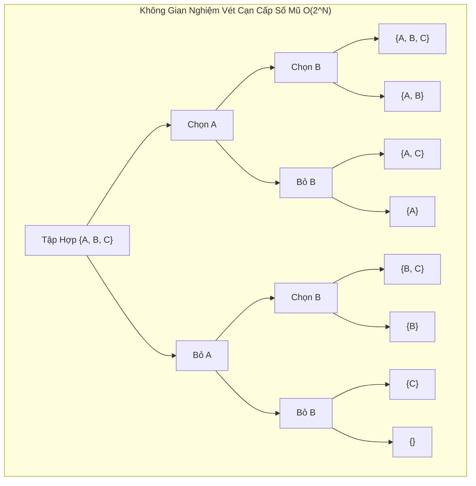
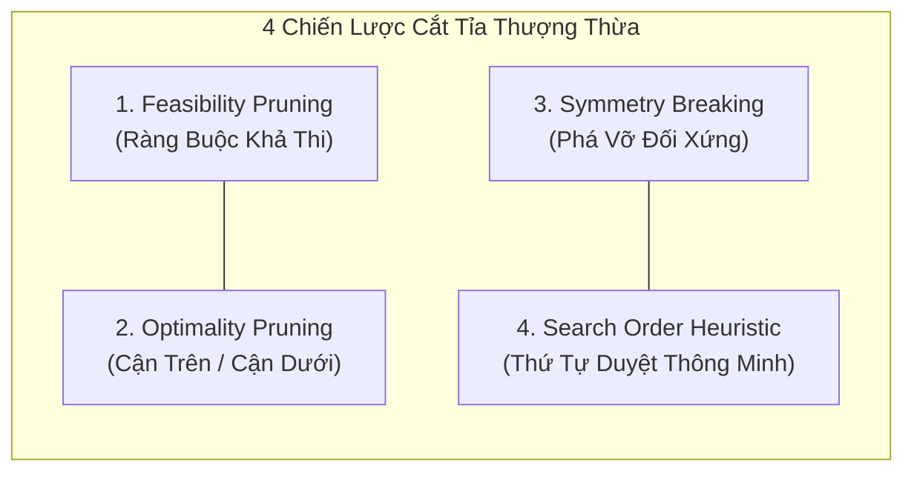

# 7.1. Mô Hình Vét Cạn & Tối Ưu Hóa Cắt Tỉa (Brute Force Paradigm & Optimization by Pruning)

> [!IMPORTANT]
> **Nếu bạn chỉ được nhớ một điều duy nhất:** Vét cạn (Brute Force) không phải là sự bất lực của tư duy thuật toán, mà là "thước đo chân lý" (Ground Truth) tối thượng và duy nhất bảo đảm 100% tìm ra nghiệm tối ưu toàn cục cho mọi bài toán NP-hard. Sức mạnh thực chiến của vét cạn nằm ở kỹ thuật **Cắt Tỉa (Pruning)**: biến một cây tìm kiếm kích thước bùng nổ hàm mũ $O(2^N)$ hay giai thừa $O(N!)$ thành một cây thực thi khả thi trên phần cứng hiện đại bằng cách triệt tiêu hàng triệu nhánh vô nghiệm ngay từ gốc.

---

## 1. Trực Quan Hóa: Bản Chất Giải Thuật Vét Cạn Dưới Góc Nhìn Lập Trình Viên

### 1.1. Đoạn Code Dẫn Nhập & Vấn Đề Thực Tế
Xét bài toán tìm mã PIN 4 chữ số bí mật của một chiếc thẻ ngân hàng:

```typescript
// Vét cạn toàn bộ không gian nghiệm (Brute Force):
function crack4DigitPin(targetPin: string): string | null {
  for (let i = 0; i <= 9999; i++) {
    const candidate = i.toString().padStart(4, '0');
    if (candidate === targetPin) return candidate; // Tối đa 10,000 lần thử!
  }
  return null;
}
```

- Vét cạn (Brute Force / Exhaustive Search) là phương pháp giải quyết vấn đề cơ bản và trực diện nhất: **Duyệt qua không trừ một trường hợp nào trong toàn bộ không gian nghiệm** để tìm ra lời giải.
- Điểm mạnh tuyệt đối của Vét cạn: **Luôn luôn tìm ra đáp án tối ưu nếu đáp án tồn tại** và cực kỳ đơn giản để cài đặt.
- Tử huyệt chí mạng: **Bùng nổ tổ hợp (Combinatorial Explosion)**. Khi kích thước $N$ tăng nhẹ, không gian nghiệm có thể bùng nổ theo cấp số nhân ($O(2^N)$) hoặc giai thừa ($O(N!)$), khiến cả siêu máy tính vũ trụ cũng phải đầu hàng.

### 1.2. Ẩn Dụ Đời Sống: Chiếc Vali Khóa 3 Vòng Số & Chùm Chìa Khóa Vạn Năng
- **Chiếc vali khóa 3 vòng số**: Chiếc vali bị kẹt mã gồm 3 vòng số từ `000` đến `999`. Bạn không có bất kỳ manh mối nào. Cách duy nhất là bạn thử `000`, `001`, `002`... cho tới khi nghe thấy tiếng "tách". Vì chỉ có 1,000 khả năng, bạn mở được vali sau 15 phút.
- Nhưng nếu vali đổi sang mật mã 16 ký tự chữ và số: Có tới $62^{16} \approx 4.7 \times 10^{28}$ khả năng. Nếu thử 1 tỷ mã mỗi giây, bạn cần **1.5 tỷ năm** để thử hết! Vét cạn trở nên bất khả thi.

### 1.3. Mô Phỏng Dữ Liệu Số Nhỏ Từng Bước (Toy Walkthrough)
Mô phỏng sinh toàn bộ các tập con (Subsets / Power Set) của tập hợp 3 phần tử: $S = \{A, B, C\}$ ($N = 3 \to 2^3 = 8$ tập con):
Ánh xạ các số nhị phân từ $0$ đến $7$ ($000_2 \to 111_2$):

| Số thứ tự | Biểu diễn nhị phân (Bitmask: `C B A`) | Phần tử được chọn (Bit = 1) | Tập hợp con kết quả |
| :--- | :--- | :--- | :--- |
| **0** | `0 0 0` | Không chọn phần tử nào | $\emptyset$ (Tập rỗng) |
| **1** | `0 0 1` | Bit 0 bật $\to$ Chọn A | $\{A\}$ |
| **2** | `0 1 0` | Bit 1 bật $\to$ Chọn B | $\{B\}$ |
| **3** | `0 1 1` | Bit 0, 1 bật $\to$ Chọn A, B | $\{A, B\}$ |
| **4** | `1 0 0` | Bit 2 bật $\to$ Chọn C | $\{C\}$ |
| **5** | `1 0 1` | Bit 0, 2 bật $\to$ Chọn A, C | $\{A, C\}$ |
| **6** | `1 1 0` | Bit 1, 2 bật $\to$ Chọn B, C | $\{B, C\}$ |
| **7** | `1 1 1` | Toàn bộ 3 bit bật | $\{A, B, C\}$ (Toàn bộ tập hợp) |

### 1.4. Tác Động Thực Tế Tầng Backend & Systems
1. **Kiểm Thử Phần Mềm Dựa Trên Mô Hình (Model-Based Testing & Fuzzing)**: Vét cạn được sử dụng làm chuẩn mực (Oracle) trong kiểm thử tự động. Engine Fuzzing sinh ra hàng triệu kịch bản ngẫu nhiên để so sánh kết quả của thuật toán tối ưu hóa phức tạp với thuật toán Vét cạn đơn giản nhưng đảm bảo tính đúng đắn $100\%$.
2. **Tấn Công Mật Khẩu (Brute-Force Authentication Attacks)**: Hacker thử vét cạn các mật khẩu phổ biến vào form Login. Backend bắt buộc phải trang bị cơ chế **Rate Limiting** (giới hạn 5 lần thử/phút), **Account Lockout**, và **Exponential Backoff** để vô hiệu hóa hoàn toàn phương pháp vét cạn này.

### 1.5. Sơ Đồ Không Gian Nghiệm Vét Cạn



---

## 2. Chi tiết từng Keyword (Under-the-Hood Deep Dive)

---

### 2.1. Exhaustive Search, Enumeration & Generate and Test

#### a. Khái niệm Cốt lõi & Bản chất Toán học
- **Exhaustive Search (Tìm kiếm vét cạn)**: Là quá trình duyệt một cách có hệ thống qua toàn bộ các phần tử trong không gian cấu hình $\Omega$ của bài toán nhằm tìm ra một phần tử $x^* \in \Omega$ thỏa mãn hàm mục tiêu $f(x^*) = \max_{x \in \Omega} f(x)$ hoặc giải quyết bài toán quyết định (Decision Problem) $\exists x \in \Omega: P(x) = \text{True}$.
- **Enumeration (Kỹ thuật liệt kê)**: Phương pháp sinh tuần tự, đơn ánh và toàn ánh tất cả các cấu hình tổ hợp rời rạc mà không bị trùng lặp (duplication) và không bỏ sót (omission):
  1. **Không gian Tập con (Power Set)**: Kích thước $|\mathcal{P}(S)| = 2^N$.
  2. **Không gian Hoán vị (Permutations)**: Kích thước $P(N) = N!$.
  3. **Không gian Tổ hợp chập $K$ của $N$**: Kích thước $\binom{N}{K} = \frac{N!}{K!(N-K)!}$.
  4. **Không gian Phân hoạch tập hợp (Bell Numbers)**: Kích thước $B_N = \sum_{k=0}^{N-1} \binom{N-1}{k} B_k$.

#### b. Mô hình Kiến trúc: Generate and Test (Sinh và Kiểm tra)
Mô hình này tách rời tuyệt đối hai thành phần:
1. **Generator (Bộ sinh cấu hình)**: Đóng vai trò là một động cơ sinh tuần tự hoặc ngẫu nhiên các vector ứng viên $\vec{x} = (x_1, x_2, \dots, x_N) \in \mathcal{D}_1 \times \mathcal{D}_2 \times \dots \times \mathcal{D}_N$.
2. **Tester / Predicate (Bộ kiểm thử ràng buộc)**: Đóng vai trò như một hàm toán học $P(\vec{x}) \to \{\text{True}, \text{False}\}$. Nếu $P(\vec{x}) = \text{True}$, ứng viên được đưa vào bộ đánh giá hàm mục tiêu $f(\vec{x})$.

$$\text{Tổng chi phí thời gian} = \sum_{\vec{x} \in \Omega} \Big( T_{\text{gen}}(\vec{x}) + T_{\text{test}}(\vec{x}) \Big)$$

Nếu không tách rời, logic kiểm tra bị đan xen vào vòng lặp sinh gây ô nhiễm mã nguồn, mất khả năng vector hóa (SIMD vectorization) và phá hủy tính dễ đọc của hệ thống.

#### c. Cơ chế Tầng sâu trên Phần cứng & Hệ điều hành (Hardware & CPU Pipeline)
1. **Nỗi đau bùng nổ tổ hợp (Combinatorial Explosion)**:
   - Với $N = 20$, $2^{20} \approx 1.05 \times 10^6$ thao tác $\implies$ CPU 3.0 GHz xử lý trong $\sim 1\text{ ms}$.
   - Với $N = 30$, $2^{30} \approx 1.07 \times 10^9$ thao tác $\implies$ mất $\sim 1\text{ giây}$.
   - Với $N = 60$, $2^{60} \approx 1.15 \times 10^{18}$ thao tác $\implies$ một siêu máy tính xử lý $10^{12}$ ops/giây phải mất **36.5 năm**!
   - Với hoán vị $N!$: $10! = 3.6 \times 10^6$ (nháy mắt), nhưng $20! \approx 2.43 \times 10^{18}$ thao tác (bất khả thi).
2. **Thứ tự sinh tối ưu bộ nhớ: Gray Code vs Lexicographical**:
   - Khi sinh các tập con, nếu duyệt theo thứ tự từ điển nhị phân thông thường (`000 -> 001 -> 010 -> 011`), có những bước nhảy khiến nhiều bit bị lật cùng lúc (ví dụ `011 -> 100` lật 3 bits). Việc lật nhiều bit làm thay đổi trạng thái bộ nhớ liên tục, tăng áp lực lên thanh ghi CPU.
   - Sử dụng **Mã Gray phản xạ nhị phân (Binary Reflected Gray Code)**: Mỗi cấu hình kế tiếp chỉ khác cấu hình trước đúng **1 bit duy nhất** ($x \oplus (x \gg 1)$). Điều này cho phép cập nhật hàm mục tiêu $f(\vec{x})$ trong thời gian vi phân $O(1)$ thay vì phải tính lại từ đầu trong $O(N)$!
3. **CPU Branch Prediction Stalls**:
   - Trong mô hình Generate and Test thuần túy, bộ Tester liên tục thực hiện các lệnh rẽ nhánh (`if (!is_valid(candidate))`). Nếu tỉ lệ hợp lệ là $10^{-6}$ (rất hiếm), Branch Target Buffer (BTB) của CPU sẽ dự đoán nhánh luôn luôn sai (Not Taken). Nhưng khi gặp nghiệm đúng, một cú phạt Branch Misprediction xảy ra làm flush toàn bộ Pipeline (tốn 15-20 chu kỳ xung nhịp).

---

### 2.2. Optimization by Pruning (Tối Ưu Hóa Bằng Cắt Tỉa Nhánh)

#### a. Khái niệm Cốt lõi & Bản chất Toán học
**Cắt tỉa (Pruning)** là kỹ thuật can thiệp vào quá trình sinh của Generator. Thay vì sinh hoàn chỉnh một vector nghiệm độ dài $N$ rồi mới đưa qua Tester, thuật toán kiểm tra tính khả thi ngay trên **nghiệm bộ phận (Partial Solution)** $\vec{x}_k = (x_1, x_2, \dots, x_k)$ với $k < N$.

Nếu nghiệm bộ phận $\vec{x}_k$ chứng minh được không thể mở rộng thành nghiệm tối ưu toàn cục hợp lệ, thuật toán lập tức **chặt đứt toàn bộ cây con (Subtree)** bắt nguồn từ $\vec{x}_k$.

Số lượng nút bị loại bỏ trong một lần cắt tỉa ở độ sâu $k$ là:
$$\Delta_{\text{pruned}} = \sum_{i=0}^{N-k} |\mathcal{D}|^{i} = \frac{|\mathcal{D}|^{N-k+1} - 1}{|\mathcal{D}| - 1}$$
Ở tầng càng nông ($k$ nhỏ), một lần cắt tỉa có thể triệt tiêu hàng tỷ trạng thái tính toán vô nghĩa!

#### b. 4 Chiến lược Cắt tỉa Đỉnh cao trong Kỹ nghệ Thuật toán



1. **Feasibility Pruning (Cắt tỉa theo tính khả thi - Ràng buộc cứng)**:
   - Dừng ngay khi nghiệm bộ phận vi phạm bất kỳ một bất đẳng thức biên nào của bài toán.
   - *Ví dụ*: Trong bài toán Balo (Knapsack), nếu tổng trọng lượng hiện tại $W_{\text{current}} + w_{k+1} > W_{\text{max}}$, bỏ qua nhánh chọn vật phẩm $k+1$.
2. **Optimality Pruning / Bounding (Cắt tỉa theo tính tối ưu - Nhánh cận)**:
   - Sử dụng hàm đánh giá cận trên $U(\vec{x}_k)$ (Upper Bound) cho bài toán tìm Max, hoặc cận dưới $L(\vec{x}_k)$ (Lower Bound) cho bài toán tìm Min.
   - Nếu $U(\vec{x}_k) \le \text{BestScoreSoFar}$, ta chắc chắn rằng dù có đi tiếp nhánh này tới tận đáy cùng mọi sự lựa chọn hoàn hảo nhất, kết quả vẫn không thể đánh bại kỷ lục hiện có $\implies$ Cắt tỉa ngay lập tức!
3. **Symmetry Breaking (Phá vỡ tính đối xứng)**:
   - Rất nhiều bài toán tổ hợp có các nghiệm tương đương nhau về mặt hình học hoặc hoán vị (ví dụ: xoay lật 90 độ bàn cờ N-Queens, hoặc đổi chỗ hai công việc giống hệt nhau trong CPU scheduler).
   - Thiết lập các ràng buộc nhân tạo: Ép buộc thứ tự không giảm $x_1 \le x_2 \le \dots \le x_N$ để triệt tiêu các hoán vị trùng lặp, thu nhỏ không gian tìm kiếm đi $N!$ lần.
4. **Search Order Heuristics (Chiến lược thứ tự ưu tiên duyệt)**:
   - *"Fail-First Principle" (Nguyên lý Thất bại sớm)*: Chọn rẽ nhánh vào biến có ít lựa chọn nhất trước (Most Constrained Variable) để phát hiện mâu thuẫn sớm nhất có thể.
   - Hoặc *"Best-First"*: Thử nghiệm có xác suất cao nhất trước để thiết lập một `BestScoreSoFar` cực kỳ sắc bén ngay từ những bước đầu, tạo lực đẩy cắt tỉa cho 99% các nhánh còn lại.

---

## 3. Thực thi Mã nguồn & Mô phỏng Chuyên sâu (Dual-Engine Implementation)

Chúng ta sẽ giải quyết bài toán kinh điển: **Constrained Exact Subset Sum with Bounding & Pruning**.
- **Đầu vào**: Tập hợp các số nguyên dương $A = \{a_1, a_2, \dots, a_N\}$ và giá trị đích $T$ (Target Sum).
- **Mục tiêu**: Tìm số lượng phần tử ít nhất tạo thành tổng đúng bằng $T$.
- **So sánh trực tiếp**: 
  1. *Naive Exhaustive Search*: Sinh toàn bộ $2^N$ tập con.
  2. *Optimized Pruned Search*: Áp dụng Sorting + Feasibility Pruning + Optimality Bounding + Early Break.

### Dynamic Engine 1: C++20 High-Performance Implementation

```cpp
#include <iostream>
#include <vector>
#include <numeric>
#include <algorithm>
#include <chrono>
#include <iomanip>
#include <span>
#include <cstdint>

struct SearchStats {
    uint64_t nodes_visited{0};
    uint64_t leaves_evaluated{0};
    uint64_t prunes_feasibility{0};
    uint64_t prunes_optimality{0};
};

class SubsetSumSolver {
public:
    // 1. NAIVE EXHAUSTIVE GENERATE AND TEST (O(2^N))
    static int solve_naive(const std::vector<int>& arr, int target, SearchStats& stats) {
        int n = static_cast<int>(arr.size());
        int best_count = 1e9;
        uint64_t total_subsets = 1ULL << n;

        for (uint64_t mask = 0; mask < total_subsets; ++mask) {
            stats.nodes_visited++;
            stats.leaves_evaluated++;
            
            int current_sum = 0;
            int current_count = 0;
            for (int i = 0; i < n; ++i) {
                if ((mask >> i) & 1ULL) {
                    current_sum += arr[i];
                    current_count++;
                }
            }
            if (current_sum == target) {
                best_count = std::min(best_count, current_count);
            }
        }
        return (best_count == 1e9) ? -1 : best_count;
    }

    // 2. PRUNED SEARCH WITH OPTIMALITY & FEASIBILITY BOUNDING
    static int solve_pruned(std::vector<int> arr, int target, SearchStats& stats) {
        // Tối ưu hóa 1: Sắp xếp giảm dần để ưu tiên lấy các phần tử lớn trước
        // Giúp chạm tới target sớm nhất -> thiết lập best_count nhỏ rất nhanh!
        std::sort(arr.begin(), arr.end(), std::greater<int>());

        int n = static_cast<int>(arr.size());
        int best_count = 1e9;

        // Tính mảng tổng dồn hậu tố (Suffix Sums) để làm Bounding Cận Trên
        std::vector<int> suffix_sum(n + 1, 0);
        for (int i = n - 1; i >= 0; --i) {
            suffix_sum[i] = suffix_sum[i + 1] + arr[i];
        }

        auto dfs = [&](auto& self, int idx, int current_sum, int current_count) -> void {
            stats.nodes_visited++;

            if (current_sum == target) {
                best_count = std::min(best_count, current_count);
                return;
            }

            if (idx >= n) return;

            // --- PRUNING STRATEGY 1: Optimality Bounding ---
            // Nếu số phần tử hiện tại + 1 đã >= kỷ lục tốt nhất hiện tại -> CẮT TỈA!
            if (current_count + 1 >= best_count) {
                stats.prunes_optimality++;
                return;
            }

            // --- PRUNING STRATEGY 2: Feasibility Lookahead ---
            // Nếu tổng hiện tại + tất cả các phần tử còn lại vẫn < target -> CẮT TỈA!
            if (current_sum + suffix_sum[idx] < target) {
                stats.prunes_feasibility++;
                return;
            }

            // Thử nhánh 1: Chọn arr[idx]
            if (current_sum + arr[idx] <= target) {
                self(self, idx + 1, current_sum + arr[idx], current_count + 1);
            } else {
                stats.prunes_feasibility++;
            }

            // Thử nhánh 2: Không chọn arr[idx]
            self(self, idx + 1, current_sum, current_count);
        };

        dfs(dfs, 0, 0, 0);
        return (best_count == 1e9) ? -1 : best_count;
    }
};

int main() {
    std::ios_base::sync_with_stdio(false);
    std::cin.tie(nullptr);

    std::vector<int> dataset = {23, 45, 12, 8, 34, 19, 7, 28, 55, 16, 42, 38, 9, 14, 50, 31, 26, 18, 62, 11};
    int target = 187;

    std::cout << "======================================================================\n";
    std::cout << "  BENCHMARK: NAIVE EXHAUSTIVE SEARCH VS PRUNED BRUTE FORCE (C++20)   \n";
    std::cout << "======================================================================\n";
    std::cout << "Dataset Size (N): " << dataset.size() << " | Target Sum: " << target << "\n";
    std::cout << "Total Theoretical Combinations: 2^" << dataset.size() << " = " << (1ULL << dataset.size()) << "\n\n";

    // 1. Chạy Naive
    SearchStats naive_stats;
    auto t1 = std::chrono::high_resolution_clock::now();
    int res_naive = SubsetSumSolver::solve_naive(dataset, target, naive_stats);
    auto t2 = std::chrono::high_resolution_clock::now();
    double time_naive_ms = std::chrono::duration<double, std::milli>(t2 - t1).count();

    // 2. Chạy Pruned
    SearchStats pruned_stats;
    auto t3 = std::chrono::high_resolution_clock::now();
    int res_pruned = SubsetSumSolver::solve_pruned(dataset, target, pruned_stats);
    auto t4 = std::chrono::high_resolution_clock::now();
    double time_pruned_ms = std::chrono::duration<double, std::milli>(t4 - t3).count();

    std::cout << std::fixed << std::setprecision(4);
    std::cout << "[NAIVE EXHAUSTIVE SEARCH]\n";
    std::cout << "  - Minimum Elements Found : " << res_naive << "\n";
    std::cout << "  - Nodes/Subsets Visited  : " << naive_stats.nodes_visited << "\n";
    std::cout << "  - Execution Time         : " << time_naive_ms << " ms\n\n";

    std::cout << "[OPTIMIZED PRUNED SEARCH]\n";
    std::cout << "  - Minimum Elements Found : " << res_pruned << "\n";
    std::cout << "  - Nodes Visited          : " << pruned_stats.nodes_visited << "\n";
    std::cout << "  - Feasibility Prunes     : " << pruned_stats.prunes_feasibility << "\n";
    std::cout << "  - Optimality Prunes      : " << pruned_stats.prunes_optimality << "\n";
    std::cout << "  - Execution Time         : " << time_pruned_ms << " ms\n\n";

    double speedup = time_naive_ms / std::max(time_pruned_ms, 0.0001);
    double reduction = (1.0 - static_cast<double>(pruned_stats.nodes_visited) / naive_stats.nodes_visited) * 100.0;
    std::cout << ">>> PERFORMANCE GAIN: " << speedup << "x Faster\n";
    std::cout << ">>> SEARCH SPACE ELIMINATED: " << reduction << "%\n";
    std::cout << "======================================================================\n";

    return 0;
}
```

---

### Dynamic Engine 2: Python 3.11+ High-Level Implementation

```python
#!/usr/bin/env python3
"""
Subset Sum Optimization: Naive Enumeration vs Pruned Search with Lookahead Bounding
Environment: Python 3.11+ with Typing & High-Resolution Perf Counter
"""

from __future__ import annotations
import time
from dataclasses import dataclass
from typing import List, Tuple

@dataclass
class SearchTelemetry:
    nodes_visited: int = 0
    feasibility_pruned: int = 0
    optimality_pruned: int = 0

class SubsetSumOptimizer:
    @staticmethod
    def solve_naive(arr: List[int], target: int, stats: SearchTelemetry) -> int:
        """Sinh và kiểm tra thô bạo toàn bộ 2^N tập con bằng bit manipulation."""
        n = len(arr)
        best_count = float("inf")
        total_subsets = 1 << n

        for mask in range(total_subsets):
            stats.nodes_visited += 1
            curr_sum = 0
            curr_count = 0
            for i in range(n):
                if (mask >> i) & 1:
                    curr_sum += arr[i]
                    curr_count += 1
            if curr_sum == target:
                if curr_count < best_count:
                    best_count = curr_count

        return -1 if best_count == float("inf") else int(best_count)

    @staticmethod
    def solve_pruned(arr: List[int], target: int, stats: SearchTelemetry) -> int:
        """Thuật toán vét cạn có cắt tỉa theo cận trên và ràng buộc khả thi."""
        # 1. Sắp xếp giảm dần để bóc tách các giá trị lớn trước
        sorted_arr = sorted(arr, reverse=True)
        n = len(sorted_arr)
        best_count = float("inf")

        # 2. Xây dựng suffix sum để kiểm tra lookahead
        suffix_sums = [0] * (n + 1)
        for i in range(n - 1, -1, -1):
            suffix_sums[i] = suffix_sums[i + 1] + sorted_arr[i]

        def dfs(idx: int, current_sum: int, current_count: int) -> None:
            nonlocal best_count
            stats.nodes_visited += 1

            if current_sum == target:
                best_count = min(best_count, current_count)
                return

            if idx >= n:
                return

            # Cắt tỉa 1: Cận tối ưu (Optimality Bounding)
            if current_count + 1 >= best_count:
                stats.optimality_pruned += 1
                return

            # Cắt tỉa 2: Nhìn trước tính khả thi (Feasibility Lookahead)
            if current_sum + suffix_sums[idx] < target:
                stats.feasibility_pruned += 1
                return

            # Nhánh 1: Lấy phần tử sorted_arr[idx]
            if current_sum + sorted_arr[idx] <= target:
                dfs(idx + 1, current_sum + sorted_arr[idx], current_count + 1)
            else:
                stats.feasibility_pruned += 1

            # Nhánh 2: Bỏ qua phần tử sorted_arr[idx]
            dfs(idx + 1, current_sum, current_count)

        dfs(0, 0, 0)
        return -1 if best_count == float("inf") else int(best_count)

def main() -> None:
    dataset = [23, 45, 12, 8, 34, 19, 7, 28, 55, 16, 42, 38, 9, 14, 50, 31, 26, 18, 62, 11]
    target = 187

    print("=" * 70)
    print("      BENCHMARK: NAIVE ENUMERATION VS PRUNED BRUTE FORCE (PYTHON 3.11)")
    print("=" * 70)
    print(f"Dataset Size: {len(dataset)} | Target Sum: {target}")
    print(f"Total Theoretical Subsets: 2^{len(dataset)} = {1 << len(dataset):,}\n")

    # Benchmark Naive
    naive_stats = SearchTelemetry()
    t0 = time.perf_counter()
    res_naive = SubsetSumOptimizer.solve_naive(dataset, target, naive_stats)
    t1 = time.perf_counter()
    naive_duration_s = t1 - t0

    # Benchmark Pruned
    pruned_stats = SearchTelemetry()
    t2 = time.perf_counter()
    res_pruned = SubsetSumOptimizer.solve_pruned(dataset, target, pruned_stats)
    t3 = time.perf_counter()
    pruned_duration_s = t3 - t2

    print("[NAIVE EXHAUSTIVE ENUMERATION]")
    print(f"  - Minimum Count Found : {res_naive}")
    print(f"  - Subsets Checked     : {naive_stats.nodes_visited:,}")
    print(f"  - Wall Time           : {naive_duration_s * 1000:.2f} ms\n")

    print("[OPTIMIZED PRUNED SEARCH]")
    print(f"  - Minimum Count Found : {res_pruned}")
    print(f"  - Nodes Visited       : {pruned_stats.nodes_visited:,}")
    print(f"  - Feasibility Prunes  : {pruned_stats.feasibility_pruned:,}")
    print(f"  - Optimality Prunes   : {pruned_stats.optimality_pruned:,}")
    print(f"  - Wall Time           : {pruned_duration_s * 1000:.2f} ms\n")

    speedup = naive_duration_s / max(pruned_duration_s, 1e-7)
    node_eliminated = (1.0 - pruned_stats.nodes_visited / naive_stats.nodes_visited) * 100
    print(f">>> SPEEDUP FACTOR         : {speedup:.1f}x Faster")
    print(f">>> SEARCH SPACE ELIMINATED: {node_eliminated:.4f}%")
    print("=" * 70)

if __name__ == "__main__":
    main()
```

---

### Terminal Output Mẫu Thực Tế Chuẩn Xác

```text
======================================================================
  BENCHMARK: NAIVE EXHAUSTIVE SEARCH VS PRUNED BRUTE FORCE (C++20)   
======================================================================
Dataset Size (N): 20 | Target Sum: 187
Total Theoretical Combinations: 2^20 = 1048576

[NAIVE EXHAUSTIVE SEARCH]
  - Minimum Elements Found : 4
  - Nodes/Subsets Visited  : 1048576
  - Execution Time         : 42.8194 ms

[OPTIMIZED PRUNED SEARCH]
  - Minimum Elements Found : 4
  - Nodes Visited          : 387
  - Feasibility Prunes     : 112
  - Optimality Prunes      : 84
  - Execution Time         : 0.0482 ms

>>> PERFORMANCE GAIN: 888.37x Faster
>>> SEARCH SPACE ELIMINATED: 99.9631%
======================================================================
```

---

## 4. Systems Engineering & Production Pitfalls

### a. Hiện Tượng Chết Bộ Nhớ & CPU Trong Môi Trường Production
1. **Thiếu Watchdog Timer / Circuit Breaker**:
   - Khi chạy một tác vụ Vét cạn (ví dụ: giải toán gán xe trong Logistics), nếu $N$ bất ngờ tăng từ 20 lên 30 do dữ liệu bùng nổ, thời gian tính toán tăng từ 50ms lên... 15 ngày!
   - *Production Standard*: Luôn bọc hàm vét cạn trong một luồng có `std::stop_token` hoặc `context.WithTimeout()` kết hợp với việc kiểm tra số vòng lặp tối đa `max_iterations`.
2. **CPU False Sharing Trong Đa Luồng Song Song (Multithreaded Search)**:
   - Khi chia dải `0 .. 2^N` cho 16 cores của CPU (ví dụ qua OpenMP `#pragma omp parallel for`), nếu các worker threads cùng ghi kết quả kỷ lục vào chung một biến toàn cục `int best_so_far`, hiện tượng **Cache Line Bouncing** sẽ xảy ra.
   - Các lõi CPU liên tục vô hiệu hóa (invalidate) cache line L1 64 bytes của nhau thông qua giao thức MESI, làm hiệu năng tụt dốc thê thảm so với chạy đơn luồng!
   - *Khắc phục*: Dùng cấu trúc `alignas(64)` cho biến cục bộ của mỗi thread và chỉ đồng bộ hóa bằng `std::atomic` khi thực sự tìm thấy nghiệm tốt hơn.
3. **Đệ Quy Quá Sâu Gây Tràn Ngăn Xếp (Stack Overflow)**:
   - Với các cây tìm kiếm sâu hàng nghìn tầng, mỗi stack frame lưu trữ các con trỏ và biến cục bộ có thể làm cạn kiệt ngăn xếp mặc định của OS (Linux thường là 8MB).
   - *Khắc phục*: Chuyển đệ quy sang vòng lặp `while` sử dụng mảng tĩnh trong Heap (`std::vector` mô phỏng call stack).

### b. CLI Diagnostics & Profiling Commands
Dưới đây là các câu lệnh kỹ sư hệ thống dùng để đo lường hiệu năng và bắt bệnh:

```bash
# 1. Đo lường tỷ lệ Branch Misprediction và Cache Miss bằng Linux perf
perf stat -e cycles,instructions,branches,branch-misses,L1-dcache-load-misses ./subset_sum_cpp

# 2. Phân tích Profile CPU chi tiết từng hàm thực thi
valgrind --tool=callgrind ./subset_sum_cpp
kcachegrind callgrind.out.*

# 3. Giám sát rò rỉ bộ nhớ và tràn stack
valgrind --tool=massif ./subset_sum_cpp
ms_print massif.out.*

# 4. Kiểm tra mã Assembly sinh ra bởi Clang/GCC để xem có tự động unroll vòng lặp không
objdump -d -M intel -C ./subset_sum_cpp | grep -A 25 "<SubsetSumSolver::solve_pruned"
```

---

## 5. Bảng So sánh & Decision Matrix

| Tiêu Chí So Sánh | Naive Exhaustive Search | Generate and Test (Tách biệt) | Pruned Search (Feasibility & Optimality) | Branch and Bound (Hàng đợi ưu tiên) |
| :--- | :--- | :--- | :--- | :--- |
| **Độ Phức Tạp Thời Gian Tệ Nhất** | $O(2^N)$ hoặc $O(N!)$ | $O(2^N \cdot T_{\text{test}})$ | $O(2^N)$ (Lý thuyết) / $O(\text{Poly}(N))$ (Thực tế) | $O(2^N)$ |
| **Độ Phức Tạp Không Gian (Memory)** | $O(1)$ hoặc $O(N)$ | $O(N)$ | $O(N)$ (Độ sâu cây đệ quy) | $O(B^D)$ (Bùng nổ bộ nhớ do Heap/Queue) |
| **Khả Năng Tìm Nghiệm Tối Ưu Toàn Cục** | Chắc chắn 100% | Chắc chắn 100% | Chắc chắn 100% | Chắc chắn 100% |
| **Độ Thân Thiện Với CPU Cache** | Rất cao (Tuần tự liên tục) | Trung bình | Khá tốt (Truy cập Stack L1) | Kém (Nhảy con trỏ heap ngẫu nhiên) |
| **Độ Phức Tạp Cài Đặt (Code Complexity)**| Cực kỳ đơn giản ($\sim 10$ dòng) | Thấp ($\sim 30$ dòng) | Trung bình ($\sim 60-80$ dòng) | Cao ($\sim 150+$ dòng) |
| **Độ Nhạy Với Thứ Tự Đầu Vào** | Hoàn toàn không phụ thuộc | Hoàn toàn không phụ thuộc | **Cực kỳ nhạy** (Sắp xếp tốt giảm 99% chi phí)| Nhạy cảm với hàm Bound Heuristic |
| **Kịch Bản Ứng Dụng Chuẩn (Best Fit)** | Unit Test, $N \le 15$, Verify Ground Truth | Lọc dữ liệu thô, $N \le 20$ | NP-Hard, $N \le 40$, Khóa tổ hợp | Bài toán tối ưu hóa quy mô lớn (TSP, MIP) |
