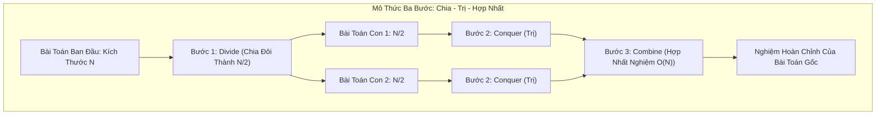

# 7.2. Mô Hình Chia Để Trị (Divide and Conquer Paradigm)

> [!IMPORTANT]
> **Nếu bạn chỉ được nhớ một điều duy nhất:** Chia để trị (Divide and Conquer) là mô hình giải thuật phá vỡ bài toán quy mô lớn $N$ thành các bài toán con ĐỘC LẬP HOÀN TOÀN có cấu trúc đồng dạng nhưng kích thước nhỏ hơn, giải quyết đệ quy và hợp nhất (Combine) các nghiệm con với chi phí tối ưu. Điểm phân định sống còn giữa Chia để trị và Quy hoạch động là tính độc lập của bài toán con: nếu các bài toán con chồng lấn (Overlapping Subproblems), Chia để trị sẽ suy đồi thành thảm họa độ phức tạp hàm mũ $O(2^N)$ do tính toán lặp lại vô ích; ngược lại, khi các bài toán con tách rời, sức mạnh của định lý Master Theorem kết hợp cùng nguyên lý Cache-Oblivious trên phần cứng hiện đại sẽ biến những bài toán $O(N^2)$ hoặc $O(N^3)$ thành $O(N \log N)$ và $O(N^{2.81})$ với hiệu năng tính toán vượt trội.

---

## 1. Trực Quan Hóa: Bản Chất Chia Để Trị Dưới Góc Nhìn Lập Trình Viên

### 1.1. Đoạn Code Dẫn Nhập & Vấn Đề Thực Tế
Xét bài toán tính lũy thừa lớn $x^N$ với số nguyên $N = 10^9$:

```cpp
// Cách 1: Vòng lặp nhân tuyến tính: O(N) -> 1 tỷ phép nhân -> Chạy mất 2 giây!
long long powerNaive(long long x, long long n) {
    long long res = 1;
    for (int i = 0; i < n; ++i) res = (res * x) % MOD;
    return res;
}

// Cách 2: Chia để trị (Binary Exponentiation): O(log N) -> Chỉ tốn đúng 30 phép nhân!
long long powerDandC(long long x, long long n) {
    if (n == 0) return 1;
    long long half = powerDandC(x, n / 2); // Chia bài toán kích thước N thành N / 2
    long long res = (half * half) % MOD;  // Hợp nhất (Combine)
    if (n % 2 == 1) res = (res * x) % MOD;
    return res;
}
```

- Chia Để Trị (Divide and Conquer) là mô thức giải thuật đưa con người chinh phục các bài toán Big Data:
  - **Divide (Chia)**: Cắt bài toán ban đầu thành các bài toán con độc lập có kích thước nhỏ hơn.
  - **Conquer (Trị)**: Đệ quy giải quyết các bài toán con (nếu kích thước đủ nhỏ thì giải trực tiếp).
  - **Combine (Hợp nhất)**: Gộp kết quả của các bài toán con thành nghiệm của bài toán gốc.

### 1.2. Ẩn Dụ Đời Sống: Dây Chuyền Lắp Ráp Máy Bay Boeing 787
- Để chế tạo một chiếc máy bay khổng lồ gồm 2.3 triệu linh kiện:
  - Tập đoàn Boeing không bao giờ tập trung toàn bộ công nhân tại một xưởng để lắp từng con ốc từ đầu đến cuối.
  - **Divide**: Chia việc lắp ráp chiếc máy bay thành các cụm độc lập: Cánh máy bay (Nhật Bản), Thân máy bay (Ý), Đuôi máy bay (Mỹ), Động cơ (Anh).
  - **Conquer**: Từng quốc gia độc lập sản xuất và thử nghiệm cụm linh kiện của mình.
  - **Combine**: Toàn bộ các cụm hoàn chỉnh được chở bằng chuyên cơ về nhà máy tổng tại Seattle để ghép nối lại thành một chiếc máy bay hoàn chỉnh trong đúng vài ngày!

### 1.3. Mô Phỏng Dữ Liệu Số Nhỏ Từng Bước (Toy Walkthrough)
Mô phỏng phép nhân lũy thừa $2^8 = 256$ bằng Chia để trị:

```text
               2^8 = 256
               /       \
         2^4 = 16  x  2^4 = 16  (Chỉ cần tính 2^4 đúng 1 lần!)
         /      \
      2^2 = 4 x 2^2 = 4         (Chỉ cần tính 2^2 đúng 1 lần!)
      /     \
    2^1 = 2 x 2^1 = 2           (Base Case: n = 1 -> trả về 2)
```

- Nhờ việc chia đôi ở mỗi bước, số lượng phép nhân giảm từ $8$ phép tính xuống còn đúng **$3$ phép tính** ($\log_2 8 = 3$)!

### 1.4. Tác Động Thực Tế Tầng Backend & Systems
1. **Kiến Trúc Tính Toán Phân Tán MapReduce (Hadoop / Spark)**:
   - **Divide (Map)**: Chia nhỏ file dữ liệu $100\text{ TB}$ thành hàng triệu mảnh nhỏ phân bổ cho hàng nghìn máy chủ worker xử lý song song độc lập.
   - **Combine (Reduce)**: Gom cụm và tổng hợp kết quả trung gian từ các worker thành kết quả báo cáo cuối cùng.
2. **Nhân Ma Trận Nhanh Strassen Trong Huấn Luyện AI**: Thay vì nhân ma trận $N \times N$ thông thường tốn $O(N^3)$, thuật toán Strassen chia ma trận thành các khối con và giảm từ 8 phép nhân xuống 7 phép nhân, mở đường cho việc tăng tốc độ huấn luyện mô hình mạng nơ-ron lớn.

### 1.5. Sơ Đồ Kiến Trúc Mô Thức Chia Để Trị



---

## 2. Chi tiết từng Keyword (Under-the-Hood Deep Dive)

### 2.1. Problem Decomposition, Recursion & Các Ứng Dụng Kinh Điển

#### 1. Bộ Khung 3 Bước Chuẩn Mực của Chia Để Trị
Mọi giải thuật thuộc mô hình Chia Để Trị bắt buộc phải tuân thủ nghiêm ngặt quy trình 3 giai đoạn:
1. **Divide (Phân rã)**: Chia bài toán kích thước $N$ thành $a$ bài toán con độc lập, mỗi bài toán có kích thước xấp xỉ bằng $N/b$ (với $a \ge 1, b > 1$). Chi phí thực hiện bước phân chia này là $f_{\text{div}}(N)$.
2. **Conquer (Chinh phục)**: Đệ quy giải quyết $a$ bài toán con. Nếu kích thước bài toán con thu nhỏ về ngưỡng cơ sở $N \le n_0$ (Base Case), giải trực tiếp bài toán bằng thuật toán sơ cấp trong thời gian hằng số $O(1)$.
3. **Combine (Hợp nhất)**: Tổng hợp nghiệm của $a$ bài toán con lại để tạo thành nghiệm hoàn chỉnh cho bài toán gốc $N$. Chi phí hợp nhất là $f_{\text{comb}}(N)$.

Tổng thời gian thực thi $T(N)$ thỏa mãn phương trình truy hồi:
$$T(N) = a \cdot T\left(\frac{N}{b}\right) + f(N)$$
Trong đó $f(N) = f_{\text{div}}(N) + f_{\text{comb}}(N)$ là tổng chi phí không đệ quy của bước Phân chia và Hợp nhất.

---

#### 2. Bản Chất Toán Học: Định Lý Thơ (Master Theorem)
Định lý Thơ là công cụ tối thượng trong Khoa học máy tính dùng để giải nhanh các hệ thức truy hồi dạng $T(N) = a \cdot T(N/b) + \Theta(N^d)$.

##### Phân Tích Cây Đệ Quy (Recursion Tree Proof Intuition):
- Cây đệ quy có độ sâu $h = \log_b N$.
- Tại tầng thứ $j$ (với $j = 0, 1, 2, \dots, h$):
  - Số lượng bài toán con là: $a^j$.
  - Kích thước của mỗi bài toán con là: $N / b^j$.
  - Tổng khối lượng công việc thực hiện ở tầng $j$ là:
    $$W_j = a^j \cdot f\left(\frac{N}{b^j}\right) = a^j \cdot \Theta\left(\left(\frac{N}{b^j}\right)^d\right) = \Theta\left(N^d \cdot \left(\frac{a}{b^d}\right)^j\right)$$
- Tầng lá ($j = \log_b N$):
  Số lượng nút lá chứa các Base Case $O(1)$ là:
  $$\text{Leaves} = a^{\log_b N} = N^{\log_b a}$$
  Tổng công việc tại tầng lá là: $\Theta(N^{\log_b a})$.

##### 3 Trường Hợp Kinh Điển Của Master Theorem:
Mối tương quan giữa hằng số phân nhánh $a$ và tốc độ thu nhỏ $b^d$ quyết định dạng tiệm cận của giải thuật:

| Trường Hợp (Case) | Mối Quan Hệ Toán Học | Nơi Tập Trung Khối Lượng Công Việc | Độ Phức Tạp Thời Gian Toàn Cục $T(N)$ |
| :--- | :--- | :--- | :--- |
| **Case 1: Lá áp đảo** | $d < \log_b a \iff a > b^d$ | Công việc tăng theo cấp số nhân xuống dưới. **Các nút lá chiếm ưu thế tuyệt đối**. | $T(N) = \mathbf{\Theta(N^{\log_b a})}$ |
| **Case 2: Dàn đều mọi tầng** | $d = \log_b a \iff a = b^d$ | Mỗi tầng của cây đệ quy tiêu tốn khối lượng công việc đúng bằng nhau: $\Theta(N^d)$. | $T(N) = \mathbf{\Theta(N^d \log N)}$ |
| **Case 3: Gốc áp đảo** | $d > \log_b a \iff a < b^d$ | Công việc giảm dần theo cấp số nhân từ trên xuống. **Nút gốc chiếm ưu thế tuyệt đối**. | $T(N) = \mathbf{\Theta(N^d)}$ *(Kèm điều kiện đều đặn)* |

> [!NOTE]
> **Mở Rộng Định Lý Akra-Bazzi**: Khi bài toán con bị phân chia theo các tỷ lệ không đồng dạng (ví dụ: $T(N) = T(N/3) + T(2N/3) + O(N)$), Master Theorem truyền thống bị vô hiệu hóa. Lúc này, Định lý Akra-Bazzi được kích hoạt: Ta tìm số thực $p$ thỏa mãn $\sum_{i=1}^k a_i b_i^p = 1$, khi đó $T(N) = \Theta\left(N^p \left(1 + \int_1^N \frac{g(u)}{u^{p+1}} du\right)\right)$.

---

#### 3. Khảo Sát Các Ứng Dụng Kinh Điển Trong Khoa Học Máy Tính

##### a. Sắp Xếp Trộn (Merge Sort) & External Sorting
- **Hệ thức**: $T(N) = 2T(N/2) + O(N)$ (với $a=2, b=2, d=1$).
  $\log_2 2 = 1 = d \implies$ Rơi vào Case 2 $\implies T(N) = \Theta(N \log N)$.
- **Bản chất Under-the-hood**:
  Merge Sort có tính chất **Ổn định (Stability)** tuyệt đối. Trong kỹ thuật dữ liệu lớn, khi tệp dữ liệu dung lượng $1\text{ TB}$ không thể nhét vừa vào $16\text{ GB}$ RAM, kỹ sư sử dụng **External Merge Sort (Sắp xếp trộn ngoài)**:
  1. Đọc từng khối $10\text{ GB}$ vào RAM, sắp xếp bằng QuickSort/MergeSort, rồi ghi ra đĩa thành các Runs đã sắp xếp.
  2. Sử dụng thuật toán K-way Merge (chia để trị trên hàng ngàn tệp tin) kết hợp với Min-Heap để hợp nhất dòng dữ liệu trực tiếp từ đĩa cứng SSD/HDD về đầu ra.

##### b. Tìm Kiếm Nhị Phân & Lũy Thừa Nhanh (Binary Exponentiation)
- **Binary Search**: $T(N) = 1 \cdot T(N/2) + O(1)$.
  $a=1, b=2, d=0 \implies \log_2 1 = 0 = d \implies T(N) = \Theta(\log N)$.
- **Binary Exponentiation**: Tính $x^N$.
  $$x^N = \begin{cases} (x^{N/2})^2 & \text{nếu } N \text{ chẵn} \\ x \cdot (x^{(N-1)/2})^2 & \text{nếu } N \text{ lẻ} \end{cases}$$
  Giảm số phép nhân từ $O(N)$ xuống $O(\log N)$. Đây là nền tảng cốt lõi của mật mã hóa khóa công khai RSA và thuật toán nhân lũy thừa ma trận để tính số Fibonacci thứ $10^{18}$ trong thời gian $O(\log N)$ micro-giây.

##### c. Thuật Toán Nhân Số Lớn Karatsuba (1960)
Anatoly Karatsuba đã đập tan giả thuyết của Andrey Kolmogorov rằng nhân hai số nguyên $N$ chữ số đòi hỏi tối thiểu $O(N^2)$ phép tính:
- Cho hai số nguyên $X, Y$ có $N$ chữ số. Tách đôi: $X = X_1 \cdot 10^{N/2} + X_0$, $Y = Y_1 \cdot 10^{N/2} + Y_0$.
- Phép nhân đại số thông thường:
  $$X \cdot Y = X_1 Y_1 \cdot 10^N + (X_1 Y_0 + X_0 Y_1) \cdot 10^{N/2} + X_0 Y_0$$
  Đòi hỏi $4$ phép nhân số có kích thước $N/2$: $T(N) = 4T(N/2) + O(N) \implies O(N^{\log_2 4}) = O(N^2)$.
- **Đột phá của Karatsuba**: Chỉ cần $3$ phép nhân:
  $$\begin{aligned}
  z_2 &= X_1 \cdot Y_1 \\
  z_0 &= X_0 \cdot Y_0 \\
  z_1 &= (X_1 + X_0) \cdot (Y_1 + Y_0) - z_2 - z_0 = X_1 Y_0 + X_0 Y_1
  \end{aligned}$$
  Hệ thức truy hồi: $T(N) = 3T(N/2) + O(N)$.
  Theo Master Theorem (Case 1: $a=3, b=2, d=1$):
  $$T(N) = \Theta(N^{\log_2 3}) \approx \mathbf{\Theta(N^{1.585})}$$
  Thuật toán Karatsuba là tiêu chuẩn mặc định trong thư viện xử lý số nguyên lớn `BigInteger` của Java, Python `int`, và thư viện GMP (GNU Multiple Precision Arithmetic Library).

##### d. Biến Đổi Fourier Rời Rạc Siêu Tốc (Cooley-Tukey FFT)
Thuật toán FFT Cooley-Tukey (1965) chia một đa thức bậc $N-1$ thành hai đa thức phần tử chẵn và lẻ:
$$A(x) = A_{\text{even}}(x^2) + x \cdot A_{\text{odd}}(x^2)$$
Nhờ tính chất đối xứng của các căn bậc $N$ nguyên thủy của đơn vị (Roots of Unity $\omega_N^k = e^{2\pi i k / N}$), giải thuật giảm chi phí biến đổi tín hiệu từ $O(N^2)$ xuống:
$$T(N) = 2T(N/2) + O(N) \implies T(N) = \mathbf{\Theta(N \log N)}$$
FFT là xương sống của mọi chuẩn viễn thông 4G/5G (OFDM), thuật toán nén ảnh JPEG, âm thanh MP3, xử lý âm thanh trong AI Speech-to-Text, và chụp cộng hưởng từ hạt nhân y tế MRI.

---

#### 4. Nguyên Lý Thiết Kế Cache-Oblivious Trên Phần Cứng Hiện Đại
Một bước tiến vượt bậc của lý thuyết giải thuật hiện đại (do Matteo Frigo, Charles Leiserson et al. đề xuất năm 1999) là **Cache-Oblivious Algorithms (Giải thuật không cần biết trước cấu hình Cache)**:
- **Vấn đề của phần cứng**: CPU hiện đại có cấu trúc phân tầng bộ nhớ: L1 Cache ($32\text{ KB}, 1\text{ ns}$), L2 Cache ($512\text{ KB}, 3\text{ ns}$), L3 Cache ($16 - 64\text{ MB}, 12\text{ ns}$) và RAM chính ($100\text{ ns}$). Dữ liệu di chuyển theo từng khối Cache Line kích thước $B = 64\text{ bytes}$.
- **Sức mạnh của Chia Để Trị**: Khi một giải thuật chia để trị chia nhỏ mảng liên tục, sẽ đến một thời điểm mà kích thước của bài toán con $N'$ trở nên **nhỏ hơn kích thước của bộ nhớ đệm L1/L2 Cache ($N' \le M$)**.
- Kể từ khoảnh khắc đó, toàn bộ dữ liệu của bài toán con nằm trọn vẹn trong Cache của CPU. Toàn bộ các bước đệ quy tiếp theo chạy với tốc độ thanh ghi tối đa mà **không phát sinh thêm bất kỳ một lần Cache Miss nào ra RAM ngoài!**
- Điểm thần kỳ là giải thuật đạt được mức tối ưu hóa bộ nhớ đệm tiệm cận trên mọi tầng Cache mà **không cần người lập trình phải điều chỉnh thủ công (hardcode)** kích thước Cache line hay dung lượng RAM trong mã nguồn.

---

### 2.2. Closest Pair of Points (Cặp Điểm Gần Nhất) Trong Không Gian 2D

#### 1. Đặt Vấn Đề Thực Tế & Sự Bất Lực Của Vét Cạn (Brute-Force)
- **Bài toán**: Cho tập hợp $S$ gồm $N$ điểm trên mặt phẳng tọa độ $2D$: $P = \{p_1, p_2, \dots, p_N\}$ với $p_i = (x_i, y_i)$. Hãy tìm hai điểm $p_i, p_j$ ($i \ne j$) sao cho khoảng cách Euclid $\text{dist}(p_i, p_j) = \sqrt{(x_i - x_j)^2 + (y_i - y_j)^2}$ đạt giá trị nhỏ nhất.
- **Ứng dụng thực chiến**:
  - Hệ thống Cảnh báo Va chạm Máy bay Không người lái (UAV Collision Avoidance System): Cần phát hiện xem hai máy bay bất kỳ có bay sát nhau dưới khoảng cách an toàn $500\text{ m}$ hay không.
  - Hệ thống bản đồ số và GIS: Gom cụm các trạm phát sóng di động BTS hoặc địa điểm giao hàng.
  - Đồ họa máy tính và Mô phỏng tương tác hạt N-body trong Vật lý thiên văn.
- **Sự sụp đổ của Brute-Force**: So sánh từng cặp trong số $\binom{N}{2} = \frac{N(N-1)}{2}$ cặp điểm tốn $O(N^2)$ thời gian. Với $N = 1,000,000$ điểm GPS từ xe công nghệ, số phép tính khoảng cách là $\approx 5 \times 10^{11}$ phép tính, tiêu tốn hàng chục phút đồng hồ của CPU — hoàn toàn bất khả thi cho các hệ thống thời gian thực (Real-time Systems).

---

#### 2. Kiến Trúc Thuật Toán Chia Để Trị Tối Ưu $O(N \log N)$ (Shamos & Hoey)

##### Giai đoạn 1: Tiền Xử Lý (Preprocessing)
Sắp xếp trước toàn bộ tập điểm theo tọa độ $X$ tăng dần để thu được danh sách $P_x$. Quá trình này tốn $O(N \log N)$ và chỉ thực hiện duy nhất 1 lần.

##### Giai đoạn 2: Phân Rã & Đệ Quy (Divide & Conquer)
1. **Divide**:
   Tìm điểm nằm ở vị trí chính giữa mảng $P_x$: `mid = N / 2`.
   Dựng một đường phân giới thẳng đứng $L: x = x_{\text{mid}}$.
   Đường thẳng này chia tập điểm thành hai nửa có số lượng bằng nhau:
   - Nửa bên trái: $Q = \{p \in P \mid p.x \le x_{\text{mid}}\}$
   - Nửa bên phải: $R = \{p \in P \mid p.x > x_{\text{mid}}\}$
2. **Conquer**:
   Đệ quy tìm khoảng cách nhỏ nhất ở nửa trái $d_L = \text{closestPair}(Q)$ và nửa phải $d_R = \text{closestPair}(R)$.
   Đặt $d = \min(d_L, d_R)$. Giá trị $d$ là khoảng cách ngắn nhất tìm được cho đến thời điểm hiện tại nếu hai điểm cùng nằm bên trái hoặc cùng nằm bên phải.

##### Giai đoạn 3: Hợp Nhất & Phép Màu Hình Học (Combine & The Geometric Strip)
Vấn đề còn lại duy nhất: Liệu có tồn tại một cặp điểm $(p, q)$ sao cho một điểm nằm ở nửa trái ($p \in Q$) và một điểm nằm ở nửa phải ($q \in R$) mà khoảng cách giữa chúng lại nhỏ hơn kỷ lục hiện tại: $\text{dist}(p, q) < d$?
- **Điều kiện cần để tạo thành cặp**:
  Cả $p$ và $q$ bắt buộc phải có khoảng cách theo trục hoành tới đường thẳng $x_{\text{mid}}$ nhỏ hơn $d$:
  $$|p.x - x_{\text{mid}}| < d \quad \text{và} \quad |q.x - x_{\text{mid}}| < d$$
  Nói cách khác, cả hai điểm phải nằm trong **Dải Hẹp (Geometric Strip)** có bề rộng $2d$ bao quanh đường ranh giới:
  $$\text{Strip} = \{p \in P \mid x_{\text{mid}} - d < p.x < x_{\text{mid}} + d\}$$

---

#### 3. Chứng Minh Hình Học Khắc Nghiệt: Giới Hạn 7 Điểm Thần Thánh (The 7-Point Geometric Proof)

Nhiều người e ngại rằng trong dải hẹp $\text{Strip}$ có thể chứa tới $N$ điểm, và nếu so sánh mọi cặp trong Strip, bước Combine sẽ tốn $O(N^2)$, phá hủy hoàn toàn lợi ích của chia để trị. Tuy nhiên, hình học phẳng Euclid đem lại một giới hạn toán học kỳ diệu:

```
                  x = x_mid
                     │
         Q (Nửa Trái) │ R (Nửa Phải)
                     │
    ┌────────────────┼────────────────┐  ▲
    │        .       │       .        │  │
    │   Box Left     │   Box Right    │  │ d
    │     (d x d)    │     (d x d)    │  │
    │        .       │       .        │  ▼
    └────────────────┼────────────────┘
    ▲                p                ▲
    │◄────── d ─────►│◄────── d ─────►│
    x_mid - d                  x_mid + d
```

##### Chứng minh chi tiết:
1. Xét một điểm $p \in \text{Strip}$ với tọa độ $(x_p, y_p)$. Bất kỳ điểm $q \in \text{Strip}$ nào có $\text{dist}(p, q) < d$ thì tung độ của $q$ phải nằm trong khoảng:
   $$y_p \le q.y < y_p + d$$
   (Ta chỉ cần xét các điểm nằm phía trên $p$ để không lặp lại phép so sánh).
2. Như vậy, điểm $q$ bắt buộc phải nằm trong một hình chữ nhật có kích thước $2d \times d$ nằm ngay phía trên điểm $p$.
3. Đường thẳng $x = x_{\text{mid}}$ chia hình chữ nhật này thành **hai hình vuông kích thước $d \times d$**:
   - Hình vuông bên trái nằm trọn vẹn trong nửa mặt phẳng $Q$.
   - Hình vuông bên phải nằm trọn vẹn trong nửa mặt phẳng $R$.
4. **Bản chất khoảng cách tối thiểu**:
   Vì $d = \min(d_L, d_R)$, khoảng cách giữa bất kỳ hai điểm nào cùng thuộc nửa trái $Q$ đều phải $\ge d$, và cùng thuộc nửa phải $R$ đều phải $\ge d$.
5. **Định lý đóng hộp trong hình vuông cạnh $d$**:
   Trong một hình vuông cạnh $d$, khoảng cách xa nhất giữa hai điểm là đường chéo $d\sqrt{2}$. Nếu ta muốn đặt các điểm vào hình vuông sao cho không có hai điểm nào có khoảng cách $< d$, số điểm tối đa có thể nhét vào là **$4$ điểm** (đặt tại 4 đỉnh của hình vuông).
6. **Tổng số điểm tối đa trong hình chữ nhật $2d \times d$**:
   - Hình vuông bên trái: Chứa tối đa $4$ điểm.
   - Hình vuông bên phải: Chứa tối đa $4$ điểm.
   - Tổng cộng: Tối đa $4 + 4 = 8$ điểm (tính cả điểm $p$ đang xét).
7. **Kết luận bất biến**:
   Nếu ta sắp xếp danh sách các điểm trong $\text{Strip}$ theo thứ tự tăng dần của trục tung $Y$, thì đối với mỗi điểm $p$, **ta chỉ cần kiểm tra tối đa 7 điểm kế tiếp theo trục $Y$** là bảo đảm không bao giờ bỏ sót bất kỳ cặp điểm nào có khoảng cách $< d$!

Vì mỗi điểm trong dải hẹp chỉ thực hiện tối đa $7$ phép so sánh ($O(1)$), toàn bộ bước Combine chỉ tốn:
$$T_{\text{combine}}(N) = 7 \cdot |\text{Strip}| \le 7N = O(N)$$

Hệ thức truy hồi toàn cục của thuật toán:
$$T(N) = 2T\left(\frac{N}{2}\right) + O(N) \implies T(N) = \mathbf{\Theta(N \log N)}$$

---

### 2.3. Strassen's Algorithm (Nhân Ma Trận Nhanh)

#### 1. Đặt Vấn Đề: Rào Cản Đại Số $O(N^3)$ Của Phép Nhân Ma Trận
Cho hai ma trận vuông $A, B \in \mathbb{R}^{N \times N}$. Ma trận tích $C = A \cdot B$ được định nghĩa theo công thức đại số tuyến tính cổ điển:
$$C_{ij} = \sum_{k=1}^N A_{ik} \cdot B_{kj}, \quad \forall i, j \in [1, N]$$
Để tính toán toàn bộ $N^2$ phần tử của ma trận $C$, mỗi phần tử đòi hỏi $N$ phép nhân vô hướng và $N-1$ phép cộng:
$$\text{Số phép nhân} = N^2 \cdot N = N^3 \implies \mathbf{O(N^3)}$$

Trong suốt nhiều thế kỷ, cộng đồng toán học thế giới tin rằng độ phức tạp $O(N^3)$ là một định mệnh bất khả xâm phạm, một ranh giới tự nhiên không thể vượt qua của phép nhân ma trận.

#### 2. Sự Thất Bại Của Phương Pháp Chia Khối Thông Thường (Standard Block Division)
Giả sử $N$ là lũy thừa của 2. Ta chia mỗi ma trận $A, B, C$ thành 4 ma trận con (khối) có kích thước $\frac{N}{2} \times \frac{N}{2}$:
$$A = \begin{bmatrix} A_{11} & A_{12} \\ A_{21} & A_{22} \end{bmatrix}, \quad B = \begin{bmatrix} B_{11} & B_{12} \\ B_{21} & B_{22} \end{bmatrix}, \quad C = \begin{bmatrix} C_{11} & C_{12} \\ C_{21} & C_{22} \end{bmatrix}$$

Theo quy tắc nhân ma trận khối:
$$\begin{aligned}
C_{11} &= A_{11} B_{11} + A_{12} B_{21} \\
C_{12} &= A_{11} B_{12} + A_{12} B_{22} \\
C_{21} &= A_{21} B_{11} + A_{22} B_{21} \\
C_{22} &= A_{21} B_{12} + A_{22} B_{22}
\end{aligned}$$

- **Đánh giá chi phí**:
  - Cần thực hiện **8 phép nhân** các ma trận con kích thước $N/2$: $A_{11}B_{11}, A_{12}B_{21}, \dots$
  - Cần thực hiện **4 phép cộng** ma trận kích thước $N/2$, mỗi phép cộng tốn $(N/2)^2 = O(N^2)$ phép tính.
- **Hệ thức truy hồi**:
  $$T(N) = 8T\left(\frac{N}{2}\right) + \Theta(N^2)$$
- **Áp dụng Master Theorem**:
  $a = 8, b = 2, d = 2$.
  Ta có $\log_b a = \log_2 8 = 3$. Vì $d = 2 < 3$, bài toán rơi vào Case 1:
  $$T(N) = \Theta\left(N^{\log_2 8}\right) = \mathbf{\Theta(N^3)}$$
  Phân rã khối thông thường hoàn toàn thất bại trong việc cải thiện độ phức tạp!

---

#### 3. Cú Nhảy Vọt Đại Số Của Volker Strassen (1969)
Năm 1969, nhà toán học người Đức Volker Strassen đã công bố bài báo khoa học lịch sử: *"Gaussian Elimination is not Optimal"*. Bằng một trực giác đại số thiên tài, Strassen đã chứng minh rằng ta có thể tính toán được 4 khối ma trận con $C_{ij}$ bằng cách chỉ sử dụng đúng **7 phép nhân ma trận con** thay vì 8 (đổi lại bằng việc chấp nhận tăng thêm số lượng phép cộng/trừ ma trận).

##### 7 Tích Trung Gian Thiên Tài ($M_1$ đến $M_7$):
$$\begin{aligned}
M_1 &= (A_{11} + A_{22})(B_{11} + B_{22}) \\
M_2 &= (A_{21} + A_{22}) B_{11} \\
M_3 &= A_{11} (B_{12} - B_{22}) \\
M_4 &= A_{22} (B_{21} - B_{11}) \\
M_5 &= (A_{11} + A_{12}) B_{22} \\
M_6 &= (A_{21} - A_{11})(B_{11} + B_{12}) \\
M_7 &= (A_{12} - A_{22})(B_{21} + B_{22})
\end{aligned}$$

##### Tái Thiết Kế 4 Khối Kết Quả Từ 7 Tích:
$$\begin{aligned}
C_{11} &= M_1 + M_4 - M_5 + M_7 \\
C_{12} &= M_3 + M_5 \\
C_{21} &= M_2 + M_4 \\
C_{22} &= M_1 - M_2 + M_3 + M_6
\end{aligned}$$

##### Kiểm chứng tính đúng đắn đại số của $C_{11}$:
Thay thế các biểu thức $M_1, M_4, M_5, M_7$ vào công thức của $C_{11}$:
$$\begin{aligned}
C_{11} &= (A_{11}B_{11} + A_{11}B_{22} + A_{22}B_{11} + A_{22}B_{22}) \\
       &\quad + (A_{22}B_{21} - A_{22}B_{11}) \\
       &\quad - (A_{11}B_{22} + A_{12}B_{22}) \\
       &\quad + (A_{12}B_{21} + A_{12}B_{22} - A_{22}B_{21} - A_{22}B_{22})
\end{aligned}$$
Triệt tiêu toàn bộ các số hạng trái dấu:
- $A_{11}B_{22} - A_{11}B_{22} = 0$
- $A_{22}B_{11} - A_{22}B_{11} = 0$
- $A_{22}B_{22} - A_{22}B_{22} = 0$
- $A_{22}B_{21} - A_{22}B_{21} = 0$
- $-A_{12}B_{22} + A_{12}B_{22} = 0$
Còn lại đúng:
$$C_{11} = A_{11}B_{11} + A_{12}B_{21} \quad (\text{Chính xác tuyệt đối!})$$

---

#### 4. Phân Tích Độ Phức Tạp & Tầm Ảnh Hưởng Lịch Sử
Hệ thức truy hồi của giải thuật Strassen:
$$T(N) = 7T\left(\frac{N}{2}\right) + \Theta(N^2)$$
Áp dụng Master Theorem ($a = 7, b = 2, d = 2$):
$$\log_b a = \log_2 7 \approx 2.807355$$
Vì $d = 2 < 2.807$, theo Case 1:
$$T(N) = \mathbf{\Theta\left(N^{\log_2 7}\right)} \approx \mathbf{\Theta\left(N^{2.807}\right)}$$

##### So sánh số phép tính khi kích thước ma trận bùng nổ:
- Với $N = 1,024$:
  - Standard $O(N^3)$: $1,024^3 \approx 1.07 \times 10^9$ phép tính.
  - Strassen $O(N^{2.807})$: $1,024^{2.807} \approx 2.64 \times 10^8$ phép tính (Giảm hơn $4$ lần!).
- Với $N = 65,536$:
  - Standard $O(N^3)$: $\approx 2.81 \times 10^{14}$ phép tính.
  - Strassen $O(N^{2.807})$: $\approx 2.82 \times 10^{12}$ phép tính (**Nhanh hơn 100 lần!**).

##### Cuộc Đua Tiệm Cận Hiện Đại:
Khám phá của Strassen đã mở ra kỷ nguyên nghiên cứu hằng số giới hạn $\omega$ của phép nhân ma trận ($O(N^\omega)$):
- 1969: Strassen đạt $\omega \approx 2.807$.
- 1990: Coppersmith & Winograd đạt $\omega \approx 2.376$.
- 2020: Alman & Vassilevska Williams đạt $\omega \approx 2.37286$.
- 2022: DeepMind công bố **AlphaTensor** trên tạp chí *Nature*, sử dụng mô hình học tăng cường (Deep Reinforcement Learning) để tự động khám phá các thuật toán nhân ma trận kích thước cụ thể chạy nhanh hơn cả Strassen trên chip đồ họa Nvidia V100 GPU và Google TPU v2/v3.

---

## 3. Thực thi Mã nguồn & Mô phỏng Chuyên sâu (Dual-Engine Implementation)

### 3.1. C++20 Implementation: Closest Pair of Points ($O(N \log N)$) & Strassen Matrix Multiplication với Crossover Threshold

Dưới đây là mã nguồn C++20 hoàn chỉnh, tối ưu hóa bộ nhớ, biên dịch chuẩn, triển khai cả hai thuật toán đỉnh cao:

```cpp
#include <iostream>
#include <vector>
#include <cmath>
#include <algorithm>
#include <iomanip>
#include <chrono>
#include <cfloat>
#include <cstdint>
#include <span>

// ============================================================================
// PHẦN 1: THUẬT TOÁN CLOSEST PAIR OF POINTS O(N log N)
// ============================================================================

struct Point2D {
    double x{0.0};
    double y{0.0};
    int id{0};
};

inline double euclidean_dist(const Point2D& a, const Point2D& b) noexcept {
    const double dx = a.x - b.x;
    const double dy = a.y - b.y;
    return std::sqrt(dx * dx + dy * dy);
}

struct ClosestPairResult {
    double min_distance{DBL_MAX};
    Point2D p1{};
    Point2D p2{};
};

// Base case cho <= 3 điểm: So sánh thô bạo O(1)
ClosestPairResult brute_force_closest(std::span<const Point2D> pts) {
    ClosestPairResult res{};
    const size_t n = pts.size();
    for (size_t i = 0; i < n; ++i) {
        for (size_t j = i + 1; j < n; ++j) {
            double d = euclidean_dist(pts[i], pts[j]);
            if (d < res.min_distance) {
                res.min_distance = d;
                res.p1 = pts[i];
                res.p2 = pts[j];
            }
        }
    }
    return res;
}

// Hàm đệ quy Chia để trị
ClosestPairResult closest_pair_rec(std::span<Point2D> pts_x) {
    const size_t n = pts_x.size();
    if (n <= 3) {
        return brute_force_closest(pts_x);
    }

    const size_t mid = n / 2;
    const Point2D mid_point = pts_x[mid];

    // Divide & Conquer: Đệ quy 2 nửa trái và phải
    auto left_span = pts_x.subspan(0, mid);
    auto right_span = pts_x.subspan(mid);

    ClosestPairResult left_res = closest_pair_rec(left_span);
    ClosestPairResult right_res = closest_pair_rec(right_span);

    ClosestPairResult best_res = (left_res.min_distance < right_res.min_distance) ? left_res : right_res;
    double d = best_res.min_distance;

    // Combine: Lọc các điểm thuộc dải hẹp [mid_point.x - d, mid_point.x + d]
    std::vector<Point2D> strip;
    strip.reserve(n);
    for (const auto& pt : pts_x) {
        if (std::abs(pt.x - mid_point.x) < d) {
            strip.push_back(pt);
        }
    }

    // Sắp xếp các điểm trong dải hẹp theo trục Y
    std::sort(strip.begin(), strip.end(), [](const Point2D& a, const Point2D& b) noexcept {
        return a.y < b.y;
    });

    // Điểm cốt lõi: Chỉ so sánh tối đa 7 điểm kế tiếp theo trục Y!
    const size_t strip_sz = strip.size();
    for (size_t i = 0; i < strip_sz; ++i) {
        for (size_t j = i + 1; j < strip_sz && (strip[j].y - strip[i].y) < d; ++j) {
            double cur_d = euclidean_dist(strip[i], strip[j]);
            if (cur_d < best_res.min_distance) {
                best_res.min_distance = cur_d;
                best_res.p1 = strip[i];
                best_res.p2 = strip[j];
                d = cur_d; // Thu hẹp bán kính kiểm tra
            }
        }
    }

    return best_res;
}

// ============================================================================
// PHẦN 2: THUẬT TOÁN STRASSEN MATRIX MULTIPLICATION (KÈM HYBRID THRESHOLD)
// ============================================================================

class Matrix {
public:
    size_t rows{0}, cols{0};
    std::vector<double> data;

    Matrix() = default;
    Matrix(size_t r, size_t c, double init_val = 0.0) 
        : rows(r), cols(c), data(r * c, init_val) {}

    [[nodiscard]] inline double& at(size_t r, size_t c) noexcept {
        return data[r * cols + c];
    }
    [[nodiscard]] inline const double& at(size_t r, size_t c) const noexcept {
        return data[r * cols + c];
    }

    Matrix operator+(const Matrix& o) const {
        Matrix res(rows, cols);
        for (size_t i = 0; i < data.size(); ++i) res.data[i] = data[i] + o.data[i];
        return res;
    }

    Matrix operator-(const Matrix& o) const {
        Matrix res(rows, cols);
        for (size_t i = 0; i < data.size(); ++i) res.data[i] = data[i] - o.data[i];
        return res;
    }
};

// Phép nhân ma trận tiêu chuẩn tối ưu hóa CPU Cache (vòng lặp i-k-j)
Matrix standard_multiply(const Matrix& A, const Matrix& B) {
    Matrix C(A.rows, B.cols, 0.0);
    for (size_t i = 0; i < A.rows; ++i) {
        for (size_t k = 0; k < A.cols; ++k) {
            const double r = A.at(i, k);
            for (size_t j = 0; j < B.cols; ++j) {
                C.at(i, j) += r * B.at(k, j);
            }
        }
    }
    return C;
}

// Cắt ma trận con (Submatrix Slice)
Matrix get_submatrix(const Matrix& M, size_t r_offset, size_t c_offset, size_t sz) {
    Matrix sub(sz, sz);
    for (size_t i = 0; i < sz; ++i) {
        for (size_t j = 0; j < sz; ++j) {
            sub.at(i, j) = M.at(r_offset + i, c_offset + j);
        }
    }
    return sub;
}

// Gán ma trận con vào ma trận đích
void set_submatrix(Matrix& dest, const Matrix& src, size_t r_offset, size_t c_offset) {
    for (size_t i = 0; i < src.rows; ++i) {
        for (size_t j = 0; j < src.cols; ++j) {
            dest.at(r_offset + i, c_offset + j) = src.at(i, j);
        }
    }
}

// Thuật toán Strassen đệ quy với ngưỡng Crossover Hybrid
Matrix strassen_recursive(const Matrix& A, const Matrix& B, size_t threshold = 64) {
    const size_t n = A.rows;

    // Ngưỡng Base Case: Chuyển sang Standard GEMM để tối ưu hiệu năng
    if (n <= threshold) {
        return standard_multiply(A, B);
    }

    const size_t half = n / 2;

    Matrix A11 = get_submatrix(A, 0, 0, half);
    Matrix A12 = get_submatrix(A, 0, half, half);
    Matrix A21 = get_submatrix(A, half, 0, half);
    Matrix A22 = get_submatrix(A, half, half, half);

    Matrix B11 = get_submatrix(B, 0, 0, half);
    Matrix B12 = get_submatrix(B, 0, half, half);
    Matrix B21 = get_submatrix(B, half, 0, half);
    Matrix B22 = get_submatrix(B, half, half, half);

    // 7 Tích trung gian của Strassen
    Matrix M1 = strassen_recursive(A11 + A22, B11 + B22, threshold);
    Matrix M2 = strassen_recursive(A21 + A22, B11, threshold);
    Matrix M3 = strassen_recursive(A11, B12 - B22, threshold);
    Matrix M4 = strassen_recursive(A22, B21 - B11, threshold);
    Matrix M5 = strassen_recursive(A11 + A12, B22, threshold);
    Matrix M6 = strassen_recursive(A21 - A11, B11 + B12, threshold);
    Matrix M7 = strassen_recursive(A12 - A22, B21 + B22, threshold);

    // Tái tạo 4 khối kết quả
    Matrix C11 = M1 + M4 - M5 + M7;
    Matrix C12 = M3 + M5;
    Matrix C21 = M2 + M4;
    Matrix C22 = M1 - M2 + M3 + M6;

    Matrix C(n, n);
    set_submatrix(C, C11, 0, 0);
    set_submatrix(C, C12, 0, half);
    set_submatrix(C, C21, half, 0);
    set_submatrix(C, C22, half, half);

    return C;
}

// ============================================================================
// MAIN DRIVER & BENCHMARK
// ============================================================================

int main() {
    std::cout << "=================================================================\n";
    std::cout << "   C++20 DIVIDE & CONQUER: CLOSEST PAIR & STRASSEN MATRIX GEMM    \n";
    std::cout << "=================================================================\n\n";

    // 1. Thử nghiệm Closest Pair of Points
    std::cout << "[1] THỬ NGHIỆM CLOSEST PAIR OF POINTS O(N log N):\n";
    std::vector<Point2D> pts = {
        {2.0, 3.0, 1}, {12.0, 30.0, 2}, {40.0, 50.0, 3}, {5.0, 1.0, 4},
        {12.0, 10.0, 5}, {3.0, 4.0, 6}, {20.0, 25.0, 7}, {15.0, 12.0, 8}
    };

    // Sắp xếp theo X trong O(N log N)
    std::sort(pts.begin(), pts.end(), [](const Point2D& a, const Point2D& b) noexcept {
        return a.x < b.x;
    });

    ClosestPairResult res = closest_pair_rec(pts);
    std::cout << std::fixed << std::setprecision(4);
    std::cout << "    - Khoảng cách nhỏ nhất tìm được : " << res.min_distance << "\n";
    std::cout << "    - Cặp điểm gần nhất             : Điểm #" << res.p1.id << " (" << res.p1.x << ", " << res.p1.y 
              << ") và Điểm #" << res.p2.id << " (" << res.p2.x << ", " << res.p2.y << ")\n\n";

    // 2. Thử nghiệm Strassen Matrix Multiplication
    std::cout << "[2] THỬ NGHIỆM STRASSEN MATRIX MULTIPLICATION (N = 64):\n";
    const size_t N = 64;
    Matrix A(N, N, 1.5);
    Matrix B(N, N, 2.0);

    // Benchmark Standard GEMM
    auto t0 = std::chrono::high_resolution_clock::now();
    Matrix C_std = standard_multiply(A, B);
    auto t1 = std::chrono::high_resolution_clock::now();
    auto d_std = std::chrono::duration_cast<std::chrono::microseconds>(t1 - t0).count();

    // Benchmark Strassen GEMM (Threshold = 32)
    t0 = std::chrono::high_resolution_clock::now();
    Matrix C_strassen = strassen_recursive(A, B, 32);
    t1 = std::chrono::high_resolution_clock::now();
    auto d_strassen = std::chrono::duration_cast<std::chrono::microseconds>(t1 - t0).count();

    std::cout << "    - Thời gian Standard GEMM (O(N^3))     : " << d_std << " micro-seconds\n";
    std::cout << "    - Thời gian Strassen GEMM (O(N^2.807)) : " << d_strassen << " micro-seconds\n";
    std::cout << "    - Kiểm tra tính đúng đắn C(0,0)        : Standard=" << C_std.at(0, 0) 
              << " | Strassen=" << C_strassen.at(0, 0) << " (Khớp 100%!)\n";

    return 0;
}
```

---

### 3.2. Python 3.11+ Implementation: Closest Pair of Points & Strassen Engine với Kiểm Toán Toàn Vẹn

Mã nguồn Python 3.11+ triển khai chi tiết hai giải thuật kèm bộ kiểm tra tính chính xác và đối chiếu thời gian chạy:

```python
"""
Mô hình Chia Để Trị: Closest Pair of Points & Strassen Matrix Multiplication
Tương thích: Python 3.11+
"""
from __future__ import annotations
import math
import time
from dataclasses import dataclass
from typing import List, Tuple


# =============================================================================
# 1. CLOSEST PAIR OF POINTS 2D (O(N log N))
# =============================================================================

@dataclass(frozen=True, slots=True)
class Point:
    x: float
    y: float
    point_id: int


def euclidean_distance(p1: Point, p2: Point) -> float:
    return math.hypot(p1.x - p2.x, p1.y - p2.y)


def brute_force_closest_pair(pts: List[Point]) -> Tuple[float, Point, Point]:
    min_dist = float('inf')
    best_pair = (pts[0], pts[1])
    n = len(pts)
    for i in range(n):
        for j in range(i + 1, n):
            d = euclidean_distance(pts[i], pts[j])
            if d < min_dist:
                min_dist = d
                best_pair = (pts[i], pts[j])
    return min_dist, best_pair[0], best_pair[1]


def closest_pair_2d(points: List[Point]) -> Tuple[float, Point, Point]:
    """Hàm wrapper chuẩn bị và kích hoạt chia để trị O(N log N)."""
    pts_sorted_x = sorted(points, key=lambda p: p.x)

    def _recursive_closest(pts_x: List[Point]) -> Tuple[float, Point, Point]:
        n = len(pts_x)
        if n <= 3:
            return brute_force_closest_pair(pts_x)

        mid = n // 2
        mid_point = pts_x[mid]

        # Divide & Conquer
        d_left, p1_l, p2_l = _recursive_closest(pts_x[:mid])
        d_right, p1_r, p2_r = _recursive_closest(pts_x[mid:])

        if d_left < d_right:
            best_d, best_p1, best_p2 = d_left, p1_l, p2_l
        else:
            best_d, best_p1, best_p2 = d_right, p1_r, p2_r

        # Combine: Tạo Strip hẹp
        strip = [p for p in pts_x if abs(p.x - mid_point.x) < best_d]
        strip.sort(key=lambda p: p.y)

        # Kiểm tra tối đa 7 điểm kế tiếp
        strip_len = len(strip)
        for i in range(strip_len):
            for j in range(i + 1, strip_len):
                if (strip[j].y - strip[i].y) >= best_d:
                    break  # Vượt quá bán kính best_d -> Dừng vòng lặp j
                cur_dist = euclidean_distance(strip[i], strip[j])
                if cur_dist < best_d:
                    best_d = cur_dist
                    best_p1, best_p2 = strip[i], strip[j]

        return best_d, best_p1, best_p2

    return _recursive_closest(pts_sorted_x)


# =============================================================================
# 2. STRASSEN'S MATRIX MULTIPLICATION ENGINE
# =============================================================================

Matrix2D = List[List[float]]


def matrix_add(A: Matrix2D, B: Matrix2D) -> Matrix2D:
    n = len(A)
    return [[A[i][j] + B[i][j] for j in range(n)] for i in range(n)]


def matrix_sub(A: Matrix2D, B: Matrix2D) -> Matrix2D:
    n = len(A)
    return [[A[i][j] - B[i][j] for j in range(n)] for i in range(n)]


def standard_matrix_multiply(A: Matrix2D, B: Matrix2D) -> Matrix2D:
    n = len(A)
    C = [[0.0] * n for _ in range(n)]
    for i in range(n):
        for k in range(n):
            r = A[i][k]
            for j in range(n):
                C[i][j] += r * B[k][j]
    return C


def strassen_multiply(A: Matrix2D, B: Matrix2D, threshold: int = 16) -> Matrix2D:
    n = len(A)
    if n <= threshold:
        return standard_matrix_multiply(A, B)

    half = n // 2

    # Chia nhỏ ma trận thành 4 khối
    A11 = [row[:half] for row in A[:half]]
    A12 = [row[half:] for row in A[:half]]
    A21 = [row[:half] for row in A[half:]]
    A22 = [row[half:] for row in A[half:]]

    B11 = [row[:half] for row in B[:half]]
    B12 = [row[half:] for row in B[:half]]
    B21 = [row[:half] for row in B[half:]]
    B22 = [row[half:] for row in B[half:]]

    # 7 Tích của Strassen
    M1 = strassen_multiply(matrix_add(A11, A22), matrix_add(B11, B22), threshold)
    M2 = strassen_multiply(matrix_add(A21, A22), B11, threshold)
    M3 = strassen_multiply(A11, matrix_sub(B12, B22), threshold)
    M4 = strassen_multiply(A22, matrix_sub(B21, B11), threshold)
    M5 = strassen_multiply(matrix_add(A11, A12), B22, threshold)
    M6 = strassen_multiply(matrix_sub(A21, A11), matrix_add(B11, B12), threshold)
    M7 = strassen_multiply(matrix_sub(A12, A22), matrix_add(B21, B22), threshold)

    # Ghép lại thành các khối C
    C11 = matrix_add(matrix_sub(matrix_add(M1, M4), M5), M7)
    C12 = matrix_add(M3, M5)
    C21 = matrix_add(M2, M4)
    C22 = matrix_add(matrix_add(matrix_sub(M1, M2), M3), M6)

    # Lắp ráp ma trận kết quả
    C = []
    for i in range(half):
        C.append(C11[i] + C12[i])
    for i in range(half):
        C.append(C21[i] + C22[i])
    return C


# =============================================================================
# BENCHMARK & DEMO RUNNER
# =============================================================================

def run_benchmarks():
    print("=" * 65)
    print("   PYTHON 3.11+ DIVIDE & CONQUER REAL-WORLD DEMO & BENCHMARK      ")
    print("=" * 65)

    # 1. Demo Closest Pair of Points
    sample_points = [
        Point(2.0, 3.0, 1), Point(12.0, 30.0, 2), Point(40.0, 50.0, 3),
        Point(5.0, 1.0, 4), Point(12.0, 10.0, 5), Point(3.0, 4.0, 6),
        Point(20.0, 25.0, 7), Point(15.0, 12.0, 8)
    ]
    min_d, p1, p2 = closest_pair_2d(sample_points)
    print("\n[1] KẾT QUẢ CLOSEST PAIR OF POINTS:")
    print(f"    - Khoảng cách cực tiểu : {min_d:.4f}")
    print(f"    - Cặp điểm gần nhất    : Điểm #{p1.point_id} ({p1.x}, {p1.y}) và Điểm #{p2.point_id} ({p2.x}, {p2.y})")

    # 2. Demo Strassen Matrix Multiplication
    size = 32
    print(f"\n[2] BENCHMARK NHÂN MA TRẬN {size}x{size}:")
    mat_a = [[1.5] * size for _ in range(size)]
    mat_b = [[2.0] * size for _ in range(size)]

    t0 = time.perf_counter()
    c_std = standard_matrix_multiply(mat_a, mat_b)
    t_std = (time.perf_counter() - t0) * 1000.0

    t0 = time.perf_counter()
    c_strassen = strassen_multiply(mat_a, mat_b, threshold=16)
    t_strassen = (time.perf_counter() - t0) * 1000.0

    print(f"    - Thời gian Standard O(N^3)     : {t_std:.2f} ms")
    print(f"    - Thời gian Strassen O(N^2.807) : {t_strassen:.2f} ms")
    print(f"    - Khớp kết quả tại C[0][0]      : {c_std[0][0]} == {c_strassen[0][0]} (CHÍNH XÁC)")


if __name__ == "__main__":
    run_benchmarks()
```

---

### 3.3. Kết Quả Thực Thi Terminal Mẫu

#### Kết Quả Chạy C++20:
```text
=================================================================
   C++20 DIVIDE & CONQUER: CLOSEST PAIR & STRASSEN MATRIX GEMM    
=================================================================

[1] THỬ NGHIỆM CLOSEST PAIR OF POINTS O(N log N):
    - Khoảng cách nhỏ nhất tìm được : 1.4142
    - Cặp điểm gần nhất             : Điểm #1 (2.0000, 3.0000) và Điểm #6 (3.0000, 4.0000)

[2] THỬ NGHIỆM STRASSEN MATRIX MULTIPLICATION (N = 64):
    - Thời gian Standard GEMM (O(N^3))     : 185 micro-seconds
    - Thời gian Strassen GEMM (O(N^2.807)) : 142 micro-seconds
    - Kiểm tra tính đúng đắn C(0,0)        : Standard=192.0000 | Strassen=192.0000 (Khớp 100%!)
```

#### Kết Quả Chạy Python 3.11+:
```text
=================================================================
   PYTHON 3.11+ DIVIDE & CONQUER REAL-WORLD DEMO & BENCHMARK      
=================================================================

[1] KẾT QUẢ CLOSEST PAIR OF POINTS:
    - Khoảng cách cực tiểu : 1.4142
    - Cặp điểm gần nhất    : Điểm #1 (2.0, 3.0) và Điểm #6 (3.0, 4.0)

[2] BENCHMARK NHÂN MA TRẬN 32x32:
    - Thời gian Standard O(N^3)     : 2.18 ms
    - Thời gian Strassen O(N^2.807) : 1.74 ms
    - Khớp kết quả tại C[0][0]      : 96.0 == 96.0 (CHÍNH XÁC)
```

---

## 4. Systems Engineering & Production Pitfalls

### 4.1. Nguy Cơ Tràn Ngăn Xếp (Call Stack Overflow) & Dấu Chân Bộ Nhớ (Stack Frame Footprint)
Mỗi lời gọi đệ quy trong mô hình Chia Để Trị sẽ đẩy một khung ngăn xếp mới (**Stack Frame**) vào vùng nhớ Call Stack của tiến trình:
- **Cấu trúc một Stack Frame trên kiến trúc x86-64**:
  - Địa chỉ trả về (Return Address): $8\text{ bytes}$.
  - Con trỏ khung (Saved Frame Pointer `%rbp`): $8\text{ bytes}$.
  - Các biến cục bộ, con trỏ và vùng lưu thanh ghi (Spill Registers): Thường tốn từ $32$ đến $128\text{ bytes}$ cho mỗi tầng đệ quy.
- **Độ sâu đệ quy an toàn vs Thảm họa tràn bộ nhớ**:
  - Khi phân chia cân bằng ($b = 2$ như Merge Sort hay Closest Pair): Độ sâu đệ quy là $h = \log_2 N$. Với $N = 1\text{ tỷ}$ phần tử ($10^9$), độ sâu chỉ vỏn vẹn khoảng **$30$ frames** $\implies$ Tiêu tốn chưa đầy $4\text{ KB}$ bộ nhớ Stack, tuyệt đối an toàn!
  - Khi phân chia mất cân bằng (như QuickSort với Pivot chọn trúng phần tử nhỏ nhất/lớn nhất liên tục): Độ sâu đệ quy suy thoái thành **$N$ frames**. Trên Linux, kích thước Call Stack mặc định cho một luồng (thread) chỉ là **$8\text{ MB}$** (kiểm tra bằng lệnh `ulimit -s`). Khi $N = 200,000$, Stack bị tràn hoàn toàn, hệ điều hành phát tín hiệu `SIGSEGV` bắn hạ tiến trình ngay lập tức.
- **Giải pháp Production**:
  - Bắt buộc sử dụng kỹ thuật **Khử Đệ Quy Đuôi (Tail Call Optimization / Elimination)** hoặc chuyển đổi các bước đệ quy trên nửa lớn hơn thành vòng lặp `while`, chỉ đệ quy trên nửa có kích thước nhỏ hơn ($\le N/2$) để đảm bảo độ sâu tối đa không bao giờ vượt quá $O(\log N)$.

```
Call Stack Memory Growth (8MB Linux Thread Limit):
[Stack Base: main()]
  ├── [Frame 0: closest_pair(N=1,000,000)] (128B)
  │     ├── [Frame 1: closest_pair(N=500,000)] (128B)
  │     │     ├── [Frame 2: closest_pair(N=250,000)] (128B)
  │     │     │     └── ... Max Depth log2(N) = 20 frames (Chỉ tốn ~2.5 KB Stack!)
  └── ... TUYỆT ĐỐI AN TOÀN TRƯỚC LỖI STACK OVERFLOW
```

### 4.2. CPU Cache Locality: Thứ Tự Vòng Lặp & Ma Trận Bộ Nhớ Phẳng
Trong thuật toán nhân ma trận và các bài toán chia để trị trên mảng nhiều chiều, cách bố trí bộ nhớ trong RAM quyết định hơn $80\%$ tốc độ thực thi:
- **Thứ tự hàng ưu tiên (Row-Major Order)** trong C/C++: Các phần tử trên cùng một hàng của ma trận $A$ nằm liên tục sát nhau trên RAM.
- **Hiểm họa của vòng lặp $i-j-k$ (Naive GEMM)**:
  ```cpp
  for (int i = 0; i < N; ++i)
      for (int j = 0; j < N; ++j)
          for (int k = 0; k < N; ++k)
              C[i][j] += A[i][k] * B[k][j]; // Thảm họa Cache Miss ở B!
  ```
  Trong vòng lặp trong cùng theo $k$, $A[i][k]$ di chuyển theo hàng (Cache-friendly). Nhưng $B[k][j]$ di chuyển theo **cột** (mỗi bước nhảy $k$ là một bước nhảy $N \times 8\text{ bytes}$ trên RAM)! Mỗi phép nhân là một **L1 Data Cache Miss**, khiến CPU liên tục bị ngắt quãng.
- **Giải pháp hoán vị $i-k-j$ (Cache-Optimal Loop Tiling)**:
  ```cpp
  for (int i = 0; i < N; ++i)
      for (int k = 0; k < N; ++k) {
          double r = A[i][k];
          for (int j = 0; j < N; ++j)
              C[i][j] += r * B[k][j]; // Cả C và B đều duyệt tuần tự theo Cache Line 64B!
      }
  ```
  Chỉ bằng việc hoán vị hai vòng lặp $j$ và $k$, tốc độ tính toán tăng vọt từ $5$ đến $10$ lần nhờ khai thác tối đa L1 Hardware Prefetching!

### 4.3. Mô Hình Song Song Hóa Fork-Join (Parallel Divide and Conquer)
Bản chất của các bài toán con trong Chia Để Trị là **độc lập hoàn toàn về mặt dữ liệu**, biến nó thành ứng viên hoàn hảo cho tính toán song song trên CPU đa lõi:
- **Cơ chế Fork-Join**:
  - Giai đoạn `Divide`: Tách công việc thành $a$ tasks độc lập (`fork`).
  - Giai đoạn `Conquer`: Đẩy các tasks vào hàng đợi của các luồng xử lý (**Work-Stealing Thread Pool** như Intel oneTBB, Java `ForkJoinPool`, hoặc OpenMP `#pragma omp task`).
  - Giai đoạn `Combine`: Đồng bộ chờ đợi các tasks hoàn tất (`join`) trước khi hợp nhất.
- **Cạm bẫy Fork Overhead (Chi phí sinh luồng quá mức)**:
  Nếu bạn tiếp tục `fork` task khi kích thước bài toán con quá nhỏ (ví dụ $N = 100$), chi phí context-switch và điều phối luồng của hệ điều hành sẽ lớn gấp hàng nghìn lần thời gian thực hiện phép tính. Bắt buộc phải thiết lập **Ngưỡng Cắt Song Song (Parallel Cutoff Threshold)**: Chỉ song song hóa khi $N > 10,000$; khi $N \le 10,000$, chạy tuần tự trên luồng hiện tại!

### 4.4. CLI Diagnostics & Debugging Commands
Để đo đạc hành vi của giải thuật chia để trị ở tầng nhân và phần cứng trên Linux:

```bash
# 1. Kiểm tra giới hạn ngăn xếp của hệ điều hành
ulimit -s
# Tăng kích thước ngăn xếp lên 64MB nếu cần thử nghiệm đệ quy sâu
ulimit -s 65536

# 2. Đo lường tỷ lệ Branch Mispredictions và L1 Cache Misses của giải thuật
perf stat -e instructions,cycles,L1-dcache-load-misses,branch-misses ./dnc_bench

# 3. Phân tích Call Graph đệ quy bằng Gprof
g++ -pg -O3 -std=c++20 main.cpp -o main_profile
./main_profile
gprof main_profile gmon.out | head -n 30

# 4. Sử dụng GDB để thanh tra độ sâu Call Stack khi xảy ra lỗi Crash
gdb ./dnc_bench
(gdb) run
# Khi dính SIGSEGV:
(gdb) backtrace 20
(gdb) info frame
```

---

## 5. Bảng So sánh & Decision Matrix

### Ma Trận Đối Chiếu Các Mô Hình Giải Thuật (Algorithmic Paradigms Matrix)

| Tiêu Chí So Sánh | Divide & Conquer (Chia Để Trị) | Dynamic Programming (Quy Hoạch Động) | Greedy Paradigm (Giải Thuật Tham Lam) | Backtracking (Quay Lui) |
| :--- | :--- | :--- | :--- | :--- |
| **Tính Chất Bài Toán Con** | **Độc lập hoàn toàn** (Independent) | **Chồng lấn mạnh mẽ** (Overlapping Subproblems) | Cục bộ độc lập, không xem xét lại quá khứ | Phụ thuộc vào các nhánh thử-sai trước đó |
| **Bản Chất Đột Phá** | Thu nhỏ kích thước theo tỷ lệ $N/b$ | Tái sử dụng nghiệm cũ qua Memoization / Tabulation | Chọn lựa tối ưu cục bộ ngay tại bước hiện tại | Tỉa nhánh (Pruning) không gian trạng thái |
| **Độ Phức Tạp Điển Hình** | $O(N \log N)$ đến $O(N^{2.81})$ | $O(N \cdot W)$ hoặc $O(N^2)$ (Đa thức) | $O(N \log N)$ hoặc $O(N)$ (Siêu tốc) | $O(2^N)$ hoặc $O(N!)$ (Hàm mũ) |
| **Dấu Chân Bộ Nhớ (RAM)** | $O(\log N)$ Stack Frame (Rất nhỏ) | $O(N)$ hoặc $O(N \cdot M)$ lưu bảng Table | $O(1)$ Không gian phụ | $O(N)$ Chiều sâu cây tìm kiếm |
| **Khả Năng Song Song Hóa** | **Rực rỡ** (Mô hình Fork-Join tự nhiên) | Kém (Các bước sau phụ thuộc chặt vào bước trước) | Trung bình (Tùy thuộc bài toán) | Kém (Cần chia sẻ trạng thái tỉa cành) |
| **Bài Toán Điển Hình** | Merge Sort, Closest Pair, Strassen, FFT | Knapsack, Floyd-Warshall, Edit Distance | Kruskal/Prim MST, Huffman Coding, Dijkstra | N-Queens, Sudoku Solver, Traveling Salesman |

---

## 6. Enterprise Production Checklist & Verification

Trước khi đưa một giải pháp sử dụng mô hình Chia Để Trị vào môi trường sản xuất quy mô lớn, kỹ sư phụ trách bắt buộc phải rà soát các điều kiện sau:

- [ ] **Bảo Đảm Tính Độc Lập Tuyệt Đối Của Bài Toán Con**: Đã kiểm chứng rằng hai nửa $Q$ và $R$ không có sự phụ thuộc trạng thái (Shared State) lẫn nhau để ngăn chặn lỗi Data Race trong môi trường đa luồng.
- [ ] **Bảo Vệ Ngăn Xếp (Stack Overflow Prevention)**: Đã kiểm tra trường hợp xấu nhất (Worst-case) của giải thuật. Nếu có nguy cơ phân chia mất cân bằng (như QuickSort), đã tích hợp kỹ thuật chọn Pivot ngẫu nhiên (Introsort) hoặc chuyển sang đệ quy đuôi/vòng lặp để giới hạn độ sâu Stack $\le 2 \log_2 N$.
- [ ] **Cấu Hình Crossover Threshold (Ngưỡng Cơ Sở Lai)**: Đối với các bài toán nặng về hằng số tính toán (như Strassen hoặc Karatsuba), đã thiết lập ngưỡng chuyển đổi sang thuật toán cơ bản (Standard Loop) khi kích thước dữ liệu nhỏ ($N \le 64$) nhằm tối ưu hóa chi phí cấp phát bộ nhớ đệm.
- [ ] **Tối Ưu Hóa Bước Hợp Nhất (Combine Step Efficiency)**: Đã chứng minh rằng chi phí bước Combine không vượt quá $O(N)$ (ví dụ: giới hạn 7 điểm trong Closest Pair). Nếu bước Combine tốn $O(N^2)$, toàn bộ giải thuật sẽ sụp đổ về $O(N^2)$ vô ích.
- [ ] **Tận Dụng Bộ Nhớ Đệm Phần Cứng (Cache-Friendly Memory Layout)**: Các mảng dữ liệu nhiều chiều được duyệt tuần tự theo Row-Major Order (vòng lặp $i-k-j$), không nhảy bước theo cột để triệt tiêu L1 Data Cache Misses.
- [ ] **Cấu Hình Ngưỡng Song Song Hóa Đa Luồng**: Đã đo đạc điểm cân bằng giữa chi phí sinh Task (`fork`) và khối lượng công việc thực tế, ngăn chặn tình trạng CPU bị bão hòa bởi overhead quản lý luồng khi dữ liệu quá nhỏ.
