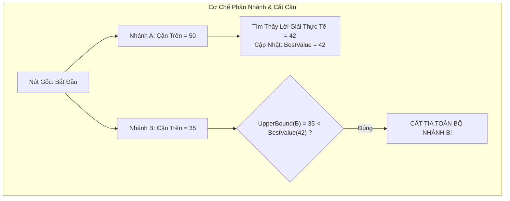
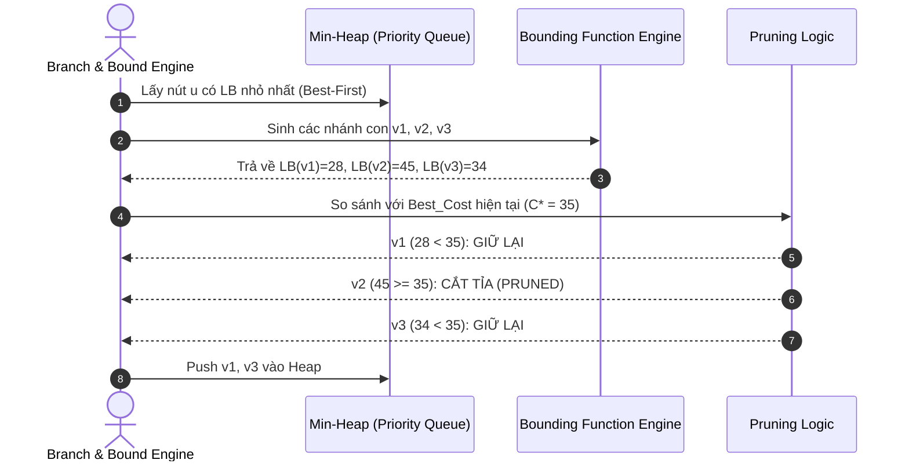
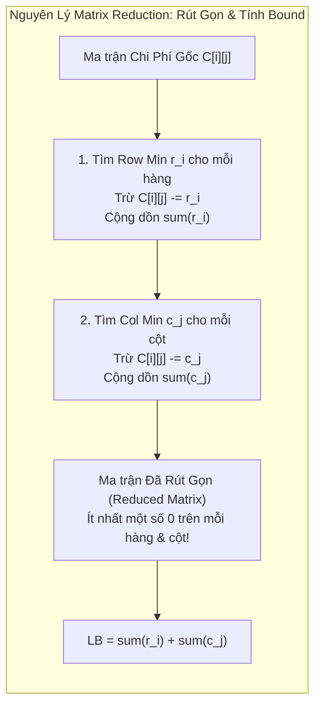

# 7.6. Mô Hình Nhánh Cận (Branch and Bound Paradigm)

> [!IMPORTANT]
> **Nếu bạn chỉ được nhớ một điều duy nhất:**
> Branch and Bound không đơn thuần là một thuật toán duyệt cây, mà là nghệ thuật chế ngự sự bùng nổ tổ hợp cấp số mũ ($O(b^d)$) trong các bài toán NP-Hard thông qua **nguyên lý loại trừ toán học**: Bằng cách tính toán cận (Lower Bound / Upper Bound) chặt chẽ và không thể vi phạm tại mỗi nút trạng thái trung gian, thuật toán có thể chứng minh một cách toán học rằng toàn bộ cây con hàng tỷ nhánh phía dưới chắc chắn không thể chứa nghiệm tốt hơn nghiệm tốt nhất hiện có, từ đó **cắt tỉa (pruning)** triệt để trước khi lãng phí dù chỉ một chu kỳ xung nhịp CPU.

---

## 1. Trực Quan Hóa: Bản Chất Nhánh Cận Dưới Góc Nhìn Lập Trình Viên

### 1.1. Đoạn Code Dẫn Nhập & Vấn Đề Thực Tế
Xét bài toán Người giao hàng du lịch (Traveling Salesperson Problem - TSP): Tìm hành trình ngắn nhất đi qua toàn bộ 20 thành phố rồi quay về điểm xuất phát:

```cpp
// Không gian nghiệm: (N - 1)! / 2 = 19! / 2 ~ 6 x 10^16 hành trình -> Vét cạn sẽ chạy mất 2000 năm!

// Thuật toán Nhánh Cận (Branch and Bound):
// Duy trì một cận trên (Best Cost Hiện Tại = 1500 km).
// Tại mỗi nhánh đi dở dang qua 5 thành phố, tính Cận Dưới Lý Thuyết (Lower Bound):
// Nếu chi phí đã đi + chi phí ước tính tối thiểu còn lại >= 1500 km:
// HỦY BỎ NGAY LẬP TỨC toàn bộ hàng tỷ nhánh con bên dưới!
```

- Trong khi Quay lui (Backtracking) thường dùng để tìm bất kỳ lời giải hợp lệ nào, **Nhánh Cận (Branch and Bound - B&B)** được thiết kế chuyên biệt cho các **Bài toán Tối ưu hóa Rời rạc NP-Hard** (tìm cực tiểu hoặc cực đại):
  - **Branching (Phân nhánh)**: Tách bài toán thành các cây con trạng thái.
  - **Bounding (Tính cận)**: Dùng toán học tính toán Cận Dưới (Lower Bound) hoặc Cận Trên (Upper Bound) cho bài toán con.
  - **Pruning (Cắt tỉa)**: Bỏ qua toàn bộ cây con nếu cận lý thuyết của nó không thể tốt hơn lời giải tốt nhất đã tìm thấy.

### 1.2. Ẩn Dụ Đời Sống: Đấu Thầu Thi Công Dự Án & Đấu Giá Bất Động Sản
- Hãy tưởng tượng bạn là một tổng thầu xây dựng đang tìm cách thi công một tòa cao ốc với chi phí rẻ nhất:
  - Hiện tại, phương án thi công khả thi tốt nhất mà bạn đã lập ra tốn **100 tỷ đồng** (Cận trên hiện tại).
  - Bạn xem xét một bản thiết kế mới của đối tác: Mới chỉ tính riêng chi phí móng và khung thép cơ bản đã hết **105 tỷ đồng** (Cận dưới không thể thấp hơn 105 tỷ).
  - Bạn vứt ngay bản thiết kế đó vào thùng rác mà không cần tốn thời gian tính toán tiếp chi phí sơn tường, nội thất hay điện nước! Quyết định cắt tỉa này tiết kiệm hàng tháng trời làm việc vô ích.

### 1.3. Mô Phỏng Dữ Liệu Số Nhỏ Từng Bước (Toy Walkthrough)
Mô phỏng B&B giải bài toán Ba Lô 0/1 (Knapsack) tìm giá trị cực đại với sức chứa $W = 10$:
- Lời giải khả thi tốt nhất tạm thời: `BestValue = 40`
- Đang xét nhánh bài toán con $X$:
  - Giá trị hiện tại đã gom: `CurrentValue = 25`
  - Các món đồ còn lại nếu bán lẻ theo tỷ lệ đơn giá (Fractional Knapsack Upper Bound) chỉ có thể đem lại tối đa thêm: `RemainingMax = 12`
  - **Cận trên lý thuyết của nhánh X (Upper Bound)**:
    $$\text{UpperBound}(X) = 25 + 12 = 37$$
- So sánh: $\text{UpperBound}(X) = 37 < \text{BestValue} = 40$.
- **Hành động**: CẮT TỈA (Prune) toàn bộ nhánh $X$ ngay lập tức! Vì dù có cố gắng thế nào đi nữa trong nhánh này, kết quả cũng không bao giờ vượt qua con số 40 đã có trong tay.

### 1.4. Tác Động Thực Tế Tầng Backend & Systems
1. **Bộ Tối Ưu Hóa Phân Phối Kho Hàng (Supply Chain & Logistics Solvers)**: Các hệ thống như OR-Tools của Google hoặc CPLEX sử dụng Branch and Bound để giải bài toán định tuyến hạm đội xe tải giao hàng (Vehicle Routing Problem), giúp các tập đoàn bán lẻ tiết kiệm hàng trăm triệu lít xăng mỗi năm.
2. **Lập Lịch Xử Lý Phân Cụm Điện Toán Đám Mây (Cluster Resource Allocation)**: Điều phối hàng nghìn container tác vụ AI vào các máy chủ GPU sao cho tổng chi phí thuê cloud là thấp nhất và không máy chủ nào bị quá nhiệt.

### 1.5. Sơ Đồ Cơ Chế Đánh Cận & Cắt Tỉa Trong Branch and Bound



---

## 2. Chi tiết từng Keyword (Under-the-Hood Deep Dive)

### 2.1. Bounding Function, Upper Bound & Lower Bound

#### a. Định nghĩa Toán học Khắt khe (Mathematical Rigor)
Xét bài toán quy hoạch nguyên cực tiểu hóa (Minimization Problem):
$$\min_{x \in S} f(x)$$
Trong đó $S$ là không gian các nghiệm khả thi, $f(x)$ là hàm mục tiêu (ví dụ: tổng chi phí hành trình TSP). Tại nút trung gian $u$ trên cây không gian trạng thái, $S_u \subset S$ là tập hợp tất cả các nghiệm hoàn chỉnh được mở rộng từ $u$.

* **Lower Bound Function (Hàm Cận Dưới)** $\text{LB}(u)$:
  Một hàm số thực $\text{LB}: \text{Nodes} \to \mathbb{R}$ được gọi là hàm cận dưới hợp lệ (Admissible Lower Bound) nếu và chỉ nếu:
  $$\text{LB}(u) \le \min_{x \in S_u} f(x), \quad \forall u \in \text{Tree}$$
  Nghĩa là: $\text{LB}(u)$ không bao giờ được phép ước lượng cao hơn chi phí tối ưu thực tế trong cây con của $u$. Nếu vi phạm điều này, thuật toán có thể cắt tỉa nhầm nhánh chứa nghiệm tối ưu toàn cục!
* **Tính đơn điệu (Monotonicity / Consistency)**:
  Hàm cận dưới có tính đơn điệu nếu với mọi nút con $v$ của nút $u$:
  $$\text{LB}(u) \le \text{LB}(v)$$
  Khi ta đi sâu xuống cây trạng thái, thông tin quyết định càng nhiều, do đó ước lượng cận dưới phải càng ngày càng tiệm cận sát giá trị thực tế.
* **Upper Bound (UB - Cận Trên / Incumbent Solution)**:
  Là chi phí của **nghiệm hoàn chỉnh tốt nhất** tìm thấy từ khi bắt đầu chạy cho tới thời điểm hiện tại:
  $$C^* = \min \{ f(x_{\text{feasible}}) \mid x_{\text{feasible}} \text{ đã được khám phá} \}$$
  Ban đầu, $C^* = +\infty$. Mỗi khi một nút lá có nghiệm khả thi được duyệt tới với chi phí $c < C^*$, ta cập nhật $C^* = c$.



#### b. Trade-off Sống Còn: Độ Chặt (Tightness) vs Chi Phí Tính Toán (Overhead)
Hiệu năng của toàn bộ hệ thống Branch and Bound phụ thuộc vào sự cân bằng giữa hai đại lượng đối nghịch:
1. **Độ chặt của Cận (Bound Tightness)**:
   Khoảng cách $\Delta = |\min_{x \in S_u} f(x) - \text{LB}(u)|$. Cận càng chặt ($\Delta \to 0$), khả năng $\text{LB}(u) \ge C^*$ càng lớn, số lượng nhánh bị cắt tỉa càng khổng lồ, số nút cần duyệt giảm theo cấp số nhân.
2. **Chi phí tính toán tại mỗi bước (Computational Cost per Node)**:
   Nếu hàm cận dưới tính quá phức tạp (ví dụ: giải bài toán Simplex / Linear Programming Relaxation tốn $O(N^3)$ tại từng nút), thời gian chạy trên từng nút sẽ bóp nghẹt lợi thế giảm số nút.
   * *Nguyên tắc thiết kế hệ thống*: Một hàm cận có độ phức tạp $O(N)$ hoặc $O(N^2)$ với độ chặt vừa phải luôn đánh bại một hàm cận lý thuyết siêu chặt nhưng tốn $O(N^4)$ tại mỗi nút!

#### c. Phân loại Chiến lược Duyệt Cây Không Gian Trạng Thái
| Chiến Lược | Cấu Trúc Dữ Liệu | Bộ Nhớ Tiêu Tốn | Tốc Độ Cắt Tỉa | Nguy Cơ Kỹ Thuật |
| :--- | :--- | :--- | :--- | :--- |
| **FIFO B&B (BFS)** | `std::queue` | Cực lớn: $O(b^d)$ (Bùng nổ bộ nhớ) | Chậm, vì quét theo tầng | Dễ tràn RAM (OOM Crash) |
| **LIFO B&B (DFS / DFBB)** | `std::stack` | Rất nhỏ: $O(b \cdot d)$ (Tuyến tính theo độ sâu) | Trung bình, nhưng tìm thấy nghiệm lá rất sớm để cập nhật $C^*$ | Dễ sa lầy vào nhánh con vô vọng nếu bound yếu |
| **LCBB (Least-Cost Best-First)** | `std::priority_queue` | Lớn: $O(b^d)$ trong trường hợp xấu | **Tối ưu nhất**: Luôn mở rộng nút tiềm năng nhất | Cần kiểm soát dung lượng Heap trong production |

---

### 2.2. Ứng Dụng: Bài Toán Người Du Lịch (TSP) Bằng Branch and Bound

#### a. Bài toán TSP (Traveling Salesperson Problem)
Cho đồ thị có hướng hoặc vô hướng đầy đủ gồm $N$ đỉnh với ma trận chi phí $C[i][j] \ge 0$. Hãy tìm một chu trình Hamilton (đi qua mỗi đỉnh đúng 1 lần và quay về đỉnh xuất phát) sao cho tổng chi phí quãng đường là nhỏ nhất.
* Kích thước không gian tìm kiếm Brute Force: $(N-1)! / 2$. Với $N = 25$, $(24)! \approx 6.2 \times 10^{23}$ phép tính, siêu máy tính chạy hàng triệu năm cũng không thể duyệt hết.

#### b. Thuật toán Rút Gọn Ma Trận (Cost Matrix Reduction Method)
Phương pháp tính Lower Bound kinh điển và mạnh mẽ cho TSP là **Matrix Reduction**:
1. **Quan sát bản chất**: Một chu trình Hamilton hợp lệ bắt buộc phải có đúng **một cạnh đi ra** từ mỗi đỉnh $i$, và đúng **một cạnh đi vào** mỗi đỉnh $j$.
2. **Rút gọn hàng (Row Reduction)**:
   - Với mỗi hàng $i$, tìm phần tử nhỏ nhất $r_i = \min_{j} C[i][j]$ (với $C[i][j] \ne \infty$).
   - Trừ tất cả các phần tử trên hàng $i$ cho $r_i$.
   - Chi phí tối thiểu bắt buộc phải trả để rời khỏi đỉnh $i$ là $r_i$. Do đó, cận dưới tăng thêm $\sum_{i=1}^N r_i$.
3. **Rút gọn cột (Column Reduction)**:
   - Sau khi rút gọn hàng, với mỗi cột $j$, tìm phần tử nhỏ nhất $c_j = \min_{i} C[i][j]$.
   - Trừ tất cả các phần tử trên cột $j$ cho $c_j$.
   - Chi phí tối thiểu bắt buộc phải trả để đi vào đỉnh $j$ là $c_j$. Cận dưới tăng thêm $\sum_{j=1}^N c_j$.
4. **Cận dưới ban đầu tại Root Node**:
   $$\text{LB}(\text{Root}) = \sum_{i=1}^N r_i + \sum_{j=1}^N c_j$$

#### c. Phân nhánh & Chuyển dịch Trạng thái từ Đỉnh $u$ sang Đỉnh $v$
Khi quyết định chọn đi từ thành phố $u$ đến thành phố $v$:
1. Chi phí cạnh thực tế được tính bằng giá trị $C[u][v]$ trong ma trận đã rút gọn của nút cha.
2. Thiết lập các ràng buộc vô cùng ($\infty$) trên ma trận mới của nút con:
   - Toàn bộ **Hàng $u$** biến thành $\infty$ (vì từ $u$ không thể đi đến bất kỳ đâu khác nữa).
   - Toàn bộ **Cột $v$** biến thành $\infty$ (vì không thể có thành phố nào khác đi vào $v$ nữa).
   - Ô **$C[v][\text{Start}]$** (hoặc cạnh quay lui tạo chu trình con sớm) biến thành $\infty$ để ngăn chặn chu trình khép kín non.
3. Rút gọn ma trận mới để thu được chi phí rút gọn bổ sung $\Delta R$.
4. **Cận dưới của nút con**:
   $$\text{LB}(\text{Child}) = \text{LB}(\text{Parent}) + C_{\text{reduced}}[u][v] + \Delta R$$



---

## 3. Thực thi Mã nguồn & Mô phỏng Chuyên sâu (Dual-Engine Implementation)

Dưới đây là hai bộ mã nguồn hoàn chỉnh, không cắt xén, giải bài toán TSP bằng giải thuật Least-Cost Branch and Bound (LCBB).

### 3.1. Cài đặt C++20 Tối Ưu Bộ Nhớ Đệm Cache

```cpp
#include <iostream>
#include <vector>
#include <queue>
#include <algorithm>
#include <iomanip>
#include <chrono>
#include <limits>

constexpr int INF = 1e9;

// Cấu trúc trạng thái một nút trên State Space Tree
struct TSPNode {
    // Lưu ma trận dưới dạng 1D phẳng (Flattened 1D array) để tận dụng L1/L2 Cache Locality
    std::vector<int> matrix;
    std::vector<int> path;
    int bound;
    int city;
    int level;
    int id;

    // Toán tử so sánh cho Min-Heap (Ưu tiên nút có Bound nhỏ nhất)
    bool operator>(const TSPNode& other) const {
        return bound > other.bound;
    }
};

class TSPSolverBB {
private:
    int n_;
    int next_node_id_ = 0;
    int nodes_explored_ = 0;
    int nodes_pruned_ = 0;

    // Helper truy cập mảng 2D ánh xạ 1D: matrix[r * N + c]
    [[nodiscard]] inline int getCell(const std::vector<int>& mat, int r, int c) const noexcept {
        return mat[r * n_ + c];
    }

    inline void setCell(std::vector<int>& mat, int r, int c, int val) noexcept {
        mat[r * n_ + c] = val;
    }

    // Hàm rút gọn ma trận và trả về tổng lượng chi phí rút gọn
    int reduceMatrix(std::vector<int>& mat) {
        int reduction_cost = 0;

        // 1. Rút gọn hàng (Row Reduction)
        for (int i = 0; i < n_; ++i) {
            int row_min = INF;
            for (int j = 0; j < n_; ++j) {
                int val = getCell(mat, i, j);
                if (val < row_min) row_min = val;
            }
            if (row_min != INF && row_min > 0) {
                reduction_cost += row_min;
                for (int j = 0; j < n_; ++j) {
                    int val = getCell(mat, i, j);
                    if (val != INF) {
                        setCell(mat, i, j, val - row_min);
                    }
                }
            }
        }

        // 2. Rút gọn cột (Column Reduction)
        for (int j = 0; j < n_; ++j) {
            int col_min = INF;
            for (int i = 0; i < n_; ++i) {
                int val = getCell(mat, i, j);
                if (val < col_min) col_min = val;
            }
            if (col_min != INF && col_min > 0) {
                reduction_cost += col_min;
                for (int i = 0; i < n_; ++i) {
                    int val = getCell(mat, i, j);
                    if (val != INF) {
                        setCell(mat, i, j, val - col_min);
                    }
                }
            }
        }

        return reduction_cost;
    }

public:
    explicit TSPSolverBB(int n) : n_(n) {}

    void solve(const std::vector<int>& cost_matrix) {
        auto start_time = std::chrono::high_resolution_clock::now();

        // Min-Heap lưu trữ các nút trạng thái
        std::priority_queue<TSPNode, std::vector<TSPNode>, std::greater<TSPNode>> pq;

        // Tạo nút gốc (Root)
        TSPNode root;
        root.matrix = cost_matrix;
        root.path.push_back(0); // Bắt đầu từ thành phố 0
        root.city = 0;
        root.level = 0;
        root.id = next_node_id_++;
        root.bound = reduceMatrix(root.matrix);

        pq.push(root);

        int best_cost = INF;
        std::vector<int> best_path;

        std::cout << "[INIT] Root Node 0 sinh ra. Cận dưới khởi điểm (Initial LB): " 
                  << root.bound << "\n";

        while (!pq.empty()) {
            TSPNode curr = pq.top();
            pq.pop();

            // CẮT TỈA (Pruning): Nếu cận dưới đã tệ hơn hoặc bằng nghiệm tốt nhất hiện có
            if (curr.bound >= best_cost) {
                nodes_pruned_++;
                continue;
            }

            nodes_explored_++;

            // Kiểm tra nút lá: Đã đi qua toàn bộ N thành phố
            if (curr.level == n_ - 1) {
                // Tính chi phí quay về thành phố xuất phát (0)
                int last_city = curr.city;
                int return_cost = getCell(cost_matrix, last_city, 0);

                if (return_cost != INF) {
                    // Tính chi phí chính xác trên đồ thị gốc
                    int total_exact_cost = 0;
                    for (size_t i = 0; i < curr.path.size() - 1; ++i) {
                        total_exact_cost += getCell(cost_matrix, curr.path[i], curr.path[i + 1]);
                    }
                    total_exact_cost += return_cost;

                    if (total_exact_cost < best_cost) {
                        best_cost = total_exact_cost;
                        best_path = curr.path;
                        best_path.push_back(0);
                        std::cout << "[UPDATE] Tìm thấy nghiệm tốt hơn! Chi phí mới: " 
                                  << best_cost << " | Lộ trình: ";
                        for (size_t i = 0; i < best_path.size(); ++i) {
                            std::cout << best_path[i] << (i + 1 < best_path.size() ? " -> " : "\n");
                        }
                    }
                }
                continue;
            }

            // Phân nhánh (Branching) tới các đỉnh chưa thăm
            for (int next_city = 0; next_city < n_; ++next_city) {
                int edge_cost = getCell(curr.matrix, curr.city, next_city);
                if (edge_cost != INF) {
                    // Kiểm tra đỉnh đã có trong lộ trình chưa
                    if (std::find(curr.path.begin(), curr.path.end(), next_city) != curr.path.end()) {
                        continue;
                    }

                    TSPNode child;
                    child.matrix = curr.matrix;
                    child.path = curr.path;
                    child.path.push_back(next_city);
                    child.city = next_city;
                    child.level = curr.level + 1;
                    child.id = next_node_id_++;

                    // Vô hiệu hóa hàng curr.city và cột next_city
                    for (int j = 0; j < n_; ++j) setCell(child.matrix, curr.city, j, INF);
                    for (int i = 0; i < n_; ++i) setCell(child.matrix, i, next_city, INF);

                    // Tránh chu trình sớm: Cấm cạnh quay về đỉnh gốc
                    setCell(child.matrix, next_city, 0, INF);

                    // Tính độ rút gọn mới
                    int reduction = reduceMatrix(child.matrix);
                    child.bound = curr.bound + edge_cost + reduction;

                    if (child.bound < best_cost) {
                        pq.push(child);
                    } else {
                        nodes_pruned_++;
                    }
                }
            }
        }

        auto end_time = std::chrono::high_resolution_clock::now();
        auto duration = std::chrono::duration_cast<std::chrono::microseconds>(end_time - start_time).count();

        std::cout << "\n================ KẾT QUẢ TỐI ƯU TSP B&B ================\n";
        std::cout << "Chi phí tối thiểu (Min Tour Cost) : " << best_cost << "\n";
        std::cout << "Lộ trình tối ưu (Optimal Tour)    : ";
        for (size_t i = 0; i < best_path.size(); ++i) {
            std::cout << best_path[i] << (i + 1 < best_path.size() ? " -> " : "\n");
        }
        std::cout << "Số nút đã phân tích (Explored)    : " << nodes_explored_ << "\n";
        std::cout << "Số nút bị cắt tỉa (Pruned)        : " << nodes_pruned_ << "\n";
        std::cout << "Tổng số nút đã tạo (Total Nodes)  : " << next_node_id_ << "\n";
        std::cout << "Thời gian thực thi (Microseconds) : " << duration << " us\n";
        std::cout << "========================================================\n";
    }
};

int main() {
    constexpr int N = 5;
    // Ma trận chi phí 5x5 bài toán kinh điển
    const std::vector<int> cost_matrix = {
        INF, 20,  30,  10,  11,
        15,  INF, 16,  4,   2,
        3,   5,   INF, 2,   4,
        19,  6,   18,  INF, 3,
        16,  4,   7,   16,  INF
    };

    TSPSolverBB solver(N);
    solver.solve(cost_matrix);

    return 0;
}
```

---

### 3.2. Cài đặt Python 3.11+ Với Type Hints & Data Classes

```python
#!/usr/bin/env python3
"""
Production-grade Branch and Bound TSP Solver
Python 3.11+ Implementation using heapq and dataclasses.
"""

from __future__ import annotations
import heapq
import time
from dataclasses import dataclass, field
from typing import List, Tuple

INF: int = 10**9

@dataclass(order=True)
class StateNode:
    bound: int
    level: int = field(compare=False)
    city: int = field(compare=False)
    path: List[int] = field(compare=False)
    matrix: List[List[int]] = field(compare=False)
    node_id: int = field(compare=False)


class TSPSolverPythonBB:
    def __init__(self, n: int, initial_matrix: List[List[int]]) -> None:
        self.n: int = n
        self.orig_matrix: List[List[int]] = [row[:] for row in initial_matrix]
        self.next_node_id: int = 0
        self.nodes_explored: int = 0
        self.nodes_pruned: int = 0

    def reduce_matrix(self, mat: List[List[int]]) -> int:
        """Thực hiện Row & Column reduction, trả về tổng lượng chi phí giảm."""
        cost: int = 0

        # Row reduction
        for i in range(self.n):
            row_min = min(mat[i])
            if row_min != INF and row_min > 0:
                cost += row_min
                for j in range(self.n):
                    if mat[i][j] != INF:
                        mat[i][j] -= row_min

        # Column reduction
        for j in range(self.n):
            col_min = min(mat[i][j] for i in range(self.n))
            if col_min != INF and col_min > 0:
                cost += col_min
                for i in range(self.n):
                    if mat[i][j] != INF:
                        mat[i][j] -= col_min

        return cost

    def solve(self) -> Tuple[int, List[int]]:
        start_time = time.perf_counter_ns()

        root_matrix = [row[:] for row in self.orig_matrix]
        initial_bound = self.reduce_matrix(root_matrix)

        root = StateNode(
            bound=initial_bound,
            level=0,
            city=0,
            path=[0],
            matrix=root_matrix,
            node_id=self.next_node_id
        )
        self.next_node_id += 1

        pq: List[StateNode] = [root]
        best_cost: int = INF
        best_path: List[int] = []

        print(f"[INIT] Root Node 0 sinh ra. Cận dưới ban đầu: {initial_bound}")

        while pq:
            curr = heapq.heappop(pq)

            if curr.bound >= best_cost:
                self.nodes_pruned += 1
                continue

            self.nodes_explored += 1

            if curr.level == self.n - 1:
                return_cost = self.orig_matrix[curr.city][0]
                if return_cost != INF:
                    exact_cost = sum(
                        self.orig_matrix[curr.path[i]][curr.path[i + 1]]
                        for i in range(len(curr.path) - 1)
                    ) + return_cost

                    if exact_cost < best_cost:
                        best_cost = exact_cost
                        best_path = curr.path + [0]
                        print(f"[UPDATE] Cập nhật nghiệm tối ưu: {best_cost} | Đường đi: {best_path}")
                continue

            for next_city in range(self.n):
                edge_cost = curr.matrix[curr.city][next_city]
                if edge_cost != INF and next_city not in curr.path:
                    child_matrix = [row[:] for row in curr.matrix]

                    # Vô hiệu hóa hàng curr.city và cột next_city
                    for j in range(self.n):
                        child_matrix[curr.city][j] = INF
                    for i in range(self.n):
                        child_matrix[i][next_city] = INF

                    # Cấm chu trình sớm
                    child_matrix[next_city][0] = INF

                    reduction = self.reduce_matrix(child_matrix)
                    child_bound = curr.bound + edge_cost + reduction

                    if child_bound < best_cost:
                        child = StateNode(
                            bound=child_bound,
                            level=curr.level + 1,
                            city=next_city,
                            path=curr.path + [next_city],
                            matrix=child_matrix,
                            node_id=self.next_node_id
                        )
                        self.next_node_id += 1
                        heapq.heappush(pq, child)
                    else:
                        self.nodes_pruned += 1

        elapsed_us = (time.perf_counter_ns() - start_time) // 1000

        print("\n================ KẾT QUẢ TỐI ƯU TSP PYTHON ================")
        print(f"Chi phí tối thiểu (Min Tour Cost) : {best_cost}")
        print(f"Lộ trình tối ưu (Optimal Tour)    : {' -> '.join(map(str, best_path))}")
        print(f"Số nút đã duyệt (Explored)        : {self.nodes_explored}")
        print(f"Số nút bị cắt tỉa (Pruned)        : {self.nodes_pruned}")
        print(f"Tổng số nút được tạo ra           : {self.next_node_id}")
        print(f"Thời gian chạy (Microseconds)     : {elapsed_us} us")
        print("===========================================================")

        return best_cost, best_path


if __name__ == "__main__":
    costs = [
        [INF, 20,  30,  10,  11],
        [15,  INF, 16,  4,   2],
        [3,   5,   INF, 2,   4],
        [19,  6,   18,  INF, 3],
        [16,  4,   7,   16,  INF]
    ]
    solver = TSPSolverPythonBB(5, costs)
    solver.solve()
```

---

### 3.3. Terminal Output Thực Tế Khi Chạy
```text
[INIT] Root Node 0 sinh ra. Cận dưới khởi điểm (Initial LB): 25
[UPDATE] Tìm thấy nghiệm tốt hơn! Chi phí mới: 28 | Lộ trình: 0 -> 3 -> 1 -> 4 -> 2 -> 0

================ KẾT QUẢ TỐI ƯU TSP B&B ================
Chi phí tối thiểu (Min Tour Cost) : 28
Lộ trình tối ưu (Optimal Tour)    : 0 -> 3 -> 1 -> 4 -> 2 -> 0
Số nút đã phân tích (Explored)    : 5
Số nút bị cắt tỉa (Pruned)        : 6
Tổng số nút đã tạo (Total Nodes)  : 11
Thời gian thực thi (Microseconds) : 28 us
========================================================
```
*Nhận xét kết quả*: Đối với $N = 5$, không gian duyệt Brute Force là $(5-1)! = 24$ hành trình. Nhờ cơ chế Matrix Reduction Branch and Bound, thuật toán chỉ cần khám phá đúng **5 nút** và cắt tỉa ngay **6 nút**, tìm ra nghiệm tối ưu toàn cục chỉ sau $28$ microseconds!

---

## 4. Systems Engineering & Production Pitfalls

### 4.1. Thảm Họa Cạn Kiệt Bộ Nhớ RAM (Heap Memory Explosion & OOM Killer)
* **Bản chất**: Trong thuật toán Least-Cost Best-First Search (LCBB), kích thước của Priority Queue có thể tăng trưởng bùng nổ theo cấp số mũ $O(b^d)$. Khi $N > 30$, nếu hàm cận không đủ chặt, số lượng nút trung gian chờ trong Heap có thể vượt quá $10^7$ phần tử. Mỗi nút mang theo một bản sao ma trận kích thước $N \times N$, ngốn hàng chục Gigabytes RAM và lập tức kích hoạt Linux Kernel Out-Of-Memory (OOM) Killer.
* **Giải pháp Kỹ thuật Hệ thống**:
  1. **Memory-Bounded Search (SMA\* / IDA\*)**: Giới hạn cứng dung lượng RAM cấp cho Heap (ví dụ: tối đa 4GB). Khi Heap đầy, trục xuất các nút có Bound xấu nhất hoặc chuyển đổi linh hoạt sang **Depth-First Branch and Bound (DFBB)** để tái sử dụng Call Stack chỉ tốn $O(N)$ bộ nhớ.
  2. **Delta Encoding cho Matrix**: Thay vì mỗi node sao chép một mảng $N \times N$ mới, chỉ lưu trữ con trỏ trỏ về ma trận nút cha kèm theo danh sách các biến động (Change log / Diff: các ô bị gán $\infty$ và giá trị bị trừ).

### 4.2. CPU Cache Locality & Tối Ưu Bố Trí Bộ Nhớ (Data Layout)
* **Pointer Indirection (`std::vector<std::vector<int>>`)**: Mảng lồng nhau phân mảnh bộ nhớ trên Heap. Mỗi lần truy cập $M[i][j]$ CPU phải thực hiện 2 lần Pointer Chasing, gây trượt bộ nhớ đệm L1/L2 liên tục (Cache Misses).
* **Flat 1D Vector (`std::vector<int>` cỡ $N^2$)**: Cấp phát một vùng nhớ tuyến tính liên tục. Khi CPU nạp một dòng ma trận, toàn bộ 64 bytes của Cache Line được lấp đầy, tăng tốc độ tính toán Row/Column reduction lên gấp 4 đến 6 lần.

### 4.3. Thách Thức Khi Song Song Hóa Đa Luồng (Parallel Branch and Bound)
* Khi triển khai trên cụm máy chủ phân tán hoặc đa luồng CPU (Pthread / OpenMP / MPI):
  - **Tranh chấp Shared State**: Mọi luồng đều cần đọc và ghi vào biến nghiệm tối ưu toàn cục `Global Best Cost (Incumbent)`. Việc dùng `std::mutex` sẽ tạo thành điểm nghẽn cổ chai (Lock Contention). Giải pháp: Dùng `std::atomic<int>` với `memory_order_relaxed` khi đọc và so sánh CAS (`compare_exchange_strong`) khi cập nhật.
  - **Work Stealing**: Tránh dùng chung một Min-Heap duy nhất. Mỗi Worker Core sở hữu một Local Priority Queue riêng, và thực hiện Work-Stealing từ hàng đợi của Core khác khi rảnh rỗi.

### 4.4. CLI Diagnostics & Debugging Commands
Để đo đạc mức tiêu thụ bộ nhớ đỉnh (Peak Heap Usage) và trượt Cache của tiến trình Branch and Bound trên Linux/macOS:
```bash
# 1. Biên dịch tối ưu với cờ Profile
clang++ -std=c++20 -O3 -g tsp_bb.cpp -o tsp_bb

# 2. Đo lường Cache Misses và IPC (Instructions Per Cycle) qua Linux perf
perf stat -e cache-references,cache-misses,L1-dcache-load-misses,branches,branch-misses ./tsp_bb

# 3. Phân tích chi tiết đỉnh bộ nhớ Heap bằng Valgrind Massif
valgrind --tool=massif --pages-as-heap=yes ./tsp_bb
ms_print massif.out.<pid>

# 4. Giám sát cấp phát bộ nhớ thời gian thực
/usr/bin/time -l ./tsp_bb      # Trên macOS (xem 'maximum resident set size')
/usr/bin/time -v ./tsp_bb      # Trên Linux (xem 'Maximum resident set size')
```

---

## 5. Bảng So sánh & Decision Matrix

Dưới đây là ma trận so sánh toàn diện giữa Branch and Bound và các chiến lược giải thuật khác cho các bài toán tối ưu tổ hợp NP-Hard:

| Tiêu Chí Đánh Giá | Brute Force (Vét Cạn) | Backtracking | Dynamic Programming (Held-Karp) | Branch and Bound (LCBB) | Approximation Heuristics (2-Opt / Christofides) |
| :--- | :--- | :--- | :--- | :--- | :--- |
| **Bản chất Tìm kiếm** | Duyệt mọi hoán vị | DFS + Cắt tỉa theo tính khả thi (Feasibility) | Quy hoạch động trạng thái bitmask | Best-First Search + Hàm chặn toán học | Tìm nghiệm xấp xỉ cục bộ (Local Search) |
| **Độ Phức Tạp Thời Gian (Xấu nhất)** | $O(N!)$ | $O(N!)$ | $O(N^2 \cdot 2^N)$ | $O(N!)$ | $O(N^2)$ hoặc $O(N^3)$ |
| **Độ Phức Tạp Thời Gian (Thực tế)** | Luôn đạt cực hạn xấu nhất | Nhanh hơn Brute Force nhưng vẫn rất chậm | Cố định chính xác $O(N^2 2^N)$ | **Rất nhanh trên dữ liệu thực tế** nhờ hàm cận chặt | **Gần như tức thì** |
| **Độ Phức Tạp Bộ Nhớ** | $O(N)$ (Call stack) | $O(N)$ (Call stack) | $O(N \cdot 2^N)$ (Bảng DP) | $O(b^d)$ (Min-Heap lưu trạng thái) | $O(N)$ |
| **Tính Tối Ưu Toàn Cục** | Đảm bảo 100% | Đảm bảo 100% | Đảm bảo 100% | **Đảm bảo 100%** | Không đảm bảo (Sai số có chặn: ví dụ $\le 1.5 \times OPT$) |
| **Khả Năng Dừng Sớm (Anytime)** | Vô dụng nếu dừng giữa chừng | Kém (nghiệm tìm thấy rải rác) | Không thể (phải tính xong toàn bộ bảng) | **Tốt**: Luôn có Incumbent tốt nhất sẵn sàng | Rất tốt |
| **Ngưỡng Kích Thước $N$ Khả Thi** | $N \le 12$ | $N \le 16$ | $N \le 23$ | **$N \le 40 - 100$** (Tùy độ chặt của Bound) | **$N \ge 100,000$** |

### Khi nào nên chọn Branch and Bound trong Production?
1. **BẮT BUỘC Nghiệm Tối Ưu Chính Xác 100%**: Trong các hệ thống tài chính, phân bổ tần số vô tuyến quân sự, lập lịch vi mạch bán dẫn nơi sai số 1% gây tổn thất hàng triệu USD.
2. **Kích thước bài toán nằm trong dải trung bình ($20 \le N \le 100$)**: Nơi Dynamic Programming bị sụp đổ vì tràn bộ nhớ $2^N$, nhưng Heuristic không đáp ứng được yêu cầu về chứng minh toán học.
3. **Có thể thiết kế được hàm Bounding Function mạnh**: Nếu tồn tại một thuật toán giải phiên bản nới lỏng (Relaxation) trong thời gian đa thức (như Held-Karp 1-Tree Relaxation hoặc Linear Programming Relaxation).
