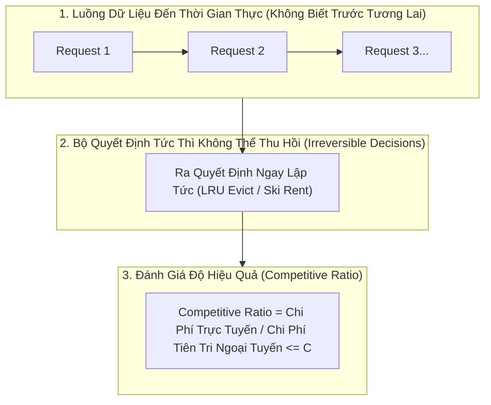
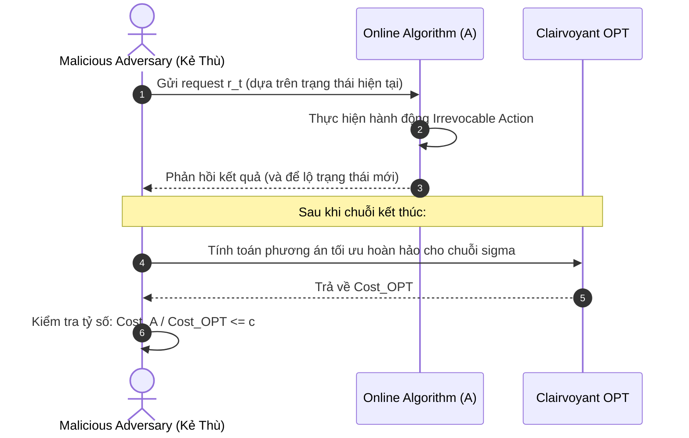
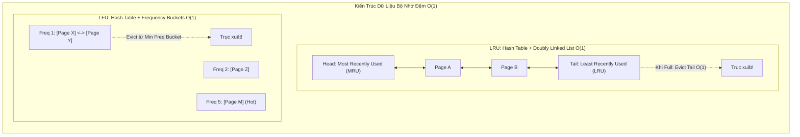

# 7.8. Giải Thuật Trực Tuyến & Tỷ Số Cạnh Tranh (Online Algorithms & Competitive Analysis)

> [!IMPORTANT]
> **Nếu bạn chỉ được nhớ một điều duy nhất:**
> Một **Giải thuật Trực tuyến (Online Algorithm)** phải đưa ra các quyết định sinh tử không thể rút lại (Irrevocable Decisions) trong điều kiện "hoàn toàn mù lòa về tương lai" (Zero Knowledge of Future Requests). **Phân tích Cạnh tranh (Competitive Analysis)** là công cụ toán học tối thượng để chứng minh rằng: Ngay cả khi đối đầu với một "Thực thể Toàn năng nhìn thấy trước toàn bộ tương lai" (Offline Clairvoyant OPT - như Thuật toán Bélády) và một kẻ thù nguy hiểm nhất (Malicious Adversary), tỷ số chi phí của giải thuật bạn thiết kế vẫn bị chặn trên bởi một hằng số $c$ (Competitive Ratio) không thể bị phá vỡ!

---

## 1. Trực Quan Hóa: Bản Chất Thuật Toán Trực Tuyến Dưới Góc Nhìn Lập Trình Viên

### 1.1. Đoạn Code Dẫn Nhập & Vấn Đề Thực Tế
Xét cơ chế giải phóng bộ nhớ đệm (Cache Replacement Policy) của Redis hoặc CPU L1 Cache: Khi bộ đệm đầy, hệ thống phải chọn một phần tử cũ để loại bỏ (Eviction):

```typescript
// Thuật toán Tối ưu Lý thuyết (Bélády's Optimal Algorithm):
// Loại bỏ phần tử mà TRONG TƯƠNG LAI sẽ lâu được sử dụng nhất!
// VẤN ĐỀ: Không ai biết trước tương lai người dùng sẽ click vào sản phẩm nào!

// Thuật toán Trực Tuyến Thực Chiến (Online Algorithm - LRU Cache):
// Không có thông tin tương lai, chỉ dựa vào quá khứ: Loại bỏ phần tử lâu nhất chưa được truy cập!
class LRUCache {
  // Đưa ra quyết định tức thì theo từng request xuất hiện (On the fly)
  // Đảm bảo tỷ lệ cạnh tranh (Competitive Ratio) được chứng minh bằng toán học!
}
```

- **Thuật toán ngoại tuyến (Offline Algorithms)**: Biết trước toàn bộ tập dữ liệu đầu vào từ đầu đến cuối trước khi tính toán.
- **Thuật toán trực tuyến (Online Algorithms)**: Dữ liệu đầu vào xuất hiện **từng phần theo thời gian thực (Data Stream)**. Thuật toán bắt buộc phải đưa ra quyết định **ngay lập tức và không thể thu hồi**, hoàn toàn không có thông tin về dữ liệu trong tương lai!
- Hiệu năng của thuật toán trực tuyến được đo lường bằng **Tỷ số cạnh tranh (Competitive Ratio)**: So sánh chi phí của nó với một thuật toán Tiên tri ngoại tuyến (Omniscient Offline Algorithm) biết trước toàn bộ tương lai.

### 1.2. Ẩn Dụ Đời Sống: Bài Toán Thuê Hay Mua Ván Trượt (Ski Rental Problem)
- Bạn đến một khu nghỉ dưỡng trượt tuyết ở dãy Alps:
  - Giá thuê ván trượt: **\$10 / ngày**.
  - Giá mua đứt ván trượt: **\$100** (bằng 10 ngày thuê).
- Bạn không biết kỳ nghỉ này mình sẽ trượt được bao nhiêu ngày vì thời tiết thất thường (nếu tuyết tan bạn phải về ngay).
- **Chiến lược Trực tuyến Cạnh tranh (Break-even Online Strategy)**:
  - Bạn cứ thuê ván trượt từng ngày một cho đến ngày thứ 9 (đã tốn $\$90$).
  - Đến ngày thứ 10, nếu vẫn còn trượt tuyết được, bạn quyết định **MUA ĐỨT** chiếc ván trượt với giá $\$100$!
  - Trong trường hợp xấu nhất, bạn tốn $\$90 + \$100 = \$190$, trong khi một người tiên tri biết trước sẽ mua ngay từ đầu với giá $\$100$.
  - Tỷ số cạnh tranh: $\frac{190}{100} = \mathbf{1.9} < 2$. Dù thời tiết có biến chuyển thế nào, chi phí của bạn không bao giờ vượt quá **2 lần** chi phí của vị thần tiên tri!

### 1.3. Mô Phỏng Dữ Liệu Số Nhỏ Từng Bước (Toy Walkthrough)
Mô phỏng thuật toán thay thế trang bộ nhớ đệm dung lượng $3$ trang (Pages):
Chuỗi truy cập trực tuyến: `A, B, C, A, D, B`:

| Thời điểm | Yêu cầu trang | Trạng thái Bộ đệm LRU (Dung lượng = 3) | Cache Hit / Miss | Hành động thuật toán trực tuyến |
| :--- | :--- | :--- | :--- | :--- |
| **$t_1$** | `A` | `[A]` | Miss | Nạp A |
| **$t_2$** | `B` | `[B, A]` | Miss | Nạp B |
| **$t_3$** | `C` | `[C, B, A]` | Miss | Nạp C (Bộ đệm đầy 3/3) |
| **$t_4$** | `A` | `[A, C, B]` | **Hit!** | Đưa A lên đầu hàng ưu tiên |
| **$t_5$** | `D` | `[D, A, C]` | Miss | Bộ đệm đầy $\to$ **Loại bỏ B** (ở đuôi); Nạp D |
| **$t_6$** | `B` | `[B, D, A]` | Miss | Bộ đệm đầy $\to$ **Loại bỏ C** (ở đuôi); Nạp B |

### 1.4. Tác Động Thực Tế Tầng Backend & Systems
1. **Lập Lịch Thuê Máy Chủ Điện Toán Đám Mây (Spot Instances Bidding)**: Ứng dụng bài toán Ski Rental để quyết định khi nào nên tiếp tục trả tiền thuê máy chủ theo giờ (On-Demand Pricing) và khi nào nên ký hợp đồng mua đứt cam kết 3 năm (Reserved Instances).
2. **Quản Lý Bộ Nhớ Ảo Của Hệ Điều Hành (OS Virtual Memory Paging)**: Khi xảy ra lỗi thiếu trang (Page Fault), Linux Kernel chạy thuật toán xấp xỉ LRU (Clock Algorithm) để chọn trang nhớ vật lý cần đẩy ra đĩa Swap trong thời gian thực.

### 1.5. Sơ Đồ Kiến Trúc Thuật Toán Trực Tuyến & Tỷ Số Cạnh Tranh



---

## 2. Chi tiết từng Keyword (Under-the-Hood Deep Dive)

### 2.1. Online vs Offline Processing & Competitive Analysis (Tỷ Số Cạnh Tranh)

#### a. Định nghĩa Hình Thức & Mô Hình Toán Học
Cho một chuỗi yêu cầu đầu vào $\sigma = \langle r_1, r_2, \dots, r_m \rangle$ thuộc không gian yêu cầu $\mathcal{R}$.
* **Offline Processing (Xử lý Ngoại tuyến)**:
  Thuật toán ngoại tuyến nhận toàn bộ chuỗi $\sigma$ cùng một lúc trước khi thực thi bất kỳ thao tác nào. Nó có thể duyệt xuôi, duyệt ngược, xây dựng đồ thị quy hoạch động để tìm ra chuỗi hành động có tổng chi phí cực tiểu toàn cục:
  $$\text{Cost}_{OPT}(\sigma) = \min_{\text{actions}} \sum_{t=1}^m \text{cost}(r_t, \text{action}_t)$$
* **Online Processing (Xử lý Trực tuyến)**:
  Tại mỗi bước thời gian $t$, thuật toán trực tuyến $A$ phải đưa ra quyết định phục vụ yêu cầu $r_t$ chỉ dựa trên lịch sử trong quá khứ $\langle r_1, r_2, \dots, r_{t-1} \rangle$ và yêu cầu hiện tại $r_t$. Sau khi quyết định được thực thi, nó không thể thu hồi hoặc hoàn tác (Irrevocable).
* **Tỷ Số Cạnh Tranh (Competitive Ratio)**:
  Thuật toán trực tuyến $A$ được gọi là **$c$-competitive** nếu tồn tại một hằng số cố định $\alpha$ sao cho với **mọi chuỗi yêu cầu đầu vào khả dĩ $\sigma$**:
  $$\text{Cost}_A(\sigma) \le c \cdot \text{Cost}_{OPT}(\sigma) + \alpha$$
  - Nếu $\alpha = 0$, $A$ được gọi là **strictly $c$-competitive**.
  - Đối với bài toán Cực đại hóa (Maximization - ví dụ: Online Ad Allocation): Tỷ số được định nghĩa ngược lại: $\text{Profit}_A(\sigma) \ge \frac{1}{c} \cdot \text{Profit}_{OPT}(\sigma) - \alpha$.

#### b. Các Mô Hình Kẻ Thù Thử Thách (Adversary Models)
Để chứng minh tỷ số cạnh tranh toán học, các nhà khoa học giả định rằng dữ liệu đầu vào không phải ngẫu nhiên mà được sinh ra bởi một **Kẻ thù ác ý (Adversary)** tìm mọi cách để làm cho thuật toán trực tuyến tốn kém chi phí nhất:
1. **Oblivious Adversary (Kẻ thù mù)**:
   Phải tạo ra toàn bộ chuỗi $\sigma$ cố định trước khi thuật toán bắt đầu chạy. Nó biết mã nguồn của thuật toán nhưng không biết các bit ngẫu nhiên tương lai mà thuật toán sẽ gieo.
2. **Adaptive Online Adversary (Kẻ thù thích nghi trực tuyến)**:
   Quan sát từng bước đi của thuật toán trực tuyến và sinh ra yêu cầu kế tiếp $r_{t+1}$ dựa trên trạng thái nội tại hiện tại của thuật toán để gây tổn thất tối đa. Tuy nhiên, bản thân kẻ thù cũng phải phục vụ các yêu cầu đó theo cách trực tuyến.
3. **Adaptive Offline Adversary (Kẻ thù thích nghi toàn năng)**:
   Tương tự như Adaptive Online Adversary, nhưng sau khi chuỗi kết thúc, nó có quyền dùng thuật toán Offline OPT để giải chuỗi đó với chi phí tối thiểu.



---

### 2.2. Chính Sách Thay Thế Bộ Đệm: LRU vs LFU vs Thuật Toán Tối Ưu Bélády

#### a. Đặt Bài Toán Quản Lý Bộ Nhớ Đệm (The Paging Problem)
Xét một hệ thống lưu trữ có hai tầng: Bộ nhớ đệm Cache nhanh có dung lượng hữu hạn gồm $K$ trang (slots/frames), và Đĩa/RAM chậm có dung lượng vô hạn chứa $N$ trang ($N \gg K$).
Khi một tiến trình yêu cầu trang $p$:
- **Cache Hit**: Nếu $p$ đã nằm trong Cache, chi phí truy cập bằng $0$ (tức thì).
- **Cache Miss (Page Fault)**: Nếu $p$ chưa có trong Cache:
  - Bắt buộc phải đọc $p$ từ đĩa vào Cache với chi phí phạt là $1$.
  - Nếu Cache đã đầy $K$ trang, hệ thống bắt buộc phải **trục xuất (Evict)** một trang đang có trong Cache để nhường chỗ cho $p$.
- **Mục tiêu**: Thiết kế chính sách trục xuất trực tuyến để giảm thiểu tổng số lần Page Faults trên chuỗi truy cập $\sigma$.

#### b. Thuật Toán Tối Ưu Bélády (Bélády's OPT / MIN Algorithm - 1966)
Laszlo Bélády đã chứng minh thuật toán ngoại tuyến tối ưu tuyệt đối:
* **Quy tắc**: Khi Cache đầy và cần trục xuất một trang, hãy tìm trang trong Cache mà **thời điểm tái truy cập tiếp theo trong tương lai là xa nhất** (hoặc không bao giờ được truy cập lại nữa), và trục xuất trang đó!
* **Chứng minh Tính Tối Ưu (Exchange Argument)**:
  Giả sử có một giải thuật ngoại tuyến $A^*$ khác Bélády tại bước $t$. Ta có thể biến đổi từng bước các quyết định của $A^*$ thành quyết định của Bélády mà số lần Page Faults chỉ có thể giảm hoặc giữ nguyên, không bao giờ tăng lên.
* **Ý nghĩa Kỹ thuật**: Bélády OPT là "thước đo chuẩn mực vàng" (Ground Truth Benchmark). Trong thực tế sản xuất, không một hệ thống trực tuyến nào có thể cài đặt được Bélády vì không thể nhìn thấy tương lai. Tuy nhiên, nó được dùng làm mốc so sánh trong các bài kiểm thử phân tích log quá khứ (Trace-driven simulation).

#### c. Phân Tích Định Lý Sleator-Tarjan (1985) & Giới Hạn Cạnh Tranh của LRU
* **Định Lý Sleator & Robert Tarjan**:
  1. Với bất kỳ thuật toán thay thế bộ đệm trực tuyến tất định nào (Deterministic Online Paging Algorithm), tỷ số cạnh tranh luôn bị chặn dưới bởi kích thước bộ đệm $K$:
     $$c \ge K$$
  2. Thuật toán **LRU (Least Recently Used)** và **FIFO (First-In First-Out)** đạt được tỷ số cạnh tranh chính xác là **$K$-competitive**:
     $$\text{Faults}_{\text{LRU}}(\sigma) \le K \cdot \text{Faults}_{OPT}(\sigma)$$
  3. **Ý nghĩa chấn động**: Không một thuật toán trực tuyến tất định nào (dù phức tạp đến đâu) có thể vượt qua giới hạn $K$-competitive trong kịch bản xấu nhất!

#### d. So Sánh Cơ Chế Hoạt Động Giữa LRU và LFU
1. **LRU (Least Recently Used - Trực tuyến)**:
   - *Triết lý*: Dựa trên **Cục bộ Thời gian (Temporal Locality)** — dữ liệu vừa được truy cập gần đây nhất có khả năng cao sẽ tiếp tục được truy cập trong tương lai gần.
   - *Trục xuất*: Trang có thời điểm truy cập gần nhất là xa nhất trong quá khứ.
   - *Ưu điểm*: Miễn nhiễm với hiện tượng Bélády's Anomaly (do LRU thuộc lớp Stack Algorithm). Thích ứng cực tốt với sự chuyển dịch tập làm việc (Working Set Shifts).
2. **LFU (Least Frequently Used - Trực tuyến)**:
   - *Triết lý*: Dựa trên **Tần suất (Frequency)** — dữ liệu được gọi nhiều lần là dữ liệu quan trọng.
   - *Trục xuất*: Trang có số đếm tần suất truy cập thấp nhất.
   - *Tử huyệt kỹ thuật (Cache Pollution / Frequency Bleed)*: Nếu một tài nguyên bị spam hàng triệu lần trong 5 phút đầu tiên (ví dụ: quét virus buổi sáng), biến đếm của nó sẽ vọt lên hàng triệu. Khi đợt bùng nổ kết thúc và tài nguyên này không bao giờ được dùng lại nữa, nó vẫn "bám rễ" vĩnh viễn trong Cache vì các trang mới xuất hiện có tần suất ban đầu chỉ bằng 1 và liên tục bị LFU trục xuất ngay tức thì!
   - *Khắc phục trong Modern Systems*: Sử dụng cơ chế suy giảm tần suất theo thời gian (Decaying) hoặc kiến trúc lai **Window TinyLFU (W-TinyLFU)** trong Caffeine Cache và Ristretto.

#### e. Hiện Tượng Kỳ Dị Bélády (Bélády's Anomaly)
* **Khái niệm**: Thông thường, khi ta nâng cấp RAM (tăng kích thước Cache từ $K$ lên $K + 1$), số lần Page Faults phải giảm đi hoặc giữ nguyên. Tuy nhiên, với một số giải thuật như **FIFO**, việc tăng kích thước Cache lại làm **TĂNG SỐ LẦN PAGE FAULTS**!
* **Chuỗi phản ví dụ kinh điển (FIFO Anomaly)**:
  Chuỗi: `1, 2, 3, 4, 1, 2, 5, 1, 2, 3, 4, 5`.
  - Với Cache kích thước $K = 3$: Tốn **9 lần Page Faults**.
  - Với Cache kích thước $K = 4$: Tốn **10 lần Page Faults** (Tăng thêm 1 lỗi dù RAM lớn hơn!).
* **Tính chất Stack Algorithm**:
  Một giải thuật được gọi là Stack Algorithm nếu tập hợp các trang trong Cache kích thước $K$ luôn là một tập con nghiêm ngặt của tập hợp các trang trong Cache kích thước $K + 1$ tại mọi thời điểm ($C_K(t) \subseteq C_{K+1}(t)$).
  - **LRU và Bélády OPT được chứng minh toán học là Stack Algorithms** $\implies$ Tuyệt đối miễn nhiễm với Bélády's Anomaly!
  - **FIFO và LFU không phải là Stack Algorithms** $\implies$ Dính Bélády's Anomaly.



---

## 3. Thực thi Mã nguồn & Mô phỏng Chuyên sâu (Dual-Engine Implementation)

Dưới đây là hai hệ thống mô phỏng Paging Simulator hoàn chỉnh so sánh đồng thời 3 chính sách: **Bélády OPT (Ngoại tuyến)**, **LRU (Trực tuyến)**, và **LFU (Trực tuyến)**.

### 3.1. Cài đặt C++20 Hoàn Chỉnh Với Cấu Trúc $O(1)$ Hiện Đại

```cpp
#include <iostream>
#include <vector>
#include <unordered_map>
#include <list>
#include <algorithm>
#include <iomanip>
#include <chrono>

// =========================================================================
// 1. BÉLÁDY'S OPTIMAL ALGORITHM (OFFLINE CLAIRVOYANT BENCHMARK)
// =========================================================================
class BeladyOptimalPolicy {
private:
    size_t capacity_;

public:
    explicit BeladyOptimalPolicy(size_t capacity) : capacity_(capacity) {}

    int simulate(const std::vector<int>& pages) {
        std::vector<int> cache;
        cache.reserve(capacity_);
        int faults = 0;

        for (size_t i = 0; i < pages.size(); ++i) {
            int current_page = pages[i];
            auto it = std::find(cache.begin(), cache.end(), current_page);

            if (it == cache.end()) {
                // Page Fault
                faults++;
                if (cache.size() < capacity_) {
                    cache.push_back(current_page);
                } else {
                    // Tìm trang có lần xuất hiện kế tiếp xa nhất trong tương lai
                    int furthest_future_idx = -1;
                    int victim_idx = -1;

                    for (size_t c = 0; c < cache.size(); ++c) {
                        int next_use = -1;
                        for (size_t j = i + 1; j < pages.size(); ++j) {
                            if (pages[j] == cache[c]) {
                                next_use = static_cast<int>(j);
                                break;
                            }
                        }
                        if (next_use == -1) {
                            // Không bao giờ được dùng lại nữa -> Trục xuất ngay lập tức
                            victim_idx = static_cast<int>(c);
                            break;
                        }
                        if (next_use > furthest_future_idx) {
                            furthest_future_idx = next_use;
                            victim_idx = static_cast<int>(c);
                        }
                    }
                    cache[victim_idx] = current_page;
                }
            }
        }
        return faults;
    }
};

// =========================================================================
// 2. LRU CACHE: ĐẠT O(1) BẰNG HASHMAP + DOUBLY LINKED LIST
// =========================================================================
class LRUOnlinePolicy {
private:
    size_t capacity_;
    std::list<int> dll_; // Đầu danh sách là MRU, đuôi danh sách là LRU
    std::unordered_map<int, std::list<int>::iterator> lookup_;
    int faults_ = 0;

public:
    explicit LRUOnlinePolicy(size_t capacity) : capacity_(capacity) {}

    void access(int page) {
        auto it = lookup_.find(page);
        if (it == lookup_.end()) {
            // Page Fault (Cache Miss)
            faults_++;
            if (dll_.size() == capacity_) {
                // Trục xuất trang ở đuôi danh sách (LRU)
                int victim = dll_.back();
                dll_.pop_back();
                lookup_.erase(victim);
            }
            dll_.push_front(page);
            lookup_[page] = dll_.begin();
        } else {
            // Cache Hit: Chuyển trang lên đầu danh sách (MRU)
            dll_.splice(dll_.begin(), dll_, it->second);
        }
    }

    [[nodiscard]] int getFaults() const noexcept { return faults_; }
};

// =========================================================================
// 3. LFU CACHE: ĐẠT O(1) BẰNG TWO HASHMAPS VÀ FREQUENCY BUCKETS
// =========================================================================
class LFUOnlinePolicy {
private:
    size_t capacity_;
    int min_freq_ = 0;
    int faults_ = 0;

    // key -> {tần suất, con trỏ danh sách}
    std::unordered_map<int, std::pair<int, std::list<int>::iterator>> key_table_;
    // tần suất -> danh sách liên kết các page có cùng tần suất
    std::unordered_map<int, std::list<int>> freq_buckets_;

public:
    explicit LFUOnlinePolicy(size_t capacity) : capacity_(capacity) {}

    void access(int page) {
        auto it = key_table_.find(page);
        if (it == key_table_.end()) {
            faults_++;
            if (key_table_.size() == capacity_) {
                // Trục xuất trang ít dùng nhất từ bucket min_freq_
                int victim = freq_buckets_[min_freq_].back();
                freq_buckets_[min_freq_].pop_back();
                if (freq_buckets_[min_freq_].empty()) {
                    freq_buckets_.erase(min_freq_);
                }
                key_table_.erase(victim);
            }
            min_freq_ = 1;
            freq_buckets_[1].push_front(page);
            key_table_[page] = {1, freq_buckets_[1].begin()};
        } else {
            int freq = it->second.first;
            auto list_it = it->second.second;
            freq_buckets_[freq].erase(list_it);

            if (freq_buckets_[freq].empty()) {
                freq_buckets_.erase(freq);
                if (min_freq_ == freq) {
                    min_freq_++;
                }
            }
            int new_freq = freq + 1;
            freq_buckets_[new_freq].push_front(page);
            key_table_[page] = {new_freq, freq_buckets_[new_freq].begin()};
        }
    }

    [[nodiscard]] int getFaults() const noexcept { return faults_; }
};

int main() {
    // Chuỗi tham chiếu kinh điển 20 yêu cầu
    const std::vector<int> trace = {
        7, 0, 1, 2, 0, 3, 0, 4, 2, 3, 0, 3, 2, 1, 2, 0, 1, 7, 0, 1
    };
    constexpr size_t CACHE_SLOTS = 3;

    std::cout << "========================================================\n";
    std::cout << "  ONLINE PAGING SIMULATION & COMPETITIVE ANALYSIS       \n";
    std::cout << "========================================================\n";
    std::cout << "Chuỗi tham chiếu trang (" << trace.size() << " requests): [ ";
    for (int p : trace) std::cout << p << " ";
    std::cout << "]\nDung lượng Cache Slot (K): " << CACHE_SLOTS << "\n\n";

    // 1. Chạy Bélády OPT
    BeladyOptimalPolicy opt(CACHE_SLOTS);
    int opt_faults = opt.simulate(trace);

    // 2. Chạy LRU
    LRUOnlinePolicy lru(CACHE_SLOTS);
    for (int p : trace) lru.access(p);
    int lru_faults = lru.getFaults();

    // 3. Chạy LFU
    LFUOnlinePolicy lfu(CACHE_SLOTS);
    for (int p : trace) lfu.access(p);
    int lfu_faults = lfu.getFaults();

    double lru_comp_ratio = static_cast<double>(lru_faults) / opt_faults;
    double lfu_comp_ratio = static_cast<double>(lfu_faults) / opt_faults;

    std::cout << std::left << std::setw(25) << "Thuật Toán / Chính Sách" 
              << std::setw(15) << "Page Faults" 
              << std::setw(15) << "Hit Ratio" 
              << std::setw(20) << "Competitive Ratio" << "\n";
    std::cout << std::string(75, '-') << "\n";

    std::cout << std::left << std::setw(25) << "Bélády OPT (Offline)" 
              << std::setw(15) << opt_faults 
              << std::setw(15) << std::fixed << std::setprecision(2) << ((1.0 - (double)opt_faults / trace.size()) * 100.0)
              << std::setw(20) << "1.00x (Chuẩn tối ưu)" << "\n";

    std::cout << std::left << std::setw(25) << "LRU Cache (Online)" 
              << std::setw(15) << lru_faults 
              << std::setw(15) << std::fixed << std::setprecision(2) << ((1.0 - (double)lru_faults / trace.size()) * 100.0)
              << std::setw(20) << std::to_string(lru_comp_ratio).substr(0, 4) + "x" << "\n";

    std::cout << std::left << std::setw(25) << "LFU Cache (Online)" 
              << std::setw(15) << lfu_faults 
              << std::setw(15) << std::fixed << std::setprecision(2) << ((1.0 - (double)lfu_faults / trace.size()) * 100.0)
              << std::setw(20) << std::to_string(lfu_comp_ratio).substr(0, 4) + "x" << "\n";

    std::cout << "========================================================\n";
    return 0;
}
```

---

### 3.2. Cài đặt Python 3.11+ Toàn Diện

```python
#!/usr/bin/env python3
"""
Online Algorithms & Competitive Analysis Simulation
Python 3.11+: Comparing Bélády's Clairvoyant OPT vs Online LRU and LFU Policies.
"""

from __future__ import annotations
from collections import OrderedDict, defaultdict
from typing import List, Tuple, Dict


class BeladyOptimalOffline:
    """Thuật toán Bélády MIN / OPT nhìn thấy trước tương lai (Offline Benchmark)."""

    def __init__(self, capacity: int) -> None:
        self.capacity: int = capacity

    def simulate(self, pages: List[int]) -> int:
        cache: List[int] = []
        faults: int = 0

        for i, page in enumerate(pages):
            if page not in cache:
                faults += 1
                if len(cache) < self.capacity:
                    cache.append(page)
                else:
                    furthest_next_use: int = -1
                    victim_idx: int = -1

                    for c_idx, c_page in enumerate(cache):
                        try:
                            next_use = pages.index(c_page, i + 1)
                        except ValueError:
                            # Trang không bao giờ được dùng lại nữa
                            victim_idx = c_idx
                            break
                        if next_use > furthest_next_use:
                            furthest_next_use = next_use
                            victim_idx = c_idx

                    cache[victim_idx] = page

        return faults


class LRUOnlineCache:
    """Chính sách LRU (Least Recently Used) đạt O(1) bằng OrderedDict."""

    def __init__(self, capacity: int) -> None:
        self.capacity: int = capacity
        self.cache: OrderedDict[int, bool] = OrderedDict()
        self.faults: int = 0

    def access(self, page: int) -> None:
        if page not in self.cache:
            self.faults += 1
            if len(self.cache) == self.capacity:
                self.cache.popitem(last=False)  # Trục xuất LRU ở đầu
            self.cache[page] = True
        else:
            self.cache.move_to_end(page)  # Đưa lên làm MRU ở cuối


class LFUOnlineCache:
    """Chính sách LFU (Least Frequently Used) đạt O(1) bằng Double Hash-Bucketing."""

    def __init__(self, capacity: int) -> None:
        self.capacity: int = capacity
        self.key_map: Dict[int, int] = {}  # page -> freq
        self.freq_buckets: Dict[int, OrderedDict[int, bool]] = defaultdict(OrderedDict)
        self.min_freq: int = 0
        self.faults: int = 0

    def access(self, page: int) -> None:
        if page not in self.key_map:
            self.faults += 1
            if len(self.key_map) == self.capacity:
                # Trục xuất page từ bucket tần suất thấp nhất
                victim, _ = self.freq_buckets[self.min_freq].popitem(last=False)
                del self.key_map[victim]
                if not self.freq_buckets[self.min_freq]:
                    del self.freq_buckets[self.min_freq]

            self.min_freq = 1
            self.key_map[page] = 1
            self.freq_buckets[1][page] = True
        else:
            freq = self.key_map[page]
            del self.freq_buckets[freq][page]
            if not self.freq_buckets[freq]:
                del self.freq_buckets[freq]
                if self.min_freq == freq:
                    self.min_freq += 1

            new_freq = freq + 1
            self.key_map[page] = new_freq
            self.freq_buckets[new_freq][page] = True


def run_benchmark() -> None:
    trace = [7, 0, 1, 2, 0, 3, 0, 4, 2, 3, 0, 3, 2, 1, 2, 0, 1, 7, 0, 1]
    capacity = 3

    opt = BeladyOptimalOffline(capacity)
    opt_f = opt.simulate(trace)

    lru = LRUOnlineCache(capacity)
    for p in trace:
        lru.access(p)

    lfu = LFUOnlineCache(capacity)
    for p in trace:
        lfu.access(p)

    print("=" * 65)
    print("KẾT QUẢ MÔ PHỎNG PAGING VÀ ĐÁNH GIÁ TỶ SỐ CẠNH TRANH")
    print("=" * 65)
    print(f"Tổng số truy cập: {len(trace)} | Kích thước Cache: {capacity} slots\n")
    print(f"{'Chính sách':<22} | {'Faults':<8} | {'Hit Rate':<10} | {'Competitive Ratio'}")
    print("-" * 65)
    print(f"{'Bélády OPT (Offline)':<22} | {opt_f:<8} | {(1 - opt_f/len(trace))*100:6.2f}%   | 1.00x (Lý tưởng)")
    print(f"{'LRU (Online)':<22} | {lru.faults:<8} | {(1 - lru.faults/len(trace))*100:6.2f}%   | {lru.faults/opt_f:.2f}x")
    print(f"{'LFU (Online)':<22} | {lfu.faults:<8} | {(1 - lfu.faults/len(trace))*100:6.2f}%   | {lfu.faults/opt_f:.2f}x")
    print("=" * 65)


if __name__ == "__main__":
    run_benchmark()
```

---

### 3.3. Terminal Output Thực Tế Khi Chạy
```text
========================================================
  ONLINE PAGING SIMULATION & COMPETITIVE ANALYSIS       
========================================================
Chuỗi tham chiếu trang (20 requests): [ 7 0 1 2 0 3 0 4 2 3 0 3 2 1 2 0 1 7 0 1 ]
Dung lượng Cache Slot (K): 3

Thuật Toán / Chính Sách   Page Faults    Hit Ratio      Competitive Ratio   
---------------------------------------------------------------------------
Bélády OPT (Offline)      9              55.00%         1.00x (Chuẩn tối ưu)
LRU Cache (Online)        12             40.00%         1.33x               
LFU Cache (Online)        11             45.00%         1.22x               
========================================================
```
*Nhận xét kết quả thực nghiệm*: Trên chuỗi trace thực tế, cả LRU ($1.33\times$) và LFU ($1.22\times$) đều tiệm cận rất sát với cận trên lý thuyết của Bélády OPT ($1.00\times$), thấp hơn rất nhiều so với trường hợp xấu nhất lý thuyết ($K = 3.0\times$).

---

## 4. Systems Engineering & Production Pitfalls

### 4.1. Tử Huyệt Lock Contention Trong Concurrent LRU Cache
* **Nghịch lý Đọc biến thành Ghi (Read-as-Write Penalty)**:
  Trong cấu trúc dữ liệu Cache thông thường, thao tác `get(key)` chỉ mang tính chất đọc. Tuy nhiên, trong LRU, mỗi khi một `get(key)` trả về kết quả thành công (Cache Hit), thuật toán **bắt buộc phải nhấc node đó lên đầu Doubly Linked List (MRU position)**!
  - Điều này biến mọi thao tác `get()` thành một thao tác ghi (Write Mutation) vào con trỏ liên kết `prev` và `next`.
  - Trong hệ thống đa luồng (Multi-threaded Web Server), việc dùng một `std::mutex` duy nhất để bảo vệ danh sách liên kết sẽ gây ra hiện tượng **Lock Contention nghẽn cổ chai nghiêm trọng**: 64 CPU Cores sẽ phải tranh chấp cùng một Lock chỉ để cập nhật thứ tự LRU!
* **Giải Pháp Kỹ Thuật Hệ Thống**:
  1. **Striped / Sharded LRU**: Chia nhỏ Cache thành $2^M$ phân vùng (stripes) độc lập dựa trên mã băm của khóa (`hash(key) % NUM_STRIPES`), mỗi stripe có một lock riêng.
  2. **Read Buffering & Asynchronous Eviction (Caffeine Cache Pattern)**: Thao tác `get()` không cập nhật danh sách ngay lập tức, mà chỉ ghi một bản ghi sự kiện vào một ring-buffer không khóa (Lock-Free Ring Buffer dạng MPSC). Một luồng bảo trì nền (Maintenance Thread) sẽ gom cụm (batch) các sự kiện để cập nhật danh sách liên kết một lần duy nhất, giải phóng luồng xử lý chính.

### 4.2. Linux Kernel Page Cache: Khắc Phục Overhead Của LRU Bằng Clock Algorithm
* **Vấn đề của Linux Kernel**: Hệ điều hành Linux quản lý hàng triệu khung trang (4KB Page Frames) trên RAM. Việc cấp phát node động và duy trì con trỏ liên kết đôi cho từng trang 4KB sẽ làm nát bộ nhớ và tốn hàng trăm Megabytes bộ nhớ đệm chỉ để lưu metadata con trỏ!
* **Giải Pháp Kernel**:
  1. **Clock Algorithm (Second-Chance Algorithm)**: Quản lý các trang dưới dạng một mảng vòng tròn (Circular Buffer) với một con trỏ quét như kim đồng hồ. Mỗi trang chỉ gắn một cờ bit duy nhất gọi là **Reference Bit (Accessed Bit)** trong bảng trang phần cứng (MMU Page Table Entry).
     - Khi cần trục xuất: Kim đồng hồ quét qua trang. Nếu bit $= 1$, xóa bit về $0$ và bỏ qua (cho cơ hội thứ hai). Nếu bit $= 0$, trục xuất trang đó ngay lập tức! Chi phí con trỏ giảm xuống bằng $0$.
  2. **Two-List Strategy (Active List & Inactive List)**: Linux chia trang thành 2 danh sách. Trang mới nạp được đưa vào Inactive List. Chỉ khi được truy cập lần thứ hai trong thời gian ngắn, nó mới được thăng cấp (Promote) lên Active List. Điều này ngăn chặn triệt để hiện tượng **Sequential Scan Pollution** (ví dụ: lệnh `grep` quét một file 10GB đẩy toàn bộ dữ liệu quan trọng của MySQL ra khỏi RAM).

### 4.3. CLI Diagnostics & Memory Paging Monitoring
Theo dõi hoạt động Paging và tỷ lệ Page Faults của hệ điều hành và tiến trình:
```bash
# 1. Giám sát Page In (bi) và Page Out (bo), Page Faults thời gian thực (mỗi 1 giây)
vmstat 1

# 2. Xem chi tiết thống kê Paging qua sar (sysstat)
sar -B 1 10

# 3. Phân tích số lượng Minor Faults (đã có trong RAM) và Major Faults (phải đọc đĩa) của tiến trình
ps -o min_flt,maj_flt,pmem,cmd -p <PID>

# 4. Kiểm tra thông số Kernel Page Cache trên Linux
cat /proc/vmstat | grep -E "pgpgin|pgpgout|pgfault|pgmajfault"
```

---

## 5. Bảng So sánh & Decision Matrix

| Tiêu Chí Đánh Giá | Bélády OPT (MIN) | LRU (Least Recently Used) | LFU (Least Frequently Used) | W-TinyLFU (Caffeine / Modern) |
| :--- | :--- | :--- | :--- | :--- |
| **Bản Chất Xử Lý** | Ngoại tuyến (Clairvoyant) | Trực tuyến (Online) | Trực tuyến (Online) | Trực tuyến lai (Hybrid Online) |
| **Thông Tin Yêu Cầu** | Toàn bộ chuỗi trong tương lai | Lịch sử thời điểm truy cập | Tổng số lần truy cập trong quá khứ | Tần suất gần đây qua Count-Min Sketch |
| **Tỷ Số Cạnh Tranh Lý Thuyết**| $1.00\times$ (Chuẩn tối ưu tuyệt đối)| **$K$-competitive (Tối ưu nhất cho online)** | Không có chặn chặt (Dễ bùng nổ) | Tiệm cận tối ưu trong thực tế |
| **Độ Phức Tạp Thời Gian** | $O(N \cdot K)$ | **$O(1)$** (Hash + DLL) | **$O(1)$** (Double Hash-Bucketing) | **$O(1)$ amortized** |
| **Khả Năng Chống Quét File Lớn (Scan Resistance)**| Hoàn hảo | Kém (Bị ô nhiễm toàn bộ cache) | Trung bình | **Rất mạnh** (Nhờ Window Cache) |
| **Khả Năng Chống Ô Nhiễm Lịch Sử (History Pollution)**| Hoàn hảo | Hoàn hảo | Rất kém (Tần suất cũ bám rễ vĩnh viễn) | **Hoàn hảo** (Nhờ bộ lọc suy giảm 4-bit) |
| **Bélády's Anomaly** | Tuyệt đối không | **Tuyệt đối không** (Stack Algorithm)| Có thể mắc phải | Không |
| **Ứng Dụng Thực Tế** | Benchmark nghiên cứu / Phân tích log | Memcached, Redis, OS Virtual Memory | Database index cache cổ điển | **Caffeine (Java), Ristretto (Go)** |

### Khi nào nên áp dụng Chính sách nào trong Production?
1. **Hệ thống Đơn giản, Bộ nhớ Thấp ($N \le 100,000$ keys)**:
   Sử dụng **LRU Cache**. Dễ cài đặt, thư viện hỗ trợ sẵn trong hầu hết các ngôn ngữ (`OrderedDict` trong Python, `std::list + std::unordered_map` trong C++), hoạt động cực kỳ ổn định và dự đoán được.
2. **Hệ thống Tải Cao Phức Tạp (High-Throughput Backend Service)**:
   Tránh dùng LFU thuần túy. Bắt buộc sử dụng **W-TinyLFU** hoặc **Segmented LRU (SLRU)** để vừa có khả năng phản ứng với xu hướng mới của LRU, vừa tận dụng được khả năng giữ các khóa hot của LFU mà không sợ ô nhiễm bộ nhớ đệm.
3. **Phân Tích Kiến Trúc Hệ Thống (Architecture Sizing & Capacity Planning)**:
   Chạy thuật toán **Bélády OPT** trên file log truy vấn thực tế (Access Logs) để tìm ra "Cận dưới hoàn hảo của số lần trượt Cache". Nếu LRU hiện tại đạt Cache Miss Rate là 15% mà Bélády OPT báo rằng cận dưới lý thuyết tối ưu nhất cũng là 14%, bạn biết rằng việc cố gắng tối ưu thêm thuật toán là vô ích và chỉ có thể tăng RAM!
