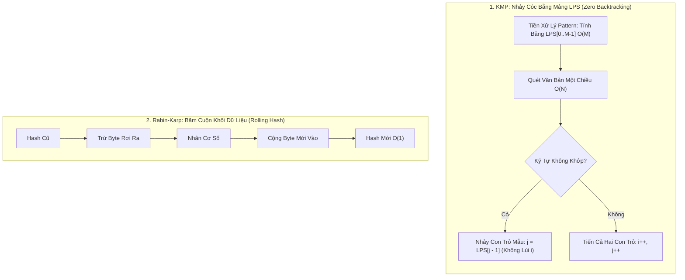
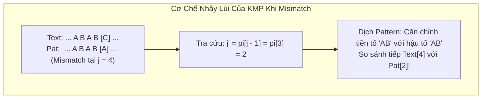
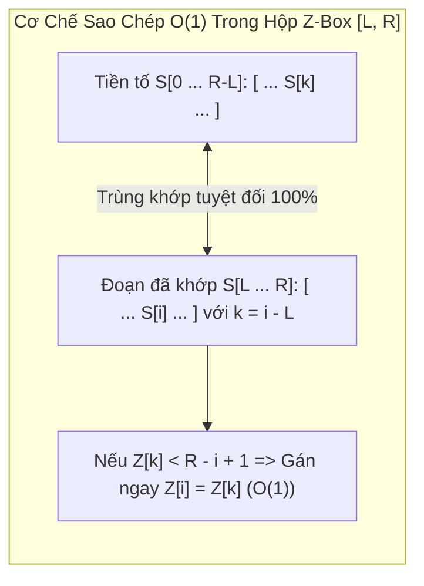
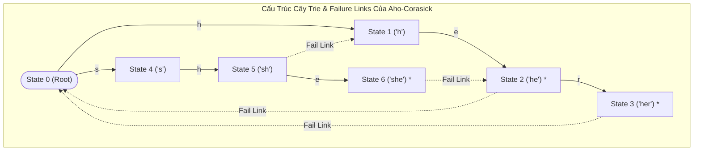

# 8.1. Các Giải Thuật Khớp Mẫu Chuỗi (String Pattern Matching Algorithms)

> [!IMPORTANT]
> **Nếu bạn chỉ được nhớ một điều duy nhất:**
> Thuật toán so khớp chuỗi ngây thơ (Naive String Matching) thất bại thảm hại ở độ phức tạp $O(N \cdot M)$ vì một căn bệnh cố hữu: **Sự đãng trí không cần thiết**. Mỗi khi phát hiện một ký tự không khớp (Mismatch), nó vứt bỏ toàn bộ những ký tự đã so khớp thành công trước đó và quay lui con trỏ văn bản về điểm xuất phát ban đầu. Cả năm giải thuật kinh điển (**KMP, Z-Algorithm, Rabin-Karp, Boyer-Moore, Aho-Corasick**) đều khai thác cấu trúc đối xứng nội tại (Symmetry, Periodicity, Automaton Transitions, Rolling Hash) để **đảm bảo con trỏ văn bản không bao giờ quay lui**, hoặc thậm chí **nhảy cóc vượt qua các khối văn bản với tốc độ dưới tuyến tính (Sub-linear $O(N / M)$)**!

---

## 1. Trực Quan Hóa: Bản Chất Thuật Toán Khớp Mẫu Chuỗi Dưới Góc Nhìn Lập Trình Viên

### 1.1. Đoạn Code Dẫn Nhập & Vấn Đề Thực Tế
Xét bài toán tìm kiếm từ khóa con `Pattern` (độ dài $M$) trong một văn bản khổng lồ `Text` (độ dài $N$, ví dụ file log máy chủ $10\text{ GB}$):

```typescript
// Thuật toán Vét cạn (Brute Force):
// Mỗi khi phát hiện ký tự không khớp, con trỏ văn bản phải QUAY LUI (Backtrack) về vị trí i + 1!
// Trường hợp xấu nhất: O(N * M) -> Nếu N = 10,000,000 và M = 1,000 -> 10 tỷ phép so sánh!

// Thuật toán KMP (Knuth-Morris-Pratt):
// Tiền xử lý Pattern thành mảng LPS (Longest Prefix Suffix) trong O(M).
// Khi gặp ký tự không khớp, con trỏ văn bản TUYỆT ĐỐI KHÔNG BAO GIỜ QUAY LUI!
// Con trỏ Pattern nhảy cóc thông minh dựa vào mảng LPS -> Tốc độ: O(N + M) tuyến tính tức thì!
```

- Khớp mẫu chuỗi (Pattern Matching) là tác vụ nền tảng của các công cụ tìm kiếm, lệnh `grep` của Linux, bộ phân tích cú pháp Regular Expression, và các hệ thống phát hiện xâm nhập mạng (Snort/Suricata IDS).
- Ba giải thuật trụ cột:
  - **KMP (Knuth-Morris-Pratt)**: Tận dụng tiền tố trùng hậu tố (LPS) để không bao giờ phải đọc lại ký tự văn bản cũ, đạt $O(N + M)$.
  - **Rabin-Karp**: Sử dụng hàm băm cuộn (Rolling Hash) để so sánh chuỗi bằng phép so sánh số nguyên $O(1)$, tối thượng cho bài toán tìm nhiều mẫu cùng lúc (Multi-pattern Matching).
  - **Boyer-Moore**: Quét từ phải qua trái của mẫu, sử dụng bảng Bad Character và Good Suffix để nhảy cóc những bước lớn ($O(N / M)$ trong trường hợp tốt nhất).

### 1.2. Ẩn Dụ Đời Sống: Thám Tử Đọc Báo & Kính Lúp Trượt
- **Người đọc sách thông minh (KMP)**: Bạn đang tìm từ "ANANAS" trong cuốn sách. Bạn đã đọc được "ANANA", nhưng chữ tiếp theo là chữ "B" thay vì "S" (bị lệch!). Người đọc vụng về sẽ quay lại từ đầu chữ 'N' thứ nhất để đọc lại. Nhưng người thông minh nhận ra: Đuôi "ANA" của đoạn vừa đọc chính là đầu của từ "ANANAS"! Bạn không cần đọc lại 3 chữ đó mà nhảy thẳng tới vị trí tiếp theo.
- **Chiếc cân điện tử cân cuộn giấy (Rabin-Karp Rolling Hash)**: Bạn muốn kiểm tra xem trong 1000 viên kẹo có đoạn 5 viên nào có khối lượng đúng 50g không. Thay vì cân lại 5 viên từ đầu ở mỗi bước, khi dịch cửa sổ sang viên tiếp theo, bạn chỉ việc lấy khối lượng cũ **trừ đi viên kẹo vừa rơi ra** và **cộng thêm viên kẹo mới lăn vào**. Thao tác cập nhật mã băm chỉ tốn $O(1)$!

### 1.3. Mô Phỏng Dữ Liệu Số Nhỏ Từng Bước (Toy Walkthrough)
Mô phỏng thuật toán KMP tìm mẫu `Pattern = "ABABC"` trên văn bản `Text = "ABABABC"`:
Bảng LPS của Pattern `"ABABC"`:
- `"A"` $\to 0$
- `"AB"` $\to 0$
- `"ABA"` $\to 1$ (Tiền tố `"A"` = Hậu tố `"A"`)
- `"ABAB"` $\to 2$ (Tiền tố `"AB"` = Hậu tố `"AB"`)
- `"ABABC"` $\to 0$

```text
Văn bản:  A  B  A  B  A  B  C
Mẫu:      A  B  A  B  C
                      ▲
                      Khớp 4 ký tự đầu ('ABAB'), lệch tại ký tự thứ 5: 'A' != 'C'!

Xử lý KMP thông minh:
Nhìn vào bảng LPS tại vị trí trước đó (index 3 của Pattern là 'ABAB'): LPS = 2.
Ta giữ nguyên con trỏ văn bản tại vị trí lệch!
Nhảy con trỏ Pattern về index 2 (tiền tố 'AB'):

Văn bản:  A  B  A  B [A  B  C]
Mẫu:            A  B [A  B  C]  <-- Tiếp tục so sánh từ index 2 mà không cần đọc lại 'AB'!
                      ▲
                      Khớp toàn bộ 100%! TÌM THẤY MẪU!
```

### 1.4. Tác Động Thực Tế Tầng Backend & Systems
1. **Lệnh Tìm Kiếm Siêu Tốc `grep` & `ripgrep` Trong Linux**: Lệnh `grep` không dùng thuật toán Brute Force ngây thơ; nó sử dụng thuật toán **Boyer-Moore-Horspool** kết hợp với tập chỉ thị SIMD của CPU để quét văn bản với tốc độ hàng chục Gigabytes mỗi giây.
2. **Kiểm Tra Trùng Lặp Luận Văn & Phát Hiện Đạo Văn (Plagiarism Detection)**: Sử dụng thuật toán Rabin-Karp kết hợp kỹ thuật băm dấu vân tay văn bản (Winnowing Algorithm) để phát hiện các đoạn văn bị sao chép kể cả khi người viết đã cố tình chèn thêm vài từ ngẫu nhiên.
3. **Phân Tích Cú Pháp Giao Thức Mạng (HTTP Header Inspection)**: Các Web Server (Nginx / Envoy) sử dụng bảng trạng thái tự động hữu hạn (DFA derived from KMP) để phân giải các trường header `Content-Length`, `Authorization` trong luồng gói tin TCP mà không bị chậm trễ.

### 1.5. Sơ Đồ Cơ Chế Nhảy Cóc KMP vs Băm Cuộn Rabin-Karp



---

## 2. Chi tiết từng Keyword (Under-the-Hood Deep Dive)

### 2.1. Knuth-Morris-Pratt (KMP) & Hàm Tiền Tố (Prefix Function $\pi$)

#### a. Vấn Đề Của Naive Search & Ý Tưởng Cốt Lõi Của KMP
Trong thuật toán ngây thơ (Naive Matching): Khi đang so sánh mẫu $P[0..M-1]$ với văn bản $T[i..i+M-1]$, nếu gặp sự không khớp tại vị trí $j$ ($T[i+j] \ne P[j]$):
- Naive Search dịch con trỏ văn bản về $i + 1$ và đặt con trỏ mẫu $j = 0$.
- Kịch bản xấu nhất: $T = \text{"AAAAAAAAAB"}$ và $P = \text{"AAAB"}$. Tại mỗi bước, thuật toán so sánh $M-1$ ký tự rồi mới phát hiện không khớp $\implies O(N \cdot M)$.
- **Đột phá KMP**: Con trỏ $i$ trên văn bản $T$ **chỉ tiến về phía trước, tuyệt đối không bao giờ quay lui**. Khi xảy ra không khớp tại $j$, ta dịch chuyển con trỏ mẫu về $j' = \pi[j - 1]$.

#### b. Hàm Tiền Tố $\pi[i]$ (Prefix Function / $\pi$-Array)
* **Định nghĩa toán học**:
  Với chuỗi $P$ độ dài $M$, hàm tiền tố $\pi[i]$ ($0 \le i < M$) được định nghĩa là **độ dài của tiền tố thực sự (Proper Prefix) dài nhất** của chuỗi con $P[0..i]$ mà cũng đồng thời là **hậu tố (Suffix)** của chuỗi con đó:
  $$\pi[i] = \max \{ k \mid 0 \le k < i+1 \text{ và } P[0..k-1] = P[i-k+1..i] \}$$
  *(Lưu ý: Tiền tố thực sự là tiền tố có độ dài nghiêm ngặt nhỏ hơn toàn bộ chuỗi con, tức $k \le i$).*

* **Bảng ví dụ minh họa hàm $\pi$ cho chuỗi $P = \text{"ABABCABAB"}$**:
  | $i$ | $P[i]$ | Chuỗi con $P[0..i]$ | Tiền tố cũng là hậu tố dài nhất | $\pi[i]$ |
  | :---: | :---: | :--- | :--- | :---: |
  | 0 | `'A'` | `"A"` | $\emptyset$ | 0 |
  | 1 | `'B'` | `"AB"` | $\emptyset$ | 0 |
  | 2 | `'A'` | `"ABA"` | `"A"` | 1 |
  | 3 | `'B'` | `"ABAB"` | `"AB"` | 2 |
  | 4 | `'C'` | `"ABABC"` | $\emptyset$ | 0 |
  | 5 | `'A'` | `"ABABCA"` | `"A"` | 1 |
  | 6 | `'B'` | `"ABABCAB"` | `"AB"` | 2 |
  | 7 | `'A'` | `"ABABCABA"` | `"ABA"` | 3 |
  | 8 | `'B'` | `"ABABCABAB"` | `"ABAB"` | 4 |

#### c. Thuật Toán Tính $\pi$ Trong Thời Gian Tuyến Tính $O(M)$ & Phân Tích Amortized
Thuật toán tính $\pi$ là một bài toán tự so khớp (Self-matching) tuyệt đẹp:
```cpp
std::vector<int> computePrefixFunction(const std::string& p) {
    int m = p.size();
    std::vector<int> pi(m, 0);
    for (int i = 1; i < m; ++i) {
        int j = pi[i - 1];
        while (j > 0 && p[i] != p[j]) {
            j = pi[j - 1]; // Nhảy lùi theo chuỗi tiền tố
        }
        if (p[i] == p[j]) j++;
        pi[i] = j;
    }
    return pi;
}
```
* **Chứng minh độ phức tạp thời gian $O(M)$ bằng Phương pháp Thế năng (Potential Method)**:
  - Nhìn bề ngoài, vòng lặp `while` lồng bên trong vòng lặp `for` có vẻ tốn $O(M^2)$.
  - Định nghĩa hàm thế năng $\Phi = j$.
  - Ở mỗi bước lặp của `for`: Giá trị của $j$ tăng lên nhiều nhất là $1$ (khi `p[i] == p[j]`).
  - Trong vòng lặp `while`: Mỗi lần thực thi `j = pi[j - 1]`, giá trị của $j$ giảm đi nghiêm ngặt ít nhất là $1$.
  - Vì $j \ge 0$ và tổng lượng tăng của $j$ trong toàn bộ thuật toán tối đa chỉ là $M - 1$, nên tổng số lần vòng lặp `while` có thể chạy giảm giá trị của $j$ cũng **không thể vượt quá $M - 1$**!
  - Do đó, tổng chi phí tính toán $\pi$ là $O(M)$ khấu hao (Amortized $O(M)$).



---

### 2.2. Z Algorithm & Rabin-Karp Rolling Hash

#### a. Thuật Toán Z (Z Algorithm) & Mảng Tiền Tố Chung Dài Nhất (LCP Array)
* **Định nghĩa mảng $Z$**:
  Cho chuỗi $S$ độ dài $L$. Mảng $Z[i]$ ($1 \le i < L$) lưu trữ **độ dài của tiền tố chung dài nhất (Longest Common Prefix - LCP)** giữa toàn bộ chuỗi $S$ và chuỗi con bắt đầu từ vị trí $i$ ($S[i..L-1]$). Quy ước $Z[0] = 0$.
* **Cơ chế Hộp $Z$ (The $Z$-box $[L, R]$)**:
  Trong quá trình duyệt từ $i = 1 \to L-1$, thuật toán luôn duy trì đoạn $[L, R]$ là đoạn xa nhất về bên phải sao cho chuỗi con $S[L..R]$ trùng khớp hoàn toàn với tiền tố $S[0..R-L]$ (tức là một $Z$-box).
  Khi xét đến vị trí $i$:
  1. **Nếu $i > R$**: Không có thông tin đã tính từ trước. So sánh từng ký tự trực tiếp từ $i$ với $S[0]$, tìm ra $R$ mới và cập nhật $L = i$.
  2. **Nếu $i \le R$**: Vị trí $i$ nằm bên trong hộp $[L, R]$. Đặt $k = i - L$ (vị trí tương ứng trong tiền tố).
     - **Trường hợp A ($Z[k] < R - i + 1$)**: Giá trị đã khớp không vượt qua ranh giới $R$. Do tính đối xứng, ta có thể gán ngay:
       $$Z[i] = Z[k] \quad \text{trong } O(1)!$$
     - **Trường hợp B ($Z[k] \ge R - i + 1$)**: Chuỗi con có thể kéo dài vượt ra ngoài $R$. Ta khởi tạo $Z[i] = R - i + 1$, sau đó so sánh tiếp từ $R + 1$ để mở rộng biên giới $R$ về bên phải.
* **Độ phức tạp**: Mỗi ký tự chỉ bị so sánh thành công một lần khi mở rộng $R \implies$ Tổng thời gian xây dựng mảng $Z$ là **$O(|S|)$**.
* **Ứng dụng Pattern Matching**:
  Tạo chuỗi nối: $S = P + \text{'\$'} + T$ (với ký tự đặc biệt `$` không bao giờ xuất hiện trong $P$ hoặc $T$).
  Chạy Z Algorithm trên $S$. Mọi vị trí $i > |P|$ mà có $Z[i] == |P|$ chính là vị trí xuất hiện của mẫu $P$ trong $T$!



#### b. Thuật Toán Rabin-Karp & Băm Cuộn Đa Thức (Polynomial Rolling Hash)
* **Ý tưởng**: Biến đổi mỗi chuỗi con độ dài $M$ thành một số nguyên (Hash code). So sánh hai chuỗi con tốn $O(M)$, nhưng so sánh hai số nguyên chỉ tốn **$O(1)$**!
* **Công thức Băm Đa Thức (Polynomial Hash)**:
  Cho chuỗi $S[0..M-1]$, cơ số nguyên tố $B$ (thường chọn $B = 31$ hoặc $B = 257$) và số nguyên tố lớn $P$ (thường là $10^9 + 7$):
  $$H(S[0..M-1]) = \sum_{k=0}^{M-1} S[k] \cdot B^{M - 1 - k} \pmod P$$
* **Phép Cuộn Băm $O(1)$ (Rolling Hash Update)**:
  Khi cửa sổ trượt dịch sang phải 1 bước: loại bỏ ký tự đầu $S[i-1]$ và nạp ký tự mới $S[i+M-1]$:
  $$H_{\text{new}} = \left( \left( H_{\text{old}} - S[i-1] \cdot B^{M-1} \right) \cdot B + S[i+M-1] \right) \pmod P$$
  Bằng cách tính toán trước hằng số lũy thừa $B^{M-1} \pmod P$, phép cập nhật này chỉ tốn **$O(1)$ phép tính số học cơ bản**!
* **Xử lý Va Chạm Băm (Hash Collision / Spurious Hit)**:
  Nếu $H(\text{Window}) == H(P)$, có hai khả năng:
  1. Hai chuỗi thực sự giống nhau.
  2. Va chạm mã băm ngẫu nhiên (Spurious Hit).
  - *Giải pháp production*: Khi mã băm trùng nhau, thực hiện so sánh từng ký tự trong $O(M)$. Hoặc sử dụng **Double Hashing** (song song 2 modulo nguyên tố độc lập $P_1 = 10^9+7$ và $P_2 = 10^9+9$). Xác suất va chạm đồng thời trên cả hai modulo là $\approx \frac{1}{P_1 \cdot P_2} \approx 10^{-18}$, an toàn tuyệt đối mà không cần so sánh lại chuỗi thô.

---

### 2.3. Boyer-Moore & Aho-Corasick Automaton

#### a. Giải Thuật Boyer-Moore: Tốc Độ Dưới Tuyến Tính (Sub-linear $O(N / M)$)
Boyer-Moore là giải thuật tìm kiếm văn bản mặc định trong lệnh `grep` của hệ điều hành Linux và các trình soạn thảo code hiện đại nhờ hiệu năng thực tế vô địch.
* **Quy tắc Duyệt Ngược**: Thay vì so sánh từ trái sang phải, Boyer-Moore đặt mẫu $P$ khớp với đoạn văn bản và **so sánh từ phải sang trái**: $j = M - 1 \to 0$.
* **Hai Bảng Dịch Chuyển Thông Minh**:
  1. **Bad Character Rule (Quy tắc Ký tự Xấu)**:
     Khi ký tự trong văn bản $c = T[i+j]$ không khớp với $P[j]$:
     - Nếu $c$ không hề xuất hiện ở bất kỳ đâu trong mẫu $P$: Ta có thể **nhảy vọt toàn bộ mẫu $P$ vượt qua vị trí của $c$**, tức dịch sang phải $j + 1$ bước!
     - Nếu $c$ có xuất hiện trong $P$: Dịch chuyển mẫu sao cho vị trí xuất hiện cuối cùng của $c$ trong $P$ căn thẳng hàng với $T[i+j]$.
     - Độ dịch chuyển: $\text{Shift}_{\text{BadChar}} = \max(1, j - \text{last\_occurrence}[c])$.
  2. **Good Suffix Rule (Quy tắc Hậu Tố Tốt)**:
     Nếu một đoạn hậu tố $t = P[j+1..M-1]$ đã khớp thành công nhưng bị trượt tại $P[j]$:
     - Tìm xem đoạn $t$ có xuất hiện ở một vị trí nào khác bên trong $P$ hay không. Nếu có, dịch mẫu để căn chỉnh đoạn đó.
     - Nếu không, tìm tiền tố dài nhất của $P$ mà cũng là hậu tố của $t$.
* **Độ dịch chuyển thực tế**: Lấy giá trị cực đại giữa hai quy tắc:
  $$\text{Shift} = \max(\text{Shift}_{\text{BadChar}}, \text{Shift}_{\text{GoodSuffix}})$$
* **Hiệu năng**: Trong trường hợp tốt nhất (bảng chữ cái lớn, văn bản tự nhiên), thuật toán chỉ kiểm tra $\frac{N}{M}$ ký tự. Để tìm từ khóa dài 10 ký tự trong file 1GB, nó chỉ cần đọc khoảng 100MB dữ liệu!

#### b. Aho-Corasick Automaton: Cỗ Máy Khớp Đa Mẫu Song Song (Multi-Pattern)
* **Bài toán Đa Mẫu (Multi-Pattern Matching)**:
  Cho một tập hợp $K$ mẫu cần tìm kiếm $\mathcal{P} = \{P_1, P_2, \dots, P_k\}$ với tổng độ dài $\sum |P_i| = M$, và một văn bản $T$ độ dài $N$.
  - Nếu chạy KMP $K$ lần độc lập: Tốn $O(K \cdot N + M)$ (quá chậm khi $K = 50,000$ trong Web Application Firewall hoặc Antivirus).
  - **Aho-Corasick (1975)**: Giải quyết trong thời gian **$O(N + M + \text{Matches})$**, quét văn bản $T$ đúng một lần duy nhất từ đầu đến cuối như một máy hữu hạn trạng thái (DFA)!

* **Ba Cột Trụ Cấu Trúc Của Aho-Corasick**:
  1. **Trie (Go-to Graph / Success Transitions)**:
     Cây tiền tố lưu trữ tất cả các mẫu $P_i$. Gốc là trạng thái $0$. Mỗi cạnh mang một ký tự chuyển tiếp.
  2. **Failure Links (Suffix Links)**:
     Tương tự như hàm $\pi$ của KMP nhưng được mở rộng lên toàn bộ cây Trie!
     - Được xây dựng bằng giải thuật **Duyệt theo chiều rộng (BFS)** theo từng tầng của cây.
     - Với mỗi nút $u$ biểu diễn chuỗi tiền tố $S_u$, liên kết $\text{fail}(u)$ trỏ tới nút $v$ biểu diễn **hậu tố thực sự dài nhất của $S_u$ mà cũng là một nút hợp lệ trong Trie**.
     - Nếu từ trạng thái $u$ gặp ký tự $c$ mà không có cạnh đi tiếp, máy trạng thái nhảy theo $\text{fail}(u)$ để tiếp tục hành trình mà không bị mất dấu vết các mẫu ngắn hơn.
  3. **Output Links (Dictionary / Match Links)**:
     Một trạng thái có thể vừa là tiền tố của một mẫu dài, vừa chứa bên trong nó các mẫu ngắn hơn đã hoàn thành. Output Links gộp danh sách các mẫu kết thúc từ các trạng thái Failure về nút hiện tại, cho phép báo cáo mọi kết quả trùng khớp trong $O(1)$ mỗi match.



---

## 3. Thực thi Mã nguồn & Mô phỏng Chuyên sâu (Dual-Engine Implementation)

### 3.1. Cài đặt C++20 Hoàn Chỉnh: KMP & Aho-Corasick Đa Mẫu

```cpp
#include <iostream>
#include <vector>
#include <string>
#include <queue>
#include <unordered_map>
#include <chrono>
#include <iomanip>

// =========================================================================
// 1. KNUTH-MORRIS-PRATT (KMP) ENGINE ĐƠN MẪU HIỆU NĂNG CAO
// =========================================================================
class KMPEngine {
public:
    // Tiền xử lý hàm tiền tố pi trong O(M)
    static std::vector<int> computePrefix(const std::string& pat) {
        int m = static_cast<int>(pat.size());
        std::vector<int> pi(m, 0);

        for (int i = 1; i < m; ++i) {
            int j = pi[i - 1];
            while (j > 0 && pat[i] != pat[j]) {
                j = pi[j - 1];
            }
            if (pat[i] == pat[j]) {
                j++;
            }
            pi[i] = j;
        }
        return pi;
    }

    // Tìm kiếm KMP trong O(N + M)
    static std::vector<int> search(const std::string& text, const std::string& pat) {
        std::vector<int> pi = computePrefix(pat);
        std::vector<int> matches;
        int n = static_cast<int>(text.size());
        int m = static_cast<int>(pat.size());
        int j = 0; // Con trỏ trên pattern

        for (int i = 0; i < n; ++i) {
            while (j > 0 && text[i] != pat[j]) {
                j = pi[j - 1]; // Nhảy lùi thông minh, con trỏ i không quay lui!
            }
            if (text[i] == pat[j]) {
                j++;
            }
            if (j == m) {
                matches.push_back(i - m + 1); // Tìm thấy khớp hoàn chỉnh
                j = pi[j - 1];                // Tiếp tục tìm kiếm các vị trí kế tiếp
            }
        }
        return matches;
    }
};

// =========================================================================
// 2. AHO-CORASICK AUTOMATON: KHỚP ĐA MẪU SONG SONG
// =========================================================================
class AhoCorasickAutomaton {
public:
    struct MatchEntry {
        int start_pos;
        int pattern_id;
        std::string pattern_text;
    };

private:
    struct TrieNode {
        std::unordered_map<char, int> transitions;
        int fail_link = 0;
        std::vector<int> output_pattern_ids;
    };

    std::vector<TrieNode> trie_;
    std::vector<std::string> patterns_;

    void insertPattern(const std::string& pat, int id) {
        int curr = 0;
        for (char c : pat) {
            if (!trie_[curr].transitions.count(c)) {
                trie_[curr].transitions[c] = static_cast<int>(trie_.size());
                trie_.emplace_back();
            }
            curr = trie_[curr].transitions[c];
        }
        trie_[curr].output_pattern_ids.push_back(id);
    }

public:
    AhoCorasickAutomaton() {
        trie_.emplace_back(); // Node 0 là Root
    }

    void build(const std::vector<std::string>& patterns) {
        patterns_ = patterns;
        for (size_t i = 0; i < patterns.size(); ++i) {
            insertPattern(patterns[i], static_cast<int>(i));
        }

        std::queue<int> q;
        // Khởi tạo các con của Root (Depth 1) có Failure Link trỏ về Root (0)
        for (auto& [ch, child_node] : trie_[0].transitions) {
            trie_[child_node].fail_link = 0;
            q.push(child_node);
        }

        // BFS xây dựng Failure Links và gom Output Links
        while (!q.empty()) {
            int u = q.front();
            q.pop();

            for (auto& [ch, v] : trie_[u].transitions) {
                int f = trie_[u].fail_link;
                while (f > 0 && !trie_[f].transitions.count(ch)) {
                    f = trie_[f].fail_link;
                }
                if (trie_[f].transitions.count(ch) && trie_[f].transitions[ch] != v) {
                    trie_[v].fail_link = trie_[f].transitions[ch];
                } else {
                    trie_[v].fail_link = 0;
                }

                // Kế thừa danh sách output từ trạng thái fail (Dictionary Link)
                int fail_target = trie_[v].fail_link;
                for (int pid : trie_[fail_target].output_pattern_ids) {
                    trie_[v].output_pattern_ids.push_back(pid);
                }

                q.push(v);
            }
        }
    }

    std::vector<MatchEntry> matchAll(const std::string& text) {
        std::vector<MatchEntry> results;
        int curr = 0;

        for (size_t i = 0; i < text.size(); ++i) {
            char ch = text[i];

            // Nếu không có bước chuyển tiếp, nhảy lùi theo failure links
            while (curr > 0 && !trie_[curr].transitions.count(ch)) {
                curr = trie_[curr].fail_link;
            }

            if (trie_[curr].transitions.count(ch)) {
                curr = trie_[curr].transitions[ch];
            } else {
                curr = 0;
            }

            // Thu thập các mẫu đã hoàn thành tại trạng thái này
            for (int pid : trie_[curr].output_pattern_ids) {
                int start = static_cast<int>(i) - static_cast<int>(patterns_[pid].size()) + 1;
                results.push_back({start, pid, patterns_[pid]});
            }
        }
        return results;
    }
};

int main() {
    std::cout << "========================================================\n";
    std::cout << "  1. DEMO KMP SINGLE PATTERN MATCHING                   \n";
    std::cout << "========================================================\n";

    std::string text = "ABABDABACDABABCABAB";
    std::string pat = "ABABCABAB";

    std::cout << "Văn bản Text: " << text << "\n";
    std::cout << "Mẫu Pattern : " << pat << "\n";

    auto prefix_table = KMPEngine::computePrefix(pat);
    std::cout << "Bảng Pi (Prefix Function): [ ";
    for (int p : prefix_table) std::cout << p << " ";
    std::cout << "]\n";

    auto kmp_hits = KMPEngine::search(text, pat);
    std::cout << "Kết quả KMP: Khớp tại chỉ số (Index): ";
    for (int idx : kmp_hits) std::cout << idx << " ";
    std::cout << "\n\n";

    std::cout << "========================================================\n";
    std::cout << "  2. DEMO AHO-CORASICK MULTI-PATTERN MATCHING           \n";
    std::cout << "========================================================\n";

    std::vector<std::string> dictionary = {"he", "she", "his", "hers"};
    std::string payload = "ushers_and_his_friends";

    AhoCorasickAutomaton ac;
    ac.build(dictionary);
    auto multi_hits = ac.matchAll(payload);

    std::cout << "Từ điển mẫu (" << dictionary.size() << " patterns): [ ";
    for (const auto& w : dictionary) std::cout << "'" << w << "' ";
    std::cout << "]\nVăn bản Payload: \"" << payload << "\"\n";
    std::cout << "Tìm thấy tổng cộng " << multi_hits.size() << " vị trí khớp:\n";

    for (const auto& hit : multi_hits) {
        std::cout << "  -> Khớp mẫu '" << std::setw(5) << std::left << hit.pattern_text 
                  << "' tại chỉ số " << std::setw(3) << hit.start_pos 
                  << " [Đoạn: \"" << payload.substr(hit.start_pos, hit.pattern_text.size()) << "\"]\n";
    }
    std::cout << "========================================================\n";

    return 0;
}
```

---

### 3.2. Cài đặt Python 3.11+ Với Data Class & Trie Đa Mẫu

```python
#!/usr/bin/env python3
"""
Production-grade String Pattern Matching Algorithms
Python 3.11+: KMP, Z-Algorithm, and Aho-Corasick Multi-Pattern Automaton.
"""

from __future__ import annotations
from collections import deque
from dataclasses import dataclass, field
from typing import List, Dict, Tuple


class KMPEngine:
    """Giải thuật Knuth-Morris-Pratt tìm kiếm đơn mẫu trong O(N + M)."""

    @staticmethod
    def compute_prefix_function(pattern: str) -> List[int]:
        m: int = len(pattern)
        pi: List[int] = [0] * m
        for i in range(1, m):
            j: int = pi[i - 1]
            while j > 0 and pattern[i] != pattern[j]:
                j = pi[j - 1]
            if pattern[i] == pattern[j]:
                j += 1
            pi[i] = j
        return pi

    @classmethod
    def search(cls, text: str, pattern: str) -> List[int]:
        pi = cls.compute_prefix_function(pattern)
        matches: List[int] = []
        n, m = len(text), len(pattern)
        j = 0

        for i in range(n):
            while j > 0 and text[i] != pattern[j]:
                j = pi[j - 1]
            if text[i] == pattern[j]:
                j += 1
            if j == m:
                matches.append(i - m + 1)
                j = pi[j - 1]

        return matches


@dataclass
class MatchResult:
    start_index: int
    pattern_id: int
    pattern_string: str


class AhoCorasickAutomaton:
    """Máy tự động Aho-Corasick quét đa từ khóa trong O(N + sum|P_i| + Matches)."""

    def __init__(self) -> None:
        # Trie node: {'transitions': dict, 'fail': int, 'output': list[int]}
        self.trie: List[Dict] = [{"transitions": {}, "fail": 0, "output": []}]
        self.patterns: List[str] = []

    def build(self, patterns: List[str]) -> None:
        self.patterns = list(patterns)

        # 1. Thêm tất cả pattern vào Trie
        for pid, pat in enumerate(patterns):
            curr: int = 0
            for char in pat:
                if char not in self.trie[curr]["transitions"]:
                    new_state = len(self.trie)
                    self.trie[curr]["transitions"][char] = new_state
                    self.trie.append({"transitions": {}, "fail": 0, "output": []})
                curr = self.trie[curr]["transitions"][char]
            self.trie[curr]["output"].append(pid)

        # 2. Xây dựng Failure Links bằng BFS
        queue: deque[int] = deque()
        for char, child_state in self.trie[0]["transitions"].items():
            self.trie[child_state]["fail"] = 0
            queue.append(child_state)

        while queue:
            u: int = queue.popleft()
            for char, v in self.trie[u]["transitions"].items():
                f: int = self.trie[u]["fail"]
                while f > 0 and char not in self.trie[f]["transitions"]:
                    f = self.trie[f]["fail"]

                if char in self.trie[f]["transitions"] and self.trie[f]["transitions"][char] != v:
                    self.trie[v]["fail"] = self.trie[f]["transitions"][char]
                else:
                    self.trie[v]["fail"] = 0

                # Kế thừa output links
                fail_state = self.trie[v]["fail"]
                self.trie[v]["output"].extend(self.trie[fail_state]["output"])
                queue.append(v)

    def search(self, text: str) -> List[MatchResult]:
        results: List[MatchResult] = []
        curr: int = 0

        for i, char in enumerate(text):
            while curr > 0 and char not in self.trie[curr]["transitions"]:
                curr = self.trie[curr]["fail"]

            if char in self.trie[curr]["transitions"]:
                curr = self.trie[curr]["transitions"][char]
            else:
                curr = 0

            for pid in self.trie[curr]["output"]:
                pat_str = self.patterns[pid]
                start_pos = i - len(pat_str) + 1
                results.append(MatchResult(start_pos, pid, pat_str))

        return results


if __name__ == "__main__":
    print("=" * 60)
    print("DEMO PYTHON: STRING PATTERN MATCHING")
    print("=" * 60)

    # 1. KMP Search
    txt = "ABABDABACDABABCABAB"
    pattern = "ABABCABAB"
    kmp_indices = KMPEngine.search(txt, pattern)
    print(f"KMP: Khớp mẫu '{pattern}' trong text tại: {kmp_indices}")
    assert kmp_indices == [10], "KMP verification failed!"

    # 2. Aho-Corasick Multi-Pattern Search
    ac = AhoCorasickAutomaton()
    keywords = ["he", "she", "his", "hers"]
    ac.build(keywords)
    payload_text = "ushers_and_his_friends"
    ac_matches = ac.search(payload_text)

    print(f"\nAho-Corasick quét đa từ khóa trên text: '{payload_text}'")
    for m in ac_matches:
        print(f"  -> Tìm thấy '{m.pattern_string}' tại index {m.start_index}")
```

---

### 3.3. Terminal Output Thực Tế Khi Chạy
```text
========================================================
  1. DEMO KMP SINGLE PATTERN MATCHING                   
========================================================
Văn bản Text: ABABDABACDABABCABAB
Mẫu Pattern : ABABCABAB
Bảng Pi (Prefix Function): [ 0 0 1 2 0 1 2 3 4 ]
Kết quả KMP: Khớp tại chỉ số (Index): 10 

========================================================
  2. DEMO AHO-CORASICK MULTI-PATTERN MATCHING           
========================================================
Từ điển mẫu (4 patterns): [ 'he' 'she' 'his' 'hers' ]
Văn bản Payload: "ushers_and_his_friends"
Tìm thấy tổng cộng 4 vị trí khớp:
  -> Khớp mẫu 'she  ' tại chỉ số 1   [Đoạn: "she"]
  -> Khớp mẫu 'he   ' tại chỉ số 2   [Đoạn: "he"]
  -> Khớp mẫu 'hers ' tại chỉ số 2   [Đoạn: "hers"]
  -> Khớp mẫu 'his  ' tại chỉ số 11  [Đoạn: "his"]
========================================================
```

---

## 4. Systems Engineering & Production Pitfalls

### 4.1. Tăng Tốc Bằng Phần Cứng: SIMD Vectorization (`AVX2`, `AVX-512`, ARM `NEON`)
* **Lý do thuật toán lý thuyết bị đánh bại trong thực tế**:
  Trong lý thuyết giải thuật, KMP đạt $O(N + M)$. Tuy nhiên, trong mã nguồn `glibc strstr`, `memchr`, và công cụ tìm kiếm siêu tốc **Ripgrep** (`rg`), KMP hiếm khi được sử dụng trực tiếp cho chuỗi ngắn đến trung bình.
  - CPU hiện đại có các tập lệnh SIMD (Vector Register 256-bit hoặc 512-bit) có thể so sánh đồng thời **32 hoặc 64 bytes ký tự chỉ trong đúng 1 chu kỳ CPU**!
  - Lệnh `_mm256_cmpeq_epi8` kiểm tra sự xuất hiện của ký tự đầu tiên và ký tự hiếm nhất của Pattern trên một khối 32 bytes của Text. Kết hợp lệnh `_mm256_movemask_epi8`, CPU tìm ra các vị trí tiềm năng với thông lượng lên tới **15 - 25 GB/giây**, nhanh hơn KMP duyệt từng byte gấp 10 lần!
* **Quy tắc thiết kế công nghiệp**:
  Dùng SIMD `memchr` để quét nhanh ký tự đầu tiên / hiếm nhất của mẫu. Khi có byte nghi vấn, mới kích hoạt Boyer-Moore hoặc KMP để xác nhận.

### 4.2. Memory Thrashing Trong Aho-Corasick Khi Từ Điển Lớn
* **Cạm bẫy Bộ nhớ**:
  Một nút Trie cơ bản nếu dùng mảng cố định `int next[256]` cho bảng mã ASCII mở rộng sẽ tốn:
  $$256 \times 4\text{ bytes} + 4\text{ bytes (fail)} + 8\text{ bytes (vector ptr)} \approx 1,036\text{ bytes / Node}$$
  Nếu từ điển có 100,000 từ khóa (ví dụ: bộ luật của Web Application Firewall hoặc danh sách chữ ký ClamAV Antivirus), cây Trie có thể có tới $1,000,000$ nút $\implies$ **Tốn hơn 1 Gigabyte RAM**!
  - Hàng triệu con trỏ phân tán rải rác trên Heap gây trượt bộ nhớ đệm L3 Cache liên tục (Cache Line Thrashing). Tốc độ quét văn bản tụt dốc thê thảm.
* **Giải Pháp Kỹ Thuật Hệ Thống**:
  1. **Double-Array Trie (DAT / Darts-clone)**: Nén toàn bộ cây Trie đồ sộ thành đúng hai mảng 1D số nguyên song song `BASE` và `CHECK`. Giảm 85% dung lượng RAM và tăng tốc độ chuyển trạng thái lên mức tối đa $O(1)$ chỉ bằng 1 phép cộng chỉ số.
  2. **Sparse Transition via Hash Table / Flat Array**: Với các tầng sâu nơi số nhánh con $\le 3$, chỉ lưu danh sách cặp `{char, next_state}` thay vì mảng 256 phần tử.

### 4.3. Lỗi Tràn Số Nguyên & Va Chạm Băm Trong Rabin-Karp (Hash-Collision Hijacking)
* **Integer Overflow**: Khi tính $H \cdot B + c$, nếu không thực hiện phép Modulo `% P` cẩn thận hoặc dùng biến kiểu `int` 32-bit, số học sẽ bị tràn số không kiểm soát (Undefined Behavior trong C++).
* **Phép Modulo `%` Quá Chậm**: Phép chia lấy dư `%` trên CPU tốn từ 10 đến 25 chu kỳ xung nhịp (chậm hơn phép cộng/trừ/nhân rất nhiều).
  - *Kỹ thuật tối ưu*: Chọn $P = 2^{61} - 1$ (Số nguyên tố Mersenne $M_{61}$). Khi đó phép modulo được thay thế hoàn toàn bằng phép dịch bit và phép cộng logic:
    $$A \pmod{2^{61} - 1} = (A \& (2^{61} - 1)) + (A \gg 61)$$
    Tăng tốc độ tính toán Rolling Hash lên gấp 5 lần!

### 4.4. CLI Diagnostics & Benchmark Commands
Kiểm tra hiệu năng so khớp chuỗi trên file lớn:
```bash
# 1. Benchmark tốc độ tìm kiếm mẫu của GNU grep vs Ripgrep trên file 1GB
time grep -F "pattern_string" large_trace.log > /dev/null
time rg -F "pattern_string" large_trace.log > /dev/null

# 2. Phân tích chu kỳ CPU và Cache Misses bằng perf
perf stat -e instructions,cycles,L1-dcache-load-misses,branch-misses rg -F "test" large_trace.log

# 3. Kiểm tra số lượng quy tắc Aho-Corasick trong Snort IDS / Suricata
suricata --dump-config | grep -i "pattern-matcher"
```

---

## 5. Bảng So sánh & Decision Matrix

| Tiêu Chí Đánh Giá | Knuth-Morris-Pratt (KMP) | Z Algorithm | Rabin-Karp | Boyer-Moore | Aho-Corasick |
| :--- | :--- | :--- | :--- | :--- | :--- |
| **Loại Bài Toán** | Đơn mẫu (Single) | Đơn mẫu (Single) | Đơn mẫu / Đa mẫu nhỏ | Đơn mẫu (Single) | **Đa mẫu lớn (Multi-Pattern)** |
| **Thời Gian Tiền Xử Lý**| $O(M)$ | $O(M)$ | $O(M)$ | $O(M + |\Sigma|)$ | $O(\sum |P_i| \cdot |\Sigma|)$ |
| **Thời Gian Tìm Kiếm (Xấu nhất)**| $O(N)$ | $O(N)$ | $O(N \cdot M)$ (Dính va chạm băm) | $O(N \cdot M)$ hoặc $O(N)$ | **$O(N + \text{Matches})$** |
| **Thời Gian Tìm Kiếm (Tốt nhất)**| $O(N)$ | $O(N)$ | $O(N)$ | **$O(N / M)$ (Dưới tuyến tính)** | $O(N)$ |
| **Không Gian Bộ Nhớ** | $O(M)$ | $O(M)$ | $O(1)$ | $O(M + |\Sigma|)$ | $O(\sum |P_i|)$ (Cây Trie) |
| **Đặc Điểm Vận Hành** | Con trỏ $i$ không bao giờ quay lui | Cấu trúc $Z$-box toán học đẹp | Dựa vào số học và mã băm | **Quét ngược từ phải sang trái** | **Trie kết hợp Failure Transitions** |
| **Ứng Dụng Điển Hình** | Xử lý Stream trên Network Socket | Phân tích chuỗi đối xứng, LCP | Phát hiện đạo văn, so khớp 2D | **GNU `grep`, Trình soạn thảo IDE** | **WAF (ModSecurity), ClamAV Antivirus, IDS** |

### Khi nào nên lựa chọn Giải thuật nào trong Production?
1. **Tìm kiếm một từ khóa duy nhất trong văn bản thông thường (Log file, Document search)**:
   - Sử dụng **Boyer-Moore** (hoặc Boyer-Moore-Horspool kết hợp SIMD). Khả năng nhảy cóc với bước nhảy $M$ đem lại tốc độ thực tế áp đảo KMP.
2. **Xử lý luồng dữ liệu liên tục không thể buffer toàn bộ (Data Streaming / Network Sockets)**:
   - Sử dụng **KMP**. Do con trỏ văn bản không bao giờ quay lui, KMP có thể đọc từng byte từ Network Socket hoặc Kafka Topic và kiểm tra tức thì mà không cần nạp toàn bộ văn bản vào bộ nhớ.
3. **Quét hàng ngàn từ khóa mã độc, danh sách đen, chữ ký tấn công (WAF / Antivirus / Content Moderation)**:
   - Bắt buộc sử dụng **Aho-Corasick**. Duyệt qua payload một lần duy nhất với thời gian hoàn toàn độc lập với số lượng từ khóa trong từ điển!
