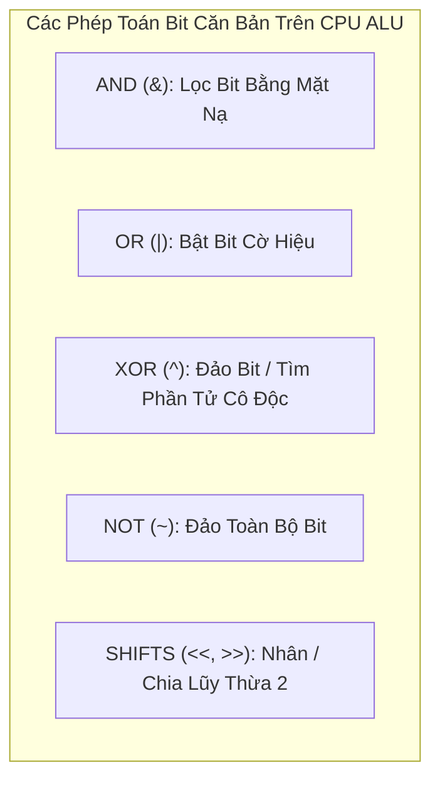
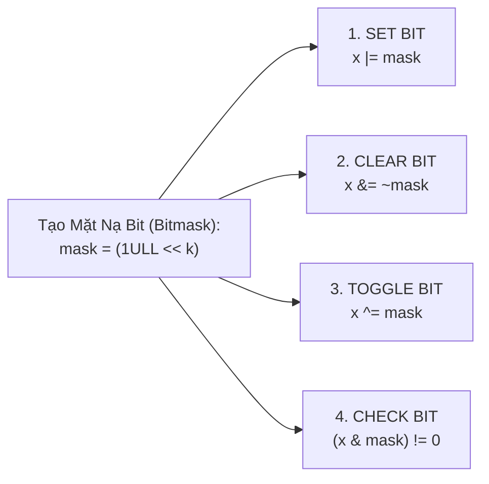

# 10.1. Nền Tảng & Kỹ Thuật Thao Tác Bit (Bitwise Basics and Bit Manipulation)

> [!IMPORTANT]
> **Nếu bạn chỉ được nhớ một điều duy nhất:** Mọi trừu tượng phần mềm cao cấp (High-Level Abstractions) trong hệ điều hành, cơ sở dữ liệu, mạng máy tính và runtime cuối cùng đều quy về các cổng logic vật lý trong đơn vị số học ALU của vi xử lý. Các phép toán bitwise được thực thi trong đúng **1 chu kỳ xung nhịp CPU (1 clock cycle)** mà không cần qua bất kỳ lớp trung gian nào. Nắm vững thao tác bit là chìa khóa để lập trình không rẽ nhánh (Branchless Programming), nén dữ liệu cực hạn (Bitsets, Bitmasks, Bloom Filters, Roaring Bitmaps) và tối ưu hóa hiệu năng hệ thống ở mức bare-metal.

---

## 1. Trực Quan Hóa: Bản Chất Thao Tác Bit Dưới Góc Nhìn Lập Trình Viên

### 1.1. Đoạn Code Dẫn Nhập & Vấn Đề Thực Tế
Xét bài toán kiểm tra xem một số nguyên $N$ có phải là lũy thừa của 2 ($2^k$ như 2, 4, 8, 16, 1024...) hay không:

```cpp
// Cách 1: Vòng lặp chia đôi thông thường: O(log N)
bool isPowerOfTwo_Naive(int n) {
    if (n <= 0) return false;
    while (n % 2 == 0) n /= 2;
    return n == 1; // Tốn hàng chục chu kỳ CPU!
}

// Cách 2: Phép thuật Thao tác Bit (Bit Manipulation): ĐÚNG 1 CHU KỲ CPU!
bool isPowerOfTwo_Bitwise(int n) {
    return n > 0 && (n & (n - 1)) == 0;
}
```

- Tại sao biểu thức `(n & (n - 1)) == 0` lại có thể kiểm tra lũy thừa của 2?
  - Một số là lũy thừa của 2 luôn có **duy nhất đúng 1 bit 1** trong biểu diễn nhị phân (ví dụ $8 = 1000_2$).
  - Khi lấy $n - 1$, bit 1 đó biến thành bit 0 và toàn bộ các bit 0 phía sau biến thành bit 1 ($7 = 0111_2$).
  - Phép AND bit: $1000_2 \ \& \ 0111_2 = \mathbf{0000_2}$! Phép tính này được thực thi trực tiếp trên mạch điện bán dẫn ALU của CPU trong **$0.3\text{ nanosecond}$**!
- Thao tác Bit là ngôn ngữ bản năng của phần cứng máy tính: Nhanh nhất, gọn nhất và tiết kiệm năng lượng nhất.

### 1.2. Ẩn Dụ Đời Sống: Bảng Công Tắc Điện & Chiếc Kẹp Phân Loại
- **Bảng công tắc điện tập trung 8 nút**: Thay vì phải thuê 8 người đứng gác 8 căn phòng, người quản lý tòa nhà chỉ cần nhìn vào bảng điều khiển 8 công tắc: Công tắc nào bật đèn xanh nghĩa là phòng đó đang sáng (`bit = 1`), tắt nghĩa là phòng tối (`bit = 0`). Một byte duy nhất ($8\text{ bits}$) có thể lưu trữ trạng thái của 8 căn phòng!
- **Bộ lọc mặt nạ bit (Bitmask)**: Bạn muốn kiểm tra xem Phòng 3 có bật đèn không? Bạn lấy một tấm bìa đục đúng một lỗ tại vị trí số 3 (`Mask = 00000100_2`) áp lên bảng điện. Toàn bộ các bóng đèn khác bị che khuất, bạn nhìn thấy ngay trạng thái của Phòng 3 trong 1 tích tắc.

### 1.3. Mô Phỏng Dữ Liệu Số Nhỏ Từng Bước (Toy Walkthrough)
Mô phỏng thuật toán đếm số lượng bit 1 của Brian Kernighan trên số $N = 12$ ($12 = 1100_2$):
Quy tắc: Thao tác `n = n & (n - 1)` luôn xóa bỏ bit 1 nằm ở vị trí thấp nhất (Rightmost Set Bit):

```text
Khởi đầu: n = 12 (nhị phân: 1100), count = 0

Lượt 1:
- n - 1 = 11 (1011)
- n & (n - 1) = 1100 & 1011 = 1000 (Số 8)
- Đã xóa được 1 bit 1 -> count = 1.
- Giá trị mới: n = 8 (1000)

Lượt 2:
- n - 1 = 7 (0111)
- n & (n - 1) = 1000 & 0111 = 0000 (Số 0)
- Đã xóa được 1 bit 1 -> count = 2.
- Giá trị mới: n = 0 -> DỪNG VÒNG LẶP!

Kết quả: Số 12 có đúng 2 bit 1 sau đúng 2 bước lặp!
```

- Số bước lặp đúng bằng số lượng bit 1 thực tế, bỏ qua toàn bộ các bit 0 vô ích!

### 1.4. Tác Động Thực Tế Tầng Backend & Systems
1. **Phân Quyền Nhị Phân Tinh Gọn (Linux File Permissions `rwxr-xr-x`)**: Linux lưu quyền đọc (`r=4=100_2`), ghi (`w=2=010_2`), thực thi (`x=1=001_2`) dưới dạng 3 bit nhị phân. Kiểm tra quyền chỉ là một phép toán `if (perm & READ_MASK)`.
2. **Kỹ Thuật Bitset Trong Nén Dữ Liệu Cột (Columnar Database Null Bitmaps)**: Trong ClickHouse / PostgreSQL, để đánh dấu trường nào bị `NULL` trong 1 triệu dòng, hệ thống không dùng 1 triệu chuỗi hay 1 triệu booleans (tốn $1\text{ MB}$); nó dùng một mảng bit liên tục (Bitset) chỉ tốn đúng **$125\text{ KB}$**!
3. **Chỉ Thị Phần Cứng Đếm Bit Siêu Tốc `POPCNT`**: Vi kiến trúc CPU x86-64 hiện đại tích hợp sẵn chỉ thị mã máy `popcnt` (`__builtin_popcount` trong C++). Nó đếm số bit 1 trong thanh ghi 64-bit trong đúng **1 chu kỳ xung nhịp**.

### 1.5. Sơ Đồ Toàn Cảnh Các Phép Toán Bit Cơ Bản



---

## 2. Chi tiết từng Keyword (Under-the-Hood Deep Dive)

### 2.1. Các Toán Tử Nguyên Thủy & Phép Dịch Bit: Arithmetic vs Logical Shift

#### 1. Bốn Toán Tử Logic Cốt Lõi Trên Mạch Transistor
Mọi phép toán logic trong vi xử lý đều thao tác trên từng cặp bit độc lập tại cùng vị trí:

| Toán Tử | Ký Hiệu | Bảng Chân Trị | Ý Nghĩa Kỹ Thuật Hệ Thống |
| :--- | :--- | :--- | :--- |
| **AND** | `&` | $1 \& 1 = 1$<br>$1 \& 0 = 0$<br>$0 \& 0 = 0$ | **Trích xuất & Lọc (Masking)**: Giữ lại các bit mong muốn tại vị trí mặt nạ có bit 1, xóa toàn bộ các bit còn lại về 0. |
| **OR** | `\|` | $1 \| 1 = 1$<br>$1 \| 0 = 1$<br>$0 \| 0 = 0$ | **Kích hoạt (Flag Setting)**: Đảm bảo các bit mục tiêu được bật thành 1 mà không làm thay đổi các bit khác. |
| **XOR** | `^` | $1 \oplus 0 = 1$<br>$0 \oplus 1 = 1$<br>$1 \oplus 1 = 0$<br>$0 \oplus 0 = 0$ | **Đảo trạng thái & Đối xứng**: Biểu diễn phép cộng không nhớ trong trường hữu hạn Galois $\mathbb{F}_2$. Tự nghịch đảo: $x \oplus x = 0$ và $x \oplus 0 = x$. |
| **NOT** | `~` | $\sim 1 = 0$<br>$\sim 0 = 1$ | **Đảo toàn bộ bit**: Trong biểu diễn số bù 2 (Two's Complement), ta luôn có đồng nhất thức: `~x == -x - 1`. |

#### 2. Phép Dịch Trái (Left Shift `<<`)
- Cú pháp: `x << k`
- Cơ chế: Đẩy toàn bộ các bit của $x$ sang trái $k$ vị trí, chèn $k$ số 0 vào các vị trí trống bên phải (LSB). Các bit bị đẩy ra ngoài biên bên trái (MSB) bị hủy bỏ.
- Ý nghĩa số học: Tương đương với phép nhân số học:
  $$x \ll k = x \times 2^k$$
- **Cảnh báo phần cứng (Undefined Behavior)**: Trong C/C++, dịch một biến 32-bit với số bước $k \ge 32$ hoặc $k < 0$ dẫn đến hành vi không xác định (UB). Trên x86, thanh ghi vi xử lý chỉ lấy 5 bit cuối của số bước dịch (`k & 31`), khiến `1 << 32` thực chất bị biên dịch thành `1 << 0 = 1`!

#### 3. Phép Dịch Phải: Arithmetic vs Logical Right Shift
Sự phân biệt giữa hai phép dịch phải là một trong những điểm sống còn nhất của kỹ thuật lập trình hệ thống cấp thấp:

* **Arithmetic Right Shift (Dịch Phải Số Học - Ký hiệu `>>` trên kiểu có dấu `signed`)**:
  - Dùng lệnh máy `SAR` (Shift Arithmetic Right) trên x86.
  - **Bảo toàn bit dấu (Sign Bit)**: Nếu bit dấu cao nhất (MSB) là 1 (số âm), CPU sẽ **chèn liên tiếp các bit 1** vào các vị trí trống bên trái. Nếu MSB là 0 (số dương), CPU chèn các bit 0.
  - Mục đích: Giữ đúng bản chất của phép chia nguyên làm tròn xuống (Floor Division) trong toán học:
    $$\lfloor x / 2^k \rfloor$$

* **Logical Right Shift (Dịch Phải Logic - Ký hiệu `>>` trên kiểu không dấu `unsigned` trong C/C++, hoặc `>>>` trong Java/JS)**:
  - Dùng lệnh máy `SHR` (Shift Logical Right) trên x86.
  - **Luôn chèn bit 0** vào các vị trí trống bên trái (MSB), bất kể số ban đầu là âm hay dương.

```
Minh họa với số nguyên 8-bit có dấu:
Giả sử x = -16 (Biểu diễn số bù hai: 11110000_2)

1. Phép Dịch Phải Số Học (Arithmetic Shift: x >> 1):
   Input:    1 1 1 1 0 0 0 0  (-16)
   Shift:      1 1 1 1 0 0 0  (Đẩy bit 0 cuối cùng ra ngoài)
   Chèn MSB: 1 1 1 1 1 0 0 0  (Chèn bit 1 vì bit dấu ban đầu là 1)
   Kết quả:  11111000_2 = -8   (Đúng quy luật: -16 / 2 = -8!)

2. Phép Dịch Phải Logic (Logical Shift: x >>> 1):
   Input:    1 1 1 1 0 0 0 0  (-16 dưới dạng nhị phân)
   Shift:      1 1 1 1 0 0 0  (Đẩy bit 0 cuối ra ngoài)
   Chèn MSB: 0 1 1 1 1 0 0 0  (Luôn chèn bit 0!)
   Kết quả:  01111000_2 = +120 (Số âm bị biến thành số dương lớn!)
```

---

### 2.2. Bốn Thao Tác Cơ Bản: Set, Clear, Toggle, Check a Bit

Mọi thuật toán thao tác bit phức tạp trong engine cơ sở dữ liệu, bộ nhớ phân bổ (Memory Allocators), hay bộ lọc Bloom Filter đều được cấu thành từ 4 thao tác nguyên tử trên bit thứ $k$ (với quy ước 0-indexed từ bit có trọng số nhỏ nhất LSB bên phải sang MSB bên trái):



#### 1. Set a Bit (Bật bit thứ $k$ thành 1)
Ta tạo mặt nạ chỉ có bit $k$ bằng 1 (`1ULL << k`) và áp dụng toán tử OR (`|`):
```cpp
x |= (1ULL << k);
```
- Cơ chế: $0 \mid 1 = 1$, $1 \mid 1 = 1$. Mọi bit khác của $x$ được OR với 0 nên giữ nguyên giá trị ban đầu.

#### 2. Clear a Bit (Xóa / Tắt bit thứ $k$ thành 0)
Ta đảo ngược mặt nạ (`~(1ULL << k)`) để thu được một chuỗi toàn bit 1 ngoại trừ bit thứ $k$ bằng 0, sau đó áp dụng toán tử AND (`&`):
```cpp
x &= ~(1ULL << k);
```
- Cơ chế: $x_k \& 0 = 0$. Mọi bit khác được AND với 1 nên giữ nguyên vẹn.

#### 3. Toggle a Bit (Đảo bit thứ $k$: $0 \to 1, 1 \to 0$)
Sử dụng đặc tính tự nghịch đảo của phép XOR (`^`):
```cpp
x ^= (1ULL << k);
```
- Cơ chế: $0 \oplus 1 = 1$, $1 \oplus 1 = 0$. Các bit khác XOR với 0 giữ nguyên.

#### 4. Check a Bit (Kiểm tra trạng thái bit thứ $k$)
Ta dùng mặt nạ để lọc lấy giá trị bit thứ $k$:
```cpp
bool is_set = (x & (1ULL << k)) != 0;
// Hoặc dịch bit về LSB rồi kiểm tra bit 0:
bool is_set = ((x >> k) & 1) != 0;
```

#### 5. Kỹ Thuật Trích Xuất & Xóa Bit Thấp Nhất (Lowest Set Bit)
- **Trích xuất bit 1 có trọng số nhỏ nhất (Isolate Lowest Set Bit)**:
  $$LSB(x) = x \ \& \ (-x)$$
  *Chứng minh qua số bù 2*: $-x = \sim x + 1$. Việc cộng 1 vào chuỗi bit bị đảo $\sim x$ sẽ lật toàn bộ các bit 1 ở đuôi thành 0 và biến bit 0 đầu tiên (vốn là bit 1 thấp nhất của $x$) thành 1. Khi AND $x$ với $-x$, toàn bộ các bit phía trước đều khác nhau (bị triệt tiêu về 0), chỉ duy nhất bit 1 thấp nhất trùng nhau!
- **Xóa bit 1 thấp nhất**:
  $$x \ \& \ (x - 1)$$

---

### 2.3. Bit Hacks Kinh Điển: Brian Kernighan & Power of Two

#### 1. Kiểm Tra Số Lũy Thừa Của 2 (Power of Two Check)
Một số nguyên dương $N$ là lũy thừa của 2 ($1, 2, 4, 8, 16, 32, \dots$) khi và chỉ khi trong biểu diễn nhị phân của nó có **đúng 1 bit 1 duy nhất** (ví dụ: $16 = 10000_2$).

Khi trừ 1 từ một số lũy thừa của 2:
$$N = 10000_2 \implies N - 1 = 01111_2$$
Toàn bộ các bit 0 biến thành 1, và bit 1 duy nhất biến thành 0. Do đó:
$$N \ \& \ (N - 1) == 0$$

Biểu thức kiểm tra không rẽ nhánh hoàn chỉnh trong công nghiệp:
```cpp
bool isPowerOfTwo = (N > 0) && ((N & (N - 1)) == 0);
```
- **Thời gian thực thi**: Thực hiện trong đúng **1 chu kỳ xung nhịp CPU**, không sử dụng phép chia `% 2`, không dùng vòng lặp, triệt tiêu hoàn toàn phân nhánh rẽ (Branch-free).

#### 2. Thuật Toán Brian Kernighan (Đếm Số Bit 1 - Population Count)
Bài toán: Đếm số lượng bit 1 trong biểu diễn nhị phân của số nguyên $N$ (Hamming Weight).
- Duyệt tuần tự 64 bits: Luôn mất đúng 64 vòng lặp ($O(64)$).
- **Thuật toán Brian Kernighan**: Tận dụng tính chất $N \ \& \ (N - 1)$ luôn xóa chính xác bit 1 thấp nhất của $N$:
```cpp
int countSetBits(uint64_t n) {
    int count = 0;
    while (n > 0) {
        n &= (n - 1); // Xóa bit 1 có trọng số nhỏ nhất
        count++;
    }
    return count;
}
```
- **Độ phức tạp**: $O(K)$ với $K$ là số bit 1 thực tế có trong số đó. Nếu một số 64-bit chỉ có 3 bit 1, thuật toán chỉ lặp đúng 3 lần!

#### 3. Tập Lệnh Phần Cứng Chuyên Dụng (Hardware Instructions)
Các kiến trúc CPU hiện đại (x86 SSE4.2 / AVX-512 và ARM NEON) đã tích hợp sẵn các mạch phần cứng chuyên biệt cho các thao tác bit này:

| Thao Tác | GCC / Clang Builtin | C++20 Standard (`<bit>`) | Lệnh Máy x86-64 | Độ Trễ (Latency) |
| :--- | :--- | :--- | :--- | :--- |
| **Population Count** (Đếm số bit 1) | `__builtin_popcountll(x)` | `std::popcount(x)` | `POPCNT` | 1 chu kỳ CPU |
| **Count Trailing Zeros** (Số bit 0 ở đuôi) | `__builtin_ctzll(x)` | `std::countr_zero(x)` | `TZCNT` / `BSF` | 1 chu kỳ CPU |
| **Count Leading Zeros** (Số bit 0 ở đầu) | `__builtin_clzll(x)` | `std::countl_zero(x)` | `LZCNT` / `BSR` | 1 chu kỳ CPU |
| **Bit Width** ($\lfloor \log_2 x \rfloor + 1$) | `64 - __builtin_clzll(x)` | `std::bit_width(x)` | `LZCNT` | 1 chu kỳ CPU |

---

## 3. Thực thi Mã nguồn & Mô phỏng Chuyên sâu (Dual-Engine Implementation)

### 3.1. C++20 Implementation: High-Performance Bitwise Toolkit

Mã nguồn C++20 đạt chuẩn hệ thống, sử dụng thư viện chuẩn `<bit>`, các lệnh phần cứng nội tại (intrinsics), và hiện thực hóa cấu trúc cờ phân quyền (Permission Bitmask):

```cpp
#include <iostream>
#include <bitset>
#include <bit>
#include <cstdint>
#include <string>

class BitManipEngine {
public:
    // ==========================================
    // 1. BỐN THAO TÁC CƠ BẢN
    // ==========================================
    static uint64_t setBit(uint64_t num, int k) {
        return num | (1ULL << k);
    }

    static uint64_t clearBit(uint64_t num, int k) {
        return num & ~(1ULL << k);
    }

    static uint64_t toggleBit(uint64_t num, int k) {
        return num ^ (1ULL << k);
    }

    static bool checkBit(uint64_t num, int k) {
        return (num & (1ULL << k)) != 0;
    }

    // ==========================================
    // 2. BIT HACKS KINH ĐIỂN
    // ==========================================
    static bool isPowerOfTwo(uint64_t n) {
        return (n > 0) && ((n & (n - 1)) == 0);
    }

    // Thuật toán Brian Kernighan O(K)
    static int countBitsKernighan(uint64_t n) {
        int count = 0;
        while (n > 0) {
            n &= (n - 1);
            count++;
        }
        return count;
    }

    // Trích xuất bit 1 có trọng số nhỏ nhất
    static uint64_t isolateLowestSetBit(uint64_t n) {
        return n & (-static_cast<int64_t>(n));
    }
};

// Mô phỏng hệ thống cấp quyền người dùng qua Bitmask trong Backend
enum UserPermissions : uint8_t {
    READ    = 1 << 0, // 00000001 (1)
    WRITE   = 1 << 1, // 00000010 (2)
    EXECUTE = 1 << 2, // 00000100 (4)
    DELETE  = 1 << 3, // 00001000 (8)
    ADMIN   = 1 << 4  // 00010000 (16)
};

int main() {
    std::cout << "=========================================================\n";
    std::cout << ">>> C++20 HIGH-PERFORMANCE BIT MANIPULATION ENGINE <<<\n";
    std::cout << "=========================================================\n";

    uint64_t val = 0b00001010; // Số thập phân 10 (bit 1 và bit 3 được bật)
    std::cout << "\n[1. Four Primitives Operations on 10 (0b" << std::bitset<8>(val) << ")]:\n";
    
    val = BitManipEngine::setBit(val, 0); // Bật bit 0 -> 0b00001011 (11)
    std::cout << "After Set Bit 0:    0b" << std::bitset<8>(val) << " (" << val << ")\n";

    val = BitManipEngine::clearBit(val, 1); // Xóa bit 1 -> 0b00001001 (9)
    std::cout << "After Clear Bit 1:  0b" << std::bitset<8>(val) << " (" << val << ")\n";

    val = BitManipEngine::toggleBit(val, 2); // Đảo bit 2 -> 0b00001101 (13)
    std::cout << "After Toggle Bit 2: 0b" << std::bitset<8>(val) << " (" << val << ")\n";

    std::cout << "Check Bit 3: " << (BitManipEngine::checkBit(val, 3) ? "SET (1)" : "UNSET (0)") << "\n";
    std::cout << "Check Bit 1: " << (BitManipEngine::checkBit(val, 1) ? "SET (1)" : "UNSET (0)") << "\n";

    // 2. Bit Hacks Benchmark
    uint64_t test_num = 0x8000000000000000ULL; // 2^63
    std::cout << "\n[2. Power of Two & Kernighan Algorithm]:\n";
    std::cout << "Is " << test_num << " power of two? " 
              << (BitManipEngine::isPowerOfTwo(test_num) ? "YES" : "NO") << "\n";
    std::cout << "Is 18 power of two? " 
              << (BitManipEngine::isPowerOfTwo(18) ? "YES" : "NO") << "\n";

    uint64_t dense_mask = 0b1011011101001101ULL;
    std::cout << "Dense Mask: 0b" << std::bitset<16>(dense_mask) << "\n";
    std::cout << "Popcount via Brian Kernighan: " << BitManipEngine::countBitsKernighan(dense_mask) << "\n";
    std::cout << "Popcount via C++20 std::popcount (HW instruction): " << std::popcount(dense_mask) << "\n";
    std::cout << "Lowest Set Bit of dense mask: 0b" 
              << std::bitset<16>(BitManipEngine::isolateLowestSetBit(dense_mask)) << "\n";
    std::cout << "Count Trailing Zeros (TZCNT): " << std::countr_zero(dense_mask) << "\n";

    // 3. Backend Permission Bitmask Simulation
    uint8_t user_role = 0;
    user_role |= (READ | WRITE); // Cấp quyền Đọc và Ghi
    std::cout << "\n[3. Production Permission Mask]:\n";
    std::cout << "User Role Bits: 0b" << std::bitset<8>(user_role) << "\n";
    std::cout << "Has Read Permission?    " << ((user_role & READ) ? "YES" : "NO") << "\n";
    std::cout << "Has Delete Permission?  " << ((user_role & DELETE) ? "YES" : "NO") << "\n";

    return 0;
}
```

---

### 3.2. Python 3.11+ Implementation: Bit Manipulation & Masking

Python 3.11+ quản lý số nguyên có kích thước tùy ý. Để mô phỏng chính xác hành vi số nguyên 32-bit và phép dịch Arithmetic/Logical, ta sử dụng mặt nạ `& 0xFFFFFFFF`:

```python
class BitManipulationSuite:
    @staticmethod
    def set_bit(n: int, k: int) -> int:
        return n | (1 << k)

    @staticmethod
    def clear_bit(n: int, k: int) -> int:
        return n & ~(1 << k)

    @staticmethod
    def toggle_bit(n: int, k: int) -> int:
        return n ^ (1 << k)

    @staticmethod
    def check_bit(n: int, k: int) -> bool:
        return (n & (1 << k)) != 0

    @staticmethod
    def is_power_of_two(n: int) -> bool:
        return n > 0 and (n & (n - 1)) == 0

    @staticmethod
    def brian_kernighan_popcount(n: int) -> int:
        """Đếm số bit 1 trong O(K)."""
        count = 0
        while n > 0:
            n &= (n - 1)
            count += 1
        return count

    @staticmethod
    def isolate_lowest_set_bit(n: int) -> int:
        return n & (-n)


def main():
    print(">>> Python 3.11 Bitwise Suite Running...")
    val = 10  # 0b1010
    print(f"Original value: {val} (binary: {bin(val)})")

    s0 = BitManipulationSuite.set_bit(val, 0)
    print(f"Set bit 0:    {s0} (binary: {bin(s0)})")

    c1 = BitManipulationSuite.clear_bit(s0, 1)
    print(f"Clear bit 1:  {c1} (binary: {bin(c1)})")

    t2 = BitManipulationSuite.toggle_bit(c1, 2)
    print(f"Toggle bit 2: {t2} (binary: {bin(t2)})")

    # Native Python 3.10+ int.bit_count()
    num = 0b1011011101001101
    print(f"\nPopcount via Kernighan: {BitManipulationSuite.brian_kernighan_popcount(num)}")
    print(f"Native Python 3.10+ num.bit_count(): {num.bit_count()}")
    print(f"Isolate Lowest Set Bit of {bin(num)}: {bin(BitManipulationSuite.isolate_lowest_set_bit(num))}")

if __name__ == "__main__":
    main()
```

---

### 3.3. Terminal Output Mẫu Chuẩn Thực Tế

```text
=========================================================
>>> C++20 HIGH-PERFORMANCE BIT MANIPULATION ENGINE <<<
=========================================================

[1. Four Primitives Operations on 10 (0b00001010)]:
After Set Bit 0:    0b00001011 (11)
After Clear Bit 1:  0b00001001 (9)
After Toggle Bit 2: 0b00001101 (13)
Check Bit 3: SET (1)
Check Bit 1: UNSET (0)

[2. Power of Two & Kernighan Algorithm]:
Is 9223372036854775808 power of two? YES
Is 18 power of two? NO
Dense Mask: 0b1011011101001101
Popcount via Brian Kernighan: 10
Popcount via C++20 std::popcount (HW instruction): 10
Lowest Set Bit of dense mask: 0b0000000000000001
Count Trailing Zeros (TZCNT): 0

[3. Production Permission Mask]:
User Role Bits: 0b00000011
Has Read Permission?    YES
Has Delete Permission?  NO

>>> Python 3.11 Bitwise Suite Running...
Original value: 10 (binary: 0b1010)
Set bit 0:    11 (binary: 0b1011)
Clear bit 1:  9 (binary: 0b1001)
Toggle bit 2: 13 (binary: 0b1101)

Popcount via Kernighan: 10
Native Python 3.10+ num.bit_count(): 10
Isolate Lowest Set Bit of 0b1011011101001101: 0b1
```

---

## 4. Systems Engineering & Production Pitfalls

### 1. Cạm Bẫy Thứ Tự Ưu Tiên Toán Tử (Operator Precedence Hazard)
Một trong những lỗi phổ biến nhất gây ra các sự cố bảo mật trong mã nguồn C/C++ là nhầm lẫn thứ tự ưu tiên giữa toán tử bitwise và toán tử so sánh quan hệ:
- Trong C/C++, toán tử so sánh (`==`, `!=`, `<`, `>`) có **độ ưu tiên cao hơn** toán tử bitwise (`&`, `|`, `^`)!
```cpp
// LỖI CHÍ MẠNG:
if (status & FLAG_ADMIN != 0) { ... }

// Trình biên dịch sẽ diễn giải thành:
if (status & (FLAG_ADMIN != 0)) { ... }
// Biểu thức (FLAG_ADMIN != 0) luôn bằng true (1)
// => Code trở thành: if (status & 1), kiểm tra nhầm bit 0 thay vì FLAG_ADMIN!
```
- **Quy tắc vàng sản xuất**: Luôn bọc toàn bộ phép toán bitwise trong cặp dấu ngoặc đơn:
```cpp
if ((status & FLAG_ADMIN) != 0) { ... }
```

### 2. Tràn Số 32-bit Khi Dịch Mặt Nạ 64-bit (The Literal 1 Trap)
Khi cần thao tác trên bit thứ 40 của một biến 64-bit:
```cpp
uint64_t mask = 1 << 40; // LỖI TRÀN SỐ!
```
- Trong C/C++, hằng số `1` mặc định có kiểu `int` (32-bit có dấu).
- Phép dịch `1 << 40` vượt quá kích thước 32-bit của `int`, gây ra **Hành vi không xác định (Undefined Behavior)**. Kết quả có thể là 0 hoặc giá trị rác.
- **Cách viết đúng**: Bắt buộc phải gắn hậu tố `ULL` (Unsigned Long Long):
```cpp
uint64_t mask = 1ULL << 40; // Đúng chuẩn 64-bit
```

### 3. Phân Nhánh Không Cần Thiết vs Lập Trình Không Rẽ Nhánh (Branchless Programming)
Khi viết mã xử lý tốc độ cao (như Packet Processing trong mạng hoặc HFT trading engine), việc dùng câu lệnh `if-else` sẽ làm đầy bộ dự đoán rẽ nhánh (Branch Predictor / Branch Target Buffer - BTB) của CPU. Nếu dự đoán sai (Branch Misprediction), CPU pipeline sẽ bị xả sạch (flushed), gây trễ từ **15 đến 20 chu kỳ xung nhịp**.
- Bằng cách thay thế `if-else` bằng các phép toán bitwise (như `x & -(condition)`), code chạy hoàn toàn thẳng tắp (straight-line execution), triệt tiêu hoàn toàn nguy cơ branch misprediction!

### 4. CLI Diagnostics & Khảo Sát Mã Máy Assembly

Kiểm tra xem trình biên dịch có hạ tầng hóa các hàm bitwise thành lệnh máy 1 chu kỳ `popcnt` và `tzcnt` hay không:

```bash
# Biên dịch kèm cờ kiến trúc tối đa
g++ -O3 -std=c++20 -march=native -g bit_engine.cpp -o bit_engine

# Soi mã máy hợp ngữ Assembly
objdump -d -M intel bit_engine | grep -E "popcnt|tzcnt|lzcnt|sar|shr"

# Đo kiểm số chu kỳ xung nhịp và độ trễ thực tế
perf stat -e cycles,instructions,branches,branch-misses ./bit_engine
```

---

## 5. Bảng So sánh & Decision Matrix

| Kỹ Thuật Bitwise | Thao Tác Đại Số Tương Đương | Chi Phí CPU Cycles | Có Gây Rẽ Nhánh (Branching)? | Ứng Dụng Điển Hình Trong Backend |
| :--- | :--- | :--- | :--- | :--- |
| **`x & (1ULL << k)`** | Kiểm tra bit | **1 cycle** | **Không** (Branch-free) | Kiểm tra cờ phân quyền RBAC, kiểm tra trạng thái kết nối mạng TCP flags. |
| **`x |= (1ULL << k)`** | Bật cờ | **1 cycle** | **Không** | Đánh dấu sự kiện trong Event Loop, đánh dấu chỉ mục trong Bloom Filter. |
| **`x &= ~(1ULL << k)`** | Tắt cờ | **1 cycle** | **Không** | Giải phóng tài nguyên, hủy quyền hạn người dùng. |
| **`x ^= (1ULL << k)`** | Đảo bit | **1 cycle** | **Không** | Toggle state, tính toán parity bit kiểm tra lỗi đường truyền mạng. |
| **`x & (x - 1)`** | Xóa bit 1 thấp nhất | **1 cycle** | **Không** | Thuật toán Brian Kernighan, xóa phần tử trong Fenwick Tree (Binary Indexed Tree). |
| **`x & (-x)`** | Trích xuất bit 1 thấp nhất | **1 cycle** | **Không** | Duyệt cây Fenwick Tree, phân tích trọng số LSB trong bộ nhớ ảo. |
| **`(x & (x - 1)) == 0`** | Kiểm tra lũy thừa của 2 | **1 cycle** | **Không** | Xác thực kích thước buffer vòng (Circular Ring Buffer), Hash table capacity sizing. |
| **`std::popcount(x)`** | Đếm tổng số bit 1 | **1 cycle** (Lệnh `POPCNT`) | **Không** | Tính toán khoảng cách Hamming trong SimHash, đếm số bản ghi trong Bitset / Roaring Bitmap. |
