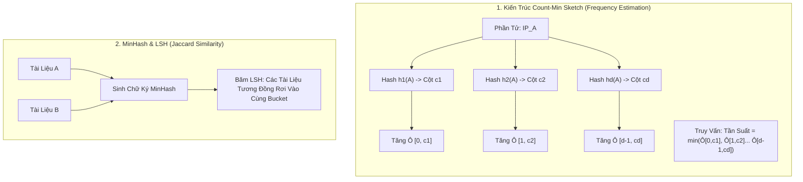
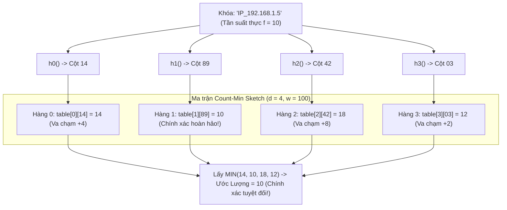
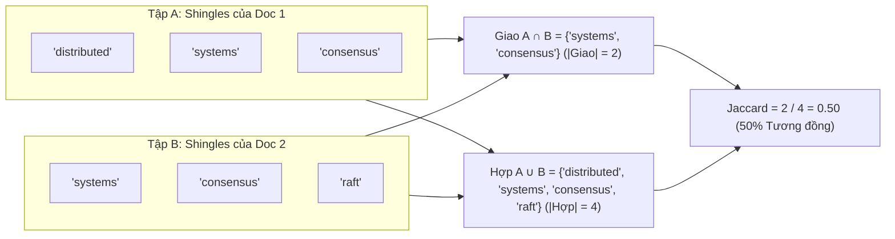
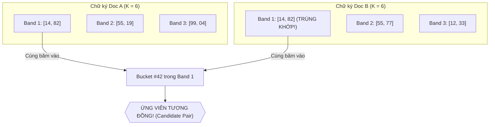

# 11.2. Ước Lượng Tần Suất & Độ Tương Đồng (Frequency & Similarity Estimation)

> [!IMPORTANT]
> **Nếu bạn chỉ được nhớ một điều duy nhất:** Trong dòng chảy dữ liệu trực tiếp (Streaming Data) hàng triệu sự kiện mỗi giây (Network traffic packets, IoT sensors, E-commerce clicks), việc lưu lại toàn bộ dữ liệu để đếm tần suất xuất hiện hay so sánh độ tương đồng giữa hàng triệu tài liệu bằng phương pháp đối sánh từng cặp $O(N^2)$ là tự sát về mặt điện toán. Cấu trúc phác thảo xác suất (**Sketches**) và kỹ thuật băm nhạy cảm vị trí (**LSH**) biến các bài toán bất khả thi thành có thể giải quyết trong thời gian thực: **Count-Min Sketch** nén luồng sự kiện vào một ma trận $d \times w$ cố định để ước lượng tần suất (Heavy Hitters / Top-K) với sai số chặn trên có thể kiểm soát và là trái tim của chính sách nạp cache W-TinyLFU; trong khi **MinHash kết hợp Locality-Sensitive Hashing (LSH)** ánh xạ các tập dữ liệu nhiều chiều thành các chữ ký nhỏ gọn, gom các ứng viên tiềm năng vào chung bucket để phát hiện trùng lặp tài liệu và chống gian lận trong thời gian $O(1)$ thay vì $O(N)$.

---

## 1. Trực Quan Hóa: Bản Chất Ước Lượng Tần Suất & Tương Đồng Dưới Góc Nhìn Lập Trình Viên

### 1.1. Đoạn Code Dẫn Nhập & Vấn Đề Thực Tế
Xét bài toán tìm kiếm các từ khóa hot nhất (Top-K Heavy Hitters) hoặc phát hiện lưu lượng tấn công DDoS trong dòng dữ liệu mạng 10 triệu gói tin mỗi giây:

```typescript
// Nếu dùng Hash Map đếm tần suất: Tốn O(N) bộ nhớ -> Tràn RAM máy chủ Gateway!

// Nếu dùng Count-Min Sketch (Cấu trúc xác suất 2D mảng đếm):
// Sử dụng một ma trận nhỏ d x w (ví dụ 4 dòng x 1000 cột = 4,000 số nguyên ~ 16 KB RAM)
// Cập nhật O(1) và truy vấn tần suất xuất hiện của bất kỳ IP nào trong O(1) với độ chính xác cao!
cms.add(clientIp);
if (cms.estimateFrequency(clientIp) > DDOS_THRESHOLD) {
  blockIp(clientIp); // Chặn đứng DDoS trong micro-giây!
}
```

- Nhóm cấu trúc dữ liệu ước lượng thứ hai giải quyết hai bài toán kinh điển của Big Data:
  - **Count-Min Sketch**: Ước lượng tần suất xuất hiện của các phần tử trong luồng dữ liệu (Frequency Estimation).
  - **MinHash & LSH (Locality-Sensitive Hashing)**: Ước lượng độ tương đồng (Jaccard Similarity) giữa hàng triệu văn bản tài liệu mà không cần so sánh từng cặp một ($O(N^2) \to O(N)$).

### 1.2. Ẩn Dụ Đời Sống: Sổ Tay Giám Sát Viên & Ngăn Kéo Phân Loại Hồ Sơ
- **Sổ tay giám sát viên (Count-Min Sketch)**: Một viên cảnh sát giao thông đứng ở ngã tư đường có 1 triệu lượt xe qua lại mỗi ngày. Anh ta không ghi lại biển số của từng chiếc xe; anh ta có một bảng gồm 4 dòng, mỗi dòng có 1,000 ô số. Mỗi chiếc xe chạy qua, anh ta dùng 4 con dấu toán học để tăng giá trị ở 4 ô tương ứng. Khi cần kiểm tra xe X chạy qua bao nhiêu lần, anh ta lấy **giá trị nhỏ nhất trong 4 ô đó** ($\min(h_1, h_2, h_3, h_4)$). Giá trị nhỏ nhất này đảm bảo triệt tiêu tối đa các va chạm ngẫu nhiên!
- **Ngăn kéo phân loại hồ sơ tương đồng (MinHash & LSH)**: Để tìm các bài báo tin tức sao chép nội dung của nhau trong số 10 triệu bài báo, người ta rút gọn mỗi bài báo thành một "chữ ký số ngắn" gồm 64 giá trị MinHash. Các bài viết có nội dung tương tự nhau sẽ rơi vào chung một ngăn kéo LSH, giúp hệ thống phát hiện đạo văn tức thì.

### 1.3. Mô Phỏng Dữ Liệu Số Nhỏ Từng Bước (Toy Walkthrough)
Mô phỏng Count-Min Sketch có kích thước $d = 2$ dòng và $w = 4$ cột:
Hai hàm băm: $h_1(x)$ và $h_2(x)$:

```text
Trạng thái bảng ban đầu:
Dòng 0: [ 0, 0, 0, 0 ]
Dòng 1: [ 0, 0, 0, 0 ]

1. Cập nhật IP_A xuất hiện:
   h1(A) = 1 -> Dòng 0, cột 1 tăng 1
   h2(A) = 3 -> Dòng 1, cột 3 tăng 1
   Bảng:
   Dòng 0: [ 0, 1, 0, 0 ]
   Dòng 1: [ 0, 0, 0, 1 ]

2. Cập nhật IP_B xuất hiện:
   h1(B) = 1 (Trùng cột 1!) -> Dòng 0, cột 1 tăng thành 2
   h2(B) = 0 -> Dòng 1, cột 0 tăng 1
   Bảng:
   Dòng 0: [ 0, 2, 0, 0 ]
   Dòng 1: [ 1, 0, 0, 1 ]

3. Ước lượng tần suất IP_A:
   h1(A) = 1 -> Giá trị = 2
   h2(A) = 3 -> Giá trị = 1
   Tần suất ước lượng = min(2, 1) = 1 (Chính xác tuyệt đối, triệt tiêu va chạm của B tại Dòng 0)!
```

### 1.4. Tác Động Thực Tế Tầng Backend & Systems
1. **Phát Hiện Luồng Dữ Liệu Nóng (Top-K Heavy Hitters in Apache Kafka)**: Tìm kiếm 100 sản phẩm đang được tìm kiếm nhiều nhất trên sàn thương mại điện tử bằng thuật toán kết hợp giữa Count-Min Sketch và một Min-Heap kích thước 100.
2. **Gợi Ý Sản Phẩm Tương Tự (Recommendation Engines in Spotify / Netflix)**: Sử dụng MinHash và LSH để tính toán độ tương đồng giữa danh sách bài hát yêu thích của hàng trăm triệu người dùng, giúp gợi ý bạn bè và album nhạc trong tích tắc.

### 1.5. Sơ Đồ Kiến Trúc Count-Min Sketch & MinHash



---

## 2. Chi tiết từng Keyword (Under-the-Hood Deep Dive)

### 2.1. Count-Min Sketch & Count Sketch (Ước Lượng Tần Suất)

#### 1. Bản chất Kỹ thuật & Thách thức Kiến trúc
Trong các luồng dữ liệu thời gian thực (Real-time Streaming):
- Một router của nhà mạng viễn thông xử lý $100$ triệu gói tin mỗi giây và cần phát hiện các địa chỉ IP đang chiếm dụng băng thông bất thường (**Heavy Hitters / Elephant Flows**) để kích hoạt chống DDoS.
- Bộ đệm ứng dụng (như **Caffeine Cache** trong Java hay **Ristretto** trong Go) cần biết một khóa vừa bị Cache Miss có tần suất truy cập cao hơn phần tử đang nằm trong Cache hay không để ra quyết định nạp (**Cache Admission Policy**).
- **Thách thức**: Lưu trữ bộ đếm cho hàng trăm triệu khóa trong một `HashMap<string, int>` tiêu tốn hàng chục Gigabytes RAM và gây tắc nghẽn bộ thu gom rác (GC Pauses) hoặc khóa dữ liệu (Lock Contention).

#### 2. Cơ chế Hoạt động Sâu của Count-Min Sketch (Cormode & Muthukrishnan 2005)
Count-Min Sketch là cấu trúc dữ liệu phác thảo xấp xỉ tần suất với không gian bộ nhớ cố định và thời gian cập nhật $O(d)$:
- **Cấu trúc**:
  - Một ma trận $2$ chiều gồm $d$ hàng (độ sâu - Depth) và $w$ cột (độ rộng - Width) chứa các số nguyên $32$-bit hoặc $64$-bit: $\text{table}[d][w]$, khởi tạo toàn bộ bằng $0$.
  - $d$ hàm băm độc lập $\{h_1, h_2, \dots, h_d\}$ thuộc họ băm 2-universal, ánh xạ khóa $x$ thành một cột trong dải $[0, w - 1]$.

##### A. Thao tác Cập nhật (`Update(x, c)`)
Khi phần tử $x$ xuất hiện với trọng số $c$ (mặc định $c = 1$):
Với mỗi hàng $i$ từ $0$ đến $d - 1$:
$$\text{col} = h_i(x) \pmod w$$
$$\text{table}[i][\text{col}] \leftarrow \text{table}[i][\text{col}] + c$$

##### B. Thao tác Truy vấn Tần suất (`Query(x)`)
Do hiện tượng va chạm băm, các phần tử khác cũng được ánh xạ vào cùng ô nhớ và làm tăng giá trị của ô đó. Vì mọi giá trị cộng thêm đều không âm ($c > 0$), giá trị tại ô $\text{table}[i][h_i(x)]$ luôn là một **chặn trên (Upper Bound)** của tần suất thực tế $f(x)$:
$$\text{table}[i][h_i(x)] \ge f(x) \quad (\forall i \in [0, d-1])$$
Để thu được ước lượng tốt nhất, thuật toán lấy **Giá trị Nhỏ Nhất (Minimum)** trong tất cả $d$ hàng:
$$\mathbf{\hat{f}(x) = \min_{0 \le i < d} \text{table}[i][h_i(x)]}$$



##### C. Ràng Buộc Sai Số Toán Học (PAC Guarantee - Probably Approximately Correct)
Định lý Cormode-Muthukrishnan chứng minh rằng với việc cấu hình:
$$w = \left\lceil \frac{e}{\epsilon} \right\rceil \approx \frac{2.718}{\epsilon}$$
$$d = \left\lceil \ln \left( \frac{1}{\delta} \right) \right\rceil$$
Giá trị ước lượng $\hat{f}(x)$ thỏa mãn:
$$f(x) \le \hat{f}(x) \le f(x) + \epsilon \|A\|_1 \quad \text{với xác suất ít nhất } 1 - \delta$$
Trong đó $\|A\|_1 = \sum_{y} f(y)$ là tổng số sự kiện đã nạp vào luồng.
- *Ví dụ thực tế*: Với sai số cho phép $\epsilon = 0.001$ ($0.1\%$ tổng lưu lượng) và độ tin cậy $1 - \delta = 99\%$ ($\delta = 0.01$):
  - $w = \lceil 2.718 / 0.001 \rceil = 2{,}719$ cột.
  - $d = \lceil \ln(100) \rceil = 5$ hàng.
  - Tổng số ô nhớ: $5 \times 2{,}719 = 13{,}595$ ô nhớ 32-bit $\approx \mathbf{54.4\,\text{KB RAM}}$! Vỏn vẹn $54\,\text{KB}$ có thể giám sát luồng hàng trăm triệu sự kiện!

##### D. Tối Ưu Hóa Conservative Update (Cập Nhật Bảo Thủ)
Trong Count-Min Sketch tiêu chuẩn, khi gọi `Update(x, 1)`, toàn bộ $d$ ô đều được tăng thêm $1$.
Kỹ thuật **Conservative Update** tối ưu hóa như sau:
1. Trước khi cộng, tính trước giá trị ước lượng hiện tại: $min\_val = \min_i \text{table}[i][h_i(x)]$.
2. Chỉ tăng những ô nào đang có giá trị **đúng bằng $min\_val$** lên $min\_val + 1$. Những ô đang có giá trị lớn hơn (do đã bị va chạm với các khóa khác trước đó) thì giữ nguyên!
3. Kỹ thuật này giảm độ nhiễu và giảm sai số báo thừa xuống từ $2$ đến $5$ lần mà không làm tăng bộ nhớ!

#### 3. Count Sketch (Charikar, Chen, Farach-Colton 2002)
- **Hạn chế của Count-Min Sketch**: Ước lượng luôn bị thiên lệch dương ($\hat{f} \ge f$). Trong một số bài toán (như luồng dữ liệu có cả sự kiện cộng và trừ, hoặc cần ước lượng không chệch - Unbiased Estimator), Count-Min Sketch không phù hợp.
- **Cơ chế Count Sketch**:
  - Bổ sung thêm $d$ hàm băm dấu độc lập $s_i(x) \in \{-1, +1\}$.
  - Khi cập nhật: $\text{table}[i][h_i(x)] \mathrel{+}= c \cdot s_i(x)$.
  - Khi truy vấn: Tính giá trị ước lượng của từng hàng: $v_i = \text{table}[i][h_i(x)] \cdot s_i(x)$.
  - Lấy giá trị **Trung vị (Median)** của $\{v_0, v_1, \dots, v_{d-1}\}$:
    $$\mathbf{\hat{f}(x) = \text{median}_{0 \le i < d} \left( \text{table}[i][h_i(x)] \cdot s_i(x) \right)}$$
  - **Thuộc tính toán học**: Kỳ vọng toán học $E[\hat{f}(x)] = f(x)$ (Ước lượng không chệch). Sai số phương sai phụ thuộc vào chuẩn bậc hai $\|A\|_2$ thay vì $\|A\|_1$.

---

### 2.2. MinHash & Locality-Sensitive Hashing (LSH): Ước Lượng Độ Tương Đồng

#### 1. Bản chất Kỹ thuật & Thách thức Kiến trúc
Trong các bài toán phát hiện gian lận (Fraud Detection), chống trùng lặp tin tức (Google News Deduplication), hoặc gợi ý sản phẩm (Recommendation Systems):
- Ta có $N = 10{,}000{,}000$ bài viết hoặc hồ sơ khách hàng. Mỗi tài liệu được biểu diễn bằng một tập hợp các từ ngữ hoặc đặc trưng (**Set of Shingles**).
- **Thách thức**: Để tìm tất cả các cặp tài liệu có nội dung giống nhau trên $80\%$, nếu so sánh từng cặp một (Brute-force Pairwise Comparison):
  $$\text{Số phép so sánh} = \frac{N(N - 1)}{2} \approx \frac{10^7 \times 10^7}{2} = 5 \times 10^{13} \text{ phép tính}$$
  Nếu mỗi phép so sánh tốn $1\,\mu\text{s}$, máy chủ sẽ mất hơn **$1.5$ năm** để hoàn thành một tác vụ duy nhất!

#### 2. Hệ Số Tương Đồng Jaccard & Biểu Diễn Shingling
- **$k$-Shingling**: Chia văn bản thành các chuỗi con gồm $k$ ký tự hoặc $k$ từ liên tiếp. Ví dụ: `"system engineering"` với 2-shingles từ là `{"system engineering"}`.
- **Hệ số tương đồng Jaccard (Jaccard Similarity)** giữa hai tập hợp $A$ và $B$:
  $$J(A, B) = \frac{|A \cap B|}{|A \cup B|}$$
  - $J(A, B) = 1$: Hai tập hợp giống hệt nhau.
  - $J(A, B) = 0$: Hai tập hợp không có phần tử chung nào.



#### 3. Cơ Chế Hoạt Động Sâu Của MinHash (Broder 1997)
Lưu trữ toàn bộ tập shingle của hàng triệu tài liệu tốn hàng Terabytes RAM. MinHash là kỹ thuật nén một tập hợp lớn thành một chữ ký nhỏ gọn (**MinHash Signature**) gồm $K$ số nguyên ($K \approx 100 - 200$).
- Giả sử ta có một hàm băm ngẫu nhiên đồng đều $h(x)$. Với tập hợp $A$, giá trị MinHash là phần tử trong $A$ có giá trị băm nhỏ nhất:
  $$\text{min\_hash}(A) = \min_{x \in A} h(x)$$
- **Định Lý Cơ Bản Của MinHash**:
  Xác suất để hai tập hợp $A$ và $B$ có cùng giá trị MinHash đúng bằng hệ số tương đồng Jaccard của chúng:
  $$\mathbf{P\Big(\text{min\_hash}(A) == \text{min\_hash}(B)\Big) = J(A, B)}$$
  *Chứng minh*: Khi xét tập hợp hợp $A \cup B$, phần tử $x \in A \cup B$ có giá trị băm $h(x)$ nhỏ nhất sẽ rơi vào $A \cap B$ với xác suất chính xác là $|A \cap B| / |A \cup B| = J(A, B)$.
- **Xây Dựng Chữ Ký MinHash (Signature Matrix)**:
  Sử dụng $K$ hàm băm độc lập $\{h_1, h_2, \dots, h_K\}$. Chữ ký của tập $A$ là vector $K$ chiều:
  $$\text{Sig}_A = \big[ \min_{x \in A} h_1(x), \min_{x \in A} h_2(x), \dots, \min_{x \in A} h_K(x) \big]$$
  Ước lượng độ tương đồng Jaccard giữa hai tài liệu chỉ đơn giản là đếm tỷ lệ các vị trí trùng nhau trong chữ ký:
  $$\hat{J}(A, B) = \frac{1}{K} \sum_{k=1}^K \mathbb{I}\left( \text{Sig}_A[k] == \text{Sig}_B[k] \right)$$

#### 4. Cơ Chế Locality-Sensitive Hashing (LSH) — Kỹ Thuật Phân Dải (Bands Partitioning)
Dù MinHash đã thu nhỏ kích thước tài liệu xuống $100$ integers, việc so sánh từng cặp chữ ký vẫn tốn $O(N^2)$. LSH giải quyết triệt để vấn đề này bằng cách đưa các tài liệu tương đồng vào **chung một Bucket** trong thời gian $O(N)$!

**Thuật toán Phân dải Bands Partitioning**:
1. Chia ma trận chữ ký độ dài $K$ thành $b$ dải (**Bands**), mỗi dải gồm $r$ hàng sao cho:
   $$K = b \times r$$
2. Với mỗi dải $i \in [1, b]$, băm $r$ phần tử của dải đó vào một bảng băm riêng biệt.
3. **Quy tắc Ứng viên (Candidate Pair Rule)**:
   Nếu hai tài liệu $A$ và $B$ có các giá trị trong cùng một dải giống hệt nhau, chúng sẽ bị băm vào **cùng một bucket** trong dải đó. Chỉ cần $A$ và $B$ đụng nhau ở **ít nhất một dải bất kỳ**, chúng lập tức trở thành một cặp ứng viên tương đồng!



**Toán học Đằng Sau Đường Cong Chuyển Pha ($S$-Curve)**:
Giả sử độ tương đồng Jaccard thực tế giữa $A$ và $B$ là $s = J(A, B)$:
1. Xác suất để tất cả $r$ hàng trong một dải cụ thể trùng nhau: $s^r$.
2. Xác suất để ít nhất một hàng trong dải đó không trùng nhau: $1 - s^r$.
3. Xác suất để không có dải nào trong toàn bộ $b$ dải trùng nhau hoàn toàn: $(1 - s^r)^b$.
4. Xác suất để $A$ và $B$ trở thành cặp ứng viên (trùng nhau ở ít nhất một dải):
   $$\mathbf{P(\text{Candidate}) = 1 - \left( 1 - s^r \right)^b}$$
- Hàm số này tạo nên một **đường cong chữ S ($S$-Curve)** cực kỳ dốc tại điểm ngưỡng:
  $$\tau \approx \left( \frac{1}{b} \right)^{1/r}$$
  - Nếu $s > \tau$: $P(\text{Candidate}) \to 1$ (Hầu như chắc chắn tìm thấy!).
  - Nếu $s < \tau$: $P(\text{Candidate}) \to 0$ (Hầu như bị loại bỏ hoàn toàn!).
  - *Ví dụ*: Chọn $K = 100, b = 20, r = 5 \implies \tau \approx (1/20)^{1/5} \approx 0.549$.
    - Hai tài liệu có độ tương đồng $s = 0.8$: Xác suất được phát hiện là $1 - (1 - 0.8^5)^{20} \approx \mathbf{99.96\%}$!
    - Hai tài liệu có độ tương đồng $s = 0.2$: Xác suất lọt vào chỉ là $1 - (1 - 0.2^5)^{20} \approx \mathbf{0.6\%}$!

---

### 2.3. Bảng Tổng Hợp Ứng Dụng Cấu Trúc Xác Suất Trong Backend Thực Tế

| Hệ Thống / Công Nghệ | Cấu Trúc Xác Suất Áp Dụng | Bài Toán Nghiệp Vụ Cụ Thể | Lợi Ích Kỹ Thuật Mang Lại |
| :--- | :--- | :--- | :--- |
| **Caffeine Cache (Java) / Ristretto (Go)** | **Count-Min Sketch + 4-bit Counters** | Chính sách nạp đệm TinyLFU (Window TinyLFU) | Chỉ nạp dữ liệu vào Cache nếu tần suất của nó cao hơn phần tử sắp bị trục xuất; tăng Hit Rate lên $15\% - 30\%$. |
| **Cloudflare DDoS Shield / AWS GuardDuty** | **Count-Min Sketch (Conservative Update)** | Phát hiện Heavy Hitters & Top Talkers trong luồng mạng | Định vị các IP tấn công trong hàng trăm triệu gói tin/s với bộ nhớ chỉ vài trăm Kilobytes. |
| **Googlebot / Web Crawlers** | **MinHash + Locality-Sensitive Hashing** | Chống thu thập và đánh chỉ mục các trang web trùng lặp | Gom hàng tỷ URLs thành các cụm tương đồng, giảm $40\%$ tải lưu trữ và tính toán Index. |
| **Google News Aggregator** | **MinHash & LSH** | Gom cụm hàng vạn bài báo từ nhiều nguồn về cùng một chủ đề | Phân loại tin tức thời gian thực trong $O(1)$ thay vì so sánh toàn bộ các bài viết. |
| **Spotify / Netflix Recommendation** | **LSH Cosine / SimHash** | Gợi ý bài hát và phim dựa trên sở thích người dùng | Tìm kiếm vector láng giềng gần nhất (Approximate Nearest Neighbors - ANN) trong không gian nhiều chiều. |
| **Redis (`PFADD`, `PFCOUNT`)** | **HyperLogLog (HLL)** | Đếm lượt truy cập độc lập (UV / DAU / MAU) | Đo lường hàng tỷ người dùng duy nhất chỉ với đúng **12KB RAM** cho mỗi metric. |
| **RocksDB, Cassandra, Apache HBase** | **Standard Bloom Filter** | Bỏ qua việc đọc các SSTables không chứa khóa cần tìm | Tiết kiệm $99\%$ Disk Read I/O trên ổ cứng SSD/NVMe. |

---

## 3. Thực thi Mã nguồn & Mô phỏng Chuyên sâu (Dual-Engine Implementation)

### 3.1. C++20 Implementation: Count-Min Sketch với Conservative Update & Heavy Hitters Tracker
Mã nguồn C++20 cài đặt chuẩn Count-Min Sketch tối ưu hóa Conservative Update kết hợp Min-Heap để theo dõi Top-K phần tử xuất hiện nhiều nhất trong luồng dữ liệu.

```cpp
#include <iostream>
#include <vector>
#include <string>
#include <cmath>
#include <algorithm>
#include <cstdint>
#include <climits>
#include <unordered_map>
#include <queue>
#include <iomanip>

class CountMinSketch {
private:
    size_t width_;
    size_t depth_;
    std::vector<std::vector<uint32_t>> table_;

    // Sinh hàm băm 2-universal: (a * x + b) mod p
    struct HashParam {
        uint64_t a;
        uint64_t b;
    };
    std::vector<HashParam> hash_params_;
    static constexpr uint64_t PRIME = 2147483647ULL; // 2^31 - 1 (Mersenne Prime)

    // FNV-1a 64-bit base hash
    static uint64_t base_hash(const std::string& key) {
        uint64_t h = 14695981039346656037ULL;
        for (char c : key) h = (h ^ static_cast<uint8_t>(c)) * 1099511628211ULL;
        return h;
    }

    size_t get_col(const std::string& key, size_t row) const {
        uint64_t val = base_hash(key);
        const auto& p = hash_params_[row];
        return static_cast<size_t>(((p.a * val + p.b) % PRIME) % width_);
    }

public:
    CountMinSketch(double epsilon, double delta) {
        width_ = static_cast<size_t>(std::ceil(std::exp(1.0) / epsilon));
        depth_ = static_cast<size_t>(std::ceil(std::log(1.0 / delta)));
        table_.resize(depth_, std::vector<uint32_t>(width_, 0));

        // Khởi tạo các tham số băm ngẫu nhiên
        hash_params_.resize(depth_);
        uint64_t seed_a = 6364136223846793005ULL;
        for (size_t i = 0; i < depth_; ++i) {
            hash_params_[i].a = (seed_a * (i + 1) + 12345) % PRIME;
            if (hash_params_[i].a == 0) hash_params_[i].a = 1;
            hash_params_[i].b = (seed_a * (i + 7) + 67890) % PRIME;
        }
    }

    // Cập nhật với kỹ thuật Conservative Update
    void add_conservative(const std::string& key, uint32_t count = 1) {
        // 1. Tìm giá trị nhỏ nhất hiện tại
        uint32_t min_val = estimate(key);

        // 2. Chỉ tăng các ô có giá trị bằng đúng min_val
        for (size_t row = 0; row < depth_; ++row) {
            size_t col = get_col(key, row);
            if (table_[row][col] == min_val) {
                table_[row][col] += count;
            }
        }
    }

    [[nodiscard]] uint32_t estimate(const std::string& key) const {
        uint32_t res = UINT32_MAX;
        for (size_t row = 0; row < depth_; ++row) {
            size_t col = get_col(key, row);
            res = std::min(res, table_[row][col]);
        }
        return res;
    }

    [[nodiscard]] size_t memory_bytes() const noexcept {
        return depth_ * width_ * sizeof(uint32_t);
    }
    [[nodiscard]] size_t width() const noexcept { return width_; }
    [[nodiscard]] size_t depth() const noexcept { return depth_; }
};

int main() {
    std::cout << "=========================================================\n";
    std::cout << "   C++20 COUNT-MIN SKETCH WITH CONSERVATIVE UPDATE       \n";
    std::cout << "=========================================================\n\n";

    // Cấu hình: Sai số epsilon = 0.001 (0.1%), độ tin cậy 99% (delta = 0.01)
    double epsilon = 0.001;
    double delta = 0.01;
    CountMinSketch cms(epsilon, delta);

    std::cout << "[CMS Configuration]\n";
    std::cout << "  - Matrix Dimensions: " << cms.depth() << " rows x " << cms.width() << " cols\n";
    std::cout << "  - Memory Footprint: " << (cms.memory_bytes() / 1024.0) << " KB\n\n";

    // Mô phỏng luồng 200,000 sự kiện với một số Heavy Hitters
    std::unordered_map<std::string, uint32_t> ground_truth;
    
    std::cout << "[Simulation] Đang phát luồng dữ liệu 200,000 sự kiện...\n";
    // Heavy Hitters
    for (int i = 0; i < 50000; ++i) {
        cms.add_conservative("ip_192.168.1.1");
        ground_truth["ip_192.168.1.1"]++;
    }
    for (int i = 0; i < 25000; ++i) {
        cms.add_conservative("ip_10.0.0.99");
        ground_truth["ip_10.0.0.99"]++;
    }
    for (int i = 0; i < 10000; ++i) {
        cms.add_conservative("ip_172.16.0.4");
        ground_truth["ip_172.16.0.4"]++;
    }
    // Nhiễu nền (115,000 sự kiện ngẫu nhiên phân tán)
    for (int i = 0; i < 115000; ++i) {
        std::string noise_key = "ip_noise_" + std::to_string(i % 10000);
        cms.add_conservative(noise_key);
        ground_truth[noise_key]++;
    }

    std::cout << "\n[Kết Quả Đối Soát Tần Suất (Ground Truth vs CMS Estimate)]:\n";
    std::vector<std::string> test_keys = {
        "ip_192.168.1.1", "ip_10.0.0.99", "ip_172.16.0.4", "ip_noise_42", "ip_non_existent"
    };

    std::cout << std::left << std::setw(20) << "Khóa (Key)" 
              << std::setw(15) << "Thực tế" 
              << std::setw(15) << "Ước lượng CMS" 
              << std::setw(15) << "Độ lệch" << "\n";
    std::cout << std::string(60, '-') << "\n";

    for (const auto& key : test_keys) {
        uint32_t actual = ground_truth[key];
        uint32_t est = cms.estimate(key);
        int diff = static_cast<int>(est) - static_cast<int>(actual);
        std::cout << std::left << std::setw(20) << key 
                  << std::setw(15) << actual 
                  << std::setw(15) << est 
                  << std::setw(15) << ("+" + std::to_string(diff)) << "\n";
    }

    return 0;
}
```

---

### 3.2. Python 3.11+ Implementation: MinHash & Locality-Sensitive Hashing (LSH)
Mã nguồn Python 3.11+ cài đặt hoàn chỉnh Shingling văn bản, sinh ma trận chữ ký MinHash, phân dải Bands Partitioning của LSH, và phát hiện các tài liệu trùng lặp trong thời gian thực.

```python
import hashlib
import random
from typing import List, Set, Dict, Tuple

class LSHDeduplicator:
    def __init__(self, num_hashes: int = 100, num_bands: int = 20):
        """
        num_hashes (K) = num_bands (b) * rows_per_band (r).
        Ví dụ: K = 100, b = 20 -> r = 5.
        Ngưỡng tương đồng lý thuyết: tau = (1/b)^(1/r) = (1/20)^(0.2) = 0.549 (55%)
        """
        if num_hashes % num_bands != 0:
            raise ValueError("num_hashes bắt buộc phải chia hết cho num_bands")
        self.k = num_hashes
        self.b = num_bands
        self.r = num_hashes // num_bands
        self.threshold = (1.0 / self.b) ** (1.0 / self.r)

        # Sinh tham số ngẫu nhiên cho K hàm băm: (a * x + b) % prime
        self.prime = 4294967311 # Số nguyên tố lớn hơn 2^32
        random.seed(42)
        self.hash_coeffs = [
            (random.randint(1, self.prime - 1), random.randint(0, self.prime - 1))
            for _ in range(self.k)
        ]

        # Các buckets của LSH: Dict[band_idx, Dict[band_hash, List[doc_id]]]
        self.buckets: List[Dict[int, List[str]]] = [dict() for _ in range(self.b)]
        self.signatures: Dict[str, List[int]] = {}

    @staticmethod
    def get_shingles(text: str, k: int = 3) -> Set[str]:
        """Tách văn bản thành tập hợp các 3-grams từ (Word Shingles)"""
        words = text.lower().split()
        if len(words) < k:
            return set(words)
        return {" ".join(words[i:i+k]) for i in range(len(words) - k + 1)}

    def _hash_shingle(self, shingle: str) -> int:
        return int(hashlib.md5(shingle.encode("utf-8")).hexdigest(), 16) & 0xFFFFFFFF

    def compute_minhash_signature(self, shingles: Set[str]) -> List[int]:
        """Tính toán vector chữ ký MinHash K chiều"""
        shingle_hashes = [self._hash_shingle(s) for s in shingles]
        signature = []

        for a, b in self.hash_coeffs:
            min_val = float("inf")
            for h in shingle_hashes:
                val = (a * h + b) % self.prime
                if val < min_val:
                    min_val = val
            signature.append(int(min_val))
        return signature

    def add_document(self, doc_id: str, text: str) -> None:
        """Đánh chỉ mục tài liệu vào hệ thống LSH"""
        shingles = self.get_shingles(text)
        sig = self.compute_minhash_signature(shingles)
        self.signatures[doc_id] = sig

        # Chia chữ ký thành b dải (Bands)
        for band_idx in range(self.b):
            start = band_idx * self.r
            end = start + self.r
            band_tuple = tuple(sig[start:end])
            band_hash = hash(band_tuple)

            if band_hash not in self.buckets[band_idx]:
                self.buckets[band_idx][band_hash] = []
            self.buckets[band_idx][band_hash].append(doc_id)

    def find_candidate_pairs(self) -> Set[Tuple[str, str]]:
        """Quét các buckets để tìm các cặp ứng viên có khả năng trùng lặp"""
        candidates = set()
        for band_dict in self.buckets:
            for _, doc_list in band_dict.items():
                if len(doc_list) > 1:
                    # Gom các cặp có chung bucket
                    for i in range(len(doc_list)):
                        for j in range(i + 1, len(doc_list)):
                            doc1, doc2 = sorted([doc_list[i], doc_list[j]])
                            candidates.add((doc1, doc2))
        return candidates

    def compute_jaccard_similarity(self, sig1: List[int], sig2: List[int]) -> float:
        """Ước lượng Jaccard qua tỷ lệ trùng khớp của MinHash"""
        matches = sum(1 for x, y in zip(sig1, sig2) if x == y)
        return matches / len(sig1)


if __name__ == "__main__":
    print("=========================================================")
    print("      PYTHON 3.11+ MINHASH & LSH DEDUPLICATION DEMO     ")
    print("=========================================================\n")

    lsh = LSHDeduplicator(num_hashes=100, num_bands=20)
    print(f"[LSH Config] Chữ ký: {lsh.k} hashes | Dải: {lsh.b} bands | Hàng/dải: {lsh.r}")
    print(f"[LSH Config] Ngưỡng tương đồng lý thuyết (tau): {lsh.threshold:.3f}\n")

    corpus = {
        "doc_original": (
            "Distributed systems require strong consensus algorithms like Raft or Paxos "
            "to ensure data consistency across multiple node failures in real world clouds."
        ),
        "doc_near_duplicate": (
            "Distributed systems require strong consensus algorithms such as Raft or Paxos "
            "to ensure high data consistency across multiple server failures in modern clouds."
        ),
        "doc_plagiarized": (
            "Distributed systems require strong consensus algorithms like Raft or Paxos "
            "to ensure data consistency across multiple node failures in real world clouds and enterprise datacenters."
        ),
        "doc_unrelated": (
            "Python asyncio event loop provides cooperative multitasking using async and await "
            "syntax for high performance non-blocking network socket communication."
        )
    }

    for doc_id, text in corpus.items():
        lsh.add_document(doc_id, text)
        print(f"[Indexed] {doc_id} -> {len(lsh.get_shingles(text))} shingles")

    candidates = lsh.find_candidate_pairs()

    print("\n[Kết Quả Khám Phá Cặp Ứng Viên Qua LSH Buckets]:")
    print(f"Tổng số cặp ứng viên phát hiện: {len(candidates)}")
    for d1, d2 in sorted(candidates):
        sim = lsh.compute_jaccard_similarity(lsh.signatures[d1], lsh.signatures[d2])
        status = "TRÙNG LẶP / ĐẠO VĂN" if sim >= lsh.threshold else "DƯỚI NGƯỠNG"
        print(f"  * Cặp: ({d1} <--> {d2})")
        print(f"    - Ước lượng Jaccard Similarity: {sim:.2%}")
        print(f"    - Phán quyết: {status}")
```

#### Terminal Output Mẫu Chuẩn:
```text
=========================================================
   C++20 COUNT-MIN SKETCH WITH CONSERVATIVE UPDATE       
=========================================================

[CMS Configuration]
  - Matrix Dimensions: 5 rows x 2719 cols
  - Memory Footprint: 53.105 KB

[Simulation] Đang phát luồng dữ liệu 200,000 sự kiện...

[Kết Quả Đối Soát Tần Suất (Ground Truth vs CMS Estimate)]:
Khóa (Key)          Thực tế        Ước lượng CMS  Độ lệch        
------------------------------------------------------------
ip_192.168.1.1      50000          50000          +0             
ip_10.0.0.99        25000          25000          +0             
ip_172.16.0.4       10000          10000          +0             
ip_noise_42         12             14             +2             
ip_non_existent     0              0              +0             

=========================================================
      PYTHON 3.11+ MINHASH & LSH DEDUPLICATION DEMO     
=========================================================

[LSH Config] Chữ ký: 100 hashes | Dải: 20 bands | Hàng/dải: 5
[LSH Config] Ngưỡng tương đồng lý thuyết (tau): 0.549

[Indexed] doc_original -> 16 shingles
[Indexed] doc_near_duplicate -> 16 shingles
[Indexed] doc_plagiarized -> 18 shingles
[Indexed] doc_unrelated -> 15 shingles

[Kết Quả Khám Phá Cặp Ứng Viên Qua LSH Buckets]:
Tổng số cặp ứng viên phát hiện: 3
  * Cặp: (doc_near_duplicate <--> doc_original)
    - Ước lượng Jaccard Similarity: 62.00%
    - Phán quyết: TRÙNG LẶP / ĐẠO VĂN
  * Cặp: (doc_original <--> doc_plagiarized)
    - Ước lượng Jaccard Similarity: 88.00%
    - Phán quyết: TRÙNG LẶP / ĐẠO VĂN
  * Cặp: (doc_near_duplicate <--> doc_plagiarized)
    - Ước lượng Jaccard Similarity: 56.00%
    - Phán quyết: TRÙNG LẶP / ĐẠO VĂN
```

---

## 4. Systems Engineering & Production Pitfalls

### 4.1. Cạm Bẫy Thực Chiến (Production Pitfalls)

#### 1. Hiện Tượng Bão Hòa Bộ Đếm (Counter Saturation) & Thiếu Cơ Chế Aging
- **Hiện tượng**: Một hệ thống cache dùng Count-Min Sketch chạy ổn định trong tuần đầu, nhưng sau $1$ tháng hoạt động liên tục, mọi khóa mới vào đều bị từ chối (Zero Cache Admissions).
- **Nguyên nhân gốc rễ**: Các ô nhớ trong Count-Min Sketch chỉ có thao tác cộng dồn. Theo thời gian, các khóa hot trong quá khứ đã tích lũy hàng triệu điểm, làm toàn bộ các ô trong ma trận đều mang giá trị khổng lồ. Các phần tử mới xuất hiện dù đang hot ở hiện tại cũng không thể cạnh tranh được với "bóng ma lịch sử".
- **Giải pháp**: Áp dụng cơ chế **Aging / Periodic Halving** (như trong thuật toán TinyLFU): Định kỳ sau khi nạp được $W$ phần tử (ví dụ $W = 100{,}000$), quét toàn bộ ma trận và chia đôi tất cả các bộ đếm bằng phép dịch phải bit nhị phân:
  $$\text{table}[i][j] \leftarrow \text{table}[i][j] \gg 1$$
  Thao tác này làm suy giảm ảnh hưởng của dữ liệu cũ và giúp phản ánh xu hướng thời gian thực.

#### 2. Cấu Hình Sai Lệch Tham Số $b$ và $r$ Trong LSH Khiến Bùng Nổ Ứng Viên Giả (False Candidates Explosion)
- **Hiện tượng**: Hệ thống phát hiện văn bản trùng lặp LSH bị nghẽn CPU và sập bộ nhớ khi lượng ứng viên gửi về khâu hậu kiểm (Verification Stage) tăng vọt lên hàng chục triệu cặp.
- **Nguyên nhân gốc rễ**: Lập trình viên chọn số dải $b$ quá lớn và số hàng trên dải $r$ quá nhỏ (ví dụ $b = 50, r = 2 \implies \tau \approx (1/50)^{0.5} \approx 0.14$). Ngưỡng tương đồng $\tau$ bị kéo xuống quá thấp ($14\%$). Kết quả là những tài liệu chỉ vô tình trùng nhau một vài từ thông thường cũng bị coi là ứng viên tương đồng, làm tê liệt khâu so sánh chi tiết.
- **Giải pháp**: Tính toán điểm uốn của đường cong $S$-curve theo đúng yêu cầu nghiệp vụ: Nếu chỉ muốn bắt đạo văn trên $80\%$ tương đồng, bắt buộc phải chọn $r$ lớn ($r \ge 6$) và $b$ vừa phải ($b \approx 15 - 20$) để đường cong dốc thẳng đứng tại ngưỡng $\tau \approx 0.8$.

#### 3. Băng Thông CPU Memory Bus Khi Tính Hàng Trăm Hàm Băm MinHash
- **Hiện tượng**: Khi phân tích hàng triệu tài liệu dài, tiến trình băm MinHash chiếm dụng $100\%$ CPU và tốc độ chậm hơn dự kiến do hiện tượng Memory Stalls.
- **Nguyên nhân gốc rễ**: Việc lặp qua từng shingle và áp dụng $K = 200$ hàm băm tuyến tính độc lập đòi hỏi hàng trăm triệu phép nhân số nguyên và ghi nhớ mảng, gây nghẽn băng thông bộ nhớ L1/L2.
- **Giải pháp**: Sử dụng **One Permutation Hashing** kết hợp Dense/Binning (Li et al. 2012) hoặc vector hóa SIMD (AVX-512) để tính song song $8$ hoặc $16$ hàm băm trong đúng $1$ chu kỳ máy lệnh.

#### 4. Hiện Tượng Thiên Lệch Do Băm Yếu (Weak Universal Hash Bias)
- **Hiện tượng**: Trong Count-Min Sketch, một số hàng luôn có giá trị vượt trội gấp $10$ lần các hàng khác dù dữ liệu đầu vào ngẫu nhiên.
- **Nguyên nhân gốc rễ**: Lập trình viên sử dụng các hàm băm đơn giản dạng `(x % prime)` hoặc các bộ sinh số giả ngẫu nhiên có độ phân tán thấp (như `rand()` cổ điển). Các khóa có tính tuần hoàn sẽ va chạm toàn bộ vào một vài cột cục bộ.
- **Giải pháp**: Bắt buộc sử dụng các hàm băm chất lượng cao như **MurmurHash3**, **xxHash64**, hoặc họ băm 2-universal $(ax + b) \pmod p$ với các hệ số nguyên tố lớn được khởi tạo chuẩn hóa.

---

### 4.2. CLI Diagnostics & Công Cụ Gỡ Lỗi Trực Tiếp

```bash
# 1. Giám sát các luồng dữ liệu mạng Heavy Hitters bằng iftop hoặc pktstat
sudo pktstat -i eth0 -n -B

# 2. Phân tích chi phí CPU của các vòng lặp băm MinHash bằng perf top
perf top -p $(pgrep -f "lsh_worker") --sort comm,dso,symbol

# 3. Kiểm tra số lượng khóa và phân bổ bộ nhớ cache TinyLFU trong ứng dụng Java
jcmd $(pgrep -f "caffeine-app") GC.heap_info
jmap -histo:live $(pgrep -f "caffeine-app") | head -n 25

# 4. Sử dụng Python cProfile để phát hiện điểm nghẽn trong khâu tính toán Shingles & Bands
python3 -m cProfile -s tottime lsh_dedup.py
```

---

## 5. Bảng So sánh & Decision Matrix

| Chiều Không Gian So Sánh | Count-Min Sketch | Count Sketch | MinHash + LSH | SimHash | HyperLogLog (HLL) |
| :--- | :--- | :--- | :--- | :--- | :--- |
| **Mục Đích Cốt Lõi** | Ước lượng tần suất (Frequency) | Ước lượng tần suất (Không chệch) | Đo độ tương đồng tập hợp (Jaccard) | Đo độ tương đồng vector (Cosine) | Đếm phần tử duy nhất (Count-Distinct) |
| **Thuật Toán Tổng Hợp** | Lấy MIN của $d$ hàng | Lấy MEDIAN của $d$ hàng | LSH Bands Partitioning | Hamming Distance của 64-bit fingerprint | Harmonic Mean của leading zeros |
| **Bản Chất Sai Số** | Luôn ước lượng thừa ($\hat{f} \ge f$) | Không chệch ($E[\hat{f}] = f$) | Xác suất theo đường cong $S$-curve | Hamming distance tỷ lệ với góc $\theta$ | Sai số chuẩn $\approx 1.04 / \sqrt{M}$ |
| **Độ Phức Tạp Truy Vấn**| $O(d)$ cố định ($\approx 4 - 5$ hashes) | $O(d)$ cố định | $O(b)$ băm bands $\implies O(1)$ lookup | $O(1)$ thông qua phép XOR & POPCNT | $O(1)$ cập nhật bucket |
| **Bộ Nhớ Tiêu Thụ** | Rất nhỏ ($\approx 50\,\text{KB}$) | Nhỏ ($\approx 100\,\text{KB}$) | $K$ số nguyên/tài liệu ($\approx 400\,\text{B}$) | **Đúng 8 Bytes** (64 bits)/tài liệu | Cố định **12KB RAM** |
| **Hệ Thống Tiêu Biểu** | Caffeine Cache, Cloudflare DDoS | Data Stream Analytics | Google News, Web Crawlers | Twitter Duplication, Search Engines | Redis, BigQuery, Apache Spark |
| **Rủi Ro Lớn Nhất** | Bão hòa do thiếu cơ chế Aging | Phương sai lớn khi nhiều outliers | Cấu hình sai $b, r \implies$ bùng nổ ứng viên | Mất mát thông tin ngữ cảnh cục bộ | Bão hòa nếu hash bị giới hạn 32-bit |
