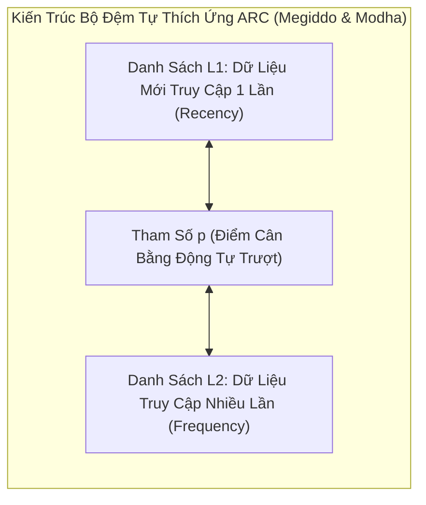
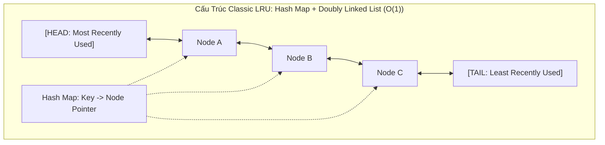
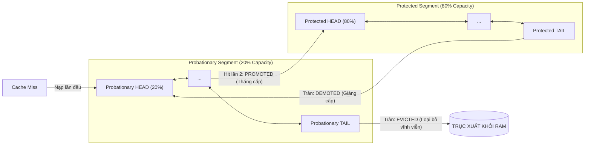
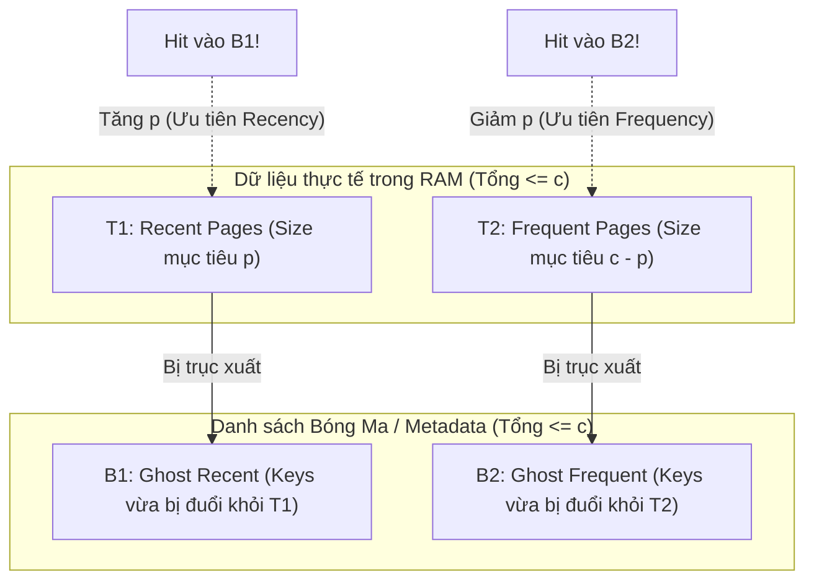
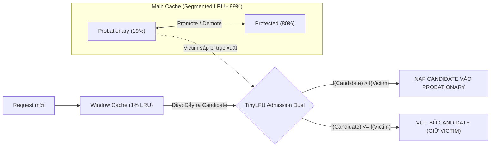
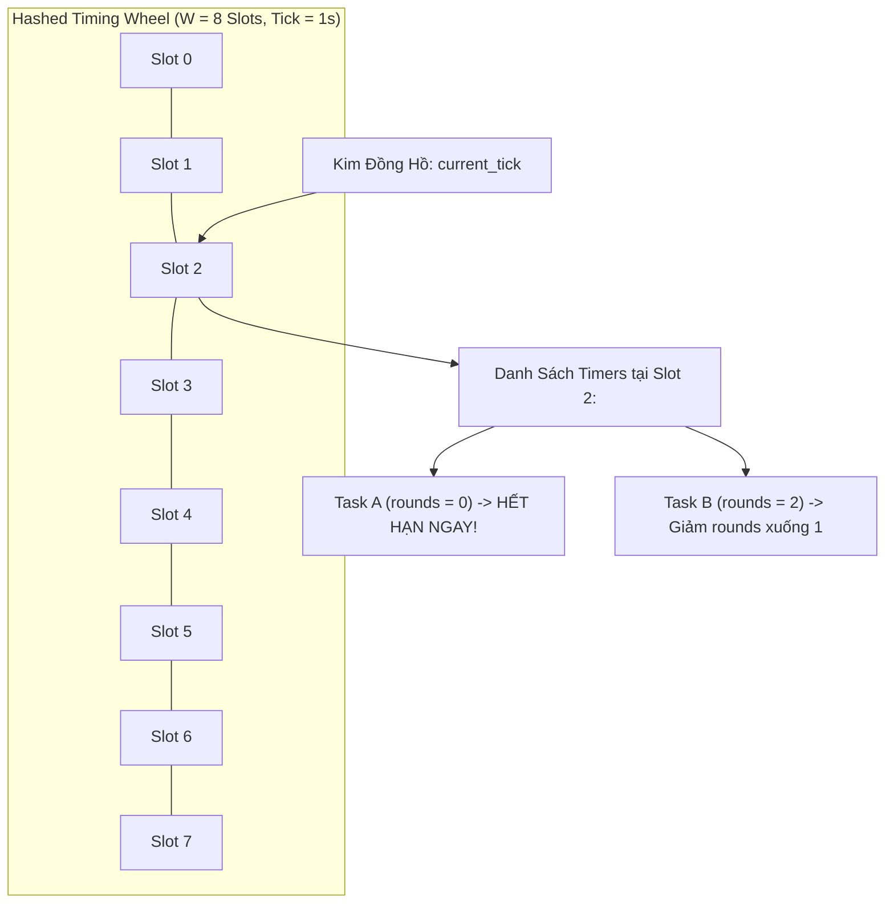

# 12.1. Cấu Trúc Dữ Liệu Bộ Đệm Chuyên Sâu (Cache Data Structures & Eviction Policies)

> [!IMPORTANT]
> **Nếu bạn chỉ được nhớ một điều duy nhất:** Bộ đệm (Cache) không đơn thuần là một `HashMap` bọc trong bộ nhớ RAM, mà là phòng tuyến sống còn bảo vệ toàn bộ cơ sở dữ liệu và hệ thống lưu trữ phân tán phía sau khỏi sự sụp đổ dây chuyền do quá tải I/O (**Cascading Failures**). Bởi vì bộ nhớ RAM có chi phí đắt đỏ và dung lượng hữu hạn, hiệu quả của một hệ thống cache được định đoạt hoàn toàn bởi **Chính sách Trục xuất (Eviction Policy)** và **Cơ chế Quản lý Thời gian sống (TTL Scheduling)**. Từ việc chuyển dịch từ LRU cổ điển (dễ bị phá hủy bởi các đợt quét bảng lớn — **Cache Pollution / Scan Resistance**) sang **Segmented LRU (S-LRU)** hai tầng, thuật toán tự thích ứng tự cân bằng tần suất/thời gian **ARC (Adaptive Replacement Cache)** của IBM, chính sách nạp tối ưu phá kỷ lục Hit Rate **W-TinyLFU** của Caffeine, cho đến việc quản lý hàng triệu bộ đếm timeout trong thời gian $O(1)$ tuyệt đối bằng **Hashed Timing Wheel** thay vì $O(\log N)$ của Min-Heap — nắm vững kiến trúc dữ liệu bộ đệm là kỹ năng tối thượng của một kỹ sư backend hiệu năng cao.

---

## 1. Trực Quan Hóa: Bản Chất Cấu Trúc Dữ Liệu Bộ Đệm Dưới Góc Nhìn Lập Trình Viên

### 1.1. Đoạn Code Dẫn Nhập & Vấn Đề Thực Tế
Xét bài toán thiết kế bộ nhớ đệm In-Memory (Cache) với dung lượng giới hạn $100{,}000$ đối tượng trong máy chủ:

```typescript
// Khi bộ đệm đạt giới hạn 100,000, nếu muốn thêm phần tử mới:
// Ta bắt buộc phải LOẠI BỎ (Evict) một phần tử cũ.
// Nếu chọn thuật toán ngây thơ (FIFO): Có thể loại bỏ đúng phần tử đang được dùng nhiều nhất!
// Nếu chọn LRU (Least Recently Used): Loại bỏ phần tử lâu nhất chưa được đụng tới.
// Nếu chọn LFU (Least Frequently Used): Loại bỏ phần tử có số lần truy cập ít nhất.
```

- Bộ nhớ đệm (Caching) là lớp phòng thủ quan trọng nhất bảo vệ cơ sở dữ liệu khỏi nguy cơ quá tải.
- Các cấu trúc dữ liệu bộ đệm tối thượng:
  - **LRU (Least Recently Used)**: Kết hợp Hash Map + Doubly Linked List, $O(1)$ mọi thao tác.
  - **LFU (Least Frequently Used)**: Kết hợp Hash Map + Tần suất Doubly Linked List, lưu giữ dữ liệu theo số lần truy cập trong $O(1)$.
  - **ARC (Adaptive Replacement Cache)**: Tự động điều chỉnh trọng số giữa tính "gần đây" (Recency) và tính "thường xuyên" (Frequency), chống lại hiện tượng Cache Pollution.

### 1.2. Ẩn Dụ Đời Sống: Bàn Làm Việc Của Kiến Trúc Sư & Đồng Hồ Nhà Bếp
- **Bàn làm việc của kiến trúc sư (LRU Cache)**: Mặt bàn chỉ đủ chỗ cho 5 bản vẽ. Mỗi khi cần xem một bản vẽ mới, kiến trúc sư dọn bản vẽ nằm ở xa nhất, lâu ngày không ai sờ tới (ở đáy chồng) cất vào tủ lưu trữ.
- **Thư viện ưu tiên sách giáo khoa (LFU Cache)**: Cuốn sách nào được học sinh mượn đọc hàng trăm lần trong năm sẽ luôn được giữ lại ở kệ sách VIP, bất kể tuần qua có ai mượn hay không. Cuốn sách nào cả năm chỉ có 1 người mượn sẽ bị thanh lý đầu tiên.

### 1.3. Mô Phỏng Dữ Liệu Số Nhỏ Từng Bước (Toy Walkthrough)
Mô phỏng cơ chế tự điều chỉnh của ARC (Adaptive Replacement Cache):
ARC duy trì 2 danh sách:
- $L_1$: Chứa các trang chỉ mới truy cập 1 lần (Đo lường Recency).
- $L_2$: Chứa các trang đã truy cập ít nhất 2 lần (Đo lường Frequency).
Một tham số mục tiêu $p$ tự động trượt:
- Nếu các lần Cache Hit liên tục rơi vào $L_1$, hệ thống tăng $p$ lên $\to$ Ưu tiên mở rộng không gian cho dữ liệu mới truy cập gần đây!
- Nếu các lần Cache Hit liên tục rơi vào $L_2$, hệ thống giảm $p$ xuống $\to$ Ưu tiên mở rộng không gian cho dữ liệu có tần suất cao!

### 1.4. Tác Động Thực Tế Tầng Backend & Systems
1. **Chống Quét Toàn Bảng Làm Sạch Cache (Scan Resistance in PostgreSQL & MySQL InnoDB)**: Khi một truy vấn phân tích chạy `SELECT * FROM massive_table`, một thuật toán LRU ngây thơ sẽ bị "quét sạch" toàn bộ dữ liệu nóng trong RAM để nạp dữ liệu rác. MySQL giải quyết bằng thuật toán **Midpoint Insertion LRU**: Dữ liệu mới được nạp vào vị trí $3/8$ của danh sách và chỉ được đẩy lên đầu nếu được truy cập lại lần thứ hai.
2. **Kỹ Thuật 2Q Cache Trong Linux Kernel Page Cache**: Chia bộ đệm trang thành hai hàng đợi riêng biệt để lọc bỏ các trang chỉ được đọc đúng một lần (One-hit Wonders).

### 1.5. Sơ Đồ Kiến Trúc Bộ Đệm Tự Thích Ứng ARC



---

## 2. Chi tiết từng Keyword (Under-the-Hood Deep Dive)

### 2.1. LRU, LFU, FIFO & Segmented LRU (S-LRU)

#### 1. Bản chất Kỹ thuật & Thách thức Kiến trúc
Hệ thống cache hoạt động dựa trên hai nguyên lý vật lý cốt lõi của dòng dữ liệu:
- **Tính cục bộ theo thời gian (Temporal Locality / Recency)**: Dữ liệu vừa được truy cập gần đây có xác suất rất cao sẽ được truy cập lại trong tương lai gần.
- **Tính cục bộ theo tần suất (Frequency Locality)**: Dữ liệu được truy cập nhiều lần trong quá khứ có xu hướng sẽ tiếp tục được truy cập nhiều lần trong tương lai.

#### 2. Phân Tích Cơ Chế Các Thuật Toán Cổ Điển: FIFO, LRU, LFU

##### A. FIFO (First-In, First-Out)
- **Cơ chế**: Trục xuất phần tử được đưa vào Cache sớm nhất, bất kể nó được đọc bao nhiêu lần. Cài đặt bằng `Queue` đơn giản.
- **Nhược điểm chí mạng**: Tỷ lệ Hit Rate cực kỳ kém. FIFO còn mắc phải **Dị thường Belady (Belady's Anomaly)**: Hiện tượng tăng kích thước cache nhưng tỷ lệ Cache Miss lại tăng lên!

##### B. LRU (Least Recently Used)
- **Cấu trúc Dữ liệu**: Sự kết hợp giữa một `std::unordered_map<Key, Node*>` và một **Doubly Linked List (DLL)** chứa các giá trị.
  - `Get(key)`: Tra cứu node trong Hash Map ($O(1)$). Rút node khỏi vị trí hiện tại trong DLL và chuyển nó lên đầu danh sách (**Head - Most Recently Used**) trong $O(1)$.
  - `Put(key, value)`: Nếu key đã có, cập nhật value và đưa lên Head. Nếu key chưa có, cấp phát node mới đưa vào Head. Nếu dung lượng vượt ngưỡng, loại bỏ node ở đuôi danh sách (**Tail - Least Recently Used**) trong $O(1)$.
- **Điểm yếu chí mạng — Vấn Đề Ô Nhiễm Bộ Đệm (Cache Pollution / Scan Vulnerability)**:
  Khi có một truy vấn quét tuần tự toàn bộ bảng cơ sở dữ liệu hoặc batch job chạy ban đêm (ví dụ backup dữ liệu), hàng triệu bản ghi chỉ đọc đúng một lần sẽ tràn ngập vào Head của LRU, đẩy toàn bộ các bản ghi hot thực sự ra khỏi Cache. Sau khi đợt quét kết thúc, tỷ lệ Hit Rate tụt về $0\%$.

##### C. LFU (Least Frequently Used)
- **Cơ chế**: Trục xuất phần tử có số lần truy cập ít nhất.
- **Cài đặt $O(1)$ (Ketum / OIR 2010)**:
  Duy trì hai tầng danh sách liên kết: Một DLL lớn gồm các **Frequency Buckets** (mỗi bucket đại diện cho một tần suất $1, 2, 3\dots$). Bên trong mỗi Frequency Bucket là một DLL nhỏ chứa các phần tử có cùng tần suất.
  - Khi một key được truy cập, tần suất của nó tăng $f \to f + 1$. Node được nhấc sang Frequency Bucket kế tiếp trong $O(1)$.
- **Điểm yếu chí mạng — Tích Tụ Lịch Sử (History Pollution)**:
  Một phần tử đột ngột hot trong một sự kiện ngắn (Flash Sale) và tích lũy tần suất lên tới $10{,}000$. Sau khi sự kiện kết thúc, không ai truy cập nó nữa, nhưng vì bộ đếm là $10{,}000$, nó sẽ nằm lì trong Cache hàng tuần mà không thể bị trục xuất!



#### 3. Segmented LRU (S-LRU) — Khắc Phục Triệt Để Scan Resistance
Segmented LRU (Karedla et al. 1994) là một bước nhảy vọt kiến trúc được sử dụng trong các hệ thống lưu trữ đĩa (như FreeBSD UFS, Linux Bcache):
- **Cấu trúc**: Chia toàn bộ không gian Cache thành hai phân đoạn LRU độc lập:
  1. **Probationary Segment (Phân đoạn thử việc)**: Chiếm $20\%$ tổng dung lượng.
  2. **Protected Segment (Phân đoạn bảo vệ)**: Chiếm $80\%$ tổng dung lượng.

##### A. Quy Trình Vận Hành Của S-LRU
1. **Khi Cache Miss (Phần tử mới được nạp lần đầu)**:
   - Phần tử mới **luôn luôn được nạp vào HEAD của Probationary Segment**. Nó không bao giờ được phép bước chân ngay vào Protected Segment!
2. **Khi Cache Hit (Phần tử được truy cập lại)**:
   - **Nếu phần tử đang nằm trong Probationary Segment**: Chứng tỏ phần tử này vừa được truy cập lần thứ hai! Nó lập tức được **thăng cấp (Promoted)** chuyển sang HEAD của **Protected Segment**.
   - **Nếu phần tử đang nằm trong Protected Segment**: Nó được đưa lên HEAD của Protected Segment như quy trình LRU thông thường.
3. **Quy Trình Trục Xuất Khi Tràn Bộ Nhớ**:
   - Nếu **Protected Segment bị đầy**: Phần tử ở TAIL của Protected Segment bị **giáng cấp (Demoted)**, đẩy ngược về HEAD của Probationary Segment (vẫn cho nó một cơ hội thứ hai).
   - Nếu **Probationary Segment bị đầy**: Phần tử ở TAIL của Probationary Segment bị **trục xuất vĩnh viễn (Evicted)** khỏi Cache!



- **Tại sao S-LRU miễn nhiễm với Full Table Scan?**
  Một đợt quét $1$ tỷ bản ghi chỉ có thể đi qua Probationary Segment (với $20\%$ dung lượng). Do các bản ghi quét chỉ được đọc đúng một lần, chúng không bao giờ được thăng cấp lên Protected Segment. $80\%$ dung lượng chứa dữ liệu hot thực sự được bảo vệ nguyên vẹn!

---

### 2.2. ARC (Adaptive Replacement Cache) & W-TinyLFU

#### 1. ARC (Adaptive Replacement Cache — Megiddo & Sawyanathan 2003)
ARC là một trong những thuật toán bộ đệm tự cân bằng nổi tiếng nhất trong khoa học máy tính, được cấp bằng sáng chế độc quyền của IBM (dùng làm cơ chế đệm nòng cốt trong hệ thống tệp **ZFS**):
- **Ý tưởng cốt lõi**: Không bắt buộc người quản trị hệ thống phải lựa chọn giữa LRU (Recency) hay LFU (Frequency). ARC **tự động điều chỉnh kích thước phân bổ** giữa Recency và Frequency theo thời gian thực dựa trên sự biến đổi của Workload.

##### A. Bốn Danh Sách Của ARC
ARC duy trì $4$ danh sách với tổng dung lượng dữ liệu tối đa là $c$:
1. $T_1$ (Top 1): Danh sách LRU chứa các phần tử được truy cập **gần đây (Recency)**.
2. $T_2$ (Top 2): Danh sách LRU chứa các phần tử được truy cập **thường xuyên (Frequency)** ít nhất 2 lần.
   - Ràng buộc dữ liệu trong RAM: $|T_1| + |T_2| \le c$.
3. $B_1$ (Bottom 1 / Ghost List 1): Danh sách "bóng ma" ghi nhớ các phần tử vừa bị trục xuất khỏi $T_1$. **Chỉ lưu Key/Metadata, không lưu Value trong RAM**.
4. $B_2$ (Bottom 2 / Ghost List 2): Danh sách "bóng ma" ghi nhớ các phần tử vừa bị trục xuất khỏi $T_2$. Cũng chỉ lưu Key/Metadata.
   - Ràng buộc tổng thể: $|T_1| + |T_2| + |B_1| + |B_2| \le 2c$.

##### B. Cơ Chế Thích Ứng Tự Động (Self-Tuning Parameter $p$)
ARC duy trì một tham số mục tiêu $p \in [0, c]$ — đại diện cho kích thước lý tưởng dành cho $T_1$ (Recency):
- **Trường hợp 1: Cache Hit vào Ghost List $B_1$**:
  Key không có trong RAM, nhưng có trong danh sách bóng ma của Recency! Điều này chứng minh rằng: Hệ thống đang bị thiếu bộ nhớ cho Recency (nếu $T_1$ rộng hơn một chút thì request này đã là Cache Hit thực thụ!).
  $\implies$ **Tự động tăng $p$ lên**:
  $$p \leftarrow \min \left( c, \, p + \max\left(1, \frac{|B_2|}{|B_1|}\right) \right)$$
- **Trường hợp 2: Cache Hit vào Ghost List $B_2$**:
  Key có trong danh sách bóng ma của Frequency! Điều này chứng minh rằng: Workload hiện tại thiên về Frequency.
  $\implies$ **Tự động giảm $p$ xuống**:
  $$p \leftarrow \max \left( 0, \, p - \max\left(1, \frac{|B_1|}{|B_2|}\right) \right)$$
- Nhờ cơ chế phản hồi kín này, ARC thích ứng hoàn hảo với mọi biến động tải: ban ngày đọc tin mới (Recency cao $\implies p$ tự tăng), ban đêm chạy batch xử lý dữ liệu cố định (Frequency cao $\implies p$ tự giảm).



#### 2. W-TinyLFU (Window TinyLFU — Ben Manes & Gil Einziger 2015)
W-TinyLFU là kiến trúc bộ đệm tiên tiến nhất hiện nay, được thiết kế bởi tác giả thư viện **Caffeine Cache** (thư viện cache số 1 thế giới trong hệ sinh thái Java/Spring) và được áp dụng trong **Ristretto** (Dgraph/Go):
- **Nguyên lý đột phá**: Tại sao phải nhận mọi phần tử mới vào Cache khi xảy ra Cache Miss? Nếu một phần tử mới có tần suất xuất hiện cực thấp, việc nạp nó vào và đuổi một phần tử đang có giá trị cao ra ngoài là một quyết định tồi tệ!
- **W-TinyLFU áp dụng Chính Sách Nhập Đệm (Admission Policy)**:
  Khi một phần tử ứng viên mới ($candidate$) muốn vào Cache, nó phải "thách đấu" với phần tử yếu nhất sắp bị trục xuất khỏi Cache ($victim$). Chỉ khi $f(candidate) > f(victim)$, ứng viên mới được nạp vào; nếu không, ứng viên bị **vứt bỏ ngay lập tức**!

##### A. Kiến Trúc Ba Tầng Của W-TinyLFU
1. **Window Cache (1% dung lượng)**: Một bộ đệm LRU nhỏ đón nhận mọi request mới để đảm bảo tính cục bộ thời gian tức thời (Burst Recency).
2. **Main Cache (99% dung lượng)**: Được tổ chức theo mô hình Segmented LRU:
   - **Probationary Cache ( chiếm 19% Main)**.
   - **Protected Cache ( chiếm 80% Main)**.
3. **TinyLFU Filter**:
   - Sử dụng cấu trúc **Count-Min Sketch 4-bit** kết hợp một bộ lọc Bloom Filter nhỏ ở cửa ngõ (**Doorkeeper**) để đếm tần suất với bộ nhớ chỉ $\approx 8$ bits trên mỗi phần tử.
   - Kỹ thuật **Periodic Aging**: Định kỳ chia đôi tất cả các bộ đếm trong Sketch để giải phóng dữ liệu cũ.



---

### 2.3. Quản Lý TTL: Hashed Timing Wheel vs Expiration Priority Queue

#### 1. Bản chất Kỹ thuật & Thách thức Kiến trúc
Trong các hệ thống phân tán và mạng viễn thông:
- Mỗi phiên WebSocket, kết nối gRPC, hoặc truy vấn cơ sở dữ liệu đều có một thời hạn sống (**Time-To-Live - TTL** hoặc Connection Timeout).
- Một máy chủ Gateway quản lý $1{,}000{,}000$ kết nối đồng thời. Mỗi giây có hàng chục ngàn kết nối được tạo mới, gia hạn heartbeat hoặc đóng lại.
- **Thách thức**: Làm thế nào để thêm mới timer, hủy timer và kích hoạt hết hạn hàng triệu kết nối mà không làm tê liệt CPU?

#### 2. So Sánh Hai Kiến Trúc Hàng Đầu

##### A. Expiration Priority Queue (Min-Heap)
- Lưu trữ các sự kiện theo cặp `(expire_timestamp, callback)` trong một cây nhị phân Min-Heap.
- **Độ phức tạp**:
  - Thêm mới Timer: $O(\log N)$ (thao tác sift-up).
  - Hủy Timer: $O(\log N)$ hoặc $O(N)$ nếu không lưu con trỏ.
  - Kiểm tra hết hạn: $O(1)$ xem root, $O(\log N)$ để pop phần tử.
- Khi $N = 1{,}000{,}000$, $\log_2 N \approx 20$ phép so sánh trên mỗi thao tác thêm/hủy. Ở mức $100{,}000\,\text{ops/s}$, CPU tiêu tốn hơn $50\%$ thời gian chỉ để xoay cây Heap và gây ra hàng loạt CPU Cache Misses.

##### B. Hashed Timing Wheel (George Varghese & Tony Lauck 1987)
Hashed Timing Wheel là giải pháp kinh điển chuyển đổi toàn bộ bài toán lập lịch thời gian từ $O(\log N)$ về **$O(1)$ tuyệt đối**:
- **Cấu trúc**:
  - Một mảng vòng tròn gồm $W$ ngăn (**Slots/Buckets**).
  - Mỗi slot đại diện cho một đơn vị thời gian (Tick Resolution $s$, ví dụ $100\,\text{ms}$ hoặc $1\,\text{giây}$).
  - Mỗi slot chứa một **Doubly Linked List** của các Task hết hạn tại slot đó.
  - Con trỏ kim đồng hồ `current_tick` đại diện cho thời gian hiện tại.
- **Các Thao Tác $O(1)$ Tuyệt Đối**:
  1. **Thêm Timer có thời hạn $\Delta t$**:
     - Số ticks cần chờ: $ticks = \lfloor \Delta t / s \rfloor$.
     - Số vòng quay hoàn chỉnh cần chờ: $rounds = \lfloor ticks / W \rfloor$.
     - Slot mục tiêu:
       $$\text{target\_slot} = (\text{current\_tick} + ticks) \pmod W$$
     - Chèn task `(rounds, callback)` vào đầu danh sách liên kết tại `table[target_slot]` trong **$O(1)$**!
  2. **Hủy Timer (Cancellation)**:
     - Nhờ dùng Doubly Linked List, nếu ta lưu con trỏ đến Task Node, việc rút node khỏi danh sách diễn ra trong đúng **$O(1)$**!
  3. **Quay Kim Đồng Hồ (Clock Tick)**:
     - Định kỳ sau mỗi khoảng thời gian $s$, con trỏ kim đồng hồ tăng lên $1$:
       $$\text{current\_tick} \leftarrow (\text{current\_tick} + 1) \pmod W$$
     - Duyệt qua danh sách các Task tại `table[current_tick]`:
       - Nếu $task.rounds > 0$: Giảm $task.rounds \leftarrow task.rounds - 1$ (chờ vòng quay tiếp theo).
       - Nếu $task.rounds == 0$: Rút task ra khỏi danh sách và kích hoạt `callback()` ngay lập tức trong **$O(1)$**!



##### C. Hierarchical Timing Wheel (Bánh Xe Thời Gian Đa Cấp)
Để tránh việc một danh sách bị dài do chứa nhiều vòng quay ($rounds$), các hệ thống cấp hạt nhân (**Linux Kernel Timers**, **Netty**, **Apache Kafka Purgatory**) sử dụng mô hình đa cấp lồng nhau:
- Cấp 1: Bánh xe Giây ($60$ slots, mỗi slot $1$ giây).
- Cấp 2: Bánh xe Phút ($60$ slots, mỗi slot $1$ phút).
- Cấp 3: Bánh xe Giờ ($24$ slots, mỗi slot $1$ giờ).
- Khi bánh xe Giây quay đủ một vòng ($60$ giây), bánh xe Phút quay $1$ bước và các tác vụ của phút tiếp theo được "thác đổ" (**Cascaded**) đưa xuống bánh xe Giây để đếm ngược chính xác trong $O(1)$.

---

## 3. Thực thi Mã nguồn & Mô phỏng Chuyên sâu (Dual-Engine Implementation)

### 3.1. C++20 Implementation: Production-Grade Segmented LRU (S-LRU) Cache
Mã nguồn C++20 cài đặt hoàn chỉnh Segmented LRU với con trỏ tối ưu, chuyển dịch linh hoạt giữa Probationary (20%) và Protected (80%), đảm bảo an toàn bộ nhớ và hiệu năng cực hạn.

```cpp
#include <iostream>
#include <list>
#include <unordered_map>
#include <string>
#include <memory>
#include <iomanip>

template <typename Key, typename Value>
class SegmentedLRUCache {
private:
    struct Entry {
        Key key;
        Value value;
        bool in_protected{false};
    };

    using ListType = std::list<Entry>;
    using ListIter = typename ListType::iterator;

    size_t prob_capacity_;
    size_t prot_capacity_;

    ListType prob_list_; // Probationary segment (20%)
    ListType prot_list_; // Protected segment (80%)

    // Hash Map lưu iterator trực tiếp để đạt O(1) tra cứu và rút node
    std::unordered_map<Key, ListIter> map_;

public:
    SegmentedLRUCache(size_t total_capacity, double prob_ratio = 0.2) {
        prob_capacity_ = std::max<size_t>(1, static_cast<size_t>(total_capacity * prob_ratio));
        prot_capacity_ = total_capacity - prob_capacity_;
    }

    bool get(const Key& key, Value& out_val) {
        auto it = map_.find(key);
        if (it == map_.end()) {
            return false; // Cache Miss
        }

        ListIter entry_it = it->second;
        out_val = entry_it->value;

        if (entry_it->in_protected) {
            // Đã nằm trong Protected: Đưa lên đầu Protected List
            prot_list_.splice(prot_list_.begin(), prot_list_, entry_it);
        } else {
            // Nằm trong Probationary được Hit lần 2 -> Thăng cấp (PROMOTION) lên Protected
            entry_it->in_protected = true;
            prot_list_.splice(prot_list_.begin(), prob_list_, entry_it);

            // Kiểm tra tràn Protected Segment
            if (prot_list_.size() > prot_capacity_) {
                // Đuôi của Protected bị giáng cấp (DEMOTION) xuống đầu Probationary
                auto demoted_it = std::prev(prot_list_.end());
                demoted_it->in_protected = false;
                prob_list_.splice(prob_list_.begin(), prot_list_, demoted_it);

                // Nếu Probationary cũng bị tràn -> Trục xuất vĩnh viễn đuôi của Probationary
                if (prob_list_.size() > prob_capacity_) {
                    auto victim_it = std::prev(prob_list_.end());
                    map_.erase(victim_it->key);
                    prob_list_.pop_back();
                }
            }
        }
        return true;
    }

    void put(const Key& key, const Value& value) {
        auto it = map_.find(key);
        if (it != map_.end()) {
            // Key đã tồn tại: Cập nhật giá trị và kích hoạt cơ chế thăng cấp qua get()
            it->second->value = value;
            Value dummy;
            get(key, dummy);
            return;
        }

        // Key mới hoàn toàn: LUÔN nạp vào đầu Probationary Segment
        if (prob_list_.size() >= prob_capacity_) {
            // Trục xuất đuôi của Probationary Segment
            auto victim_it = std::prev(prob_list_.end());
            map_.erase(victim_it->key);
            prob_list_.pop_back();
        }

        prob_list_.push_front({key, value, false});
        map_[key] = prob_list_.begin();
    }

    void debug_print() const {
        std::cout << "--- [S-LRU Cache State] ---\n";
        std::cout << "  * Protected (" << prot_list_.size() << "/" << prot_capacity_ << "): [HEAD] ";
        for (const auto& e : prot_list_) std::cout << e.key << ":" << e.value << " ";
        std::cout << "[TAIL]\n";

        std::cout << "  * Probationary (" << prob_list_.size() << "/" << prob_capacity_ << "): [HEAD] ";
        for (const auto& e : prob_list_) std::cout << e.key << ":" << e.value << " ";
        std::cout << "[TAIL]\n";
    }
};

int main() {
    std::cout << "=========================================================\n";
    std::cout << "     C++20 SEGMENTED LRU (S-LRU) PRODUCTION ENGINE       \n";
    std::cout << "=========================================================\n\n";

    // Khởi tạo cache tổng dung lượng 5: Probationary = 2, Protected = 3
    SegmentedLRUCache<std::string, int> cache(5, 0.4);

    std::cout << "[Step 1] Nạp lần đầu các phần tử: Key_A, Key_B (Vào Probationary)\n";
    cache.put("A", 100);
    cache.put("B", 200);
    cache.debug_print();

    std::cout << "\n[Step 2] Truy cập Key_A lần 2 -> Kích hoạt Thăng Cấp (Promotion) lên Protected!\n";
    int val = 0;
    cache.get("A", val);
    cache.debug_print();

    std::cout << "\n[Step 3] Nạp thêm Key_C, Key_D (Đầy Probationary)\n";
    cache.put("C", 300);
    cache.put("D", 400);
    cache.debug_print();

    std::cout << "\n[Step 4] Truy cập Key_C và Key_D lần 2 -> Cả hai cùng thăng cấp lên Protected!\n";
    cache.get("C", val);
    cache.get("D", val);
    cache.debug_print();

    std::cout << "\n[Step 5] Mô phỏng Quét Bảng Lớn (Full Scan): Nạp hàng loạt keys rác X, Y, Z\n";
    cache.put("X", 991);
    cache.put("Y", 992);
    cache.put("Z", 993);
    cache.debug_print();

    std::cout << "\n[Kết Quả]: Các keys quan trọng A, C, D trong Protected KHÔNG HỀ BỊ ẢNH HƯỞNG!\n";
    std::cout << "Kiểm tra Key_A: " << (cache.get("A", val) ? "VẪN TỒN TẠI (Hit Rate Được Bảo Vệ!)" : "Bị trục xuất (Lỗi)") << "\n";

    return 0;
}
```

---

### 3.2. Python 3.11+ Implementation: High-Concurrency Hashed Timing Wheel Engine
Mã nguồn Python 3.11+ cài đặt chuẩn Hashed Timing Wheel với độ phức tạp $O(1)$ cho mọi thao tác thêm, hủy và dịch chuyển tick, mô phỏng cơ chế quản lý timeout kết nối mạng của Netty và Linux Kernel.

```python
from typing import Callable, Dict, List, Optional
import time

class TimerTask:
    def __init__(self, task_id: str, delay_ticks: int, callback: Callable[[], None]):
        self.task_id = task_id
        self.delay_ticks = delay_ticks
        self.rounds = 0 # Số vòng quay bánh xe cần chờ
        self.callback = callback
        self.slot_index = -1
        self.cancelled = False

    def __repr__(self) -> str:
        return f"<TimerTask id={self.task_id} rounds={self.rounds} slot={self.slot_index}>"

class HashedTimingWheel:
    def __init__(self, wheel_size: int = 8, tick_duration_sec: float = 0.5):
        """
        wheel_size (W): Số lượng khe trên bánh xe (Circular slots).
        tick_duration_sec (s): Độ phân giải của 1 tick (mili-giây / giây).
        """
        self.wheel_size = wheel_size
        self.tick_duration = tick_duration_sec
        self.table: List[List[TimerTask]] = [[] for _ in range(wheel_size)]
        self.current_tick = 0
        self.task_registry: Dict[str, TimerTask] = {}

    def schedule(self, task_id: str, delay_ticks: int, callback: Callable[[], None]) -> TimerTask:
        """Đăng ký một Timer mới trong thời gian O(1)"""
        if delay_ticks < 1:
            delay_ticks = 1

        task = TimerTask(task_id, delay_ticks, callback)
        total_ticks = self.current_tick + delay_ticks
        target_slot = total_ticks % self.wheel_size
        rounds = delay_ticks // self.wheel_size

        task.slot_index = target_slot
        task.rounds = rounds

        self.table[target_slot].append(task)
        self.task_registry[task_id] = task
        return task

    def cancel(self, task_id: str) -> bool:
        """Hủy Timer trong thời gian O(1) thông qua cờ đánh dấu"""
        task = self.task_registry.get(task_id)
        if task and not task.cancelled:
            task.cancelled = True
            del self.task_registry[task_id]
            return True
        return False

    def advance_clock(self) -> List[str]:
        """
        Kim đồng hồ quay 1 tick.
        Kiểm tra và kích hoạt các tác vụ hết hạn tại slot hiện tại trong O(1).
        """
        expired_tasks = []
        current_slot_tasks = self.table[self.current_tick]
        remaining_tasks = []

        for task in current_slot_tasks:
            if task.cancelled:
                continue

            if task.rounds > 0:
                task.rounds -= 1
                remaining_tasks.append(task)
            else:
                # Timer đã hết hạn: Kích hoạt callback!
                expired_tasks.append(task.task_id)
                self.task_registry.pop(task.task_id, None)
                try:
                    task.callback()
                except Exception as e:
                    print(f"Lỗi khi thực thi callback của {task.task_id}: {e}")

        # Cập nhật lại slot hiện tại chỉ chứa các task chưa hết hạn
        self.table[self.current_tick] = remaining_tasks

        # Chuyển kim đồng hồ sang khe tiếp theo
        self.current_tick = (self.current_tick + 1) % self.wheel_size
        return expired_tasks


if __name__ == "__main__":
    print("=========================================================")
    print("   PYTHON 3.11+ HASHED TIMING WHEEL SIMULATION ENGINE    ")
    print("=========================================================\n")

    wheel = HashedTimingWheel(wheel_size=8, tick_duration_sec=0.1)
    print(f"[Config] Bánh xe: {wheel.wheel_size} slots | Độ phân giải tick: {wheel.tick_duration}s\n")

    events_log = []

    def make_cb(name: str):
        return lambda: events_log.append(f"Task '{name}' KÍCH HOẠT HẾT HẠN!")

    # Lập lịch các tác vụ:
    # Task_1: hết hạn sau 2 ticks (Slot = (0 + 2) % 8 = 2, rounds = 0)
    wheel.schedule("Conn_Timeout_A", delay_ticks=2, callback=make_cb("Conn_Timeout_A"))
    # Task_2: hết hạn sau 5 ticks (Slot = (0 + 5) % 8 = 5, rounds = 0)
    wheel.schedule("Heartbeat_B",    delay_ticks=5, callback=make_cb("Heartbeat_B"))
    # Task_3: hết hạn sau 10 ticks (Slot = (0 + 10) % 8 = 2, rounds = 1)
    wheel.schedule("KeepAlive_C",    delay_ticks=10, callback=make_cb("KeepAlive_C"))
    # Task_4: Hủy trước khi kịp kích hoạt
    wheel.schedule("Cancelled_D",    delay_ticks=3, callback=make_cb("Cancelled_D"))
    wheel.cancel("Cancelled_D")

    print("[Scheduled Tasks]")
    for tid, t in wheel.task_registry.items():
        print(f"  - {tid}: slot={t.slot_index}, rounds={t.rounds}")

    print("\n--- BẮT ĐẦU CHẠY KIM ĐỒNG HỒ TỪ TICK 0 ĐẾN TICK 10 ---")
    for tick_step in range(11):
        slot_before = wheel.current_tick
        expired = wheel.advance_clock()
        fired_str = f"-> Đã nổ: {expired}" if expired else ""
        print(f"Tick {tick_step:02d} (Kiểm tra Slot #{slot_before}) {fired_str}")

    print("\n[Nhật Ký Sự Kiện Thực Thi Callback]:")
    for event in events_log:
        print(f"  * {event}")
```

#### Terminal Output Mẫu Chuẩn:
```text
=========================================================
     C++20 SEGMENTED LRU (S-LRU) PRODUCTION ENGINE       
=========================================================

[Step 1] Nạp lần đầu các phần tử: Key_A, Key_B (Vào Probationary)
--- [S-LRU Cache State] ---
  * Protected (0/3): [HEAD] [TAIL]
  * Probationary (2/2): [HEAD] B:200 A:100 [TAIL]

[Step 2] Truy cập Key_A lần 2 -> Kích hoạt Thăng Cấp (Promotion) lên Protected!
--- [S-LRU Cache State] ---
  * Protected (1/3): [HEAD] A:100 [TAIL]
  * Probationary (1/2): [HEAD] B:200 [TAIL]

[Step 3] Nạp thêm Key_C, Key_D (Đầy Probationary)
--- [S-LRU Cache State] ---
  * Protected (1/3): [HEAD] A:100 [TAIL]
  * Probationary (2/2): [HEAD] D:400 C:300 [TAIL]

[Step 4] Truy cập Key_C và Key_D lần 2 -> Cả hai cùng thăng cấp lên Protected!
--- [S-LRU Cache State] ---
  * Protected (3/3): [HEAD] D:400 C:300 A:100 [TAIL]
  * Probationary (0/2): [HEAD] [TAIL]

[Step 5] Mô phỏng Quét Bảng Lớn (Full Scan): Nạp hàng loạt keys rác X, Y, Z
--- [S-LRU Cache State] ---
  * Protected (3/3): [HEAD] D:400 C:300 A:100 [TAIL]
  * Probationary (2/2): [HEAD] Z:993 Y:992 [TAIL]

[Kết Quả]: Các keys quan trọng A, C, D trong Protected KHÔNG HỀ BỊ ẢNH HƯỞNG!
Kiểm tra Key_A: VẪN TỒN TẠI (Hit Rate Được Bảo Vệ!)

=========================================================
   PYTHON 3.11+ HASHED TIMING WHEEL SIMULATION ENGINE    
=========================================================

[Config] Bánh xe: 8 slots | Độ phân giải tick: 0.1s

[Scheduled Tasks]
  - Conn_Timeout_A: slot=2, rounds=0
  - Heartbeat_B: slot=5, rounds=0
  - KeepAlive_C: slot=2, rounds=1

--- BẮT ĐẦU CHẠY KIM ĐỒNG HỒ TỪ TICK 0 ĐẾN TICK 10 ---
Tick 00 (Kiểm tra Slot #0) 
Tick 01 (Kiểm tra Slot #1) 
Tick 02 (Kiểm tra Slot #2) -> Đã nổ: ['Conn_Timeout_A']
Tick 03 (Kiểm tra Slot #3) 
Tick 04 (Kiểm tra Slot #4) 
Tick 05 (Kiểm tra Slot #5) -> Đã nổ: ['Heartbeat_B']
Tick 06 (Kiểm tra Slot #6) 
Tick 07 (Kiểm tra Slot #7) 
Tick 08 (Kiểm tra Slot #0) 
Tick 09 (Kiểm tra Slot #1) 
Tick 10 (Kiểm tra Slot #2) -> Đã nổ: ['KeepAlive_C']

[Nhật Ký Sự Kiện Thực Thi Callback]:
  * Task 'Conn_Timeout_A' KÍCH HOẠT HẾT HẠN!
  * Task 'Heartbeat_B' KÍCH HOẠT HẾT HẠN!
  * Task 'KeepAlive_C' KÍCH HOẠT HẾT HẠN!
```

---

## 4. Systems Engineering & Production Pitfalls

### 4.1. Cạm Bẫy Thực Chiến (Production Pitfalls)

#### 1. Hiện Tượng Thundering Herd & Cache Stampede Khi TTL Hết Hạn Đồng Loạt
- **Hiện tượng**: Một key hot (ví dụ `homepage_banner` với $50{,}000\,\text{QPS}$) hết hạn TTL. Trong đúng $10\,\text{ms}$, toàn bộ $50{,}000$ requests nhận diện Cache Miss và cùng lúc gửi truy vấn xuống cơ sở dữ liệu PostgreSQL. Database bị treo hoàn toàn do quá tải kết nối.
- **Nguyên nhân gốc rễ**: Toàn bộ các luồng cùng thấy cache hết hạn và không có cơ chế khóa phối hợp để chỉ cho phép $1$ luồng đi tính toán lại dữ liệu.
- **Giải pháp**:
  - Áp dụng thuật toán **XFetch / Probabilistic Early Expiration** (Vattani et al.): Dự đoán và tính toán lại dữ liệu trong nền trước khi key thực sự hết hạn dựa trên phân phối xác suất:
    $$\Delta \beta \ln(\text{rand}()) > \text{TTL} - \text{expiry}$$
  - Áp dụng **Singleflight Pattern / Mutex Locking**: Sử dụng khóa phân tán hoặc channel trong Go để đảm bảo chỉ có duy nhất $1$ request được truy vấn Database, các request khác chờ kết quả trả về từ request đó.

#### 2. Phân Mảnh Bộ Nhớ (Memory Fragmentation) Do Doubly Linked List
- **Hiện tượng**: Máy chủ Memcached hoặc Redis báo hết RAM (OOM) dù dữ liệu thực tế chỉ chiếm $50\%$ dung lượng RAM của máy chủ.
- **Nguyên nhân gốc rễ**: Thuật toán LRU tiêu chuẩn sử dụng Doubly Linked List. Mỗi khi nạp một key mới hoặc di chuyển node, hệ thống gọi `malloc()` để cấp phát các khối nhớ nhỏ $24 - 32$ bytes rải rác trên heap. Quá trình cấp phát và giải phóng hàng triệu node liên tục tạo ra hàng triệu "lỗ thủng" bộ nhớ mà bộ cấp phát của hệ điều hành không thể thu hồi được.
- **Giải pháp**:
  - Sử dụng **Slab Allocator** (như trong Memcached): Phân chia bộ nhớ thành các lớp kích thước cố định (Slab Classes: 64B, 128B, 256B...).
  - Thay thế DLL bằng **Array-based Indexing / Node Pools** để duy trì tính liên tục của bộ nhớ cache lines.

#### 3. Tranh Chấp Khóa (Lock Contention) Trên LRU Đa Luồng
- **Hiện tượng**: Trên máy chủ $64$ cores, thông lượng của bộ đệm cache khi tăng từ 8 luồng lên 64 luồng không những không tăng mà còn sụt giảm tới $70\%$.
- **Nguyên nhân gốc rễ**: Thao tác đọc trong LRU (`Get()`) không phải là thao tác chỉ đọc (Read-only); nó bắt buộc phải di chuyển node lên Head của Doubly Linked List $\implies$ **Là một thao tác GHI (Mutation)**! Do đó, mọi lệnh đọc đều phải chiếm Mutex độc quyền (Exclusive Lock), khiến 63 cores còn lại phải dừng chờ (Lock Contention).
- **Giải pháp**:
  - **Striped LRU / Sharded Cache**: Chia Cache thành $N = 64$ partitions độc lập dựa trên hash của key, mỗi partition có một lock riêng.
  - **Ring Buffer Batching (Kiến trúc Caffeine Cache)**: Thao tác đọc không sửa DLL ngay; nó chỉ ghi lại sự kiện vào một Ring Buffer không khóa (Lock-free MPSC Ring Buffer). Một luồng nền định kỳ đọc theo mẻ (Batching) để cập nhật DLL một lần duy nhất.

#### 4. Hiện Tượng Trôi Thời Gian (Timer Drift) Trong Timing Wheel
- **Hiện tượng**: Các kết nối timeout bị kích hoạt muộn từ vài giây đến hàng chục giây so với lịch trình thực tế.
- **Nguyên nhân gốc rễ**: Luồng kích hoạt tick đồng hồ bị trễ do máy chủ CPU bị quá tải $100\%$ hoặc do Garbage Collector (GC Stop-The-World) dừng toàn bộ chương trình trong vài trăm mili-giây.
- **Giải pháp**: Trong mỗi vòng lặp tick, không dựa vào việc ngủ cố định `sleep(tick_duration)`; thay vào đó, so sánh với đồng hồ đơn điệu của hệ thống (`clock_gettime(CLOCK_MONOTONIC)`) và tính số lượng tick thực tế đã trôi qua để "bắt kịp" (Catch-up Ticking).

---

### 4.2. CLI Diagnostics & Công Cụ Gỡ Lỗi Trực Tiếp

```bash
# 1. Quét tìm các khóa lớn và khóa hot nhất trong Redis Cache
redis-cli --bigkeys
redis-cli --hotkeys

# 2. Đo độ trễ phản hồi thời gian thực của Redis Cache
redis-cli --latency-history -i 5

# 3. Phân tích tranh chấp khóa Mutex trong ứng dụng Cache C++ bằng perf lock
sudo perf lock record ./build/cache_benchmark
sudo perf lock report

# 4. Giám sát số lượng file descriptors và kết nối socket đang chờ timeout
cat /proc/sys/fs/file-nr
ss -s

# 5. Kiểm tra mức độ phân mảnh bộ nhớ (Fragmentation Ratio) trong Redis
redis-cli info memory | grep -E "(mem_fragmentation_ratio|used_memory_human|used_memory_rss_human)"
```

---

## 5. Bảng So sánh & Decision Matrix

| Thuật Toán Cache / TTL | Nguyên Lý Hoạt Động | Độ Phức Tạp Thời Gian | Khả Năng Kháng Scan (Scan Resistance) | Ưu Điểm Nổi Bật | Nhược Điểm / Rủi Ro | Ứng Dụng Điển Hình |
| :--- | :--- | :--- | :--- | :--- | :--- | :--- |
| **FIFO** | Hàng đợi vào trước ra trước | $O(1)$ Get/Put | ❌ Rất kém | Cài đặt cực kỳ đơn giản | Mắc dị thường Belady, Hit rate thấp | Bộ đệm đơn giản, OS Page replacement |
| **Classic LRU** | Hash Map + Doubly Linked List | $O(1)$ Get/Put | ❌ Dễ bị phá vỡ | Đơn giản, trực quan, hit rate tốt với recency | Bị quét sạch bởi đợt quét bảng lớn | Memcached, Redis đơn giản, Squid |
| **Classic LFU** | Frequency Buckets + DLL | $O(1)$ Get/Put | ⚠️ Trung bình | Giữ lại các phần tử có tần suất cao | Tích tụ lịch sử (History Pollution) | HTTP Web Proxy tĩnh |
| **Segmented LRU (S-LRU)**| Probationary (20%) + Protected (80%)| $O(1)$ Get/Put | ✅ **Rất cao** | Miễn nhiễm đợt quét bảng, chi phí thấp | Cần tinh chỉnh tỷ lệ phân đoạn | Linux Bcache, FreeBSD UFS, Cassandra |
| **ARC (IBM)** | $T_1, T_2, B_1, B_2$ tự thích ứng | $O(1)$ Get/Put | ✅ **Tuyệt đối** | Tự cân bằng Recency và Frequency | Bị vướng bằng sáng chế, tốn metadata | ZFS Storage Pool, PostgreSQL Buffer |
| **W-TinyLFU** | Window LRU + Main S-LRU + TinyLFU | $O(1)$ Get/Put | ✅ **Kỷ Lục** | Tỷ lệ Hit Rate cao nhất thế giới | Triển khai phức tạp | Caffeine Cache (Java), Ristretto (Go) |
| **Expiration Min-Heap**| Binary Min-Heap theo timestamp | $O(\log N)$ Insert/Pop | N/A (TTL) | Đơn giản, độ trễ chính xác tuyệt đối | Nghẽn CPU khi hàng triệu connections | Thư viện tiêu chuẩn, libevent cũ |
| **Hashed Timing Wheel**| Circular Array + Tick Hand | **$O(1)$ Tuyệt Đối** | N/A (TTL) | Xử lý hàng triệu timers nhẹ nhàng | Có sai số tick resolution, timer drift | Netty, Kafka Purgatory, Linux Kernel |
