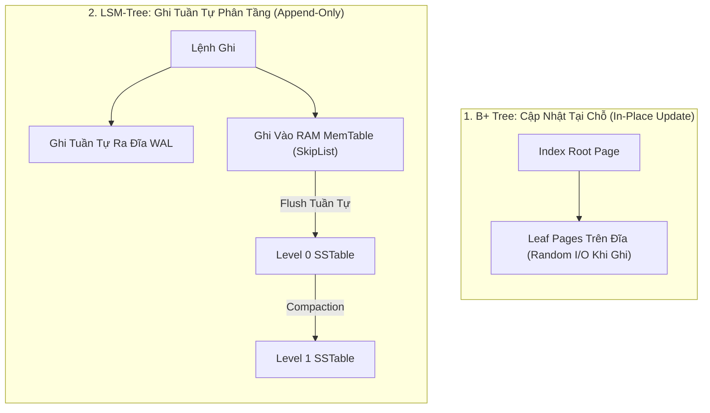

# 12.2. Cấu Trúc Dữ Liệu Lõi Cơ Sở Dữ Liệu (Database Storage Engines & Internal Data Structures)

> [!IMPORTANT]
> **Nếu bạn chỉ được nhớ một điều duy nhất:** Toàn bộ ngành công nghiệp cơ sở dữ liệu hiện đại là cuộc đàm phán không khoan nhượng giữa **Chi phí truy xuất ngẫu nhiên (Random I/O)** và **Chi phí truy xuất tuần tự (Sequential I/O)** của phần cứng vật lý (RAM, SSD NVMe, HDD). Trường phái **B+ Tree (Update-in-Place)** chấp nhận chi phí ghi ngẫu nhiên và phân mảnh trang đĩa để đổi lấy tốc độ truy vấn đọc và quét dải (Range Scan) $O(\log N)$ cố định từ $1 - 3$ lần I/O qua kiến trúc **Slotted Page** và **Buffer Pool**. Ngược lại, trường phái **LSM-Tree (Log-Structured Merge-Tree)** biến $100\%$ các thao tác ghi thành ghi tuần tự siêu tốc trên RAM (**MemTable / Skip List**) và nối tiếp xuống đĩa (**SSTables**), sau đó trả nợ kỹ thuật dần thông qua tiến trình nền **Compaction**, đồng thời kiểm soát đồng thời không khóa bằng chuỗi phiên bản **MVCC Version Chain**.

---

## 1. Trực Quan Hóa: Bản Chất Cấu Trúc Dữ Liệu Cơ Sở Dữ Liệu Dưới Góc Nhìn Lập Trình Viên

### 1.1. Đoạn Code Dẫn Nhập & Vấn Đề Thực Tế
Xét hai kiến trúc lưu trữ dữ liệu trái ngược nhau: PostgreSQL (dùng B+ Tree) và Cassandra / RocksDB (dùng LSM-Tree):

```cpp
// PostgreSQL B+ Tree: Ghi đè trực tiếp tại chỗ (In-Place Update)
// Đọc cực nhanh O(log N) do dữ liệu nằm cố định trong cây.
// Nhưng Ghi bị chậm vì mỗi lệnh UPDATE phát sinh RANDOM DISK I/O để cập nhật lá B+ Tree!

// RocksDB LSM-Tree: Ghi nối tiếp vào đuôi (Append-Only Log)
// Ghi cực nhanh vì chỉ ghi tuần tự vào RAM (MemTable) và file nhật ký (WAL)!
// Nhưng Đọc phải tìm qua nhiều tầng tệp (L0, L1, L2) -> Cần Bloom Filter hỗ trợ.
```

- Cơ sở dữ liệu hiện đại được định hình bởi hai trường phái cấu trúc dữ liệu đối lập:
  - **B+ Tree Engine (MySQL InnoDB, PostgreSQL, SQLite)**: Tối ưu cho hệ thống Đọc nhiều hơn Ghi (Read-heavy OLTP).
  - **LSM-Tree Engine (RocksDB, Cassandra, ScyllaDB, TiKV)**: Tối ưu cho hệ thống Ghi nhiều hơn Đọc (Write-heavy).

### 1.2. Ẩn Dụ Đời Sống: Tủ Hồ Sơ Công Chứng vs Sổ Nhật Ký Kế Toán
- **Tủ hồ sơ công chứng chia ngăn cố định (B+ Tree)**: Mọi hợp đồng mua bán nhà đất được đánh số và đặt chính xác vào ngăn tủ tương ứng. Khi cần xem hợp đồng, công chứng viên bước đến đúng ngăn tủ mở ra trong 10 giây ($O(1)$ Disk Page). Nhưng khi cần cập nhật hợp đồng, họ phải tháo ghim, sửa đổi và cất lại đúng vị trí (In-place Write).
- **Sổ nhật ký kế toán ghi dồn (LSM-Tree)**: Viên kế toán không mở sổ cái để sửa số liệu cũ; ông ghi dồn các giao dịch mới vào cuối trang nhật ký nhanh như chớp. Định kỳ ban đêm, một nhân viên phụ tá mới ngồi tổng hợp các dòng nhật ký rải rác lại để chốt sổ cái mới (**Compaction**).

### 1.3. Mô Phỏng Dữ Liệu Số Nhỏ Từng Bước (Toy Walkthrough)
Mô phỏng chu trình ghi dữ liệu trong LSM-Tree:
1. Ghi `Key="user:1", Val="Alice"`: Ghi vào `WAL` (đĩa) + chèn vào `MemTable` (RAM).
2. Ghi `Key="user:1", Val="Alice_Updated"`: Không sửa bản ghi cũ! Chỉ chèn bản ghi mới đè lên `MemTable`.
3. Khi `MemTable` đầy: Đổ tràn tuần tự thành tệp bất biến `SSTable_0.db` trên đĩa.
4. Quá trình **Compaction**: Engine đọc hai tệp `SSTable_0` và `SSTable_1`, gộp hai tệp và chỉ giữ lại giá trị mới nhất `"Alice_Updated"`, xóa bỏ hoàn toàn dữ liệu rác cũ!

### 1.4. Tác Động Thực Tế Tầng Backend & Systems
1. **Hiện Tượng Write Amplification (Khuếch Đại Ghi)**: Trong LSM-Tree, một byte dữ liệu có thể được đọc và ghi lại nhiều lần qua các tầng Compaction (L0 -> L1 -> L2). Kỹ sư Database phải tinh chỉnh kích thước MemTable và tỷ lệ tăng trưởng tầng (`max_bytes_for_level_multiplier`) để bảo vệ tuổi thọ ổ đĩa SSD.
2. **Khôi Phục Dữ Liệu Sau Sự Cố Bằng Write-Ahead Log (WAL Crash Recovery)**: Nếu máy chủ mất điện đột ngột, toàn bộ `MemTable` trên RAM biến mất. Khi khởi động lại, Database chỉ việc đọc lại tệp nhật ký `WAL` từ đầu đến cuối để tái tạo lại trạng thái trong RAM nguyên vẹn 100%.

### 1.5. Sơ Đồ So Sánh Kiến Trúc B+ Tree vs LSM-Tree



---

## 2. Chi tiết từng Keyword (Under-the-Hood Deep Dive)

### 2.1. B+ Tree Storage Engine: Slotted Page Structure & Buffer Pool

#### 1. Cấu Trúc Trang Xẻ Rãnh (Slotted Page Architecture)
Trong các cơ sở dữ liệu quan hệ (PostgreSQL dùng trang mặc định $8\text{KB}$, MySQL InnoDB dùng trang $16\text{KB}$), đĩa lưu trữ chỉ giao tiếp qua từng khối sector vật lý ($512\text{B}$ hoặc $4\text{KB}$). Database Engine không thể lưu trữ bản ghi một cách lộn xộn vì các dòng dữ liệu có kích thước hoàn toàn biến thiên (**Variable-length Records** do chứa `VARCHAR`, `TEXT`, `BLOB`, `JSON`).

Giải pháp chuẩn công nghiệp là cấu trúc **Slotted Page**:
- **Page Header ($24 - 64\text{ bytes}$)**:
  - `LSN` (Log Sequence Number, 8 bytes): Số hiệu bản ghi WAL gần nhất sửa đổi trang này, dùng cho thuật toán phục hồi lỗi ARIES.
  - `Checksum` (4 bytes): Kiểm tra tính toàn vẹn dữ liệu tránh hiện tượng hỏng trang vật lý (Torn Pages).
  - `Slot Count` (2 bytes): Số lượng slot hiện có trong mảng.
  - `Lower Offset` (2 bytes): Con trỏ trỏ tới byte kết thúc của Slot Array (phát triển sang phải).
  - `Upper Offset` (2 bytes): Con trỏ trỏ tới byte bắt đầu của bản ghi dữ liệu gần nhất (phát triển ngược sang trái từ đáy trang).
  - `Special / Free Space`: Các cờ chỉ mục B-Tree (leaf vs internal, next/prev page pointers).
- **Slot Array (Mảng con trỏ xẻ rãnh)**:
  - Mảng các phần tử 4-byte (`offset`: 2 bytes, `length`: 2 bytes).
  - Phát triển từ **đầu trang dịch dần về phía cuối**.
  - Mỗi bản ghi (`Tuple`) trong bảng được định danh duy nhất bởi một cặp giá trị **RID (Record ID) = `(PageID, SlotID)`**.
- **Tuple Storage (Dữ liệu bản ghi thực tế)**:
  - Được ghi liên tục từ **đáy trang dịch ngược dần lên đầu** (Bottom-up).
  - **Lợi thế kiến trúc**: Khi một bản ghi bị xóa hoặc cập nhật độ dài, Database Engine chỉ cần sắp xếp lại các byte dữ liệu trong trang và cập nhật lại `offset` trong Slot Array. **RID của bản ghi hoàn toàn không thay đổi!** Các Secondary Indexes trỏ tới RID này không hề bị gãy liên kết.

```
+-----------------------------------------------------------------------+
|  Page Header (LSN, Slot Count, Lower Ptr, Upper Ptr, Flags)           |
+-----------------------------------------------------------------------+
|  Slot 0 (Off: 4060, Len: 36) | Slot 1 (Off: 3990, Len: 70) | ... ->   |
+-----------------------------------------------------------------------+
|                                                                       |
|                     KHOẢNG TRỐNG CHƯA SỬ DỤNG                         |
|                     (Free Space Gap: Upper - Lower)                   |
|                                                                       |
+-----------------------------------------------------------------------+
|  <- ... | Tuple 1 Data (70B) | Tuple 0 Data (36B)                     |
+-----------------------------------------------------------------------+
```

#### 2. Kiến Trúc Bộ Đệm Dữ Liệu (Buffer Pool & Frame Management)
Buffer Pool là một vùng bộ nhớ RAM khổng lồ do Database Engine quản lý trực tiếp (thường chiếm $70\% - 80\%$ tổng RAM máy chủ), bypass hoàn toàn qua OS Page Cache bằng cờ mở file `O_DIRECT`.
- **Page Table**: Một bảng băm đồng thời (`Concurrent Hash Map`) ánh xạ từ `PageID` $\to$ `Frame ID` trong RAM.
- **Frame Descriptors**: Metadata của từng ô nhớ, bao gồm:
  - `Pin Count` (hay `Reference Count`): Đếm số lượng luồng worker đang đọc/ghi vào trang. Một trang có $\text{Pin Count} > 0$ thì **tuyệt đối không được phép trục xuất (Eviction)**.
  - `Dirty Bit`: Đánh dấu trang đã bị sửa đổi trên RAM nhưng chưa ghi xuống đĩa.
  - `Page Latch`: Khóa RWLatch bảo vệ tính toàn vẹn cấu trúc vật lý của trang trong RAM.
- **Chính sách Trục xuất Trang (Eviction Policies)**:
  - LRU thông thường dễ bị hủy diệt bởi **Table Scan Storm** (Một câu lệnh `SELECT * FROM big_table` sẽ quét qua hàng triệu trang, đẩy toàn bộ dữ liệu hot ra khỏi RAM).
  - Các hệ thống hiện đại áp dụng **Clock-Pro** hoặc **2Q (Two-Queue)**: Phân chia trang thành hai nhóm *Hot (Active)* và *Cold (Inactive)*. Một trang mới nạp chỉ nằm ở hàng đợi Cold; chỉ khi được truy cập lại lần thứ hai trong một khoảng thời gian nhất định, nó mới được thăng cấp lên Hot.

#### 3. Giao Thức Write-Ahead Logging (WAL) & Thuật Toán Phục Hồi ARIES
- **Nguyên Tắc Bất Di Bất Dịch**: Trang dữ liệu bẩn (`Dirty Page`) chỉ được phép xả xuống đĩa khi và chỉ khi **bản ghi nhật ký WAL mô tả thay đổi đó đã được xả (`fsync`) xuống đĩa trước!**
- **ARIES (Algorithms for Recovery and Isolation Exploiting Semantics)**:
  1. *Analysis Phase*: Quét WAL từ điểm Checkpoint gần nhất để xác định danh sách các Dirty Pages và các giao dịch đang dang dở (`Active Transactions`) tại thời điểm máy chủ sập nguồn.
  2. *Redo Phase*: Lặp lại toàn bộ các thao tác đã ghi trong WAL từ mốc `Redo LSN` để đưa trạng thái cơ sở dữ liệu về chính xác thời điểm sập nguồn (bao gồm cả các giao dịch sau này sẽ bị Rollback).
  3. *Undo Phase*: Quét ngược WAL để hoàn tác (Rollback) toàn bộ các thay đổi của những giao dịch chưa kịp `COMMIT`.

---

### 2.2. LSM-Tree Architecture: MemTable, SSTable & Compaction

#### 1. Bản Chất Kiến Trúc Log-Structured Merge-Tree
Cơ sở dữ liệu B+ Tree phải trả giá rất đắt cho các thao tác ghi ngẫu nhiên (Random Disk Writes) và hiện tượng khuếch đại ghi (**Write Amplification** - ví dụ: sửa 10 bytes trong bản ghi nhưng phải ghi toàn bộ trang đĩa $16\text{KB}$ xuống đĩa). LSM-Tree (Patrick O'Neil et al., 1996) giải quyết triệt để vấn đề này bằng cách biến mọi thao tác sửa đổi (`INSERT`, `UPDATE`, `DELETE`) thành các bản ghi nối tiếp tuần tự (**Append-only Streams**).

#### 2. Vòng Đời Dữ Liệu Trong LSM-Tree
1. **Commit Log (WAL)**: Ghi bản ghi tuần tự xuống file log đĩa với độ trễ tối thiểu để đảm bảo độ bền vững ACID Durability.
2. **MemTable (RAM)**:
   - Dữ liệu được đưa vào một cấu trúc cây tìm kiếm trên RAM sắp xếp theo thứ tự khóa tăng dần (thường dùng **Skip List**). Thao tác ghi hoàn tất ngay tại RAM trong thời gian $O(\log N)$ microsecond!
   - Khi MemTable đạt ngưỡng kích thước (ví dụ: $64\text{MB}$ trong RocksDB), nó được chuyển sang trạng thái **Immutable MemTable** (chỉ đọc), và một MemTable mới được mở ra đón nhận các luồng ghi tiếp theo.
3. **Flushing & SSTable (Sorted String Table)**:
   - Một luồng nền (`Flush Thread`) tuần tự duyệt qua Immutable MemTable và xả xuống đĩa thành một file **SSTable**.
   - **SSTable là Bất Biến (Immutable)**: Một khi đã sinh ra trên đĩa, file SSTable không bao giờ bị mở ra để sửa chữa hay ghi đè.
   - Thao tác `DELETE` thực chất là ghi một bản ghi đặc biệt gọi là **Tombstone** (Bia mộ) mang cờ xóa.
   - Thao tác `UPDATE` thực chất là ghi một bản ghi mới với giá trị mới và số thứ tự chuỗi (`Sequence Number`) cao hơn.

#### 3. Cấu Trúc Nội Bộ Của Một File SSTable Trên Đĩa
Một file SSTable bao gồm nhiều khối dữ liệu chuẩn (thường là $4\text{KB}$ mỗi block):
- **Data Blocks**: Chứa các cặp key-value đã được sắp xếp tuần tự. Dữ liệu trong block thường được nén bằng Snappy hoặc ZSTD, và áp dụng kỹ thuật mã hóa tiền tố (**Prefix Encoding**) để tiết kiệm dung lượng.
- **Index Block**: Chứa con trỏ offset và độ dài của từng Data Block, kèm theo khóa lớn nhất của block đó. Cho phép định vị đúng Data Block cần tìm trong $O(\log (\text{Blocks}))$ bằng Binary Search.
- **Filter Block (Bloom Filter)**: Lưu mảng bit của Bloom Filter đại diện cho toàn bộ các khóa nằm trong SSTable. Giúp kiểm tra nhanh xem một khóa có cơ hội tồn tại trong file này hay không.
- **Footer**: Nằm ở $48\text{ bytes}$ cuối cùng của file, chứa con trỏ trỏ tới Index Block, Filter Block và một chuỗi nhận dạng đặc biệt (**Magic Number**).

```
+-------------------------------------------------------------------+
|  Data Block 0 | Data Block 1 | ... | Data Block N                 |
+-------------------------------------------------------------------+
|  Filter Block (Bloom Filter Bitset)                               |
+-------------------------------------------------------------------+
|  Meta Index Block & Properties Block                              |
+-------------------------------------------------------------------+
|  Index Block (Offset & Length of each Data Block)                 |
+-------------------------------------------------------------------+
|  Footer (Magic Number: 0xdb4775248b80fb57, Index Block Handle)   |
+-------------------------------------------------------------------+
```

#### 4. Chiến Lược Hợp Nhất & Nén Dọn Rác (Compaction Strategies)
Do các SSTables liên tục được sinh ra, hệ thống sẽ bị suy thoái tốc độ đọc dữ liệu (**Read Amplification**) vì một truy vấn phải lục lọi qua quá nhiều file đĩa. Tiến trình **Compaction** chạy ngầm để thực hiện thuật toán **K-way Merge Sort** giữa các SSTable:
- **Size-Tiered Compaction Strategy (STCS - Phổ biến trong Apache Cassandra)**:
  - Gom các SSTable có kích thước tương đương nhau lại thành một nhóm.
  - Khi một nhóm có đủ $N$ file (ví dụ: 4 file), tiến trình merge chúng thành 1 file lớn hơn ở tầng tiếp theo.
  - *Ưu điểm*: Tốc độ ghi cực cao, chi phí CPU cho compaction thấp.
  - *Nhược điểm*: Khuếch đại không gian (**Space Amplification**) rất lớn (có thể đòi hỏi tới $50\%$ dung lượng đĩa trống dự phòng để thực hiện merge file khổng lồ).
- **Leveled Compaction Strategy (LCS - Chuẩn mực trong RocksDB, LevelDB, TiKV)**:
  - Chia đĩa thành nhiều tầng ($L_0, L_1, L_2, \dots, L_k$).
  - Tầng $L_0$ là kết quả flush trực tiếp từ MemTable, do đó các file trong $L_0$ có thể có các dải khóa chồng chéo lên nhau (**Overlapping Key Ranges**).
  - Từ tầng $L_1$ trở đi: Mỗi tầng có dung lượng giới hạn tăng theo cấp số nhân (ví dụ: $L_1 = 10\text{MB}$, $L_2 = 100\text{MB}$, $L_3 = 1\text{GB}$). **Toàn bộ các SSTables trong cùng một tầng từ $L_1$ trở lên được bảo đảm có dải khóa phân tách tuyệt đối, không bao giờ chồng chéo (Non-overlapping Runs)!**
  - Khi một tầng vượt quá hạn ngạch dung lượng, một file từ tầng $L_i$ được chọn để merge với các file có dải khóa giao thoa ở tầng $L_{i+1}$.
  - *Ưu điểm*: Tối ưu hóa cực hạn cho thao tác Đọc (Point Lookup và Range Scan), Space Amplification thấp ($\le 10\%$).
  - *Nhược điểm*: Khuếch đại ghi (**Write Amplification**) cao do một bản ghi có thể bị đọc lên và ghi lại xuống đĩa từ 10 đến 30 lần trong suốt vòng đời của nó.

---

### 2.3. Skip List: Cấu Trúc Dữ Liệu Thay Thế Cây Cân Bằng Trong MemTable

#### 1. Khái Niệm Bản Chất & Nguyên Lý Phân Tầng Xác Suất
Skip List (William Pugh, 1990) là cấu trúc dữ liệu danh sách liên kết nhiều tầng ngẫu nhiên (**Probabilistic Multi-level Linked List**).
- Thay vì duy trì một danh sách liên kết đơn phẳng $O(N)$, Skip List xây dựng các tầng liên kết "tốc hành" (Express Lanes) phía trên.
- **Quy tắc phân tầng hình học (Geometric Distribution)**:
  - Tầng 0 chứa $100\%$ các phần tử được sắp xếp.
  - Khi chèn một phần tử mới, hệ thống tung đồng xu ngẫu nhiên với xác suất $p = 1/2$ (hoặc $p = 1/4$ như trong LevelDB để tiết kiệm bộ nhớ con trỏ). Nếu mặt ngửa, phần tử được thăng cấp lên Tầng 1. Quá trình tung đồng xu tiếp tục cho đến khi gặp mặt sấp hoặc đạt chiều cao tối đa $MaxLevel$.
  - Số lượng nút ở Tầng $k$ trung bình bằng $N \cdot p^k$.
  - Chiều cao trung bình của cấu trúc là $O(\log_{1/p} N)$.
  - Độ phức tạp thời gian tìm kiếm, chèn, xóa trung bình: **$O(\log N)$**.

#### 2. Tại Sao Skip List Thống Trị MemTable So Với Cây Đỏ-Đen (Red-Black Tree)?
Trong môi trường cơ sở dữ liệu đa luồng thông lượng cao (hàng trăm ngàn Write Requests mỗi giây), cây cân bằng truyền thống (AVL Tree, Red-Black Tree) bộc lộ nhược điểm chết người:
1. **Thảm Họa Khóa Đồng Thời (Lock Contention During Tree Rotations)**:
   - Khi chèn một phần tử làm mất cân bằng cây Red-Black, thuật toán buộc phải thực hiện các phép xoay cây (**Tree Rotations**) và đổi màu nút.
   - Phép xoay cây làm thay đổi con trỏ của nhiều nút lân cận trên diện rộng từ nút lá ngược lên nút gốc. Do đó, luồng ghi buộc phải khóa độc quyền (**Exclusive Write Lock**) một vùng rộng lớn của cây, biến toàn bộ cấu trúc thành điểm nghẽn cổ chai (Bottleneck) làm tê liệt các luồng khác.
2. **Cơ Chế Không Khóa Hoàn Hảo Của Skip List (Lock-Free Friendly via Atomic CAS)**:
   - Trong Skip List, việc chèn một nút mới chỉ đơn thuần là cập nhật các con trỏ `next` cục bộ tại từng tầng mà nút đó hiện diện.
   - Chiều cao của nút được cố định ngay từ lúc chèn thông qua hàm sinh số ngẫu nhiên độc lập, **hoàn toàn không có khái niệm tái cân bằng hay xoay cây toàn cục!**
   - Các hệ thống hiện đại (như RocksDB `ConcurrentSkipList` hay Java `ConcurrentSkipListMap`) cài đặt thao tác chèn hoàn toàn không khóa bằng lệnh nguyên tử CPU:
     ```cpp
     std::atomic_compare_exchange_weak(&pred->next[level], &curr, new_node);
     ```
   - Điều này mang lại khả năng mở rộng quy mô đồng thời (**Concurrent Scalability**) gần như tuyến tính theo số lượng nhân CPU.

```
Level 3: [Head] ------------------------------> [17] ----------------------------> [NIL]
Level 2: [Head] -------------> [8] -----------> [17] ----------------------------> [NIL]
Level 1: [Head] -> [3] ------> [8] -> [12] ---> [17] --------------> [25] -------> [NIL]
Level 0: [Head] -> [3] -> [5] -> [8] -> [12] -> [17] -> [19] -> [22] -> [25] -> [30] -> [NIL]
```

---

### 2.4. MVCC Version Chain (Chuỗi Phiên Bản Trong Điều Khiển Đa Phiên Bản)

#### 1. Triết Lý Cốt Lõi: Đọc Không Chặn Ghi, Ghi Không Chặn Đọc
Trong các hệ thống quản trị cơ sở dữ liệu truyền thống sử dụng khóa 2 pha (**Strict Two-Phase Locking - 2PL**), một luồng đọc dữ liệu sẽ giữ Shared Lock (`S-Lock`), khiến cho mọi luồng muốn cập nhật dữ liệu (`X-Lock`) phải đứng chờ; ngược lại, một luồng ghi đang chạy sẽ chặn đứng toàn bộ các luồng đọc.

**Multi-Version Concurrency Control (MVCC)** giải quyết dứt điểm vấn đề này bằng cách: **Mỗi khi một bản ghi được cập nhật hoặc xóa, Database không ghi đè trực tiếp lên giá trị cũ mà sinh ra một phiên bản dữ liệu mới.**
- Luồng đọc quan sát trạng thái của cơ sở dữ liệu tại một thời điểm nhất định trong quá khứ (**Snapshot Isolation**).
- Luồng ghi thoải mái tạo ra phiên bản mới nhất trên hàng đợi mà không làm gián đoạn luồng đọc.

#### 2. So Sánh Kiến Trúc Version Chain: PostgreSQL vs MySQL InnoDB
Cơ chế tổ chức chuỗi phiên bản giữa hai hệ quản trị RDBMS phổ biến nhất thế giới có sự khác biệt sâu sắc về mặt kiến trúc:

| Thuộc Tính Kỹ Thuật | PostgreSQL (Append Tuples in Heap) | MySQL InnoDB (Clustered Index + Undo Log) |
| :--- | :--- | :--- |
| **Vị Trí Lưu Phiên Bản Cũ** | Nằm trực tiếp trên Data Pages (Heap Tables). | Nằm trong phân đoạn đặc biệt **Undo Log**. |
| **Cấu Trúc Header Của Tuple** | Chứa `xmin` (ID giao dịch tạo), `xmax` (ID giao dịch xóa/cập nhật), `t_ctid` (con trỏ trỏ tới phiên bản mới). | Chứa `DB_TRX_ID` (ID giao dịch gần nhất), `DB_ROLL_PTR` (con trỏ 7-byte trỏ về Undo Log). |
| **Hướng Của Version Chain** | **Old $\to$ New**: Bản ghi cũ trỏ tới bản ghi mới nằm ở trang khác trong Heap. | **New $\to$ Old**: Bản ghi trong Clustered Index luôn là mới nhất; trỏ ngược về bản ghi cũ trong Undo Log. |
| **Ảnh Hưởng Tới Secondary Index**| Nghiêm trọng: Cập nhật dòng tạo Tuple mới ở vị trí RID khác, buộc phải cập nhật lại mọi Secondary Indexes (trừ khi tối ưu bằng HOT). | Tuyệt vời: Secondary Index chỉ lưu giá trị Primary Key, không bị ảnh hưởng khi dữ liệu cập nhật. |
| **Cơ Chế Thu Dọn Rác** | Tiến trình `VACUUM` quét toàn bộ bảng để xóa các Dead Tuples và giải phóng không gian. | Tiến trình ngầm `Purge Thread` giải phóng các trang Undo Log khi không còn Snapshot nào cần đọc. |

#### 3. Heap-Only Tuples (HOT) trong PostgreSQL
Để khắc phục nhược điểm mỗi lần `UPDATE` phải cập nhật lại hàng loạt Secondary Indexes, PostgreSQL giới thiệu cơ chế **HOT**:
- Nếu bản ghi mới được cập nhật vừa vặn nằm trong **cùng một trang đĩa ($8\text{KB}$)** với bản ghi cũ và các cột được cập nhật **không thuộc bất kỳ Index nào**:
- Database sẽ không tạo mục nhập mới trong Secondary Index.
- Secondary Index vẫn trỏ tới Slot cũ. Khi luồng truy vấn lần tới Slot cũ, nó thấy cờ `HEAP_HOT_UPDATED` và tự động lần theo con trỏ `t_ctid` trong cùng trang đĩa để đọc bản ghi mới trong $O(1)$ mà không tốn thêm bất kỳ I/O đĩa nào!

---

## 3. Thực thi Mã nguồn & Mô phỏng Chuyên sâu (Dual-Engine Implementation)

### 3.1. C++20 Storage Engine: Slotted Page Memory Manager
Mã nguồn C++20 hiện thực chính xác cấu trúc bộ nhớ vật lý của một trang đĩa cơ sở dữ liệu ($4096\text{ bytes}$ chuẩn): Quản lý PageHeader, mảng Slot phát triển từ trái sang phải, vùng Tuple Data phát triển ngược từ phải sang trái, kiểm tra Free Space Gap, chèn bản ghi độ dài biến thiên và xóa mềm bằng Tombstone.

```cpp
#include <iostream>
#include <vector>
#include <string>
#include <cstring>
#include <cstdint>
#include <optional>
#include <iomanip>

// Kích thước trang chuẩn tương tự Database Engine (4096 bytes)
constexpr size_t PAGE_SIZE = 4096;

#pragma pack(push, 1)
struct Slot {
    uint16_t offset; // Offset tính từ đầu trang tới vị trí bắt đầu của record data
    uint16_t length; // Độ dài bản ghi (0 nếu bản ghi đã bị đánh dấu xóa - Tombstone)
};

struct PageHeader {
    uint64_t lsn;             // Log Sequence Number cho WAL & ARIES Recovery
    uint16_t slot_count;      // Số lượng slot hiện có trong mảng
    uint16_t lower_offset;    // Điểm kết thúc của Slot Array (phát triển sang phải)
    uint16_t upper_offset;    // Điểm bắt đầu của Tuple Data gần nhất (phát triển sang trái)
    uint16_t free_space;      // Tổng byte khoảng trống giữa lower và upper
};
#pragma pack(pop)

class SlottedPageEngine {
private:
    uint8_t data_[PAGE_SIZE];

    PageHeader* header() {
        return reinterpret_cast<PageHeader*>(data_);
    }

    const PageHeader* header() const {
        return reinterpret_cast<const PageHeader*>(data_);
    }

    Slot* slots() {
        return reinterpret_cast<Slot*>(data_ + sizeof(PageHeader));
    }

    const Slot* slots() const {
        return reinterpret_cast<const Slot*>(data_ + sizeof(PageHeader));
    }

public:
    explicit SlottedPageEngine(uint64_t initial_lsn = 1001) {
        std::memset(data_, 0, PAGE_SIZE);
        PageHeader* h = header();
        h->lsn = initial_lsn;
        h->slot_count = 0;
        h->lower_offset = sizeof(PageHeader);
        h->upper_offset = PAGE_SIZE;
        h->free_space = PAGE_SIZE - sizeof(PageHeader);
    }

    // Thêm bản ghi có độ dài biến thiên vào trang (Bottom-up Tuple, Top-down Slot)
    std::optional<uint16_t> insert_record(const std::string& record) {
        PageHeader* h = header();
        uint16_t record_len = static_cast<uint16_t>(record.size());
        uint16_t needed_space = sizeof(Slot) + record_len;

        // Kiểm tra xem khoảng trống giữa lower và upper còn đủ không
        if (h->free_space < needed_space || (h->lower_offset + sizeof(Slot) > h->upper_offset - record_len)) {
            return std::nullopt; // Trang đầy, cần kích hoạt Page Split hoặc tạo trang mới
        }

        // 1. Phân bổ dữ liệu bản ghi từ cuối trang dịch dần lên trước (Bottom-up)
        h->upper_offset -= record_len;
        std::memcpy(data_ + h->upper_offset, record.data(), record_len);

        // 2. Phân bổ Slot mới ở đầu trang phát triển dần sang phải (Top-down)
        uint16_t slot_id = h->slot_count;
        Slot* s = slots();
        s[slot_id].offset = h->upper_offset;
        s[slot_id].length = record_len;

        h->slot_count++;
        h->lower_offset += sizeof(Slot);
        h->free_space -= needed_space;

        return slot_id;
    }

    // Đọc bản ghi dựa trên Slot ID
    std::optional<std::string> read_record(uint16_t slot_id) const {
        const PageHeader* h = header();
        if (slot_id >= h->slot_count) return std::nullopt;

        const Slot& s = slots()[slot_id];
        if (s.length == 0) return std::nullopt; // Đã bị đánh dấu xóa (Tombstone)

        return std::string(reinterpret_cast<const char*>(data_ + s.offset), s.length);
    }

    // Đánh dấu xóa mềm bản ghi (Soft Delete / Tombstone) mà không cần dịch chuyển dữ liệu vật lý
    bool mark_deleted(uint16_t slot_id) {
        PageHeader* h = header();
        if (slot_id >= h->slot_count) return false;

        Slot& s = slots()[slot_id];
        if (s.length == 0) return false;

        s.length = 0; // Đánh dấu Tombstone
        return true;
    }

    // In chẩn đoán bố cục bộ nhớ (Memory Layout Diagnostic)
    void print_layout() const {
        const PageHeader* h = header();
        std::cout << "--- Slotted Page Header Info ---\n"
                  << "  LSN: " << h->lsn 
                  << " | Total Slots: " << h->slot_count
                  << " | Lower Offset: " << h->lower_offset << " bytes"
                  << " | Upper Offset: " << h->upper_offset << " bytes"
                  << " | Free Space Gap: " << (h->upper_offset - h->lower_offset) << " bytes\n";
        
        std::cout << "--- Slot Array Entries ---\n";
        for (uint16_t i = 0; i < h->slot_count; ++i) {
            const Slot& s = slots()[i];
            std::cout << "  [Slot #" << i << "] Offset: " << s.offset 
                      << " | Length: " << s.length << " bytes";
            if (s.length == 0) {
                std::cout << " -> [DELETED / TOMBSTONE]\n";
            } else {
                std::cout << " -> Data: \"" 
                          << std::string(reinterpret_cast<const char*>(data_ + s.offset), s.length) 
                          << "\"\n";
            }
        }
    }
};

int main() {
    std::cout << "=== C++20 Slotted Page Storage Engine Emulation ===\n";
    SlottedPageEngine page(204850);

    auto s0 = page.insert_record("user_id:101,name:Alice,tier:VIP");
    auto s1 = page.insert_record("user_id:102,name:Bob,role:Admin,department:Engineering");
    auto s2 = page.insert_record("user_id:103,name:Charlie,status:Pending");

    std::cout << "Chèn thành công 3 bản ghi với kích thước biến thiên.\n\n";
    page.print_layout();

    std::cout << "\nThực hiện xóa mềm Slot #1 (Bob)...\n";
    page.mark_deleted(*s1);
    page.print_layout();

    std::cout << "\nTruy vấn đọc bản ghi Slot #0: " << page.read_record(*s0).value_or("EMPTY") << "\n";
    std::cout << "Truy vấn đọc bản ghi Slot #1: " << page.read_record(*s1).value_or("[RECORD DELETED]") << "\n";
    std::cout << "Truy vấn đọc bản ghi Slot #2: " << page.read_record(*s2).value_or("EMPTY") << "\n";

    return 0;
}
```

#### Terminal Output Mẫu (C++20 Engine):
```text
=== C++20 Slotted Page Storage Engine Emulation ===
Chèn thành công 3 bản ghi với kích thước biến thiên.

--- Slotted Page Header Info ---
  LSN: 204850 | Total Slots: 3 | Lower Offset: 28 bytes | Upper Offset: 3972 bytes | Free Space Gap: 3944 bytes
--- Slot Array Entries ---
  [Slot #0] Offset: 4065 | Length: 31 bytes -> Data: "user_id:101,name:Alice,tier:VIP"
  [Slot #1] Offset: 4011 | Length: 54 bytes -> Data: "user_id:102,name:Bob,role:Admin,department:Engineering"
  [Slot #2] Offset: 3972 | Length: 39 bytes -> Data: "user_id:103,name:Charlie,status:Pending"

Thực hiện xóa mềm Slot #1 (Bob)...
--- Slotted Page Header Info ---
  LSN: 204850 | Total Slots: 3 | Lower Offset: 28 bytes | Upper Offset: 3972 bytes | Free Space Gap: 3944 bytes
--- Slot Array Entries ---
  [Slot #0] Offset: 4065 | Length: 31 bytes -> Data: "user_id:101,name:Alice,tier:VIP"
  [Slot #1] Offset: 4011 | Length: 0 bytes -> [DELETED / TOMBSTONE]
  [Slot #2] Offset: 3972 | Length: 39 bytes -> Data: "user_id:103,name:Charlie,status:Pending"

Truy vấn đọc bản ghi Slot #0: user_id:101,name:Alice,tier:VIP
Truy vấn đọc bản ghi Slot #1: [RECORD DELETED]
Truy vấn đọc bản ghi Slot #2: user_id:103,name:Charlie,status:Pending
```

---

### 3.2. Python 3.11+ Storage Engine: Mini LSM-Tree với Bloom Filter & Compaction
Mã nguồn Python 3.11+ mô phỏng hoàn chỉnh kiến trúc LSM-Tree: MemTable trên RAM, xả xuống các file SSTable bất biến trên đĩa, màng lọc Bloom Filter lọc nhanh trong $O(1)$, cơ chế Tombstone xóa mềm, và tiến trình Major Compaction dọn rác tối thượng.

```python
import hashlib
from typing import Optional, Dict, List, Tuple

class SimpleBloomFilter:
    """Bloom Filter đơn giản dùng 2 hàm băm FNV-1a và Murmur-like để kiểm tra nhanh."""
    def __init__(self, size: int = 128):
        self.size = size
        self.bitset = [0] * size

    def _hashes(self, key: str) -> List[int]:
        h1 = int(hashlib.md5(key.encode()).hexdigest(), 16) % self.size
        h2 = int(hashlib.sha256(key.encode()).hexdigest(), 16) % self.size
        return [h1, h2]

    def add(self, key: str) -> None:
        for bit_idx in self._hashes(key):
            self.bitset[bit_idx] = 1

    def might_contain(self, key: str) -> bool:
        return all(self.bitset[bit_idx] == 1 for bit_idx in self._hashes(key))

class SSTable:
    """SSTable bất biến trên Disk: Lưu trữ các cặp key-value đã sắp xếp kèm Bloom Filter."""
    def __init__(self, table_id: int, records: List[Tuple[str, Optional[str]]]):
        self.table_id = table_id
        # Sắp xếp khóa tuần tự theo thứ tự bảng chữ cái
        self.data: List[Tuple[str, Optional[str]]] = sorted(records, key=lambda x: x[0])
        self.bloom_filter = SimpleBloomFilter(size=64)
        for k, _ in self.data:
            self.bloom_filter.add(k)

    def get(self, key: str) -> Tuple[bool, Optional[str]]:
        """Trả về (found, value). Value=None nghĩa là Tombstone (đã bị xóa)."""
        if not self.bloom_filter.might_contain(key):
            return False, None # Lọc nhanh: 100% không có mặt trong SSTable này mà không cần scan đĩa!
        
        # Nhị phân tìm kiếm trong Data Block
        low, high = 0, len(self.data) - 1
        while low <= high:
            mid = (low + high) // 2
            k, v = self.data[mid]
            if k == key:
                return True, v
            elif k < key:
                low = mid + 1
            else:
                high = mid - 1
        return False, None

class MiniLSMTree:
    """Hệ thống lưu trữ LSM-Tree: MemTable trên RAM + Danh sách SSTables trên Đĩa + Compaction."""
    def __init__(self, memtable_threshold: int = 3):
        self.memtable_threshold = memtable_threshold
        self.memtable: Dict[str, Optional[str]] = {}
        self.sstables: List[SSTable] = [] # SSTable mới nhất ở đầu danh sách (L0)
        self.next_table_id = 1

    def put(self, key: str, value: str) -> None:
        """Ghi hoặc cập nhật dữ liệu vào MemTable trong RAM."""
        self.memtable[key] = value
        if len(self.memtable) >= self.memtable_threshold:
            self.flush()

    def delete(self, key: str) -> None:
        """Xóa dữ liệu bằng cách gắn Tombstone (None)."""
        self.memtable[key] = None
        if len(self.memtable) >= self.memtable_threshold:
            self.flush()

    def flush(self) -> None:
        """Xả MemTable từ RAM xuống SSTable mới trên đĩa."""
        if not self.memtable:
            return
        records = list(self.memtable.items())
        sst = SSTable(self.next_table_id, records)
        self.sstables.insert(0, sst) # Chèn vào vị trí mới nhất
        print(f"[FLUSH] Xả {len(records)} khóa từ MemTable xuống SSTable #{self.next_table_id} trên Disk.")
        self.next_table_id += 1
        self.memtable.clear()

    def get(self, key: str) -> Optional[str]:
        """Truy vấn dữ liệu theo phân cấp: MemTable -> SSTable mới nhất -> SSTable cũ hơn."""
        # 1. Kiểm tra trên MemTable (RAM)
        if key in self.memtable:
            val = self.memtable[key]
            return val # Nếu là None, bản ghi đã bị xóa trong RAM

        # 2. Kiểm tra lần lượt qua từng SSTable (Disk)
        for sst in self.sstables:
            found, val = sst.get(key)
            if found:
                return val # Nếu val là None -> Bản ghi đã bị xóa bởi Tombstone!

        return None # Không tìm thấy trên toàn hệ thống

    def major_compaction(self) -> None:
        """Compaction: Hợp nhất các SSTables, loại bỏ các bản ghi trùng lặp cũ và các tombstones."""
        print("\n--- BẮT ĐẦU QUÁ TRÌNH COMPACTION (HỢP NHẤT SSTABLES) ---")
        merged: Dict[str, Optional[str]] = {}
        # Hợp nhất từ cũ đến mới (ngược danh sách) để giá trị mới nhất đè lên giá trị cũ
        for sst in reversed(self.sstables):
            for k, v in sst.data:
                merged[k] = v

        # Thu dọn rác: Loại bỏ triệt để các khóa mang Tombstone (v is None)
        compacted_records = [(k, v) for k, v in merged.items() if v is not None]
        
        compacted_table = SSTable(self.next_table_id, compacted_records)
        print(f"[COMPACTION HOÀN TẤT] Hợp nhất {len(self.sstables)} SSTables thành 1 SSTable #{self.next_table_id}")
        print(f"Tổng số bản ghi sau khi dọn rác và triệt tiêu tombstones: {len(compacted_records)}")
        self.next_table_id += 1
        self.sstables = [compacted_table]

if __name__ == "__main__":
    print("=== Python 3.11+ Mini LSM-Tree Engine Emulation ===")
    lsm = MiniLSMTree(memtable_threshold=3)

    # Đợt ghi 1: Kích hoạt Flush 1
    lsm.put("user_1", "Alice")
    lsm.put("user_2", "Bob")
    lsm.put("user_3", "Charlie")

    # Đợt ghi 2: Cập nhật user_1, ghi thêm user_4, xóa user_2 -> Kích hoạt Flush 2
    lsm.put("user_1", "Alice_Updated_V2")
    lsm.delete("user_2")
    lsm.put("user_4", "David")

    print("\nTrạng thái đọc hiện tại trước khi Compaction:")
    print("  GET('user_1'):", lsm.get("user_1"))
    print("  GET('user_2'):", lsm.get("user_2"), "(Đã bị xóa bởi Tombstone)")
    print("  GET('user_3'):", lsm.get("user_3"))
    print("  GET('user_4'):", lsm.get("user_4"))
    print("  GET('user_99'):", lsm.get("user_99"), "(Không tồn tại)")

    # Kích hoạt Compaction
    lsm.major_compaction()

    print("\nTrạng thái đọc sau Compaction:")
    print("  GET('user_1'):", lsm.get("user_1"))
    print("  GET('user_2'):", lsm.get("user_2"))
    print("  GET('user_4'):", lsm.get("user_4"))
```

#### Terminal Output Mẫu (Python 3.11+ Engine):
```text
=== Python 3.11+ Mini LSM-Tree Engine Emulation ===
[FLUSH] Xả 3 khóa từ MemTable xuống SSTable #1 trên Disk.
[FLUSH] Xả 3 khóa từ MemTable xuống SSTable #2 trên Disk.

Trạng thái đọc hiện tại trước khi Compaction:
  GET('user_1'): Alice_Updated_V2
  GET('user_2'): None (Đã bị xóa bởi Tombstone)
  GET('user_3'): Charlie
  GET('user_4'): David
  GET('user_99'): None (Không tồn tại)

--- BẮT ĐẦU QUÁ TRÌNH COMPACTION (HỢP NHẤT SSTABLES) ---
[COMPACTION HOÀN TẤT] Hợp nhất 2 SSTables thành 1 SSTable #3
Tổng số bản ghi sau khi dọn rác và triệt tiêu tombstones: 3

Trạng thái đọc sau Compaction:
  GET('user_1'): Alice_Updated_V2
  GET('user_2'): None
  GET('user_4'): David
```

---

## 4. Systems Engineering & Production Pitfalls

### 4.1. Cơn Bão Tách Trang B+ Tree Do UUIDv4 (Page Split Storm)
- **Cơ chế sự cố**: Khi sử dụng UUIDv4 (ngẫu nhiên hoàn toàn) làm khóa chính (Primary Key Clustered Index trong MySQL InnoDB):
  - Dữ liệu bị chèn phân tán ngẫu nhiên vào các trang lá $16\text{KB}$ nằm rải rác trên khắp cây B+.
  - Khi một trang bị đầy $100\%$, cơ sở dữ liệu buộc phải thực hiện **Page Split**: Cấp phát trang mới, di chuyển $50\%$ dữ liệu sang trang mới, cập nhật danh sách liên kết hai chiều và chèn con trỏ lên trang cha.
  - Phá hủy hoàn toàn tính liên tục vật lý của các block đĩa, gây phân mảnh chỉ mục nghiêm trọng (**Index Fragmentation**) và làm giảm tới $80\%$ thông lượng ghi của cơ sở dữ liệu.
- **Giải pháp**: Luôn sử dụng khóa chính có tính chất đơn điệu tăng dần theo thời gian: Auto-increment `BIGINT`, Twitter Snowflake ID, hoặc **UUIDv7** (kết hợp UNIX timestamp ở các bit đầu).

### 4.2. Hiện Tượng Write Stalls Trong LSM-Tree Khi Compaction Quá Tải
- **Cơ chế sự cố**: Khi tốc độ ghi vào MemTable vượt xa năng lực nén hợp nhất của đĩa đệm (Disk I/O bandwidth bị nghẽn):
  - Số lượng file SSTable tại tầng $L_0$ tích lũy vượt quá ngưỡng an toàn (`level0_slowdown_writes_trigger` mặc định là 20 file trong RocksDB).
  - Để ngăn chặn tình trạng cạn kiệt dung lượng đĩa và suy thoái đọc thảm khốc, RocksDB sẽ chủ động **đóng băng hoặc làm chậm có chủ đích (Throttle / Write Stall)** toàn bộ các luồng ghi của ứng dụng.
  - P99 Write Latency nhảy vọt từ $100\mu\text{s}$ lên tới hàng chục giây, gây hiện tượng Cascading Timeout trên toàn hệ thống Microservices.
- **Giải pháp**: Tách biệt ổ đĩa ghi WAL và ổ đĩa lưu SSTable (dùng SSD NVMe riêng biệt), tăng số lượng luồng nền `max_background_compactions`, và chuyển sang thuật toán Leveled Compaction với Dynamic Level Base.

### 4.3. Thảm Họa Cuộn Vòng Mã Giao Dịch (PostgreSQL Transaction ID Wraparound Disaster)
- **Cơ chế sự cố**: PostgreSQL sử dụng số nguyên 32-bit không dấu để định danh giao dịch (`xmin`, `xmax`), tối đa khoảng $4.29$ tỷ giao dịch. Do sử dụng phép toán modulo vòng tròn, sau mỗi $2$ tỷ giao dịch, nếu các phiên bản cũ không được đánh dấu là `FROZEN`, PostgreSQL sẽ xem các bản ghi từ quá khứ là thuộc về "tương lai", dẫn đến việc toàn bộ dữ liệu cũ biến mất hoàn toàn!
- **Hệ quả**: Khi số lượng giao dịch còn lại tiến gần tới giới hạn nguy hiểm, PostgreSQL sẽ **tự động chuyển sang chế độ READ-ONLY và từ chối mọi kết nối ghi mới** để ép buộc chạy `VACUUM FREEZE`.
- **Giải pháp**: Theo dõi sát sao chỉ số `datfrozenxid`, tinh chỉnh `autovacuum_freeze_max_age`, và nâng cấp lên các phiên bản hỗ trợ 64-bit Transaction ID.

### 4.4. Các Lệnh Chẩn Đoán Production Thực Chiến (CLI Diagnostics)
```bash
# 1. Kiểm tra tỷ lệ trúng đệm Buffer Pool và các trang bẩn trong MySQL InnoDB
mysql -e "SHOW ENGINE INNODB STATUS\G" | grep -A 10 "BUFFER POOL AND MEMORY"

# 2. Đo lường tỷ lệ bão hòa đĩa và thời gian chờ I/O của database
iostat -xz 1 5
# Quan sát cột %util (> 90% là báo động) và await (> 10ms đối với SSD NVMe là quá tải)

# 3. Kiểm tra số lượng Dead Tuples cần VACUUM trong PostgreSQL
psql -c "
SELECT relname, n_live_tup, n_dead_tup, 
       round(100.0 * n_dead_tup / nullif(n_live_tup + n_dead_tup, 0), 2) as dead_pct,
       last_vacuum, last_autovacuum
FROM pg_stat_user_tables
ORDER BY n_dead_tup DESC LIMIT 10;"

# 4. Giám sát tình trạng Compaction và Write Stalls trong RocksDB / TiKV
tail -f LOG | grep -E "(Compacting|Stalling writes|Stopping writes)"
```

---

## 5. Bảng So sánh & Decision Matrix

| Chiều Đánh Giá | B+ Tree (Postgres, InnoDB, SQLite) | LSM-Tree (RocksDB, Cassandra, TiKV) | Skip List (In-Memory MemTable) |
| :--- | :--- | :--- | :--- |
| **Mô Hình Ghi Đĩa** | **Update-in-Place (Random I/O)** | **Append-only Log + SSTables (Sequential I/O)** | In-Memory Pointer Manipulation |
| **Độ Phức Tạp Ghi (Write)** | $O(\log N)$ đĩa (Chậm do random page writes) | **$O(1)$ tuần tự (Cực nhanh: hàng trăm ngàn TPS)** | **$O(\log N)$ trên RAM (Vài micro-giây)** |
| **Độ Phức Tạp Đọc (Point)** | **$O(\log N)$ (Cố định 1-3 I/O đĩa)** | $O(\log N)$ (Chậm hơn: quét MemTable + Bloom + SSTables) | $O(\log N)$ không khóa (Lock-free) |
| **Quét Dải (Range Scan)** | **Tối thượng (Duyệt theo chuỗi lá liên kết)** | Chậm hơn (Phải mở K-way Iterators trên nhiều file) | Nhanh (Duyệt con trỏ Tầng 0) |
| **Khuếch Đại Ghi (Write Amp)** | Cao (Ghi cả Page 16KB cho 10 bytes sửa đổi) | Trung bình đến cao (Do Compaction nhiều tầng) | Không áp dụng (In-Memory) |
| **Khuếch Đại Không Gian** | Trung bình ($15\% - 30\%$ do trang rỗng) | Thấp trong Leveled ($\le 10\%$), cao trong Size-Tiered | Khá cao (Tốn nhiều con trỏ đa tầng) |
| **Khả Năng Mở Rộng Concurrency**| Phức tạp (Cần Latch Crabbing trên cây) | Độc lập (Luồng ghi vào MemTable, Compaction chạy ngầm) | **Tối thượng (Hoàn toàn Lock-free qua CAS)** |
| **Khôi Phục Thảm Họa (Crash)** | Cần phân tích WAL qua ARIES protocol | Phát lại WAL tuần tự vào MemTable | Cần tải lại từ Snapshot hoặc WAL |

> [!TIP]
> **Quy Tắc Vàng Ra Quyết Định Thiết Kế (Engineering Decision Rules)**:
> 1. **Chọn B+ Tree Storage Engine khi**: Ứng dụng là hệ thống OLTP truyền thống (Thương mại điện tử, Ngân hàng, ERP), tỷ lệ Đọc/Ghi là $80/20$ hoặc cao hơn, và yêu cầu truy vấn Range Scan theo thời gian thực với độ trễ P99 ổn định tuyệt đối.
> 2. **Chọn LSM-Tree Storage Engine khi**: Ứng dụng thiên về Ghi áp đảo (Write-Heavy Workloads: Time-Series metrics, IoT sensor data, Messaging, Financial Ledger audit logs), thông lượng ghi cần đạt hàng trăm ngàn bản ghi mỗi giây và chấp nhận đánh đổi một phần độ trễ của các truy vấn đọc ngẫu nhiên.
> 3. **Chọn Skip List khi**: Thiết kế thành phần lưu trữ trong bộ nhớ RAM phục vụ đồng thời cao (In-Memory Index, MemTable, Real-time Leaderboard); Skip List vượt trội hoàn toàn so với Red-Black Tree về khả năng mở rộng đa luồng không khóa (Lock-Free Concurrency).
