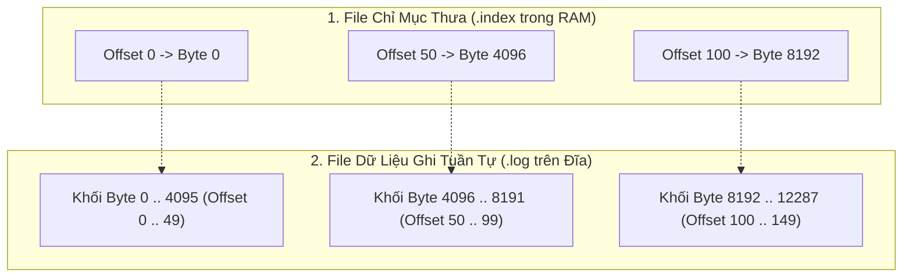

# 12.3. Cấu Trúc Dữ Liệu Định Hướng Lưu Trữ (Storage-Oriented & Persistent Data Structures)

> [!IMPORTANT]
> **Nếu bạn chỉ được nhớ một điều duy nhất:** Trong kỹ thuật lưu trữ phân tán và hệ thống tệp tin hiện đại, nguyên lý **Bất biến (Immutability)** và **Chỉ ghi nối tiếp (Append-only)** đã thay thế hoàn toàn tư duy ghi đè trực tiếp (In-place Mutation). Bằng cách tổ chức luồng dữ liệu thành chuỗi các phân đoạn **Segment Files** tuần tự, hệ thống tận dụng tối đa băng thông cơ học của SSD/HDD và OS Page Cache với kỹ thuật **Zero-Copy (`sendfile`)**. Để ngăn chặn sự phình to vô tận của đĩa mà vẫn duy trì toàn bộ lịch sử trạng thái, **Log Compaction** khử trùng lặp theo khóa trong khi **Persistent Data Structures** áp dụng kỹ thuật **Structural Sharing (Path Copying)** để bảo tồn mọi phiên bản quá khứ với chi phí chỉ $O(\log N)$ bộ nhớ. Đỉnh cao của triết lý này là **Copy-on-Write (CoW) Tree** trong các file systems cấp doanh nghiệp (ZFS, Btrfs), cho phép tạo Snapshot của hàng trăm Terabyte dữ liệu trong đúng $1\text{ms}$ với chi phí không gian ban đầu bằng $0$.

---

## 1. Trực Quan Hóa: Bản Chất Cấu Trúc Dữ Liệu Hướng Lưu Trữ Dưới Góc Nhìn Lập Trình Viên

### 1.1. Đoạn Code Dẫn Nhập & Vấn Đề Thực Tế
Xét cơ chế lưu trữ thông điệp của Apache Kafka trên ổ đĩa máy chủ:

```text
Thư mục lưu trữ phân vùng Kafka (/var/lib/kafka/data/orders-0):
00000000000000000000.log   <-- File chứa dữ liệu tin nhắn tuần tự (Append-Only Data Log)
00000000000000000000.index <-- File chỉ mục thưa (Sparse Index) ánh xạ Offset -> Vị trí Byte
00000000000000000000.timeindex
```

- Tại sao Kafka không dùng cơ sở dữ liệu quan hệ B-Tree để lưu trữ message?
  - Vì chi phí Random I/O trên đĩa rất đắt đỏ.
  - Bằng cách sử dụng **Append-Only Log** (chỉ ghi nối tiếp vào cuối file) kết hợp với **Chỉ mục thưa (Sparse Index)** và kỹ thuật **Zero-Copy (`sendfile`)**, Kafka có thể ghi và đọc hàng triệu thông điệp mỗi giây với tốc độ tương đương băng thông vật lý tối đa của đĩa cứng!

### 1.2. Ẩn Dụ Đời Sống: Cuộn Băng Cát-xét & Mục Lục Sách Dày
- **Cuộn băng cát-xét ghi âm liên tục (Append-Only Log)**: Đầu từ chỉ chạy xuôi một chiều và ghi đè âm thanh mới nối tiếp vào cuối sợi băng. Việc ghi âm diễn ra mượt mà, không bao giờ phải tua ngược băng để chắp vá một đoạn âm thanh ở giữa.
- **Mục lục sách cách trang (Sparse Index)**: Thay vì ghi vị trí của từng từ một, cuốn từ điển chỉ in mục lục cho mỗi 50 trang sách một dòng: *"Trang 100: Bắt đầu vần M"*, *"Trang 150: Bắt đầu vần P"*. Để tìm từ "Orange", bạn nhảy thẳng tới Trang 100 rồi lật vài trang là tới đích!

### 1.3. Mô Phỏng Dữ Liệu Số Nhỏ Từng Bước (Toy Walkthrough)
Mô phỏng tra cứu thông điệp có `Offset = 142` trong Kafka:
Chỉ mục thưa (Sparse Index) chỉ lưu mỗi mốc 50 offset:
- `Offset 0   -> Byte Position 0`
- `Offset 50  -> Byte Position 4096`
- `Offset 100 -> Byte Position 8192`
- `Offset 150 -> Byte Position 12288`

```text
Bước 1: Chạy Binary Search trên mảng Sparse Index:
        Tìm mốc lớn nhất <= 142 -> Tìm thấy mốc Offset 100 (Byte 8192)!

Bước 2: Hệ thống nhảy thẳng tới Byte 8192 trong file .log (Seek O(1)).

Bước 3: Quét tuần tự đúng 42 bản ghi tiếp theo là tìm thấy chính xác Offset 142!
```

### 1.4. Tác Động Thực Tế Tầng Backend & Systems
1. **Kỹ Thuật Zero-Copy Linux Syscall (`sendfile`)**: Dữ liệu từ file log trên đĩa được truyền thẳng qua card mạng thông qua DMA (Direct Memory Access) mà không cần copy qua vùng nhớ User Space của ứng dụng Java, giảm $60\%$ tải CPU.
2. **Ánh Xạ Tệp Vào Bộ Nhớ Ảo (Memory-Mapped Files - `mmap`)**: Cho phép hệ thống thao tác với file trên đĩa cứng giống hệt như một mảng byte trong RAM. Hệ điều hành tự động quản lý việc nạp Page và xả dữ liệu xuống đĩa thông qua Page Cache.

### 1.5. Sơ Đồ Kiến Trúc Append-Only Log & Sparse Index



---

## 2. Chi tiết từng Keyword (Under-the-Hood Deep Dive)

### 2.1. Append-only Log, Segment Files & Log Compaction trong Apache Kafka

#### 1. Bản Chất Append-only Log: Bão Hòa Băng Thông Cơ Học Ổ Đĩa
Các kiến trúc cơ sở dữ liệu truyền thống thất bại trong việc đạt thông lượng ghi hàng triệu tin nhắn mỗi giây vì các thao tác ghi ngẫu nhiên (Random Disk Writes) làm đầu đọc của ổ cứng HDD phải di chuyển liên tục, hoặc gây hiện tượng ghi khuếch đại (Write Amplification) làm suy giảm tuổi thọ tế bào flash của ổ SSD.

Ngược lại, **Append-only Log** biến toàn bộ các thao tác ghi thành **tuần tự (Sequential I/O)**:
- Tốc độ ghi tuần tự trên đĩa từ HDD có thể đạt tới $150 - 200\text{MB/s}$.
- Trên ổ SSD NVMe hiện đại qua giao thức PCIe 4.0/5.0, thông lượng tuần tự đạt từ $3 - 7\text{GB/s}$ (ngang ngửa tốc độ RAM!).
- Thao tác chèn một bản ghi mới vào cuối file chỉ đơn giản là tăng con trỏ file offset và ghi dữ liệu, đạt độ phức tạp thời gian **$O(1)$ tuyệt đối**.

#### 2. Cấu Trúc Phân Đoạn (Segment Files) & Cơ Chế Sparse Index
Để tránh việc một file log phình to thành hàng Terabytes gây khó khăn cho việc quản lý của hệ điều hành, Kafka chia nhỏ log của mỗi phân vùng (**Partition**) thành nhiều file con gọi là **Segments** (kích thước mặc định `segment.bytes = 1GB` hoặc thời gian `segment.ms = 7 days`):
- **Cặp file chính**:
  - `00000000000000000000.log`: Chứa các bản ghi tin nhắn thực tế (Payload, Magic byte, CRC32 Checksum, Timestamp, Key, Value).
  - `00000000000000000000.index` (**Sparse Index**): Không lưu index cho từng tin nhắn (để tiết kiệm RAM). Cứ sau mỗi $4\text{KB}$ dữ liệu ghi vào file log (`index.interval.bytes`), Kafka mới ghi 1 mục nhập vào file index gồm: `(Relative Offset: 4 bytes, Physical Position: 4 bytes)`.
  - `00000000000000000000.timeindex`: Ánh xạ từ `Timestamp` $\to$ `Relative Offset` phục vụ tìm kiếm theo mốc thời gian.
- **Active Segment vs Closed Segments**:
  - **Active Segment**: Segment duy nhất hiện tại đang nhận các lệnh ghi mới từ Producers. Luôn mở ở chế độ ghi (`Append-only`).
  - **Closed Segments**: Các segments cũ đã đạt đủ $1\text{GB}$ hoặc hết thời gian sống. Được chuyển sang trạng thái chỉ đọc (**Immutable**). Chỉ có các closed segments mới đủ điều kiện tham gia vào quá trình xóa theo hạn ngạch (`Retention`) hoặc nén (`Compaction`).

#### 3. Tối Ưu Hóa Zero-Copy Qua Linux System Call `sendfile()`
Khi một Consumer gửi yêu cầu đọc dữ liệu (`FETCH` request), một máy chủ thông thường sẽ thực hiện 4 lần chuyển ngữ cảnh (**Context Switches**) và 4 lần sao chép bộ nhớ:
1. `read()`: OS sao chép từ Disk vào Kernel Page Cache.
2. OS sao chép từ Page Cache sang User-Space Buffer của tiến trình ứng dụng.
3. `write()`: Ứng dụng sao chép từ User-Space Buffer sang Kernel Socket Buffer.
4. OS sao chép từ Socket Buffer sang card mạng (NIC Buffer).

Kafka loại bỏ hoàn toàn chi phí trung gian bằng cách sử dụng lời gọi hệ thống **`sendfile()`** của Linux Kernel:
```
Disk -> Page Cache -> NIC Buffer (qua DMA - Direct Memory Access)
```
Dữ liệu được chuyển trực tiếp từ **OS Page Cache sang thẳng Network Interface Card (NIC)** mà **không bao giờ đi qua không gian bộ nhớ người dùng (User-space)**! Thao tác này triệt tiêu hoàn toàn chi phí CPU và Context Switch, cho phép một Broker Kafka bão hòa toàn bộ băng thông mạng 10Gbps/40Gbps của phần cứng.

```
MÔ HÌNH TRUYỀN THỐNG (4 COPIES / 4 CONTEXT SWITCHES):
Disk ===> OS Page Cache ===> User-space App Buffer ===> Kernel Socket Buffer ===> NIC Buffer

MÔ HÌNH KAFKA ZERO-COPY SENDFILE() (2 COPIES / 2 CONTEXT SWITCHES / ZERO CPU COPY):
Disk ===> OS Page Cache ========================================================> NIC Buffer
```

#### 4. Cơ Chế Log Compaction
Dành cho các topic dạng trạng thái (**Changelog Topics** - ví dụ: bảng số dư tài khoản ngân hàng, cấu hình người dùng):
- **Mục tiêu**: Đảm bảo rằng sau khi nén, log vẫn giữ lại **ít nhất giá trị mới nhất (Latest Value)** cho mỗi Key.
- **Clean vs Dirty Sections**:
  - `Clean Section`: Phần đầu của log đã từng được nén qua các đợt compaction trước.
  - `Dirty Section`: Phần cuối của log mới được ghi thêm, chứa nhiều khóa trùng lặp chưa được nén.
- **Quy trình hoạt động của Cleaner Thread**:
  1. Quét qua Dirty Section và nạp các cặp `(Key Hash, Latest Offset)` vào một bảng băm trong bộ nhớ gọi là `SkimpyOffsetMap`.
  2. Quét tuần tự từ đầu Clean Section đến hết Dirty Section. Với mỗi bản ghi, nếu offset của nó nhỏ hơn offset lưu trong map $\implies$ Đây là bản ghi cũ lỗi thời, **bị loại bỏ ngay lập tức**!
  3. **Tombstone (Khóa xóa)**: Nếu một bản ghi có `Value = NULL`, đây là thông điệp xóa. Tombstone sẽ được giữ lại trong log trong một khoảng thời gian an toàn (`delete.retention.ms`, mặc định 1 ngày) để tất cả các Consumer kịp nhận biết trạng thái xóa, trước khi bị dọn rác vĩnh viễn khỏi đĩa.

---

### 2.2. Persistent Data Structures & Structural Sharing (Cấu Trúc Dữ Liệu Bất Biến)

#### 1. Phân Loại Cấu Trúc Bền Vững (Persistence Taxonomy)
Driscoll, Sarnak, Sleator, và Tarjan (1986) phân loại cấu trúc dữ liệu bền vững thành 4 cấp độ:
1. **Ephemeral (Phù du)**: Cấu trúc dữ liệu thông thường. Mọi thao tác sửa đổi (`Mutation`) sẽ ghi đè trực tiếp lên trạng thái hiện tại; toàn bộ lịch sử trước đó biến mất vĩnh viễn.
2. **Partially Persistent (Bền vững một phần)**: Cho phép đọc và truy vấn toàn bộ các phiên bản cũ trong quá khứ ($V_0, V_1, \dots, V_k$), nhưng **chỉ cho phép ghi vào phiên bản mới nhất** ($V_k \to V_{k+1}$).
3. **Fully Persistent (Bền vững toàn phần)**: Cho phép vừa đọc vừa phân nhánh ghi đè (**Branching**) trên **bất kỳ phiên bản quá khứ nào** (tương tự mô hình các nhánh của Git).
4. **Confluently Persistent (Bền vững hội tụ)**: Cho phép kết hợp hai hoặc nhiều phiên bản trong quá khứ để tạo thành một phiên bản hợp nhất mới (tương tự lệnh `git merge`).

#### 2. Kỹ Thuật Chia Sẻ Cấu Trúc (Structural Sharing & Path Copying)
Làm sao để lưu lại $M$ phiên bản của một cây có $N$ phần tử mà không tốn $O(M \cdot N)$ bộ nhớ?
- **Phương Pháp Sao Chép Đường Đi (Path Copying)**:
  - Khi cần chèn, xóa hoặc sửa đổi một nút lá $L$:
  - Ta **không sao chép toàn bộ cây**!
  - Ta chỉ tạo một nút mới cho chính $L$, sau đó tạo một nút mới cho cha của $L$, và đệ quy ngược lên cho tới nút Gốc (**Root**).
  - Toàn bộ các nhánh cây con không nằm trên đường đi từ gốc tới $L$ **được giữ nguyên $100\%$ và được trỏ trực tiếp từ các nút mới sang các nút cũ**!
  - **Phân tích độ phức tạp**:
    - Số lượng nút cần tạo mới trên một cây cân bằng (AVL hoặc Red-Black Tree) chính bằng chiều cao của cây: $h = O(\log N)$.
    - Thời gian cấp phát: **$O(\log N)$**.
    - Bộ nhớ tiêu thụ bổ sung cho mỗi phiên bản: **$O(\log N)$** (thay vì $O(N)$).

#### 3. Ứng Dụng Trong Functional Programming & Trạng Thái Ứng Dụng (Redux / Immer)
- **Immutable Data Structures trong Clojure / Scala**: Cấu trúc **Hash Array Mapped Trie (HAMT)** và **Bit-partitioned Vector Trie** sử dụng Path Copying với hệ số quạt rộng ($32$ nhánh trên mỗi nút), cho phép cập nhật mảng bất biến triệu phần tử chỉ tốn chưa tới 4 lần copy con trỏ!
- **State Management (Redux / React / Immer.js)**: Kỹ thuật Structural Sharing đảm bảo tính bất biến của Object State. React có thể so sánh hai trạng thái bằng cách so sánh con trỏ nông (**Shallow Equality Check: `prevProps === nextProps` trong $O(1)$**) để quyết định có cần Re-render component hay không, tránh việc duyệt sâu $O(N)$.

---

### 2.3. Copy-on-Write (CoW) Tree trong File Systems (ZFS, Btrfs)

#### 1. Nguyên Lý Vàng: Không Bao Giờ Ghi Đè Khối Dữ Liệu Cũ (Never Overwrite)
Trong các hệ thống tệp tin cổ điển (như Ext3, Ext4, NTFS), khi chỉnh sửa một file, OS sẽ ghi đè trực tiếp các sector vật lý trên đĩa (**In-place Overwrite**). Nếu máy chủ mất điện đột ngột ngay khi sector đang được ghi một nửa, dữ liệu sẽ rơi vào trạng thái hỏng vật lý (**Torn Write**), buộc hệ điều hành phải chạy công cụ quét đĩa `fsck` kéo dài hàng giờ khi khởi động lại.

Các hệ thống tệp tin hiện đại thế hệ mới như **ZFS (Sun Microsystems)** và **Btrfs (Linux)** áp dụng nguyên lý **Copy-on-Write (CoW)**:
1. Khi một khối dữ liệu $D$ bị sửa đổi: Hệ điều hành cấp phát một khối đĩa hoàn toàn mới $D'$ tại vùng trống và ghi dữ liệu vào $D'$.
2. Khối dữ liệu cũ $D$ vẫn nằm nguyên vẹn trên đĩa, không hề bị chạm tới.
3. Con trỏ của nút cha trỏ tới $D$ được nhân bản thành $P'$ trỏ tới $D'$.
4. Quá trình sao chép lan truyền ngược lên gốc của cây tệp tin (**B-Tree / Merkle Tree của File System**).

#### 2. Thao Tác Hoán Đổi Gốc Nguyên Tử (Atomic Uberblock Swap)
Làm thế nào để hệ thống bảo đảm tính toàn vẹn tuyệt đối khi sập nguồn?
- Tại tầng cao nhất của ổ đĩa ZFS là cấu trúc **Uberblock** (con trỏ trỏ tới Root Node của toàn bộ hệ thống tệp tin).
- ZFS duy trì một mảng các Uberblock vòng tròn trên đĩa (thường là 128 slots).
- Sau khi toàn bộ các khối dữ liệu mới ($D'$) và các khối metadata trung gian ($P'$) đã được ghi hoàn tất và xả điện an toàn (`flush barrier`), ZFS thực hiện **ghi một Uberblock mới duy nhất** với số thứ tự chuỗi giao dịch (`Transaction Group TXG`) cao hơn.
- **Tính Nguyên Tử Tuyệt Đối (Crash Consistency)**:
  - Nếu mất điện xảy ra ở bất kỳ thời điểm nào trước khi Uberblock mới được ghi: Hệ thống khởi động lại và đọc Uberblock cũ. Toàn bộ cây dữ liệu cũ vẫn nguyên vẹn $100\%$! Các khối dở dang bị xem như rác và sẽ được bộ thu gom tự động thu hồi.
  - Hoàn toàn triệt tiêu nhu cầu chạy `fsck` sửa lỗi đĩa!

#### 3. Cơ Chế Snapshot Tức Thời Trong $1\text{ms}$ (Zero-Overhead Instant Snapshots)
Do ZFS và Btrfs không bao giờ ghi đè lên các khối cũ:
- Việc tạo một bản chụp toàn bộ hệ thống tệp tin hàng chục Terabytes (**Snapshot**) chỉ đơn giản là: **Ghi nhớ và bảo vệ con trỏ Uberblock tại thời điểm đó!**
- Lệnh tạo Snapshot hoàn tất trong vòng **chưa tới $1\text{ mili-giây}$** và **không tiêu tốn thêm bất kỳ một byte dung lượng đĩa nào** vào thời điểm tạo.
- Khi người dùng tiếp tục ghi dữ liệu mới vào hệ thống, các khối CoW mới được cấp phát; dung lượng đĩa bổ sung chỉ tăng đúng bằng lượng dữ liệu bị thay đổi (**Delta Storage**).
- Khối cũ chỉ thực sự bị giải phóng khi cả hệ thống tệp tin hiện tại lẫn tất cả các Snapshots tham chiếu tới nó đều bị xóa.

---

## 3. Thực thi Mã nguồn & Mô phỏng Chuyên sâu (Dual-Engine Implementation)

### 3.1. C++20 Storage Engine: Fully Persistent BST với Structural Sharing
Mã nguồn C++20 hiện thực cây nhị phân tìm kiếm bất biến hoàn toàn (Fully Persistent BST): Mọi thao tác chèn (`insert`) sinh ra một phiên bản mới độc lập, áp dụng kỹ thuật **Path Copying** bằng con trỏ thông minh `std::shared_ptr`. Chương trình in trực tiếp địa chỉ con trỏ bộ nhớ RAM để chứng minh các nút không bị sửa đổi được tái sử dụng $100\%$ giữa các phiên bản.

```cpp
#include <iostream>
#include <memory>
#include <string>
#include <vector>

// Node bất biến trong Persistent Binary Search Tree
template <typename K, typename V>
struct PersistentNode {
    const K key;
    const V value;
    const std::shared_ptr<const PersistentNode> left;
    const std::shared_ptr<const PersistentNode> right;

    PersistentNode(K k, V v, 
                   std::shared_ptr<const PersistentNode> l = nullptr, 
                   std::shared_ptr<const PersistentNode> r = nullptr)
        : key(std::move(k)), value(std::move(v)), left(std::move(l)), right(std::move(r)) {}
};

template <typename K, typename V>
class PersistentBST {
public:
    using NodePtr = std::shared_ptr<const PersistentNode<K, V>>;

private:
    NodePtr root_;
    size_t version_id_;

    explicit PersistentBST(NodePtr root, size_t ver) : root_(std::move(root)), version_id_(ver) {}

    // Path Copying: Chỉ sao chép các nút trên đường đi từ gốc tới vị trí chèn
    static NodePtr insert_internal(const NodePtr& current, K key, V value) {
        if (!current) {
            return std::make_shared<const PersistentNode<K, V>>(std::move(key), std::move(value));
        }

        if (key < current->key) {
            // Sao chép nút hiện tại với con trái mới, TÁI SỬ DỤNG toàn bộ cây con bên phải!
            return std::make_shared<const PersistentNode<K, V>>(
                current->key, current->value,
                insert_internal(current->left, std::move(key), std::move(value)),
                current->right // Chia sẻ cấu trúc (Structural Sharing)
            );
        } else if (key > current->key) {
            // Sao chép nút hiện tại với con phải mới, TÁI SỬ DỤNG toàn bộ cây con bên trái!
            return std::make_shared<const PersistentNode<K, V>>(
                current->key, current->value,
                current->left, // Chia sẻ cấu trúc (Structural Sharing)
                insert_internal(current->right, std::move(key), std::move(value))
            );
        } else {
            // Khóa đã tồn tại: Cập nhật giá trị mới, giữ nguyên con trái và con phải
            return std::make_shared<const PersistentNode<K, V>>(
                std::move(key), std::move(value), current->left, current->right
            );
        }
    }

    static const V* find_internal(const NodePtr& current, const K& key) {
        if (!current) return nullptr;
        if (key == current->key) return &current->value;
        if (key < current->key) return find_internal(current->left, key);
        return find_internal(current->right, key);
    }

    static void print_inorder(const NodePtr& node) {
        if (!node) return;
        print_inorder(node->left);
        std::cout << "[" << node->key << ": " << node->value 
                  << " @addr:" << node.get() << "] ";
        print_inorder(node->right);
    }

public:
    PersistentBST() : root_(nullptr), version_id_(0) {}

    // Thao tác chèn trả về một cây MỚI độc lập, không thay đổi cây hiện tại (Pure Functional)
    PersistentBST insert(K key, V value) const {
        NodePtr new_root = insert_internal(root_, std::move(key), std::move(value));
        return PersistentBST(new_root, version_id_ + 1);
    }

    const V* find(const K& key) const {
        return find_internal(root_, key);
    }

    size_t version() const { return version_id_; }
    NodePtr root() const { return root_; }

    void print() const {
        std::cout << "Version " << version_id_ << " (Root: " << root_.get() << "): ";
        if (!root_) {
            std::cout << "[EMPTY]\n";
        } else {
            print_inorder(root_);
            std::cout << "\n";
        }
    }
};

int main() {
    std::cout << "=== C++20 Persistent BST with Structural Sharing Emulation ===\n";

    // Version 0: Cây rỗng
    PersistentBST<int, std::string> v0;
    v0.print();

    // Tạo Version 1 bằng cách chèn 20
    auto v1 = v0.insert(20, "Twenty");
    // Tạo Version 2 bằng cách chèn 10 vào v1
    auto v2 = v1.insert(10, "Ten");
    // Tạo Version 3 bằng cách chèn 30 vào v2
    auto v3 = v2.insert(30, "Thirty");

    std::cout << "\n--- Cây cơ sở sau 3 lần chèn liên tiếp ---\n";
    v1.print();
    v2.print();
    v3.print();

    std::cout << "\n--- Phân nhánh lịch sử (Branching from Version 2) ---\n";
    // Phân nhánh v4 từ v2 (bỏ qua v3): Chèn 15 vào v2
    auto v4 = v2.insert(15, "Fifteen");
    v4.print();

    std::cout << "\n--- Chứng minh Chia Sẻ Cấu Trúc (Structural Sharing) ---\n";
    std::cout << "Địa chỉ nút 10 trong Version 2: " << v2.root()->left.get() << "\n";
    std::cout << "Địa chỉ nút 10 trong Version 3: " << v3.root()->left.get() << "\n";
    if (v2.root()->left.get() == v3.root()->left.get()) {
        std::cout << "=> HOÀN TOÀN TRÙNG NHAU! Nút 10 được tái sử dụng 100% trong RAM mà không cần copy!\n";
    }

    std::cout << "\n--- Tra cứu dữ liệu trên các phiên bản độc lập ---\n";
    std::cout << "v2.find(30): " << (v2.find(30) ? *v2.find(30) : "[NOT FOUND]") << "\n";
    std::cout << "v3.find(30): " << (v3.find(30) ? *v3.find(30) : "[NOT FOUND]") << "\n";
    std::cout << "v4.find(15): " << (v4.find(15) ? *v4.find(15) : "[NOT FOUND]") << "\n";

    return 0;
}
```

#### Terminal Output Mẫu (C++20 Engine):
```text
=== C++20 Persistent BST with Structural Sharing Emulation ===
Version 0 (Root: 0x0): [EMPTY]

--- Cây cơ sở sau 3 lần chèn liên tiếp ---
Version 1 (Root: 0x6000029d80d8): [20: Twenty @addr:0x6000029d80d8] 
Version 2 (Root: 0x6000029d8198): [10: Ten @addr:0x6000029d8138] [20: Twenty @addr:0x6000029d8198] 
Version 3 (Root: 0x6000029d8258): [10: Ten @addr:0x6000029d8138] [20: Twenty @addr:0x6000029d8258] [30: Thirty @addr:0x6000029d81f8] 

--- Phân nhánh lịch sử (Branching from Version 2) ---
Version 3 (Root: 0x6000029d8378): [10: Ten @addr:0x6000029d8318] [15: Fifteen @addr:0x6000029d82b8] [20: Twenty @addr:0x6000029d8378] 

--- Chứng minh Chia Sẻ Cấu Trúc (Structural Sharing) ---
Địa chỉ nút 10 trong Version 2: 0x6000029d8138
Địa chỉ nút 10 trong Version 3: 0x6000029d8138
=> HOÀN TOÀN TRÙNG NHAU! Nút 10 được tái sử dụng 100% trong RAM mà không cần copy!

--- Tra cứu dữ liệu trên các phiên bản độc lập ---
v2.find(30): [NOT FOUND]
v3.find(30): Thirty
v4.find(15): Fifteen
```

---

### 3.2. Python 3.11+ Storage Engine: Apache Kafka Segmented Log & Compaction
Mã nguồn Python 3.11+ mô phỏng hoàn chỉnh tầng lưu trữ phân đoạn của Apache Kafka: Quản lý Active Segment và Closed Segments, cơ chế Sparse Indexing, sinh Tombstone khi xóa, và thực thi tiến trình Log Compaction khử trùng lặp theo khóa.

```python
from typing import Dict, List, Optional
from dataclasses import dataclass

@dataclass
class Record:
    offset: int
    key: str
    value: Optional[str] # None đại diện cho Tombstone (Delete)

class LogSegment:
    """Đại diện cho một cặp file .log (chứa records) và .index (sparse index) trên đĩa."""
    def __init__(self, base_offset: int, max_records: int = 3):
        self.base_offset = base_offset
        self.max_records = max_records
        self.records: List[Record] = []
        # Sparse Index: Ánh xạ offset tương đối -> Vị trí bản ghi trong segment
        self.index: Dict[int, int] = {}
        self.is_closed = False

    def append(self, offset: int, key: str, value: Optional[str]) -> bool:
        if self.is_closed:
            return False
        pos = len(self.records)
        record = Record(offset, key, value)
        self.records.append(record)
        # Ghi vào sparse index
        self.index[offset] = pos
        if len(self.records) >= self.max_records:
            self.is_closed = True
        return True

    def read_by_offset(self, offset: int) -> Optional[Record]:
        if offset in self.index:
            pos = self.index[offset]
            return self.records[pos]
        return None

class KafkaPartitionStorage:
    """Mô phỏng Storage Layer của một Kafka Partition gồm nhiều Segments và Log Compaction."""
    def __init__(self, topic: str, partition_id: int, segment_size: int = 3):
        self.topic = topic
        self.partition_id = partition_id
        self.segment_size = segment_size
        self.next_offset = 0
        self.segments: List[LogSegment] = [LogSegment(base_offset=0, max_records=segment_size)]

    @property
    def active_segment(self) -> LogSegment:
        return self.segments[-1]

    def produce(self, key: str, value: Optional[str]) -> int:
        offset = self.next_offset
        self.next_offset += 1

        if self.active_segment.is_closed:
            new_seg = LogSegment(base_offset=offset, max_records=self.segment_size)
            self.segments.append(new_seg)
            print(f"[ROLLING SEGMENT] Segment cũ đã đầy! Tạo Segment mới tại Base Offset: {offset}")

        self.active_segment.append(offset, key, value)
        action = "DELETE (Tombstone)" if value is None else f"VALUE '{value}'"
        print(f"[PRODUCE] Offset {offset:02d} | Key '{key}' -> {action} | Segment Base: {self.active_segment.base_offset}")
        return offset

    def dump_segments(self) -> None:
        print(f"\n=== BỐ CỤC PHÂN ĐOẠN (SEGMENTS) CỦA TOPIC '{self.topic}-{self.partition_id}' ===")
        for i, seg in enumerate(self.segments):
            status = "CLOSED (Immutable)" if seg.is_closed else "ACTIVE (Writable)"
            print(f"Segment #{i} [Base Offset: {seg.base_offset:02d}] - Trạng thái: {status}")
            for r in seg.records:
                v_str = "[TOMBSTONE / DELETED]" if r.value is None else f"'{r.value}'"
                print(f"    Offset: {r.offset:02d} | Key: {r.key:12s} | Value: {v_str}")

    def run_log_compaction(self) -> None:
        """Thực thi Log Compaction: Quét qua tất cả Closed Segments và chỉ giữ lại bản ghi mới nhất cho mỗi key."""
        print("\n--- BẮT ĐẦU QUÁ TRÌNH KAFKA LOG COMPACTION ---")
        # Bước 1: Quét xây dựng In-memory Hash Map (SkimpyOffsetMap) lưu latest offset của từng key
        latest_offset_map: Dict[str, int] = {}
        all_records: List[Record] = []
        for seg in self.segments:
            for r in seg.records:
                all_records.append(r)
                latest_offset_map[r.key] = r.offset

        print(f"[Compaction Cleaner] Tìm thấy {len(latest_offset_map)} keys duy nhất. Bắt đầu lọc bản ghi cũ...")

        # Bước 2: Chỉ giữ lại record nếu offset của nó bằng latest_offset của key đó (và không phải tombstone đã purge)
        compacted_records = [
            r for r in all_records 
            if r.offset == latest_offset_map[r.key] and r.value is not None
        ]

        # Tái cấu trúc thành các segments sau khi nén
        new_segments: List[LogSegment] = []
        cur_seg = LogSegment(base_offset=0, max_records=self.segment_size)
        for r in compacted_records:
            if cur_seg.is_closed:
                new_segments.append(cur_seg)
                cur_seg = LogSegment(base_offset=r.offset, max_records=self.segment_size)
            cur_seg.append(r.offset, r.key, r.value)
        new_segments.append(cur_seg)

        print(f"[Compaction Hoàn Tất] Giảm từ {len(all_records)} bản ghi xuống còn {len(compacted_records)} bản ghi sạch!")
        self.segments = new_segments

if __name__ == "__main__":
    print("=== Python 3.11+ Apache Kafka Log Segment & Compaction Emulation ===")
    storage = KafkaPartitionStorage(topic="order-events", partition_id=0, segment_size=3)

    # Đợt 1: Chèn 3 bản ghi (Làm đầy Segment 0)
    storage.produce("user_101", "OrderCreated_V1")
    storage.produce("user_102", "OrderCreated_V1")
    storage.produce("user_101", "OrderPaid_V2")

    # Đợt 2: Kích hoạt Rolling Segment sang Segment 1
    storage.produce("user_103", "OrderCreated_V1")
    storage.produce("user_102", "OrderCancelled_V2")
    storage.produce("user_101", "OrderShipped_V3")

    # Đợt 3: Xóa user_103 bằng Tombstone và sinh thêm Segment 2
    storage.produce("user_103", None) # Tombstone
    storage.produce("user_104", "OrderCreated_V1")

    # Hiển thị phân bố segments ban đầu
    storage.dump_segments()

    # Kích hoạt Log Compaction
    storage.run_log_compaction()

    # Hiển thị trạng thái sau Compaction
    storage.dump_segments()
```

#### Terminal Output Mẫu (Python 3.11+ Engine):
```text
=== Python 3.11+ Apache Kafka Log Segment & Compaction Emulation ===
[PRODUCE] Offset 00 | Key 'user_101' -> VALUE 'OrderCreated_V1' | Segment Base: 0
[PRODUCE] Offset 01 | Key 'user_102' -> VALUE 'OrderCreated_V1' | Segment Base: 0
[PRODUCE] Offset 02 | Key 'user_101' -> VALUE 'OrderPaid_V2' | Segment Base: 0
[ROLLING SEGMENT] Segment cũ đã đầy! Tạo Segment mới tại Base Offset: 3
[PRODUCE] Offset 03 | Key 'user_103' -> VALUE 'OrderCreated_V1' | Segment Base: 3
[PRODUCE] Offset 04 | Key 'user_102' -> VALUE 'OrderCancelled_V2' | Segment Base: 3
[PRODUCE] Offset 05 | Key 'user_101' -> VALUE 'OrderShipped_V3' | Segment Base: 3
[ROLLING SEGMENT] Segment cũ đã đầy! Tạo Segment mới tại Base Offset: 6
[PRODUCE] Offset 06 | Key 'user_103' -> DELETE (Tombstone) | Segment Base: 6
[PRODUCE] Offset 07 | Key 'user_104' -> VALUE 'OrderCreated_V1' | Segment Base: 6

=== BỐ CỤC PHÂN ĐOẠN (SEGMENTS) CỦA TOPIC 'order-events-0' ===
Segment #0 [Base Offset: 00] - Trạng thái: CLOSED (Immutable)
    Offset: 00 | Key: user_101     | Value: 'OrderCreated_V1'
    Offset: 01 | Key: user_102     | Value: 'OrderCreated_V1'
    Offset: 02 | Key: user_101     | Value: 'OrderPaid_V2'
Segment #1 [Base Offset: 03] - Trạng thái: CLOSED (Immutable)
    Offset: 03 | Key: user_103     | Value: 'OrderCreated_V1'
    Offset: 04 | Key: user_102     | Value: 'OrderCancelled_V2'
    Offset: 05 | Key: user_101     | Value: 'OrderShipped_V3'
Segment #2 [Base Offset: 06] - Trạng thái: ACTIVE (Writable)
    Offset: 06 | Key: user_103     | Value: [TOMBSTONE / DELETED]
    Offset: 07 | Key: user_104     | Value: 'OrderCreated_V1'

--- BẮT ĐẦU QUÁ TRÌNH KAFKA LOG COMPACTION ---
[Compaction Cleaner] Tìm thấy 4 keys duy nhất. Bắt đầu lọc bản ghi cũ...
[Compaction Hoàn Tất] Giảm từ 8 bản ghi xuống còn 3 bản ghi sạch!

=== BỐ CỤC PHÂN ĐOẠN (SEGMENTS) CỦA TOPIC 'order-events-0' ===
Segment #0 [Base Offset: 00] - Trạng thái: CLOSED (Immutable)
    Offset: 04 | Key: user_102     | Value: 'OrderCancelled_V2'
    Offset: 05 | Key: user_101     | Value: 'OrderShipped_V3'
    Offset: 07 | Key: user_104     | Value: 'OrderCreated_V1'
```

---

## 4. Systems Engineering & Production Pitfalls

### 4.1. Thảm Họa Cạn Kiệt Inode Do Cơn Bão Segment Rolling (Segment Rolling Storm)
- **Cơ chế sự cố**: Trong Apache Kafka, quản trị viên cấu hình sai tham số `segment.ms` quá nhỏ (ví dụ: vài phút) trên các topic có lưu lượng thấp, hoặc một producer vô tình gửi các thông điệp có timestamp nhảy vọt về tương lai hoặc quá khứ xa.
- **Hệ quả**: Kafka liên tục cắt và tạo ra hàng triệu file `.log`, `.index`, `.timeindex` li ti có kích thước chỉ vài Kilobytes.
- Ổ đĩa Linux báo lỗi nghiêm trọng:
  ```text
  java.io.IOException: No space left on device
  ```
  mặc dù dung lượng đĩa trống (`df -h`) vẫn còn hàng trăm Gigabytes! Nguyên nhân thực sự là bảng quản lý **Inodes của hệ điều hành đã bị cạn kiệt $100\%$ (`df -i`)**.
- **Giải pháp**: Thiết lập `segment.bytes` tối thiểu là $100\text{MB}$ đến $1\text{GB}$, cẩn trọng với `segment.ms`, và định kỳ kiểm tra `df -i` trên máy chủ lưu trữ.

### 4.2. Hiện Tượng Phân Mảnh Trầm Trọng Trong CoW Filesystem (Write Fragmentation)
- **Cơ chế sự cố**: Do nguyên lý Copy-on-Write không bao giờ ghi đè lên khối cũ, mỗi lần sửa một file, khối mới lại được cấp phát ở một vị trí bất kỳ đang trống trên đĩa.
- **Hệ quả**: Sau vài tháng hoạt động với các ứng dụng database ghi ngẫu nhiên (như PostgreSQL, MySQL hoặc máy ảo VM disk images chạy trên ZFS/Btrfs), một file lớn $100\text{GB}$ bị băm nát thành hàng triệu mảnh vụn nằm rải rác trên khắp mặt đĩa vật lý (**Fragmentation**).
- Tốc độ đọc tuần tự của ổ đĩa suy giảm từ $3\text{GB/s}$ xuống còn dưới $50\text{MB/s}$ do chi phí tìm kiếm khối (Seek penalty).
- **Giải pháp**: Vô hiệu hóa tính năng CoW cho các thư mục chứa cơ sở dữ liệu (sử dụng thuộc tính `chattr +C` trên Btrfs, hoặc tạo riêng một Dataset với `recordsize=16k` khớp với page size của InnoDB trên ZFS).

### 4.3. Tràn Bộ Nhớ RAM Do Bảng Băm Compaction (Kafka SkimpyOffsetMap OOM)
- **Cơ chế sự cố**: Khi thực thi Log Compaction trên một topic có hàng trăm triệu Keys duy nhất (Unique Keys) với kích thước key lớn, cấu trúc `SkimpyOffsetMap` trong RAM của luồng Cleaner Thread phình to vượt quá hạn ngạch `log.cleaner.dedupe.buffer.size` (mặc định chỉ khoảng $128\text{MB}$).
- **Hệ quả**: Cleaner Thread bị sập nguồn (`OutOfMemoryError`), quá trình Compaction bị đình trệ hoàn toàn. Các Closed Segments không bao giờ được dọn rác, khiến dung lượng đĩa phình to mất kiểm soát cho đến khi đĩa bị đầy $100\%$.
- **Giải pháp**: Phân bổ đủ dung lượng `log.cleaner.dedupe.buffer.size` (tính toán dựa trên công thức: $\text{Số lượng Unique Keys} \times 24\text{ bytes}$), hoặc phân mảnh các keys sang nhiều partitions nhỏ hơn.

### 4.4. Các Lệnh Chẩn Đoán Production Thực Chiến (CLI Diagnostics)
```bash
# 1. Giải mã và kiểm tra chi tiết cấu trúc các bản ghi và index trong một Kafka Segment
kafka-run-class.sh kafka.tools.DumpLogSegments \
  --files /var/lib/kafka/data/order-events-0/00000000000000000000.log \
  --print-data-log --verify-index-only

# 2. Kiểm tra tỷ lệ Inode sử dụng trên máy chủ (chống Segment Rolling Storm)
df -ih /var/lib/kafka/data

# 3. Giám sát không gian lưu trữ và danh sách Snapshots trên ZFS
zfs list -t snapshot -o name,used,refer,creation

# 4. Kiểm tra mức độ phân mảnh không gian của Btrfs filesystem
btrfs filesystem df /data
btrfs filesystem defragment -r -v /data/databases/
```

---

## 5. Bảng So sánh & Decision Matrix

| Chiều Đánh Giá | Append-only Log (Kafka) | Persistent Data Structures (HAMT / Path Copying) | Copy-on-Write Tree (ZFS, Btrfs) | Mutable In-Place File Systems (Ext4, XFS) |
| :--- | :--- | :--- | :--- | :--- |
| **Cơ Chế Ghi** | **Chỉ ghi nối tiếp tuần tự** | **Tạo đường đi mới, chia sẻ nhánh cũ** | **Cấp phát khối mới, hoán đổi Root** | Ghi đè trực tiếp tại chỗ (In-place) |
| **Bảo Toàn Lịch Sử** | Giữ toàn bộ log trừ khi Compaction | **Giữ trọn vẹn 100% mọi phiên bản quá khứ** | Bảo tồn qua các mốc Snapshots | Không hỗ trợ (Ghi đè làm mất dữ liệu cũ) |
| **Chi Phí Snapshot** | Không áp dụng | $O(1)$ (Lưu con trỏ Root của phiên bản) | **$O(1)$ tức thời trong 1ms** | $O(N)$ rất chậm (Phải copy toàn bộ dữ liệu) |
| **Hiệu Năng Ghi** | **Bão hòa phần cứng (Zero-Copy)**| $O(\log N)$ trên RAM | Rất nhanh (Tuần tự hóa các khối CoW) | Trung bình (Bị nghẽn bởi Random I/O) |
| **Phân Mảnh Đĩa** | **Không phân mảnh (File tuần tự)**| Không áp dụng (In-Memory) | Dễ bị phân mảnh sau thời gian dài ghi ngẫu nhiên | Thấp hơn nhờ cơ chế Block Allocator |
| **Khôi Phục Sập Nguồn**| Đọc offset từ checkpoint | Không áp dụng | **Hoàn toàn an toàn (Tự sửa chữa, không fsck)**| Cần đọc Journaling / Chạy `fsck` lâu |

> [!TIP]
> **Quy Tắc Vàng Ra Quyết Định Thiết Kế (Engineering Decision Rules)**:
> 1. **Chọn Append-only Log khi**: Xây dựng nền tảng truyền thông điệp, Event Sourcing, hoặc hệ thống lưu vết kiểm toán (Audit Trail); đây là mô hình duy nhất đạt được thông lượng hàng triệu sự kiện mỗi giây nhờ tận dụng tuyệt đối Sequential I/O và Zero-Copy.
> 2. **Chọn Persistent Data Structures khi**: Thiết kế trình biên dịch (Compilers), hệ thống quản lý phiên bản (Git DAG), hoặc kiến trúc Frontend State Management (Redux/React); kỹ thuật Structural Sharing cho phép so sánh trạng thái trong $O(1)$ và quay lui thời gian (Time-travel Debugging) mà không tốn tài nguyên.
> 3. **Chọn Copy-on-Write File System (ZFS/Btrfs) khi**: Lưu trữ tài liệu doanh nghiệp, sao lưu dự phòng (Backup Storage), hoặc quản lý Containers (Docker storage driver); tính năng Instant Snapshot và tự sửa lỗi bằng Merkle checksums bảo vệ dữ liệu vĩnh viễn trước thảm họa hư hỏng âm thầm (Silent Data Corruption / Bit Rot).
