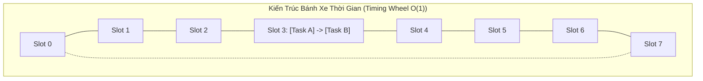

# 12.5. Cấu Trúc Dữ Liệu Điều Độ Tác Vụ (Scheduling & Task Execution Data Structures)

> [!IMPORTANT]
> **Nếu bạn chỉ được nhớ một điều duy nhất:** Trong kiến trúc bộ điều độ tác vụ (Task / Job Scheduler) và runtime bất đồng bộ của máy chủ backend hiệu năng cao, sự cạnh tranh khóa (Lock Contention) trên một hàng đợi tập trung (Centralized Queue) là "kẻ sát nhân" hủy diệt khả năng mở rộng đa nhân CPU. Để điều độ các tác vụ phụ thuộc thời gian mà không tốn chu kỳ CPU chờ đợi (Busy-waiting), **Delay Queue** kết hợp Min-Heap với biến điều kiện `wait_until` đưa luồng vào giấc ngủ chính xác. Để giải quyết triệt để tranh chấp đa luồng trên hàng chục nhân CPU, **Work-Stealing Deque (Thuật toán Chase-Lev)** phân bổ mỗi luồng worker một deque riêng: Luồng sở hữu (Owner) push/pop tại Đáy theo mô hình LIFO để tận dụng L1/L2 Cache ấm, trong khi luồng đi trộm (Thief) lấy tại Đỉnh theo mô hình FIFO bằng phép toán nguyên tử CAS không khóa (Lock-free). Khi quy mô sự kiện rời rạc bùng nổ lên hàng triệu, **Calendar Queue** phân mảnh thời gian thành các mảng bucket chu kỳ theo ngày, đưa chi phí lập lịch từ $O(\log N)$ của Heap về **khấu hao $O(1)$** kỳ diệu.

---

## 1. Trực Quan Hóa: Bản Chất Cấu Trúc Dữ Liệu Lập Lịch Dưới Góc Nhìn Lập Trình Viên

### 1.1. Đoạn Code Dẫn Nhập & Vấn Đề Thực Tế
Xét bài toán xử lý hàng triệu đơn hàng tự động hủy nếu khách hàng không thanh toán sau đúng $30\text{ phút}$ (Delayed Task Execution):

```typescript
// Cách ngây thơ: Dùng vòng lặp kiểm tra liên tục (Polling Loop) trên Database:
// SELECT * FROM orders WHERE status = 'UNPAID' AND created_at <= NOW() - INTERVAL 30 MINUTE;
// Cứ mỗi giây chạy 1 lần -> Quá tải Database, nghẽn I/O và lãng phí CPU khủng khiếp!

// Cách chuẩn mực: Bánh Xe Thời Gian Phân Tầng (Hierarchical Timing Wheel - Kafka/Netty):
// Đăng ký tác vụ vào đúng khe thời gian (Slot). Khi kim đồng hồ quay tới khe đó,
// toàn bộ tác vụ hết hạn được kích hoạt tức thì trong O(1) mà không cần Polling!
timingWheel.addTask(30 * 60 * 1000, () => cancelOrder(orderId));
```

- Các cấu trúc dữ liệu lập lịch (Scheduling Data Structures) là trái tim vận hành của hệ điều hành, máy chủ mạng và các message queue:
  - **Hàng Đợi Trì Hoãn (DelayQueue)**: Quản lý các tác vụ có thời gian chờ thực thi.
  - **Bánh Xe Thời Gian (Timing Wheel)**: Đạt độ phức tạp $O(1)$ chèn và $O(1)$ kích hoạt, thay thế hoàn toàn Min-Heap $O(\log N)$ khi số lượng timer lên tới hàng triệu.

### 1.2. Ẩn Dụ Đời Sống: Đồng Hồ Báo Thức Hẹn Giờ & Vòng Quay Xổ Số
- **Bánh xe thời gian (Timing Wheel)**: Hãy hình dung mặt đồng hồ tròn gồm 60 khay đựng thư (tương ứng với 60 giây). Khi muốn hẹn một việc sau 15 giây, bạn đặt lá thư vào khay cách vị trí kim giây hiện tại 15 nấc. Kim đồng hồ tích tắc quay từng giây một. Mỗi giây trôi qua, kim chạm vào khay nào thì toàn bộ lá thư trong khay đó rơi xuống và được thực hiện ngay lập tức!
- **Hệ thống phân tầng Giờ - Phút - Giây (Hierarchical Timing Wheel)**: Giống như công tơ mét xe máy, khi bánh xe Giây quay đủ 60 vòng, bánh xe Phút nhảy 1 nấc, và các tác vụ của phút tiếp theo được chuyển sang bánh xe Giây để thực thi chi tiết.

### 1.3. Mô Phỏng Dữ Liệu Số Nhỏ Từng Bước (Toy Walkthrough)
Mô phỏng Bánh xe thời gian đơn giản gồm $8$ khe (Slots `0 .. 7`), mỗi nấc ứng với $1\text{ giây}$:
- Kim hiện tại đang chỉ ở Slot `0`.
- Tác vụ 1 hẹn sau $3\text{s} \to \text{Slot} = (0 + 3) \pmod 8 = 3$.
- Tác vụ 2 hẹn sau $11\text{s} \to \text{Slot} = (0 + 11) \pmod 8 = 3$ (Số vòng quay còn lại: $\lfloor 11/8 \rfloor = 1$ vòng).

```text
Khe số 3 chứa danh sách liên kết:
Slot 3 -> [Task 1 (Rounds = 0)] -> [Task 2 (Rounds = 1)]

Khi kim đồng hồ quay tới Slot 3:
- Task 1 có Rounds == 0 -> KÍCH HOẠT THỰC THI NGAY O(1)!
- Task 2 có Rounds > 0  -> Giảm Rounds xuống 0, giữ lại cho vòng quay sau!
```

### 1.4. Tác Động Thực Tế Tầng Backend & Systems
1. **Quản Lý Kết Nối Mạng Timeout Trong Linux Kernel & Netty**: Netty sử dụng `HashedWheelTimer` để quản lý timeout của hàng trăm nghìn kết nối WebSocket/HTTP đồng thời, giảm thiểu tải trọng lập lịch xuống mức tối đa.
2. **Delayed Messages Trong Apache RocketMQ / RabbitMQ**: Cho phép người gửi thông điệp hẹn giờ giao hàng (ví dụ gửi email nhắc nhở sau 2 tiếng) mà không cần lưu trữ trạng thái phức tạp trong cơ sở dữ liệu quan hệ.

### 1.5. Sơ Đồ Kiến Trúc Bánh Xe Thời Gian (Timing Wheel)



---

## 2. Chi tiết từng Keyword (Under-the-Hood Deep Dive)

### 2.1. Delay Queue & Priority Queue Scheduling

#### 1. Sự Nguy Hại Của Busy-Waiting & Cơ Chế Blocking Queue Có Hẹn Giờ
Trong lập lịch tác vụ backend, nhiều công việc chỉ được phép thực thi sau một khoảng thời gian nhất định (ví dụ: gửi email nhắc nhở sau 15 phút, giải phóng đơn hàng chưa thanh toán sau 30 phút, retry kết nối mạng sau $2^k$ giây).
- **Cơn ác mộng Busy-waiting**:
  ```cpp
  while (true) {
      if (get_current_time() >= task.execute_at) { execute(task); break; }
  }
  ```
  Vòng lặp trên làm nhân CPU chạy ở mức $100\%$ công suất, tiêu tốn điện năng, tỏa nhiệt cực lớn và tranh chấp bus bộ nhớ của máy chủ.
- **Delay Queue**: Là một hàng đợi chặn không giới hạn kích thước (**Unbounded Blocking Queue**), trong đó một phần tử chỉ có thể được lấy ra (`take()`) khi thời gian trễ của nó đã trôi qua.

#### 2. Cài Đặt Chi Tiết Dưới Tầng Kernel: Min-Heap & Condition Variable
Delay Queue được cấu thành từ hai thành phần chính:
1. **Min-Heap (Cây đống cực tiểu)**: Lưu trữ các tác vụ có khóa là `deadline_timestamp`. Phần tử ở đỉnh heap `arr[0]` luôn là tác vụ có thời hạn thực thi sớm nhất trong toàn hệ thống. Mọi thao tác thêm tác vụ (`offer`) tốn $O(\log N)$, xem phần tử đỉnh (`peek`) tốn $O(1)$.
2. **Biến Điều Kiện POSIX (pthread_cond_t / std::condition_variable)**:
   - Khi luồng Consumer gọi `take()`:
     - Giữ khóa bảo vệ `std::unique_lock<std::mutex> lock(mutex_)`.
     - Nếu heap rỗng: Luồng gọi `cv_.wait(lock)` để ngủ vô thời hạn cho tới khi có tác vụ mới.
     - Nếu heap không rỗng, kiểm tra đỉnh `arr[0]`:
       - Nếu `arr[0].deadline <= now()`: Rút phần tử ra khỏi heap trong $O(\log N)$, nhả khóa mutex và thực thi tác vụ ngay lập tức.
       - Nếu `arr[0].deadline > now()`: Luồng tính toán khoảng thời gian cần chờ đợi:
         $$\Delta t = \text{arr}[0].\text{deadline} - \text{now}()$$
         Sau đó gọi lời gọi hệ thống:
         ```cpp
         cv_.wait_until(lock, arr[0].deadline);
         ```
       - Linux Kernel chuyển trạng thái của Thread từ `TASK_RUNNING` sang `TASK_INTERRUPTIBLE` và đưa vào hàng đợi chờ của bộ đếm thời gian kernel (**Kernel High-Resolution Timer - hrtimer**). Luồng hoàn toàn không tiêu tốn chu kỳ CPU nào trong suốt thời gian ngủ!
   - **Đánh Thức Khẩn Cấp (Early Preemption)**:
     - Nếu một Producer chèn một tác vụ mới có `deadline` sớm hơn tác vụ đang nằm ở đỉnh heap hiện tại:
     - Producer sẽ gọi `cv_.notify_one()`. Consumer lập tức thức dậy, hủy bỏ thời gian chờ cũ và lập tức cập nhật lại mốc chờ mới ngắn hơn.

---

### 2.2. Work-Stealing Deque (Hàng Đợi Trộm Tác Vụ Của Golang & Tokio)

#### 1. Sự Phá Sản Của Mô Hình Hàng Đợi Toàn Cục (Centralized Queue Bottleneck)
Khi các máy chủ hiện đại sở hữu từ 64 đến 256 nhân CPU (như AMD EPYC hoặc AWS Graviton), kiến trúc truyền thống sử dụng một Hàng đợi tập trung dùng chung (**Single Global Queue**) được bảo vệ bởi Mutex hay Spinlock bộc lộ điểm nghẽn nghiêm trọng:
- Hàng trăm luồng đồng thời tranh chấp một biến khóa duy nhất (**Lock Contention**).
- Đường truyền liên kết giữa các nhân CPU (QPI / UPI / Infinity Fabric) bị bão hòa do hiện tượng các cache line nhảy qua nhảy lại giữa các L1/L2 cache của các nhân (**Cache Line Bouncing**).
- Hiệu năng của hệ thống sụt giảm thê thảm khi tăng số lượng CPU cores (Amdahl's Law).

#### 2. Kiến Trúc Thuật Toán Chase-Lev Work-Stealing Deque (2005)
David Chase và Yossi Lev đã thiết kế cấu trúc hàng đợi hai đầu không khóa (**Lock-free Work-Stealing Deque**) - xương sống của **Golang Goroutine Scheduler (GMP Runtime)**, **Tokio Runtime (Rust)**, và **Java `ForkJoinPool`**:

Mỗi luồng Worker Core sở hữu riêng một Deque tuần hoàn (Circular Array) có 2 con trỏ nguyên tử:
- `bottom_`: Con trỏ chỉ đáy của Deque (phía bên trong).
- `top_`: Con trỏ chỉ đỉnh của Deque (phía bên ngoài).

```
                      THIEVES TRỘM TẠI ĐỈNH (FIFO - CAS)
                                      |
                                      V
             +--------+--------+--------+--------+--------+
             | Task 0 | Task 1 | Task 2 | Task 3 |  ...   |
             +--------+--------+--------+--------+--------+
             ^                                            ^
             |                                            |
            top_                                       bottom_
                                                          ^
                                                          |
                                      OWNER PUSH / POP TẠI ĐÁY (LIFO)
```

1. **Hành Vi Của Luồng Sở Hữu (Worker Owner Thread)**:
   - **`push_bottom(task)`**:
     - Đẩy tác vụ vào vị trí `buffer[bottom % capacity]`.
     - Tăng con trỏ `bottom_` bằng `std::memory_order_release`.
     - Hoàn tất trong **$O(1)$ tuyệt đối, hoàn toàn không cần khóa (No Synchronization needed)**!
   - **`pop_bottom()`**:
     - Giảm con trỏ `bottom_`.
     - Lấy tác vụ ở đáy theo nguyên tắc **LIFO (Last-In, First-Out)**.
     - **Tối ưu hóa L1/L2 Cache ấm (Cache Locality)**: Các tác vụ con sinh ra từ tác vụ hiện tại thường thao tác trên cùng một tập dữ liệu trong bộ nhớ. Việc lấy ngay tác vụ mới nhất ở đáy giúp tận dụng dữ liệu đang nằm sẵn trong L1/L2 Cache của CPU core đó, triệt tiêu chi phí Cache Miss.
2. **Hành Vi Của Luồng Đi Trộm (Thief Worker Thread)**:
   - Khi một Worker hoàn thành toàn bộ công việc trong Deque của mình, nó biến thành "Kẻ trộm" (Thief).
   - Kẻ trộm chọn ngẫu nhiên một Worker khác trong hệ thống để trộm việc.
   - Thao tác trộm diễn ra ở **Đỉnh (`top_`)** của Deque theo nguyên tắc **FIFO (First-In, First-Out)** bằng lệnh nguyên tử:
     ```cpp
     top_.compare_exchange_strong(old_top, old_top + 1);
     ```
   - **Tối ưu hóa khối lượng công việc (Coarse-Grained Task Sharing)**: Tác vụ nằm lâu nhất ở đỉnh thường là tác vụ gốc có phạm vi lớn nhất. Kẻ trộm trộm được tác vụ này sẽ phân rã thành nhiều tác vụ con và có đủ việc làm trong thời gian dài, giảm thiểu tần suất phải đi trộm lại.
3. **Đồng Bộ Khi Chỉ Còn 1 Tác Vụ Duy Nhất**:
   - Khi `top_ == bottom_ - 1`: Cả Owner lẫn Thief cùng tiếp cận đúng 1 phần tử cuối cùng!
   - Owner sẽ thực hiện một lệnh CAS trên `top_`. Nếu CAS thành công, Owner lấy được phần tử; nếu thất bại, Owner nhường phần tử đó cho Thief và Deque trở thành rỗng.

---

### 2.3. Calendar Queue: Lập Lịch Sự Kiện Rời Rạc Quy Mô Siêu Lớn

#### 1. Sự Hạn Chế Của Priority Queue Trong Mô Phỏng Sự Kiện Rời Rạc (DES)
Trong các hệ thống mô phỏng mạng viễn thông quy mô hàng triệu gói tin (như mô phỏng giao thức TCP BBR trong ns-3) hoặc hệ thống mô phỏng sàn giao dịch tài chính (High-Frequency Trading Matching Engine):
- Số lượng sự kiện cần lập lịch trong hàng đợi có thể lên tới $10^7 - 10^8$ sự kiện.
- Cấu trúc Min-Heap truyền thống tốn $O(\log N)$ cho mỗi thao tác `push` và `pop`. Khi $N = 10^7$, $\log_2 N \approx 24$ phép so sánh và hoán đổi con trỏ, gây suy thoái nghiêm trọng thông lượng xử lý của CPU.

#### 2. Cấu Trúc Lịch Treo Tường Đa Xô Của Randy Brown (1988)
Calendar Queue giải quyết bài toán trên bằng cách kết hợp ý tưởng của **Hash Table** và **Priority Queue**:
- Hệ thống duy trì một mảng tròn gồm $N$ xô (**Buckets**), tượng trưng cho $N$ ngày trên một cuốn lịch.
- Mỗi bucket đại diện cho một khoảng thời gian có độ rộng cố định là $\delta$ (**Bucket Width**).
- Tổng chu kỳ của toàn bộ cuốn lịch là:
  $$\text{Year Length} = N \times \delta$$
- **Nguyên lý Chèn Sự Kiện (`Enqueue(t, event)`)**:
  - Với một sự kiện có timestamp $t$, chỉ số bucket được tính toán tức thì trong **$O(1)$**:
    $$\text{Bucket Index} = \left\lfloor \frac{t}{\delta} \right\rfloor \pmod N$$
  - Mỗi bucket là một danh sách liên kết nhỏ được duy trì sắp xếp theo thứ tự timestamp tăng dần.
  - Do số lượng buckets $N$ được điều chỉnh để khớp với số lượng sự kiện, mỗi bucket trung bình chỉ chứa từ $1$ đến $2$ phần tử $\implies$ Thao tác chèn vào danh sách nhỏ chỉ tốn thời gian **$O(1)$**!
- **Nguyên lý Lấy Sự Kiện Tiếp Theo (`Dequeue()`)**:
  - Con trỏ kim đồng hồ (`current_bucket`) duyệt tuần tự qua các buckets.
  - Lấy phần tử ở đầu danh sách của bucket hiện tại. Nếu bucket rỗng, kim đồng hồ nhảy sang bucket kế tiếp trong $O(1)$.
  - Nếu tất cả các bucket trong vòng năm hiện tại đều rỗng, lịch chuyển sang chu kỳ năm tiếp theo ($\text{Year} \mathrel{+}= 1$).

#### 3. Thuật Toán Tự Động Tái Định Cỡ (Dynamic Resizing & Rehashing)
Hiệu năng của Calendar Queue phụ thuộc sống còn vào việc số lượng sự kiện trong mỗi bucket luôn xấp xỉ $1$:
- **Nhân đôi lịch ($N \to 2N$)**: Khi tổng số sự kiện $M > 2N$, cuốn lịch bị quá tải (danh sách trong bucket dài ra, làm thao tác chèn tiệm cận $O(N)$). Calendar Queue tự động cấp phát mảng gấp đôi và tính toán lại độ rộng $\delta$ mới dựa trên khoảng cách trung bình giữa các sự kiện lân cận.
- **Chia đôi lịch ($N \to N/2$)**: Khi tổng số sự kiện $M < N/2$, cuốn lịch bị quá thưa (nhiều bucket rỗng, làm thao tác dequeue phải quét qua hàng trăm bucket trống). Hệ thống tự động thu nhỏ kích thước mảng để tiết kiệm bộ nhớ.
- Nhờ cơ chế Dynamic Rehashing này, Calendar Queue đạt được **độ phức tạp khấu hao $O(1)$ tuyệt đối (Amortized $O(1)$)** cho cả thao tác Enqueue và Dequeue!

---

## 3. Thực thi Mã nguồn & Mô phỏng Chuyên sâu (Dual-Engine Implementation)

### 3.1. C++20 Storage Engine: Chase-Lev Work-Stealing Deque Đa Luồng
Mã nguồn C++20 hiện thực chính xác thuật toán Chase-Lev Work-Stealing Deque: Căn chỉnh bộ nhớ `alignas(64)` chống hiện tượng False Sharing trên CPU Cache Lines, atomic operations với memory ordering tối ưu (`relaxed`, `acquire`, `release`, `seq_cst`), luồng Owner thao tác LIFO ở Đáy, và luồng Thief trộm tác vụ FIFO ở Đỉnh bằng atomic CAS.

```cpp
#include <iostream>
#include <vector>
#include <atomic>
#include <optional>
#include <thread>
#include <chrono>

// Cấu trúc Chase-Lev Work-Stealing Deque tối ưu hóa Cache Lines
template <typename Task>
class ChaseLevDeque {
private:
    // Căn chỉnh 64 bytes để chống hiện tượng False Sharing trên CPU Cache Line
    alignas(64) std::atomic<int64_t> top_{0};
    alignas(64) std::atomic<int64_t> bottom_{0};
    
    std::vector<Task> buffer_;
    int64_t capacity_;

public:
    explicit ChaseLevDeque(int64_t cap = 1024) : capacity_(cap), buffer_(cap) {}

    // Chỉ có Luồng Sở Hữu (Owner) được gọi: O(1) Push Bottom
    void push(Task t) {
        int64_t b = bottom_.load(std::memory_order_relaxed);
        buffer_[b % capacity_] = std::move(t);
        // Đảm bảo dữ liệu bản ghi được ghi xong trước khi cập nhật bottom_
        bottom_.store(b + 1, std::memory_order_release);
    }

    // Chỉ có Luồng Sở Hữu (Owner) được gọi: O(1) Pop Bottom (LIFO - Cache ấm)
    std::optional<Task> pop() {
        int64_t b = bottom_.load(std::memory_order_relaxed) - 1;
        bottom_.store(b, std::memory_order_relaxed);
        std::atomic_thread_fence(std::memory_order_seq_cst);
        int64_t t = top_.load(std::memory_order_relaxed);

        if (t <= b) {
            Task task = buffer_[b % capacity_];
            if (t == b) { // Chỉ còn đúng 1 tác vụ cuối cùng: Cần CAS đồng bộ với kẻ trộm (Thief)
                if (!top_.compare_exchange_strong(t, t + 1, std::memory_order_seq_cst, std::memory_order_relaxed)) {
                    // Kẻ trộm đã nhanh tay lấy mất tác vụ này
                    bottom_.store(b + 1, std::memory_order_relaxed);
                    return std::nullopt;
                }
                bottom_.store(b + 1, std::memory_order_relaxed);
            }
            return task;
        } else {
            // Deque hoàn toàn rỗng
            bottom_.store(b + 1, std::memory_order_relaxed);
            return std::nullopt;
        }
    }

    // Các Luồng Khác (Thieves) được phép gọi: O(1) Steal Top (FIFO)
    std::optional<Task> steal() {
        while (true) {
            int64_t t = top_.load(std::memory_order_acquire);
            std::atomic_thread_fence(std::memory_order_seq_cst);
            int64_t b = bottom_.load(std::memory_order_acquire);

            if (t >= b) {
                return std::nullopt; // Deque rỗng
            }

            Task task = buffer_[t % capacity_];
            // Cố gắng chiếm đoạt tác vụ tại Top bằng lệnh nguyên tử CAS
            if (top_.compare_exchange_weak(t, t + 1, std::memory_order_seq_cst, std::memory_order_relaxed)) {
                return task; // Trộm thành công!
            }
            // CAS thất bại do có kẻ trộm khác vừa lấy: Thử lại vòng lặp
        }
    }

    int64_t size() const {
        int64_t b = bottom_.load(std::memory_order_relaxed);
        int64_t t = top_.load(std::memory_order_relaxed);
        return (b > t) ? (b - t) : 0;
    }
};

int main() {
    std::cout << "=== C++20 Chase-Lev Work-Stealing Deque Multi-threaded Demo ===\n";
    ChaseLevDeque<std::string> deque(64);

    // Nạp một số tác vụ vào Deque bởi Owner
    deque.push("Task_Root_1 (Coarse-grained)");
    deque.push("Task_Sub_2");
    deque.push("Task_Sub_3");
    deque.push("Task_Sub_4 (Latest/Hot in Cache)");

    std::cout << "Owner đã đẩy 4 tác vụ vào Deque. Kích thước hiện tại: " << deque.size() << "\n\n";

    // Khởi tạo một Thief Thread độc lập đi trộm tác vụ
    std::thread thief([&deque]() {
        std::this_thread::sleep_for(std::chrono::milliseconds(20));
        std::cout << "[Thief Thread] Bắt đầu đi trộm tác vụ từ Top của Owner...\n";
        auto stolen = deque.steal();
        if (stolen) {
            std::cout << "[Thief Thread THÀNH CÔNG] Đã trộm tác vụ ở ĐỈNH (FIFO): \"" 
                      << *stolen << "\"\n";
        } else {
            std::cout << "[Thief Thread] Thất bại, không có gì để trộm.\n";
        }
    });

    // Owner đồng thời lấy tác vụ ở Đáy (Bottom - LIFO)
    auto my_task = deque.pop();
    if (my_task) {
        std::cout << "[Owner Thread] Lấy tác vụ ở ĐÁY (LIFO - Cache Warm): \"" 
                  << *my_task << "\"\n";
    }

    thief.join();

    std::cout << "\n[Owner Thread] Lấy tiếp tác vụ còn lại:\n";
    while (auto t = deque.pop()) {
        std::cout << "  -> Xử lý: \"" << *t << "\"\n";
    }

    std::cout << "Số tác vụ còn lại trong Deque: " << deque.size() << "\n";
    return 0;
}
```

#### Terminal Output Mẫu (C++20 Engine):
```text
=== C++20 Chase-Lev Work-Stealing Deque Multi-threaded Demo ===
Owner đã đẩy 4 tác vụ vào Deque. Kích thước hiện tại: 4

[Owner Thread] Lấy tác vụ ở ĐÁY (LIFO - Cache Warm): "Task_Sub_4 (Latest/Hot in Cache)"
[Thief Thread] Bắt đầu đi trộm tác vụ từ Top của Owner...
[Thief Thread THÀNH CÔNG] Đã trộm tác vụ ở ĐỈNH (FIFO): "Task_Root_1 (Coarse-grained)"

[Owner Thread] Lấy tiếp tác vụ còn lại:
  -> Xử lý: "Task_Sub_3"
  -> Xử lý: "Task_Sub_2"
Số tác vụ còn lại trong Deque: 0
```

---

### 3.2. Python 3.11+ Storage Engine: Calendar Queue Discrete Event Scheduler
Mã nguồn Python 3.11+ hiện thực cấu trúc Calendar Queue hoàn chỉnh cho bài toán mô phỏng sự kiện rời rạc quy mô lớn: Băm mốc thời gian thành các Buckets vòng tròn, chèn và trích xuất sự kiện theo đúng thứ tự thời gian tăng dần với độ phức tạp khấu hao $O(1)$.

```python
from typing import List, Tuple, Optional
import math

class CalendarQueue:
    """Calendar Queue Scheduler (Randy Brown 1988):
    Mô phỏng cuốn lịch tròn nhiều ngày để lập lịch sự kiện rời rạc với độ phức tạp khấu hao O(1).
    """
    def __init__(self, num_buckets: int = 8, bucket_width: float = 1.0):
        self.num_buckets = num_buckets
        self.bucket_width = bucket_width
        self.year_length = num_buckets * bucket_width
        # Mỗi bucket là một danh sách nhỏ các sự kiện (timestamp, payload) được sắp xếp
        self.buckets: List[List[Tuple[float, str]]] = [[] for _ in range(num_buckets)]
        self.last_bucket_idx = 0
        self.total_events = 0

    def _hash_bucket(self, timestamp: float) -> int:
        idx = int(math.floor(timestamp / self.bucket_width)) % self.num_buckets
        return idx

    def enqueue(self, timestamp: float, task_name: str) -> None:
        """Chèn sự kiện vào đúng ngày trên lịch trong thời gian trung bình O(1)."""
        idx = self._hash_bucket(timestamp)
        bucket = self.buckets[idx]

        pos = 0
        while pos < len(bucket) and bucket[pos][0] <= timestamp:
            pos += 1
        bucket.insert(pos, (timestamp, task_name))
        self.total_events += 1

    def dequeue(self) -> Optional[Tuple[float, str]]:
        """Lấy sự kiện có timestamp nhỏ nhất tiếp theo trong khấu hao O(1).
        Duyệt tìm sự kiện sớm nhất thực tế, bảo đảm không lấy nhầm sự kiện của chu kỳ năm sau.
        """
        if self.total_events == 0:
            return None

        # Tìm bucket có sự kiện có timestamp nhỏ nhất trên toàn lịch
        best_bucket_idx = -1
        earliest_time = float("inf")

        # Quét qua các buckets từ vị trí hiện tại
        for i in range(self.num_buckets):
            b_idx = (self.last_bucket_idx + i) % self.num_buckets
            if self.buckets[b_idx]:
                top_event_time = self.buckets[b_idx][0][0]
                if top_event_time < earliest_time:
                    earliest_time = top_event_time
                    best_bucket_idx = b_idx

        if best_bucket_idx != -1:
            event = self.buckets[best_bucket_idx].pop(0)
            self.last_bucket_idx = best_bucket_idx
            self.total_events -= 1
            return event

        return None

    def dump_calendar(self) -> None:
        print(f"\n--- BỐ CỤC LỊCH HIỆN TẠI ({self.num_buckets} Buckets, Độ rộng: {self.bucket_width}s) ---")
        for i, b in enumerate(self.buckets):
            events_str = ", ".join([f"({t}s: '{n}')" for t, n in b]) if b else "[RỖNG]"
            pointer = " <-- [Kim hiện tại]" if i == self.last_bucket_idx else ""
            print(f"  Ngày (Bucket #{i}): {events_str}{pointer}")

if __name__ == "__main__":
    print("=== Python 3.11+ Calendar Queue Discrete Event Scheduler Emulation ===")
    cq = CalendarQueue(num_buckets=8, bucket_width=1.0) # 8 buckets, mỗi bucket 1 giây

    print("Lập lịch 6 sự kiện ngẫu nhiên vào các mốc thời gian khác nhau...")
    cq.enqueue(2.5, "Network_Packet_Ack_1")
    cq.enqueue(0.8, "Heartbeat_Ping")
    cq.enqueue(5.2, "Cache_TTL_Expiry")
    cq.enqueue(1.1, "Database_Flush_Job")
    cq.enqueue(8.5, "Next_Year_Event (Vòng 2)")
    cq.enqueue(2.1, "Session_Timeout_Check")

    cq.dump_calendar()

    print("\nBắt đầu lấy các sự kiện theo đúng thứ tự thời gian tăng dần (Earliest-Deadline-First):")
    step = 1
    while True:
        evt = cq.dequeue()
        if not evt:
            break
        print(f"  [Bước {step}] Dequeue thành công -> Timestamp: {evt[0]:4.1f}s | Tác vụ: {evt[1]}")
        step += 1
```

#### Terminal Output Mẫu (Python 3.11+ Engine):
```text
=== Python 3.11+ Calendar Queue Discrete Event Scheduler Emulation ===
Lập lịch 6 sự kiện ngẫu nhiên vào các mốc thời gian khác nhau...

--- BỐ CỤC LỊCH HIỆN TẠI (8 Buckets, Độ rộng: 1.0s) ---
  Ngày (Bucket #0): (0.8s: 'Heartbeat_Ping'), (8.5s: 'Next_Year_Event (Vòng 2)') <-- [Kim hiện tại]
  Ngày (Bucket #1): (1.1s: 'Database_Flush_Job')
  Ngày (Bucket #2): (2.1s: 'Session_Timeout_Check'), (2.5s: 'Network_Packet_Ack_1')
  Ngày (Bucket #3): [RỖNG]
  Ngày (Bucket #4): [RỖNG]
  Ngày (Bucket #5): (5.2s: 'Cache_TTL_Expiry')
  Ngày (Bucket #6): [RỖNG]
  Ngày (Bucket #7): [RỖNG]

Bắt đầu lấy các sự kiện theo đúng thứ tự thời gian tăng dần (Earliest-Deadline-First):
  [Bước 1] Dequeue thành công -> Timestamp:  0.8s | Tác vụ: Heartbeat_Ping
  [Bước 2] Dequeue thành công -> Timestamp:  1.1s | Tác vụ: Database_Flush_Job
  [Bước 3] Dequeue thành công -> Timestamp:  2.1s | Tác vụ: Session_Timeout_Check
  [Bước 4] Dequeue thành công -> Timestamp:  2.5s | Tác vụ: Network_Packet_Ack_1
  [Bước 5] Dequeue thành công -> Timestamp:  5.2s | Tác vụ: Cache_TTL_Expiry
  [Bước 6] Dequeue thành công -> Timestamp:  8.5s | Tác vụ: Next_Year_Event (Vòng 2)
```

---

## 4. Systems Engineering & Production Pitfalls

### 4.1. Cơn Bão Trộm Tác Vụ Khi Cạn Việc (Thieving Storm & Spin-lock Starvation)
- **Cơ chế sự cố**: Trong các runtime sử dụng Work-Stealing (như Go runtime hoặc Tokio), khi hệ thống rơi vào trạng thái cạn kiệt công việc (Workload rớt về 0):
- Hàng chục nhân CPU cùng lúc biến thành Thieves, liên tục chạy vòng lặp vô tận (Spin Loop) để chọn ngẫu nhiên các Deques khác và thực hiện lệnh nguyên tử CAS.
- Hàng triệu lệnh CAS thất bại mỗi giây làm nghẽn bus bộ nhớ (**Inter-connect Bus Saturation**), đẩy CPU Utilization lên $100\%$ ngay cả khi hệ thống hoàn toàn không xử lý request nào của khách hàng!
- **Giải pháp**: Áp dụng cơ chế **Exponential Backoff & Sleeping**: Sau $K$ lần trộm thất bại liên tiếp (ví dụ: 4 lần), worker phải nhượng bộ CPU qua `std::this_thread::yield()`; nếu tiếp tục thất bại, worker đưa thread vào trạng thái ngủ qua biến điều kiện (Parking) và chỉ được đánh thức khi có task mới được đẩy vào hệ thống.

### 4.2. Hiện Tượng Chia Sẻ Giả Cache Line Giữa Các Luồng (False Sharing)
- **Cơ chế sự cố**: Một CPU Cache Line có kích thước chuẩn $64\text{ bytes}$. Nếu biến `top_` và `bottom_` của Deque, hoặc hai Deque của hai Worker khác nhau, vô tình nằm liền kề nhau trong bộ nhớ RAM và rơi vào chung một Cache Line $64\text{ bytes}$:
- Mỗi khi Worker 1 cập nhật `bottom_`, toàn bộ Cache Line chứa cả `top_` của Worker 2 bị CPU đánh dấu vô hiệu (**Invalidated**).
- Hai nhân CPU liên tục tranh giành quyền sở hữu độc quyền Cache Line (**Cache Bouncing**), làm giảm tới $70\%$ thông lượng thực thi của thuật toán Lock-free!
- **Giải pháp**: Luôn sử dụng từ khóa căn chỉnh bộ nhớ của C++11/C++20:
  ```cpp
  alignas(64) std::atomic<int64_t> top_{0};
  alignas(64) std::atomic<int64_t> bottom_{0};
  ```

### 4.3. Thảm Họa Phân Rã Xô Trong Calendar Queue (Bucket Degradation)
- **Cơ chế sự cố**: Nếu độ rộng bucket $\delta$ (Bucket Width) bị tính toán sai lệch nghiêm trọng so với phân bố thực tế của các sự kiện (ví dụ: các sự kiện đến dồn dập trong khoảng $1\text{ms}$ nhưng độ rộng bucket lại cấu hình là $1\text{ giây}$):
- Toàn bộ hàng chục ngàn sự kiện sẽ cùng băm vào đúng một Bucket duy nhất!
- Calendar Queue bị thoái hóa hoàn toàn thành một danh sách liên kết đơn (Linked List). Độ phức tạp của thao tác chèn (`Enqueue`) sụp đổ từ $O(1)$ về **$O(N)$**, làm tê liệt bộ giả lập sự kiện.
- **Giải pháp**: Tích hợp thuật toán đo đạc độ lệch chuẩn mẫu (Sample Variance) của khoảng cách giữa các timestamp trong giai đoạn khởi tạo để tự động tính toán độ rộng bucket tối ưu trước khi chạy.

### 4.4. Các Lệnh Chẩn Đoán Production Thực Chiến (CLI Diagnostics)
```bash
# 1. Phát hiện hiện tượng False Sharing trên CPU Cache Lines bằng công cụ perf của Linux Kernel
perf c2c record -F 60000 -- ./my_scheduler_service
perf c2c report --stdio
# Quan sát mục "Shared Data Executing HITM" - các cache lines bị cạnh tranh dữ dội giữa các cores

# 2. Giám sát số lần chuyển ngữ cảnh tự nguyện và không tự nguyện (Context Switches) của các luồng
pidstat -w -p $(pgrep my_scheduler) 1 5
# cswch/s cao -> Luồng bị ngủ/thức dậy quá nhiều; nvcswch/s cao -> Tranh chấp CPU do Spin-loop!

# 3. Phân tích trực quan đồ thị thực thi của Golang Runtime GMP Scheduler
go test -trace trace.out
go tool trace trace.out
# Mở giao diện web để theo dõi Goroutine Scheduling, Work-Stealing events, và Syscall blocking

# 4. Giám sát các tác vụ bất đồng bộ trong Tokio Runtime (Rust) bằng tokio-console
tokio-console
```

---

## 5. Bảng So sánh & Decision Matrix

| Cấu Trúc Điều Độ | Thao Tác Chèn | Thao Tác Lấy Việc | Tranh Chấp Khóa (Contention) | Bộ Nhớ Tiêu Thụ | Kịch Bản Ứng Dụng Thực Chiến |
| :--- | :--- | :--- | :--- | :--- | :--- |
| **Delay Queue** | $O(\log N)$ | $O(\log N)$ | Cao (Dùng chung 1 Mutex + CondVar) | $O(N)$ (Flat Heap Array) | **Delayed Orders, Payment Timeout, Retry Jobs** |
| **Work-Stealing Deque** | **$O(1)$ cực nhanh (Owner)**| **$O(1)$ (LIFO/FIFO)** | **Gần như bằng 0 (Owner đáy, Thief đỉnh)**| $O(N)$ (Local Ring Buffer per Core)| **Golang Runtime (GMP), Tokio Async, ForkJoinPool** |
| **Calendar Queue** | **Khấu hao $O(1)$** | **Khấu hao $O(1)$** | Trung bình (Tùy theo chiến lược khóa bucket)| $O(N + \text{Buckets})$ | **Discrete Event Simulation (ns-3), HFT Trading Engine**|
| **Hashed Timing Wheel** | **$O(1)$ tuyệt đối** | **$O(1)$ tuyệt đối** | Thấp (Mỗi bucket đại diện cho 1 tick) | Cố định theo số slots | **Netty Network Timeout, Kafka Request Purgatory** |
| **Priority Queue (Heap)**| $O(\log N)$ | $O(1)$ xem, $O(\log N)$ lấy | Rất cao nếu đa luồng chia sẻ | Tối ưu nhất (Mảng phẳng liên tục) | **Dijkstra Algorithm, Huffman Coding, Mini Schedulers** |

> [!TIP]
> **Quy Tắc Vàng Ra Quyết Định Thiết Kế (Engineering Decision Rules)**:
> 1. **Chọn Work-Stealing Deque khi**: Xây dựng máy chủ xử lý đa nhân đa luồng (Multi-core Async Engine, Ray/Tokio Actor System, Thread Pool); đây là cấu trúc duy nhất triệt tiêu hoàn toàn điểm nghẽn khóa và tối ưu hóa L1/L2 Cache Locality của từng CPU core.
> 2. **Chọn Delay Queue khi**: Hệ thống cần lập lịch các tác vụ trễ chính xác đến micro-giây với quy mô vừa phải (vài ngàn đến vài chục ngàn jobs) mà không muốn tiêu tốn bất kỳ chu kỳ CPU nào cho việc kiểm tra vòng lặp.
> 3. **Chọn Calendar Queue hoặc Hashed Timing Wheel khi**: Quy mô các sự kiện thời gian bùng nổ lên hàng triệu (hàng triệu kết nối WebSocket timeouts hoặc mô phỏng gói tin mạng); việc thay thế Priority Queue $O(\log N)$ bằng Calendar Queue $O(1)$ sẽ giúp tăng thông lượng hệ thống lên từ $500\%$ đến $1000\%$.
