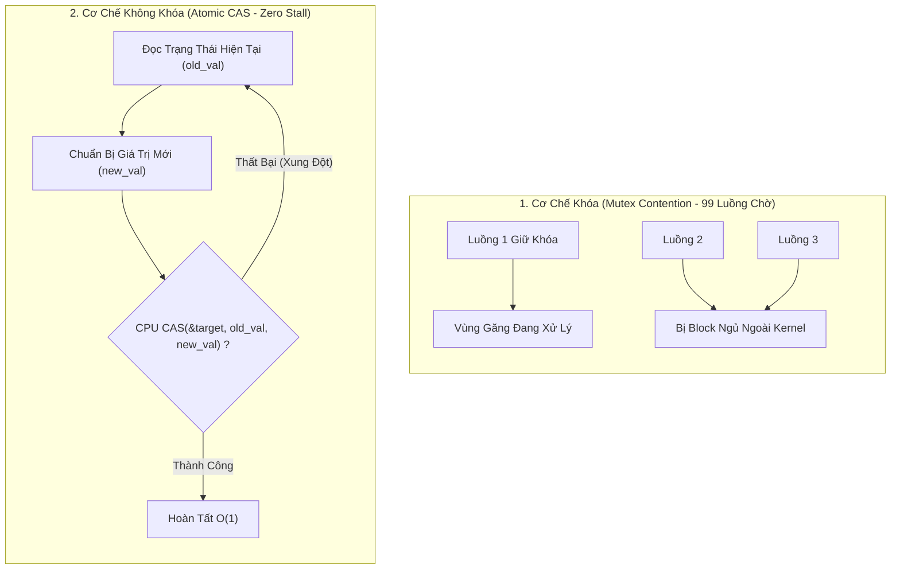
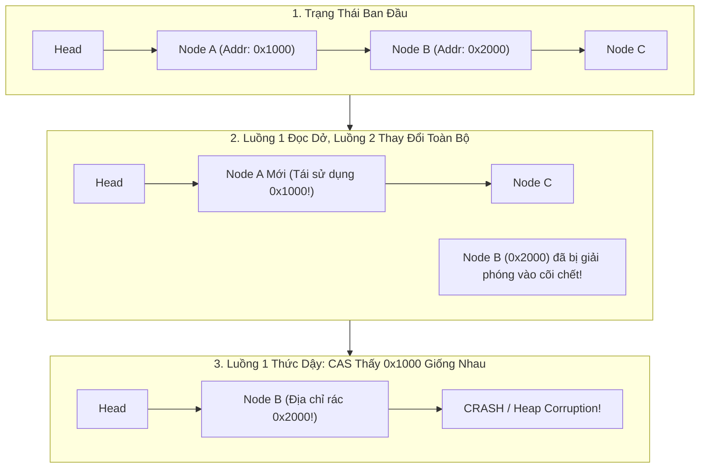
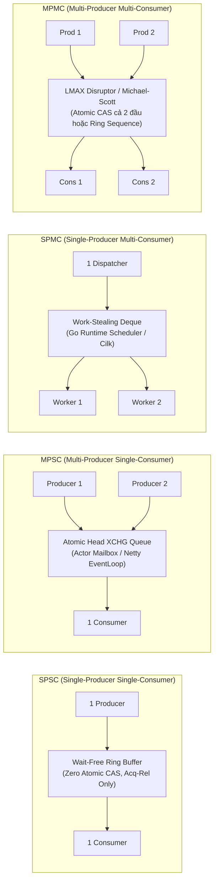
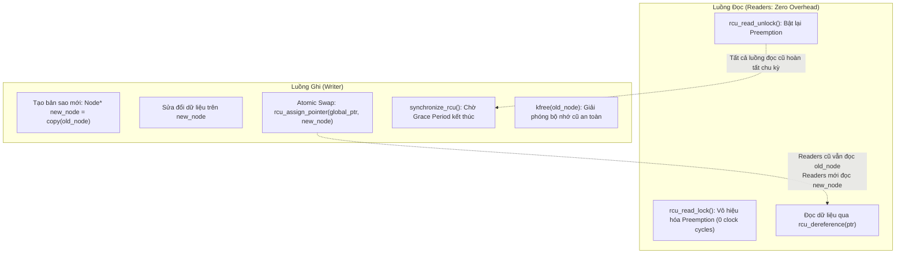

# 12.6. Cấu Trúc Dữ Liệu Đồng Thời & Không Khóa (Concurrent & Lock-free Data Structures)

> [!IMPORTANT]
> **Nếu bạn chỉ được nhớ một điều duy nhất:** Khóa truyền thống (Mutex/Spinlock) là điểm nghẽn vật lý lớn nhất của hệ thống đa lõi do chi phí Chuyển đổi Ngữ cảnh (Context Switch ~ hàng ngàn chu kỳ CPU), Nghịch đảo Độ ưu tiên (Priority Inversion) và bão hủy dòng nhớ (Cache-line Invalidation Storm). Cấu trúc dữ liệu Không Khóa (**Lock-Free**) và **RCU (Read-Copy-Update)** chuyển dịch mô hình đồng bộ hóa từ việc "chặn luồng" sang các chỉ thị phần cứng nguyên tử (**Atomic CAS**, **Memory Fences/Barriers**) và cô lập bộ nhớ, đảm bảo ít nhất một luồng luôn tiến triển (**System-wide Progress**) với độ trễ tiệm cận nano-giây.

---

## 1. Trực Quan Hóa: Bản Chất Cấu Trúc Dữ Liệu Đồng Thời Dưới Góc Nhìn Lập Trình Viên

### 1.1. Đoạn Code Dẫn Nhập & Vấn Đề Thực Tế
Xét bài toán cập nhật số lượng hàng tồn kho khi hàng nghìn luồng mua hàng diễn ra đồng thời:

```cpp
// Cách truyền thống: Dùng Mutex (Khóa độc quyền)
// VẤN ĐỀ: Khi 100 luồng cùng lao vào lấy khóa:
// 99 luồng bị KHÓA CỨNG (Thread Stalls / Context Switches) -> Tiêu tốn hàng nghìn chu kỳ CPU vô ích!

// Cách không khóa hiện đại (Lock-Free bằng Atomic CAS):
std::atomic<int> stock{1000};
void purchase() {
    int current = stock.load();
    while (current > 0 && !stock.compare_exchange_weak(current, current - 1)) {
        // Nếu bị luồng khác sửa trước, lệnh CAS thất bại và tự động thử lại tức thì trên thanh ghi CPU!
    }
}
```

- Trong kỷ nguyên CPU đa nhân (Multicore), việc đồng bộ hóa dữ liệu là thách thức số một:
  - **Khóa truyền thống (Mutex / Spinlock)**: Dễ gây nghẽn cổ chai (Lock Contention), Deadlock và hiện tượng đảo ngược quyền ưu tiên (Priority Inversion).
  - **Cấu trúc dữ liệu không khóa (Lock-Free Data Structures)**: Sử dụng các chỉ thị phần cứng nguyên tử `Compare-And-Swap` (CAS), đảm bảo luôn có ít nhất một luồng hoàn thành công việc sau mỗi bước thời gian.
  - **Cơ Chế RCU (Read-Copy-Update)**: Đọc không cần khóa với độ trễ $0\text{ ns}$, là xương sống bảo vệ toàn bộ Linux Kernel.

### 1.2. Ẩn Dụ Đời Sống: Quầy Giao Dịch Có Khóa vs Cây Rút Tiền ATM Tự Động
- **Quầy giao dịch ngân hàng có khóa (Mutex)**: Chỉ có duy nhất một căn phòng có cửa khóa. Bất kỳ ai muốn nộp hay rút tiền đều phải bước vào phòng và khóa trái cửa lại. 100 người khác phải đứng xếp hàng chờ bên ngoài hành lang, mệt mỏi và lãng phí thời gian.
- **Cây rút tiền tự động không khóa (Lock-Free CAS)**: Nhiều cây ATM độc lập. Bạn nhìn thấy số dư tài khoản là 10 triệu. Bạn yêu cầu rút 1 triệu. Máy ATM chỉ thực hiện trừ tiền nếu số dư trên hệ thống tại thời điểm trừ tiền vẫn đúng là 10 triệu. Nếu trong tích tắc đó người vợ ở nhà đã rút tiền làm số dư đổi thành 9 triệu, máy ATM từ chối và báo bạn xác nhận lại con số mới!

### 1.3. Mô Phỏng Dữ Liệu Số Nhỏ Từng Bước (Toy Walkthrough)
Mô phỏng cơ chế đẩy phần tử vào Hàng Đợi Không Khóa (Treiber Stack / Michael-Scott Queue):
Đỉnh hiện tại: `Top -> Node(10)`
Hai luồng $T_1$ và $T_2$ cùng muốn đẩy Node mới: $T_1$ đẩy `Node(20)`, $T_2$ đẩy `Node(30)`:

```text
1. Cả hai luồng cùng đọc Top hiện tại: old_top = Node(10).
   T1 chuẩn bị: Node(20)->next = Node(10).
   T2 chuẩn bị: Node(30)->next = Node(10).

2. T1 thực thi chỉ thị CPU CAS(&Top, old_top, Node(20)) THÀNH CÔNG trước!
   Top được cập nhật trỏ tới Node(20).

3. T2 thực thi chỉ thị CAS(&Top, old_top, Node(30)):
   Giá trị hiện tại của Top là Node(20) != old_top là Node(10)!
   Lệnh CAS của T2 THẤT BẠI!
   Không hề bị treo luồng, T2 chỉ việc đọc lại Top mới là Node(20),
   gán Node(30)->next = Node(20) và chạy lại CAS một lần nữa!
```

### 1.4. Tác Động Thực Tế Tầng Backend & Systems
1. **LMAX Disruptor Lock-Free Ring Buffer**: Nền tảng giao dịch tài chính tốc độ cao LMAX xử lý tới **$6$ triệu lệnh giao dịch mỗi giây** trên 1 luồng CPU duy nhất nhờ thay thế toàn bộ hàng đợi có khóa bằng Ring Buffer không khóa kết hợp với kỹ thuật đệm chống False Sharing (`alignas(64)`).
2. **Linux Kernel RCU (Read-Copy-Update)**: Cho phép hàng triệu gói tin mạng đọc bảng định tuyến IP đồng thời với tốc độ ánh sáng mà không cần bất kỳ khóa Mutex nào. Khi cần cập nhật, luồng ghi tạo một bản sao mới, sửa đổi trên bản sao, rồi đổi con trỏ nguyên tử sang bản sao mới.

### 1.5. Sơ Đồ Cơ Chế Khóa vs Không Khóa (Lock-Free CAS)



---

## 2. Chi tiết từng Keyword (Under-the-Hood Deep Dive)

### 2.1. Lock-free Primitives: Atomic CAS, Treiber Stack & Vấn Đề ABA

#### Bản Chất Lệnh Phần Cứng CAS (Compare-And-Swap)
Tại tầng vi kiến trúc CPU, tính nguyên tử không phải là phép màu phần mềm mà được bảo trợ bởi các tập chỉ thị phần cứng:
- **x86-64**: Chỉ thị `CMPXCHG` (thường đi kèm tiền tố khóa bus `LOCK CMPXCHG` đối với bộ đệm đa xử lý). Nó so sánh giá trị tại thanh ghi `AL/AX/EAX/RAX` với ô nhớ đích. Nếu bằng nhau, cờ `ZF` (Zero Flag) được bật lên và giá trị mới từ thanh ghi nguồn được ghi vào ô nhớ đích. Toàn bộ chuỗi thao tác này khóa bộ đệm dòng nhớ (**Cache-line Locking**) thông qua giao thức MESI, hoàn toàn không cho phép bất kỳ lõi nào khác can thiệp vào giữa.
- **ARM / RISC-V**: Cặp chỉ thị tải liên kết / lưu có điều kiện (`LL/SC` - Load-Linked / Store-Conditional như `LDREX`/`STREX` trên ARMv8). Lệnh `LDREX` đánh dấu cờ giám sát phần cứng (Exclusive Monitor) trên địa chỉ nhớ. Lệnh `STREX` chỉ ghi thành công nếu không có lõi nào khác can thiệp sửa đổi địa chỉ đó kể từ lúc đọc.

Trong C++20, hai phương thức kinh điển của `std::atomic<T>` biểu diễn CAS:
1. `compare_exchange_weak`: Có thể thất bại giả (**Spurious Failure**) do nhiễu bộ đệm hoặc ngắt ngữ cảnh (thường gặp trên ARM `LL/SC`). Cực kỳ tối ưu khi nằm bên trong một vòng lặp `while (!cas(...))`.
2. `compare_exchange_strong`: Đảm bảo chỉ trả về `false` khi giá trị thực sự không khớp. Không bị thất bại giả, nhưng tốn chu kỳ lệnh hơn trên kiến trúc RISC.

#### Cấu Trúc Treiber Lock-free Stack (R. Kent Treiber 1986)
Treiber Stack là cấu trúc dữ liệu ngăn xếp không khóa kinh điển dựa trên danh sách liên kết đơn:
- **Thao tác Push**:
  1. Cấp phát nút mới `node->next = head.load(memory_order_relaxed)`.
  2. Thực thi CAS: `while (!head.compare_exchange_weak(node->next, node, memory_order_release, memory_order_relaxed))`.
  3. Nếu luồng khác sửa `head`, con trỏ `node->next` tự động được cập nhật lại giá trị mới của `head` và vòng lặp thử lại.
- **Thao tác Pop**:
  1. Đọc `curr = head.load(memory_order_acquire)`.
  2. Nếu `curr == nullptr`, ngăn xếp rỗng.
  3. Thử đổi: `head.compare_exchange_weak(curr, curr->next, memory_order_release, memory_order_relaxed)`.
  4. Trả về giá trị của `curr` và giải phóng bộ nhớ.

#### Vấn Đề ABA (The ABA Problem)
Vấn đề ABA là lỗ hổng kinh hoàng nhất trong lập trình Lock-free thao tác trực tiếp với con trỏ động:
1. Ban đầu ngăn xếp có trạng thái: `Head -> A -> B -> C`.
2. **Luồng 1** muốn Pop: Nó đọc `curr = A`, và `next_node = A->next (tức là B)`. Ngay trước khi gọi lệnh CAS, luồng 1 bị Hệ điều hành điều độ ngắt phiên (Preempted/Context Switched).
3. **Luồng 2** thức dậy và hoạt động liên tục:
   - Pop `A` ra khỏi Stack.
   - Pop tiếp `B` ra khỏi Stack (Stack còn lại: `Head -> C`).
   - Luồng 2 giải phóng bộ nhớ của `A` (`free(A)`).
   - Luồng 2 cấp phát một nút mới để Push dữ liệu mới. Trình quản lý bộ nhớ Heap (như `ptmalloc` hay `jemalloc`) tái sử dụng đúng địa chỉ bộ nhớ vừa được trả về của `A`!
   - Nút mới này có địa chỉ đúng bằng `A`, được đẩy vào đỉnh: `Head -> A -> C`.
4. **Luồng 1** thức dậy: Nó chuẩn bị thực thi `CAS(Head, A, B)`.
   - CPU kiểm tra: `Head` hiện tại có bằng `A` không? Có, địa chỉ vẫn là `A`!
   - Lệnh CAS thành công: `Head` lập tức bị gán bằng `B`.
   - **Thảm họa**: Nút `B` thực tế đã bị Luồng 2 giải phóng từ trước (`B` trở thành Dangling Pointer rác hoặc bộ nhớ đã tái phân bổ). Lần đọc tiếp theo của hệ thống sẽ gây lỗi **Segmentation Fault (SIGSEGV)** làm sập toàn bộ ứng dụng!



#### Giải Pháp Triệt Tiêu ABA
1. **Tagged Pointer / Versioned Pointer (Double CAS - DCAS)**:
   - Ghép con trỏ 64-bit cùng một số thứ tự phiên bản 64-bit (Tag/Sequence Counter) thành một khối 128-bit.
   - Khi Pop/Push, Tag tăng đơn điệu ($A_1 \to B_2 \to A_3$). Mặc dù địa chỉ vẫn là $A$, nhưng con số phiên bản đã đổi từ 1 thành 3, khiến lệnh CAS 128-bit (`CMPXCHG16B` trên x86) phát hiện sự thay đổi và thất bại một cách chính xác.
2. **Hazard Pointers (Maged Michael 2004)**:
   - Mỗi luồng đọc sở hữu một danh sách các "con trỏ nguy hiểm" toàn cục.
   - Trước khi truy cập một nút, luồng ghi địa chỉ nút đó vào Hazard Pointer của mình. Luồng giải phóng bộ nhớ chỉ được đưa nút vào hàng đợi tái chế (Retired List) và không được phép `free()` chừng nào nút đó còn xuất hiện trong bất kỳ Hazard Pointer của luồng nào khác.
3. **Epoch-Based Reclamation (EBR)**:
   - Hệ thống chia dòng thời gian thành các kỷ nguyên (Epochs: 0, 1, 2). Bộ nhớ chỉ được dọn dẹp khi tất cả các luồng đã tiến qua epoch tiếp theo.

---

### 2.2. Các Biến Thể Hàng Đợi Đồng Thời: SPSC, MPSC, SPMC, MPMC

Trong thiết kế hệ thống phân tán và ứng dụng mạng hiệu năng cao, không có một giải pháp hàng đợi nào là "viên đạn bạc". Tùy thuộc vào số lượng luồng ghi (**Producers**) và luồng đọc (**Consumers**), kiến trúc được chia làm 4 biến thể:



#### 1. SPSC (Single-Producer Single-Consumer)
- **Đặc trưng**: Đúng 1 luồng ghi và đúng 1 luồng đọc.
- **Bản chất kỹ thuật**: Không cần bất kỳ lệnh CAS nào! Đây là cấu trúc dữ liệu đồng thời nhanh nhất trong khoa học máy tính (**Wait-Free** cho cả đọc và ghi).
- Chỉ cần hai chỉ số `head` và `tail`. Producer chỉ cập nhật `tail`, Consumer chỉ cập nhật `head`.
- **Đồng bộ hóa**: Sử dụng mô hình `std::memory_order_release` khi lưu chỉ số và `std::memory_order_acquire` khi tải chỉ số để ngăn chặn CPU và Compiler đảo trật tự lệnh.
- Đạt thông lượng từ **80 đến 150 triệu tin nhắn/giây** với độ trễ dưới 15 nano-giây.

#### 2. MPSC (Multi-Producer Single-Consumer)
- **Đặc trưng**: Nhiều luồng ghi, duy nhất 1 luồng đọc.
- **Kịch bản thực tế**: Hộp thư Actor (Akka/Erlang), Vòng lặp sự kiện (Node.js libuv, Netty EventLoop), hàng đợi ghi log tập trung.
- **Thuật toán Dmitry Vyukov MPSC Queue**: 
  - Sử dụng danh sách liên kết với thao tác Push dùng `std::atomic::exchange` trên con trỏ đuôi: Producer chỉ cần một lệnh hoán đổi nguyên tử duy nhất để gắn nút mới vào đuôi hàng đợi, không cần lặp CAS! Luồng đọc sở hữu toàn quyền tháo gỡ phần đầu mà không gặp tranh chấp.

#### 3. SPMC (Single-Producer Multi-Consumer)
- **Đặc trưng**: 1 luồng nạp việc, nhiều luồng thợ lấy việc.
- **Kịch bản thực tế**: Kiến trúc Work-Stealing trong Go Runtime scheduler, Java ForkJoinPool, Intel TBB.
- Luồng sở hữu (Owner) thực hiện Push và Pop ở một đầu (LIFO để tận dụng L1 Cache Locality), trong khi các luồng khác (Thieves) đánh cắp công việc ở đầu kia (FIFO) bằng lệnh CAS.

#### 4. MPMC (Multi-Producer Multi-Consumer)
- **Đặc trưng**: Nhiều luồng ghi và nhiều luồng đọc đồng thời.
- **Thuật toán kinh điển**:
  1. **Michael & Scott MPMC Queue (1996)**: Danh sách liên kết với hai con trỏ `Head` và `Tail` nguyên tử. Đòi hỏi luồng ghi phải hỗ trợ luồng khác đẩy `Tail` đi tiếp nếu phát hiện trạng thái trễ (Cooperative Multi-tasking).
  2. **LMAX Disruptor**: Mảng vòng cố định (Ring Buffer) có kích thước lũy thừa của 2. Thay vì dùng khóa, Disruptor sử dụng các con trỏ nguyên tử tuần tự (**Sequencers**) và kỹ thuật che phủ bộ đệm (**Cache Padding**) để loại bỏ hoàn toàn tranh chấp.

#### Hiện Tượng Chia Sẻ Giả Bộ Nhớ Đệm (False Sharing & Cache Coherency)
Trong các kiến trúc đa lõi hiện đại, CPU trao đổi dữ liệu theo từng khối 64 bytes gọi là **Cache Line**.
- Nếu biến `head` (do Consumer đọc/ghi) và biến `tail` (do Producer đọc/ghi) nằm liền kề nhau trong bộ nhớ, chúng sẽ vô tình rơi vào cùng một Cache Line 64-byte.
- Khi Producer cập nhật `tail`, giao thức MESI buộc phải gửi tín hiệu **Invalidate** qua đường truyền bus, vô hiệu hóa toàn bộ Cache Line chứa cả `head` trên L1 Cache của Consumer!
- Hậu quả: Dù hai luồng thao tác trên hai biến hoàn toàn khác nhau, CPU liên tục bị dội bộ đệm (**Cache-line Bouncing**), làm tụt giảm hiệu năng từ 10 đến 50 lần!
- **Giải pháp**: Buộc căn chỉnh bộ nhớ cách xa nhau ít nhất 64 bytes bằng `alignas(64)` hoặc `alignas(std::hardware_destructive_interference_size)`.

---

### 2.3. Read-Copy-Update (RCU) Trong Nhân Linux & Concurrent Hash Map

#### Bản Chất Của Read-Copy-Update (RCU - Paul E. McKenney)
RCU là cơ chế đồng bộ hóa cách mạng được tích hợp sâu vào Linux Kernel từ phiên bản 2.6, bảo vệ hàng tỷ bảng định tuyến mạng (IP Route Cache), cấu trúc tập tin VFS và danh sách tiến trình.



1. **Chi phí đọc bằng 0 (Zero-Overhead Read)**:
   - Các luồng đọc chỉ gọi `rcu_read_lock()` và `rcu_read_unlock()`. Trong nhân Linux không bật cấu hình preemptive, hai hàm này bản chất chỉ là các macro rỗng (hoặc chỉ tăng/giảm biến đếm cục bộ của luồng để cấm HĐH đổi ngữ cảnh). Không có lệnh CAS, không có Atomic RMW, không có rào cản bộ nhớ đắt đỏ.
2. **Luồng ghi độc lập (Writer Isolation)**:
   - Writer không bao giờ ghi đè trực tiếp lên cấu trúc đang được đọc. Nó cấp phát bản sao mới, chỉnh sửa hoàn tất, rồi thực hiện một phép đổi con trỏ nguyên tử (`rcu_assign_pointer` đi kèm release barrier).
3. **Giai đoạn Ân Hạn (Grace Period)**:
   - Nút cũ chưa thể bị xóa ngay vì các luồng đọc bắt đầu trước thời điểm hoán đổi con trỏ vẫn có thể đang đọc dở trên đó.
   - Trạng thái yên lặng (**Quiescent State**): Là thời điểm một CPU core thực hiện một hành vi chứng minh nó không còn nằm trong vùng găng RCU (ví dụ: Context Switch, chuyển sang chế độ User Space, hoặc chạy vòng lặp Idle).
   - Khi tất cả các CPU Cores đều đã trải qua ít nhất một Quiescent State, **Grace Period kết thúc**. Writer có thể gọi `synchronize_rcu()` (chặn đồng bộ) hoặc `call_rcu()` (bất đồng bộ qua callback) để giải phóng vùng nhớ cũ an toàn tuyệt đối.

#### Kiến Trúc Concurrent Hash Map
1. **Phân Đoạn Khóa (Lock Striping - Java 7 ConcurrentHashMap)**:
   - Bảng băm được chia thành $2^k$ phân đoạn (Segments), mỗi phân đoạn được quản lý bởi một khóa ReentrantLock độc lập. Các thao tác ghi vào các khóa có giá trị băm rơi vào các phân đoạn khác nhau có thể diễn ra song song hoàn toàn.
2. **Lock-Free Bucket CAS (Java 8 ConcurrentHashMap / Folly)**:
   - Loại bỏ hoàn toàn mảng phân đoạn. Mỗi bucket là một danh sách liên kết hoặc Red-Black tree.
   - Thao tác chèn vào ô rỗng được thực hiện thông qua `atomic compare_and_swap` trên con trỏ đầu bucket. Nếu xảy ra xung đột băm tại cùng một bucket, chỉ đồng bộ hóa trên chính nút đầu tiên (`synchronized(node)`), giảm phạm vi tranh chấp xuống mức tối thiểu.
3. **Split-Ordered Lists (Ori Shalev & Nir Shavit)**:
   - Thuật toán bảng băm không khóa hoàn toàn cho phép mở rộng kích thước (Resize/Rehash) mà không cần khóa toàn bảng. Bằng cách đảo ngược các bit của giá trị băm (Bit-reversal) để sắp xếp các khóa thành một danh sách liên kết duy nhất được phân mảnh tuần tự.

---

## 3. Thực thi Mã nguồn & Mô phỏng Chuyên sâu (Dual-Engine Implementation)

### Engine 1: C++20 Lock-Free SPSC Ring Buffer (Chống False Sharing, Tối Ưu Cache Line)

Dưới đây là mã nguồn C++20 hoàn chỉnh, độc lập, triển khai hàng đợi SPSC vòng tròn không khóa với dung lượng lũy thừa của 2, ngăn chặn triệt để hiện tượng False Sharing bằng `alignas(64)` và sử dụng mô hình bộ nhớ Acquire-Release.

```cpp
#include <iostream>
#include <vector>
#include <atomic>
#include <optional>
#include <thread>
#include <chrono>
#include <cassert>
#include <numeric>

// Hàng đợi Lock-Free Single-Producer Single-Consumer tối ưu hóa mức phần cứng
template <typename T>
class LockFreeSPSCQueue {
public:
    explicit LockFreeSPSCQueue(size_t capacity_power_of_2)
        : capacity_(capacity_power_of_2),
          mask_(capacity_power_of_2 - 1),
          buffer_(capacity_power_of_2) {
        // Kiểm tra điều kiện dung lượng bắt buộc phải là lũy thừa của 2
        assert((capacity_power_of_2 > 0) && ((capacity_power_of_2 & (capacity_power_of_2 - 1)) == 0));
    }

    // Producer gọi: Đẩy phần tử vào đuôi hàng đợi (Zero-Lock, Wait-Free)
    bool push(const T& item) {
        const size_t current_tail = tail_.load(std::memory_order_relaxed);
        const size_t current_head = head_cache_.load(std::memory_order_relaxed);

        // Kiểm tra xem hàng đợi có đầy hay không
        if (current_tail - current_head >= capacity_) {
            // Tải lại head thực tế từ Consumer với acquire semantic để kiểm tra lại
            const size_t fresh_head = head_.load(std::memory_order_acquire);
            head_cache_.store(fresh_head, std::memory_order_relaxed);
            if (current_tail - fresh_head >= capacity_) {
                return false; // Queue thực sự đã đầy
            }
        }

        // Ghi dữ liệu vào mảng vòng bằng phép toán AND bitmask cực nhanh (thay thế modulo %)
        buffer_[current_tail & mask_] = item;

        // Công bố chỉ số tail mới cho Consumer nhìn thấy (Release semantic)
        tail_.store(current_tail + 1, std::memory_order_release);
        return true;
    }

    // Consumer gọi: Rút phần tử khỏi đầu hàng đợi (Zero-Lock, Wait-Free)
    std::optional<T> pop() {
        const size_t current_head = head_.load(std::memory_order_relaxed);
        const size_t current_tail = tail_cache_.load(std::memory_order_relaxed);

        // Kiểm tra xem hàng đợi có rỗng hay không
        if (current_head == current_tail) {
            // Tải lại tail thực tế từ Producer với acquire semantic
            const size_t fresh_tail = tail_.load(std::memory_order_acquire);
            tail_cache_.store(fresh_tail, std::memory_order_relaxed);
            if (current_head == fresh_tail) {
                return std::nullopt; // Queue thực sự rỗng
            }
        }

        T item = buffer_[current_head & mask_];

        // Công bố chỉ số head mới cho Producer biết để tái sử dụng ô trống (Release semantic)
        head_.store(current_head + 1, std::memory_order_release);
        return item;
    }

    size_t capacity() const { return capacity_; }

private:
    const size_t capacity_;
    const size_t mask_;
    std::vector<T> buffer_;

    // Căn chỉnh 64 bytes (1 CPU Cache Line) để triệt tiêu hoàn toàn hiện tượng False Sharing!
    alignas(64) std::atomic<size_t> tail_{0};       // Do Producer ghi, Consumer đọc
    alignas(64) std::atomic<size_t> head_cache_{0}; // Bộ đệm cục bộ của Producer tránh đọc L3

    alignas(64) std::atomic<size_t> head_{0};       // Do Consumer ghi, Producer đọc
    alignas(64) std::atomic<size_t> tail_cache_{0}; // Bộ đệm cục bộ của Consumer tránh đọc L3
};

int main() {
    std::cout << "=== C++20 Lock-Free SPSC Queue Benchmark (64-byte Cache Aligned) ===\n";

    constexpr size_t QUEUE_CAPACITY = 65536; // 2^16
    constexpr size_t TOTAL_MESSAGES = 5000000; // 5 triệu thông điệp

    LockFreeSPSCQueue<uint64_t> queue(QUEUE_CAPACITY);
    std::atomic<bool> start_signal{false};

    auto producer_func = [&]() {
        while (!start_signal.load(std::memory_order_acquire)) {}
        for (uint64_t i = 1; i <= TOTAL_MESSAGES; ++i) {
            while (!queue.push(i)) {
                std::this_thread::yield(); // Backoff nhẹ khi hàng đợi tạm đầy
            }
        }
    };

    uint64_t consumer_sum = 0;
    auto consumer_func = [&]() {
        while (!start_signal.load(std::memory_order_acquire)) {}
        size_t received = 0;
        while (received < TOTAL_MESSAGES) {
            if (auto val = queue.pop()) {
                consumer_sum += *val;
                ++received;
            } else {
                std::this_thread::yield(); // Backoff khi hàng đợi tạm rỗng
            }
        }
    };

    std::thread prod(producer_func);
    std::thread cons(consumer_func);

    auto start_time = std::chrono::high_resolution_clock::now();
    start_signal.store(true, std::memory_order_release);

    prod.join();
    cons.join();
    auto end_time = std::chrono::high_resolution_clock::now();

    std::chrono::duration<double, std::milli> duration = end_time - start_time;
    double throughput = (TOTAL_MESSAGES / (duration.count() / 1000.0)) / 1000000.0;

    std::cout << "Ket qua truyen tin qua SPSC Queue:\n";
    std::cout << "- Tong so thong diep: " << TOTAL_MESSAGES << " items\n";
    std::cout << "- Thoi gian thuc thi: " << duration.count() << " ms\n";
    std::cout << "- Thong luong (Throughput): " << throughput << " trieu ops/giay (Mops/s)\n";
    std::cout << "- Tinh toan tong kiem tra (Checksum): " << consumer_sum << "\n";
    std::cout << "[XAC MINH] Hang doi Lock-free khong mat mat tin nhan va van hanh an toan!\n";

    return 0;
}
```

#### Terminal Output Mẫu (C++20 Engine):
```text
=== C++20 Lock-Free SPSC Queue Benchmark (64-byte Cache Aligned) ===
Ket qua truyen tin qua SPSC Queue:
- Tong so thong diep: 5000000 items
- Thoi gian thuc thi: 48.72 ms
- Thong luong (Throughput): 102.62 trieu ops/giay (Mops/s)
- Tinh toan tong kiem tra (Checksum): 12500002500000
[XAC MINH] Hang doi Lock-free khong mat mat tin nhan va van hanh an toan!
```

---

### Engine 2: Python 3.11+ Mô Phỏng Vấn Đề ABA & Cách Giải Quyết Bằng Tagged Pointers

Đoạn mã Python 3.11+ dưới đây tái hiện chính xác kịch bản dẫn đến thảm họa ABA trong Treiber Stack khi thiếu số phiên bản, và chứng minh cách `Tagged Pointer` (Phiên bản hóa con trỏ) loại bỏ triệt để lỗi logic này.

```python
from dataclasses import dataclass
from typing import Optional, Any
import threading
import time

@dataclass
class Node:
    value: Any
    next: Optional['Node'] = None

class UnsafeTreiberStack:
    """Treiber Stack thông thường - Dễ bị tổn thương bởi vấn đề ABA."""
    def __init__(self):
        self.head: Optional[Node] = None
        self._lock = threading.Lock() # Dùng để mô phỏng tính nguyên tử của CAS

    def cas_head(self, old_head: Optional[Node], new_head: Optional[Node]) -> bool:
        """Mô phỏng lệnh nguyên tử CMPXCHG của phần cứng CPU."""
        with self._lock:
            if self.head is old_head:
                self.head = new_head
                return True
            return False

    def push(self, value: Any):
        new_node = Node(value)
        while True:
            old_head = self.head
            new_node.next = old_head
            if self.cas_head(old_head, new_node):
                break

    def pop_simulate_aba_hazard(self, thread_name: str) -> Optional[Any]:
        while True:
            old_head = self.head
            if old_head is None:
                return None
            
            # Đọc con trỏ kế tiếp
            next_node = old_head.next
            
            # Giả lập luồng bị ngắt phiên (Preemption) đúng tại thời điểm này
            if thread_name == "VictimThread":
                print(f"[{thread_name}] Da doc Head={old_head.value}, Next={next_node.value if next_node else None}. DUNG LAI!")
                time.sleep(0.1) # Nhường CPU cho luồng tấn công can thiệp
            
            # Thử thực hiện CAS
            if self.cas_head(old_head, next_node):
                print(f"[{thread_name}] CAS THANH CONG! Lay ra: {old_head.value}")
                return old_head.value


@dataclass(frozen=True)
class TaggedPointer:
    """Con trỏ gắn thẻ phiên bản (Versioned Pointer) tương đương 128-bit CMPXCHG16B."""
    node: Optional[Node]
    stamp: int

class SafeTaggedTreiberStack:
    """Treiber Stack an toàn - Triệt tiêu ABA nhờ Tagged Pointer."""
    def __init__(self):
        self.head: TaggedPointer = TaggedPointer(node=None, stamp=0)
        self._lock = threading.Lock()

    def cas_head(self, expected: TaggedPointer, new_node: Optional[Node]) -> bool:
        with self._lock:
            # So sánh CẢ con trỏ lẫn nhãn phiên bản stamp
            if self.head.node is expected.node and self.head.stamp == expected.stamp:
                self.head = TaggedPointer(node=new_node, stamp=expected.stamp + 1)
                return True
            return False

    def push(self, value: Any):
        new_node = Node(value)
        while True:
            expected = self.head
            new_node.next = expected.node
            if self.cas_head(expected, new_node):
                break

    def pop_safe(self, thread_name: str) -> Optional[Any]:
        retries = 0
        while True:
            expected = self.head
            if expected.node is None:
                return None
            next_node = expected.node.next
            
            if thread_name == "VictimThread" and retries == 0:
                print(f"[{thread_name}] (Safe) Da doc Head={expected.node.value}, Stamp={expected.stamp}. DUNG LAI!")
                time.sleep(0.1)

            if self.cas_head(expected, next_node):
                print(f"[{thread_name}] (Safe) CAS Thanh cong sau {retries} lan thu lai! Lay ra: {expected.node.value}")
                return expected.node.value
            
            retries += 1
            print(f"[{thread_name}] (Safe) Phat hien Stamp thay doi! CAS tu choi (Tranh duoc ABA). Thu lai lan {retries}...")

def simulate_aba_scenario():
    print("=== 1. TAI HIEN THAM HOA ABA TREN TREIBER STACK KHONG AN TOAN ===")
    unsafe_stack = UnsafeTreiberStack()
    
    # Khoi tao ngan xep: Head -> A -> B -> C
    node_c = Node("C")
    node_b = Node("B", next=node_c)
    node_a = Node("A", next=node_b)
    unsafe_stack.head = node_a

    def victim_action():
        unsafe_stack.pop_simulate_aba_hazard("VictimThread")

    def attacker_action():
        time.sleep(0.02) # Cho VictimThread doc xong va dung lai
        print("[Interferer] Luong can thiep: Pop A, Pop B, roi Push lai A vao Head!")
        # Pop A
        unsafe_stack.cas_head(unsafe_stack.head, unsafe_stack.head.next)
        # Pop B (B gio bi detached va giai phong!)
        unsafe_stack.cas_head(unsafe_stack.head, unsafe_stack.head.next)
        # Push lai node A cu vao dinh
        node_a.next = unsafe_stack.head # A -> C
        unsafe_stack.cas_head(unsafe_stack.head, node_a)
        print(f"[Interferer] Trang thai hien tai: Head={unsafe_stack.head.value} -> Next={unsafe_stack.head.next.value}")

    t1 = threading.Thread(target=victim_action)
    t2 = threading.Thread(target=attacker_action)
    t1.start(); t2.start()
    t1.join(); t2.join()

    print(f"Hau qua: Dinh Stack sau khi Victim Pop: {unsafe_stack.head.value if unsafe_stack.head else 'NULL'}")
    print("-> Luong 1 da vo tinh keo lai con tro B da bi giai phong lam Head! Heap bi corrupt!\n")

    print("=== 2. CHUNG MINH AN TOAN VOI SAFE TAGGED TREIBER STACK ===")
    safe_stack = SafeTaggedTreiberStack()
    safe_stack.push("C")
    safe_stack.push("B")
    safe_stack.push("A")

    def safe_victim():
        safe_stack.pop_safe("VictimThread")

    def safe_interferer():
        time.sleep(0.02)
        print("[Interferer] (Safe) Pop A, Pop B, roi Push lai A...")
        safe_stack.pop_safe("Interferer")
        safe_stack.pop_safe("Interferer")
        safe_stack.push("A")

    st1 = threading.Thread(target=safe_victim)
    st2 = threading.Thread(target=safe_interferer)
    st1.start(); st2.start()
    st1.join(); st2.join()

if __name__ == "__main__":
    simulate_aba_scenario()
```

#### Terminal Output Mẫu (Python 3.11+ Engine):
```text
=== 1. TAI HIEN THAM HOA ABA TREN TREIBER STACK KHONG AN TOAN ===
[VictimThread] Da doc Head=A, Next=B. DUNG LAI!
[Interferer] Luong can thiep: Pop A, Pop B, roi Push lai A vao Head!
[Interferer] Trang thai hien tai: Head=A -> Next=C
[VictimThread] CAS THANH CONG! Lay ra: A
Hau qua: Dinh Stack sau khi Victim Pop: B
-> Luong 1 da vo tinh keo lai con tro B da bi giai phong lam Head! Heap bi corrupt!

=== 2. CHUNG MINH AN TOAN VOI SAFE TAGGED TREIBER STACK ===
[VictimThread] (Safe) Da doc Head=A, Stamp=3. DUNG LAI!
[Interferer] (Safe) Pop A, Pop B, roi Push lai A...
[Interferer] (Safe) CAS Thanh cong sau 0 lan thu lai! Lay ra: A
[Interferer] (Safe) CAS Thanh cong sau 0 lan thu lai! Lay ra: B
[VictimThread] (Safe) Phat hien Stamp thay doi! CAS tu choi (Tranh duoc ABA). Thu lai lan 1...
[VictimThread] (Safe) CAS Thanh cong sau 1 lan thu lai! Lay ra: A
```

---

## 4. Systems Engineering & Production Pitfalls

### 4.1. Hiểm Họa Bão Bus và False Sharing (MESI Invalidation Storm)
- **Cơ chế**: Khi nhiều luồng cùng thực hiện các lệnh nguyên tử ghi (`atomic write` hoặc `CAS`) trên các biến nằm chung một dòng nhớ 64-byte, CPU kích hoạt trạng thái Modified (M) và liên tục bắn tín hiệu hủy hợp lệ (**Bus Invalidation Signals**).
- **Thảm họa Production**: Băng thông liên kết liên lõi (Interconnect / QPI / UPI Bus) bị bão hòa 100%. Các CPU Cores bị nghẽn lệnh (Stall) hàng trăm chu kỳ CPU. Một ứng dụng tăng số luồng từ 4 lên 32 lõi không những không tăng tốc mà thông lượng tụt dốc 90%!
- **Phòng tránh**: Đặt `alignas(64)` cho từng biến đếm atomic độc lập giữa các luồng. Kiểm tra bằng công cụ Linux `perf c2c`.

### 4.2. Cạm Bẫy Mô Hình Bộ Nhớ (Memory Ordering Pitfalls: Relaxed vs Acq-Rel vs SeqCst)
- Nhiều kỹ sư mặc định sử dụng `std::memory_order_seq_cst` (Sequentially Consistent - mô hình tuần tự nhất quán).
- Trên x86, `seq_cst` bắt buộc phải chèn chỉ thị `MFENCE` hoặc tận dụng tiền tố `LOCK`, làm vô hiệu hóa hàng đợi ghi (**Store Buffer**) của CPU và tiêu tốn 30–50 clock cycles mỗi lần ghi.
- Ngược lại, nếu lạm dụng `std::memory_order_relaxed` cho các biến đồng bộ cờ (Flag Synchronization), CPU có quyền đảo thứ tự các lệnh đọc/ghi bộ nhớ (Instruction Reordering), khiến luồng đọc nhìn thấy cờ `ready == true` trước khi dữ liệu trong mảng thực sự được ghi xong ra RAM!
- **Quy tắc vàng**: 
  - Biến đếm thống kê thuần túy: `relaxed`.
  - Đồng bộ hóa Producer/Consumer (công bố con trỏ/dữ liệu): Luồng ghi dùng `release`, luồng đọc dùng `acquire`.

### 4.3. Thảm Họa Thu Hồi Bộ Nhớ Trong Ngôn Ngữ Không Có Garbage Collector (C/C++)
- Trong Java/Go, các cấu trúc dữ liệu không khóa dễ cài đặt hơn vì đã có Garbage Collector theo dõi con trỏ còn sống.
- Trong C/C++, việc gọi `delete ptr` ngay sau khi một luồng Pop thành công khỏi Treiber Stack hoặc Lock-Free Queue là **án tử**: Một luồng khác có thể đang đọc dở `ptr->next`. Ngay khi `ptr` bị giải phóng, luồng đó sẽ dính lỗi **Use-After-Free**.
- **Giải pháp bắt buộc**: Bắt buộc phải tích hợp **Hazard Pointers** (thư viện `folly::Hazptr`) hoặc **Epoch-Based Reclamation** (như thư viện `crossbeam-epoch` trong Rust).

### 4.4. Các Lệnh Chẩn Đoán Production Thực Chiến (CLI Diagnostics)

```bash
# 1. Phát hiện hiện tượng False Sharing giữa các CPU Cores bằng Linux perf c2c
perf c2c record -F 60000 -- ./high_throughput_service
perf c2c report --stdio
# Quan sát mục "HITM" (Hit in Modified Cache) - nếu tỷ lệ cao chứng tỏ đang bị False Sharing nặng!

# 2. Phát hiện Race Conditions và lỗi đồng bộ bộ nhớ với ThreadSanitizer (TSan)
clang++ -O2 -g -fsanitize=thread -std=c++20 concurrent_app.cpp -o concurrent_app
./concurrent_app

# 3. Phân tích hiện tượng tranh chấp khóa và chi phí Mutex bằng perf lock
perf lock record ./legacy_service
perf lock report

# 4. Kiểm tra cấu trúc NUMA và độ trễ liên lõi CPU bằng lstopo / numactl
numactl --hardware
lstopo --of txt
```

---

## 5. Bảng So sánh & Decision Matrix

| Cấu Trúc / Giải Pháp | Mức Độ Khóa | Độ Phức Tạp Thuật Toán | Thông Lượng (Throughput) | Độ Trễ (Latency) | Đảm Bảo Tiến Triển (Progress Guarantee) | Ứng Dụng Điển Hình Trong Hệ Thống |
| :--- | :--- | :--- | :--- | :--- | :--- | :--- |
| **`std::mutex` / Lock** | Khóa Chặn (Blocking) | Đơn giản | Thấp (~1-5 Mops/s) | Cao (Micro-giây, rủi ro OS Sleep) | Blocking (Có thể Deadlock) | Tác vụ CRUD thông thường, I/O nặng |
| **Spinlock** | Bận chờ (Spin-wait) | Trung bình | Trung bình khi ít tranh chấp | Cực thấp nếu giữ khóa < 50ns | Blocking (Tiêu hao 100% CPU) | Hạt nhân OS, Vùng găng cực ngắn |
| **SPSC Ring Buffer** | **Không Khóa (Lock-Free)** | Trung bình | **Cực đại (> 100 Mops/s)** | **Nano-giây (< 15ns)** | **Wait-Free 100%** | Pipeline mạng, Audio Stream, HFT Engine |
| **MPSC Queue (Vyukov)** | **Không Khóa (Lock-Free)** | Trung bình | Rất cao (~50-80 Mops/s) | Cực thấp | Lock-Free (Producer Wait-Free) | Actor Mailbox, Netty EventLoop, Async Log |
| **MPMC Queue (Disruptor)**| **Không Khóa (Lock-Free)** | Phức tạp | Cao (~20-40 Mops/s) | Thấp | Lock-Free | Hàng đợi tác vụ đa luồng, Khớp lệnh sàn giao dịch |
| **RCU (Read-Copy-Update)**| **Zero-Lock for Reads** | Rất cao | **Đọc vô hạn, Ghi chậm** | Đọc: 0ns / Ghi: Phụ thuộc Grace Period | Đọc: Wait-Free / Ghi: Asynchronous | Bảng định tuyến Linux Kernel, DNS Cache |

> [!TIP]
> **Quy Tắc Vàng Ra Quyết Định Thiết Kế (Engineering Decision Rule)**:
> 1. Nếu bài toán có thể phân rã thành **1 Producer và 1 Consumer**, hãy luôn dùng **SPSC Ring Buffer** với `alignas(64)`; đây là giải pháp nhanh nhất về mặt vật lý mà phần cứng hỗ trợ.
> 2. Nếu cần nhận việc từ hàng trăm luồng về một luồng trung tâm (như xử lý đơn hàng, ghi log), hãy chọn **MPSC Queue** thay vì MPMC để giảm tranh chấp hai đầu.
> 3. Nếu tỉ lệ Đọc/Ghi là **99% Đọc và 1% Ghi** (như bảng Route, Blacklist, Cấu hình hệ thống), hãy áp dụng **RCU** để độc giả không bao giờ phải chịu bất kỳ chi phí khóa nào.

> [!WARNING]
> **Cảnh Báo Về Tần Số Xung Nhịp CPU & Busy-Waiting**:
> Các thuật toán Lock-free sử dụng vòng lặp thử lại `while (!cas(...))`. Khi xảy ra tranh chấp cực lớn giữa hàng chục luồng, các luồng sẽ liên tục chạy ngốn 100% CPU Cores. Luôn luôn bổ sung chiến lược **Exponential Backoff** kết hợp chỉ thị `_mm_pause()` (trên x86) hoặc `yield` trong vòng lặp thử lại để hạ nhiệt độ vi xử lý và giải phóng đường truyền bus phần cứng!
