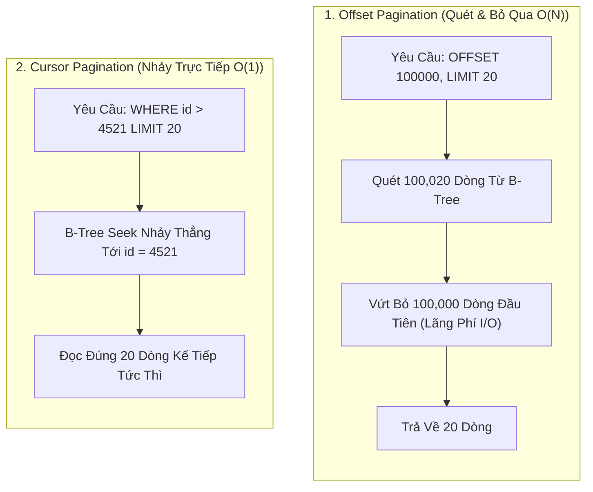
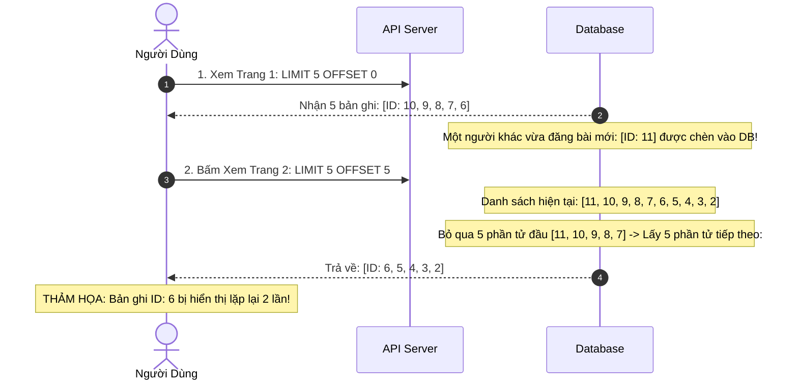

# 13.1. Các Kỹ Thuật Phân Trang Dữ Liệu (Pagination Techniques in Backend Systems)

> [!IMPORTANT]
> **Nếu bạn chỉ được nhớ một điều duy nhất:** `LIMIT M OFFSET N` ngây thơ là thủ phạm hàng đầu giết chết Cơ sở dữ liệu ở các trang sâu (Deep Paging) do Engine bắt buộc phải quét đủ $N + M$ hàng từ đĩa, nạp vào Buffer Pool rồi vứt bỏ $N$ hàng đầu tiên ($O(N)$ Disk I/O & CPU). Ngược lại, **Keyset Pagination (Seek Method)** và **Cursor-based Pagination** chuyển đổi việc duyệt trang thành phép tìm kiếm chỉ mục B+ Tree trong $O(\log N)$ bất biến ở mọi độ sâu trang, đồng thời triệt tiêu hoàn toàn lỗi trôi lệch trang (**Page Drift**) khi có thao tác ghi dữ liệu theo thời gian thực.

---

## 1. Trực Quan Hóa: Bản Chất Kỹ Thuật Phân Trang Dưới Góc Nhìn Lập Trình Viên

### 1.1. Đoạn Code Dẫn Nhập & Vấn Đề Thực Tế
Xét câu lệnh phân trang xem danh sách sản phẩm ở Trang thứ 10,000 trên cơ sở dữ liệu:

```sql
-- Cách 1: Phân trang truyền thống (Offset Pagination) - THẢM HỌA HIỆU NĂNG!
SELECT * FROM products ORDER BY id LIMIT 20 OFFSET 200000;
-- Database bắt buộc phải quét qua và đọc đủ 200,020 bản ghi từ đĩa, rồi vứt bỏ 200,000 bản ghi đầu tiên!
-- Thời gian truy vấn: 3 - 5 giây -> Làm nghẽn toàn bộ cụm Database!

// Cách 2: Phân trang con trỏ (Keyset / Cursor Pagination) - HIỆU NĂNG VƯỢT TRỘI!
SELECT * FROM products WHERE id > 200000 ORDER BY id LIMIT 20;
-- Database tận dụng chỉ mục B-Tree nhảy thẳng tới id = 200000 trong 0.001 ms và đọc đúng 20 bản ghi!
```

- Phân trang (Pagination) là API phổ biến nhất trong mọi ứng dụng web, nhưng cũng là nguyên nhân số một gây ra các sự cố sập cơ sở dữ liệu do **Deep Paging** (phân trang quá sâu).
- Hai trường phái phân trang cốt lõi:
  - **Offset Pagination (`LIMIT/OFFSET`)**: Dễ cài đặt, cho phép nhảy cóc tới trang tùy ý, nhưng hiệu năng tụt dốc thảm hại $O(N)$ khi trang càng sâu và dễ dính lỗi trùng/nhảy bản ghi khi có dữ liệu mới chèn vào.
  - **Cursor / Keyset Pagination**: Hiệu năng bất biến $O(1)$ ở bất kỳ độ sâu nào, loại bỏ hoàn toàn lỗi trùng lặp dữ liệu, là chuẩn mực bắt buộc cho Mobile Infinite Scroll (Facebook, TikTok, Twitter feed).

### 1.2. Ẩn Dụ Đời Sống: Cuốn Từ Điển 1,000 Trang & Chiếc Thẻ Kẹp Sách
- **Đếm từng trang từ đầu sách (Offset Pagination)**: Bạn muốn đọc tiếp Trang 500 của cuốn từ điển dày. Thay vì mở thẳng vào giữa cuốn sách, bạn bắt buộc phải dùng tay lật từng tờ từ Trang 1, Trang 2, Trang 3... cho tới Trang 499 rồi mới bắt đầu đọc Trang 500! Lần sau muốn đọc Trang 900, bạn lại phải lật lại 899 trang từ đầu. Đó chính là sự lãng phí khủng khiếp của lệnh `OFFSET`.
- **Chiếc thẻ kẹp sách Bookmark (Cursor Pagination)**: Khi đọc xong Trang 499, bạn kẹp chiếc thẻ sách vào dòng cuối cùng bạn vừa đọc (`id = 4521`). Ngày hôm sau mở sách ra, bạn chỉ việc nhìn vào thẻ kẹp sách và đọc tiếp ngay lập tức mà không cần quan tâm trước đó có bao nhiêu trang sách!

### 1.3. Mô Phỏng Dữ Liệu Số Nhỏ Từng Bước (Toy Walkthrough)
Mô phỏng lỗi nhảy bản ghi của Offset Pagination khi có dữ liệu mới chèn vào:
Danh sách bài viết gốc: `[Post 10, Post 9, Post 8, Post 7, Post 6, Post 5]` (Sắp xếp theo ID giảm dần)
Trang 1 (`LIMIT 2 OFFSET 0`): Người dùng đang xem `Post 10, Post 9`.

```text
Sự cố diễn ra: Một bài viết mới "Post 11" vừa được đăng lên hệ thống!
Danh sách mới trong DB: [Post 11, Post 10, Post 9, Post 8, Post 7, Post 6, Post 5]

Người dùng bấm xem Trang 2 (Hệ thống gọi: LIMIT 2 OFFSET 2):
- Database bỏ qua 2 bản ghi đầu tiên: Bỏ qua Post 11 và Post 10!
- Database trả về 2 bản ghi tiếp theo: [Post 9, Post 8]!
HẬU QUẢ: Người dùng bị nhìn thấy "Post 9" LẶP LẠI HAI LẦN!
```

- Trong khi đó, với Cursor Pagination (`WHERE id < 9 LIMIT 2`), hệ thống luôn trả về chính xác `[Post 8, Post 7]` bất chấp có bao nhiêu bài viết mới được đăng!

### 1.4. Tác Động Thực Tế Tầng Backend & Systems
1. **Mã Hóa Con Trỏ Opaque Cursor Trong REST / GraphQL APIs**: Các API lớn (như Stripe, GitHub, Shopify) không bao giờ để lộ ID cơ sở dữ liệu thô ra ngoài; họ mã hóa Base64 con trỏ (`cursor = base64(created_at + "_" + id)`), ngăn chặn việc người dùng đoán thứ tự dữ liệu và bảo vệ cấu trúc nội bộ.
2. **Kỹ Thuật Deferred Join Tối Ưu Hóa Offset**: Nếu bắt buộc phải dùng Offset cho trang quản trị Admin Portal, kỹ sư áp dụng kỹ thuật Deferred Join: Chỉ truy vấn `id` qua B-Tree trước bằng `OFFSET`, sau đó mới `JOIN` lại bảng chính để lấy dữ liệu chi tiết, giúp tăng tốc độ truy vấn lên gấp 10 lần.

### 1.5. Sơ Đồ Cơ Chế Offset Pagination vs Cursor Pagination



---

## 2. Chi tiết từng Keyword (Under-the-Hood Deep Dive)

### 2.1. Offset Pagination & Lỗi Hiệu Năng Phân Trang Sâu (Deep Paging Problem)

#### Cơ Chế Thực Thi Của Database Engine Với `LIMIT M OFFSET N`
Hầu hết các lập trình viên mới bắt đầu đều sử dụng cú pháp:
```sql
SELECT * FROM orders 
ORDER BY created_at DESC 
LIMIT 20 OFFSET 1000000;
```
Bên dưới tầng vật lý của MySQL (InnoDB) hoặc PostgreSQL:
1. Engine cơ sở dữ liệu **không có cách nào để nhảy cóc trực tiếp đến hàng thứ $1,000,000$**.
2. Bộ tối ưu hóa truy vấn (Query Optimizer) buộc phải sử dụng chỉ mục hoặc quét toàn bảng (Full Table Scan) để đọc tuần tự từng hàng một.
3. Với mỗi hàng, nó kiểm tra điều kiện lọc, nạp toàn bộ dữ liệu hàng từ đĩa vào bộ đệm RAM (**Buffer Pool**), tăng biến đếm offset.
4. Quá trình này lặp lại liên tục $1,000,000$ lần. Sau khi đã đếm đủ 1 triệu hàng, Database **vứt bỏ toàn bộ 1 triệu hàng đó** vào thùng rác và chỉ giữ lại đúng 20 hàng tiếp theo để trả về cho Client!
5. **Hậu quả phần cứng**:
   - Tiêu tốn hàng gigabyte Disk I/O và CPU Cycles một cách vô nghĩa.
   - Thổi bay toàn bộ các trang dữ liệu "hot" đang nằm trong Buffer Pool (**Buffer Pool Thrashing**), làm suy giảm nghiêm trọng hiệu năng của các truy vấn khác trong toàn hệ thống.
   - Thời gian đáp ứng của API tăng tuyến tính theo cấp số cộng: Trang 1 mất $2\text{ ms}$, trang $1,000$ mất $300\text{ ms}$, trang $50,000$ mất $20\text{ giây}$ hoặc kích hoạt lỗi Gateway Timeout (HTTP 504).

#### Vấn Đề Dạt Trang & Sai Lệch Dữ Liệu (The Page Drift Problem)
Bên cạnh thảm họa hiệu năng, Offset Pagination phá vỡ tính nhất quán dữ liệu của các ứng dụng có tần suất ghi cao (Real-time Feeds, E-commerce):



- **Trường hợp Chèn Thêm (Insert)**: Bản ghi cuối cùng của trang trước bị đẩy sang trang sau $\to$ Người dùng nhìn thấy dữ liệu bị trùng lặp.
- **Trường hợp Xóa Bỏ (Delete)**: Một bản ghi ở trang 1 bị xóa $\to$ Bản ghi đầu tiên của trang 2 bị kéo giật lùi về trang 1 $\to$ Người dùng bị bỏ lỡ một bản ghi mà không hề hay biết!

---

### 2.2. Keyset Pagination (Seek Method) & Composite Keys

#### Nguyên Lý Dò Tìm Chỉ Mục B+ Tree (The Seek Method)
Thay vì hướng dẫn Database "bỏ qua $N$ hàng", ta hướng dẫn Database: *"Hãy tìm bản ghi có giá trị khóa nhỏ hơn giá trị khóa của bản ghi cuối cùng tôi vừa đọc"*:
```sql
SELECT * FROM orders 
WHERE id < 982041 
ORDER BY id DESC 
LIMIT 20;
```
- **Hành vi vật lý của B+ Tree**:
  1. Con trỏ duyệt từ Root Node qua các Branch Node xuống Leaf Node chứa khóa `982041` trong đúng $O(\log N)$ bước (chỉ tốn 3-4 lần đọc trang nhớ).
  2. Tại Leaf Node, nó men theo danh sách liên kết hai chiều giữa các trang lá (Leaf Page Pointers) để đọc đúng 20 bản ghi tiếp theo rồi dừng lại ngay lập tức.
  3. Thời gian thực thi ở trang thứ $1$ và trang thứ $1,000,000$ là **hoàn toàn đồng nhất ($\approx 0.3 - 0.8\text{ ms}$)**.
  4. Hoàn toàn miễn nhiễm với hiện tượng Page Drift vì điểm mốc tìm kiếm gắn liền với định danh của bản ghi chứ không phải vị trí tương đối.

#### Composite Keys (Khóa Phức Hợp) & Quy Tắc So Sánh Hàng (Row Value Constructors)
Trong thực tế, người dùng hiếm khi chỉ sắp xếp theo `id` tăng dần, mà thường sắp xếp theo các trường nghiệp vụ như thời gian tạo (`created_at`), điểm số (`score`), hoặc trạng thái (`status`).
- Vì trường `created_at` **có thể bị trùng lặp** giữa nhiều bản ghi tạo ra trong cùng một mili-giây, việc chỉ dùng `WHERE created_at < :last_created_at` sẽ khiến toàn bộ các bản ghi có cùng timestamp bị bỏ sót!
- Bắt buộc phải kết hợp với khóa chính `id` duy nhất để tạo thành một **Cặp Khóa Tất Định (Deterministic Tie-Breaker)**: `(created_at, id)`.

```sql
-- Cú pháp chuẩn SQL-92 Row Value Constructor (Được hỗ trợ tối ưu trong PostgreSQL)
SELECT id, user_id, created_at, amount
FROM orders
WHERE (created_at, id) < ('2026-11-16 08:30:00.125', 948120)
ORDER BY created_at DESC, id DESC
LIMIT 20;
```

Nếu hệ quản trị cơ sở dữ liệu không tối ưu hóa tốt cho Row Value Constructor (như một số phiên bản cũ của MySQL), câu truy vấn được viết tường minh dưới dạng logic đại số Boolean tương đương:
```sql
SELECT id, user_id, created_at, amount
FROM orders
WHERE created_at < '2026-11-16 08:30:00.125'
   OR (created_at = '2026-11-16 08:30:00.125' AND id < 948120)
ORDER BY created_at DESC, id DESC
LIMIT 20;
```

#### Thiết Kế Chỉ Mục Composite B+ Tree Bắt Buộc
Để câu truy vấn trên đạt hiệu năng $O(\log N)$, hệ thống bắt buộc phải có một Composite Index có thứ tự cột và chiều sắp xếp hoàn toàn trùng khớp:
```sql
CREATE INDEX idx_orders_pagination ON orders (created_at DESC, id DESC);
```
Nếu chỉ mục được tạo là `(id, created_at)` hoặc chiều sắp xếp bị lệch (`created_at DESC, id ASC`), Database sẽ buộc phải thực hiện phép sắp xếp phụ trên bộ nhớ đệm (**Filesort / Sort Node**), phá hủy toàn bộ lợi ích hiệu năng!

---

### 2.3. Cursor-based Pagination Trong Thiết Kế API Hiện Đại

#### Bản Chất Con Trỏ Opaque Cursor
Trong thiết kế RESTful API và GraphQL hiện đại (Stripe, Slack, GitHub, Twitter), Backend không bao giờ phơi bày các trường cơ sở dữ liệu trần trụi (`last_id`, `last_created_at`) lên query parameters của URL. Thay vào đó, toàn bộ trạng thái vị trí được gói gọn trong một chuỗi **Opaque Cursor**:
- Opaque có nghĩa là đối với Client, chuỗi này hoàn toàn vô nghĩa và "mờ đục", Client chỉ việc lưu giữ và truyền ngược lại server trong tham số `?cursor=...`.

```text
Chuỗi JSON thô:
{"created_at": 1718000000125, "id": 948120}
               │
               ▼ (Chuyển đổi Base64 URL-safe)
Cursor phát hành cho Client:
eyJjcmVhdGVkX2F0IjoxNzE4MDAwMDAwMTI1LCJpZCI6OTQ4MTIwfQ==
```

#### Kiến Trúc Chuẩn Relay GraphQL Cursor Specification
Được Facebook chuẩn hóa để giải quyết bài toán cuộn vô tận (Infinite Scroll) trên Web và Mobile, cấu trúc JSON trả về bao gồm:
```json
{
  "data": {
    "orders": {
      "edges": [
        {
          "node": { "id": "948120", "amount": 150.0 },
          "cursor": "eyJjcmVhdGVkX2F0IjoxNzE4MDAwMDAwMTI1LCJpZCI6OTQ4MTIwfQ=="
        }
      ],
      "pageInfo": {
        "endCursor": "eyJjcmVhdGVkX2F0IjoxNzE4MDAwMDAwMTI1LCJpZCI6OTQ4MTIwfQ==",
        "hasNextPage": true,
        "hasPreviousPage": false,
        "startCursor": "eyJjcmVhdGVkX2F0IjoxNzE4MDAwMDAwOTk5LCJpZCI6OTQ4MTM5fQ=="
      }
    }
  }
}
```

#### Kỹ Thuật Ký Số Toàn Vẹn Con Trỏ (HMAC Signature Protection)
Nếu chỉ dùng Base64 thuần túy, kẻ tấn công có thể dễ dàng giải mã, thay đổi `created_at` thành năm 2099 để quét trộm dữ liệu hoặc dò quét ID người dùng khác.
Trong hệ thống Backend tiêu chuẩn tài chính, Cursor luôn được nối kèm một chữ ký mã hóa **HMAC-SHA256**:
$$\text{SecureCursor} = \text{Base64}(\text{Payload}) + "." + \text{HMAC-SHA256}(\text{Payload}, \text{SecretKey})$$
Khi nhận request, Backend kiểm tra chữ ký trước khi thực thi SQL. Bất kỳ sự sửa đổi nào từ phía Client đều bị từ chối với mã lỗi `HTTP 400 Bad Request`.

---

## 3. Thực thi Mã nguồn & Mô phỏng Chuyên sâu (Dual-Engine Implementation)

### Engine 1: C++20 High-Speed In-Memory Keyset/Cursor Engine

Dưới đây là mã nguồn C++20 hiện đại, triển khai bộ máy phân trang Keyset/Cursor trong bộ nhớ tối ưu, sử dụng cấu trúc khóa phức hợp `(timestamp, id)`, giải thuật tìm kiếm nhị phân `std::lower_bound` tương đương B+ Tree seek, kèm bộ mã hóa/giải mã Base64 Cursor.

```cpp
#include <iostream>
#include <vector>
#include <string>
#include <string_view>
#include <algorithm>
#include <sstream>
#include <iomanip>
#include <chrono>
#include <optional>

// Bảng tra cứu Base64 URL-safe
static constexpr std::string_view BASE64_CHARS =
    "ABCDEFGHIJKLMNOPQRSTUVWXYZabcdefghijklmnopqrstuvwxyz0123456789-_";

std::string base64_encode(std::string_view input) {
    std::string encoded;
    int val = 0, valb = -6;
    for (unsigned char c : input) {
        val = (val << 8) + c;
        valb += 8;
        while (valb >= 0) {
            encoded.push_back(BASE64_CHARS[(val >> valb) & 0x3F]);
            valb -= 6;
        }
    }
    if (valb > -6) encoded.push_back(BASE64_CHARS[((val << 8) >> (valb + 8)) & 0x3F]);
    while (encoded.size() % 4) encoded.push_back('=');
    return encoded;
}

std::string base64_decode(std::string_view input) {
    std::string decoded;
    std::vector<int> T(256, -1);
    for (int i = 0; i < 64; i++) T[BASE64_CHARS[i]] = i;

    int val = 0, valb = -8;
    for (unsigned char c : input) {
        if (c == '=') break;
        if (T[c] == -1) continue;
        val = (val << 6) + T[c];
        valb += 6;
        while (valb >= 0) {
            decoded.push_back(char((val >> valb) & 0xFF));
            valb -= 8;
        }
    }
    return decoded;
}

// Cấu trúc bản ghi đơn hàng
struct OrderRecord {
    uint64_t id;
    int64_t created_at; // Timestamp mili-giây
    double amount;
    std::string customer_name;

    // So sánh thứ tự sắp xếp giảm dần theo created_at, tie-breaker bằng id giảm dần
    bool operator>(const OrderRecord& other) const {
        if (created_at != other.created_at) {
            return created_at > other.created_at;
        }
        return id > other.id;
    }
};

// Cấu trúc vị trí Cursor
struct PaginationCursor {
    int64_t last_created_at;
    uint64_t last_id;

    std::string encode() const {
        std::ostringstream ss;
        ss << last_created_at << ":" << last_id;
        return base64_encode(ss.str());
    }

    static std::optional<PaginationCursor> decode(std::string_view encoded_str) {
        std::string raw = base64_decode(encoded_str);
        auto delim_pos = raw.find(':');
        if (delim_pos == std::string::npos) return std::nullopt;

        try {
            int64_t ts = std::stoll(raw.substr(0, delim_pos));
            uint64_t id = std::stoull(raw.substr(delim_pos + 1));
            return PaginationCursor{ts, id};
        } catch (...) {
            return std::nullopt;
        }
    }
};

struct PageResult {
    std::vector<OrderRecord> records;
    std::optional<std::string> next_cursor;
    bool has_next_page;
};

class OrderPaginationService {
public:
    explicit OrderPaginationService(std::vector<OrderRecord> dataset)
        : dataset_(std::move(dataset)) {
        // Giả lập việc lập chỉ mục B+ Tree: Sắp xếp sẵn tập dữ liệu theo thứ tự (created_at DESC, id DESC)
        std::sort(dataset_.begin(), dataset_.end(), [](const OrderRecord& a, const OrderRecord& b) {
            return a > b;
        });
    }

    // Thực thi Keyset/Seek Pagination trong O(log N)
    PageResult fetch_page(size_t limit, std::optional<std::string> cursor_str) const {
        auto it_begin = dataset_.begin();

        if (cursor_str.has_value() && !cursor_str->empty()) {
            auto cursor = PaginationCursor::decode(*cursor_str);
            if (cursor.has_value()) {
                // Tạo một bản ghi giả lập mục tiêu tìm kiếm
                OrderRecord target{cursor->last_id, cursor->last_created_at, 0.0, ""};

                // Binary search O(log N) định vị chính xác vị trí con trỏ trên mảng đã sắp xếp
                it_begin = std::upper_bound(dataset_.begin(), dataset_.end(), target,
                    [](const OrderRecord& a, const OrderRecord& b) {
                        return a > b; // Thứ tự giảm dần
                    });
            }
        }

        std::vector<OrderRecord> page_records;
        size_t count = 0;
        auto it = it_begin;
        while (it != dataset_.end() && count < limit) {
            page_records.push_back(*it);
            ++it;
            ++count;
        }

        bool has_more = (it != dataset_.end());
        std::optional<std::string> next_cursor = std::nullopt;
        if (!page_records.empty() && has_more) {
            const auto& last = page_records.back();
            next_cursor = PaginationCursor{last.created_at, last.id}.encode();
        }

        return PageResult{std::move(page_records), next_cursor, has_more};
    }

private:
    std::vector<OrderRecord> dataset_;
};

int main() {
    std::cout << "=== C++20 Keyset/Cursor Pagination Engine (B+ Tree Seek Simulation) ===\n\n";

    // Khởi tạo tập dữ liệu mẫu
    std::vector<OrderRecord> orders = {
        {101, 1718000000500, 250.0, "Alice"},
        {102, 1718000000500, 120.0, "Bob"},      // Cùng timestamp với 101, tie-breaker bằng id!
        {103, 1718000000400, 89.0,  "Charlie"},
        {104, 1718000000300, 450.0, "David"},
        {105, 1718000000200, 310.0, "Emma"},
        {106, 1718000000100, 15.0,  "Frank"}
    };

    OrderPaginationService service(std::move(orders));

    // Lấy Trang 1 (Limit = 2)
    std::cout << "--- [FETCH TRANG 1] (limit=2, cursor=null) ---\n";
    auto page1 = service.fetch_page(2, std::nullopt);
    for (const auto& r : page1.records) {
        std::cout << "  - Order #" << r.id << " | TS: " << r.created_at 
                  << " | Customer: " << r.customer_name << " | $" << r.amount << "\n";
    }
    std::cout << "Next Cursor: " << page1.next_cursor.value_or("NONE") << "\n\n";

    // Lấy Trang 2 sử dụng Cursor từ Trang 1
    std::cout << "--- [FETCH TRANG 2] (limit=2, cursor=" << *page1.next_cursor << ") ---\n";
    auto page2 = service.fetch_page(2, page1.next_cursor);
    for (const auto& r : page2.records) {
        std::cout << "  - Order #" << r.id << " | TS: " << r.created_at 
                  << " | Customer: " << r.customer_name << " | $" << r.amount << "\n";
    }
    std::cout << "Next Cursor: " << page2.next_cursor.value_or("NONE") << "\n\n";

    // Lấy Trang 3
    std::cout << "--- [FETCH TRANG 3] (limit=2, cursor=" << *page2.next_cursor << ") ---\n";
    auto page3 = service.fetch_page(2, page2.next_cursor);
    for (const auto& r : page3.records) {
        std::cout << "  - Order #" << r.id << " | TS: " << r.created_at 
                  << " | Customer: " << r.customer_name << " | $" << r.amount << "\n";
    }
    std::cout << "Has More Pages: " << (page3.has_next_page ? "YES" : "NO") << "\n";
    std::cout << "Next Cursor: " << page3.next_cursor.value_or("NONE") << " (Het du lieu)\n";

    return 0;
}
```

#### Terminal Output Mẫu (C++20 Engine):
```text
=== C++20 Keyset/Cursor Pagination Engine (B+ Tree Seek Simulation) ===

--- [FETCH TRANG 1] (limit=2, cursor=null) ---
  - Order #102 | TS: 1718000000500 | Customer: Bob | $120
  - Order #101 | TS: 1718000000500 | Customer: Alice | $250
Next Cursor: MTcxODAwMDAwMDUwMDoxMDE=

--- [FETCH TRANG 2] (limit=2, cursor=MTcxODAwMDAwMDUwMDoxMDE=) ---
  - Order #103 | TS: 1718000000400 | Customer: Charlie | $89
  - Order #104 | TS: 1718000000300 | Customer: David | $450
Next Cursor: MTcxODAwMDAwMDMwMDoxMDQ=

--- [FETCH TRANG 3] (limit=2, cursor=MTcxODAwMDAwMDMwMDoxMDQ=) ---
  - Order #105 | TS: 1718000000200 | Customer: Emma | $310
  - Order #106 | TS: 1718000000100 | Customer: Frank | $15
Has More Pages: NO
Next Cursor: NONE (Het du lieu)
```

---

### Engine 2: Python 3.11+ Production-Grade Cursor Service & So Sánh Page Drift

Chương trình Python 3.11+ hoàn chỉnh mô phỏng dịch vụ phân trang API chuẩn REST, tích hợp chữ ký mật mã **HMAC-SHA256** chống sửa đổi cursor, đồng thời chạy bài kiểm tra thực nghiệm đối đầu giữa **Offset Pagination** và **Cursor Pagination** khi có luồng ghi dữ liệu song song để chứng minh lỗi Page Drift.

```python
import base64
import json
import hmac
import hashlib
import time
from typing import List, Dict, Any, Optional, Tuple

SECRET_KEY = b"production-secure-hmac-key-2026"

class SecureCursor:
    """Đóng gói và ký số điện tử cho Opaque Cursor bằng HMAC-SHA256."""
    
    @staticmethod
    def encode(payload: Dict[str, Any]) -> str:
        raw_json = json.dumps(payload, separators=(',', ':'), sort_keys=True)
        encoded_data = base64.urlsafe_b64encode(raw_json.encode('utf-8')).decode('utf-8')
        signature = hmac.new(SECRET_KEY, encoded_data.encode('utf-8'), hashlib.sha256).hexdigest()
        return f"{encoded_data}.{signature}"

    @staticmethod
    def decode(cursor_token: str) -> Optional[Dict[str, Any]]:
        try:
            parts = cursor_token.split('.')
            if len(parts) != 2:
                return None
            encoded_data, received_sig = parts
            expected_sig = hmac.new(SECRET_KEY, encoded_data.encode('utf-8'), hashlib.sha256).hexdigest()
            if not hmac.compare_digest(received_sig, expected_sig):
                print("[AN NINH] Canh bao: Cursor bi lam gia hoac sua doi trai phep!")
                return None
            raw_json = base64.urlsafe_b64decode(encoded_data.encode('utf-8')).decode('utf-8')
            return json.loads(raw_json)
        except Exception:
            return None


class DatabaseSimulator:
    """Mô phỏng bảng cơ sở dữ liệu có hỗ trợ cả Offset và Keyset Seek."""
    def __init__(self):
        self.rows: List[Dict[str, Any]] = []

    def insert(self, row_id: int, created_at: float, content: str):
        self.rows.append({"id": row_id, "created_at": created_at, "content": content})
        # Giữ mảng luôn sắp xếp theo (created_at DESC, id DESC) như B+ Tree Index
        self.rows.sort(key=lambda x: (x["created_at"], x["id"]), reverse=True)

    def query_offset(self, limit: int, offset: int) -> List[Dict[str, Any]]:
        """Mô phỏng LIMIT limit OFFSET offset."""
        return self.rows[offset : offset + limit]

    def query_keyset(self, limit: int, last_created_at: Optional[float], last_id: Optional[int]) -> List[Dict[str, Any]]:
        """Mô phỏng WHERE (created_at, id) < (:last_time, :last_id) LIMIT limit."""
        if last_created_at is None or last_id is None:
            return self.rows[:limit]

        result = []
        for row in self.rows:
            # Điều kiện so sánh tuple (created_at, id) < (last_created_at, last_id)
            if (row["created_at"], row["id"]) < (last_created_at, last_id):
                result.append(row)
                if len(result) == limit:
                    break
        return result


def demonstrate_page_drift_scenario():
    print("=================================================================")
    print("THUC NGHIEM SO SANH: OFFSET PAGINATION VS SECURE CURSOR SEEK")
    print("Kich ban: Client dang doc Trang 1, mot bai viet moi duoc chen vao!")
    print("=================================================================\n")

    db = DatabaseSimulator()
    # Nạp 6 bài viết ban đầu
    now = 1718000000.0
    for i in range(1, 7):
        db.insert(row_id=i, created_at=now + i * 10, content=f"Post #{i}")

    print("--- [1. KHACH HANG DOC TRANG 1] (Moi trang 3 bai viet) ---")
    page1_offset = db.query_offset(limit=3, offset=0)
    page1_keyset = db.query_keyset(limit=3, last_created_at=None, last_id=None)
    
    print(f"Trang 1 (Offset): {[r['content'] for r in page1_offset]}")
    print(f"Trang 1 (Keyset): {[r['content'] for r in page1_keyset]}")

    last_item = page1_keyset[-1]
    cursor = SecureCursor.encode({"last_created_at": last_item["created_at"], "last_id": last_item["id"]})
    print(f"Issued Secure Cursor -> {cursor}\n")

    # BIẾN CỐ: Người dùng khác đăng bài mới có độ ưu tiên cao nhất!
    print(">>> [BIEN CO GHI DU LIEU] Nguoi dung khac dang Post #99 moi nhat vao Database!\n")
    db.insert(row_id=99, created_at=now + 999, content="Post #99 (Moi Tinh)")

    print("--- [2. KHACH HANG DOC TIEP TRANG 2] ---")
    
    # 1. Cach tiep can Offset (OFFSET 3)
    page2_offset = db.query_offset(limit=3, offset=3)
    print(f"[OFFSET PHAN TRANG]: {[r['content'] for r in page2_offset]}")
    # Kiểm tra xem có bài viết nào ở Trang 1 bị xuất hiện lại không
    overlap = [r['content'] for r in page2_offset if r in page1_offset]
    print(f"  -> PHAT HIEN LOI TRANG TRÔI (Page Drift): Bai viet {overlap} bi hien thi lap lai 2 lan!")

    # 2. Cach tiep can Keyset / Cursor
    decoded_cursor = SecureCursor.decode(cursor)
    page2_keyset = db.query_keyset(
        limit=3,
        last_created_at=decoded_cursor["last_created_at"],
        last_id=decoded_cursor["last_id"]
    )
    print(f"\n[SECURE CURSOR PHAN TRANG]: {[r['content'] for r in page2_keyset]}")
    keyset_overlap = [r['content'] for r in page2_keyset if r in page1_keyset]
    print(f"  -> KET QUA: {keyset_overlap if keyset_overlap else 'Khong co phan tu trung lap!'}")
    print("  -> Danh sach phan trang nhat quan 100% bat chap thao tac ghi dong thoi!\n")

    print("--- [3. KIEM TRA TINH NANG CHONG GIA MAO CURSOR] ---")
    tampered_cursor = cursor[:-5] + "AAAAA" # Kẻ gian sửa đổi chữ ký
    print(f"Gia mao token: {tampered_cursor}")
    res = SecureCursor.decode(tampered_cursor)
    print(f"Ket qua giai ma: {res} (He thong tu choi xu ly an toan)")

if __name__ == "__main__":
    demonstrate_page_drift_scenario()
```

#### Terminal Output Mẫu (Python 3.11+ Engine):
```text
=================================================================
THUC NGHIEM SO SANH: OFFSET PAGINATION VS SECURE CURSOR SEEK
Kich ban: Client dang doc Trang 1, mot bai viet moi duoc chen vao!
=================================================================

--- [1. KHACH HANG DOC TRANG 1] (Moi trang 3 bai viet) ---
Trang 1 (Offset): ['Post #6', 'Post #5', 'Post #4']
Trang 1 (Keyset): ['Post #6', 'Post #5', 'Post #4']
Issued Secure Cursor -> eyJsYXN0X2NyZWF0ZWRfYXQiOjE3MTgwMDAwNDAuMCwibGFzdF9pZCI6NH0=.5f4c1c9849fa86a038bf8cf2711ddc381c0cb6c5c798939eecdfefba157ce94c

>>> [BIEN CO GHI DU LIEU] Nguoi dung khac dang Post #99 moi nhat vao Database!

--- [2. KHACH HANG DOC TIEP TRANG 2] ---
[OFFSET PHAN TRANG]: ['Post #4', 'Post #3', 'Post #2']
  -> PHAT HIEN LOI TRANG TRÔI (Page Drift): Bai viet ['Post #4'] bi hien thi lap lai 2 lan!

[SECURE CURSOR PHAN TRANG]: ['Post #3', 'Post #2', 'Post #1']
  -> KET QUA: Khong co phan tu trung lap!
  -> Danh sach phan trang nhat quan 100% bat chap thao tac ghi dong thoi!

--- [3. KIEM TRA TINH NANG CHONG GIA MAO CURSOR] ---
Gia mao token: eyJsYXN0X2NyZWF0ZWRfYXQiOjE3MTgwMDAwNDAuMCwibGFzdF9pZCI6NH0=.5f4c1c9849fa86a038bf8cf2711ddc381c0cb6c5c798939eecdfefbaAAAAA
[AN NINH] Canh bao: Cursor bi lam gia hoac sua doi trai phep!
Ket qua giai ma: None (He thong tu choi xu ly an toan)
```

---

## 4. Systems Engineering & Production Pitfalls

### 4.1. Cạm Bẫy Đếm Tổng Số Bản Ghi (`COUNT(*)` Trap)
- **Vấn đề**: Các thiết kế UI truyền thống thường yêu cầu thanh điều hướng phân trang hiển thị: `"Trang 1 của 5,000 trang (Tổng cộng: 100,000,000 bản ghi)"`.
- **Cái chết của Database**: Để tính được tổng số hàng, câu lệnh `SELECT COUNT(*)` buộc phải quét toàn bộ cây chỉ mục. Trong kiến trúc MVCC của PostgreSQL, do mỗi giao dịch nhìn thấy ảnh chụp độc lập (Snapshot Isolation), `COUNT(*)` **bắt buộc phải đọc từng hàng một trên bảng vật lý** để kiểm tra tính hiển thị (`Heap Visibility Check`). Trên bảng 50 triệu hàng, lệnh đếm này mất $10 - 30\text{ giây}$!
- **Giải pháp Production**:
  1. Loại bỏ thanh phân trang số (Pagination bar 1, 2, 3...) và chuyển sang mô hình **Infinite Scroll** hoặc nút **"Xem Thêm (Load More)"**.
  2. Nếu bắt buộc phải hiển thị con số ước tính, hãy đọc từ metadata thống kê của Database:
     - PostgreSQL: `SELECT reltuples::bigint FROM pg_class WHERE relname = 'orders';` ($0.1\text{ ms}$).
     - MySQL: `SHOW TABLE STATUS LIKE 'orders';` (đọc cột `Rows`).
  3. Duy trì một biến đếm riêng trong Redis hoặc bảng thống kê `counter_table` được cập nhật qua Trigger / Kafka Consumer.

### 4.2. Lỗi Lệch Chiều Chỉ Mục (Index Direction Mismatch)
- Nếu câu truy vấn sử dụng:
  ```sql
  ORDER BY created_at DESC, id ASC
  ```
  Nhưng chỉ mục được tạo mặc định là:
  ```sql
  CREATE INDEX idx_orders ON orders (created_at, id); -- Mặc định là ASC, ASC
  ```
- Trên một số Database Engine (đặc biệt là MySQL phiên bản trước 8.0), B+ Tree không thể duyệt ngược chiều hỗn hợp hiệu quả. Database sẽ buộc phải đưa tập dữ liệu vào bộ nhớ tạm RAM/Disk để thực hiện **Filesort**, làm sập chỉ số p99 Latency!
- **Khắc phục**: Luôn khai báo tường minh chiều sắp xếp trong chỉ mục:
  `CREATE INDEX idx_orders ON orders (created_at DESC, id ASC);`

### 4.3. Nguy Cơ Tấn Công DoS Qua Thu Thập Dữ Liệu Sâu (Deep Paging Scraping)
- Các bot thu thập dữ liệu (Scrapers) thường viết vòng lặp gọi API với `page=1, 2, 3... 100000`.
- Nếu API sử dụng Offset, chỉ cần 10 con bot chạy đồng thời các request có `offset=500000` là có thể làm toàn bộ CPU của RDS/PostgreSQL chạm ngưỡng 100%, gây tê liệt toàn bộ hệ thống bán hàng.
- **Biện pháp bảo vệ**:
  1. Áp đặt trần Offset cứng (Hard Limit): Nếu `offset > 5000`, từ chối ngay lập tức với thông báo: *"Vui lòng lọc chi tiết hơn hoặc sử dụng Export API"*.
  2. Bắt buộc chuyển toàn bộ API công khai sang Cursor-based Pagination.

### 4.4. Các Lệnh Chẩn Đoán Production Thực Chiến (CLI Diagnostics)

```bash
# 1. Đo lường chi tiết Buffer Pool và thời gian thực thi phân trang trong PostgreSQL
EXPLAIN (ANALYZE, BUFFERS, VERBOSE, TIMING)
SELECT * FROM orders 
ORDER BY created_at DESC, id DESC 
LIMIT 20 OFFSET 500000;
# Quan sát dòng "Buffers: shared hit=... read=..." để thấy lượng I/O khổng lồ bị lãng phí!

# 2. Phân tích kế hoạch thực thi tối ưu của Keyset Seek trong MySQL 8.0
EXPLAIN FORMAT=JSON
SELECT * FROM orders 
WHERE (created_at, id) < ('2026-11-16 00:00:00', 1000) 
ORDER BY created_at DESC, id DESC 
LIMIT 20;
# Tìm kiếm "using_index_condition: true" và đảm bảo KHÔNG xuất hiện "Using filesort"

# 3. Giám sát các truy vấn phân trang chậm nhất trên cụm PostgreSQL bằng pg_stat_statements
psql -d production_db -c "
SELECT query, calls, total_exec_time / calls AS avg_ms, rows
FROM pg_stat_statements 
WHERE query LIKE '%OFFSET%' 
ORDER BY total_exec_time DESC 
LIMIT 5;"
```

---

## 5. Bảng So sánh & Decision Matrix

| Tiêu Chí | Offset Pagination (`OFFSET N`) | Keyset Pagination (Seek Method) | Cursor-based Pagination | Phân Vùng Thời Gian (Time-bucket Partition) |
| :--- | :--- | :--- | :--- | :--- |
| **Độ Phức Tạp Thời Gian** | $O(N)$ (Chậm dần về cuối) | **$O(\log N)$ (Cố định tuyệt đối)**| **$O(\log N)$ (Cố định tuyệt đối)**| $O(1)$ Partition Pruning + $O(\log M)$ |
| **Tài Nguyên Disk I/O & RAM** | Cực kỳ tốn kém (Buffer Thrashing) | **Tối thiểu (Chỉ đọc số hàng LIMIT)**| **Tối thiểu (Chỉ đọc số hàng LIMIT)**| Rất thấp |
| **Tính Nhất Quán Dữ Liệu** | Rất kém (Bị Page Drift khi ghi) | **Hoàn hảo (Không trôi trang)** | **Hoàn hảo (Không trôi trang)** | Hoàn hảo |
| **Khả Năng Nhảy Trang Bất Kỳ**| **Có (Hỗ trợ nhảy tới trang 50)** | Không (Chỉ đi Next/Prev tuần tự) | Không (Chỉ đi Next/Prev tuần tự) | Có (Nhảy theo khung giờ/ngày) |
| **Bảo Mật Cấu Trúc Bảng DB** | Lộ rõ cấu trúc cột nội bộ | Lộ trường khóa chính / timestamp | **Bảo mật cao (Opaque Cursor + HMAC)**| Bảo mật trung bình |
| **Kịch Bản Ứng Dụng Chuẩn** | Trang quản trị nội bộ Admin nhỏ | Dịch vụ nội bộ giữa Microservices | **Public API, Mobile App, Social Feed** | Dữ liệu Log (Elasticsearch, TimescaleDB)|

> [!TIP]
> **Quy Tắc Vàng Ra Quyết Định Thiết Kế (Engineering Decision Rule)**:
> 1. Đối với **Bảng quản trị Admin nội bộ** có kích thước dưới $50,000$ hàng và người dùng bắt buộc cần nhảy trang tùy ý: Cho phép dùng **Offset Pagination**, nhưng phải chặn trần tối đa `offset <= 5000`.
> 2. Đối với **Mọi Public API, Mobile Backend, Social Feed, Dịch vụ chịu tải cao**: Bắt buộc triển khai **Cursor-based Pagination** có ký số HMAC-SHA256.
> 3. Tuyệt đối **không gọi `COUNT(*)`** trong các API phân trang danh sách lớn; thay thế bằng `hasNextPage` (bằng cách truy vấn `LIMIT limit + 1`).

> [!NOTE]
> **Thủ Thuật "LIMIT + 1" Để Kiểm Tra `hasNextPage` Không Tốn Chi Phí**:
> Thay vì chạy thêm một câu lệnh đếm riêng để xem còn trang sau hay không, Backend chỉ cần truy vấn với:
> `LIMIT (page_size + 1)`
> - Nếu kết quả trả về đúng `page_size + 1` phần tử: Ta biết chắc chắn rằng vẫn còn trang kế tiếp (`hasNextPage = true`). Ta chỉ việc cắt bỏ phần tử thừa thứ $N+1$ đó ra khỏi mảng trả về cho Client và phát hành Cursor từ phần tử thứ $N$.
> - Nếu kết quả $\le page_size$: Đây là trang cuối cùng (`hasNextPage = false`), không có Cursor tiếp theo.
> - Kỹ thuật này giảm **50% số lượng truy vấn cơ sở dữ liệu** của toàn bộ hệ thống!
