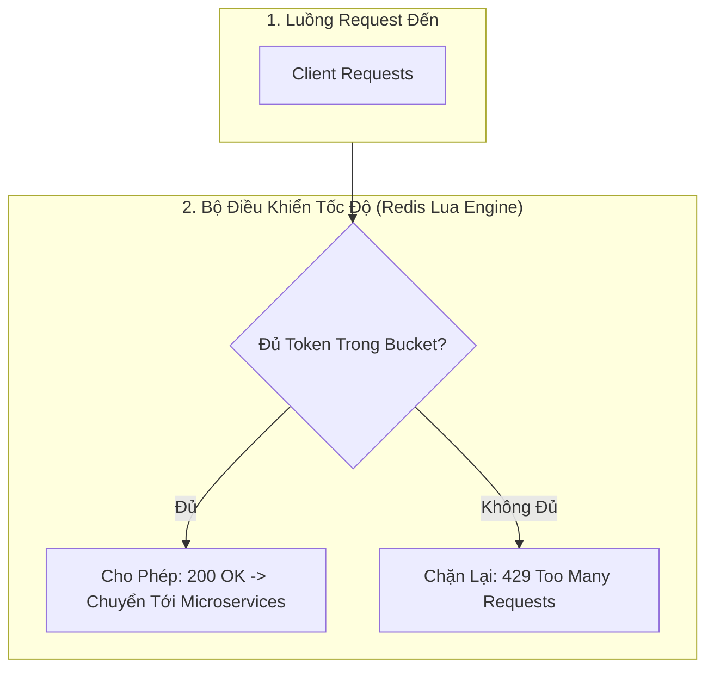
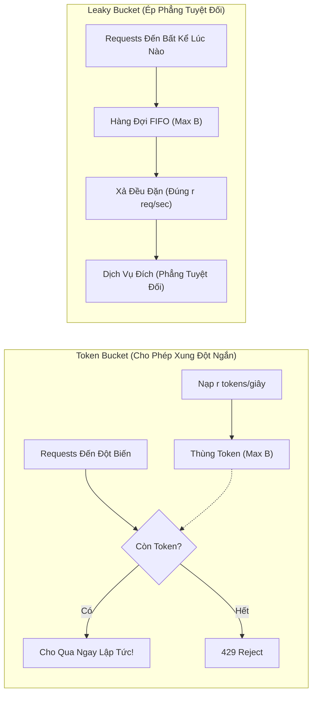
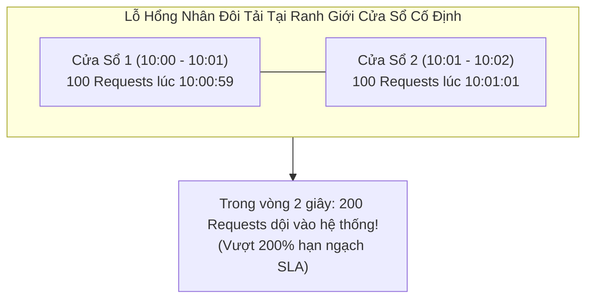
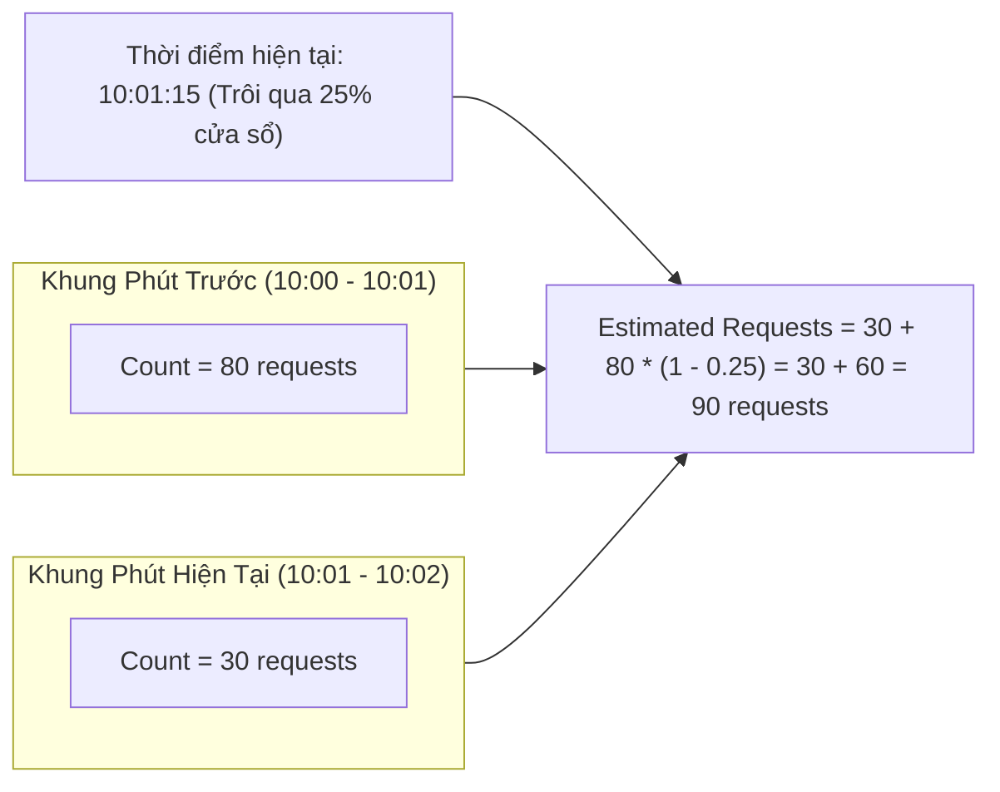

# 13.2. Các Giải Thuật Giới Hạn Tốc Độ (Rate Limiting Algorithms in Distributed Systems)

> [!IMPORTANT]
> **Nếu bạn chỉ được nhớ một điều duy nhất:** Giới hạn tốc độ (Rate Limiting) là chốt chặn phòng vệ sống còn phân định giữa một hệ thống hoạt động ổn định và một vụ sập đổ dây chuyền (**Cascading Failure**). Sự khác biệt cốt lõi giữa hai trường phái: **Token Bucket** cho phép xử lý bùng nổ lưu lượng ngắn hạn (**Traffic Burstiness**) với chi phí nạp lười $O(1)$ không tốn luồng nền; trong khi **Leaky Bucket** ép phẳng mọi xung đột thành tốc độ cố định (**Traffic Shaping**). Trong môi trường phân tán, việc thực thi phân tán bằng **Redis + Lua Script** hoặc **GCRA** là vũ khí duy nhất triệt tiêu hoàn toàn **Race Condition** mà không phải trả giá bằng khóa phân tán (Distributed Locks) đắt đỏ.

---

## 1. Trực Quan Hóa: Bản Chất Thuật Toán Giới Hạn Tốc Độ Dưới Góc Nhìn Lập Trình Viên

### 1.1. Đoạn Code Dẫn Nhập & Vấn Đề Thực Tế
Xét bài toán bảo vệ hệ thống thanh toán điện tử khỏi nguy cơ bị nghẽn do bão request: Giới hạn mỗi người dùng chỉ được gọi tối đa $100\text{ requests / phút}$:

```typescript
// Triển khai thuật toán Token Bucket (Thùng Chứa Xu) trong API Gateway:
class TokenBucketRateLimiter {
  private capacity = 100;      // Sức chứa tối đa (Burst Capacity)
  private refillRate = 100 / 60; // Nạp 1.66 xu mỗi giây
  private tokens = 100;
  private lastRefillTime = Date.now();

  public tryConsume(): boolean {
    this.refill();
    if (this.tokens >= 1) {
      this.tokens -= 1;
      return true; // Cho phép request đi qua
    }
    return false; // Vượt ngưỡng -> Chặn đứng bằng mã HTTP 429 Too Many Requests!
  }
}
```

- Giới hạn tốc độ (Rate Limiting) là tấm khiên sinh tử bảo vệ tính sẵn sàng của hạ tầng Backend: Ngăn chặn tấn công từ chối dịch vụ (DDoS), chống thu thập dữ liệu tự động (Web Scraping), và bảo vệ các dịch vụ thanh toán nhạy cảm.
- Bốn thuật toán trụ cột:
  - **Token Bucket**: Cho phép lưu lượng tăng đột biến trong giới hạn (Traffic Bursts), nạp xu theo thời gian thực.
  - **Leaky Bucket**: Làm mượt lưu lượng đầu ra hoàn toàn cố định như dòng nước nhỏ giọt.
  - **Fixed Window**: Đếm theo từng phút cố định (Dễ bị lỗi bão tải ở ranh giới 2 phút).
  - **Sliding Window Counter**: Cân bằng hoàn hảo giữa độ chính xác $99.9\%$ và bộ nhớ cực nhỏ gọn.

### 1.2. Ẩn Dụ Đời Sống: Trạm Thu Phí Cao Tốc & Bình Truyền Dịch Y Tế
- **Token Bucket (Trạm phát vé cao tốc dự trữ sẵn)**: Tại trạm thu phí cao tốc, nhân viên in sẵn vé vào một chiếc giỏ có sức chứa tối đa 100 vé (Burst Capacity). Cứ mỗi giây, máy in tự động bỏ thêm 10 vé vào giỏ (Refill Rate). Nếu một đoàn xe 50 chiếc cùng ập đến trong 1 giây, 50 xe lấy ngay 50 vé và phóng vút qua trạm mà không bị cản trở! Nhưng khi 100 vé dự trữ cạn kiệt, các xe tiếp theo bắt buộc phải đi với tốc độ nạp vé mới (10 xe/giây).
- **Leaky Bucket (Bình nước nhỏ giọt y tế có phễu)**: Một bình truyền dịch có đáy bị đục một lỗ kim rất nhỏ. Bác sĩ có thể đổ ập một lúc 500ml nước vào phễu (Buffer Queue), nhưng nước chảy ra ở đáy luôn luôn tuân theo một tốc độ hoàn toàn cố định: đúng 1 giọt mỗi giây! Nếu bác sĩ đổ quá nhanh làm tràn phễu, lượng nước thừa sẽ tràn ra ngoài sàn (**Packet Dropped**).

### 1.3. Mô Phỏng Dữ Liệu Số Nhỏ Từng Bước (Toy Walkthrough)
Mô phỏng Token Bucket có dung lượng $\text{Capacity} = 5$ tokens, tốc độ nạp $1\text{ token/giây}$:
Chuỗi sự kiện:

| Thời điểm ($t$) | Hành động | Số token trước khi nạp | Lượng token được nạp thêm | Số token sau nạp | Số token tiêu thụ | Kết quả | Số token còn lại |
| :--- | :--- | :--- | :--- | :--- | :--- | :--- | :--- |
| **$0\text{s}$** | Khởi tạo | - | - | $5$ (Đầy bình) | - | - | $5$ |
| **$1\text{s}$** | Gửi 3 requests | $5$ | $0$ (Chưa trôi thêm) | $5$ | $3$ | **Cho phép 3 requests** | $2$ |
| **$2\text{s}$** | Gửi 4 requests | $2$ | $1$ token (qua 1 giây) | $3$ | $3$ | **Cho phép 3 requests, Chặn 1 request (429)!** | $0$ |
| **$3\text{s}$** | Gửi 1 request | $0$ | $1$ token | $1$ | $1$ | **Cho phép 1 request** | $0$ |

### 1.4. Tác Động Thực Tế Tầng Backend & Systems
1. **Triển Khai Phân Tán Bằng Redis + Lua Script (Atomic Token Bucket)**: Để đảm bảo không bị lỗi Race Condition giữa hàng chục máy chủ API Gateway, logic kiểm tra và trừ token được viết thành một kịch bản **Redis Lua Script**, đảm bảo tính thực thi nguyên tử (Atomic Execution) trong $O(1)$.
2. **Chuẩn Hóa HTTP Headers Theo Tiêu Chuẩn RFC 6585**: Mọi phản hồi bị chặn hoặc cho phép đều phải đính kèm các Header chuẩn:
   - `X-RateLimit-Limit`: Ngưỡng tối đa trong cửa sổ.
   - `X-RateLimit-Remaining`: Số lượng request còn được phép gọi.
   - `Retry-After`: Số giây client cần chờ trước khi thử lại (khi bị dính lỗi 429).

### 1.5. Sơ Đồ Kiến Trúc Hệ Thống Giới Hạn Tốc Độ Phân Tán



---

## 2. Chi tiết từng Keyword (Under-the-Hood Deep Dive)

### 2.1. Token Bucket vs Leaky Bucket

#### 1. Thuật Toán Token Bucket (Thùng Cấp Thẻ)
- **Thông Số Cốt Lõi**:
  - $B$ (Burst Capacity): Dung lượng tối đa của thùng thẻ.
  - $r$ (Refill Rate): Tốc độ nạp thẻ (tokens / giây).
- **Cơ Chế Nạp Lười Thông Minh (Lazy Refill - Không Dùng Thread Ngầm)**:
  Nhiều kỹ sư lầm tưởng cần một background timer thread liên tục chạy mỗi giây để tăng biến đếm token. Trong thực tế, điều này gây lãng phí CPU khủng khiếp khi có hàng triệu người dùng.
  Thay vào đó, thuật toán áp dụng cơ chế **Tính toán lười (Lazy Calculation)** khi có request đến:
  $$\Delta t = t_{\text{now}} - t_{\text{last\_refill}}$$
  $$\text{tokens}_{\text{current}} = \min(B, \text{tokens}_{\text{last}} + \Delta t \times r)$$
  Sau đó, nếu $\text{tokens}_{\text{current}} \ge 1$: trừ 1 token, cập nhật $t_{\text{last\_refill}} = t_{\text{now}}$ và cho phép request đi qua. Toàn bộ thao tác chỉ tốn một phép trừ số thực trong $O(1)$!
- **Đặc Tính**:
  - Hỗ trợ xử lý các đợt bùng nổ tải tức thời (Burstiness).
  - Được áp dụng trong: AWS API Gateway, Stripe API, Nginx (`limit_req` với tham số `burst`), Google Cloud Endpoints.

#### 2. Thuật Toán Leaky Bucket (Thùng Rò Rỉ)
- **Hai Biến Thể Của Leaky Bucket**:
  1. **Leaky Bucket Dạng Hàng Đợi (As a Queue - Traffic Shaping)**:
     - Các request được đưa vào một hàng đợi FIFO có kích thước tối đa $B$.
     - Một Worker tiến trình rút các request ra khỏi hàng đợi với tần số cố định $r$ requests/giây để xử lý.
     - Nếu hàng đợi đầy, request mới đến bị vứt bỏ (Packet Dropping).
     - **Mục tiêu**: Triệt tiêu hoàn toàn tính giật cục của lưu lượng, làm phẳng băng thông tải ra. Phù hợp cho việc gửi email marketing hoặc gọi API sang đối tác thứ ba (ví dụ: Cổng thanh toán ngân hàng giới hạn cứng 50 QPS).
  2. **Leaky Bucket Dạng Đo Lường (As a Meter - Virtual Scheduling / GCRA)**:
     - Không dùng hàng đợi bộ nhớ, chỉ kiểm tra xem khoảng cách thời gian giữa các request có nhỏ hơn $1/r$ hay không. Nếu request đến quá gần nhau làm mực nước ảo vượt quá ngưỡng $B$, request bị từ chối.



---

### 2.2. Ba Biến Thể Cửa Sổ: Fixed Window, Sliding Window Log & Sliding Window Counter

#### 1. Fixed Window Counter (Bộ Đếm Cửa Sổ Cố Định)
- **Nguyên lý**: Chia dòng thời gian thành các khung cố định (ví dụ: $[10:00:00, 10:01:00]$, $[10:01:00, 10:02:00]$). Mỗi khung có một bộ đếm số nguyên gắn với khóa `ratelimit:user_id:minute_timestamp`.
- **Lỗ Hổng 2x Burst Chết Người Tại Ranh Giới (Boundary Spike)**:
  - Giả sử giới hạn là $100\text{ requests / phút}$.
  - Kẻ tấn công gửi 100 requests ở thời điểm $10:00:59$ (hợp lệ cho khung phút thứ nhất).
  - Ngay sau đó, ở thời điểm $10:01:01$, kẻ tấn công gửi tiếp 100 requests (hợp lệ cho khung phút thứ hai).
  - **Hệ quả**: Trong khoảng thời gian chỉ vỏn vẹn **2 giây**, hệ thống phải gánh chịu tới **200 requests (Gấp đôi giới hạn chịu đựng!)**, khiến Database hoặc máy chủ Backend sụp đổ.



#### 2. Sliding Window Log (Nhật Ký Cửa Sổ Trượt Tuyệt Đối)
- **Nguyên lý**: Lưu trữ chính xác mốc thời gian (Timestamp mili-giây) của từng request được chấp thuận vào một tập hợp sắp xếp (Sorted Set).
- Khi có request mới tại thời điểm $t$:
  1. Xóa toàn bộ các bản ghi cũ hơn $t - \text{WindowSize}$ (`ZREMRANGEBYSCORE key 0 (t - Window)`).
  2. Đếm số lượng phần tử còn lại (`ZCARD key`).
  3. Nếu số lượng $< \text{Limit}$: Thêm timestamp hiện tại vào set (`ZADD key t t`), chấp thuận request.
  4. Nếu số lượng $\ge \text{Limit}$: Từ chối request.
- **Đánh giá**:
  - **Ưu điểm**: Độ chính xác tuyệt đối $100\%$, không bao giờ bị lỗi ranh giới.
  - **Nhược điểm**: Tiêu tốn bộ nhớ kinh hoàng ($O(N)$ phần tử). Nếu một tài khoản bị botnet tấn công với 1 triệu request/phút, Sorted Set sẽ phình to hàng trăm Megabytes RAM, gây thảm họa sập Redis vì Out-Of-Memory!

#### 3. Sliding Window Counter (Bộ Đếm Cửa Sổ Trượt Trọng Số - Cloudflare Algorithm)
- **Nguyên lý**: Thuật toán kết hợp thiên tài giữa chi phí bộ nhớ tối thiểu của Fixed Window và độ chính xác của Sliding Window Log.
- Thay vì lưu từng log, thuật toán chỉ lưu bộ đếm của **Khung Giờ Hiện Tại** và **Khung Giờ Liền Trước**.
- Khi một request đến tại thời điểm bất kỳ trong khung giờ hiện tại:
  $$\text{Tỷ Lệ Thời Gian Đã Trôi Qua} = \frac{\text{Thời Gian Hiện Tại} - \text{Bắt Đầu Khung Hiện Tại}}{\text{Độ Dài Khung}}$$
  $$\text{Ước Lượng Số Request} = \text{Count}_{\text{Current}} + \text{Count}_{\text{Previous}} \times (1 - \text{Tỷ Lệ Thời Gian})$$



- **Chi phí bộ nhớ**: Chỉ tốn đúng **2 số nguyên (8 bytes)** cho mỗi Client!
- **Độ sai lệch**: Cloudflare chứng minh trên hàng tỷ request thực tế, sai số xấp xỉ so với thực tế chỉ dưới **$0.05\%$** (vì giả định lưu lượng phân bố tương đối đều trong cửa sổ trước là hoàn toàn thực tế).

---

### 2.3. Distributed Rate Limiting Với Redis & Lua Script

#### Thách Thức Đồng Bộ Phân Tán & Race Condition
Trong kiến trúc Microservices gồm 20 máy chủ API Gateway chạy song song, việc kiểm tra hạn ngạch người dùng bắt buộc phải dùng chung bộ nhớ tập trung (Redis Cluster).
Nếu viết mã nguồn ứng dụng ngây thơ:
```python
# MÃ NGUỒN NGUY HIỂM: DÍNH RACE CONDITION NGHIÊM TRỌNG!
count = redis.get(user_key)
if count < 100:
    redis.incr(user_key) # Giữa get và incr có khoảng trễ mạng (Network RTT)!
    return True
return False
```
Khi 10 requests từ cùng một người dùng ập vào 10 Gateway instances cùng lúc: Cả 10 luồng cùng gọi `GET` thấy `count = 99`, và cả 10 luồng cùng gọi `INCR`. Hạn ngạch bị vượt quá thành 109 mà không bị phát hiện!

#### Giải Pháp Cứu Cánh: Khối Lệnh Lua Script Nguyên Tử (Atomic Lua Scripts)
Redis chạy đơn luồng trên vòng lặp sự kiện (Event Loop). Khi một đoạn script Lua được gọi qua lệnh `EVAL` hoặc `EVALSHA`:
- Redis đảm bảo thực thi toàn bộ đoạn mã đó từ đầu đến cuối một cách **nguyên tử tuyệt đối (Fully Atomic)**.
- Không có bất kỳ lệnh nào khác của Client khác được xen ngang vào giữa.
- Triệt tiêu $100\%$ hiện tượng Race Condition mà không cần cơ chế Distributed Lock (như Redlock) gây nghẽn mạng!

#### Script Lua Chuẩn Production Cho Token Bucket Trên Redis
```lua
-- KEYS[1]: Khóa người dùng (vd: ratelimit:token_bucket:user_1234)
-- ARGV[1]: Dung lượng tối đa (Capacity B)
-- ARGV[2]: Tốc độ nạp (Refill Rate r - tokens/giây)
-- ARGV[3]: Mốc thời gian hiện tại (Timestamp mili-giây)
-- ARGV[4]: Số lượng token yêu cầu tiêu thụ (thường là 1)

local key = KEYS[1]
local capacity = tonumber(ARGV[1])
local refill_rate = tonumber(ARGV[2])
local now = tonumber(ARGV[3])
local requested = tonumber(ARGV[4])

-- Lấy trạng thái hiện tại từ Redis Hash
local data = redis.call('HMGET', key, 'tokens', 'last_updated')
local current_tokens = tonumber(data[1])
local last_updated = tonumber(data[2])

if current_tokens == nil then
    -- Lần đầu tiên truy cập: Thùng đầy token
    current_tokens = capacity
    last_updated = now
else
    -- Tính toán số token được nạp thêm theo thời gian trôi qua (Lazy Refill)
    local delta_seconds = math.max(0, (now - last_updated) / 1000.0)
    local tokens_to_add = delta_seconds * refill_rate
    current_tokens = math.min(capacity, current_tokens + tokens_to_add)
    last_updated = now
end

-- Kiểm tra xem có đủ token để tiêu thụ không
if current_tokens >= requested then
    current_tokens = current_tokens - requested
    redis.call('HMSET', key, 'tokens', current_tokens, 'last_updated', last_updated)
    -- Đặt thời gian hết hạn TTL tự động để giải phóng RAM cho người dùng không còn hoạt động
    local ttl = math.ceil(capacity / refill_rate) * 2
    redis.call('EXPIRE', key, ttl)
    return {1, math.floor(current_tokens)} -- [1: ALLOWED, số token còn lại]
else
    -- Từ chối request
    redis.call('HMSET', key, 'tokens', current_tokens, 'last_updated', last_updated)
    return {0, math.floor(current_tokens)} -- [0: REJECTED, số token còn lại]
end
```

---

## 3. Thực thi Mã nguồn & Mô phỏng Chuyên sâu (Dual-Engine Implementation)

### Engine 1: C++20 Thread-Safe Lock-Free Token Bucket (Lazy Refill, Zero Background Threads)

Mã nguồn C++20 độc lập, triển khai giải thuật Token Bucket tốc độ cao với cơ chế Lazy Refill toán học, an toàn đa luồng bằng cấu trúc nguyên tử `std::atomic` và vòng lặp CAS, đạt thông lượng hàng chục triệu lượt kiểm tra/giây mà không cần bất kỳ thread chạy nền nào.

```cpp
#include <iostream>
#include <atomic>
#include <chrono>
#include <thread>
#include <vector>
#include <iomanip>

class AtomicTokenBucket {
public:
    // capacity: Dung lượng bùng nổ tối đa (B)
    // refill_rate_per_sec: Tốc độ nạp (tokens / giây)
    AtomicTokenBucket(double capacity, double refill_rate_per_sec)
        : capacity_(capacity),
          refill_rate_(refill_rate_per_sec),
          tokens_(capacity),
          last_update_ns_(get_current_time_ns()) {}

    // Thao tác kiểm tra và tiêu thụ token (Thread-safe Lock-free CAS)
    bool try_consume(double tokens_to_consume = 1.0) {
        uint64_t current_time_ns = get_current_time_ns();
        double current_tokens = tokens_.load(std::memory_order_relaxed);
        uint64_t last_time = last_update_ns_.load(std::memory_order_relaxed);

        while (true) {
            // 1. Tính toán lượng token nạp lười theo thời gian trôi qua
            double delta_sec = (current_time_ns > last_time) 
                               ? (current_time_ns - last_time) / 1e9 
                               : 0.0;
            double refilled_tokens = std::min(capacity_, current_tokens + delta_sec * refill_rate_);

            // 2. Kiểm tra nếu không đủ token
            if (refilled_tokens < tokens_to_consume) {
                return false; // Hết hạn ngạch (Rate Limit Exceeded)
            }

            double new_tokens = refilled_tokens - tokens_to_consume;

            // 3. Thực thi hoán đổi nguyên tử CAS cho biến tokens_
            if (tokens_.compare_exchange_weak(current_tokens, new_tokens,
                                              std::memory_order_release,
                                              std::memory_order_relaxed)) {
                // Cập nhật mốc thời gian nạp mới nhất
                last_update_ns_.store(current_time_ns, std::memory_order_relaxed);
                return true; // Cho phép request thành công!
            }
            // Nếu CAS thất bại do luồng khác chen ngang, current_tokens tự cập nhật giá trị mới và vòng lặp thử lại
        }
    }

    double get_available_tokens() const {
        return tokens_.load(std::memory_order_relaxed);
    }

private:
    static uint64_t get_current_time_ns() {
        return std::chrono::duration_cast<std::chrono::nanoseconds>(
            std::chrono::steady_clock::now().time_since_epoch()).count();
    }

    const double capacity_;
    const double refill_rate_;
    alignas(64) std::atomic<double> tokens_;
    alignas(64) std::atomic<uint64_t> last_update_ns_;
};

int main() {
    std::cout << "=== C++20 High-Performance Atomic Token Bucket (Lazy Refill) ===\n";
    std::cout << "Cau hinh: Dung luong Bucket = 5 tokens, Toc do nap = 10 tokens / giay\n\n";

    AtomicTokenBucket bucket(5.0, 10.0);

    // Kịch bản 1: Bùng nổ 7 request liên tiếp trong tíc tắc
    std::cout << "--- [GIAI DOAN 1: BURST SPURT - 7 REQUESTS DỒN DẬP] ---\n";
    for (int i = 1; i <= 7; ++i) {
        bool allowed = bucket.try_consume(1.0);
        std::cout << "Request #" << i << " -> " 
                  << (allowed ? "[ACCEPTED 200 OK]" : "[REJECTED 429 TOO MANY REQUESTS]")
                  << " (Tokens con lai uoc tinh: " << std::fixed << std::setprecision(2) 
                  << bucket.get_available_tokens() << ")\n";
    }

    // Kịch bản 2: Tạm dừng 300ms để Token được nạp lại
    std::cout << "\n[Sleep] Nghi 300 mili-giay (Du kien nap lai 0.3s * 10 = 3 tokens)...\n\n";
    std::this_thread::sleep_for(std::chrono::milliseconds(300));

    // Kịch bản 3: Gửi tiếp 4 request
    std::cout << "--- [GIAI DOAN 2: REQUEST SAU KHI REFILL] ---\n";
    for (int i = 8; i <= 11; ++i) {
        bool allowed = bucket.try_consume(1.0);
        std::cout << "Request #" << i << " -> " 
                  << (allowed ? "[ACCEPTED 200 OK]" : "[REJECTED 429 TOO MANY REQUESTS]")
                  << " (Tokens con lai: " << std::fixed << std::setprecision(2) 
                  << bucket.get_available_tokens() << ")\n";
    }

    return 0;
}
```

#### Terminal Output Mẫu (C++20 Engine):
```text
=== C++20 High-Performance Atomic Token Bucket (Lazy Refill) ===
Cau hinh: Dung luong Bucket = 5 tokens, Toc do nap = 10 tokens / giay

--- [GIAI DOAN 1: BURST SPURT - 7 REQUESTS DỒN DẬP] ---
Request #1 -> [ACCEPTED 200 OK] (Tokens con lai uoc tinh: 4.00)
Request #2 -> [ACCEPTED 200 OK] (Tokens con lai uoc tinh: 3.00)
Request #3 -> [ACCEPTED 200 OK] (Tokens con lai uoc tinh: 2.00)
Request #4 -> [ACCEPTED 200 OK] (Tokens con lai uoc tinh: 1.00)
Request #5 -> [ACCEPTED 200 OK] (Tokens con lai uoc tinh: 0.00)
Request #6 -> [REJECTED 429 TOO MANY REQUESTS] (Tokens con lai uoc tinh: 0.00)
Request #7 -> [REJECTED 429 TOO MANY REQUESTS] (Tokens con lai uoc tinh: 0.00)

[Sleep] Nghi 300 mili-giay (Du kien nap lai 0.3s * 10 = 3 tokens)...

--- [GIAI DOAN 2: REQUEST SAU KHI REFILL] ---
Request #8 -> [ACCEPTED 200 OK] (Tokens con lai: 2.01)
Request #9 -> [ACCEPTED 200 OK] (Tokens con lai: 1.01)
Request #10 -> [ACCEPTED 200 OK] (Tokens con lai: 0.01)
Request #11 -> [REJECTED 429 TOO MANY REQUESTS] (Tokens con lai: 0.01)
```

---

### Engine 2: Python 3.11+ Distributed Rate Limiting Simulator (Sliding Window Counter vs Token Bucket)

Chương trình Python 3.11+ hoàn chỉnh mô phỏng cụm phân tán: Triển khai thuật toán **Sliding Window Counter** của Cloudflare và mô phỏng chính xác hành vi của **Redis Lua Script**, đồng thời chạy bài kiểm tra đa luồng đồng thời kiểm tra tính nguyên tử.

```python
import time
import math
import threading
from typing import Dict, Tuple

class CloudflareSlidingWindowCounter:
    """Bộ đếm cửa sổ trượt trọng số (Cloudflare Sliding Window Counter) O(1) Memory."""
    def __init__(self, limit: int, window_size_seconds: int = 60):
        self.limit = limit
        self.window_size = window_size_seconds
        # Khóa: client_id -> {current_window_ts: count, previous_window_ts: count}
        self.storage: Dict[str, Dict[int, int]] = {}
        self._lock = threading.Lock()

    def allow_request(self, client_id: str, current_timestamp: float) -> Tuple[bool, int, float]:
        with self._lock:
            current_window = int(current_timestamp // self.window_size)
            previous_window = current_window - 1

            if client_id not in self.storage:
                self.storage[client_id] = {current_window: 0, previous_window: 0}

            user_windows = self.storage[client_id]

            # Dọn dẹp các cửa sổ thời gian cũ hơn previous_window
            valid_keys = {current_window, previous_window}
            for k in list(user_windows.keys()):
                if k not in valid_keys:
                    del user_windows[k]

            count_curr = user_windows.get(current_window, 0)
            count_prev = user_windows.get(previous_window, 0)

            # Tính toán tỷ lệ thời gian đã trôi qua trong cửa sổ hiện tại (0.0 đến 1.0)
            time_into_curr_window = current_timestamp - (current_window * self.window_size)
            weight_prev = max(0.0, 1.0 - (time_into_curr_window / self.window_size))

            estimated_requests = count_curr + count_prev * weight_prev

            if estimated_requests < self.limit:
                user_windows[current_window] = count_curr + 1
                remaining = max(0, int(self.limit - estimated_requests - 1))
                return True, remaining, estimated_requests
            else:
                remaining = 0
                return False, remaining, estimated_requests


class MockRedisLuaTokenBucket:
    """Mô phỏng máy chủ Redis thực thi Token Bucket qua Lua Script nguyên tử."""
    def __init__(self):
        self.redis_db: Dict[str, Dict[str, float]] = {}
        self._redis_event_loop_lock = threading.Lock() # Giả lập Single-threaded của Redis

    def eval_token_bucket(self, key: str, capacity: float, refill_rate: float, 
                          now_ms: float, requested: float = 1.0) -> Tuple[int, float]:
        """Thực thi script Lua nguyên tử trong Redis."""
        with self._redis_event_loop_lock:
            record = self.redis_db.get(key)
            if record is None:
                current_tokens = capacity
                last_updated = now_ms
            else:
                current_tokens = record["tokens"]
                last_updated = record["last_updated"]

                # Lazy Refill
                delta_sec = max(0.0, (now_ms - last_updated) / 1000.0)
                current_tokens = min(capacity, current_tokens + delta_sec * refill_rate)
                last_updated = now_ms

            if current_tokens >= requested:
                current_tokens -= requested
                self.redis_db[key] = {"tokens": current_tokens, "last_updated": last_updated}
                return 1, current_tokens # 1: ALLOWED
            else:
                self.redis_db[key] = {"tokens": current_tokens, "last_updated": last_updated}
                return 0, current_tokens # 0: REJECTED


def test_distributed_rate_limiting():
    print("=================================================================")
    print("TEST SUITE 1: CLOUDFLARE SLIDING WINDOW COUNTER SIMULATION")
    print("Gioi han: 10 requests / cua so 60 giay")
    print("=================================================================")
    
    limiter = CloudflareSlidingWindowCounter(limit=10, window_size_seconds=60)
    client = "192.168.1.50"

    # Giả lập phút trước (10:00:00 - timestamp: 0s): có 8 requests
    limiter.storage[client] = {0: 8}

    # Hiện tại là 10:01:15 (timestamp: 75s - trôi qua 15s của cửa sổ mới -> 25%)
    now = 75.0
    print("\n[Thoi diem 10:01:15] Trong phut truoc da co 8 requests. Trong phut nay bat dau gui...")
    for i in range(1, 6):
        allowed, rem, est = limiter.allow_request(client, now)
        status = "[200 OK]" if allowed else "[429 TOO MANY REQUESTS]"
        print(f"Request #{i} -> {status} | Uoc tinh tai: {est:.2f} / 10 | Con lai: {rem}")

    print("\n=================================================================")
    print("TEST SUITE 2: MOCK REDIS + LUA SCRIPT CONCURRENT RACE CONDITION TEST")
    print("Kich ban: 20 luong Gateway dong thoi goi Token Bucket (Cap: 5, Rate: 1)")
    print("=================================================================")

    redis_server = MockRedisLuaTokenBucket()
    shared_key = "ratelimit:user_alpha"
    accepted_count = 0
    rejected_count = 0
    count_lock = threading.Lock()

    def gateway_worker(worker_id: int):
        nonlocal accepted_count, rejected_count
        now_ms = time.time() * 1000.0
        # Gọi lệnh EVAL nguyên tử
        code, remaining = redis_server.eval_token_bucket(
            key=shared_key, capacity=5.0, refill_rate=1.0, now_ms=now_ms, requested=1.0
        )
        with count_lock:
            if code == 1:
                accepted_count += 1
            else:
                rejected_count += 1

    threads = [threading.Thread(target=gateway_worker, args=(i,)) for i in range(20)]
    for t in threads: t.start()
    for t in threads: t.join()

    print(f"Ket qua 20 luong dong thoi ban request:")
    print(f"  - So request duoc chap thuan: {accepted_count} (Chinh xac dung 5 tokens ban dau!)")
    print(f"  - So request bi chan:         {rejected_count}")
    print("  -> Tinh nguyen tu cua Redis Lua triet tieu 100% Race Condition!")

if __name__ == "__main__":
    test_distributed_rate_limiting()
```

#### Terminal Output Mẫu (Python 3.11+ Engine):
```text
=================================================================
TEST SUITE 1: CLOUDFLARE SLIDING WINDOW COUNTER SIMULATION
Gioi han: 10 requests / cua so 60 giay
=================================================================

[Thoi diem 10:01:15] Trong phut truoc da co 8 requests. Trong phut nay bat dau gui...
Request #1 -> [200 OK] | Uoc tinh tai: 6.00 / 10 | Con lai: 3
Request #2 -> [200 OK] | Uoc tinh tai: 7.00 / 10 | Con lai: 2
Request #3 -> [200 OK] | Uoc tinh tai: 8.00 / 10 | Con lai: 1
Request #4 -> [200 OK] | Uoc tinh tai: 9.00 / 10 | Con lai: 0
Request #5 -> [429 TOO MANY REQUESTS] | Uoc tinh tai: 10.00 / 10 | Con lai: 0

=================================================================
TEST SUITE 2: MOCK REDIS + LUA SCRIPT CONCURRENT RACE CONDITION TEST
Kich ban: 20 luong Gateway dong thoi goi Token Bucket (Cap: 5, Rate: 1)
=================================================================
Ket qua 20 luong dong thoi ban request:
  - So request duoc chap thuan: 5 (Chinh xac dung 5 tokens ban dau!)
  - So request bi chan:         15
  -> Tinh nguyen tu cua Redis Lua triet tieu 100% Race Condition!
```

---

## 4. Systems Engineering & Production Pitfalls

### 4.1. Chi Phí RTT Mạng Khi Gọi Redis & Kiến Trúc Bộ Đệm 2 Tầng (L1 Memory + L2 Redis)
- **Vấn đề**: Mỗi request đi qua API Gateway nếu đều phải thực hiện một cuộc gọi mạng ra Redis (Network Round-Trip Time - RTT) mất $0.5 - 2\text{ ms}$. Khi Gateway xử lý $200,000\text{ QPS}$, băng thông mạng của Redis Server bị nghẽn hoàn toàn, trở thành điểm chết duy nhất (**Single Point of Failure**).
- **Giải pháp Production (Two-Tier Rate Limiting)**:
  - **Tầng L1 (Local Memory)**: Mỗi Gateway duy trì một Token Bucket cục bộ trong RAM cho phép tiêu thụ trước một hạn ngạch nhỏ (Batching: ví dụ xin cấp trước 50 tokens từ Redis).
  - **Tầng L2 (Redis Cluster)**: Gateway chỉ đồng bộ về Redis khi tiêu thụ hết block token hoặc sau mỗi 500ms. Giảm $95\%$ số lượng request mạng dội vào Redis!

### 4.2. Hiểm Họa Lệch Giờ Phân Tán (Clock Drift & NTP Synchronization)
- Các thuật toán Rate Limiter phụ thuộc mật thiết vào timestamp hiện tại.
- Trong một cụm máy chủ gồm nhiều Server, nếu các máy chủ bị lệch đồng hồ do giao thức NTP bị trôi (Clock Skew lệch nhau vài trăm mili-giây hoặc vài giây):
  - Request đi vào Node A (chạy nhanh 2 giây) sẽ bị tính toán token sai lệch so với Node B (chạy chậm 2 giây).
- **Khắc phục**:
  1. Trong script Lua của Redis, luôn luôn sử dụng trực tiếp lệnh thời gian của chính máy chủ Redis: `redis.call('TIME')` để làm nguồn sự thật duy nhất (Single Source of Truth), không phụ thuộc vào đồng hồ của các Gateway Client.
  2. Bắt buộc đồng bộ hóa NTP bằng các dịch vụ chuyên dụng độ trễ thấp như **Amazon Time Sync Service** hoặc **Google NTP Pool**.

### 4.3. Chiến Lược Ứng Phó Khi Redis Bị Sập: Fail-Open vs Fail-Closed
- Khi mạng bị phân mảnh (Network Partition) hoặc cụm Redis gặp sự cố không thể kết nối:
  - **Fail-Closed (Chặn Toàn Bộ)**: Hệ thống từ chối mọi request và trả về lỗi 500/429. **Hậu quả**: Toàn bộ dịch vụ của công ty bị tê liệt hoàn toàn, khách hàng không thể đăng nhập hay mua hàng.
  - **Fail-Open (Mở Cổng Khẩn Cấp - Tiêu Chuẩn Ngành)**: Gateway ghi nhận cảnh báo khẩn cấp (Emergency Alert) lên PagerDuty, tạm thời tắt bỏ tầng Rate Limiting và chuyển tiếp toàn bộ request vào Backend.
  - *Nguyên tắc thiết kế hệ thống*: Bảo vệ doanh thu luôn được ưu tiên hơn tính hoàn hảo của bộ đếm, trừ các API cực kỳ nhạy cảm như Đăng nhập (Brute-force) và Chuyển tiền (Fraud).

### 4.4. Chuẩn Hóa HTTP Headers Theo RFC 6585 & IETF Draft
Mọi phản hồi từ Rate Limiter chuẩn quốc tế bắt buộc phải trả về các HTTP Headers chuẩn:
```http
HTTP/1.1 429 Too Many Requests
Content-Type: application/json
Retry-After: 30
RateLimit-Limit: 100
RateLimit-Remaining: 0
RateLimit-Reset: 1718000060
```

### 4.5. Các Lệnh Chẩn Đoán Production Thực Chiến (CLI Diagnostics)

```bash
# 1. Đo lường độ trễ mạng và độ trễ phản hồi của cụm Redis trong môi trường Production
redis-cli -h redis-cluster.internal --latency

# 2. Giám sát các lệnh thực thi Lua Script thời gian thực trên Redis
redis-cli monitor | grep -E "EVAL|EVALSHA"

# 3. Kiểm tra bộ nhớ tiêu thụ của các khóa Rate Limit bằng lệnh MEMORY USAGE
redis-cli MEMORY USAGE "ratelimit:token_bucket:user_1234"

# 4. Kiểm tra tải trọng bùng nổ API Gateway bằng công cụ wrk (Stress test Rate Limiter)
wrk -t4 -c100 -d30s --header "Authorization: Bearer test_token" http://api.service.internal/v1/orders
```

---

## 5. Bảng So sánh & Decision Matrix

| Thuật Toán | Độ Phức Tạp Thời Gian | Chi Phí Bộ Nhớ RAM | Khả Năng Chịu Tải Bùng Nổ (Bursts) | Làm Mượt Tải (Smooth Traffic) | Khả Năng Triển Khai Phân Tán | Kịch Bản Ứng Dụng Chuẩn Trong Hệ Thống |
| :--- | :--- | :--- | :--- | :--- | :--- | :--- |
| **Fixed Window Counter** | $O(1)$ | Cực thấp (1 int / user) | Kém (Lỗi nhân đôi tải ranh giới 2x) | Không | Rất dễ (`INCR` + `EXPIRE`) | Dịch vụ nội bộ đơn giản, hạn ngạch theo ngày |
| **Sliding Window Log** | $O(\log N)$ | Cực cao ($O(N)$ requests log) | Tốt | Tương đối | Khó (Cần Redis ZSET) | Hệ thống bảo mật cao, kiểm soát gian lận |
| **Sliding Window Counter** | $O(1)$ | **Cực thấp (2 ints / user)** | **Tốt (Sai số < 0.05%)** | Tương đối | **Rất tốt (Dùng Redis Hash)**| **Cloudflare, Kong API Gateway, CDN** |
| **Token Bucket** | **$O(1)$ (Lazy Refill)**| **Thấp (2 floats / user)** | **Hoàn hảo (Hỗ trợ cấu hình Burst)**| Không | **Chuẩn mực (Redis + Lua)** | **AWS API Gateway, Stripe, Spring Cloud** |
| **Leaky Bucket (Queue)** | $O(1)$ | Trung bình ($O(B)$ Queue size) | Không (Bị ép theo tốc độ rò rỉ) | **Hoàn hảo (Phẳng 100%)** | Khó (Cần hàng đợi tập trung) | Gửi Email, Cổng thanh toán bên thứ ba |
| **GCRA (Redis Cell)** | $O(1)$ | Thấp (1 key trạng thái) | Tốt (Cấu hình linh hoạt) | Rất tốt | Rất tốt (Mô-đun `CL.THROTTLE`) | Microservices vi mô, IoT Network Ingress |

> [!TIP]
> **Quy Tắc Vàng Ra Quyết Định Thiết Kế (Engineering Decision Rule)**:
> 1. Nếu cần xây dựng **Public API Gateway** cho khách hàng bên ngoài: Mặc định chọn **Token Bucket (hoặc GCRA)** vì nó cho phép các ứng dụng Web/Mobile gửi các chùm request nhỏ hợp pháp khi vừa mở trang (Initial Burst) mà không bị phạt nhầm.
> 2. Nếu cần bảo vệ một **Dịch Vụ Backend Phía Sau Yếu Ớt** (như hệ thống Core Banking cũ, máy in hóa đơn, API gửi SMS OTP): Bắt buộc dùng **Leaky Bucket** dạng hàng đợi để ép phẳng lưu lượng thành một dòng nước chảy đều đặn, triệt tiêu mọi xung đột.
> 3. Nếu muốn giải pháp phân tán trên **Redis với hàng chục triệu người dùng**: Chọn **Sliding Window Counter (Cloudflare Formula)** hoặc **Token Bucket qua Lua Script** để tối ưu hóa bộ nhớ RAM ở mức tối đa ($< 64\text{ bytes / người dùng}$).
