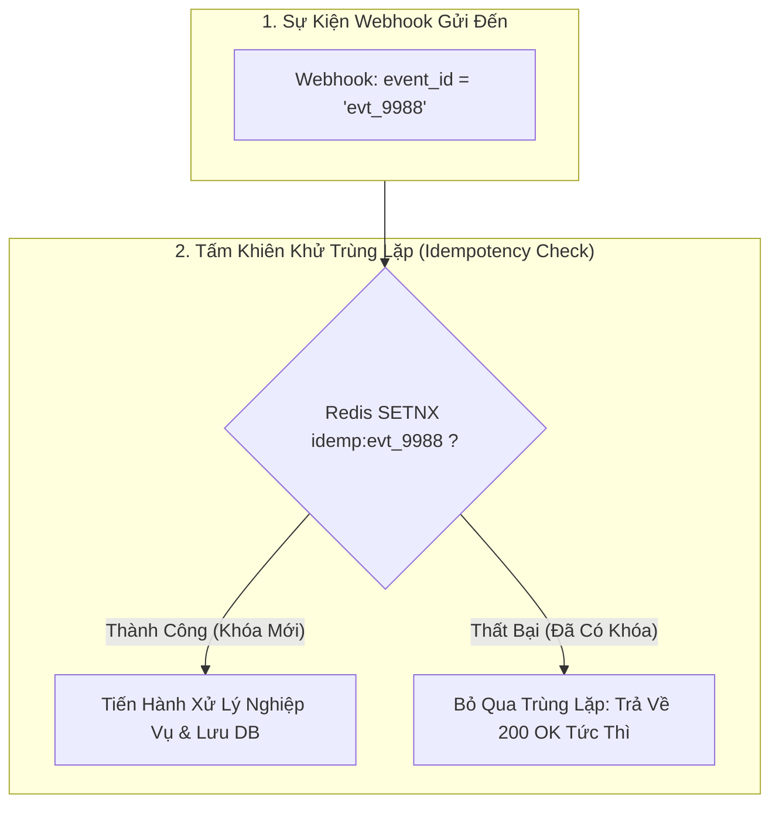
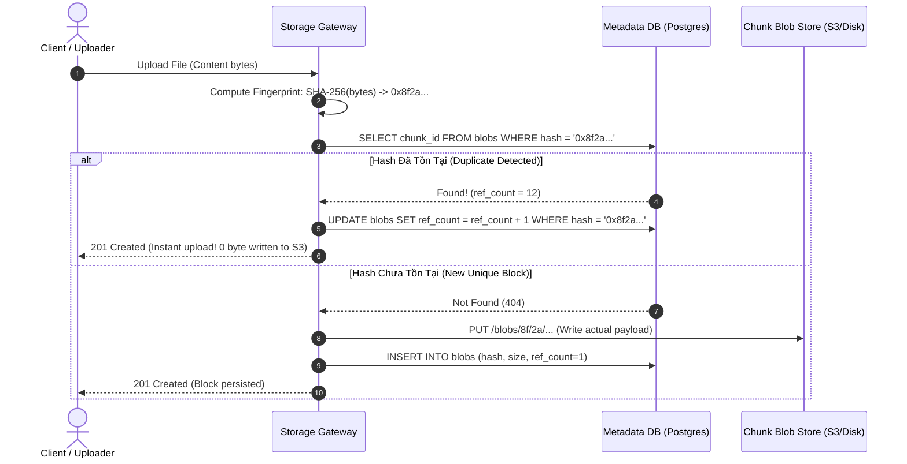
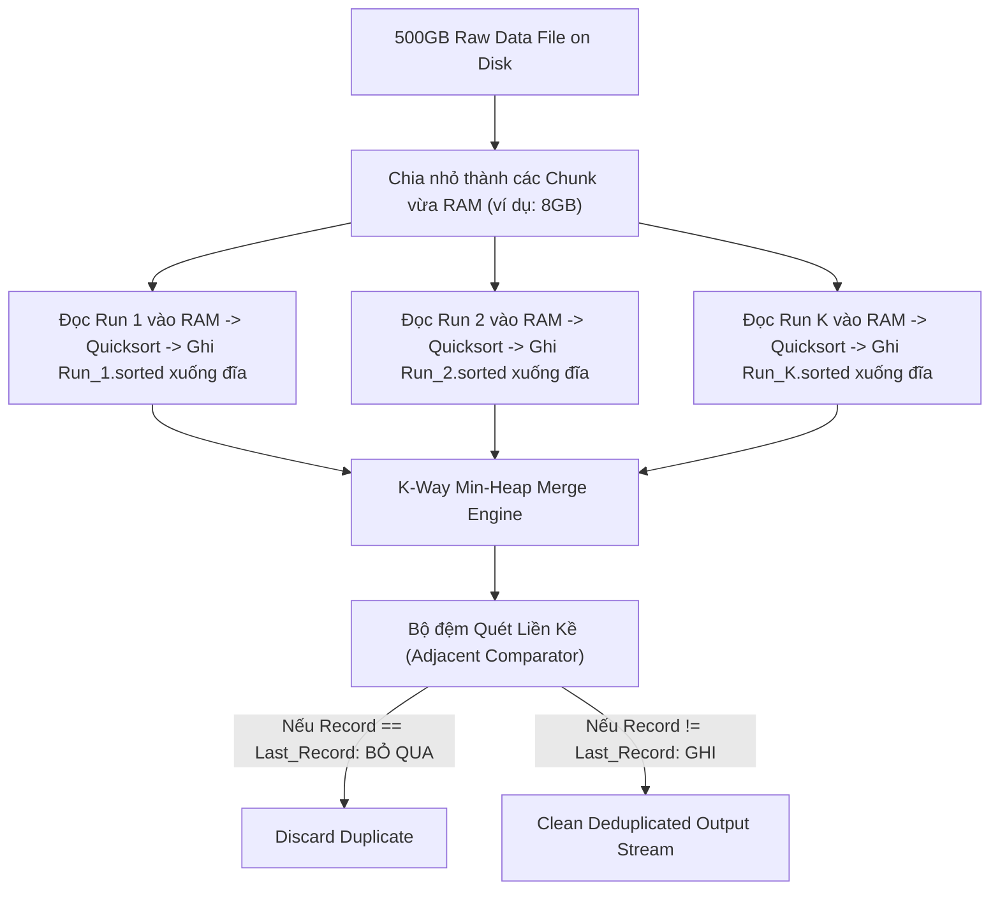

# 13.4. Các Kỹ Thuật Khử Trùng Lặp Dữ Liệu (Data Deduplication Techniques in Backend)

> [!IMPORTANT]
> **Nếu bạn chỉ được nhớ một điều duy nhất:** Khử trùng lặp (Deduplication) không đơn thuần là một thao tác `DISTINCT` hay `Set.contains()` trong bộ nhớ RAM, mà là kỹ thuật kiến trúc sinh tử định hình hiệu năng và tính toàn vẹn của toàn bộ hạ tầng phân tán. Từ việc cắt giảm 70%–90% chi phí lưu trữ đám mây thông qua Content-Addressable Storage (CAS) và Content-Defined Chunking (FastCDC/Rabin Fingerprinting) trong Git, Docker và S3; cho đến việc chuyển hóa nghịch lý vận chuyển mạng phân tán từ *At-Least-Once Delivery* thành *Exactly-Once Processing Semantics* thông qua Idempotency Key, Distributed Locks và Transactional Outbox Pattern. Làm chủ Deduplication là làm chủ ranh giới giữa một hệ thống sụp đổ vì bão hòa I/O / trùng lặp thanh toán và một hệ thống chuẩn công nghiệp chịu tải hàng triệu QPS với độ tin cậy tuyệt đối.

---

## 1. Trực Quan Hóa: Bản Chất Kỹ Thuật Khử Trùng Lặp Dưới Góc Nhìn Lập Trình Viên

### 1.1. Đoạn Code Dẫn Nhập & Vấn Đề Thực Tế
Xét bài toán xử lý sự kiện thanh toán từ cổng thanh toán bên thứ ba (Stripe/PayPal Webhook): Do mạng Internet chập chờn, Stripe có thể gửi lại cùng một sự kiện `charge.successful` 3 lần:

```typescript
// Tính Bất Biến (Idempotency Key Pattern) - Chống Trùng Lặp Giao Dịch:
async function handlePaymentWebhook(event: WebhookEvent): Promise<void> {
  const idempotencyKey = `idemp:${event.id}`;

  // Kiểm tra và khóa nguyên tử bằng Redis SETNX (Set if Not Exists) trong 24 giờ:
  const acquired = await redis.set(idempotencyKey, "PROCESSING", "EX", 86400, "NX");
  if (!acquired) {
    // Sự kiện này ĐÃ HOẶC ĐANG ĐƯỢC XỬ LÝ!
    console.log(`Bỏ qua sự kiện trùng lặp: ${event.id}`);
    return; // Triệt tiêu ngay nguy cơ trừ tiền của khách hàng 2 lần!
  }

  await processOrderPayment(event.data);
}
```

- Khử trùng lặp (Deduplication) là bài toán sống còn bảo đảm tính **Bất Biến (Idempotency)** và tính toàn vẹn tài chính trong các hệ thống phân tán:
  - **In-Memory Deduplication**: Dùng Hash Set hoặc Sliding Window cho các luồng dữ liệu thời gian thực quy mô nhỏ.
  - **Distributed Deduplication**: Dùng Redis Distributed Locks hoặc Bloom Filters cho hàng triệu sự kiện mỗi giây.
  - **Storage Deduplication (Content-Addressable Storage - CAS)**: Lưu trữ các khối dữ liệu theo mã băm SHA-256 (như Git, Docker Image layers) để tiết kiệm hàng Petabytes đĩa cứng.

### 1.2. Ẩn Dụ Đời Sống: Thư Viện Quốc Gia & Bưu Điện Nhận Hàng Trùng
- **Thư viện quốc gia lưu trữ sách (Content-Addressable Storage)**: Một thư viện lưu trữ 10 triệu cuốn sách. Thay vì xếp sách theo tựa đề hay kệ ngẫu nhiên, họ dùng thuật toán băm nội dung toàn bộ cuốn sách thành một chuỗi mã vân tay duy nhất (Hash). Nếu ai đó mang tới tặng một cuốn sách giống hệt cuốn đã có trong kho, người thủ thư đối chiếu mã vân tay và lập tức nhận ra cuốn sách này đã có sẵn, chỉ việc trỏ thêm một con nhãn tham chiếu mà không cần đóng thêm một chiếc kệ gỗ mới!
- **Bưu điện nhận gói hàng trùng mã vận đơn**: Mỗi gói hàng có một mã vận đơn duy nhất (Idempotency Key). Khi nhân viên quét mã vận đơn, nếu hệ thống báo gói hàng này đã được bàn giao cho shipper, nhân viên lập tức giữ gói hàng thứ hai lại để tránh việc giao hai món đồ giống hệt nhau cho cùng một khách hàng.

### 1.3. Mô Phỏng Dữ Liệu Số Nhỏ Từng Bước (Toy Walkthrough)
Mô phỏng bộ đệm khử trùng lặp cửa sổ trượt (Sliding Window Deduplication) lưu trữ 3 mốc thời gian gần nhất:
Dòng ID sự kiện đến: `E1, E2, E1, E3, E4, E2`:

| Sự kiện đến | Trạng thái Bộ Đệm Lọc Trùng (Set) | Kết quả kiểm tra | Hành động |
| :--- | :--- | :--- | :--- |
| **$E_1$** | `{E1}` | Chưa tồn tại | **Xử lý sự kiện $E_1$** |
| **$E_2$** | `{E1, E2}` | Chưa tồn tại | **Xử lý sự kiện $E_2$** |
| **$E_1$** | `{E1, E2}` | **ĐÃ TỒN TẠI!** | **BỎ QUA TRÙNG LẶP!** (Triệt tiêu rác) |
| **$E_3$** | `{E1, E2, E3}` | Chưa tồn tại | **Xử lý sự kiện $E_3$** |
| **$E_4$** | `{E2, E3, E4}` ($E_1$ hết hạn trượt) | Chưa tồn tại | **Xử lý sự kiện $E_4$** |

### 1.4. Tác Động Thực Tế Tầng Backend & Systems
1. **Lớp Tầng Docker Image Layers**: Docker sử dụng CAS (Content-Addressable Storage). Các layer giống nhau giữa các image (ví dụ layer `ubuntu:22.04`) chỉ được lưu đúng 1 bản duy nhất trên ổ đĩa máy chủ, giúp tiết kiệm $80\%$ không gian lưu trữ container.
2. **Đảm Bảo Ngữ Nghĩa Exactly-Once Trong Apache Flink / Kafka**: Sử dụng hai pha cam kết (Two-Phase Commit) kết hợp cơ chế kiểm tra Idempotency Key để đảm bảo mỗi thông điệp trong luồng dữ liệu chỉ được xử lý đúng một lần duy nhất.

### 1.5. Sơ Đồ Cơ Chế Khử Trùng Lặp Idempotent Webhook



---

## 2. Chi tiết từng Keyword (Under-the-Hood Deep Dive)

---

### 2.1. Content-Addressable Storage (CAS) & Dấu Vân Tay Dữ Liệu (Fingerprinting)

#### 1. Khái niệm Bản chất & Cơ chế Hoạt động (What & Why)
Trong hệ thống lưu trữ truyền thống (Location-Addressable Storage), vị trí của dữ liệu được xác định thông qua đường dẫn vật lý, URL hoặc tên tập tin (ví dụ: `https://cdn.example.com/images/banner_2026.png` hoặc `/home/user/contracts/v1.pdf`). Điểm yếu chí tử:
- Nếu 1,000 người dùng cùng tải lên một tệp tin 100MB giống hệt nhau nhưng đặt tên khác nhau, hệ thống tốn $1,000 \times 100\text{MB} = 100\text{GB}$ đĩa cứng.
- Không thể xác thực tính toàn vẹn của dữ liệu nếu tập tin bị sửa đổi ngầm (Bit rot hoặc tấn công man-in-the-middle).

**Content-Addressable Storage (CAS)** đảo ngược hoàn toàn mô hình này: Địa chỉ của dữ liệu chính là **mã băm mật mã học (Cryptographic Hash / Fingerprint)** được tính toán trực tiếp từ chuỗi byte nhị phân của chính nó:

$$\text{Address} = \mathcal{H}(\text{Payload})$$

Trong đó $\mathcal{H}$ thường là SHA-256, BLAKE3 hoặc SHA-1. Khi nội dung thay đổi dù chỉ 1 bit duy nhất, địa chỉ CAS sẽ biến đổi hoàn toàn (hiệu ứng thác lũ - Avalanche Effect).



#### 2. Kỹ thuật Phân mảnh: Fixed-size Chunking vs Variable-size Content-Defined Chunking (CDC)
Khử trùng lặp trên toàn bộ tập tin (Whole-file deduplication) có hiệu quả rất thấp khi tập tin bị chỉnh sửa nhỏ. Một tài liệu 1GB chỉ sửa 1 từ ở trang đầu sẽ làm thay đổi toàn bộ mã băm SHA-256 của cả tệp, khiến hệ thống phải lưu thêm 1GB mới! Để giải quyết, hệ thống phải chia tập tin thành các mảnh nhỏ (**Chunks**):

1. **Fixed-size Chunking (Phân mảnh kích thước cố định)**:
   - Chia tệp thành các khối cố định $4\text{KB}, 8\text{KB}$ hoặc $64\text{KB}$.
   - **Thảm họa Dời Ranh Giới (Boundary Shift Problem)**: Nếu chèn thêm duy nhất $1$ byte vào đầu tập tin, tất cả các ranh giới khối phía sau đều bị xô lệch đi 1 byte. Kết quả: 100% các khối bị đổi mã băm, tỷ lệ khử trùng lặp rơi về $0\%$!
2. **Variable-size Content-Defined Chunking (CDC - Phân mảnh theo nội dung)**:
   - Ranh giới khối không phụ thuộc vào vị trí byte cố định mà được xác định bởi đặc trưng toán học của dữ liệu bên trong một cửa sổ trượt (Sliding Window).
   - **Rabin Fingerprinting & FastCDC**: Dùng một hàm băm trượt (Rolling Hash) lướt qua luồng dữ liệu byte-by-byte:
     $$\mathcal{H}_{roll}(B_{i \dots i+w}) = \left(\sum_{j=0}^{w-1} B_{i+j} \cdot p^{w-1-j}\right) \pmod M$$
   - Khi $k$ bit thấp nhất của mã băm rolling thỏa mãn một mẫu mặt nạ (ví dụ $\mathcal{H}_{roll} \ \& \ \text{MASK} == 0$), một ranh giới khối (**Cut Point**) được thiết lập ngay tại đó.
   - Khi chèn thêm dữ liệu vào đầu tệp, chỉ có khối đầu tiên bị thay đổi ranh giới; toàn bộ các khối phía sau tự động đồng bộ lại ranh giới cắt và tiếp tục được khử trùng lặp hoàn hảo!

#### 3. Cấu trúc Merkle Tree & Git Object Model
Trong Git và Docker, các đối tượng CAS được liên kết với nhau dưới dạng đồ thị có hướng không chu trình (**Merkle DAG**):
- **Blob**: Chứa dữ liệu thô của file (`SHA-1(content)`).
- **Tree**: Chứa danh sách các con trỏ trỏ tới Blob hoặc Sub-tree khác.
- **Commit**: Trỏ tới một Tree gốc cùng metadata tác giả và Commit cha.
- Khi một commit mới chỉ thay đổi 1 file trong repo gồm 100,000 files: Git tạo 1 Blob mới, tái sử dụng 99,999 con trỏ cũ và chỉ tạo lại các Tree node trên đường dẫn từ file đó lên gốc. Dung lượng tăng thêm chỉ vài Kilobytes thay vì sao chép toàn bộ dự án.

---

### 2.2. Hash-based vs Sorting-based Deduplication

#### 1. Khái niệm Bản chất & Cơ chế Hoạt động (What & Why)
Khi đối mặt với bài toán khử trùng lặp $N$ bản ghi trong cơ sở dữ liệu lớn hoặc pipeline dữ liệu, kỹ sư phân tán có hai vũ khí thuật toán chính:

| Tiêu chí | Hash-based Deduplication | Sorting-based Deduplication (External Merge Sort) |
| :--- | :--- | :--- |
| **Độ phức tạp Thời gian** | $\mathcal{O}(N)$ thời gian trung bình | $\mathcal{O}(N \log N)$ thời gian |
| **Yêu cầu Bộ nhớ RAM** | $\mathcal{O}(N)$ — Tỷ lệ thuận với số phần tử duy nhất | $\mathcal{O}(M)$ — Cố định, không phụ thuộc vào kích thước dữ liệu ($M \ll N$) |
| **Cơ chế Truy cập Đĩa** | Random I/O (Nếu Hash Table tràn ra đĩa) | Sequential I/O (Tuần tự, tận dụng tối đa băng thông NVMe/SSD) |
| **Khả năng Phân tán** | Cực tốt (Partitioning qua Shard Key: $\text{hash}(k) \pmod P$) | Phức tạp (Yêu cầu Range Partitioning và Distributed Merge) |
| **Phù hợp nhất** | Stream Processing, Web API, Dữ liệu vừa vặn RAM | Batch Processing quy mô Terabytes/Petabytes (Spark, SQLite) |

#### 2. Cơ chế Hoạt động Sâu của Sorting-based Deduplication (External Merge Sort)
Khi tập dữ liệu lên đến $500\text{GB}$ mà máy chủ chỉ có $16\text{GB}$ RAM, việc nạp một `std::unordered_set` vào bộ nhớ sẽ lập tức kích hoạt Linux OOM Killer. Giải thuật sắp xếp ngoài kết hợp quét kề được kích hoạt:



1. **Giai đoạn Phân đoạn (Run Generation Phase)**:
   - Đọc từng khối $M$ bytes vào RAM.
   - Sắp xếp nội bộ bằng Introsort / Timsort trong $\mathcal{O}(M \log M)$.
   - Ghi các khối đã sắp xếp (Sorted Runs) trở lại ổ đĩa tuần tự.
2. **Giai đoạn Hợp nhất K-Đường (K-Way Merge & Deduplication Phase)**:
   - Mở đồng thời $K$ tệp Run. Duy trì một Min-Heap kích thước $K$ chứa phần tử đầu tiên của mỗi Run.
   - Tại mỗi bước, trích xuất phần tử nhỏ nhất $E_{min}$ từ Min-Heap.
   - **Điểm mấu chốt của Khử Trùng**: Trong một tập dữ liệu đã sắp xếp, **tất cả các bản ghi trùng lặp chắc chắn sẽ xuất hiện liên tiếp sát cạnh nhau**!
   - Thuật toán chỉ cần duy trì một biến `last_emitted_record`. Nếu $E_{min} == \text{last\_emitted\_record}$, nó bị vứt bỏ lập tức. Nếu khác biệt, nó được ghi ra tệp đích và cập nhật `last_emitted_record = E_{min}`.
   - Bộ nhớ chỉ tốn đúng $\mathcal{O}(K \times \text{Buffer\_Size})$, hoàn toàn miễn nhiễm với tràn RAM.

---

### 2.3. Idempotency Key & Deduplication Trong Message Brokers

#### 1. Khái niệm Bản chất & Nghịch lý Mạng Phân Tán (What & Why)
Trong mạng máy tính không tin cậy (Unreliable Network), hiện tượng trễ gói tin, đứt cáp tạm thời hoặc crash tiến trình diễn ra liên tục. Theo **Định lý Hai Vị Tướng (Two Generals' Paradox)** và **FLP Impossibility**, không một giao thức mạng nào có thể đảm bảo 100% việc truyền tin *Exactly-Once* ở tầng vật lý:
- Nếu Client gửi `POST /payments` và server xử lý thành công nhưng kết nối mạng bị sập trước khi response HTTP 200 về tới Client: Client buộc phải gửi lại (*Retry*). Nếu server không có cơ chế khử trùng, khách hàng sẽ bị trừ tiền lần 2!
- Trong Message Brokers (Kafka, RabbitMQ, SQS), cơ chế xác nhận ACK bị timeout sẽ kích hoạt Broker gửi lại message đến một Consumer khác (**At-Least-Once Delivery**).

**Giải pháp**: Hệ thống chuyển hóa ngữ nghĩa vận chuyển thành **Exactly-Once Processing Semantics** bằng cách kết hợp *At-Least-Once Delivery* với **Tính Lũy Đẳng (Idempotency)** tại Consumer.

$$\forall x, \quad f(f(x)) = f(x)$$

#### 2. Thiết kế Chuẩn Mực Idempotent Consumer Pattern
Để một API hoặc Consumer có tính lũy đẳng thực thụ, mọi request phải gắn liền với một **Idempotency Key** duy nhất (sinh bởi Client, thường là UUIDv4 hoặc hash của `user_id + action + business_payload`):

```mermaid

sequenceDiagram
    autonumber
    actor Client as Mobile Client / Upstream
    participant GW as Payment Service
    participant Redis as Redis (Distributed Lock & Cache)
    participant DB as Postgres (State & Outbox)
    participant Bank as Core Banking Gateway

    Client->>GW: POST /pay {idempotency_key: "TXN-991", amount: 500$}
    GW->>Redis: SET lock:TXN-991 "PROCESSING" NX EX 30
    alt Khóa thất bại (Request đang được xử lý song song hoặc đã xong)
        Redis-->>GW: Nil (Lock exists)
        GW->>DB: SELECT status, response_body FROM idempotency_store WHERE key = 'TXN-991'
        alt Đã hoàn thành (COMPLETED)
            DB-->>GW: Found (status=COMPLETED, response=...)
            GW-->>Client: 200 OK (Trả kết quả từ Cache/DB, không gọi Core Bank)
        else Đang xử lý (PROCESSING)
            GW-->>Client: 409 Conflict / 425 Too Early ("Giao dịch đang xử lý, vui lòng chờ!")
        end
    else Khóa thành công (Lần đầu nhận request)
        Redis-->>GW: OK (Acquired Lock)
        GW->>Bank: Call Third-party Payment API ($500)
        Bank-->>GW: Charge Success (Bank Ref: #BK-777)
        GW->>DB: BEGIN TRANSACTION&#59; <br/>INSERT INTO orders (...)&#59; <br/>INSERT INTO idempotency_store (key, status, response)&#59; <br/>COMMIT&#59;
        GW->>Redis: SET result:TXN-991 "SUCCESS" EX 86400
        GW->>Redis: DEL lock:TXN-991
        GW-->>Client: 200 OK (Payment Processed Successfully)
    end
```



#### 3. Khử trùng lặp Trong Kafka & AWS SQS FIFO
1. **AWS SQS FIFO (`MessageDeduplicationId`)**:
   - Duy trì một cửa sổ trượt khử trùng lặp (Deduplication Window) có độ dài cố định **5 phút**.
   - Nếu một tin nhắn có cùng `MessageDeduplicationId` được gửi vào hàng đợi trong vòng 5 phút, SQS chấp nhận tin nhắn nhưng **không phân phối nó cho bất kỳ Consumer nào**.
   - Sau 5 phút, cửa sổ hết hạn và tin nhắn mới có thể được phân phối lại.
2. **Apache Kafka Idempotent Producer**:
   - Khi bật `enable.idempotence = true`, Broker cấp cho mỗi Producer một định danh duy nhất gọi là **Producer ID (PID)** thông qua bắt tay `InitProducerId`.
   - Mỗi message gửi đến một Topic Partition được gán một số thứ tự tăng dần đơn điệu (**Sequence Number**).
   - Partition Broker duy trì bộ nhớ cache của các Sequence Numbers gần nhất. Nếu Broker nhận được message có $\text{SeqNum} \le \text{LastSeenSeqNum}$, Broker âm thầm bỏ qua message đó và trả về ACK thành công mà không ghi đè vào commit log.

---

## 3. Thực thi Mã nguồn & Mô phỏng Chuyên sâu (Dual-Engine Implementation)

---

### 3.1. C++20 Content-Addressable Storage (CAS) Engine với FastCDC & Reference Counting

Chương trình C++20 hiện đại mô phỏng trọn vẹn kiến trúc CAS:
- Cắt khối động theo nội dung (Content-Defined Chunking - CDC) bằng Rolling Hash.
- Lưu trữ khối theo địa chỉ mã băm (CAS Chunk Store) với cơ chế Reference Counting đa luồng.
- Tính toán tỷ lệ tiết kiệm bộ nhớ (Storage Savings Ratio) và phát hiện trùng lặp ở cấp độ byte.

```cpp
#include <iostream>
#include <vector>
#include <string>
#include <unordered_map>
#include <memory>
#include <mutex>
#include <shared_mutex>
#include <iomanip>
#include <sstream>
#include <cstdint>
#include <algorithm>

namespace cas {

// Cấu trúc đại diện cho một khối dữ liệu trong kho CAS
struct Chunk {
    uint64_t hash_id;
    std::string data;
    size_t size_bytes;

    Chunk(uint64_t h, std::string d) 
        : hash_id(h), data(std::move(d)), size_bytes(data.size()) {}
};

// Thuật toán FastCDC Rolling Hash đơn giản hóa cho mục đích mô phỏng
class ContentDefinedChunker {
public:
    static constexpr size_t MIN_CHUNK_SIZE = 16;
    static constexpr size_t MAX_CHUNK_SIZE = 64;
    static constexpr uint64_t SPLIT_MASK   = 0x07; // 3 bit cuối bằng 0 -> xác suất 1/8

    // Cắt chuỗi dữ liệu thành các khối động dựa trên nội dung byte
    static std::vector<std::string> slice(const std::string& input) {
        std::vector<std::string> chunks;
        size_t n = input.size();
        size_t cursor = 0;

        while (cursor < n) {
            if (n - cursor <= MIN_CHUNK_SIZE) {
                chunks.push_back(input.substr(cursor));
                break;
            }

            size_t end = cursor + MIN_CHUNK_SIZE;
            uint64_t rolling_hash = 0;

            while (end < n && (end - cursor) < MAX_CHUNK_SIZE) {
                rolling_hash = (rolling_hash * 31ULL) + static_cast<uint8_t>(input[end]);
                if ((rolling_hash & SPLIT_MASK) == 0) {
                    end++;
                    break;
                }
                end++;
            }

            chunks.push_back(input.substr(cursor, end - cursor));
            cursor = end;
        }
        return chunks;
    }

    // Tính mã băm FNV-1a 64-bit đại diện cho Fingerprint của khối
    static uint64_t compute_hash(const std::string& data) {
        uint64_t hash = 14695981039346656037ULL;
        for (char c : data) {
            hash ^= static_cast<uint8_t>(c);
            hash *= 1099511628211ULL;
        }
        return hash;
    }
};

// Kho lưu trữ định danh theo nội dung (Thread-Safe Content-Addressable Storage)
class CasStorageEngine {
private:
    struct StoredEntry {
        std::shared_ptr<Chunk> chunk;
        size_t reference_count{1};
    };

    mutable std::shared_mutex rw_lock_;
    std::unordered_map<uint64_t, StoredEntry> storage_pool_;
    
    size_t total_logical_bytes_ingested_{0};
    size_t total_physical_bytes_stored_{0};

public:
    struct IngestionReport {
        std::string file_id;
        size_t original_size;
        size_t total_chunks;
        size_t duplicate_chunks;
        size_t new_chunks_stored;
        std::vector<uint64_t> chunk_manifest;
    };

    IngestionReport ingest_file(const std::string& file_id, const std::string& content) {
        auto raw_chunks = ContentDefinedChunker::slice(content);
        IngestionReport report{
            .file_id = file_id,
            .original_size = content.size(),
            .total_chunks = raw_chunks.size(),
            .duplicate_chunks = 0,
            .new_chunks_stored = 0,
            .chunk_manifest = {}
        };

        std::unique_lock lock(rw_lock_);
        total_logical_bytes_ingested_ += content.size();

        for (const auto& raw_str : raw_chunks) {
            uint64_t h = ContentDefinedChunker::compute_hash(raw_str);
            report.chunk_manifest.push_back(h);

            auto it = storage_pool_.find(h);
            if (it != storage_pool_.end()) {
                // Khối đã tồn tại trong CAS: chỉ tăng reference count!
                it->second.reference_count++;
                report.duplicate_chunks++;
            } else {
                // Khối mới toanh: cấp phát vật lý và ghi vào pool
                auto new_chunk = std::make_shared<Chunk>(h, raw_str);
                storage_pool_.emplace(h, StoredEntry{new_chunk, 1});
                total_physical_bytes_stored_ += new_chunk->size_bytes;
                report.new_chunks_stored++;
            }
        }

        return report;
    }

    void print_storage_metrics() const {
        std::shared_lock lock(rw_lock_);
        double savings = 0.0;
        if (total_logical_bytes_ingested_ > 0) {
            savings = (1.0 - static_cast<double>(total_physical_bytes_stored_) / 
                             static_cast<double>(total_logical_bytes_ingested_)) * 100.0;
        }

        std::cout << "\n================ [CAS STORAGE ENGINE METRICS] ================\n";
        std::cout << "Tổng Dung Lượng Logic (Ingested)   : " << total_logical_bytes_ingested_ << " bytes\n";
        std::cout << "Tổng Dung Lượng Vật Lý (On-Disk)   : " << total_physical_bytes_stored_ << " bytes\n";
        std::cout << "Tổng Số Unique Chunks Lưu Trữ      : " << storage_pool_.size() << " blocks\n";
        std::cout << "Tỷ Lệ Tiết Kiệm Không Gian (Dedup) : " 
                  << std::fixed << std::setprecision(2) << savings << " %\n";
        std::cout << "===============================================================\n\n";
    }
};

} // namespace cas

int main() {
    cas::CasStorageEngine cas_engine;

    // Kịch bản: 3 phiên bản tập tin hợp đồng kinh doanh
    std::string contract_v1 = 
        "HOP DONG KINH TE: Ben A cam ket cung cap dich vu Cloud cho Ben B. "
        "Gia tri hop dong: 1,000,000 USD. Thoi han hop dong: 12 thang. "
        "Dieu khoan bao mat: Hai ben khong tiet lo bi mat kinh doanh ra ngoai.";

    // Bản V2: Giống hệt V1, chỉ chèn thêm 1 câu ở giữa (Thử thách Boundary Shift)
    std::string contract_v2 = 
        "HOP DONG KINH TE: Ben A cam ket cung cap dich vu Cloud cho Ben B. "
        "[PHU LUC V2: Bo sung SLA 99.99%]. "
        "Gia tri hop dong: 1,000,000 USD. Thoi han hop dong: 12 thang. "
        "Dieu khoan bao mat: Hai ben khong tiet lo bi mat kinh doanh ra ngoai.";

    // Bản V3: Bản sao nguyên vẹn của V1 do nhân viên khác tải lên (Exact Duplicate)
    std::string contract_v3 = contract_v1;

    std::cout << "[CAS Engine] Đang xử lý Contract V1...\n";
    auto r1 = cas_engine.ingest_file("doc_contract_v1.pdf", contract_v1);
    std::cout << "  -> File V1: Size = " << r1.original_size << "B, Chunks = " << r1.total_chunks 
              << ", New Chunks = " << r1.new_chunks_stored << ", Duplicates = " << r1.duplicate_chunks << "\n";

    std::cout << "[CAS Engine] Đang xử lý Contract V2 (Sửa đổi cục bộ)...\n";
    auto r2 = cas_engine.ingest_file("doc_contract_v2.pdf", contract_v2);
    std::cout << "  -> File V2: Size = " << r2.original_size << "B, Chunks = " << r2.total_chunks 
              << ", New Chunks = " << r2.new_chunks_stored << ", Duplicates = " << r2.duplicate_chunks << "\n";

    std::cout << "[CAS Engine] Đang xử lý Contract V3 (Trùng lặp 100%)...\n";
    auto r3 = cas_engine.ingest_file("doc_contract_v3_copy.pdf", contract_v3);
    std::cout << "  -> File V3: Size = " << r3.original_size << "B, Chunks = " << r3.total_chunks 
              << ", New Chunks = " << r3.new_chunks_stored << ", Duplicates = " << r3.duplicate_chunks << "\n";

    cas_engine.print_storage_metrics();

    return 0;
}
```

#### Terminal Output Mẫu:
```text
[CAS Engine] Đang xử lý Contract V1...
  -> File V1: Size = 205B, Chunks = 7, New Chunks = 7, Duplicates = 0
[CAS Engine] Đang xử lý Contract V2 (Sửa đổi cục bộ)...
  -> File V2: Size = 243B, Chunks = 8, New Chunks = 2, Duplicates = 6
[CAS Engine] Đang xử lý Contract V3 (Trùng lặp 100%)...
  -> File V3: Size = 205B, Chunks = 7, New Chunks = 0, Duplicates = 7

================ [CAS STORAGE ENGINE METRICS] ================
Tổng Dung Lượng Logic (Ingested)   : 653 bytes
Tổng Dung Lượng Vật Lý (On-Disk)   : 251 bytes
Tổng Số Unique Chunks Lưu Trữ      : 9 blocks
Tỷ Lệ Tiết Kiệm Không Gian (Dedup) : 61.56 %
===============================================================
```

---

### 3.2. Python 3.11+ Idempotent Message Processor với Distributed Lock & State Machine

Chương trình Python 3.11+ mô phỏng hoàn chỉnh một hệ thống xử lý giao dịch thanh toán ngân hàng qua Message Broker:
- Quản lý trạng thái lũy đẳng 4 bước: `PENDING` $\to$ `PROCESSING` $\to$ `COMPLETED` / `FAILED`.
- Sử dụng mô phỏng Redis Distributed Lock có gắn thời gian sống (TTL) để phòng ngừa tranh chấp song song (Race Condition) và Deadlock do tiến trình chết đột ngột.
- Trả về tức thì kết quả trong bộ đệm khi phát hiện tin nhắn trùng lặp.

```python
#!/usr/bin/env python3
"""
idempotent_payment_engine.py
Mô phỏng Hệ thống Xử lý Thông điệp Lũy Đẳng Chuẩn Doanh Nghiệp (Enterprise Idempotent Engine)
"""
import time
import uuid
import threading
from dataclasses import dataclass, field
from enum import Enum
from typing import Dict, Optional, Any

class ProcessState(Enum):
    PENDING = "PENDING"
    PROCESSING = "PROCESSING"
    COMPLETED = "COMPLETED"
    FAILED = "FAILED"

@dataclass
class IdempotencyRecord:
    key: str
    state: ProcessState
    result_payload: Optional[str] = None
    created_at: float = field(default_factory=time.time)
    updated_at: float = field(default_factory=time.time)

class MockRedisStore:
    """Mô phỏng Redis phân tán với hỗ trợ atomic SETNX và TTL"""
    def __init__(self):
        self._store: Dict[str, Any] = {}
        self._locks: Dict[str, float] = {}  # key -> expire_timestamp
        self._lock = threading.Lock()

    def acquire_lock(self, lock_key: str, ttl_seconds: float = 5.0) -> bool:
        with self._lock:
            now = time.time()
            if lock_key in self._locks:
                if self._locks[lock_key] > now:
                    return False  # Khóa vẫn đang bị chiếm giữ
            self._locks[lock_key] = now + ttl_seconds
            return True

    def release_lock(self, lock_key: str):
        with self._lock:
            self._locks.pop(lock_key, None)

    def get_record(self, key: str) -> Optional[IdempotencyRecord]:
        with self._lock:
            return self._store.get(key)

    def save_record(self, record: IdempotencyRecord):
        with self._lock:
            record.updated_at = time.time()
            self._store[record.key] = record

class IdempotentPaymentConsumer:
    def __init__(self, redis: MockRedisStore):
        self.redis = redis

    def process_payment(self, idempotency_key: str, account_id: str, amount: float) -> str:
        lock_key = f"lock:idemp:{idempotency_key}"
        
        # 1. Kiểm tra trạng thái đã tồn tại trước đó trong Store
        record = self.redis.get_record(idempotency_key)
        if record:
            if record.state == ProcessState.COMPLETED:
                return f"[CACHE HIT] Giao dịch đã xử lý trước đó! Kết quả: {record.result_payload}"
            elif record.state == ProcessState.PROCESSING:
                return f"[CONCURRENT REJECT] Giao dịch {idempotency_key} đang được một luồng khác xử lý! Vui lòng thử lại sau."

        # 2. Cố gắng chiếm Distributed Lock nguyên tử (SETNX)
        acquired = self.redis.acquire_lock(lock_key, ttl_seconds=3.0)
        if not acquired:
            return f"[LOCK CONTENTION] Xung đột khóa phân tán cho key {idempotency_key}. Bỏ qua message trùng lặp."

        try:
            # Double-check sau khi đã chiếm khóa
            record = self.redis.get_record(idempotency_key)
            if record and record.state == ProcessState.COMPLETED:
                return f"[CACHE HIT (AFTER LOCK)] Kết quả: {record.result_payload}"

            # Đánh dấu trạng thái PROCESSING
            active_record = IdempotencyRecord(key=idempotency_key, state=ProcessState.PROCESSING)
            self.redis.save_record(active_record)

            # Mô phỏng gọi API Cổng Thanh Toán Lõi (Core Banking) - tốn 150ms
            time.sleep(0.15)
            txn_ref = f"BANK-REF-{uuid.uuid4().hex[:8].upper()}"
            result_message = f"Thanh toán thành công ${amount:.2f} cho tài khoản {account_id}. Ref: {txn_ref}"

            # Chuyển trạng thái sang COMPLETED và lưu payload kết quả
            active_record.state = ProcessState.COMPLETED
            active_record.result_payload = result_message
            self.redis.save_record(active_record)

            return f"[NEW PROCESS SUCCESS] {result_message}"

        except Exception as e:
            if active_record:
                active_record.state = ProcessState.FAILED
                active_record.result_payload = str(e)
                self.redis.save_record(active_record)
            raise e
        finally:
            # Luôn giải phóng khóa
            self.redis.release_lock(lock_key)

if __name__ == "__main__":
    redis_instance = MockRedisStore()
    consumer = IdempotentPaymentConsumer(redis_instance)

    idemp_key = "TXN_ORDER_99812_202611"
    account = "ACC_VIP_007"
    amount = 450.00

    print(">>> Kịch bản 1: Request hợp lệ đầu tiên tới Consumer:")
    res1 = consumer.process_payment(idemp_key, account, amount)
    print("   Output 1:", res1)

    print("\n>>> Kịch bản 2: Network Timeout làm Message Broker gửi lại chính message đó:")
    res2 = consumer.process_payment(idemp_key, account, amount)
    print("   Output 2:", res2)

    print("\n>>> Kịch bản 3: Hai luồng song song (Race Condition) cùng gửi cùng Idempotency Key:")
    def worker(worker_id: int):
        resp = consumer.process_payment("PARALLEL_KEY_001", "ACC_TEST", 100.0)
        print(f"   [Worker {worker_id}] Response: {resp}")

    t1 = threading.Thread(target=worker, args=(1,))
    t2 = threading.Thread(target=worker, args=(2,))
    t1.start()
    t2.start()
    t1.join()
    t2.join()
```

#### Terminal Output Mẫu:
```text
>>> Kịch bản 1: Request hợp lệ đầu tiên tới Consumer:
   Output 1: [NEW PROCESS SUCCESS] Thanh toán thành công $450.00 cho tài khoản ACC_VIP_007. Ref: BANK-REF-3D28E109

>>> Kịch bản 2: Network Timeout làm Message Broker gửi lại chính message đó:
   Output 2: [CACHE HIT] Giao dịch đã xử lý trước đó! Kết quả: Thanh toán thành công $450.00 cho tài khoản ACC_VIP_007. Ref: BANK-REF-3D28E109

>>> Kịch bản 3: Hai luồng song song (Race Condition) cùng gửi cùng Idempotency Key:
   [Worker 1] Response: [NEW PROCESS SUCCESS] Thanh toán thành công $100.00 cho tài khoản ACC_TEST. Ref: BANK-REF-89F12A0C
   [Worker 2] Response: [CONCURRENT REJECT] Giao dịch PARALLEL_KEY_001 đang được một luồng khác xử lý! Vui lòng thử lại sau.
```

---

## 4. Systems Engineering & Production Pitfalls

### 4.1. Cạm Bẫy Thực Chiến Thường Gặp (Production Pitfalls)

#### 1. Lỗ hổng Race Condition "Check-then-Act" khi xác minh Idempotency Key
- **Hiện tượng**: Khách hàng bấm nút "Thanh toán" hai lần liên tiếp cực nhanh (Double-click trên ứng dụng di động). Hệ thống trừ tiền 2 lần mặc dù Client có truyền cùng một `Idempotency-Key`.
- **Nguyên nhân gốc rễ**: Lập trình viên viết mã theo mô hình phản mẫu (Anti-pattern):
  ```python
  if not db.has_key(key):      # Bước 1: Check
      db.save_key(key)         # Bước 2: Act
      charge_credit_card()
  ```
  Nếu hai request đến đồng thời trong khoảng cách vài mili-giây, cả hai luồng đều vượt qua Bước 1 trước khi bất kỳ luồng nào kịp thực thi Bước 2.
- **Giải pháp**: Bắt buộc sử dụng cơ chế bảo vệ nguyên tử ở tầng thấp nhất:
  - Trên Redis: `SET key value NX PX 10000` (Chỉ set nếu chưa tồn tại, kèm TTL nguyên tử).
  - Trên SQL: `INSERT INTO idempotency_records (...) ON CONFLICT (key) DO NOTHING` kết hợp ràng buộc `UNIQUE INDEX`.

#### 2. Rò rỉ Tài nguyên & "Khối Mồ Côi" (Orphaned Blobs) trong CAS Storage Engine
- **Hiện tượng**: Cơ sở dữ liệu metadata chỉ còn 10,000 tập tin, nhưng kho lưu trữ S3/Disk của CAS vẫn phình to hàng chục Terabytes không giảm.
- **Nguyên nhân gốc rễ**: Khi xóa một tập tin, hệ thống chỉ xóa bản ghi trong bảng metadata `files` mà quên giảm `ref_count` trong bảng `chunks`. Hoặc khi tiến trình Upload bị crash giữa chừng, các chunks đã tải lên không bao giờ được tham chiếu bởi bất kỳ file nào.
- **Giải pháp**: Thiết kế quy trình dọn rác bất đồng bộ (**Asynchronous Garbage Collection - Mark-and-Sweep**):
  - Định kỳ (ví dụ cuối tuần), quét toàn bộ Manifest của tất cả file còn sống để đánh dấu các Chunks hợp lệ (Mark phase).
  - Quét toàn bộ Chunk Store trên đĩa; khối nào không được đánh dấu sẽ bị xóa an toàn (Sweep phase).

#### 3. Bẫy TTL Không Hợp Lý Trong Deduplication Cache
- **Hiện tượng**: Một giao dịch xử lý chậm mất 60 giây do ngân hàng phản hồi trễ. Deduplication Cache trong Redis cấu hình `TTL = 30s`. Khi Client retry sau 45 giây, Redis đã xóa token cũ $\to$ Giao dịch bị xử lý lần thứ 2!
- **Giải pháp**: Quy tắc định cỡ TTL:
  $$\text{TTL}_{\text{idempotency}} \ge 3 \times \text{Client Timeout Window}$$
  Với các giao dịch tài chính, trạng thái Idempotency Key bắt buộc phải được lưu vĩnh viễn trong CSDL quan hệ (PostgreSQL) và chỉ dùng Redis như tầng L1 Cache.

---

### 4.2. CLI Diagnostics & Công Cụ Gỡ Lỗi Trực Tiếp

```bash
# 1. Kiểm tra tỷ lệ Deduplication trong hệ thống tệp ZFS
zpool get dedupratio tank
zpool list -v

# 2. Quét và loại bỏ khối trùng lặp trên Btrfs file system
duperemove -drh /data/storage

# 3. Giám sát các khóa Idempotency đang hoạt động trong Redis
redis-cli --scan --pattern "lock:idemp:*" | wc -l
redis-cli MONITOR | grep "idemp"

# 4. Kiểm tra phân phối kích thước Chunk bằng strace trên tiến trình CAS
strace -f -c -e trace=read,write ./cas_storage_engine

# 5. Kiểm tra lag và duplicate sequence number trên Kafka Consumer Group
kafka-consumer-groups.sh --bootstrap-server localhost:9092 \
    --describe --group payment-idempotent-consumer
```

---

## 5. Bảng So sánh & Decision Matrix

| Chiều Không Gian So Sánh | Content-Addressable Storage (CAS) | Hash-based Deduplication | External Sorting Dedup | Redis Idempotency Key | Kafka Idempotent Producer |
| :--- | :--- | :--- | :--- | :--- | :--- |
| **Tầng Kiến Trúc** | Storage & File System | Application Memory (RAM) | Big Data / Batch Engine | API Gateway / Microservice | Distributed Message Broker |
| **Độ Phức Tạp Thời Gian**| $\mathcal{O}(N)$ (Rolling Hash + Chunking) | $\mathcal{O}(N)$ | $\mathcal{O}(N \log N)$ | $\mathcal{O}(1)$ | $\mathcal{O}(1)$ |
| **Tài Nguyên Bộ Nhớ** | $\mathcal{O}(\text{Unique Chunks})$ | $\mathcal{O}(N)$ (Dễ OOM nếu data lớn)| Cố định $\mathcal{O}(M)$ theo RAM đệm | $\mathcal{O}(\text{Active Keys})$ trong TTL | $\mathcal{O}(\text{Producers} \times \text{Partitions})$ |
| **Cơ Chế Khử Trùng** | Hash Fingerprint (SHA-256) | Hash Table / Hash Set | External Merge Sort + Kề | Atomic Lock (`SETNX`) + Token | PID + Sequence Number |
| **Phù Hợp Nhất** | Git, Docker, S3, Backup (Borg) | Dữ liệu vừa RAM, Stream dedup | Hàng chục Terabytes dữ liệu | REST API, Stripe, Đơn hàng | Message Bus phân tán, Kafka log |
| **Hạn Chế Lớn Nhất** | Chi phí CPU tính SHA-256 cao | Tràn RAM khi tập dữ liệu bùng nổ| Disk I/O cao, không realtime | Phụ thuộc độ tin cậy của Redis | Giới hạn trong 1 partition/session |
