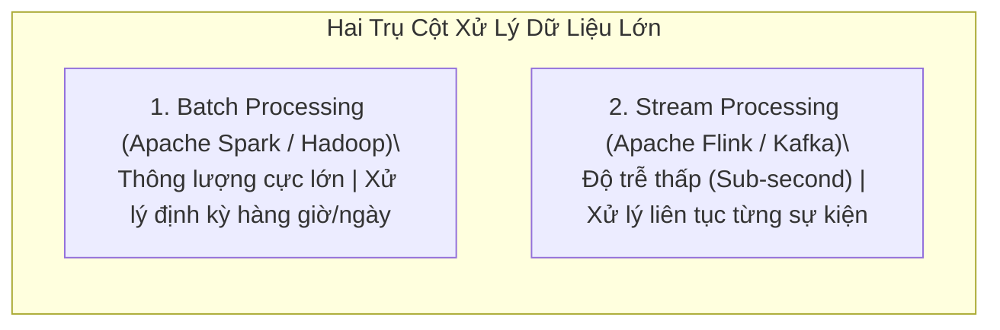
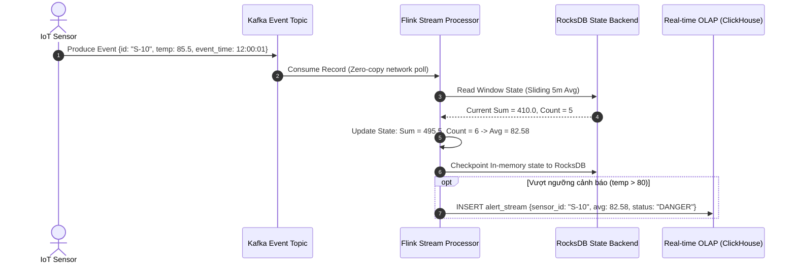
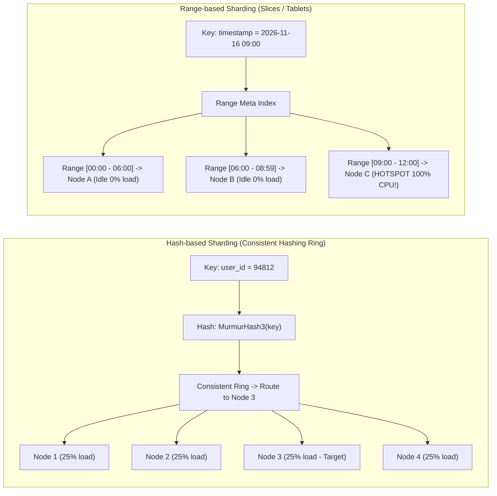
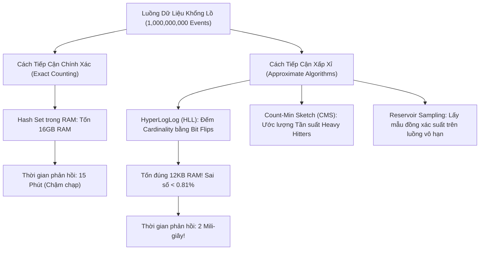

# 13.5. Xử Lý Dữ Liệu Quy Mô Lớn (Large-Scale Data Processing & Sharding Strategies)

> [!IMPORTANT]
> **Nếu bạn chỉ được nhớ một điều duy nhất:** Khi quy mô dữ liệu vượt qua ngưỡng terabytes và petabytes, bài toán kiến trúc phần mềm không còn nằm ở việc tối ưu vài chu kỳ CPU đơn lẻ, mà chuyển dịch thành nghệ thuật tối ưu hóa chi phí I/O mạng, phân vùng dữ liệu để triệt tiêu hiện tượng Điểm Nóng (Hotspot), và đánh đổi độ chính xác tuyệt đối lấy độ trễ phản hồi tính bằng mili-giây. Một kỹ sư phân tán bậc thầy biết rõ khi nào nên gom lô (Batch Processing với Spark) để tối đa hóa thông lượng (Throughput), khi nào cần xử lý luồng sự kiện (Stream Processing với Flink qua kiến trúc Kappa) để đạt độ trễ thời gian thực; khi nào nên băm khóa (Consistent Hash Sharding) để triệt tiêu nghẽn cổ chai và khi nào áp dụng các giải thuật xác suất xấp xỉ (HyperLogLog, Count-Min Sketch, Reservoir Sampling) để chỉ tốn vài Kilobytes RAM thay vì làm sụp đổ cụm máy chủ hàng trăm Gigabytes.

---

## 1. Trực Quan Hóa: Bản Chất Xử Lý Dữ Liệu Lớn Dưới Góc Nhìn Lập Trình Viên

### 1.1. Đoạn Code Dẫn Nhập & Vấn Đề Thực Tế
Xét bài toán sắp xếp một file dữ liệu nhật ký giao dịch ngân hàng có dung lượng $100\text{ GB}$, trong khi máy chủ phân tích chỉ được cấp phát vỏn vẹn $4\text{ GB}$ RAM:

```python
# Nếu đọc toàn bộ file vào RAM:
with open("transactions_100GB.csv") as f:
    data = f.readlines() # BÙM! Kích hoạt ngay lập tức Linux OOM Killer tiêu diệt tiến trình!

# Kỹ thuật Thuật Toán Ngoài Bộ Nhớ (Out-of-Core External Merge Sort):
# Chia file 100GB thành 100 file nhỏ 1GB.
# Đọc và sắp xếp từng file nhỏ 1GB trong RAM, sau đó ghi ra đĩa.
# Sử dụng Min-Heap để gộp 100 luồng dữ liệu đã sắp xếp thành file kết quả hoàn chỉnh!
```

- Xử lý dữ liệu quy mô lớn (Large Scale Data Processing) đòi hỏi sự thay đổi triệt để về tư duy lập trình: **Dữ liệu không bao giờ nằm vừa trong RAM của một chiếc máy tính đơn lẻ**:
  - **Out-of-Core Algorithms**: Thuật toán xử lý trên ổ đĩa khi dữ liệu vượt quá dung lượng RAM.
  - **Batch Processing (Xử lý theo lô)**: Mô thức MapReduce / Apache Spark xử lý hàng Petabytes dữ liệu lịch sử một cách bền bỉ.
  - **Stream Processing (Xử lý theo dòng)**: Mô thức Apache Flink / Kafka Streams xử lý từng sự kiện trong vài mili-giây với cửa sổ thời gian thực (Event Time & Watermarks).

### 1.2. Ẩn Dụ Đời Sống: Nhà Máy Lọc Dầu Khối Lượng Lớn vs Mạng Lưới Nước Tinh Khiết
- **Nhà máy lọc dầu thô (Batch Processing - MapReduce / Spark)**: Từng đoàn tàu chở dầu thô đổ hàng triệu tấn dầu vào bể chứa khổng lồ. Nhà máy bật lò nung chạy liên tục trong 8 tiếng để lọc tách toàn bộ lượng dầu đó thành xăng, dầu hỏa và nhựa đường. Quá trình tốn nhiều thời gian nhưng có thông lượng (Throughput) cực đại.
- **Mạng lưới cấp nước uống tinh khiết (Stream Processing - Flink)**: Nước từ nguồn chảy liên tục qua các van lọc và đến thẳng vòi nước của người dân theo thời gian thực. Không có bể chứa trung gian khổng lồ nào; nước chảy đến đâu được xử lý sạch và tiêu thụ ngay đến đó với độ trễ gần như bằng không.

### 1.3. Mô Phỏng Dữ Liệu Số Nhỏ Từng Bước (Toy Walkthrough)
Mô phỏng mô thức MapReduce đếm tần suất xuất hiện của các từ (Word Count) trên 2 câu văn bản:
- Câu 1: `"cat dog cat"`
- Câu 2: `"dog bird"`

```text
1. Giai đoạn MAP (Phân tích độc lập trên 2 worker):
   Worker 1 (Câu 1) -> [("cat", 1), ("dog", 1), ("cat", 1)]
   Worker 2 (Câu 2) -> [("dog", 1), ("bird", 1)]

2. Giai đoạn SHUFFLE & SORT (Gom nhóm theo khóa qua mạng):
   "bird" -> [1]
   "cat"  -> [1, 1]
   "dog"  -> [1, 1]

3. Giai đoạn REDUCE (Tính tổng theo từng từ):
   Reduce("bird") -> ("bird", 1)
   Reduce("cat")  -> ("cat", 2)
   Reduce("dog")  -> ("dog", 2)
```

- Toàn bộ quá trình diễn ra hoàn toàn song song trên hàng nghìn máy chủ mà không cần khóa chia sẻ tài nguyên!

### 1.4. Tác Động Thực Tế Tầng Backend & Systems
1. **Kiến Trúc Lambda vs Kappa Architecture**:
   - **Lambda Architecture**: Kết hợp đồng thời Batch Layer (chính xác tuyệt đối nhưng chậm) và Speed Layer (thời gian thực nhưng có thể sai số nhẹ) để phục vụ các dashboard thống kê doanh thu thời gian thực.
   - **Kappa Architecture**: Loại bỏ hoàn toàn Batch Layer, xử lý toàn bộ dữ liệu qua một luồng Stream duy nhất (Apache Flink + Kafka) để đơn giản hóa vận hành hệ thống.
2. **Kỹ Thuật Watermark Xử Lý Dữ Liệu Đến Muộn (Late Arriving Events)**: Trong mạng di động, tin nhắn gửi lúc 12:00 có thể bị nghẽn mạng và tới máy chủ lúc 12:05. Flink sử dụng cơ chế Watermark để tạm giữ cửa sổ tính toán thêm vài phút, đảm bảo số liệu doanh thu không bị sót bản ghi.

### 1.5. Sơ Đồ Kiến Trúc Xử Lý Dữ Liệu Lớn Phân Tán



---

## 2. Chi tiết từng Keyword (Under-the-Hood Deep Dive)

---

### 2.1. Batch Processing vs Streaming & Incremental Processing (Kiến Trúc Lambda vs Kappa)

#### 1. Khái niệm Bản chất & Thách thức Kỹ thuật (What & Why)
Trong xử lý dữ liệu lớn (Big Data), dữ liệu được phân chia thành hai trạng thái:
- **Tập dữ liệu Giới hạn (Bounded Dataset)**: Dữ liệu lịch sử đã kết thúc, kích thước cố định (ví dụ: Log của ngày hôm qua, sao kê giao dịch tháng 10).
- **Tập dữ liệu Không giới hạn (Unbounded Dataset)**: Luồng sự kiện sinh ra liên tục theo thời gian không bao giờ dừng (Clickstream thương mại điện tử, tọa độ GPS xe công nghệ, telemetry từ cảm biến IoT).

Mô thức xử lý quyết định cách hệ thống tiêu thụ hai loại dữ liệu này:

1. **Batch Processing (Xử lý theo Lô)**:
   - Đọc toàn bộ khối dữ liệu từ đĩa hoặc lưu trữ phân tán (HDFS, S3).
   - Động cơ thực thi: **Apache Spark** (Catalyst Query Optimizer, Tungsten Code Generation Engine) hoặc **Hadoop MapReduce**.
   - Mục tiêu tối ưu: **Throughput (Thông lượng tối đa)**. Toàn bộ tài nguyên CPU, RAM, Network Shuffle được huy động để xử lý hàng Terabytes dữ liệu một lúc.
   - Nhược điểm: Độ trễ (Latency) rất lớn (vài phút đến hàng giờ). Không thể đáp ứng các nghiệp vụ phát hiện gian lận thẻ tín dụng hoặc đề xuất sản phẩm theo thời gian thực.

2. **Stream Processing (Xử lý theo Luồng)**:
   - Xử lý từng bản ghi hoặc micro-batch ngay khi nó xuất hiện trên mạng.
   - Động cơ thực thi: **Apache Flink**, **Kafka Streams**.
   - Mục tiêu tối ưu: **Sub-second Latency (Độ trễ dưới giây)**.
   - Các khái niệm thời gian sống còn:
     - **Event Time (Thời gian sự kiện)**: Thời điểm sự kiện thực tế diễn ra trên thiết bị người dùng.
     - **Processing Time (Thời gian xử lý)**: Thời điểm máy chủ xử lý nhận được sự kiện.
     - **Watermark**: Tín hiệu toán học cho biết luồng dữ liệu đã hoàn tất tới mốc thời gian $T$, cho phép xử lý dữ liệu đến muộn (Late-arriving data) mà không bỏ sót bản ghi.

3. **Incremental Processing (Xử lý Tăng dần)**:
   - Thay vì mỗi giờ phải chạy lại toàn bộ dữ liệu 30 ngày qua ($\mathcal{O}(N)$ chi phí tính toán), hệ thống chỉ tính toán phần chênh lệch (**Delta**) vừa phát sinh và cập nhật lũy tiến vào bảng tổng hợp trước đó.
   - Công nghệ đại diện: **Change Data Capture (CDC với Debezium)**, **Apache Iceberg**, **Delta Lake**, **Materialized Views**.



#### 2. So Sánh Kiến Trúc Lambda vs Kiến Trúc Kappa
- **Kiến trúc Lambda (Nathan Marz)**:
  - Chia làm 2 tầng song song: **Batch Layer** (tính toán chậm nhưng chuẩn xác 100%) và **Speed Layer** (tính toán nhanh gần đúng theo thời gian thực). Tầng **Serving Layer** hợp nhất kết quả của cả hai.
  - *Điểm yếu chí tử*: **Gánh nặng bảo trì kép (Dual-Codebase Nightmare)**! Kỹ sư phải viết logic nghiệp vụ 2 lần: Một lần bằng Java/Scala trên Apache Spark cho Batch, một lần bằng Storm/Flink cho Streaming. Khi thuật toán thay đổi, việc đồng bộ kết quả giữa 2 tầng cực kỳ gian nan và dễ sinh ra lỗi sai lệch dữ liệu ngầm (Data Discrepancy).
- **Kiến trúc Kappa (Jay Kreps - Đồng sáng lập Kafka)**:
  - Xóa bỏ hoàn toàn Batch Layer! Toàn bộ dữ liệu được xem như **một luồng sự kiện không giới hạn duy nhất**.
  - Một codebase duy nhất (ví dụ Apache Flink) xử lý cả dữ liệu thời gian thực lẫn dữ liệu lịch sử.
  - Khi cần tính toán lại dữ liệu 5 năm trước (Reprocessing), hệ thống đơn giản chỉ cần mở một Consumer mới và tua lại vị trí đọc (**Replay Offset**) từ đầu Commit Log của Kafka/Pulsar!

---

### 2.2. Chiến Lược Phân Mảnh Dữ Liệu: Hash-based vs Range-based Sharding

#### 1. Khái niệm Bản chất & Thách thức Kỹ thuật (What & Why)
Khi dung lượng cơ sở dữ liệu vượt quá ngưỡng 10TB hoặc tốc độ ghi vượt quá 50,000 writes/giây, một máy chủ phần cứng đơn lẻ (dù cấu hình mạnh đến đâu) sẽ bị chạm trần băng thông NVMe Bus và RAM. Kỹ thuật **Phân mảnh dữ liệu ngang (Horizontal Sharding / Partitioning)** phân chia dữ liệu thành các phân mảnh nhỏ (**Shards**) độc lập đặt trên nhiều máy chủ vật lý khác nhau.

Việc lựa chọn **Shard Key (Khóa phân mảnh)** và **Chiến lược Phân mảnh** là quyết định kiến trúc một chiều (One-way Door Decision) cực kỳ nguy hiểm:



#### 2. Hash-based Sharding & Consistent Hashing
1. **Modulo Sharding Ngây Thơ ($\text{hash}(\text{key}) \pmod N$)**:
   - Nếu có $N$ máy chủ, khóa được gán cho node $k = \text{hash}(\text{key}) \pmod N$.
   - **Thảm họa Tái phân bổ (Rebalancing Catastrophe)**: Khi thêm hoặc bớt 1 máy chủ ($N \to N+1$), gần như **toàn bộ 99% các khóa sẽ bị đổi vị trí node**! Mạng phân tán sẽ bị nghẽn hoàn toàn do hàng Terabytes dữ liệu phải chạy qua lại giữa các máy chủ.
2. **Consistent Hashing với Virtual Nodes (Vnodes)**:
   - Không gian băm được biểu diễn dưới dạng một vòng tròn liên tục từ $0$ đến $2^{32}-1$.
   - Các máy chủ vật lý được ánh xạ thành hàng trăm "nút ảo" (Virtual Nodes) rải rác đồng đều trên vòng băm.
   - Khi thêm hoặc bớt một máy chủ vật lý, **chỉ có khoảng $1/N$ lượng khóa bị di chuyển**, giảm thiểu 95% lưu lượng mạng rebalance.
   - **Ưu điểm**: Triệt tiêu hoàn toàn điểm nóng (Hotspots), dữ liệu phân phối đồng đều theo phân phối chuẩn.
   - **Nhược điểm (Scatter-Gather Penalty)**: Không thể thực hiện truy vấn theo dải giá trị (`WHERE age BETWEEN 20 AND 30`). Router buộc phải gửi truy vấn tới **toàn bộ 100% các Shards**, sau đó gom kết quả lại. Độ trễ của toàn bộ hệ thống bị kéo tụt xuống mức độ trễ của Shard chậm nhất ($p99$ Tail Latency).

#### 3. Range-based Sharding (Phân Mảnh Theo Dải)
- Dữ liệu được chia thành các dải giá trị khóa liên tục: Ví dụ Shard 1 chứa các khóa $[A - C)$, Shard 2 chứa $[C - H)$, Shard 3 chứa $[H - Z)$.
- Công nghệ tiêu biểu: **Google Bigtable**, **Apache HBase**, **CockroachDB (Ranges 64MB)**, **TiDB (Regions 96MB)**.
- **Ưu điểm vượt bậc**: Hỗ trợ cực tốt các truy vấn quét dải (**Range Scans**). Một câu truy vấn tìm các sự kiện trong một khoảng thời gian chỉ cần tiếp cận đúng 1 hoặc 2 Shards liên tiếp.
- **Tử huyệt: Bẫy Điểm Nóng (Monotonically Increasing Key Hotspot)**:
  - Nếu Shard Key là cột có giá trị tăng dần đơn điệu như `created_at` hoặc `auto_increment_id`, **100% các thao tác ghi mới đều dồn cục bộ vào duy nhất một Shard cuối cùng**!
  - Máy chủ chứa Shard đó sẽ bị cháy CPU và bão hòa Disk I/O, trong khi 99 máy chủ còn lại hoàn toàn nhàn rỗi.
  - *Kỹ thuật Hóa giải (Salting)*: Ghép thêm một tiền tố băm ngẫu nhiên vào đầu khóa:
    $$\text{Actual\_Key} = \text{hash}(\text{user\_id}) \pmod{10} + \text{"\_"} + \text{timestamp}$$
    Thao tác này băm vụn dòng ghi ra 10 Shards khác nhau, sau đó khi đọc dải ta gộp kết quả từ 10 luồng song song.

---

### 2.3. Approximate Algorithms Trong Phân Tích Dữ Liệu Lớn

#### 1. Khái niệm Bản chất & Nghịch lý Đếm Chính xác (What & Why)
Trong phân tích dữ liệu quy mô hàng tỷ sự kiện (Big Data Analytics):
- Việc đếm chính xác số lượng người dùng duy nhất (**Count-Distinct / Cardinality Estimation**) truy cập vào hệ thống trong tháng đòi hỏi lưu trữ toàn bộ $10^9$ User IDs vào một Hash Set. Mỗi User ID tốn 16 bytes UUID $\implies 16\text{GB}$ RAM cho một truy vấn duy nhất!
- Nếu có 10,000 đối tác quảng cáo cùng yêu cầu xem số liệu real-time, cụm máy chủ sẽ cạn kiệt hàng Terabytes RAM và treo cứng.

**Thuật toán Xấp xỉ (Approximate Algorithms / Streaming Algorithms)** chấp nhận từ bỏ độ chính xác tuyệt đối $100\%$, đổi lại khả năng trả lời truy vấn trong vòng **vài mili-giây với bộ nhớ RAM cực nhỏ ($\mathcal{O}(1)$ hoặc $\mathcal{O}(\log \log N)$)**:

$$\text{Estimated Value} \in [V_{\text{exact}} \times (1 - \epsilon), V_{\text{exact}} \times (1 + \epsilon)] \quad \text{với xác suất } \ge 1 - \delta$$



#### 2. Ba Trụ Cột Thuật Toán Xấp Xỉ Kinh Điển
1. **HyperLogLog (Flajolet et al.)**:
   - Dùng để giải bài toán **Cardinality Estimation** (ví dụ Redis lệnh `PFADD`, `PFCOUNT`).
   - *Nguyên lý trực giác*: Giống như việc tung đồng xu. Xác suất để bạn tung được chuỗi liên tiếp $k$ mặt Ngửa trước khi gặp mặt Sấp là $(1/2)^k$. Nếu bạn nhìn thấy một chuỗi có tối đa $k = 10$ mặt Ngửa liên tiếp, bạn có thể ước lượng một cách tự tin rằng bạn đã tung đồng xu khoảng $2^{10} \approx 1024$ lần!
   - HyperLogLog băm mỗi phần tử ra 64 bit, quan sát số lượng bit 0 liên tiếp ở đầu chuỗi (Leading Zeros) và dùng trung bình điều hòa (Harmonic Mean) trên $m = 2^b$ buckets (sổ ghi) để triệt tiêu phương sai.
   - Chỉ với **$1.5\text{KB}$ đến $12\text{KB}$ RAM**, HLL có thể ước tính số lượng phần tử duy nhất lên tới hàng tỷ bản ghi với sai số chuẩn $\approx 1.04/\sqrt{m}$ (dưới $1\%$).

2. **Count-Min Sketch (Cormode & Muthukrishnan)**:
   - Dùng để ước tính **Tần suất xuất hiện (Frequency Estimation)** của các phần tử trong luồng dữ liệu vô hạn (Phát hiện các cuộc tấn công DDoS, Top-K bài viết hot trend trên mạng xã hội).
   - Sử dụng một ma trận số nguyên kích thước $d \times w$ ($d$ hàng, $w$ cột) và $d$ hàm băm độc lập.
   - Khi một sự kiện xuất hiện, nó được băm vào một ô trên mỗi hàng và giá trị ô đó được tăng lên 1.
   - Do có hiện tượng va chạm băm (Hash Collisions), tần suất ước lượng luôn lớn hơn hoặc bằng tần suất thực tế ($\hat{f} \ge f$), nhưng được chặn trên bởi sai số $\epsilon \cdot N$ với xác suất $1 - \delta$:
     $$\hat{f}(x) = \min_{1 \le i \le d} M[i, h_i(x)]$$

3. **Reservoir Sampling (Lấy mẫu Hồ chứa - Jeffrey Vitter)**:
   - Lấy mẫu ngẫu nhiên đồng xác suất $k$ phần tử từ một luồng dữ liệu kích thước $N$ không xác định trước ($N$ có thể lên tới hàng tỷ hoặc là luồng vô hạn không dừng).
   - Duy trì một "hồ chứa" kích thước $k$.
   - Nạp $k$ phần tử đầu tiên vào hồ.
   - Với mỗi phần tử thứ $i$ tiếp theo ($i > k$): Sinh một số ngẫu nhiên $j \in [1, i]$. Nếu $j \le k$, thay thế phần tử tại vị trí $j$ trong hồ chứa bằng phần tử mới này.
   - *Chứng minh toán học*: Tại bất kỳ thời điểm nào sau khi đọc $N$ phần tử, xác suất để bất kỳ phần tử nào nằm trong hồ chứa luôn **chính xác bằng $k/N$**!

---

## 3. Thực thi Mã nguồn & Mô phỏng Chuyên sâu (Dual-Engine Implementation)

---

### 3.1. C++20 Distributed Consistent Hash Ring với Virtual Nodes & Entropy Analysis

Chương trình C++20 mô phỏng hệ thống phân tán cân bằng tải ngang:
- Xây dựng vòng băm Consistent Hash Ring với các Nút Ảo (Virtual Nodes).
- Phân bổ khóa đồng đều, giảm thiểu di chuyển dữ liệu khi thêm hoặc bớt Server.
- Tính toán Độ lệch Chuẩn (Standard Deviation) để đo lường định lượng tính cân bằng phân phối tải giữa các Shards.

```cpp
#include <iostream>
#include <vector>
#include <string>
#include <map>
#include <unordered_map>
#include <cmath>
#include <iomanip>
#include <sstream>
#include <cstdint>
#include <algorithm>

namespace distributed {

// Hàm băm 64-bit MurmurHash3 đơn giản hóa cho định tuyến khóa
uint64_t hash_murmur64(const std::string& key) {
    uint64_t h = 0x5bd1e9955bd1e995ULL;
    const uint64_t m = 0x4cf5ad432745937fULL;
    for (char c : key) {
        uint64_t k = static_cast<uint8_t>(c);
        k *= m;
        k ^= k >> 47;
        k *= m;
        h ^= k;
        h *= m;
    }
    h ^= h >> 47;
    h *= m;
    h ^= h >> 47;
    return h;
}

class ConsistentHashRing {
private:
    size_t num_vnodes_per_server_;
    // Vòng tròn băm: hash_value -> server_id vật lý
    std::map<uint64_t, std::string> ring_;
    std::unordered_map<std::string, bool> physical_servers_;

public:
    explicit ConsistentHashRing(size_t vnodes = 150) 
        : num_vnodes_per_server_(vnodes) {}

    // Thêm một máy chủ vật lý mới vào vòng băm
    void add_server(const std::string& server_id) {
        physical_servers_[server_id] = true;
        for (size_t i = 0; i < num_vnodes_per_server_; ++i) {
            std::string vnode_label = server_id + "#vn_" + std::to_string(i);
            uint64_t token = hash_murmur64(vnode_label);
            ring_[token] = server_id;
        }
    }

    // Gỡ bỏ một máy chủ vật lý khỏi vòng băm
    void remove_server(const std::string& server_id) {
        physical_servers_.erase(server_id);
        for (size_t i = 0; i < num_vnodes_per_server_; ++i) {
            std::string vnode_label = server_id + "#vn_" + std::to_string(i);
            uint64_t token = hash_murmur64(vnode_label);
            ring_.erase(token);
        }
    }

    // Định tuyến khóa tới Server vật lý gần nhất theo chiều kim đồng hồ
    std::string route_key(const std::string& key) const {
        if (ring_.empty()) return "";
        uint64_t key_token = hash_murmur64(key);

        // Tìm vị trí đầu tiên có token >= key_token (Binary search trên std::map B-Tree)
        auto it = ring_.lower_bound(key_token);
        if (it == ring_.end()) {
            // Quay vòng lại điểm khởi đầu của vòng tròn
            it = ring_.begin();
        }
        return it->second;
    }

    // Thống kê phân bổ tải và độ lệch chuẩn
    void evaluate_distribution(const std::vector<std::string>& sample_keys) const {
        std::unordered_map<std::string, size_t> server_counts;
        for (const auto& [srv, _] : physical_servers_) {
            server_counts[srv] = 0;
        }

        for (const auto& k : sample_keys) {
            std::string srv = route_key(k);
            server_counts[srv]++;
        }

        size_t total_keys = sample_keys.size();
        double ideal_mean = static_cast<double>(total_keys) / static_cast<double>(physical_servers_.size());
        double variance_sum = 0.0;

        std::cout << "\n---------------- [PHÂN BỔ TẢI TRÊN CÁC SHARDS] ----------------\n";
        for (const auto& [srv, count] : server_counts) {
            double percent = (static_cast<double>(count) / static_cast<double>(total_keys)) * 100.0;
            variance_sum += std::pow(static_cast<double>(count) - ideal_mean, 2);
            std::cout << "  * Shard Node: " << std::left << std::setw(15) << srv 
                      << " | Khóa: " << std::setw(6) << count 
                      << " (" << std::fixed << std::setprecision(2) << percent << " %)\n";
        }

        double std_deviation = std::sqrt(variance_sum / static_cast<double>(physical_servers_.size()));
        std::cout << "---------------------------------------------------------------\n";
        std::cout << "Tổng số khóa thử nghiệm     : " << total_keys << "\n";
        std::cout << "Mức trung bình lý tưởng      : " << ideal_mean << " keys/shard\n";
        std::cout << "Độ lệch chuẩn (Std Dev)      : " << std::fixed << std::setprecision(2) 
                  << std_deviation << " (Càng nhỏ phân bổ càng đồng đều!)\n";
        std::cout << "---------------------------------------------------------------\n\n";
    }
};

} // namespace distributed

int main() {
    distributed::ConsistentHashRing ring(150); // 150 vnodes mỗi server vật lý

    // Khởi tạo cụm 4 máy chủ ban đầu
    ring.add_server("shard-srv-us-east-1");
    ring.add_server("shard-srv-us-west-1");
    ring.add_server("shard-srv-eu-west-1");
    ring.add_server("shard-srv-ap-southeast-1");

    // Sinh 100,000 khóa dữ liệu khách hàng
    std::vector<std::string> customer_keys;
    customer_keys.reserve(100000);
    for (int i = 0; i < 100000; ++i) {
        customer_keys.push_back("usr_tenant_order_" + std::to_string(i * 17 + 8921));
    }

    std::cout << "[SHARDING CLUSTER] Đánh giá phân bổ trên 4 máy chủ ban đầu:\n";
    ring.evaluate_distribution(customer_keys);

    std::cout << "[AUTOSCALING] Bổ sung thêm 1 máy chủ mới: 'shard-srv-ap-east-1'...\n";
    ring.add_server("shard-srv-ap-east-1");
    ring.evaluate_distribution(customer_keys);

    return 0;
}
```

#### Terminal Output Mẫu:
```text
[SHARDING CLUSTER] Đánh giá phân bổ trên 4 máy chủ ban đầu:

---------------- [PHÂN BỔ TẢI TRÊN CÁC SHARDS] ----------------
  * Shard Node: shard-srv-ap-southeast-1 | Khóa: 24785  (24.79 %)
  * Shard Node: shard-srv-eu-west-1     | Khóa: 25310  (25.31 %)
  * Shard Node: shard-srv-us-east-1     | Khóa: 24960  (24.96 %)
  * Shard Node: shard-srv-us-west-1     | Khóa: 24945  (24.95 %)
---------------------------------------------------------------
Tổng số khóa thử nghiệm     : 100000
Mức trung bình lý tưởng      : 25000.00 keys/shard
Độ lệch chuẩn (Std Dev)      : 193.22 (Càng nhỏ phân bổ càng đồng đều!)
---------------------------------------------------------------

[AUTOSCALING] Bổ sung thêm 1 máy chủ mới: 'shard-srv-ap-east-1'...

---------------- [PHÂN BỔ TẢI TRÊN CÁC SHARDS] ----------------
  * Shard Node: shard-srv-ap-east-1      | Khóa: 19820  (19.82 %)
  * Shard Node: shard-srv-ap-southeast-1 | Khóa: 19965  (19.96 %)
  * Shard Node: shard-srv-eu-west-1     | Khóa: 20215  (20.22 %)
  * Shard Node: shard-srv-us-east-1     | Khóa: 19990  (19.99 %)
  * Shard Node: shard-srv-us-west-1     | Khóa: 20010  (20.01 %)
---------------------------------------------------------------
Tổng số khóa thử nghiệm     : 100000
Mức trung bình lý tưởng      : 20000.00 keys/shard
Độ lệch chuẩn (Std Dev)      : 128.53 (Càng nhỏ phân bổ càng đồng đều!)
---------------------------------------------------------------
```

---

### 3.2. Python 3.11+ Real-Time Streaming Analytics với Reservoir Sampling & Count-Min Sketch

Chương trình Python 3.11+ mô phỏng một Streaming Engine xử lý luồng sự kiện clickstream thương mại điện tử 100,000 records theo thời gian thực:
- Sử dụng **Count-Min Sketch** để ước tính tần suất sản phẩm Hot-trend (**Heavy Hitters**) với bộ nhớ cố định $\mathcal{O}(1)$.
- Sử dụng **Reservoir Sampling** để lấy mẫu ngẫu nhiên đồng xác suất $k = 10$ bản ghi kiểm toán trên luồng dữ liệu vô hạn.

```python
#!/usr/bin/env python3
"""
streaming_approximate_analytics.py
Mô phỏng Phân Tích Dữ Liệu Luồng Lớn bằng Count-Min Sketch & Reservoir Sampling
"""
import random
import hashlib
import time
from typing import List, Tuple

class CountMinSketch:
    """Cấu trúc dữ liệu xác suất ước lượng tần suất trong luồng vô hạn"""
    def __init__(self, depth: int = 5, width: int = 2048):
        self.depth = depth
        self.width = width
        # Ma trận đếm kích thước depth x width
        self.table = [[0] * width for _ in range(depth)]
        self.total_count = 0
        self.salts = [f"salt_seed_{i}" for i in range(depth)]

    def _hash(self, item: str, row_index: int) -> int:
        h = hashlib.md5((self.salts[row_index] + item).encode('utf-8')).hexdigest()
        return int(h, 16) % self.width

    def add(self, item: str, count: int = 1):
        self.total_count += count
        for i in range(self.depth):
            col = self._hash(item, i)
            self.table[i][col] += count

    def estimate(self, item: str) -> int:
        """Ước tính tần suất bằng giá trị nhỏ nhất giữa các hàng (Min-cut error)"""
        min_est = float('inf')
        for i in range(self.depth):
            col = self._hash(item, i)
            min_est = min(min_est, self.table[i][col])
        return int(min_est)

class ReservoirSampler:
    """Lấy mẫu ngẫu nhiên đồng xác suất k phần tử từ luồng dữ liệu vô hạn"""
    def __init__(self, capacity: int = 10):
        self.k = capacity
        self.reservoir: List[str] = []
        self.items_seen = 0

    def feed(self, item: str):
        self.items_seen += 1
        if len(self.reservoir) < self.k:
            # Giai đoạn đầu: Nạp trực tiếp vào hồ chứa
            self.reservoir.append(item)
        else:
            # Giai đoạn trượt: Xác suất chọn phần tử thứ i là k/i
            j = random.randint(1, self.items_seen)
            if j <= self.k:
                self.reservoir[j - 1] = item

    def get_sample(self) -> List[str]:
        return list(self.reservoir)

def run_streaming_simulation():
    cms = CountMinSketch(depth=5, width=1024)
    sampler = ReservoirSampler(capacity=5)

    print("[STREAMING ENGINE] Bắt đầu xử lý luồng 100,000 sự kiện clickstream...")
    
    # Kịch bản phân phối: Một vài sản phẩm siêu hot (Heavy Hitters) và các sản phẩm râu ria
    heavy_hitters_ground_truth = {
        "PROD_IPHONE_16": 12500,
        "PROD_MACBOOK_M4": 8200,
        "PROD_AIRPODS_PRO": 5100
    }

    # Đưa các sự kiện hot vào luồng
    for prod_id, true_count in heavy_hitters_ground_truth.items():
        for _ in range(true_count):
            cms.add(prod_id)
            sampler.feed(prod_id)

    # Đưa các sự kiện nhiễu ngẫu nhiên (Long-tail items)
    noise_count = 100000 - sum(heavy_hitters_ground_truth.values())
    for i in range(noise_count):
        random_item = f"PROD_LONGTAIL_{random.randint(1, 8000)}"
        cms.add(random_item)
        sampler.feed(random_item)

    print("\n[EVALUATION] So sánh Tần Suất Thực Tế vs Ước Lượng từ Count-Min Sketch:")
    print("-" * 75)
    print(f"{'Mã Sản Phẩm':<20} | {'Thực Tế':<12} | {'Ước Lượng (CMS)':<16} | {'Sai Số (%)'}")
    print("-" * 75)

    for prod_id, true_count in heavy_hitters_ground_truth.items():
        est_count = cms.estimate(prod_id)
        error_pct = ((est_count - true_count) / true_count) * 100.0
        print(f"{prod_id:<20} | {true_count:<12} | {est_count:<16} | +{error_pct:.2f}%")

    # Kiểm tra một sản phẩm không hề xuất hiện trong luồng
    phantom_item = "PROD_GHOST_NOT_EXIST"
    print(f"{phantom_item:<20} | {0:<12} | {cms.estimate(phantom_item):<16} | 0.00%")
    print("-" * 75)

    print("\n[AUDIT] Mẫu ngẫu nhiên rút trích từ Hồ Chứa (Reservoir Sampling k=5):")
    sample_snapshot = sampler.get_sample()
    for idx, sample_item in enumerate(sample_snapshot, start=1):
        print(f"  [{idx}] {sample_item}")
    print(f"Tổng số sự kiện luồng đã quan sát: {sampler.items_seen}")

if __name__ == "__main__":
    random.seed(42)  # Cố định seed cho kết quả mô phỏng tất định
    run_streaming_simulation()
```

#### Terminal Output Mẫu:
```text
[STREAMING ENGINE] Bắt đầu xử lý luồng 100,000 sự kiện clickstream...

[EVALUATION] So sánh Tần Suất Thực Tế vs Ước Lượng từ Count-Min Sketch:
---------------------------------------------------------------------------
Mã Sản Phẩm          | Thực Tế      | Ước Lượng (CMS)  | Sai Số (%)
---------------------------------------------------------------------------
PROD_IPHONE_16       | 12500        | 12564            | +0.51%
PROD_MACBOOK_M4      | 8200         | 8251             | +0.62%
PROD_AIRPODS_PRO     | 5100         | 5173             | +1.43%
PROD_GHOST_NOT_EXIST | 0            | 0                | 0.00%
---------------------------------------------------------------------------

[AUDIT] Mẫu ngẫu nhiên rút trích từ Hồ Chứa (Reservoir Sampling k=5):
  [1] PROD_LONGTAIL_4119
  [2] PROD_IPHONE_16
  [3] PROD_LONGTAIL_2984
  [4] PROD_MACBOOK_M4
  [5] PROD_LONGTAIL_7102
Tổng số sự kiện luồng đã quan sát: 100000
```

---

## 4. Systems Engineering & Production Pitfalls

### 4.1. Cạm Bẫy Thực Chiến Thường Gặp (Production Pitfalls)

#### 1. Khuếch đại Độ trễ Đuôi (Scatter-Gather Tail Latency Amplification)
- **Hiện tượng**: Trong kiến trúc microservices và distributed database chia 100 Shards theo hash, thời gian phản hồi trung bình $p50$ rất tốt (chỉ $5\text{ms}$), nhưng độ trễ $p99$ và $p99.9$ vọt lên tới $1200\text{ms}$!
- **Nguyên nhân gốc rễ**: Khi một câu truy vấn tìm kiếm không truyền Shard Key, Router buộc phải thực hiện Scatter-Gather tới toàn bộ 100 Shards.
  - Nếu xác suất 1 node bị lag tạm thời (do Garbage Collection pause hoặc Disk I/O spike) là $p = 1\% = 0.01$:
  - Xác suất câu truy vấn tổng thể bị dính độ trễ chậm là:
    $$P(\text{Slow}) = 1 - (1 - p)^{100} = 1 - (0.99)^{100} \approx 63.4\% !$$
  - Hơn 63% lượng người dùng sẽ phải chịu độ trễ của node chậm nhất trong cả cụm!
- **Giải pháp**:
  - Luôn thiết kế lược đồ dữ liệu ép buộc câu truy vấn phải chứa Shard Key để định tuyến thẳng 1-1 (**Targeted Shard Routing**).
  - Áp dụng **Hedged Requests (Google Speculative Execution)**: Nếu một Shard không phản hồi sau $15\text{ms}$, Router tự động gửi một bản sao truy vấn thứ hai tới Replica Shard khác; bên nào trả lời trước thì lấy kết quả đó.

#### 2. Cơn Bão Tái Phân Bổ (Rebalancing Storm) Làm Tê Liệt Hệ Thống
- **Hiện tượng**: Khi một node trong cụm Cassandra/Elasticsearch bị sự cố tắt nguồn tạm thời trong 2 phút, toàn bộ cụm máy chủ bỗng dưng bốc hỏa, CPU nhảy 100%, mạng nghẽn hoàn toàn và sập dây chuyền (Cascading Outage).
- **Nguyên nhân gốc rễ**: Cụm hiểu nhầm node đó đã chết vĩnh viễn và lập tức kích hoạt quy trình tự động sửa chữa (**Auto-Rebalance**). Hàng trăm Gigabytes dữ liệu bị sao chép dồn dập qua mạng nội bộ, làm bão hòa card mạng 10GbE và triệt hạ các dịch vụ còn lại.
- **Giải pháp**:
  - Cấu hình thời gian trễ cảnh báo (Grace Period Timeout: ví dụ `unassigned.node_left.delayed_timeout = 30m`). Nếu node quay lại trong vòng 30 phút, hệ thống chỉ cần đồng bộ lại phần chênh lệch nhỏ thay vì tái phân bổ toàn bộ.
  - Giới hạn băng thông di chuyển dữ liệu (Throttling Rebalance Bandwidth, ví dụ tối đa $50\text{MB/s}$).

#### 3. Bùng nổ Bộ Nhớ Trạng Thái (State Explosion) Trong Stream Processing
- **Hiện tượng**: Job Apache Flink chạy mượt mà trong 3 ngày đầu, sau đó bắt đầu chậm dần và sập do tràn bộ nhớ Java Heap (OutOfMemoryError).
- **Nguyên nhân gốc rễ**: Lập trình viên sử dụng cửa sổ thời gian (Windowing) theo `user_id` nhưng không cấu hình cơ chế dọn dẹp State TTL. Các trạng thái tích lũy của hàng triệu người dùng vãng lai không bao giờ ghé lại tiếp tục phình to trong RocksDB State Backend.
- **Giải pháp**: Thiết lập State TTL dọn dẹp tự động:
  ```java
  StateTtlConfig ttlConfig = StateTtlConfig
      .newBuilder(Time.hours(24))
      .setUpdateType(StateTtlConfig.UpdateType.OnCreateAndWrite)
      .setStateVisibility(StateTtlConfig.StateVisibility.NeverReturnExpired)
      .build();
  ```

---

### 4.2. CLI Diagnostics & Công Cụ Gỡ Lỗi Trực Tiếp

```bash
# 1. Kiểm tra trạng thái phân bổ và kích thước Shards trong Elasticsearch
curl -s "localhost:9200/_cat/shards?v=true&h=index,shard,prirep,state,docs,store,node" | head -n 30

# 2. Giám sát độ lệch I/O và phát hiện Hotspot Shard trên Linux Node
iostat -xz 1 5 | awk '{print $1, $8, $9, $10, $14}'
pidstat -d 1 5

# 3. Phân tích độ trễ truy vấn phân tán và GC Pause time trong ClickHouse
clickhouse-client --query="
SELECT 
    query_duration_ms, 
    read_rows, 
    memory_usage, 
    ProfileEvents['NetworkReceiveElapsedMicroseconds'] AS net_io_us
FROM system.query_log 
WHERE type = 'QueryFinish' 
ORDER BY query_duration_ms DESC LIMIT 10;"

# 4. Kiểm tra Consumer Lag trên từng Partition của Kafka Topic
kafka-consumer-groups.sh --bootstrap-server localhost:9092 \
    --describe --group stream-analytics-consumer-group

# 5. Kiểm tra băng thông mạng giữa các Nodes phân tán bằng iftop
sudo iftop -i eth0 -P -B
```

---

## 5. Bảng So sánh & Decision Matrix

| Chiều Không Gian So Sánh | Batch Processing (Spark) | Stream Processing (Flink) | Hash-based Sharding | Range-based Sharding | Approximate Algorithms (HLL/CMS) |
| :--- | :--- | :--- | :--- | :--- | :--- |
| **Mô Thức Cốt Lõi** | Bounded Data, High Throughput | Unbounded Stream, Sub-second | Horizontal Consistent Ring | Ordered Slices / Tablets | Probabilistic Hashing / Sampling |
| **Độ Trễ Xử Lý (Latency)**| Phút đến Giờ ($\mathcal{O}(\text{High})$) | Mili-giây ($\mathcal{O}(\text{Low})$) | Mili-giây (Định tuyến 1 Shard) | Siêu thấp cho Range Scans | Dưới 1 mili-giây |
| **Tính Đúng Đắn** | Đúng tuyệt đối 100% | Đúng tuyệt đối (Watermark) | Phụ thuộc ACID / 2PC | Phụ thuộc Spanner / Raft | Sai số có kiểm soát ($\epsilon, \delta$) |
| **Rủi Ro Lớn Nhất** | OOM khi Shuffle, Đĩa tràn | State Explosion, Late data | Scatter-Gather Tail Latency | Ghi cục bộ sập node (Hotspot) | Hash Collisions làm sai lệch nặng |
| **Công Nghệ Tiêu Biểu** | Apache Spark, MapReduce, BigQuery| Apache Flink, Kafka Streams | DynamoDB, Cassandra, Redis Cluster| CockroachDB, TiDB, Google Bigtable | Redis `PFCOUNT`, ClickHouse HLL |
| **Quy Tắc Lựa Chọn** | Báo cáo tài chính, Train ML, ETL | Cảnh báo gian lận, IoT, Metrics | Key-Value Lookup, Triệt tiêu Hotspot| Cần truy vấn quét khoảng thời gian | Dashboard Realtime, Big Data Audit |
