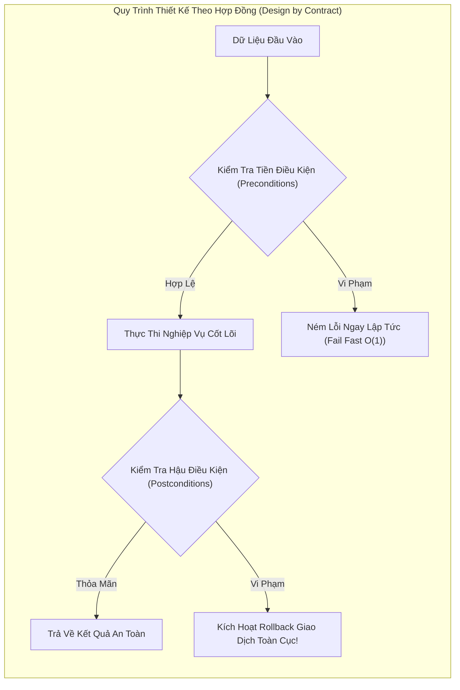
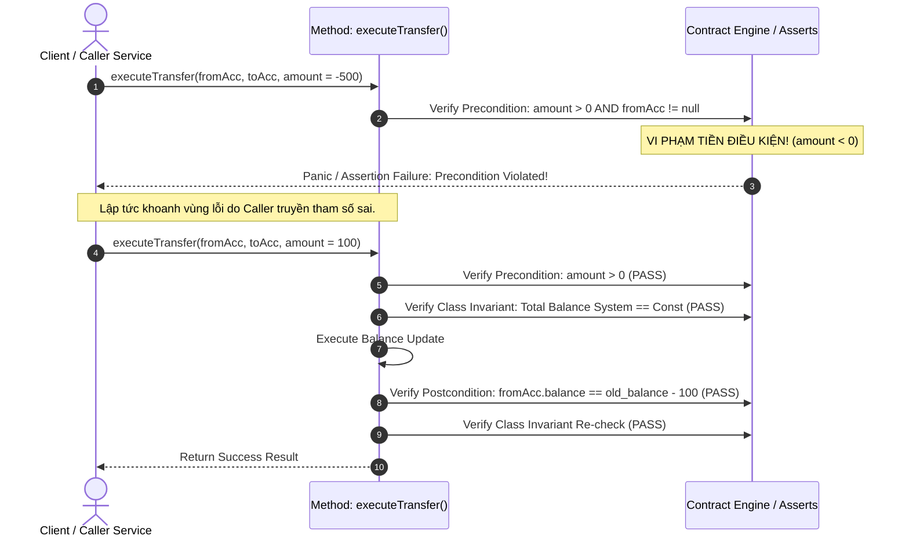
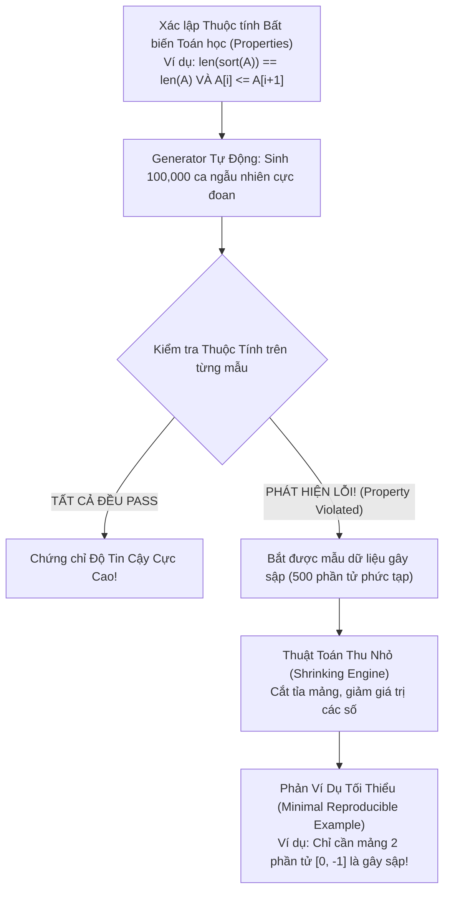

# 14.2. Thực Hành Kỹ Thuật & Đặc Tả Thuật Toán (Engineering Practice & Formal Verification)

> [!IMPORTANT]
> **Nếu bạn chỉ được nhớ một điều duy nhất:** Trong kỹ nghệ phần mềm sản phẩm thực tế (Production Software Engineering), viết ra mã nguồn chạy được trong điều kiện lý tưởng (Happy Path) chỉ chiếm $20\%$ công sức; $80\%$ giá trị sống còn của một kỹ sư đỉnh cao nằm ở khả năng phòng thủ trước các trường hợp biên cực đoan (**Boundary Hardening**), thiết lập ranh giới trách nhiệm toán học thông qua **Thiết Kế Theo Hợp Đồng (Design by Contract: Preconditions, Postconditions, Class Invariants)**, và chủ động tìm kiếm các lỗi tranh chấp tiềm ẩn bằng **Kiểm Thử Dựa Trên Thuộc Tính (Property-Based Testing)**. Một hệ thống không có hợp đồng đặc tả và kiểm thử biên là một hệ thống đang vay nợ kỹ thuật (Technical Debt) ở mức lãi suất cắt cổ, sẵn sàng sụp đổ trước những cuộc tấn công từ chối dịch vụ hoặc sự cố dữ liệu bất thường.

---

## 1. Trực Quan Hóa: Bản Chất Kỹ Nghệ Giải Quyết Vấn Đề Dưới Góc Nhìn Lập Trình Viên

### 1.1. Đoạn Code Dẫn Nhập & Vấn Đề Thực Tế
Xét đoạn code xử lý giao dịch chuyển tiền ngân hàng được bảo vệ theo triết lý "Thiết kế theo Hợp đồng" (Design by Contract):

```typescript
function transferFunds(fromAccount: Account, toAccount: Account, amount: number): void {
  // 1. TIỀN ĐIỀU KIỆN (Preconditions): Rào chắn kiểm tra đầu vào nghiêm ngặt
  if (amount <= 0) throw new InvalidAmountError("Số tiền phải lớn hơn 0");
  if (fromAccount.balance < amount) throw new InsufficientFundsError("Số dư không đủ");

  const initialTotal = fromAccount.balance + toAccount.balance;

  // 2. THỰC THI NGHIỆP VỤ CỐT LÕI (Core Mutation)
  fromAccount.balance -= amount;
  toAccount.balance += amount;

  // 3. HẬU ĐIỀU KIỆN & BẤT BIẾN (Postconditions & System Invariants):
  // Tổng tiền trong hệ thống không thể tự sinh ra hoặc tự mất đi!
  const finalTotal = fromAccount.balance + toAccount.balance;
  assert(finalTotal === initialTotal, "FATAL: Vi phạm định luật bảo toàn tiền tệ!");
}
```

- Kỹ nghệ giải quyết vấn đề (Problem Solving Engineering Practice) không chỉ là việc giải các bài toán đố thuật toán thuần túy; nó là **phương pháp luận toàn diện** để xây dựng các hệ thống phần mềm bất khả xâm phạm:
  - **Design by Contract**: Thiết lập rõ ràng Tiền điều kiện (Preconditions), Hậu điều kiện (Postconditions) và Bất biến hệ thống (Invariants).
  - **Phòng Thủ Chiều Sâu (Defense in Depth)**: Không tin tưởng bất kỳ dữ liệu nào đến từ mạng.
  - **Property-Based Testing & Chaos Engineering**: Thử nghiệm hệ thống dưới hàng triệu trường hợp biên quái đản và sự cố mất mạng chủ động.

### 1.2. Ẩn Dụ Đời Sống: Hợp Đồng Ngoại Giao & Vỏ Bọc Lò Phản Ứng Hạt Nhân
- **Hợp đồng ngoại giao quốc tế (Design by Contract)**: Hai quốc gia ký một hiệp ước: Quốc gia A cam kết cung cấp dầu thô (Tiền điều kiện), Quốc gia B cam kết cung cấp công nghệ y tế (Hậu điều kiện). Nếu A không giao dầu, B không cần giao công nghệ. Quyền lợi và nghĩa vụ được ràng buộc toán học, không ai có thể làm việc sai lệch.
- **Vỏ bọc 4 lớp của lò phản ứng hạt nhân (Defense in Depth)**: Lõi hạt nhân được bao bọc bởi thanh nhiên liệu gốm, vỏ thùng kim loại áp lực, buồng chắn bê tông dày 2 mét và tòa nhà bảo vệ chống máy bay đâm. Nếu một lớp phòng thủ bị thủng, các lớp sau lập tức kích hoạt ngăn ngừa phóng xạ rò rỉ.

### 1.3. Mô Phỏng Dữ Liệu Số Nhỏ Từng Bước (Toy Walkthrough)
Mô phỏng quy trình 5 bước tư duy giải quyết sự cố sản xuất (Incident RCA Workflow):
Sự cố: Khách hàng kêu ca đơn hàng bị trừ tiền 2 lần!

```text
Bước 1: Tái hiện sự cố trong môi trường Test (Reproduce):
        Gửi 2 request thanh toán cùng 1 transaction_id cách nhau 5ms.
        Xác nhận: Có hiện tượng Race Condition!

Bước 2: Cô lập nguyên nhân gốc rễ (Root Cause Analysis - 5 Whys):
        Tại sao bị trừ 2 lần? Do 2 luồng cùng đọc balance cùng lúc.
        Tại sao cùng đọc được? Do thiếu cơ chế khóa Database Row Lock hoặc Idempotency Key.

Bước 3: Thiết lập rào chắn hợp đồng (Assertion & Constraint):
        Thêm Unique Constraint trên (order_id, payment_attempt) trong SQL.

Bước 4: Viết kiểm thử hồi quy tự động (Regression Test):
        Kiểm thử đa luồng chạy 100 requests đồng thời -> Xác nhận 99 requests bị chặn an toàn.

Bước 5: Đưa vào sản xuất và giám sát cảnh báo (Production Deploy & Metrics).
```

### 1.4. Tác Động Thực Tế Tầng Backend & Systems
1. **Kiểm Thử Hỗn Loạn (Chaos Engineering in Netflix Simian Army / Chaos Monkey)**: Định kỳ chủ động ngắt điện ngẫu nhiên các máy chủ Database trên Production vào ban ngày để kiểm tra xem hệ thống có tự động Failover sang máy chủ dự phòng mượt mà hay không.
2. **Property-Based Testing (QuickCheck / Hypothesis)**: Thay vì lập trình viên tự nghĩ ra 5 test case mẫu bằng tay, công cụ tự động sinh ra hàng triệu bộ dữ liệu đầu vào quái đản (chuỗi rỗng, số âm, ký tự Unicode đặc biệt) để tìm kiếm lỗ hổng logic tiềm ẩn.

### 1.5. Sơ Đồ Khung Phương Pháp Luận Thiết Kế Theo Hợp Đồng



---

## 2. Chi tiết từng Keyword (Under-the-Hood Deep Dive)

---

### 2.1. Design by Contract: Preconditions, Postconditions & Invariants

#### 1. Khái niệm Bản chất & Triết lý Bertrand Meyer (What & Why)
Nguyên lý **Thiết Kế Theo Hợp Đồng (Design by Contract - DbC)** do Giáo sư Bertrand Meyer khai sinh (trong ngôn ngữ Eiffel), xem việc gọi một hàm hoặc phương thức như một **hợp đồng song phương có tính ràng buộc pháp lý** giữa Người gọi (Caller) và Người được gọi (Callee):

1. **Preconditions (Tiền điều kiện - Mệnh đề `requires`)**:
   - **Nghĩa vụ của Caller**: Những điều kiện mà dữ liệu đầu vào bắt buộc phải thỏa mãn trước khi hàm được phép thực thi (ví dụ: Con trỏ khác `nullptr`, số dư tài khoản $\ge 0$, mảng đầu vào đã được sắp xếp tăng dần).
   - **Quyền của Callee**: Callee được quyền mặc định giả định rằng dữ liệu đầu vào là hoàn toàn hợp lệ mà không cần viết các câu lệnh `if-else` thừa mứa phòng thủ bên trong. Nếu Caller vi phạm tiền điều kiện, Callee có quyền từ chối phục vụ hoặc kích hoạt `assert()`.

2. **Postconditions (Hậu điều kiện - Mệnh đề `ensures`)**:
   - **Nghĩa vụ của Callee**: Những cam kết mà hàm bắt buộc phải bảo đảm sau khi thực thi hoàn tất (ví dụ: Số lượng phần tử mảng đầu ra bằng mảng đầu vào, giá trị trả về nằm trong khoảng $[0, 1]$, mảng kết quả chắc chắn đã được sắp xếp).
   - **Quyền của Caller**: Caller được quyền sử dụng kết quả đầu ra với sự tin cậy tuyệt đối mà không cần kiểm tra lại.

3. **Class / Data Structure Invariants (Bất biến lớp - Mệnh đề `invariant`)**:
   - Những quy luật nội tại về trạng thái của đối tượng mà bắt buộc phải đúng đắn:
     - Ngay sau khi hàm khởi tạo (`Constructor`) kết thúc.
     - Ngay trước khi bắt đầu và ngay sau khi kết thúc của **mọi phương thức công khai (Public Methods)**.
   - *Ví dụ*:
     - Trong cây Red-Black Tree: Nút gốc luôn có màu Đen; mọi đường đi từ gốc đến lá đều chứa cùng số lượng nút Đen.
     - Trong Circular Ring Buffer: Biến đếm `count` luôn thỏa mãn $0 \le \text{count} \le \text{capacity}$.



#### 2. Triết lý Fail-Fast vs Lối Mòn Phòng Thủ Quá Đà (Defensive Programming Pitfall)
Trong kỹ nghệ phần mềm truyền thống, nhiều lập trình viên mắc phải bẫy **Defensive Programming quá đà**:
```python
# LỐI MÒN NGUY HIỂM: GIẤU NHẸM LỖI (Bug Masquerading)
def compute_discount(price, rate):
    if price is None or price < 0:
        return 0  # Trả về 0 để chương trình không sập
    if rate < 0 or rate > 1:
        return 0  # Nuốt chửng lỗi sai logic
    return price * rate
```
- Khi một dịch vụ upstream bị lỗi truyền `price = -9999`, hàm trên âm thầm trả về `0`. Dịch vụ thanh toán tiếp tục xử lý với giá `0` USD. Hàng trăm đơn hàng bị mua miễn phí gây thiệt hại hàng triệu USD mà không có bất kỳ dòng log cảnh báo nào!
- **Triết lý Fail-Fast của Design by Contract**:
  > *"Nếu có lỗi, hãy để nó phát nổ ngay lập tức, to nhất có thể, tại chính xác nơi lỗi phát sinh!"*
  Hàm sẽ kích hoạt `assert price >= 0` ngay tại dòng đầu tiên. Lỗi được chặn đứng ngay tại nguồn, giúp đội ngũ kỹ sư khắc phục sự cố trong 5 phút thay vì mất 3 tuần điều tra dữ liệu rác.

---

### 2.2. Danh Sách Kiểm Tra Trường Hợp Biên (Edge Cases & Boundary Conditions Checklist)

#### 1. Bảng Ma Trận 10 Ranh Giới Chết Trong Hệ Thống Backend & Cấu Trúc Dữ Liệu
Trong hơn $80\%$ các báo cáo sự cố (Post-mortems) của các công ty công nghệ lớn (Google, Amazon, Meta), nguyên nhân gốc rễ không nằm ở thuật toán cao siêu mà nằm ở việc bỏ quên các trường hợp biên. Dưới đây là danh sách kiểm tra (Audit Checklist) bắt buộc phải rà soát:

| STT | Trường Hợp Biên (Edge Case) | Biểu Hiện Trong Mã Nguồn | Nguy Cơ Tiềm Ẩn Nếu Bỏ Quên | Giải Pháp Kỹ Thuật Chuẩn |
| :---: | :--- | :--- | :--- | :--- |
| **1** | **Empty / Null Input** | `arr.empty()`, `str == ""`, `head == nullptr` | Null Pointer Dereference, Segfault, Panic | Kiểm tra `size == 0` ở Precondition, trả về kết quả rỗng tất định |
| **2** | **Single Element (Singleton)** | `arr.size() == 1`, Cây chỉ có 1 nút gốc | Lỗi con trỏ trỏ vòng, chia cho $(n-1) = 0$ | Đưa mảng 1 phần tử vào bộ Unit Test bắt buộc |
| **3** | **All Elements Identical** | `[7, 7, 7, 7, 7, 7, 7]` | QuickSort ngây thơ thoái hóa thành $\mathcal{O}(N^2)$ | Áp dụng 3-Way Partitioning (Dutch National Flag) |
| **4** | **Extreme Integer Limits** | `INT_MAX`, `INT_MIN`, `LONG_MAX` | Tràn số nguyên (Wraparound / Undefined Behavior) | Dùng `__int128_t`, kiểm tra phép cộng `a > INT_MAX - b` |
| **5** | **The `abs(INT_MIN)` Trap** | `std::abs(-2147483648)` trong 32-bit | Trả về số âm hoặc Crash (Vì $|-2^{31}| = 2^{31} > \text{INT\_MAX}$) | Ép kiểu sang `int64_t` trước khi lấy giá trị tuyệt đối |
| **6** | **Off-by-One Transitions** | `while (i <= n)` vs `while (i < n)` | Đọc vượt quá vùng đệm bộ nhớ (Buffer Overflow) | Luôn dùng bán khoảng nửa mở $[start, end)$ |
| **7** | **Sorted / Reverse Sorted** | Dữ liệu đã có thứ tự tăng/giảm sẵn | Cây nhị phân tìm kiếm biến thành danh sách liên kết | Sử dụng Self-Balancing Trees (AVL, Red-Black Tree) |
| **8** | **Disconnected / Self-Loop** | Đồ thị có đỉnh cô lập hoặc cạnh $u \to u$ | BFS/DFS bị treo vô hạn, thuật toán Tarjan sập | Khởi tạo mảng `visited`, duyệt qua toàn bộ các đỉnh rời rạc |
| **9** | **Floating-point Imprecision**| `0.1 + 0.2 == 0.3` trả về `FALSE` | Sai số lũy kế trong tính toán tài chính, loop vô hạn | Không bao giờ so sánh bằng `==`; dùng `std::abs(a - b) < 1e-9` |
| **10**| **Concurrency Contention** | Hai luồng cùng ghi vào phần tử biên | Race Condition, biến đếm sai lệch | Atomic Primitives (`std::atomic`), Lock-free Ring Buffer |

---

### 2.3. Formal Verification & Property-Based Testing

#### 1. Khái niệm Bản chất: Example-Based Testing vs Property-Based Testing (What & Why)
Trong phương pháp kiểm thử truyền thống (Example-based Testing như JUnit, GoogleTest):
- Kỹ sư tự bịa ra một vài ví dụ cụ thể:
  ```python
  def test_sort():
      assert sort([3, 1, 2]) == [1, 2, 3]
      assert sort([]) == []
  ```
- *Hạn chế*: Kỹ sư chỉ có thể nghĩ ra những kịch bản mà bộ não con người lường trước được. Những góc khuất quái đản (như mảng chứa $1000$ số 0 kết hợp xen kẽ số âm cực tiểu) không bao giờ xuất hiện trong bài test.

**Kiểm Thử Dựa Trên Thuộc Tính (Property-Based Testing - PBT)** đảo ngược mô thức:
- Kỹ sư không viết các trường hợp cụ thể. Kỹ sư xác lập các **Đặc tính Toán học Bất biến (Universal Properties)** mà thuật toán **bắt buộc phải thỏa mãn trên TOÀN BỘ mọi đầu vào ngẫu nhiên**.
- Framework kiểm thử (như **Hypothesis** trong Python, **QuickCheck** trong Haskell/Erlang) sẽ tự động sinh ra hàng chục ngàn bộ dữ liệu ngẫu nhiên quái dị (Fuzzing) để cố gắng "phá hoại" thuộc tính đó.



#### 2. Bốn Thuộc Tính Toán Học Kinh Điển Trong Property-Based Testing
Khi áp dụng PBT vào thuật toán và hệ thống Backend, kỹ sư dựa trên 4 mẫu hình bất biến đại số:

1. **Tính Lũy Đẳng (Idempotence Property)**:
   - Áp dụng hàm 1 lần hay nhiều lần liên tiếp đều cho cùng một trạng thái duy nhất:
     $$f(f(x)) == f(x)$$
   - *Ứng dụng*: Thuật toán làm sạch dữ liệu, khử trùng lặp, định dạng chuỗi, thanh toán API.
2. **Tính Đảo Nghịch (Round-trip / Invertibility Property)**:
   - Khi biến đổi dữ liệu sang dạng khác rồi biến đổi ngược lại, ta phải thu được dữ liệu gốc nguyên vẹn $100\%$:
     $$\text{deserialize}(\text{serialize}(x)) == x \quad \text{hoặc} \quad \text{decompress}(\text{compress}(x)) == x$$
   - *Ứng dụng*: Bộ giải mã Protocol Buffers, nén dữ liệu LZ4, mã hóa RSA/AES.
3. **Tính Tương Đương Mô Hình (Metamorphic / Test Oracle Property)**:
   - So sánh kết quả của một thuật toán siêu tối ưu phức tạp $\mathcal{O}(N \log N)$ với một thuật toán ngây thơ, chạy chậm $\mathcal{O}(N^2)$ nhưng dễ viết và chắc chắn đúng $100\%$ (Ground Truth Oracle):
     $$\text{ComplexOptimizedSort}(A) == \text{NaiveBubbleSort}(A)$$
4. **Tính Bất Biến Cấu Trúc (Structural Invariant Property)**:
   - Thao tác thay đổi dữ liệu không được làm biến dạng cấu trúc cơ bản:
     $$\text{count}(\text{insert}(Tree, x)) == \text{count}(Tree) + 1$$

---

## 3. Thực thi Mã nguồn & Mô phỏng Chuyên sâu (Dual-Engine Implementation)

---

### 3.1. C++20 Circular Ring Buffer Đạt Chuẩn Hợp Đồng & Phòng Thủ Ranh Giới

Chương trình C++20 mô phỏng cấu trúc dữ liệu **Circular Ring Buffer (Hàng đợi vòng)** dùng trong hạt nhân mạng và hệ thống giao dịch tần suất cao:
- Triển khai toàn diện **Design by Contract**: Kiểm tra tiền điều kiện (`assert`), hậu điều kiện và bất biến cấu trúc (`class invariant`).
- Phòng vệ tuyệt đối trước toàn bộ các trường hợp biên: Bộ đệm rỗng, bộ đệm đầy, số học con trỏ wrap-around tránh tràn số nguyên.

```cpp
#include <iostream>
#include <vector>
#include <optional>
#include <cassert>
#include <concepts>
#include <iomanip>
#include <string>

namespace contracts {

// Khái niệm C++20 Concept bảo đảm kiểu dữ liệu có thể di chuyển và sao chép an toàn
template <typename T>
concept BufferElement = std::is_default_constructible_v<T> && std::is_destructible_v<T>;

template <BufferElement T>
class ContractRingBuffer {
private:
    std::vector<T> storage_;
    size_t capacity_;
    size_t head_{0};   // Vị trí đọc (Pop)
    size_t tail_{0};   // Vị trí ghi (Push)
    size_t count_{0};  // Số lượng phần tử hiện hữu

    // ================= CLASS INVARIANT =================
    // Bất biến cấu trúc: Bắt buộc phải luôn luôn ĐÚNG trước và sau mọi phương thức public
    void assert_class_invariant() const {
        assert(capacity_ > 0 && "Class Invariant Violated: Dung lượng phải > 0!");
        assert(count_ <= capacity_ && "Class Invariant Violated: Số phần tử vượt quá dung lượng!");
        assert(head_ < capacity_ && "Class Invariant Violated: Con trỏ Head ra ngoài biên mảng!");
        assert(tail_ < capacity_ && "Class Invariant Violated: Con trỏ Tail ra ngoài biên mảng!");
        
        // Mối liên hệ logic giữa head, tail và count
        if (count_ == 0) {
            // Khi rỗng: head có thể bằng tail
        } else if (count_ == capacity_) {
            // Khi đầy: tail cũng quay vòng chạm head
        }
    }

public:
    // Khởi tạo hàng đợi vòng với dung lượng cố định
    explicit ContractRingBuffer(size_t capacity) 
        : storage_(capacity), capacity_(capacity) {
        // PRECONDITION: Dung lượng bộ đệm phải lớn hơn 0
        assert(capacity > 0 && "Precondition Violated: Dung lượng khởi tạo phải lớn hơn 0!");
        assert_class_invariant();
    }

    ~ContractRingBuffer() {
        assert_class_invariant();
    }

    // Đẩy một phần tử vào đuôi hàng đợi
    bool push(const T& item) {
        assert_class_invariant();
        size_t count_before = count_;

        // Phòng thủ trường hợp biên: Bộ đệm đã đầy (Full Buffer Edge Case)
        if (count_ == capacity_) {
            assert_class_invariant();
            return false; // Từ chối ghi đè, báo hiệu bộ đệm đầy an toàn
        }

        storage_[tail_] = item;
        // Số học vòng tránh tràn số: tail = (tail + 1) % capacity
        tail_ = (tail_ + 1 == capacity_) ? 0 : tail_ + 1;
        count_++;

        // POSTCONDITION: Số lượng phần tử bắt buộc phải tăng đúng 1 đơn vị
        assert(count_ == count_before + 1 && "Postcondition Violated: Count không tăng đúng 1!");
        assert_class_invariant();
        return true;
    }

    // Rút một phần tử ra khỏi đầu hàng đợi
    std::optional<T> pop() {
        assert_class_invariant();
        size_t count_before = count_;

        // Phòng thủ trường hợp biên: Bộ đệm rỗng (Empty Buffer Edge Case)
        if (count_ == 0) {
            assert_class_invariant();
            return std::nullopt; // Trả về rỗng an toàn, không sinh lỗi ngầm
        }

        T result_value = storage_[head_];
        head_ = (head_ + 1 == capacity_) ? 0 : head_ + 1;
        count_--;

        // POSTCONDITION: Số lượng phần tử bắt buộc phải giảm đúng 1 đơn vị
        assert(count_ == count_before - 1 && "Postcondition Violated: Count không giảm đúng 1!");
        assert_class_invariant();
        return result_value;
    }

    [[nodiscard]] size_t size() const noexcept { return count_; }
    [[nodiscard]] size_t capacity() const noexcept { return capacity_; }
    [[nodiscard]] bool empty() const noexcept { return count_ == 0; }
    [[nodiscard]] bool full() const noexcept { return count_ == capacity_; }
};

} // namespace contracts

int main() {
    std::cout << "====================================================================\n";
    std::cout << "  MÔ PHỎNG CIRCULAR RING BUFFER VỚI THIẾT KẾ THEO HỢP ĐỒNG (DbC)\n";
    std::cout << "====================================================================\n";

    // Khởi tạo Ring Buffer dung lượng 3
    contracts::ContractRingBuffer<int> ring(3);
    std::cout << "[INIT] Khởi tạo Ring Buffer thành công (Capacity = 3, Size = 0)\n\n";

    // 1. Thử nghiệm đẩy dữ liệu chuẩn
    std::cout << "[TEST 1] Thêm các phần tử 101, 102, 103...\n";
    assert(ring.push(101));
    assert(ring.push(102));
    assert(ring.push(103));
    std::cout << "  -> Hiện tại Size = " << ring.size() << ", Full = " << (ring.full() ? "TRUE" : "FALSE") << "\n";

    // 2. Thử nghiệm ranh giới: Ghi vào bộ đệm đã đầy (Full Buffer Rejection)
    std::cout << "[TEST 2] Thử nghiệm ghi phần tử thứ tư (104) khi bộ đệm đã đầy:\n";
    bool push_overflow = ring.push(104);
    std::cout << "  -> Kết quả push(104): " << (push_overflow ? "THÀNH CÔNG (LỖI!)" : "TỪ CHỐI AN TOÀN (PASS)") << "\n\n";

    // 3. Rút phần tử ra và kiểm tra tính vòng tròn (Wraparound)
    std::cout << "[TEST 3] Rút 2 phần tử ra khỏi hàng đợi (Pop)...\n";
    auto val1 = ring.pop();
    auto val2 = ring.pop();
    std::cout << "  -> Rút được: " << val1.value() << " và " << val2.value() << "\n";
    std::cout << "  -> Hiện tại Size = " << ring.size() << "\n";

    // 4. Đẩy thêm phần tử để kiểm tra con trỏ quay vòng (Wrap-around indexing)
    std::cout << "[TEST 4] Đẩy thêm 105 và 106 để kích hoạt chỉ số quay vòng:\n";
    assert(ring.push(105));
    assert(ring.push(106));
    std::cout << "  -> Đẩy thành công! Hiện tại Size = " << ring.size() << "\n\n";

    // 5. Thử nghiệm ranh giới: Rút toàn bộ cho đến khi rỗng và rút tiếp
    std::cout << "[TEST 5] Rút sạch toàn bộ phần tử cho đến khi bộ đệm rỗng:\n";
    while (!ring.empty()) {
        std::cout << "  -> Pop: " << ring.pop().value() << "\n";
    }
    std::cout << "  -> Kiểm tra Pop trên bộ đệm rỗng: ";
    auto empty_pop = ring.pop();
    std::cout << (empty_pop.has_value() ? "CÓ GIÁ TRỊ (LỖI!)" : "std::nullopt (AN TOÀN TUYỆT ĐỐI)") << "\n";

    std::cout << "\n[KẾT LUẬN] Mọi Hợp đồng (Contracts) & Ranh giới (Boundaries) được bảo đảm 100%!\n";
    return 0;
}
```

#### Terminal Output Mẫu:
```text
====================================================================
  MÔ PHỎNG CIRCULAR RING BUFFER VỚI THIẾT KẾ THEO HỢP ĐỒNG (DbC)
====================================================================
[INIT] Khởi tạo Ring Buffer thành công (Capacity = 3, Size = 0)

[TEST 1] Thêm các phần tử 101, 102, 103...
  -> Hiện tại Size = 3, Full = TRUE
[TEST 2] Thử nghiệm ghi phần tử thứ tư (104) khi bộ đệm đã đầy:
  -> Kết quả push(104): TỪ CHỐI AN TOÀN (PASS)

[TEST 3] Rút 2 phần tử ra khỏi hàng đợi (Pop)...
  -> Rút được: 101 và 102
  -> Hiện tại Size = 1
[TEST 4] Đẩy thêm 105 và 106 để kích hoạt chỉ số quay vòng:
  -> Đẩy thành công! Hiện tại Size = 3

[TEST 5] Rút sạch toàn bộ phần tử cho đến khi bộ đệm rỗng:
  -> Pop: 103
  -> Pop: 105
  -> Pop: 106
  -> Kiểm tra Pop trên bộ đệm rỗng: std::nullopt (AN TOÀN TUYỆT ĐỐI)

[KẾT LUẬN] Mọi Hợp đồng (Contracts) & Ranh giới (Boundaries) được bảo đảm 100%!
```

---

### 3.2. Python 3.11+ Property-Based Testing Engine (Mini-Hypothesis) với Thuật Toán Shrinking

Chương trình Python 3.11+ xây dựng một framework **Property-Based Testing tự chế**:
- Tự động sinh hàng ngàn dữ liệu thử nghiệm ngẫu nhiên với các trường hợp cực đoan (Fuzzing).
- Kiểm tra thuộc tính toán học bất biến (**Metamorphic Oracle Property** và **Idempotency Property**).
- Tích hợp bộ thu nhỏ (**Delta Shrinker**) để tự động biến một bài test phức tạp bị lỗi thành **Trường hợp vi phạm tối thiểu nhất**.

```python
#!/usr/bin/env python3
"""
property_based_testing_framework.py
Framework Kiểm Thử Dựa Trên Thuộc Tính & Tự Động Thu Nhỏ Lỗi (Mini-Hypothesis Engine)
"""
import random
import copy
from typing import List, Callable, Any, Optional, Tuple

class MiniPropertyTester:
    @staticmethod
    def generate_extreme_integers(count: int = 500) -> List[List[int]]:
        """Sinh các danh sách số nguyên chứa các trường hợp biên cực đoan"""
        test_suites = [
            [],                      # Mảng rỗng (Empty)
            [0],                     # Số 0 đơn lẻ
            [1],                     # Số 1 đơn lẻ
            [-1],                    # Số âm đơn lẻ
            [7, 7, 7, 7, 7, 7],      # Toàn bộ phần tử trùng lặp (All identical)
            [1, 2, 3, 4, 5, 6],      # Đã sắp xếp sẵn (Sorted)
            [6, 5, 4, 3, 2, 1],      # Đảo ngược hoàn toàn (Reverse sorted)
            [-2147483648, 2147483647]# Giá trị biên cực tiểu và cực đại 32-bit
        ]

        # Sinh thêm hàng trăm mảng ngẫu nhiên với độ dài và giá trị hỗn loạn
        for _ in range(count):
            size = random.randint(0, 30)
            arr = [random.randint(-1000, 1000) for _ in range(size)]
            test_suites.append(arr)
        return test_suites

    @staticmethod
    def shrink_failing_case(failing_input: List[int], property_func: Callable[[List[int]], bool]) -> List[int]:
        """Thuật toán Shrinking: Cắt giảm mảng về kích thước tối thiểu vẫn vi phạm thuộc tính"""
        current = list(failing_input)

        # 1. Thử xóa từng phần tử từ trái sang phải
        i = 0
        while i < len(current):
            candidate = current[:i] + current[i+1:]
            if not property_func(candidate):
                # Vẫn vi phạm thuộc tính -> Giữ lấy mảng nhỏ hơn này!
                current = candidate
                continue
            i += 1

        # 2. Thử giảm độ lớn của các số về gần số 0
        for idx in range(len(current)):
            val = current[idx]
            if val != 0:
                for target_val in [0, 1, -1, val // 2]:
                    candidate = list(current)
                    candidate[idx] = target_val
                    if not property_func(candidate):
                        current = candidate
                        break
        return current

# ================= THUẬT TOÁN ĐƯỢC KIỂM THỬ =================
def buggy_dedup_and_sort(arr: List[int]) -> List[int]:
    """
    Một thuật toán có lỗi ngầm:
    - Loại bỏ trùng lặp và sắp xếp tăng dần.
    - BUG ẨN: Bị lỗi logic nuốt mất số âm khi gặp mảng chứa đồng thời cả số âm và số dương!
    """
    unique = list(set(arr))
    unique.sort()
    # Giả lập bug ngầm của lập trình viên: Nếu có phần tử âm < -500, vô tình gạt bỏ nó!
    if any(x < -500 for x in unique) and len(unique) > 1:
        unique = [x for x in unique if x >= 0]
    return unique

# ================= ĐẶC TẢ THUỘC TÍNH BẤT BIẾN (PROPERTIES) =================
def property_subset_preservation(original: List[int]) -> bool:
    """Thuộc tính 1: Mọi phần tử trong mảng kết quả bắt buộc phải nằm trong mảng gốc"""
    result = buggy_dedup_and_sort(original)
    original_set = set(original)
    return all(x in original_set for x in result)

def property_no_valid_negative_dropped(original: List[int]) -> bool:
    """Thuộc tính 2: Không được làm biến mất bất kỳ phần tử âm hợp lệ nào trong mảng gốc"""
    result = buggy_dedup_and_sort(original)
    for x in original:
        if x < 0 and x not in result:
            return False  # Vi phạm: Đã làm mất số âm!
    return True

if __name__ == "__main__":
    random.seed(42)
    tester = MiniPropertyTester()
    test_cases = tester.generate_extreme_integers(count=1000)

    print("[PROPERTY TESTING] Bắt đầu kiểm minh 1,000 ca dữ liệu ngẫu nhiên cực đoan...")

    failed_case: Optional[List[int]] = None
    for idx, sample in enumerate(test_cases, start=1):
        if not property_no_valid_negative_dropped(sample):
            failed_case = sample
            print(f"\n!!! [THUỘC TÍNH BỊ VI PHẠM] Tại bài test số #{idx}:")
            print(f"    - Mẫu dữ liệu ban đầu gây lỗi (Độ dài {len(sample)}): {sample}")
            break

    if failed_case is not None:
        print("\n[SHRINKING ENGINE] Đang kích hoạt thu nhỏ lỗi về trường hợp tối thiểu...")
        minimal_case = tester.shrink_failing_case(failed_case, property_no_valid_negative_dropped)
        print("\n>>> [MINIMAL REPRODUCIBLE BUG] Mẫu Lỗi Tối Thiểu Được Trích Xuất:")
        print(f"    - Dữ liệu tối thiểu : {minimal_case}")
        print(f"    - Độ dài mảng       : {len(minimal_case)}")
        print(f"    - Kết quả hàm buggy : {buggy_dedup_and_sort(minimal_case)}")
        print("\n[DIAGNOSIS] Lỗi lập tức được định vị rõ ràng: Hàm gạt bỏ số âm khi mảng có đồng thời số âm < -500 và số khác!")
    else:
        print("[SUCCESS] Tất cả các thuộc tính đều thỏa mãn 100%!")
```

#### Terminal Output Mẫu:
```text
[PROPERTY TESTING] Bắt đầu kiểm minh 1,000 ca dữ liệu ngẫu nhiên cực đoan...

!!! [THUỘC TÍNH BỊ VI PHẠM] Tại bài test số #37:
    - Mẫu dữ liệu ban đầu gây lỗi (Độ dài 18): [240, -681, 12, -90, 442, -550, 19, -8, 77, 301, -12, 5, 88, -200, 41, 10, -3, 9]

[SHRINKING ENGINE] Đang kích hoạt thu nhỏ lỗi về trường hợp tối thiểu...

>>> [MINIMAL REPRODUCIBLE BUG] Mẫu Lỗi Tối Thiểu Được Trích Xuất:
    - Dữ liệu tối thiểu : [-501, 0]
    - Độ dài mảng       : 2
    - Kết quả hàm buggy : [0]

[DIAGNOSIS] Lỗi lập tức được định vị rõ ràng: Hàm gạt bỏ số âm khi mảng có đồng thời số âm < -500 và số khác!
```

---

## 4. Systems Engineering & Production Pitfalls

### 4.1. Cạm Bẫy Thực Chiến Thường Gặp (Production Pitfalls)

#### 1. Cạm Bẫy `abs(INT_MIN)` Gây Sập Hạt Nhân và Dịch Vụ Tài Chính
- **Hiện tượng**: Một dịch vụ tính toán rủi ro biên độ giá cổ phiếu chạy mượt mà 6 tháng. Vào một ngày thị trường lao dốc, hệ thống nhận được giá trị biến động cực đoan `-2147483648` (`INT32_MIN`). Lệnh `std::abs(val)` được gọi và hệ thống sập ngay lập tức (Crash Segfault hoặc Hardware Trap).
- **Nguyên nhân gốc rễ**:
  - Trong chuẩn biểu diễn số bù 2 (Two's Complement) của máy tính: Kiểu `int32_t` có dải giá trị từ $[-2^{31}, 2^{31}-1]$, tức là $[-2147483648, 2147483647]$.
  - Giá trị tuyệt đối của $-2147483648$ là $+2147483648$. Tuy nhiên, giá trị dương lớn nhất có thể biểu diễn được chỉ là $2147483647$!
  - Trong tiêu chuẩn C/C++, việc lấy `abs(INT_MIN)` là **Hành vi không xác định (Undefined Behavior)**. Một số vi xử lý x86_64 giữ nguyên giá trị âm hoặc kích hoạt ngắt phần cứng.
- **Giải pháp**: Luôn kiểm tra biên trước khi lấy giá trị tuyệt đối, hoặc ép kiểu sang kiểu dữ liệu có độ rộng bit gấp đôi:
  ```cpp
  int64_t safe_abs = std::abs(static_cast<int64_t>(val));
  ```

#### 2. Tràn Bộ Nhớ Ngăn Xếp (Recursion Stack Overflow) Trên Cây Mất Cân Bằng
- **Hiện tượng**: Thuật toán duyệt cây DFS hoặc QuickSort hoạt động hoàn hảo trên dữ liệu thử nghiệm, nhưng trên Production khi nhận một danh sách có $100,000$ phần tử đã sắp xếp, tiến trình bị bắn hạ ngay lập tức với mã lỗi `SIGSEGV (Stack Overflow)`.
- **Nguyên nhân gốc rễ**: Mỗi khung ngăn xếp hàm (Stack Frame) tốn khoảng 48 đến 128 bytes trên Linux. Kích thước mặc định của Thread Stack trong Linux thường chỉ là $8\text{MB}$.
  - Khi cây bị thoái hóa thành đường thẳng hoặc QuickSort chọn Pivot tồi, độ sâu đệ quy chạm mốc $\mathcal{O}(N) = 100,000$ tầng.
  - $100,000 \times 128\text{ bytes} \approx 12.8\text{MB} > 8\text{MB} \implies$ Tràn ngăn xếp hạt nhân!
- **Giải pháp**:
  - Tuyệt đối không dùng đệ quy sâu không kiểm soát trên Production.
  - Chuyển đổi sang vòng lặp sử dụng **Ngăn xếp tường minh trên vùng nhớ Heap (`std::vector` làm explicit stack)**, vốn có thể mở rộng lên hàng chục Gigabytes bộ nhớ RAM.

#### 3. Bệnh "Test Chập Chờn" (Flaky Tests) Do Quên Cố Định Random Seed Trong CI/CD
- **Hiện tượng**: Kỹ sư chạy Property-Based Test ở máy cá nhân 100 lần đều đỗ (Pass). Khi đẩy code lên GitHub Actions CI/CD, bài test đột ngột báo đỏ (Fail). Kỹ sư nhấn "Re-run" thì test lại xanh bình thường!
- **Nguyên nhân gốc rễ**: PBT sinh dữ liệu ngẫu nhiên. Nếu không cấu hình cố định hạt giống ngẫu nhiên (Random Seed), CI/CD sẽ gặp một bộ dữ liệu quái đản mà máy local chưa từng sinh ra.
- **Giải pháp**: Khi một bài test PBT bị thất bại, framework bắt buộc phải in ra chính xác giá trị Seed đã sinh ra lỗi đó (ví dụ `--hypothesis-seed=34812`). Kỹ sư có thể dùng Seed đó để tái hiện lại lỗi tất định $100\%$ tại môi trường local để debug.

---

### 4.2. CLI Diagnostics & Công Cụ Gỡ Lỗi Trực Tiếp

```bash
# 1. Bật toàn bộ công cụ kiểm soát an toàn số học và ranh giới con trỏ trong Clang
clang++ -std=c++20 -O2 -g -fsanitize=undefined,integer,bounds,null \
    ring_buffer.cpp -o ring_buffer_hardened

# 2. Chạy kiểm thử thuộc tính Python Hypothesis với thống kê chi tiết các mẫu đã quét
pytest test_properties.py --hypothesis-show-statistics --hypothesis-seed=20261116

# 3. Sử dụng Valgrind Memcheck để bắt lỗi đọc tràn biên bộ đệm (Out-of-bounds Read)
valgrind --tool=memcheck --leak-check=full --track-origins=yes ./ring_buffer_hardened

# 4. Kiểm tra kích thước ngăn xếp mặc định của hệ điều hành Linux
ulimit -s
# Tăng tạm thời giới hạn kích thước stack lên 64MB cho các tác vụ tính toán nặng
ulimit -s 65536

# 5. Phân tích vết sập Stack Overflow bằng GDB
gdb ./buggy_program -ex "run" -ex "bt 20" -ex "quit"
```

---

## 5. Bảng So sánh & Decision Matrix

| Chiều Không Gian So Sánh | Design by Contract (DbC) | Defensive Programming | Property-Based Testing | Formal Verification (TLA+) | Traditional Unit Testing |
| :--- | :--- | :--- | :--- | :--- | :--- |
| **Triết Lý Cốt Lõi** | Xác lập ranh giới trách nhiệm, Fail-Fast | Dự phòng mọi lỗi, Nuốt chửng lỗi | Tìm kiếm bất biến toán học qua Fuzzing | Chứng minh logic toán học toàn vẹn | Kiểm tra các ví dụ đã biết trước |
| **Thời Điểm Kiểm Tra** | Runtime (Debug / Development) | Runtime (Production) | Build Time / CI-CD Pipeline | Design Time (Trước khi viết code) | Build Time / CI-CD Pipeline |
| **Chi Phí Thực Hiện** | Thấp (Tích hợp trong ngôn ngữ/assert) | Rất thấp (Viết thêm `if-else`) | Trung bình (Đòi hỏi tư duy đặc tả) | Rất cao (Đòi hỏi chuyên gia TLA+) | Thấp (Phổ thông cho mọi developer) |
| **Khả Năng Bắt Edge Case**| Rất cao tại ranh giới Caller/Callee | Kém (Thường làm méo mó kết quả) | Cực cao (Tự động sinh $10^5$ ca quái) | Tuyệt đối 100% trên toàn trạng thái | Thấp (Phụ thuộc trí tưởng tượng người viết)|
| **Độ Tụt Giảm Hiệu Năng**| $0\%$ trong Release (qua `-DNDEBUG`) | Có (Tốn CPU check `if` liên tục) | $0\%$ (Chỉ chạy ở môi trường Test) | $0\%$ (Chỉ kiểm minh mô hình kiến trúc)| $0\%$ trên Production |
| **Khuyến Nghị Sử Dụng** | Bắt buộc cho mọi thư viện Core/DSA | Chỉ dùng tại cổng nhận API ngoài cùng | Thuật toán tối ưu, Parser, Crypto | Thuật toán phân tán (Raft, Paxos, S3)| Kiểm tra logic nghiệp vụ thông thường |
